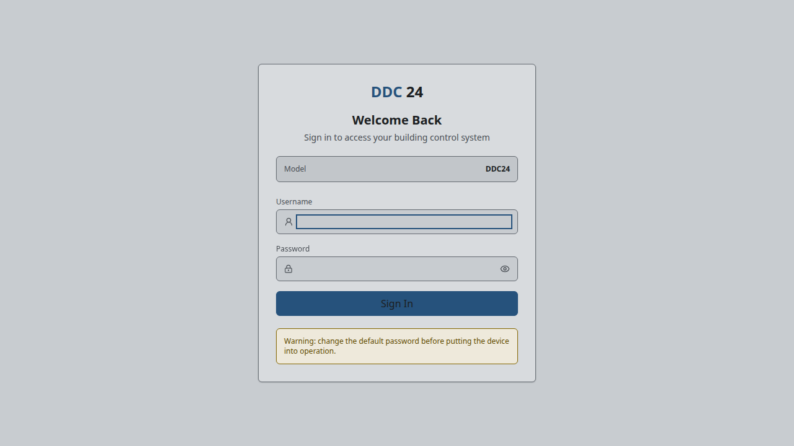
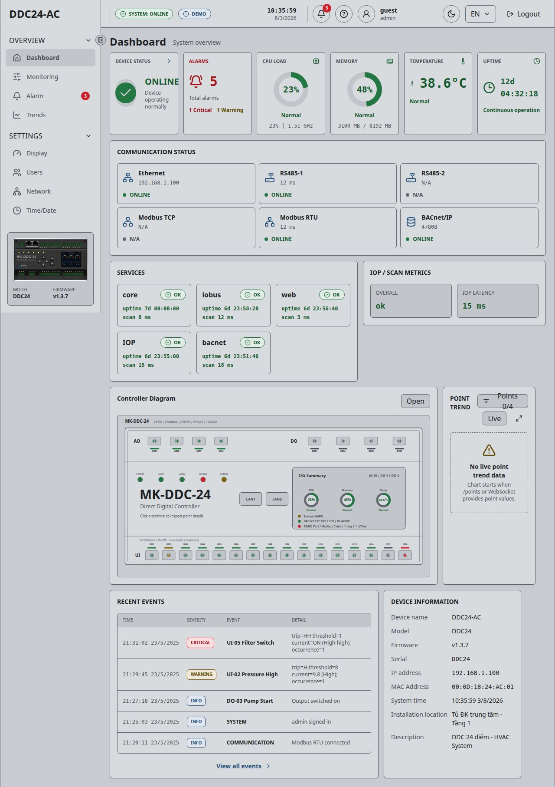
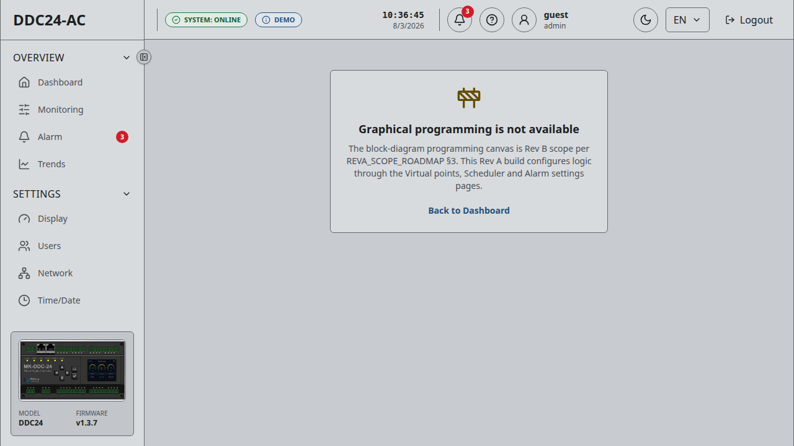
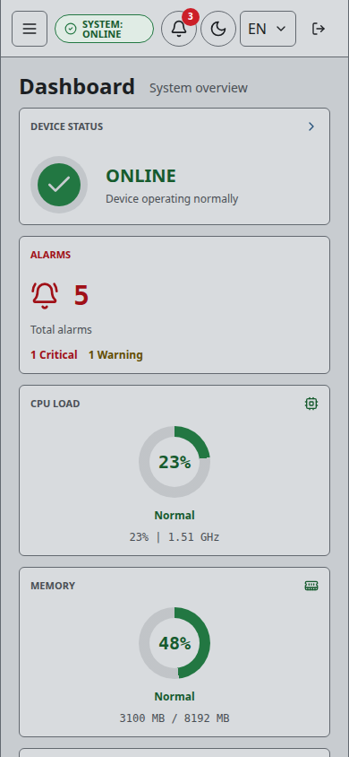

# Audit hiện trạng FE, BE và FW-SOM DDC-24

**Mã tài liệu:** DDC24-AS-BUILT-AUDIT-001<br>
**Ngày audit:** 2026-08-03, múi giờ Asia/Ho_Chi_Minh<br>
**Repository:** `Mekong-HCM/MK-DDC-24`<br>
**Nhánh/commit:** `main` / `5eeb7b9bf95e0c7d7933766ae3bf62e7c6fdb90f`<br>
**Target quan sát:** Orange Pi 5B `orangepi5b`, Linux `6.1.43-rockchip-rk3588`, `aarch64`<br>
**Mục đích:** ghi nhận hiện trạng trước khi lập kế hoạch tính năng Programming. Tài liệu này không phải thiết kế, kế hoạch triển khai hoặc phê duyệt release.

## Phạm vi, quy tắc và giới hạn bằng chứng

Báo cáo đối chiếu đồng thời tài liệu kiểm soát, source, deployment, target SOM, API/DB, log, test trực tiếp, Git history, GitHub issue và CI. Trạng thái dùng đúng tập giá trị: `NOT_STARTED`, `DOC_ONLY`, `MOCK_ONLY`, `PARTIAL`, `IMPLEMENTED`, `VERIFIED`, `PRODUCTION_READY`, `BLOCKED`.

Các giới hạn cần đọc cùng kết luận:

- Target đang dùng `mkddc-fakemcu` và cặp PTY, không nối STM32/physical I/O. Vì vậy mọi bằng chứng output hiện tại chỉ chứng minh đường mô phỏng, không phải HIL hay an toàn phần cứng.
- Không có tài khoản audit dạng mật khẩu rõ để đăng nhập live mà không thay đổi target. Audit không tạo/reset tài khoản, không ghi output, không thay đổi mạng và không reboot board. API live chỉ được kiểm tra xác thực thất bại `401`; browser live được chụp tới màn hình login. Các màn hình sau login được chụp từ build FE hiện tại ở chế độ `DEMO` và được ghi rõ là mô phỏng.
- HMI được cài nhưng inactive, không có panel/touch/button nối để kiểm chứng.
- Không thực hiện power-cut, reboot, network mutation hoặc hardware fault injection trong phiên audit này. Bằng chứng cũ được dùng để nhận diện gap, không dùng thay cho test mới.
- Binary trên target chỉ truy được hash và thời điểm cài, chưa có manifest ánh xạ tới Git commit. Do đó không khẳng định binary target trùng tuyệt đối với HEAD dù thời điểm deploy gần commit hiện tại.

### Lệnh kiểm chứng chính chạy trong phiên

```text
git rev-parse HEAD; git status --short --branch
cmake -S services -B build/audit-fw -DCMAKE_BUILD_TYPE=Release \
  -DMKDDC_ENABLE_MODBUS=ON -DMKDDC_ENABLE_BACNET=ON -DMKDDC_ENABLE_HMI=ON
cmake --build build/audit-fw -j2
ctest --test-dir build/audit-fw --output-on-failure
cd web/backend && go vet ./... && go test ./... -count=1
cd src/frontend && npx vitest --run --environment jsdom src && npm run lint && npm run build
cd src/frontend && npx playwright test e2e/network-qa.spec.ts
cd src/frontend && npx playwright test e2e/point-names.spec.ts
cd fw && make clean && make
ssh SOM-DDC-24 'systemctl list-units --type=service --all "mkddc*"; ...'
ssh SOM-DDC-24 'journalctl -u mkddc-core ...; journalctl -u mkddc-iobus ...'
ssh SOM-DDC-24 'sudo python3 ... sqlite3 mode=ro ...'
gh issue list --state open; gh run list; gh run view 30692074419 --log-failed
```

## 1. Executive Summary

| Phạm vi | Trạng thái tổng thể | Kết luận ngắn | Bằng chứng chính |
|---|---|---|---|
| FE | `PARTIAL` | Shell, RBAC route, monitor, alarm, trend, network, config, commissioning và responsive UI đã có; unit/lint/build xanh. Một số màn hình vẫn mock/local-only; Programming production bị khóa; E2E hiện đỏ do locator đăng nhập mơ hồ. | `src/frontend/src/App.tsx`, `src/frontend/src/api/client.ts`, `296/296` Vitest, ảnh §1.1, Playwright `1/1` và `18/18` fail cùng root cause. |
| BE | `PARTIAL` | Go API đang chạy trên SOM, có JWT/RBAC, point/config/alarm/trend/network/users và WebSocket. Không có API/storage/lifecycle Programming; health, audit durability, config transaction/versioning và full-device backup/restore chưa đủ production. | `web/backend/http.go`, `web/backend/auth.go`, `web/backend/audit.go`, process PID `284692`, DB runtime §6.4, Go test xanh. |
| FW-SOM | `PARTIAL` | `core`, `iobus`, `netcfg` chạy ổn định trên board với watchdog cho core/iobus. Point table, priority và safe-state có source/test. ST/typed IR/scheduler có thư viện và test nhưng production `main.cpp` không cấp `StScheduler`. STM32 firmware thực vẫn là placeholder; target dùng fake MCU. | `services/core/main.cpp:265`, `services/core/graph/scan_loop.cpp`, `services/core/st/`, `fw/Core/Src/main.c`, systemd/log target §6. |
| Tích hợp end-to-end | `PARTIAL` | Đã xác minh `FE/REST → Go → core.sock/SHM → core → iobus → IOP → fake MCU`; chưa có `Physical I/O/STM32 → ...` và chưa có Programming project/build/activate/rollback end-to-end. | Log `output.set_do ... ack=ok` và `fake_mcu: SET_DO`; units `mkddc-pty`/`mkddc-fakemcu` active; API matrix §5. |
| Nền Programming | `BLOCKED` | Có nhiều primitive tốt ở host nhưng baseline chưa đủ nhất quán và chưa được chứng minh trên production path để làm nền chính thức cho Planning Programming. | §8–§10; governance C0 chưa Go, CI đỏ, production wiring/API/MCU/HIL/provenance còn thiếu. |

**Kết luận điều hành:** hệ thống hiện là một **lab controller vận hành được bằng fake MCU**, không phải baseline production có physical I/O. Monitoring/configuration hiện hữu đáng kể, nhưng Program Runtime mới ở mức source/test host, không phải tính năng đã nối vào sản phẩm.

### 1.1 Bằng chứng UI/UX chụp trong phiên

**Bước 1 — Login live trên SOM — sức khỏe: dùng được nhưng chỉ kiểm được trước xác thực.** Form có label, focus và cảnh báo đổi mật khẩu. Cảnh báo được render cố định nên không chứng minh mật khẩu mặc định còn tồn tại; ngôn ngữ mặc định là tiếng Anh và chưa có lựa chọn ngôn ngữ trên màn login.



**Bước 2 — Dashboard FE hiện tại ở chế độ DEMO — sức khỏe: giàu thông tin, có nhãn DEMO và empty-state, nhưng dữ liệu mô phỏng tự mâu thuẫn.** Badge điều hướng báo 3 alarm trong khi card tổng báo 5; điều này làm giảm độ tin cậy dù đã ghi rõ DEMO. Empty-state trend diễn đạt rõ nguyên nhân. Sidebar desktop có nhiều nhóm nhưng phần Engineering nằm dưới vùng cuộn, dấu hiệu cuộn chưa nổi bật.



**Bước 3 — Programming — sức khỏe: trung thực về trạng thái chưa khả dụng.** Route không giả vờ deploy; trang nói rõ đây chưa phải tính năng hiện hành. Tuy nhiên mục Programming không xuất hiện trong menu, nên trạng thái này chỉ thấy khi vào deep link; refresh/deep link yêu cầu đăng nhập lại vì session chỉ nằm trong React memory.



**Bước 4 — Dashboard mobile 390×844 — sức khỏe: responsive tốt ở phần đầu.** Card reflow một cột và hamburger hiện đúng. Nút icon logout ngoài cùng bên phải không có accessible name trong DOM snapshot; đây là rủi ro cho screen reader. Ảnh chỉ chứng minh viewport đầu, không chứng minh toàn bộ keyboard/focus/WCAG.



Giới hạn accessibility: ảnh và DOM snapshot xác nhận được reflow, label và accessible name quan sát được; không đủ để tuyên bố tuân thủ WCAG toàn hệ thống. Bộ test contrast có trong source và đang pass, nhưng chưa thay thế screen-reader, keyboard, zoom và panel thật.

## 2. System As-Built Architecture

### 2.1 Kiến trúc chạy thật trên target

```text
                    TARGET HIỆN TẠI: LAB / NO-MCU

┌───────────────────────────────────────────────────────────────────────────┐
│ React FE production (same-origin, JWT)                                   │
│  REST /api/v1/*  +  WebSocket /api/v1/ws/monitor                        │
└──────────────────────────────┬────────────────────────────────────────────┘
                               │ HTTP :8081, không TLS trong process
┌──────────────────────────────▼────────────────────────────────────────────┐
│ mkddc-web (Go) — owner REST/RBAC/users/config/historian/alarm history    │
│  UDS request/response: /run/mkddc/core.sock                              │
│  mmap read: /dev/shm/mkddc_plc_shm                                      │
└──────────────┬───────────────────────┬────────────────────────────────────┘
               │                       │ UDS strict authority
               │                       ▼
               │              mkddc-netcfg (root, CAP_NET_ADMIN/RAW)
               │              /run/mkddc-netcfg/netcfg.sock
┌──────────────▼────────────────────────────────────────────────────────────┐
│ mkddc-core — owner point table, graph, alarm, schedule, priority, safety │
│  đọc /dev/shm/mkddc_io_shm; ghi AO/DO command trong cùng SHM             │
│  ghi /dev/shm/mkddc_plc_shm cho BE/BACnet diagnostics                    │
│  ST code tồn tại nhưng StScheduler = nullptr trong production main       │
└──────────────┬────────────────────────────────────────────────────────────┘
               │ shared memory ABI + seqlock/atomic fields
┌──────────────▼────────────────────────────────────────────────────────────┐
│ mkddc-iobus — owner UART/IOP, raw/scaled I/O, fieldbus và IO SHM         │
│  production intent: UART 921600 tới STM32                                │
│  deployment hiện tại: /tmp/mkddc-iop-a                                  │
└──────────────┬────────────────────────────────────────────────────────────┘
               │ PTY do socat tạo, Kinexus-IOP v2
┌──────────────▼────────────────────────────────────────────────────────────┐
│ mkddc-fakemcu — mô phỏng GET_IO/SET_AO/SET_DO/ACK                        │
└───────────────────────────────────────────────────────────────────────────┘

Physical I/O / STM32 firmware / ADC / DAC / relay / 200 ms safe timeout:
CHƯA NẰM TRONG ĐƯỜNG CHẠY HIỆN TẠI.
```

### 2.2 Chủ sở hữu dữ liệu và luồng thực tế

| Luồng | Chủ sở hữu | Đường dữ liệu thực tế | Hiện trạng |
|---|---|---|---|
| Input | Fake MCU trong lab; mục tiêu là STM32 | IOP `IO_RESP` → iobus → `mkddc_io_shm` → core point table → `mkddc_plc_shm`/core UDS → Go → REST/WS → FE | `PARTIAL` — đã xác minh với fake MCU, chưa có physical producer. |
| Output | Core là authority điều khiển; iobus chỉ transport | FE/HMI/BACnet/schedule/graph → core `PriorityResolver` → `SafeState` → `ao_setpoint/do_cmd` → iobus `SET_AO/SET_DO` → fake MCU ACK | `PARTIAL` — đã xác minh với fake MCU, chưa có relay/DAC thật. |
| Config | Go sở hữu northbound và file persistence; consumer sở hữu activation | FE → API → atomic file write → reload helper/SIGHUP → core/iobus đọc ở scan boundary. Network đi riêng qua netcfg transaction. | `PARTIAL`; từng group có validation nhưng không có transaction/version chung toàn controller. |
| Alarm/event | Core sở hữu alarm active; Go sở hữu history/audit web | Core UDS alarm command/list → Go REST → FE; history JSONL/SQLite tùy miền; system journal cho audit chung | `PARTIAL`; hoạt động nhưng audit không có một durable/queryable authority thống nhất. |
| Diagnostics | iobus/core tạo metric; Go tổng hợp; FE hiển thị | SHM/UDS → `/system/status`, `/points`, REST polling và WS point snapshot | `PARTIAL` — lab path có bằng chứng, physical diagnostics chưa có. |
| Programming | Chưa có owner runtime production hoàn chỉnh | FE route unavailable; không có BE API; core ST library không được khởi tạo trong `main` | `BLOCKED`. |

## 3. Module Inventory

| Layer | Module | Chức năng | Trạng thái | Bằng chứng | Owner |
|---|---|---|---|---|---|
| FE | App shell/router/navigation/theme/i18n | Route, layout, responsive drawer, theme, VI/EN | `VERIFIED` | `src/frontend/src/App.tsx`, `components/NavRail.tsx`, `theme/`; Vitest/build pass; ảnh §1.1 | FE |
| FE | Login/AuthProvider/RequireRole | JWT, mock auth, route gate theo 3 role | `PARTIAL` | `auth/AuthProvider.tsx`, `auth/roles.ts`; live login page; session memory-only, E2E selector đỏ | FE + BE auth |
| FE | Dashboard/Monitor/Diagram | System health, point list, realtime quality/value/source | `PARTIAL` | `DashboardPage.tsx`, `MonitorPage.tsx`, `DiagramPage.tsx`, `realtime/`; demo/source đã xác minh, live sau auth chưa audit trong phiên | FE |
| FE | Alarm/Alarm history/Alarm settings | List, ack/suppress/return, history, cấu hình | `IMPLEMENTED` | Routes và calls trong `api/client.ts`; BE endpoints tương ứng; unit test | FE + BE alarm |
| FE | Trends/Historian | Lịch sử, CSV, policy trend | `IMPLEMENTED` | `TrendsPage.tsx`, `/history`, `/history/export.csv`, `/trends/config`; DB đang ghi | FE + BE historian |
| FE | Network | Active/configured/pending transaction, stage/apply/confirm/rollback | `PARTIAL` | `NetworkPage.tsx`, API `/network*`; CI/E2E đỏ; board evidence còn N-01..03 | FE + BE/netcfg |
| FE | Inputs/Outputs/Commissioning | I/O config, safe state, force/release/test | `PARTIAL` | `InputsPage.tsx`, `OutputsPage.tsx`, `CommissioningPage.tsx`; output save là hai PUT tuần tự | FE + core/iobus |
| FE | Virtual Points/Scheduler | CRUD virtual point và lịch | `IMPLEMENTED` | Routes, `apiClient` calls, BE endpoints và core schedule runtime | FE + BE/core |
| FE | Users/Device/Time/Display | Quản trị user, device/time; display local | `IMPLEMENTED` | `/users`, `/me`, `/system/config/device|time`; RBAC tests | FE + BE |
| FE | User Parameters | Form EasySet nhưng luôn đọc/ghi simulator | `MOCK_ONLY` | `api/client.ts:1100-1108`, comment “no backend/core hook yet” | FE |
| FE | Auxiliary Functions | Sinh cluster graph và validate local | `MOCK_ONLY` | `pages/AuxFunctionsPage.tsx` dùng `getDemoGraph()`/`validateGraphLocal()` | FE legacy graph |
| FE | Programming | Trang unavailable production; legacy JSON demo khi flag riêng | `MOCK_ONLY` | `App.tsx:113-126`, `.env.production` tắt legacy demo, `ProgrammingPage.tsx` chỉ local validate/toast | FE Programming |
| FE | Component dùng lại | Button, Panel, Modal, StatusBadge, Toast, loading/error/empty patterns | `VERIFIED` | `src/frontend/src/components/`, 296 unit tests và ảnh responsive | FE |
| BE | HTTP router/middleware | `/api/v1`, static FE, recovery, request/error handling | `VERIFIED` | `web/backend/http.go`; process target active; Go test pass | BE |
| BE | JWT/RBAC/users | Login/logout, viewer/operator/admin, bcrypt, last-admin guard | `PARTIAL` | `auth.go`, `users.go`; route guards đầy đủ; revoked-token map chỉ ở RAM | BE security |
| BE | Point/core client | Point snapshot, force/release, commissioning, metadata tag/name | `VERIFIED` | `core_client.go`, `points.go`, `pointconfig.go`; core log lab có accepted command | BE + core |
| BE | WebSocket monitor | Push point snapshot thay đổi, auth qua subprotocol | `VERIFIED` | `websocket.go`, FE `realtime/`; code/test xác minh loop 200 ms | BE realtime |
| BE | Config API | Device, IO, safe-state, virtual, BACnet, fieldbus, time | `PARTIAL` | `configapi.go`, `http.go:151-168`; atomic per-file/reload nhưng thiếu revision/transaction toàn bộ | BE config |
| BE | Network adapter | Proxy strict authority tới `mkddc-netcfg` | `PARTIAL` | `netcfg_client.go`, `networktransaction.go`; deadline 4 s còn tạo false 503 | BE/netcfg |
| BE | Historian v2 | SQLite schema v5, policy, migration, activation, rollback, retention | `VERIFIED` | `historian_*.go`; code/runtime, DB quick_check `ok`, 1,123,666 hot samples tại audit | BE historian |
| BE | Legacy trend store | SQLite sample API cũ | `PARTIAL` | `/opt/mkddc-web/trend.sqlite` active; thêm một DB legacy không active ở `/data/mkddc` | BE historian |
| BE | Alarm/history/schedule/virtual | Cấu hình và runtime hỗ trợ | `VERIFIED` | `alarms.go`, `scheduleapi.go`, `virtualpoints.go`; endpoints active trên lab | BE + core |
| BE | Audit log | Login/change/point/commissioning/HMI log | `IMPLEMENTED` | `audit.go`; dùng `log.Logger`/journal, không phải audit DB chung có retention/query contract | BE security/ops |
| BE | Program service/API/storage | Project/source/revision/build/artifact/io_map/activation | `NOT_STARTED` | Không có route Program trong `http.go`; không có module `mkddc-program-service` | BE Programming |
| FW-SOM | `mkddc-core` | Scan loop, point table, graph, alarm, schedule, priority, safety, PLC SHM | `VERIFIED` | PID `284680`, watchdog 6 s, lab runtime và 744 CTest full-option pass | Core |
| FW-SOM | Priority/Safe-state | 6 mức ưu tiên, manual TTL, graph/schedule/BACnet, safe override | `VERIFIED` | `priority_resolver.*`, `safe_state.*`, `scan_loop.cpp`; code/test và log conflict có deterministic last-writer | Core safety |
| FW-SOM | ST parser/compiler/IR/runtime | ST subset, typecheck, typed IR, Ed25519, loader, scheduler, retain, trace | `IMPLEMENTED` | `services/core/st/`, nhiều CTest pass; chưa chạy production path | Core Programming |
| FW-SOM | ST production integration | Khởi tạo task/program, control endpoint, activation trong `mkddc-core` | `NOT_STARTED` | `ScanDeps.st_sched` mặc định `nullptr`; `main.cpp:265` không truyền trường này; `st_control_api` không nối WebIPC | Core Programming |
| FW-SOM | `mkddc-iobus` | IOP master, scaling, SHM, Modbus, BACnet/fieldbus | `VERIFIED` | PID `284675`, watchdog 5 s; fake/protocol jitter/log/ACK và CTest pass | IOBus |
| FW-SOM | `mkddc-netcfg` | Network authority transaction và rollback | `PARTIAL` | PID `284670`; source/test; 3 finding board còn mở và chưa reboot test | Platform/network |
| FW-SOM | `mkddc-hmi` | Limited local operator HMI | `IMPLEMENTED` | Source/test build full option; unit target inactive, chưa panel evidence | HMI |
| FW-SOM | Fake MCU + PTY | Mô phỏng IOP/IO cho lab | `VERIFIED` | `mkddc-fakemcu` PID `898`, `mkddc-pty` PID `754`, log SET_DO/ACK | Lab tooling |
| MCU | `fw/src/iop/iop_link.c` | Parser/builder/session IOP C thuần | `VERIFIED` | `fw_iop_tests` pass trên host trong CTest; firmware `make` pass | MCU firmware |
| MCU | Firmware target STM32 | Clock/HAL/UART/ADC/DAC/relay/watchdog/200 ms safe | `NOT_STARTED` | `fw/Core/Src/main.c` chỉ print + vòng lặp rỗng; `.ioc` placeholder; không HIL | MCU firmware |
| Ops | systemd/package | Restart/watchdog/drop-in lab và helper quyền cao | `PARTIAL` | Unit target §6; `packaging/install.sh` không đóng gói/cài đầy đủ `mkddc-web-pi` | DevOps/Platform |
| CI | Build/Test/Security | C++ matrix, Go, FE, firmware, sanitizer/fuzz, scan bảo mật | `PARTIAL` | Security run xanh; Build & Test run `30692074419` đỏ ở C++ GCC 11 và FE E2E | DevOps/QA |

### 3.1 Route FE hiện hành

| Nhóm | Route/page | Trạng thái | Ghi chú hiện trạng |
|---|---|---|---|
| Public | `/login` | `IMPLEMENTED` | Live trên SOM; login/password/show-password, JWT hoặc mock theo build mode |
| Overview | `/`, `/monitor`, `/alarms`, `/alarms/history`, `/trends`, `/me`, `/help` | `IMPLEMENTED` | Dashboard/monitor/alarm/trend/user/help; mutation tiếp tục bị BE RBAC kiểm soát |
| Settings | `/settings/display`, `/settings/users`, `/settings/network`, `/settings/time`, `/settings/device` | `PARTIAL` | Display local; các trang còn lại gọi API; network còn finding; route users/time/device có gate role |
| Engineering vận hành | `/eng/scheduler`, `/eng/commissioning`, `/eng/inputs`, `/eng/outputs`, `/eng/virtual-points`, `/eng/alarm-settings`, `/eng/diagram` | `IMPLEMENTED` | Có API/core path; mức end-to-end tùy từng use case ở §4 |
| Engineering local/mock | `/eng/user-parameters`, `/eng/aux` | `MOCK_ONLY` | User parameters chỉ simulator; aux sinh/validate graph local |
| Programming | `/eng/programming` | `MOCK_ONLY` | Production hiện trang unavailable; legacy graph demo chỉ bật ở demo + flag riêng |
| Redirect | `/settings` → device, `/eng/virtual-io` → virtual-points và alias cũ | `IMPLEMENTED` | Compatibility/navigation, không phải page nghiệp vụ riêng |

## 4. Use Case Coverage

| Use case | FE | BE | FW-SOM | End-to-end | Kết quả test |
|---|---|---|---|---|---|
| Đăng nhập, phân quyền 3 vai trò | `IMPLEMENTED` | `VERIFIED` | Không áp dụng | `PARTIAL` | Unit xanh; live login render; chưa authenticated live audit; E2E login selector đỏ |
| Xem system status | `IMPLEMENTED` | `VERIFIED` | `VERIFIED` | `VERIFIED` | REST yêu cầu JWT và source/unit pass; target lab process/log có dữ liệu |
| Xem point value/quality/timestamp/source/fault | `IMPLEMENTED` | `VERIFIED` | `VERIFIED` | `PARTIAL` | Point DTO/normalizer/WS test; fake IO có bằng chứng, physical path chưa có |
| Realtime monitor | `IMPLEMENTED` | `VERIFIED` | `VERIFIED` | `PARTIAL` | WS authenticated, reconnect/backoff; chưa soak browser live trong phiên |
| Manual force/release AO/DO | `IMPLEMENTED` | `VERIFIED` | `VERIFIED` | `PARTIAL` | Core/iobus/fake ACK log; physical output chưa test |
| Cấu hình input | `IMPLEMENTED` | `VERIFIED` | `VERIFIED` | `PARTIAL` | Unit và file reload pass; không physical sensor/mode test |
| Cấu hình output + safe-state | `PARTIAL` | `VERIFIED` | `VERIFIED` | `PARTIAL` | Từng API và FW code/test pass; FE gửi IO config rồi safe-state bằng hai request, có khả năng apply một nửa |
| Commissioning | `IMPLEMENTED` | `VERIFIED` | `VERIFIED` | `PARTIAL` | Confirm/release UI tests và fake path; không cơ cấu thật |
| Alarm active/ack/suppress/return/history | `IMPLEMENTED` | `VERIFIED` | `VERIFIED` | `PARTIAL` | Unit/integration lab xanh; no-MCU fault physical chưa test |
| Trend/history/export | `IMPLEMENTED` | `VERIFIED` | `VERIFIED` | `VERIFIED` | DB quick_check `ok`, dữ liệu runtime lab lớn; 46,808 history gap records cần đánh giá |
| Schedule | `IMPLEMENTED` | `VERIFIED` | `VERIFIED` | `IMPLEMENTED` | Code/test pass; target config hiện disable, không có scenario live mới |
| Virtual point | `IMPLEMENTED` | `VERIFIED` | `VERIFIED` | `IMPLEMENTED` | Core table/unit/API path pass; E2E point-name bị chặn ở login selector |
| Tag/name point | `PARTIAL` | `VERIFIED` | `VERIFIED` | `PARTIAL` | Point identity và tag/name đi BE; unit/trend override còn localStorage; E2E 18/18 không vào được flow |
| User parameters | `MOCK_ONLY` | `NOT_STARTED` | `NOT_STARTED` | `MOCK_ONLY` | Chỉ simulator/local state |
| Network status/config/rollback | `IMPLEMENTED` | `PARTIAL` | `PARTIAL` | `PARTIAL` | Board evidence 21 PASS/3 FAIL; E2E hiện fail trước flow; chưa reboot thật |
| Local HMI | Không áp dụng | `IMPLEMENTED` | `IMPLEMENTED` | `BLOCKED` | Broker/API và HMI có source/test; target unit inactive, không panel/touch/button |
| BACnet/IP | `IMPLEMENTED` | `IMPLEMENTED` | `IMPLEMENTED` | `PARTIAL` | FE diagnostics + BE config/status có; UDP 47808 bind và host tests; chưa packet capture/physical BMS segment release evidence |
| Modbus RTU/TCP | `IMPLEMENTED` | `IMPLEMENTED` | `IMPLEMENTED` | `PARTIAL` | FE diagnostics + BE config/status có; PTY/fake tests; thiết bị/slave thật và reconnect full-system còn thiếu |
| Programming project/source/build/deploy | `MOCK_ONLY` | `NOT_STARTED` | `PARTIAL` | `BLOCKED` | FE unavailable/local demo; FW có ST library nhưng production lifecycle chưa có; không route/API/active scheduler |
| Reboot/warm/cold/power loss | Không áp dụng | `PARTIAL` | `PARTIAL` | `BLOCKED` | Không chạy trong phiên; network evidence N-03 dự báo không persist; RETAIN chưa production-wired |

## 5. API và Interface Matrix

| Interface | Producer | Consumer | Protocol/API | Trạng thái | Vấn đề |
|---|---|---|---|---|---|
| Login/logout/me/users | Go | FE | REST `/api/v1/auth/*`, `/me`, `/users` + JWT Bearer | `VERIFIED` source/test | Token revoke chỉ RAM; session FE mất khi reload; chưa có session history |
| System/points | Core + Go | FE | REST `/system/status`, `/points`, `/points/{id}` | `VERIFIED` lab | Không có `/health` hoặc `/healthz`; `/system/status` cần auth |
| Realtime point | Go | FE | WebSocket `/api/v1/ws/monitor`, token trong subprotocol | `VERIFIED` code/test | 200 ms/per-connection polling; chưa load/soak target |
| Force/commissioning | FE | Go → core | REST PUT `/points/{id}`, POST `/commissioning/points/{id}/test`; UDS JSON | `VERIFIED` fake | Không physical HIL |
| Alarm lifecycle | Core | Go → FE | core UDS + REST `/alarms*`, `/alarm-history` | `VERIFIED` lab | General event/audit storage phân tán |
| History/trend | Go SQLite | FE | REST `/history`, CSV, `/trends/config` | `VERIFIED` runtime | Hai legacy DB path, một DB orphan; v2 archive blocks = 0, gap records > 0 |
| Config groups | FE | Go → file consumer | REST `/system/config/*`, atomic file, helper/SIGHUP | `PARTIAL` | Không revision/ETag/transaction chung; output save dùng hai PUT |
| Schedule/virtual/alarm settings | FE/Go | Core | REST + config/core UDS | `IMPLEMENTED` | Target schedule disable; chưa system scenario mới |
| Network | FE/Go | `mkddc-netcfg` | REST `/network*` → UDS `/run/mkddc-netcfg/netcfg.sock` strict v1 | `PARTIAL` | Client deadline 4 s; duplicate profile/autoconnect finding; reboot chưa test |
| IO SHM | iobus | core | `/dev/shm/mkddc_io_shm`, packed C ABI, seqlock; AO/DO command atomic | `VERIFIED` lab | Layout thay đổi cần magic/rebuild đồng bộ; physical producer chưa có |
| PLC SHM | core | Go/BACnet/HMI | `/dev/shm/mkddc_plc_shm`, mmap + seqlock | `VERIFIED` lab | Deployed binary provenance không có manifest |
| Core command | Go/HMI | core | Unix stream `/run/mkddc/core.sock`, JSON request/response | `VERIFIED` lab | Log cho thấy client connect mỗi giây, gây noise/overhead |
| Fieldbus socket | iobus | core | Unix datagram `/run/mkddc/fieldbus.sock` | `IMPLEMENTED` | Physical RTU/TCP evidence chưa đủ release |
| SOM–MCU | iobus | STM32/fake | Kinexus-IOP v2, UART 921600, poll 2 ms, timeout 3 ms, frame CRC | `PARTIAL` | Đã xác minh với fake; target MCU không có HAL/UART/ADC/DAC/relay/watchdog/200 ms HIL |
| ST validate/compile | CLI/library | Test hoặc consumer tương lai | `mkddc-st-validate`, typed IR binary, SHA-256/Ed25519 | `VERIFIED` host | Không BE orchestration/artifact registry |
| ST scheduler/control | Core ST library | Production core/BE tương lai | C++ API `StScheduler`, JSON `st_handle_control_request` | `IMPLEMENTED` | Không được tạo/nối trong `main.cpp`/WebIPC |
| I/O map Programming | ST validator | BE/storage tương lai | `StIoMapEntry`, `validate_io_map()` | `PARTIAL` | Chỉ validator in-memory; không CRUD/file authority/activation |
| FE graph validate | FE | BE dự kiến | `/graphs/{id}/validate` fallback `/graph/validate` | `NOT_STARTED` live | BE không có cả hai route; Programming production không gọi |
| FE `/io/channels` | FE client | BE dự kiến | GET `/io/channels` | `NOT_STARTED` BE | Hàm client không thấy consumer page hiện hành; route không tồn tại |
| FE user params | FE simulator | Không có BE/core | local function | `MOCK_ONLY` | Màn hình nhìn như config nhưng không persist thiết bị |

### 5.1 Rủi ro nhiều nguồn ghi output

Core có một authority đúng về mặt kiến trúc: mọi nguồn đi qua `PriorityResolver`, sau đó `SafeState`, rồi mới ghi SHM. Mức ưu tiên hiện là safety → manual → BACnet → schedule → local logic → default. ST cũng dùng `PRIO_LOCAL_LOGIC`, cùng mức với graph. Source `priority_resolver.cpp` dùng **nguồn ghi sau thắng** khi cùng level; target demo log liên tục báo conflict ở level 5. Cơ chế deterministic đã có, nhưng identity/ownership giữa legacy graph và ST chưa được chốt ở production activation, nên nguy cơ hai engine cùng điều khiển một output vẫn là blocker nền tảng.

## 6. Runtime và Deployment Status

### 6.1 Service đang chạy lúc 2026-08-03 10:39:15 +07

| Service | PID | Trạng thái | Restart/watchdog | MemoryCurrent | Quan sát CPU snapshot | Vai trò |
|---|---:|---|---|---:|---:|---|
| `mkddc-core` | 284680 | active/running từ 2026-08-01 15:24 | `Restart=always`, watchdog 6 s, 0 restart | 696,320 B | ~0% ở snapshot `ps` | Point/logic/priority/safety |
| `mkddc-iobus` | 284675 | active/running | `Restart=always`, watchdog 5 s, 0 restart | 9,904,128 B | 5.8% | IOP/SHM/fieldbus |
| `mkddc-web-pi` | 284692 | active/running | `Restart=on-failure`, không watchdog, 0 restart | 62,513,152 B | 5.0% | REST/WS/FE/DB |
| `mkddc-netcfg` | 284670 | active/running | `Restart=on-failure`, không watchdog, 0 restart | 385,024 B | dưới top snapshot | Network authority |
| `mkddc-fakemcu` | 898 | active/running từ 2026-07-31 | `Restart=on-failure`, không watchdog | ~332 KiB | 3.4% | Fake MCU lab |
| `mkddc-pty` | 754 | active/running | `Restart=on-failure` | 1,925,120 B | 8.2% | PTY lab |
| reload/time helper | process riêng | active/running | helper privilege boundary | Chưa đo riêng | Chưa đo | Apply reload/time |
| `mkddc-hmi` | — | inactive/dead | Unit installed | — | — | HMI chưa chạy |

Lưu ý: tên unit đúng là `mkddc-fakemcu.service`; `mkddc-fake-mcu.service` không phải unit active. Đây là một ví dụ cho việc thao tác vận hành cần dùng inventory thực tế, không suy từ tên mô tả.

### 6.2 Network, resource và cycle-time

- Backend listen `*:8081` bằng HTTP. BACnet/IP bind UDP `192.168.1.18:47808` và broadcast `192.168.1.255:47808`.
- Disk root: 28 GiB, dùng 20 GiB, còn 7.8 GiB, 72%. RAM 7.7 GiB, dùng 408 MiB, available 7.3 GiB; swap 3.9 GiB, chưa dùng.
- SHM tồn tại đúng owner/mode: IO 1,304 B, PLC 9,280 B; `core.sock` mode `srw-rw----` owner `mkddc:mkddc`.
- Core jitter log gần audit: chu kỳ graph 1 s, không thấy overrun trong cửa sổ đã đọc. Iobus 2 ms có các cửa sổ 60 s: max 2.58–10.17 ms, avg 72.59–75.25 µs; counter overrun tăng `12043 → 12068` trong ba phút. Source không reset counter overrun khi reset window, nên đây là số tích lũy, không được diễn giải thành 12,068 lỗi trong mỗi phút.
- Core đang bị systemd drop-in ép `SCHED_OTHER`; iobus cũng chạy lab no-MCU. Số timing này không chứng minh WCET/RT production.
- Core log có `web_ipc.client_connected` và `alarm_list` gần mỗi giây. Chức năng chạy, nhưng tạo log noise và connection churn.

### 6.3 Version và provenance

| Artifact | Phiên bản/source hiển thị | SHA-256 target | Nhận xét |
|---|---|---|---|
| FE | package `0.1.0`; production `live/jwt`, legacy graph demo off | Gộp trong static web, chưa có manifest riêng | Build mới pass |
| Go backend | constant `0.1.0-be-b6c` | `4dbb93d0...55c4132` | Cài 2026-08-01 15:24 |
| core | log source `1.0.0` | `8c6d603c...97914e5a` | Cài cùng thời điểm web |
| iobus | source/build hiện tại | `a1b3b166...62fec23` | Cài cùng thời điểm |
| netcfg | source/build hiện tại | `ded60662...75e3b4` | Cài cùng thời điểm |
| fake MCU | lab binary | `c60faa33...b919c` | Cài 2026-07-02, cũ hơn bộ service chính |

Không tìm thấy commit/version/manifest file cạnh artifact trên target. Hash cho phép so sánh artifact, nhưng chưa cho phép truy ngược chắc chắn về source commit/toolchain.

### 6.4 Database và dữ liệu runtime

Kiểm tra bằng SQLite read-only và `PRAGMA quick_check`:

| DB | Active bởi web | Schema | Quick check | Dữ liệu chính |
|---|---|---:|---|---|
| `/data/config/historian-v2.sqlite` | Có, FD 4/7/8 | user_version 5 | `ok` | 1,123,666 `hot_samples`; 46,808 `history_gaps`; 0 `archive_blocks`; 176 policy; 1 migration; 0 rejection |
| `/opt/mkddc-web/trend.sqlite` | Có, FD 9/10/11 | user_version 0 | `ok` | 596,160 samples; 0 trend_config |
| `/data/mkddc/trend.sqlite` | Không thấy trong FD web | user_version 0 | `ok` | 401,640 samples; 0 trend_config |

DB không corrupt tại thời điểm audit. Tuy nhiên hai đường legacy chứa dữ liệu khác nhau tạo nguy cơ backup/restore/query nhầm authority. `history_gaps` là evidence có khoảng trống dữ liệu, không tự động đồng nghĩa bug; cần được giải thích bằng policy/migration/retention trước khi dùng làm tiêu chí chất lượng. Archive tier chưa có block nào.

### 6.5 Startup, recovery, deploy và rollback

- `core`/`iobus` dùng systemd notify + watchdog và restart always. `web`/`netcfg` chỉ restart on-failure, không application watchdog.
- Core boot fail-fast với config an toàn bắt buộc; reload lỗi giữ last-valid tại scan boundary. Network có journal transaction và rollback. Historian v2 có migration/cutover/rollback evidence riêng.
- Không có `/health` hoặc `/healthz` trong router hiện hành, dù issue #25 vẫn yêu cầu `/healthz`. FE `getHealth()` fallback `/health` không có route tương ứng; primary path `/system/status` lại cần auth.
- `packaging/install.sh` bao phủ C++/netcfg và optional HMI nhưng không tái tạo đầy đủ service/binary Go `mkddc-web-pi` đang thấy trên board. `.github/workflows` hiện có build/security, không có auto-deploy/atomic swap/health/rollback workflow của ADR-022.
- Không có một rollback artifact toàn thiết bị hoặc backup/restore thống nhất cho config + user + alarm + historian + binary. Các cơ chế rollback hiện phân mảnh theo subsystem.
- Network board evidence ngày 2026-08-01 còn N-01 false `503`, N-02 profile trùng tên và N-03 `autoconnect=no`; N-03 chưa được xác minh bằng reboot thật.
- Target graph hiện là `orangepi-do-demo`, scan 1,000 ms, `io_map={}`, lấy UI12/UI13 để đổi bốn DO. Đây là cấu hình lab, không phải cấu hình production acceptance.

## 7. Test Coverage

| Test type | FE | BE | FW-SOM | Integration |
|---|---|---|---|---|
| Unit test | `VERIFIED`: 34 file, 296/296 pass | `VERIFIED`: `go test ./... -count=1` pass | `VERIFIED`: trong 744/744 CTest có core/iobus/netcfg/HMI/ST/fw host | `VERIFIED` chủ yếu host/fake |
| Integration test | `PARTIAL`: API/React tests có; browser E2E đỏ | `VERIFIED` code-local: UDS/DB/config/auth tests | `VERIFIED` host: SHM, IPC, fake IOP, fieldbus | `PARTIAL`: fake path có; physical path không |
| Hardware test | `NOT_STARTED` trong phiên; responsive browser không phải hardware | Không áp dụng trực tiếp | `BLOCKED`: không STM32/panel/physical I/O | `BLOCKED` |
| Recovery test | `PARTIAL`: error/empty/reconnect unit | `PARTIAL`: historian/netcfg/config recovery unit | `PARTIAL`: restart/config/SHM fault host tests | `BLOCKED`: chưa reboot/power-cut/UART loss physical |
| Performance test | `PARTIAL`: build size đo được; chưa browser load test | `PARTIAL`: chưa API load/soak | `PARTIAL`: jitter lab đo được, không RT/WCET/HIL | `BLOCKED` cho production timing |
| Security test | `PARTIAL`: RBAC/contrast/unit | `PARTIAL`: auth/RBAC/unit; audit journal | `PARTIAL`: compiler IR signature/sanitizer/fuzz | Security Scan HEAD xanh; CodeQL workflow có giới hạn; chưa pentest/release sign-off |

### 7.1 Kết quả trực tiếp tại HEAD

| Gate | Kết quả |
|---|---|
| C++ full option build + CTest | PASS, `744/744`, 0 fail, 9.63 s test time sau build; GCC 13.3.0 |
| Go vet + test no-cache | PASS, package `mkddc-web`, test 22.043 s |
| FE Vitest | PASS, 34 file, `296/296`, 24.30 s |
| FE lint | PASS, 0 warning |
| FE production build | PASS, 2,216 module; JS chính 472.58 kB, gzip 120.90 kB; chart chunk 387.65 kB, gzip 103.28 kB |
| Firmware cross-build | PASS với ARM GCC 13.2.1; linker cảnh báo syscall newlib không implement; artifact vẫn chỉ placeholder runtime |
| Network Playwright | FAIL, `1/1`; `getByLabel('Password')` match cả input và nút “Show password” |
| Point-name Playwright | FAIL, `18/18`; tất cả dừng cùng locator login, chưa chạy assertion nghiệp vụ |

### 7.2 CI/GitHub hiện tại

- Latest Security Scan tại HEAD: **success**, run `30692074420`.
- Latest Build & Test tại HEAD: **failure**, run `30692074419`.
  - Tất cả 5 C++ matrix fail build do GCC 11 `-Werror=dangling-else` tại `fw/tests/test_iop_link.cpp:215`; local GCC 13 không báo cùng warning.
  - FE unit `296/296` pass trong CI nhưng network E2E fail do locator password giống kết quả local.
  - Go, MCU firmware, ASan/UBSan và fuzz smoke pass.
- Chỉ có một issue mở: #25 `[NO-MCU-MVP-004]`. Nội dung phần lớn đã được source hiện tại vượt qua, nhưng `/healthz` và graph deploy thật vẫn chưa có. Issue chưa được reconcile từ 2026-06-19.

Do CI required workflow đang đỏ, repository không có trạng thái release-clean dù các gate local chính phần lớn xanh.

## 8. Gap và Technical Debt

| ID | Hiện trạng | Hành vi mong đợi theo tài liệu hiện tại | Ảnh hưởng | Root cause | Layer chịu trách nhiệm | Chặn Planning Programming? |
|---|---|---|---|---|---|---|
| G-01 | Target dùng fake MCU/PTy; firmware target chỉ vòng lặp rỗng | `FIRMWARE.md`/FW requirements yêu cầu UART/ADC/DAC/relay/watchdog và safe timeout 200 ms | Không chứng minh I/O, safety, timing, power recovery thật | MCU implementation/HIL chưa có | MCU/FW/HIL | **Có** — point/I/O/safety baseline chưa có physical truth |
| G-02 | ST scheduler hook có trong `ScanLoop` nhưng production `main` truyền thiếu nên `nullptr` | ADR-020/runtime spec yêu cầu deterministic task execution trên runtime thực | Code/test dễ bị hiểu nhầm là đang chạy; không có lifecycle thật | Library slice chưa được production-wire và chưa có approved lifecycle config | Core Programming | **Có** |
| G-03 | Không có Program project/source/revision/build/artifact/io_map API | `SOFTWARE.md`, requirements và ADR-020 mô tả `mkddc-program-service` | Không tồn tại authority để FE hoặc core nhận program | BE Programming chưa bắt đầu | BE Programming | **Có** |
| G-04 | FE production chỉ unavailable; legacy editor validate/deploy local toast | FE authoritative state phải phản ánh build/deploy device thật | Không có Programming use case cho người dùng; demo không phải foundation | Feature flag tắt và BE API vắng | FE Programming | **Có** |
| G-05 | `SOFTWARE.md`, `VERIFICATION.md`, `TRACEABILITY.md` còn ghi ST code chưa có/planned; review khác lại nói ST đã wire production | Baseline controlled docs phải khớp source/target | Planning dùng sai dependency/gate; traceability không đáng tin | Các nhánh triển khai tiến nhanh hơn tài liệu, nhiều review snapshot lỗi thời | Architecture/QA/Docs | **Có** |
| G-06 | C0 full readiness vẫn `NO`, owner thật chưa assign; C0.15 Go/No-Go chưa chạy | Governance ADR-020 chỉ cho slice host được phê duyệt; mở rộng cần approval riêng | Scope/ownership/acceptance không có authority | Quyết định nhân sự và gate chưa đóng | CTO/Product/PM | **Có** |
| G-07 | Build & Test CI đỏ tại HEAD; local xanh do compiler khác | Mọi matrix/required E2E pass trên toolchain CI | Không có baseline xanh để phân biệt regression mới | Test C++ không portable qua GCC 11; locator FE bị mơ hồ sau thêm nút show password | Dev/QA/CI | **Có** |
| G-08 | Binary target chỉ có hash/time, không commit manifest; web unit không tái tạo từ root installer | Deployment phải truy xuất commit/toolchain/artifact và có rollback | Không xác định chắc code đang chạy; khó rollback/so sánh audit | ADR-022 mới Proposed; packaging phân mảnh | DevOps/Release | **Có** |
| G-09 | Config từng group/file; output save IO rồi safe-state bằng hai PUT | Programming yêu cầu versioned config và atomic activation/rollback | Có cửa sổ partial apply; khó gắn program với đúng I/O map/config revision | Không có aggregate transaction/revision authority | BE config/Core | **Có** |
| G-10 | ST và legacy graph cùng ghi `PRIO_LOCAL_LOGIC`; same-level last writer wins; target log conflict định kỳ | Một output phải có ownership xác định và xung đột được validate trước activation | Kết quả phụ thuộc thứ tự thực thi nếu hai engine active | Priority model không tách identity/activation exclusivity cho Programming | Core/Architecture | **Có** |
| G-11 | Không có warm/cold/power-loss evidence cho Program RETAIN/activation; core production chưa dùng retain | Requirements cần retain, rollback, deterministic recovery | Không biết state sau crash/reboot/corrupt artifact | Host library tests chưa thành system lifecycle | Core/QA/HIL | **Có** |
| G-12 | Core/iobus timing đo trên SCHED_OTHER + fake MCU; iobus max jitter vượt chu kỳ 2 ms | Watchdog/WCET/resource limits phải đo trên target RT/physical | Không có ngân sách runtime đáng tin cho task Programming | Lab kernel/drop-in và no-MCU deployment | FW-SOM/Platform/QA | **Có** |
| G-13 | Auth revoke map chỉ ở RAM; web plain HTTP; audit chung đi journal | Security/RBAC/audit phải bền và release deployment phải bảo vệ transport | Restart quên logout revoke; audit khó query/retention; LAN token phụ thuộc external TLS không thấy | MVP auth/ops boundary chưa hoàn thiện | BE security/DevOps | Không trực tiếp; phải là guardrail song song trước release |
| G-14 | 46,808 historian gap rows; archive 0; hai legacy DB path, một không active | Một historian authority và backup/restore rõ | Query/backup nhầm DB, chất lượng trend khó giải thích | Migration/cutover còn dấu vết và service env dùng đường riêng | BE historian/Ops | Không trực tiếp; ảnh hưởng diagnostics/trace |
| G-15 | Network rollback có false 503; duplicate profile; autoconnect finding chưa reboot | ADR-017 yêu cầu transaction/reboot recovery | Có thể mất quản trị hoặc báo sai trạng thái trong commissioning | Deadline 4 s và vệ sinh/persistence NetworkManager | BE/netcfg/Ops | Không trực tiếp với runtime logic; cần xử lý song song |
| G-16 | User Parameters và Aux Functions nhìn như tính năng nhưng chỉ simulator/local graph | EasySet field có consumer/persistence mới được công bố | Người dùng có thể tin config đã áp dụng | FE legacy/demo chưa tách khỏi IA kỹ thuật hoàn toàn | FE/Product | Không trực tiếp |
| G-17 | Unit/trendEnabled của point có thể chỉ lưu localStorage nếu không đổi tag/name | Point DB/config cần một authority nhất quán | Hai browser có thể thấy metadata khác nhau | API point config chỉ persist tag/name | FE/BE point model | **Có** — variable/metadata authority chưa trọn vẹn |
| G-18 | `/health[z]` vắng, web/netcfg không watchdog, system health cần auth | Ops/release cần health probe và service recovery rõ | Deploy automation không có probe ổn định; failure detect chậm | MVP route thay đổi, ADR-022 chưa triển khai | BE/Ops | Không trực tiếp; cần song song trước deploy |
| G-19 | UI demo alarm count 3 ở nav và 5 ở dashboard; mobile logout icon không có accessible name | UI phải nhất quán và mọi control có tên truy cập | Giảm niềm tin dữ liệu demo; screen reader không hiểu logout | Hai nguồn demo state/label icon không đồng bộ | FE UX/A11y | Không |
| G-20 | Open issue #25 stale, yêu cầu `/healthz` và graph deploy không khớp source hiện hành | Issue phải phản ánh backlog và acceptance còn thật | Planning có thể đếm sai việc còn mở/đã xong | Issue chưa được triage sau nhiều PR | PM/Dev | Có, ở mức quản trị baseline |

## 9. Blocker và Dependency

### 9.1 Blocker bắt buộc đóng trước khi Planning Programming chính thức

1. **Baseline truth:** reconcile source, target, `SOFTWARE.md`, `INTERFACES.md`, `VERIFICATION.md`, `TRACEABILITY.md`, C0 review và issue #25; ghi rõ phần host library, production-wired và physical/HIL.
2. **Governance:** có owner thật và quyết định Go/No-Go/approval đúng phạm vi cho FE, BE, core production, STM32/HIL và FBD; ngoại lệ host-only hiện tại không đủ.
3. **CI baseline:** Build & Test tại HEAD phải xanh trên chính compiler matrix và E2E phải vào được flow nghiệp vụ; hiện CI đỏ không thể làm regression baseline.
4. **Runtime truth:** chứng minh rõ production `mkddc-core` có hay chưa có Program scheduler/lifecycle; hiện câu trả lời là chưa có. Không được dùng unit-tested library như evidence runtime.
5. **I/O/safety truth:** có physical MCU/I/O contract đã thực thi và HIL cho watchdog/safe timeout, hoặc một quyết định chính thức rằng Planning chỉ được phép dựa trên interface giả lập và mọi giả định physical vẫn open. Hiện chưa có quyết định/evidence này.
6. **Authority/versioning:** chốt một source of truth cho point/variable metadata, `io_map`, config revision, activation/rollback và output ownership. Hiện các primitive phân tán và có partial apply/same-priority conflict.
7. **Deployment provenance:** target artifact phải truy được về commit/toolchain/config revision; nếu không, Planning không có baseline deployment xác định.
8. **Resource/recovery envelope:** phải có số đo target phù hợp và trạng thái reboot/warm/cold/retain được xác minh hoặc ghi thành ràng buộc chưa biết có owner/acceptance rõ; số SCHED_OTHER + fake MCU hiện không đủ.

Các điều kiện trên là điều kiện **làm sạch baseline và authority**; tài liệu này không chỉ định cách implement Programming.

### 9.2 Vấn đề có thể xử lý song song

- Security transport, durable token revocation/audit, health probe và watchdog web/netcfg.
- Historian gap/archive/duplicate legacy DB và backup/restore vận hành.
- Network N-01/N-02/N-03 và reboot/power-loss evidence.
- UI accessibility sâu hơn, demo count consistency, session UX, bundle/load test.
- HMI panel integration nếu HMI không phải dependency trực tiếp của Programming editor.

### 9.3 Vấn đề không liên quan trực tiếp đến Programming

- Polish màn hình login/dashboard demo.
- Optional protocol features ngoài scope, cloud/MQTT/OTA, SSO/AD, LD/SFC và certification claim.
- Cleanup log noise có thể ảnh hưởng observability nhưng không quyết định mô hình Program.

### 9.4 Quyết định còn thiếu từ CTO/Product

| Quyết định | Hiện trạng |
|---|---|
| Tên thật cho Program Runtime Architect, SOM Backend Lead, Firmware Lead, QA/HIL Lead, TechLead reviewer | Chưa có trong C0 readiness |
| Phê duyệt mở FE/BE/STM32/HIL/FBD ngoài slice FW-SOM ST host-only | Chưa có; ADR-020 chỉ ghi approval riêng còn chờ |
| C0.15 Go/No-Go và điều kiện mở C1+ | Chưa chạy/chưa ký |
| Quan hệ runtime giữa legacy graph và ST/FBD khi activation | Chưa có production authority rõ |
| Có cho phép Planning dựa trên fake MCU trước physical HIL hay không | Chưa có waiver/decision được ghi nhận |
| ADR-022 CI/CD deployment | Còn `Proposed`; WP1/3/4/5/6 mở |

## 10. Programming Foundation Readiness

| Hạng mục nền tảng | Ready/Not Ready | Bằng chứng | Gap |
|---|---|---|---|
| Point và variable model | **Not Ready** | Core có typed `PointTable`; ST có BOOL/INT/REAL/TIME và process image tests | Metadata authority phân mảnh; ST variable ↔ runtime point chưa production-wired; unit/trend override local |
| I/O mapping | **Not Ready** | `StIoMapEntry` + validator/test tồn tại | Không CRUD/file authority/version/activation; target `graph.json` có `io_map={}` |
| Input snapshot | **Not Ready** | IO SHM seqlock → core point table → ST bridge có test trên lab | Production ST scheduler off; physical MCU producer không có |
| Output arbitration | **Not Ready** | PriorityResolver/safe-state test và fake path verified | ST + legacy graph cùng level, last-writer conflict; activation exclusivity chưa có |
| Safe-state | **Not Ready** | Core safe-state, watchdog và fake ACK đã xác minh ở SOM lab | STM32 200 ms safe timeout/HIL chưa implement/test |
| Runtime lifecycle | **Not Ready** | Scheduler/control/retain/rollback library có source/test | Không instantiate/config/control trong production core; không BE lifecycle |
| Configuration versioning | **Not Ready** | Một số schema/version và historian revision có | Không revision chung program/io_map/config; per-file apply |
| Activation/rollback | **Not Ready** | Historian/netcfg/core reload có rollback riêng; ST scheduler có API library | Không atomic Program artifact activation/rollback end-to-end |
| Realtime data flow | **Not Ready** | REST/WS/UDS/SHM point path đã xác minh với fake | Không Program state/trace authoritative qua BE/FE; physical source absent |
| Authentication/RBAC | **Not Ready** | JWT 3 role và route guards nền tảng đã xác minh | Không Program permissions/audit endpoints; revoke/audit durability hạn chế |
| Diagnostics | **Not Ready** | Core/iobus/status/log metric có | Không task/program state, WCET/overrun/activation diagnostics production; current timing lab-only |
| Test infrastructure | **Not Ready** | 744 CTest, Go, 296 FE, sanitizer/fuzz/security scan | Build & Test CI đỏ; browser E2E không vào flow; không MCU/HIL/reboot/power/soak RT |

Kết luận bắt buộc:

```text
PROGRAMMING_FOUNDATION_READY = NO
```

Lý do quyết định `NO` không phải vì repository thiếu toàn bộ nền tảng. Ngược lại, parser/compiler/typed IR/scheduler, point model, priority, safe-state, SHM, API và UI shell đã có nhiều phần tốt. Quyết định `NO` xuất phát từ việc các phần đó **chưa tạo thành một baseline production có authority và bằng chứng nhất quán**: CI đỏ, tài liệu/governance lệch source, production core không chạy ST, BE/FE Programming vắng, physical MCU/HIL vắng, configuration/activation/versioning chưa có source of truth và artifact target không truy về commit.

**Điều kiện chính xác phải đạt trước khi bắt đầu Planning Programming chính thức:** đóng đủ tám blocker ở §9.1 và có quyết định CTO/Product cho các mục §9.4. Cho tới lúc đó, mọi planning dựa trên hiện trạng này sẽ phải tự giả định về owner, I/O safety, lifecycle, activation, versioning, resource envelope và deployment baseline — trái yêu cầu “không tự suy đoán khi thiếu dữ liệu”.

## Phụ lục A — Nguồn bằng chứng chính

- Kiểm soát/governance: `docs/00_governance/CONTROL.md`, `docs/00_governance/DECISIONS.md`, ADR-020/021/022.
- Baseline/spec: `docs/01_product/PRODUCT.md`, `docs/02_requirements/REQUIREMENTS.md`, `docs/04_design/SOFTWARE.md`, `docs/04_design/INTERFACES.md`, `docs/04_design/FIRMWARE.md`.
- Verification/trace: `docs/05_verification/VERIFICATION.md`, `docs/07_records/TRACEABILITY.md`, `docs/07_records/reviews/archive/PROGRAM_RUNTIME_READY_FOR_C0.md`, `docs/review/FW_SOM_SOURCE_SPEC_STATUS_REVIEW.md`.
- FE: `src/frontend/src/App.tsx`, `src/frontend/src/api/client.ts`, `src/frontend/src/auth/`, `src/frontend/src/realtime/`, `src/frontend/src/pages/`, `.env.production`.
- BE: `web/backend/http.go`, `auth.go`, `audit.go`, `core_client.go`, `netcfg_client.go`, `historian_*.go`.
- FW-SOM/MCU: `services/core/main.cpp`, `services/core/graph/scan_loop.*`, `services/core/st/`, `services/iobus/`, `services/netcfg/`, `shared/*.h`, `fw/Core/Src/main.c`, `fw/src/iop/iop_link.c`.
- Deployment/CI: `packaging/`, `.github/workflows/`, unit files lấy trực tiếp bằng `systemctl cat` trên target.
- Runtime: process/systemd/SHM/socket/log/hash/SQLite read-only lấy qua `ssh SOM-DDC-24` lúc audit.
- GitHub: issue #25; Actions run `30692074419` và `30692074420`.

## Revision History

| Phiên bản | Ngày | Thay đổi | Kiểm chứng |
|---|---|---|---|
| 1.0 | 2026-08-03 | Audit as-built FE/BE/FW-SOM và nền Programming tại HEAD `5eeb7b9` | Source/docs/deploy/runtime/API/DB/log/test/Git/issue/CI + browser screenshot trong phiên |
