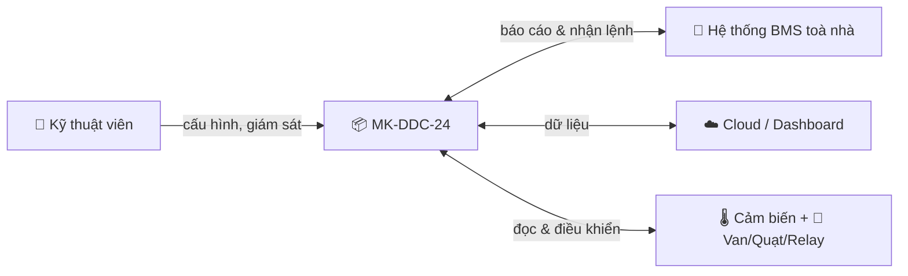
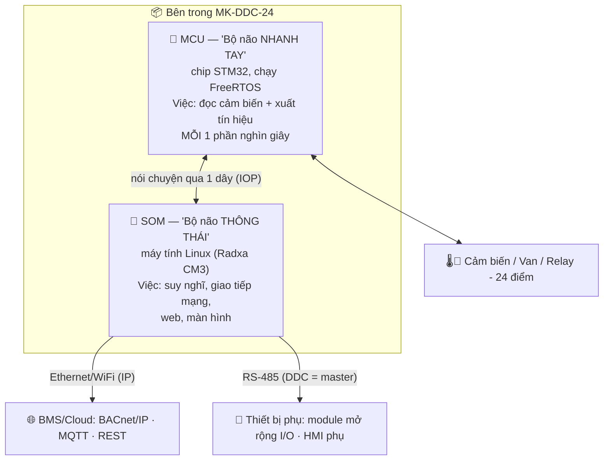
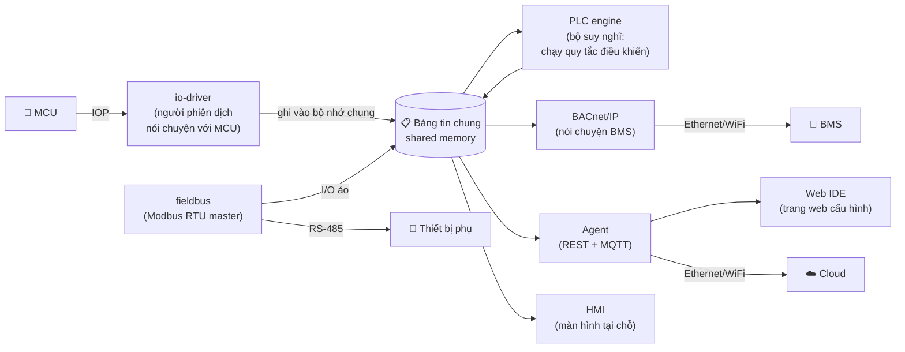
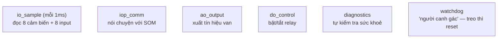
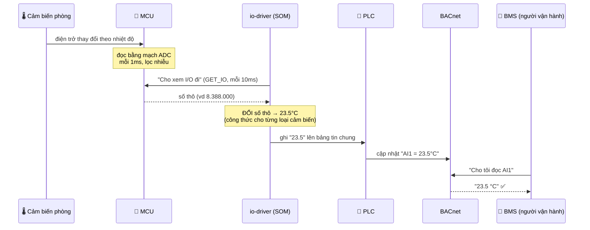
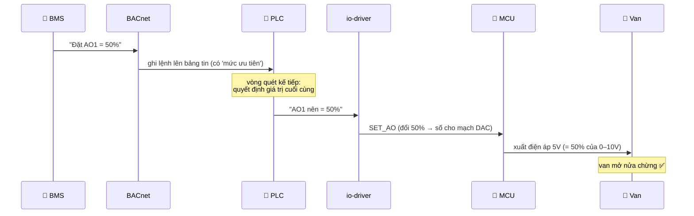
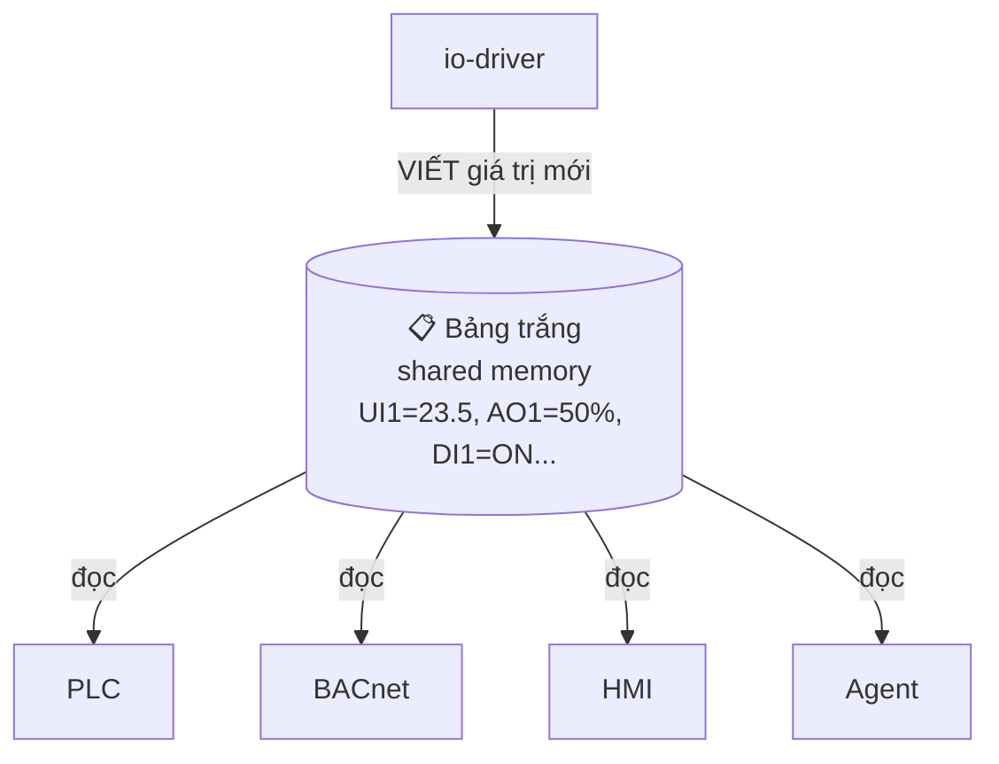
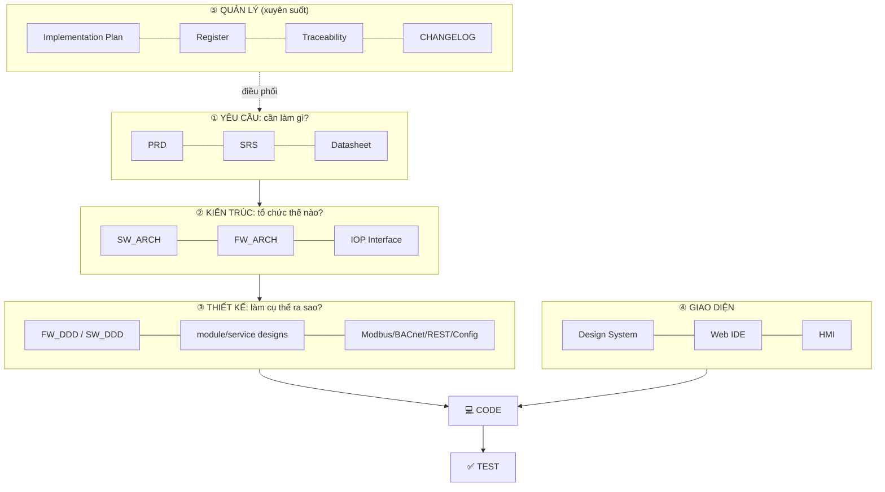
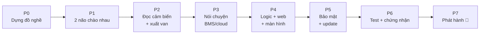

# Sổ tay Hiểu Hệ thống MK-DDC-24
## System Handbook — Hiểu toàn bộ sản phẩm từ số 0 (cho người không chuyên)

> **Document ID:** KX-DDC24-SYS-ARCH-001
> **Phiên bản:** 1.0 | 2026-05-30 · **Trạng thái:** Approved · **Owner:** System Architect
> 📘 [docs/README](../README.md)

> 🎯 **Tài liệu này KHÁC mọi tài liệu khác.** Các file kia để **tra cứu khi code**. File này để **HIỂU** — đọc từ trên xuống dưới như đọc truyện. Không cần biết lập trình. Có hình vẽ, có ví von đời thường. Đọc xong bạn sẽ trả lời được: *"Cái hộp này là gì, bên trong có gì, dữ liệu chạy thế nào, vì sao cần từng thứ."*
>
> 💡 Các sơ đồ dạng ```mermaid``` sẽ hiện thành hình trong VSCode (bấm nút "Preview" ở góc phải, hoặc cài extension *Markdown Preview Mermaid Support*) và trên GitHub.

---

## Mục lục
1. [Vấn đề thực tế: tại sao cần cái hộp này?](#1-vấn-đề-thực-tế)
2. [Cái hộp MK-DDC-24 là gì?](#2-cái-hộp-mk-ddc-24-là-gì)
3. [Ý tưởng cốt lõi: "hai bộ não"](#3-ý-tưởng-cốt-lõi-hai-bộ-não)
4. [Phóng to dần: 4 mức nhìn](#4-phóng-to-dần-4-mức-nhìn)
5. [Đi theo chân MỘT con số (dữ liệu vào)](#5-đi-theo-chân-một-con-số)
6. [Đi theo chân MỘT mệnh lệnh (lệnh ra)](#6-đi-theo-chân-một-mệnh-lệnh)
7. [Từng khối là gì & vì sao cần](#7-từng-khối-là-gì--vì-sao-cần)
8. [Phần mềm chạy thế nào (bảng tin chung)](#8-phần-mềm-chạy-thế-nào)
9. [Cấu trúc hồ sơ tài liệu](#9-cấu-trúc-hồ-sơ-tài-liệu)
10. [Vòng đời làm ra sản phẩm](#10-vòng-đời-làm-ra-sản-phẩm)
11. [Từ điển thuật ngữ (giải thích như cho người mới)](#11-từ-điển-thuật-ngữ)
12. [FAQ — những chỗ hay nhầm](#12-faq)

---

## 1. Vấn đề thực tế

Hãy tưởng tượng một **toà nhà văn phòng**. Trong đó có hàng trăm thiết bị: máy lạnh trung tâm, quạt thông gió, van nước nóng/lạnh, cảm biến nhiệt độ ở mỗi phòng…

Câu hỏi: **ai điều khiển tất cả những thứ đó cho phòng luôn mát 25°C, tiết kiệm điện, và báo động khi hỏng?**

Không thể thuê người ngồi canh từng phòng. Ta cần một **"bộ điều khiển tự động"** đặt trong tủ điện, làm việc 24/7:
- **Đọc** cảm biến (phòng đang bao nhiêu độ?).
- **Suy nghĩ** theo quy tắc (nóng quá → mở van lạnh nhiều hơn).
- **Ra lệnh** cho thiết bị (mở van, bật quạt).
- **Báo cáo** lên hệ thống quản lý toà nhà (BMS) và lên cloud.

➡️ **MK-DDC-24 chính là bộ điều khiển đó.** "DDC" = *Direct Digital Control* = điều khiển số trực tiếp. "24" = quản lý **24 điểm** vào/ra.



> **Ví von:** MK-DDC-24 giống **"người quản lý kỹ thuật mini"** cho một khu vực toà nhà — không bao giờ ngủ, làm theo quy tắc bạn đặt ra.

---

## 2. Cái hộp MK-DDC-24 là gì?

Về mặt vật lý, nó là một **hộp nhỏ gắn trên thanh ray trong tủ điện** (DIN rail), có nhiều cổng đấu dây. "24 điểm" gồm 4 loại cổng:

| Nhóm | Số lượng | Là gì | Ví dụ thực tế |
|------|:--------:|-------|----------------|
| **UI** (Universal Input) | 8 | cổng **đọc** giá trị đo được | cảm biến nhiệt độ, độ ẩm, áp suất |
| **DI** (Digital Input) | 8 | cổng **đọc** tín hiệu bật/tắt | công tắc, báo cháy, trạng thái "máy đang chạy" |
| **AO** (Analog Output) | 4 | cổng **ra** tín hiệu điều chỉnh được | mở van 0–100%, chỉnh tốc độ quạt |
| **DO** (Digital Output) | 4 | cổng **ra** bật/tắt (relay) | bật/tắt bơm, đèn, máy nén |

```
                       BMS / Cloud / Trình duyệt
                                ▲
                                │ LÊN TRÊN (northbound) — Ethernet/WiFi (IP)
                                │ BACnet/IP · MQTT · REST
                     ┌──────────┴───────────┐
        ĐỌC VÀO ────►│     MK-DDC-24         ├────► RA LỆNH
   8× UI, 8× DI      │  (xử lý + giao tiếp)  │      4× AO, 4× DO
                     └──────────┬───────────┘
                                │ XUỐNG DƯỚI (southbound) — RS-485
                                │ Modbus RTU (DDC = MASTER)
                                ▼
              Thiết bị phụ: module mở rộng I/O · màn hình phụ · đồng hồ/biến tần
```

> **Ví von:** Cổng **UI/DI là "tai và mắt"**, cổng **AO/DO là "tay chân"**. Cổng **mạng phía trên** để báo cáo lên sếp (BMS/cloud); cổng **RS-485 phía dưới** để DDC **sai vặt đám lính phụ** (thiết bị phụ).
>
> ⚠ **Hai hướng đừng nhầm:** lên BMS/cloud **chỉ đi bằng Ethernet/WiFi** (giao thức IP: BACnet/IP, MQTT, REST). Cổng **RS-485/Modbus** là để DDC **làm chủ (master) đi sai khiến thiết bị phụ** — KHÔNG phải để BMS đọc DDC.

---

## 3. Ý tưởng cốt lõi: "hai bộ não"

Đây là điều **quan trọng nhất** cần hiểu. Bên trong cái hộp có **hai máy tính nhỏ**, mỗi cái một việc:



**Vì sao phải tách làm hai?**

| | 🏃 MCU (nhanh tay) | 🧠 SOM (thông thái) |
|--|--------------------|----------------------|
| Giỏi | làm **đúng giờ tuyệt đối**, mỗi 1ms không sai | làm **việc phức tạp**: mạng, web, logic |
| Dở | không làm nổi việc phức tạp | thỉnh thoảng "khựng" vài ms (Linux bận) |
| Ví von | **tài xế phản xạ nhanh** | **người quản lý giỏi tính toán** |

➡️ Nếu để Linux trực tiếp điều khiển van, có lúc nó bận xử lý mạng và **trễ** → van giật cục, nguy hiểm. Nên ta giao việc "real-time" (đúng từng mili-giây) cho MCU, còn việc "thông minh" cho SOM. Hai bên **chia việc** và nói chuyện qua một đường dây.

**Đường dây giữa hai bộ não tên là IOP** (Internal/IO Protocol). Hiểu đơn giản: **hai người nhắn tin cho nhau theo một mẫu cố định**. SOM là sếp (hỏi/ra lệnh), MCU là nhân viên (trả lời/thực thi):
- SOM hỏi: *"Cảm biến giờ bao nhiêu?"* → MCU đáp: *"UI1 = số thô 8.388.000…"*
- SOM ra lệnh: *"Mở van AO1 lên 50%"* → MCU: *"Đã mở."*

> Nếu mất liên lạc IOP > 0,2 giây, MCU tự đưa mọi đầu ra về **trạng thái an toàn** (van đóng, relay tắt) — để không gây sự cố. Đây là nguyên tắc an toàn cốt lõi.

---

## 4. Phóng to dần: 4 mức nhìn

Hiểu hệ thống giống xem bản đồ Google Maps — **zoom từ xa vào gần**.

### Mức 1 — Nhìn từ xa (hệ thống trong thế giới)
Cái hộp ngồi giữa **con người + BMS + cloud** (một bên) và **thiết bị HVAC** (bên kia). → đã vẽ ở §1.

### Mức 2 — Mở nắp hộp (hai bộ não)
Bên trong = MCU + SOM nói chuyện qua IOP. → đã vẽ ở §3.

### Mức 3 — Bên trong "bộ não thông thái" (SOM) có những chương trình gì
SOM chạy Linux, trên đó có **nhiều chương trình nhỏ ("service") mỗi cái một nhiệm vụ**, xếp thành dây chuyền:



### Mức 4 — Bên trong "bộ não nhanh tay" (MCU) có những việc gì
MCU chạy FreeRTOS với **6 việc lặp đi lặp lại ("task")**, mỗi việc một ưu tiên:



> **Mẹo nhớ:** SOM = "văn phòng có nhiều phòng ban" (mỗi service một phòng ban). MCU = "công nhân dây chuyền làm 6 thao tác lặp lại cực nhanh".

---

## 5. Đi theo chân MỘT con số

Đây là phần **vỡ òa hiểu ra**. Ta theo dõi nhiệt độ phòng đi từ **cảm biến** đến khi **người vận hành nhìn thấy "23.5°C" trên BMS**.



**Giải thích từng chặng (bằng lời):**

1. **Cảm biến** không gửi chữ "23.5". Nó chỉ là một linh kiện mà **điện trở thay đổi theo nhiệt độ**. Nóng hơn → điện trở khác đi.
2. **MCU** dùng mạch **ADC** (bộ chuyển đổi tương tự→số) đọc giá trị đó thành một **con số thô** rất to (ví dụ 8.388.000), làm **mỗi 1ms** và lọc bớt nhiễu. MCU **chưa biết** đó là bao nhiêu độ — nó chỉ có con số thô.
3. **io-driver** (trên SOM) cứ mỗi 10ms lại **hỏi** MCU "cho xem I/O". MCU trả về con số thô.
4. **io-driver đổi số thô → đơn vị thật** (23.5°C) bằng công thức toán tương ứng loại cảm biến (cảm biến NTC, PT100… mỗi loại một công thức). Đây là bước "phiên dịch".
5. io-driver **ghi 23.5 lên "bảng tin chung"** (shared memory — xem §8).
6. **PLC** đọc bảng tin, cập nhật vào "ô nhớ" tên **AI1** (Analog Input 1). **BACnet** lấy AI1 để phục vụ BMS.
7. **BMS** hỏi BACnet "đọc AI1" → nhận **23.5°C**. Xong! Con số đã đi trọn hành trình.

> **Điểm chốt để hiểu:** dữ liệu **không nhảy thẳng** từ cảm biến lên BMS. Nó đi qua một **dây chuyền phiên dịch**: vật lý → số thô (MCU) → đơn vị thật (io-driver) → ô nhớ chuẩn (PLC/BACnet) → BMS. Mỗi khối làm một việc nhỏ.

---

## 6. Đi theo chân MỘT mệnh lệnh

Giờ chiều ngược lại: BMS muốn **"mở van lạnh 50%"**.



**Lưu ý quan trọng — "ai được quyền ra lệnh?"**
Van AO1 có thể bị nhiều bên muốn điều khiển cùng lúc: PLC (logic tự động), BMS (người vận hành), kỹ thuật viên (ép giá trị để test). Để không loạn, hệ thống dùng **"mức ưu tiên"** (priority): ai ưu tiên cao hơn thì được nghe. Ví dụ kỹ thuật viên "ép" (force) khi bảo trì thì đè lên logic tự động — nhưng tự hết hạn sau 10 phút để không quên.

> **Ví von:** giống nhiều người cùng chỉnh điều hoà trong phòng họp — phải có quy tắc "ai bấm thì tính" để khỏi cãi nhau. Đó là "write arbitration".

---

## 7. Từng khối là gì & vì sao cần

Bảng này giải thích **mọi thành phần**: nó là gì, vì sao tồn tại, ví von, và **nếu bỏ đi thì sao**.

| Khối | Là gì (1 câu) | Vì sao cần | Nếu bỏ đi |
|------|----------------|------------|-----------|
| **MCU** | chip nhỏ đọc/xuất I/O mỗi 1ms | đảm bảo điều khiển **đúng giờ tuyệt đối** | điều khiển giật cục, mất an toàn |
| **SOM** | máy tính Linux | chạy logic + mạng + web | không có BACnet/web/cloud |
| **IOP** | "ngôn ngữ" 2 não nói với nhau | để 2 não phối hợp | hai não "câm", vô dụng |
| **io-driver** | người phiên dịch với MCU | đổi số thô ↔ đơn vị thật, là cửa duy nhất tới MCU | không ai đọc được cảm biến |
| **Shared memory** | "bảng tin chung" trong SOM | các service đọc/ghi dữ liệu chung cực nhanh | các service không chia sẻ được dữ liệu |
| **PLC engine** | bộ chạy quy tắc điều khiển (như PLC) | nơi bạn lập trình "nếu nóng thì mở van" | hộp chỉ đọc/ghi, không tự điều khiển |
| **BACnet/IP** | "tiếng nói chung" ngành toà nhà (qua Ethernet/WiFi) | để BMS bất kỳ hãng nào cũng hiểu | không tích hợp được với toà nhà |
| **Agent (MQTT/REST)** | đẩy lên cloud + cổng API (qua Ethernet/WiFi) | giám sát từ xa, app, dashboard | không lên cloud, không có API |
| **fieldbus (Modbus RTU master)** | DDC làm chủ bus RS-485, **sai khiến thiết bị phụ** | mở rộng I/O, gắn màn hình phụ, đọc đồng hồ/biến tần | không mở rộng được quá 24 điểm |
| **Web IDE** | trang web để cấu hình & lập trình | kỹ thuật viên dùng trình duyệt làm việc | phải cắm cáp + phần mềm riêng |
| **HMI** | màn hình nhỏ trên hộp | xem nhanh tại tủ điện, không cần laptop | ra hiện trường phải mang máy tính |
| **OTA** | cập nhật phần mềm từ xa, an toàn | vá lỗi/nâng cấp không cần tháo máy | phải đến tận nơi mỗi lần update |
| **Security** | TLS, mật khẩu, tường lửa, log | thiết bị nối mạng phải chống hack | dễ bị tấn công, mất an toàn toà nhà |
| **Watchdog** | "người canh gác", treo là reset | tự phục hồi khi phần mềm đơ | treo là đứng luôn, nguy hiểm |

---

## 8. Phần mềm chạy thế nào

**Câu hỏi hay gặp:** các service trên SOM trao đổi dữ liệu kiểu gì cho nhanh?

Trả lời: qua một vùng nhớ dùng chung gọi là **shared memory** — hãy hình dung là một **tấm bảng trắng treo giữa văn phòng**:
- **io-driver** liên tục **viết** giá trị cảm biến mới nhất lên bảng.
- **PLC, BACnet, HMI, agent** chỉ việc **liếc bảng** để đọc — không phải đi hỏi từng người.



Có một mẹo kỹ thuật tên **seqlock** đảm bảo: trong lúc io-driver đang viết dở, người đọc **không vớ phải nửa cũ nửa mới**. Nhưng bạn chỉ cần nhớ: **"bảng trắng chung, ai cần thì liếc, cực nhanh, không kẹt nhau."**

**Mỗi service là một chương trình độc lập** do Linux (systemd) trông coi: nếu một service chết, Linux **tự bật lại**. Watchdog ở cả MCU lẫn SOM đảm bảo treo là phục hồi.

---

## 9. Cấu trúc hồ sơ tài liệu

Bộ tài liệu cũng có cấu trúc, đừng sợ. Hãy nhìn theo **vòng đời sản phẩm** (yêu cầu → kiến trúc → thiết kế → code → test):



| Bạn muốn… | Mở thư mục/file |
|-----------|-----------------|
| Hiểu hệ thống (đang đọc) | file này |
| Biết làm gì trước/sau | [Implementation Plan](KX-DDC24-PM-IMPLPLAN-001_VI.md) |
| Bắt đầu code | [Getting Started](../../design/GETTING_STARTED_DEV.md) |
| Xem yêu cầu | `../../` (PRD/SRS) + `../../spec/` |
| Xem thiết kế chi tiết | `../../design/` |
| Xem giao diện | [docs/04_uiux/](../04_uiux/) |
| Tìm 1 tài liệu bất kỳ | [Master Register](KX-DDC24-QA-REGISTER-001_VI.md) |

---

## 10. Vòng đời làm ra sản phẩm

Từ ý tưởng đến lúc bán ra, dự án đi qua **8 chặng (Phase P0→P7)** — chi tiết ở [Implementation Plan](KX-DDC24-PM-IMPLPLAN-001_VI.md). Tóm tắt dễ hiểu:



Mỗi chặng có **"cổng"**: làm xong và đạt tiêu chí mới được qua chặng sau — để không "xây nhà từ nóc".

---

## 11. Từ điển thuật ngữ

| Từ | Giải thích đời thường |
|----|------------------------|
| **DDC** | bộ điều khiển tự động cho HVAC (sản phẩm này) |
| **HVAC** | hệ thống điều hoà – thông gió – sưởi |
| **BMS** | "bộ não lớn" quản lý cả toà nhà; DDC báo cáo lên nó |
| **MCU** | chip nhỏ làm việc đúng giờ tuyệt đối ("nhanh tay") |
| **SOM** | máy tính Linux nhỏ trong hộp ("thông thái") |
| **FreeRTOS** | hệ điều hành tí hon cho MCU |
| **Linux/Debian** | hệ điều hành cho SOM (như Windows nhưng cho thiết bị) |
| **IOP** | "ngôn ngữ" 2 não nói với nhau qua 1 dây |
| **UART** | sợi dây truyền dữ liệu nối tiếp (IOP chạy trên nó) |
| **UI/DI/AO/DO** | 4 loại cổng: đo / bật-tắt-vào / điều chỉnh-ra / relay-ra |
| **ADC** | mạch đổi tín hiệu tương tự (điện áp) → số |
| **DAC** | mạch đổi số → điện áp (để xuất van 0–10V) |
| **Relay** | công tắc điện tử, bật/tắt thiết bị to |
| **PLC** | "bộ chạy quy tắc điều khiển", nơi lập trình logic |
| **IEC 61131-3** | chuẩn ngôn ngữ lập trình PLC (FBD vẽ khối, ST viết lệnh) |
| **FBD / ST** | 2 cách lập trình PLC: vẽ sơ đồ khối / viết câu lệnh |
| **PID** | thuật toán điều chỉnh mượt (giữ nhiệt độ ổn định) |
| **BACnet/IP** | "tiếng nói chung" ngành toà nhà, chạy trên mạng IP; BTL = chứng nhận đạt chuẩn |
| **Modbus RTU master** | DDC làm chủ bus RS-485, đi hỏi/sai các thiết bị phụ (slave) |
| **Northbound / Southbound** | hướng LÊN BMS/cloud (IP) / hướng XUỐNG thiết bị phụ (RS-485) |
| **Thiết bị phụ (slave)** | module mở rộng I/O, màn hình phụ, đồng hồ điện, biến tần… DDC điều khiển qua RTU |
| **Device profile** | "tờ khai" mô tả 1 loại thiết bị phụ đọc/ghi thanh ghi nào — thêm thiết bị mới chỉ bằng cấu hình |
| **MQTT** | cách đẩy dữ liệu lên cloud nhẹ nhàng |
| **REST API** | "cửa" để phần mềm khác hỏi/ra lệnh qua mạng |
| **shared memory** | "bảng tin chung" để các service đọc/ghi nhanh |
| **service** | một chương trình chạy nền, làm 1 việc |
| **systemd** | quản lý service trên Linux (chết thì bật lại) |
| **watchdog** | "người canh gác", phần mềm treo thì reset |
| **safe-state** | trạng thái an toàn (van đóng, relay tắt) khi sự cố |
| **OTA** | cập nhật phần mềm từ xa, an toàn (có thể quay lui) |
| **TLS / JWT** | mã hoá đường truyền / vé đăng nhập (bảo mật) |
| **HMI** | màn hình nhỏ trên hộp |
| **Web IDE** | trang web để cấu hình & lập trình thiết bị |
| **firmware** | phần mềm chạy bên trong thiết bị |

---

## 12. FAQ

**Hỏi: Tại sao không dùng 1 máy tính cho gọn?**
Vì Linux đôi lúc "khựng" vài ms khi bận → không an toàn cho điều khiển thời gian thực. Tách MCU lo phần đúng-giờ, SOM lo phần thông minh. Đây là kiến trúc chuẩn của ngành.

**Hỏi: "Số thô" với "đơn vị thật" khác gì?**
Số thô = con số ADC đọc được (vô nghĩa với người, vd 8.388.000). Đơn vị thật = sau khi đổi qua công thức (23.5°C). io-driver làm việc đổi này.

**Hỏi: Dữ liệu có đi thẳng từ cảm biến lên cloud không?**
Không. Luôn qua dây chuyền: cảm biến → MCU (số thô) → io-driver (đổi đơn vị) → bảng tin chung → BACnet/agent → BMS/cloud (qua Ethernet/WiFi).

**Hỏi: Cổng Modbus dùng làm gì?**
Để DDC **làm chủ (master)** đi nói chuyện **xuống thiết bị phụ** qua dây RS-485: thêm module mở rộng I/O, gắn màn hình phụ, đọc đồng hồ điện/biến tần. **Không phải** để BMS đọc DDC (BMS đọc DDC qua BACnet/IP trên mạng). Thêm 1 thiết bị phụ mới chỉ cần khai báo "device profile" trong Web UI, không cần lập trình lại.

**Hỏi: Nếu mất điện đang chạy thì sao?**
Có "retain" lưu lại biến quan trọng; có UPS tín hiệu báo trước; khi khởi động lại, máy nạp lại trạng thái. Nếu mất liên lạc, đầu ra về safe-state.

**Hỏi: Tôi không biết code, có hiểu nổi không?**
Đọc xong tài liệu này là bạn hiểu **bức tranh**. Muốn đi sâu phần nào → bấm link tới tài liệu kỹ thuật tương ứng. Cứ coi file này là "tấm bản đồ", các file khác là "đường phố cụ thể".

---

## Tôi nên đọc gì tiếp?
- Muốn biết **đội sẽ code thế nào** → [Implementation Plan](KX-DDC24-PM-IMPLPLAN-001_VI.md).
- Muốn **xem giao diện** → [Web IDE UI](../04_uiux/KX-DDC24-UX-WEBIDE-001_VI.md) · [HMI](../04_uiux/KX-DDC24-UX-HMI-001_VI.md).
- Muốn **đi sâu kỹ thuật** → [spec/README](../../spec/README.md) (yêu cầu+kiến trúc), [design/README](../../design/README.md) (thiết kế).

---
## Revision History
| Version | Ngày | Người | Thay đổi |
|---------|------|-------|----------|
| 1.0 | 2026-05-30 | System Architect | Phát hành đầu — sổ tay hiểu hệ thống cho người không chuyên (kể chuyện + sơ đồ Mermaid + ví von) |
