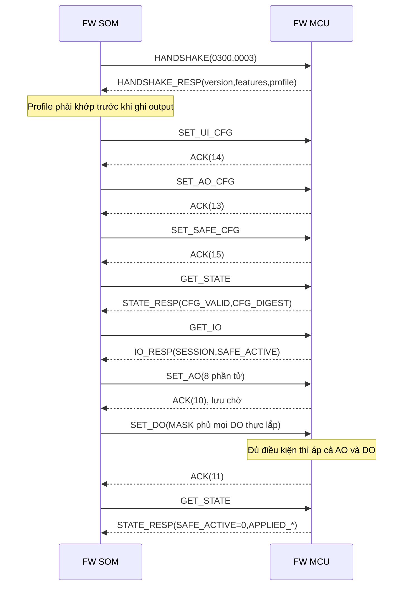
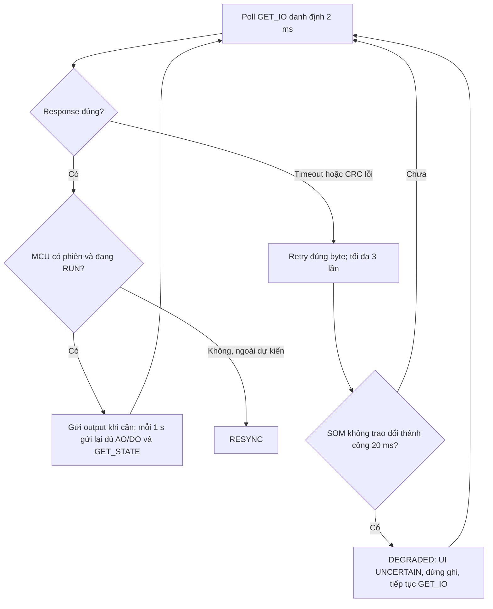

# Sổ tay lệnh FWSOM ↔ FW-MCU — IOP V3.0

**Document ID:** IOP-CMD-GUIDE-MK-DDC-24-VI

**Phiên bản tài liệu:** 1.0 · **Ngày:** 2026-09-30 · **Bản gói:** R3

**Trạng thái:** Draft — hướng dẫn đọc và fixture kiểm host; chưa là bằng chứng chạy trên bo

**Chủ quản:** System Architect · **Review:** SOM lead, MCU lead; Safety đối với safe/timing

**Nguồn ràng buộc:** [ICD v3.0](SWFW_INTERFACE_SPEC_MK-DDC-24_VI.md), [header byte nháp](iop_protocol_v3_DRAFT.h), [FW-REQ v3.1](FW_REQUIREMENTS_MK-DDC-24_VI.md).

**Mục đích:** hai team tra cứu được từng lệnh, dựng/giải mã frame và hiểu kết quả quan sát được. Byte/hằng số theo header; hành vi theo ICD. Sổ tay không tạo thêm lệnh hoặc thay đổi hợp đồng.

## 1. Đọc nhanh và quy ước ví dụ

- **SOM là master**, gửi request; MCU chỉ gửi response. Có tối đa một giao dịch chờ response.
- Có **16 mã CMD: 10 request và 6 loại response**. ACK/NACK dùng chung cho nhiều lệnh.
- Mọi khối `hex` có nhãn `frame:` dưới đây là **một frame đầy đủ**, gồm CRC. Xuống dòng và dấu cách chỉ để đọc; UART gửi byte nhị phân, không gửi ký tự ASCII `A`, `A` hoặc chuỗi hex.
- Mỗi cặp ví dụ là **fixture độc lập** với tiền điều kiện đã ghi. SEQ giữa hai mục không phải một capture liên tục. Số đo, nhiệt độ, uptime và bộ đếm đều là dữ liệu minh họa.
- `4/4` nghĩa là 16 UI / 4 AO / 4 DO / 0 DI; `8/8` nghĩa là 16 UI / 8 AO / 8 DO / 0 DI. Số kênh do HANDSHAKE_RESP khai, SOM đối chiếu cấu hình trước khi ghi output.
- Offset trong bảng payload bắt đầu ở **0**; offset trong toàn frame = offset payload + 4. Chỉ số mảng `i=0` là kênh 1; bit 0 là kênh 1.
- Các fixture output dùng trên host/thiết bị thử đã chuẩn bị theo [kế hoạch kiểm](IOP_V3_VERIFICATION_PLAN_MK-DDC-24_VI.md). Raw khác 0 có thể làm AO/relay thay đổi thật.
- Các sơ đồ là trình tự logic. Thời gian và khả năng chuyển AO/DO nguyên khối phải được đo theo ICD; O-9 vẫn cần HW/MCU/Safety kết luận.

### 1.1 Chọn lệnh theo công việc

| Công việc | SOM gửi | MCU trả | Mục |
|---|---|---|---|
| Mở phiên, nhận biến thể | HANDSHAKE `30` | HANDSHAKE_RESP `31` | [3–4](#cmd-handshake) |
| Chọn chế độ UI | SET_UI_CFG `14` | ACK `12` / NACK `FE` | [5](#cmd-set-ui-cfg) |
| Chọn chế độ AO | SET_AO_CFG `13` | ACK / NACK | [6](#cmd-set-ao-cfg) |
| Đặt giá trị safe | SET_SAFE_CFG `15` | ACK / NACK | [7](#cmd-set-safe-cfg) |
| Đọc UI và nuôi watchdog | GET_IO `01` | IO_RESP `02` | [8–9](#cmd-get-io) |
| Ghi toàn bộ AO | SET_AO `10` | ACK / NACK | [10](#cmd-set-ao) |
| Ghi DO theo mask | SET_DO `11` | ACK / NACK | [11](#cmd-set-do) |
| Đọc cấu hình/trạng thái output | GET_STATE `22` | STATE_RESP `23` | [12–13](#cmd-get-state) |
| Đọc thống kê/chẩn đoán | GET_DIAG `20` | DIAG_RESP `21` | [14–15](#cmd-get-diag) |
| Đưa output về safe | RESET_IO `40` | ACK / NACK nếu frame lỗi | [16](#cmd-reset-io) |
| Xác nhận hoặc báo từ chối | MCU gửi ACK `12` hoặc NACK `FE` | SOM không ACK lại | [17–18](#cmd-ack) |

## 2. Cách đọc byte, CRC và phiên

```text
Offset frame: 0    1     2     3     4 ... LEN+3    LEN+4   LEN+5
              AA   LEN   CMD   SEQ   PAYLOAD         CRC_HI  CRC_LO
```

| Thành phần | Quy tắc |
|---|---|
| SOF | `AA`; không escape byte `AA` nằm trong payload |
| LEN | Số byte payload, không tính header/CRC; 0..252; cố định theo CMD |
| SEQ | SOM tăng cho mỗi request mới, `FF → 00`; response chép lại SEQ |
| CRC | CRC-16/MODBUS, init `FFFF`, poly phản xạ `A001`, xorout 0; tính cả `AA LEN CMD SEQ PAYLOAD`; **byte cao trước** |
| Số nhiều byte | Big-endian; uint16 `0x1234 → 12 34`; int16 −10 → `FF F6`; int32 −1 → `FF FF FF FF` |
| Tổng byte | LEN + 6; IO_RESP là 80 byte, STATE_RESP là 38 byte |
| UART | 921600, 8N1; khoảng trống khi phát ≤ 500 µs, nhận hủy frame dở nếu > 1000 µs |
| Timeout/retry | Bình thường 3 ms; HANDSHAKE 1 s. Retry tối đa 3 lần, giữ **toàn bộ byte** và SEQ |
| Ghép response | Cùng SEQ và đúng loại; ACK có ECHOED_CMD, NACK có REJECTED_CMD khớp request. Bỏ response không khớp và chờ hết timeout |

Ví dụ `AA 00 01 00 6C 20`: LEN=0, CMD=GET_IO, SEQ=0, CRC của bốn byte đầu là `0x6C20`. CRC truyền `6C 20`.

### 2.1 Trạng thái cần biết trước khi gửi

| Nhóm lệnh | BOOT_SAFE / COMM_SAFE | SESSION_SAFE | SESSION_RUN |
|---|---|---|---|
| HANDSHAKE | mở phiên nếu major khớp | mở lại phiên, giữ safe | về safe và mở lại phiên |
| GET_IO / GET_STATE / GET_DIAG | được đọc; GET_IO không nuôi watchdog ngoài phiên | được đọc | được đọc |
| Ba SET cấu hình | ERR_NO_SESSION | áp cấu hình | áp; đổi AO mode thì về SESSION_SAFE |
| SET_AO / SET_DO | ERR_SAFE_STATE | cần CFG_VALID và GET_IO sau handshake; thiếu → ERR_SAFE_STATE; lỗi HW ngăn chạy → ERR_HW_FAULT; đủ thì lưu chờ hoặc áp khi đủ bộ | áp trước ACK |
| RESET_IO | giữ safe, ACK | safe, xóa giá trị chờ, ACK | về SESSION_SAFE, ACK |

Rời SESSION_SAFE cần **đủ cả**: CFG_VALID=1, không có ADC1/ADC2/DAC/VDD fault ngăn chạy, đã nhận GET_IO hợp lệ sau handshake, SET_AO đủ 8 phần tử và MASK SET_DO tích lũy phủ mọi DO thực lắp. Đổi cấu hình hoặc vào safe xóa giá trị output chờ; phải gửi lại đủ bộ.

Chỉ GET_IO hợp lệ trong phiên nuôi watchdog. Đồng hồ bắt đầu từ cuối HANDSHAKE_RESP nếu chưa có GET_IO. Các lệnh cấu hình, output và chẩn đoán **không kéo dài** cửa sổ 200 ms.

<a id="cmd-handshake"></a>
## 3. HANDSHAKE — `0x30`, SOM → MCU, LEN=4

**Dùng khi:** khởi động SOM, MCU vừa reset hoặc cần RESYNC. Được nhận ở mọi trạng thái. Gửi lại handshake khi đang RUN sẽ đưa output về safe; không dùng làm heartbeat.

| Offset | Field | Ví dụ | Ý nghĩa |
|---|---|---|---|
| 0..1 | SOM_IOP_VERSION, uint16 | `03 00` | IOP 3.0; khác với phiên bản image FW |
| 2..3 | SOM_CAPABILITIES, uint16 | `00 03` | bit 0 DIAG, bit 1 RESET_IO; các bit còn lại bằng 0 |

**Kết quả:** HANDSHAKE_RESP cùng SEQ; cùng major tạo SESSION_SAFE, xóa lịch sử SEQ/giá trị chờ, CFG_VALID=0. Khác major trả INCOMPAT và giữ BOOT_SAFE. Chưa được gửi output ngay sau handshake.

SOM → MCU, SEQ=00:

<!-- frame:HS-REQ -->
```hex
AA 04 30 00 03 00 00 03 79 CA
```

Response 4/4 và 8/8 ở mục 4. Thử khác major, ver=2.0, SEQ=01 (fixture từ chối, không phải hỗ trợ fallback V2):

<!-- frame:HS-OLD-REQ -->
```hex
AA 04 30 01 02 00 00 03 45 F6
```

MCU v3 trả INCOMPAT, vẫn khai đúng profile 4/4:

<!-- frame:HS-OLD-RESP -->
```hex
AA 0C 31 01 03 00 01 00 02 00 00 00 10 04 04 00
83 ED
```
<a id="cmd-handshake-resp"></a>
## 4. HANDSHAKE_RESP — `0x31`, MCU → SOM, LEN=12

**Chỉ gửi để trả HANDSHAKE.** Không gửi ACK bổ sung.

| Offset | Field / kiểu | Miền / cách đọc |
|---|---|---|
| 0..1 | MCU_IOP_VERSION / uint16 | `0300` = IOP 3.0 |
| 2..3 | MCU_FW_VERSION / uint16 | `0100` = image FW 1.0 trong ví dụ |
| 4 | HS_STATUS / uint8 | 0 OK: cùng version; 1 WARN: cùng major khác minor; 2 INCOMPAT: khác major |
| 5 | reserved / uint8 | 0 |
| 6..7 | BOARD_FEATURES / uint16 | bit 0 RTD (Rev A=0), bit 1 DO_FB; bit 2..15=0 |
| 8 | N_UI / uint8 | 16 |
| 9 | N_AO / uint8 | 4 hoặc 8 |
| 10 | N_DO / uint8 | 4 hoặc 8, theo cặp profile đã duyệt |
| 11 | N_DI / uint8 | 0 |

4/4, không feedback relay, trả HS-REQ:

<!-- frame:HS-44-RESP -->
```hex
AA 0C 31 00 03 00 01 00 00 00 00 00 10 04 04 00
DB 6E
```

8/8 có feedback relay, cũng là phương án trả HS-REQ trên bo khác:

<!-- frame:HS-88-RESP -->
```hex
AA 0C 31 00 03 00 01 00 00 00 00 02 10 08 08 00
18 D2
```

**SOM kiểm:** major/status, profile đầy đủ và tính năng. Profile lệch cấu hình → alarm MCU_VARIANT_MISMATCH, giữ safe, không gửi output. Cùng major khác minor thì dùng minor nhỏ hơn theo ICD §12.1. Không suy số kênh từ BOARD_FEATURES.

<a id="cmd-set-ui-cfg"></a>
## 5. SET_UI_CFG — `0x14`, SOM → MCU, LEN=16

**Tiền điều kiện:** có phiên. Payload[i] là mode UI(i+1), i=0..15.

| Giá trị | Mode | Nơi xử lý |
|---:|---|---|
| 0 | DISABLED | MCU xuất raw=0 |
| 1 | VOLTAGE_0_10V | MCU chọn đường đo; SOM đổi raw sang V |
| 2 | CURRENT_4_20MA | MCU chọn đường đo; SOM đổi raw sang mA |
| 3 | NTC | MCU chọn đường kích thích; SOM đổi raw sang nhiệt độ |
| 4 | DRY_CONTACT | MCU gửi raw; SOM đặt ngưỡng/debounce |
| 5..255 | reserved | ERR_BAD_VALUE, không áp kênh nào |

Ví dụ UI1–4=1, UI5–8=2, UI9–12=3, UI13–14=4, UI15–16=0; SEQ=10:

<!-- frame:UI-CFG -->
```hex
AA 10 14 10 01 01 01 01 02 02 02 02 03 03 03 03
04 04 00 00 29 97
```

MCU → SOM, ACK cùng SEQ:

<!-- frame:UI-CFG-ACK -->
```hex
AA 01 12 10 14 2E 90
```

ACK sau khi chốt mode vào phần cứng. ADC có kênh đổi mode bật SETTLING, phải tắt trong ≤100 ms sau ACK; kênh không đổi mất ≤1 mẫu. UI mode không lưu bền, reset về DISABLED. ACK không có nghĩa dữ liệu đã settle. Sai một mode → từ chối toàn bộ. Ví dụ lỗi cụ thể ở mục 18.

<a id="cmd-set-ao-cfg"></a>
## 6. SET_AO_CFG — `0x13`, SOM → MCU, LEN=1

**Tiền điều kiện:** có phiên. Payload[0] là mask mode: bit i=0 chọn 0–10 V, bit i=1 chọn 4–20 mA cho AO(i+1). Bit của kênh không lắp phải 0.

4/4: chỉ AO2 dùng dòng; SEQ=11, mode=02:

<!-- frame:AO-CFG-44 -->
```hex
AA 01 13 11 02 B0 41
```

MCU → SOM, ACK cùng SEQ:

<!-- frame:AO-CFG-44-ACK -->
```hex
AA 01 12 11 13 7C D0
```

8/8: AO2 và AO8 dùng dòng; SEQ=12, mode=82:

<!-- frame:AO-CFG-88 -->
```hex
AA 01 13 12 82 E0 40
```

MCU → SOM, ACK cùng SEQ:

<!-- frame:AO-CFG-88-ACK -->
```hex
AA 01 12 12 13 8C D0
```

**Tác động:** mode đổi khi RUN → output safe, SESSION_SAFE, LAST_SAFE_REASON=CONFIG_CHANGE; SOM RESYNC và quy đổi lại lệnh theo mode mới. Gửi mode giống đang áp không đổi trạng thái. MCU giữ bản sao lưu bền, mặc định 0–10 V nếu bản lưu không hợp lệ. Gửi `82` cho bo 4 AO → ERR_BAD_VALUE, không đổi mode.

<a id="cmd-set-safe-cfg"></a>
## 7. SET_SAFE_CFG — `0x15`, SOM → MCU, LEN=17

**Tiền điều kiện:** có phiên. Đây là cấu hình output khi safe, không phải lệnh output chạy bình thường.

| Offset | Field | Kiểu / giới hạn |
|---|---|---|
| 0..15 | AO_SAFE_RAW[8] | 8 uint16 BE; kênh không lắp=0 |
| 16 | DO_SAFE_MASK | bit i: safe của DO(i+1); bit không lắp=0 |

4/4: tất cả safe raw=0, DO mở; SEQ=13:

<!-- frame:SAFE-CFG-44 -->
```hex
AA 11 15 13 00 00 00 00 00 00 00 00 00 00 00 00
00 00 00 00 00 D7 0A
```

MCU → SOM, ACK cùng SEQ:

<!-- frame:SAFE-CFG-44-ACK -->
```hex
AA 01 12 13 15 1E 51
```

8/8: AO3=8000, AO8=4000, DO8 đóng khi safe; các kênh còn lại raw 0/mở; SEQ=14. Đây là fixture minh họa mã hóa; safe thực tế do Safety duyệt.

<!-- frame:SAFE-CFG-88 -->
```hex
AA 11 15 14 00 00 00 00 80 00 00 00 00 00 00 00
00 00 40 00 80 17 44
```

MCU → SOM, ACK cùng SEQ:

<!-- frame:SAFE-CFG-88-ACK -->
```hex
AA 01 12 14 15 2E 53
```

**Tác động:** đang RUN thì output hiện tại giữ nguyên. Đang SAFE thì áp safe mới trước ACK. Ghi lỗi → ERR_HW_FAULT, giữ SAFE và OUTPUT_MISMATCH=1. Cấu hình có bản sao lưu bền. Raw 0 là 0 V ở mode voltage, **4 mA** ở mode current. DO safe bit 1 nghĩa relay đóng, không đồng nghĩa trạng thái mất điện cơ khí. Sai một kênh/bit không lắp → ERR_BAD_VALUE toàn lệnh.

<a id="cmd-get-io"></a>
## 8. GET_IO — `0x01`, SOM → MCU, LEN=0

**Được đọc ở mọi trạng thái.** Trong phiên, request hợp lệ cập nhật mốc watchdog; ngoài phiên chỉ đọc, không thoát safe. SOM poll danh định mỗi 2 ms. Response là IO_RESP, không phải ACK.

SEQ=20, không có payload:

<!-- frame:GET-IO -->
```hex
AA 00 01 20 B4 21
```

Timeout: retry giữ nguyên cả frame. GET_IO lặp luôn được xử lý mới, vì vậy IO_RESP có thể chứa mẫu/counter mới. Phải xem SESSION/SAFE_ACTIVE trong response; có response không có nghĩa MCU đang RUN.

<a id="cmd-io-resp"></a>
## 9. IO_RESP — `0x02`, MCU → SOM, LEN=74

| Offset | Field / kiểu | Ngữ nghĩa |
|---|---|---|
| 0..63 | UI_RAW[16] / int32 BE | Mã ADC signed 24 bit mở rộng dấu; trung bình mẫu hợp lệ từ IO_RESP trước, cắt về 0. Không có mẫu mới: giữ cũ, DRDY_OK=0. Disabled=0 |
| 64 | ADC1_STAT / uint8 | UI1..UI8 |
| 65 | ADC2_STAT / uint8 | UI9..UI16 |
| 66..67 | MCU_TEMP / int16 BE | 0,1 °C |
| 68..69 | FAULT_FLAGS / uint16 BE | Bảng dưới |
| 70..71 | SAMPLE_CNT / uint16 BE | Chu kỳ chuyển đổi ADC1, mod 65536; không đổi qua ≥3 response liên tiếp báo lấy mẫu dừng |
| 72 | DO_FB_MASK / uint8 | Feedback thật nếu DO_FB=1; trạng thái drive nếu DO_FB=0; bit không lắp=0 |
| 73 | MCU_STATE / uint8 | Trạng thái phiên/safe/config |

**Fixture profile 8/8 đang RUN**, trả GET-IO: UI1=+1048576 (`00 10 00 00`), UI2=−1048576 (`FF F0 00 00`), UI khác=0; ADC1/2=01; 25,0 °C; fault=0; sample_cnt=100; DO=A5; state=05.

<!-- frame:IO-RESP -->
```hex
AA 4A 02 20 00 10 00 00 FF F0 00 00 00 00 00 00
00 00 00 00 00 00 00 00 00 00 00 00 00 00 00 00
00 00 00 00 00 00 00 00 00 00 00 00 00 00 00 00
00 00 00 00 00 00 00 00 00 00 00 00 00 00 00 00
00 00 00 00 01 01 00 FA 00 00 00 64 A5 05 24 4A
```

### 9.1 Giải mã cờ ADC

| Bit | Mask | Tên | Cách SOM hiểu |
|---:|---|---|---|
| 0 | 01 | DRDY_OK | Có ít nhất một mẫu hợp lệ từ response trước |
| 1 | 02 | LOCK | ADC báo LOCK theo ICD |
| 2 | 04 | CRC_FAULT | ADC báo REGMAP_CRC_ERR |
| 3 | 08 | DRDY_TIMEOUT | Không thấy DRDY trong cửa sổ mong đợi |
| 4 | 10 | SPI_TIMEOUT | Giao dịch SPI không hoàn tất |
| 5 | 20 | SETTLING | Chip có kênh vừa đổi mode; SOM đánh UNCERTAIN cho các kênh chip |
| 6..7 | C0 | reserved | 0 |

### 9.2 Giải mã FAULT_FLAGS

| Bit | Tên | Điều kiện bật / xóa |
|---:|---|---|
| 0 | ADC1_FAULT | UI1..8 không mẫu hợp lệ 100 ms / khởi tạo lại và có mẫu |
| 1 | ADC2_FAULT | Tương tự UI9..16 |
| 2 | DAC_FAULT | Ghi DAC thất bại / ghi thành công |
| 3 | UI_OV | Có UI bật với abs(raw)≥8136950 / tất cả dưới ngưỡng |
| 4 | RELAY_STUCK | Chỉ khi DO_FB=1: feedback lệch lệnh >20 ms / khớp lại |
| 5 | WDG_RESET | Reset do watchdog / GET_DIAG đầu tiên sau boot |
| 6 | MCU_OVERTEMP | >85,0 °C / <80,0 °C |
| 7 | VDD_FAULT | VDD ngoài [3,0;3,6] V / trở lại trong dải |
| 8..15 | reserved | 0 |

### 9.3 Giải mã MCU_STATE (cũng dùng trong STATE_RESP)

| Bit | Mask | Tên | Ý nghĩa |
|---:|---|---|---|
| 0 | 01 | SESSION | Có phiên |
| 1 | 02 | SAFE_ACTIVE | Đang chế độ safe; khi lỗi HW cần kiểm thêm OUTPUT_MISMATCH |
| 2 | 04 | CFG_VALID | Đã áp/ACK đủ ba cấu hình trong phiên |
| 3 | 08 | FRESH_BOOT | Chưa gửi STATE_RESP đầu tiên sau boot |
| 4 | 10 | OUTPUT_MISMATCH | Output áp khác lệnh được chấp nhận |
| 5..7 | E0 | reserved | 0 |

`05` = SESSION + CFG_VALID, RUN; `07` = có phiên/cấu hình nhưng vẫn safe; `0F` = như 07 và fresh boot. **Không so sánh toàn byte bằng 05 để quyết định mọi tình huống**: kiểm từng bit và fault. UI_RAW là mã ADC, không áp công thức raw AO để đổi UI sang V/mA.

<a id="cmd-set-ao"></a>
## 10. SET_AO — `0x10`, SOM → MCU, LEN=16

Payload luôn 8 uint16 BE, offset của AO(i+1)=2*i. Trên bo 4 AO, **vẫn gửi 16 byte**, AO5..8=0. Miền raw mỗi kênh thực lắp: 0..65535.

| Raw | Byte | Mode 0–10 V | Mode 4–20 mA |
|---:|---|---:|---:|
| 0 | 00 00 | 0 V | 4 mA |
| 32768 | 80 00 | ≈5,00008 V | ≈12,00012 mA |
| 65535 | FF FF | 10 V | 20 mA |

Công thức: V=raw/65535×10; mA=4+raw/65535×16. SOM chọn cách lượng tử hóa raw; MCU nhận số nguyên trên dây. `8000` là điểm gần giữa, không phải đúng nửa của 65535.

4/4 đang RUN: AO1=8000, AO2=4000, AO3/4=0; SEQ=30:

<!-- frame:AO-44 -->
```hex
AA 10 10 30 80 00 40 00 00 00 00 00 00 00 00 00
00 00 00 00 20 D0
```

MCU → SOM, ACK cùng SEQ:

<!-- frame:AO-44-ACK -->
```hex
AA 01 12 30 10 2D 88
```

8/8 đang RUN: AO1=8000, AO8=FFFF, còn lại 0; SEQ=31:

<!-- frame:AO-88 -->
```hex
AA 10 10 31 80 00 00 00 00 00 00 00 00 00 00 00
00 00 FF FF 80 C1
```

MCU → SOM, ACK cùng SEQ:

<!-- frame:AO-88-ACK -->
```hex
AA 01 12 31 10 BD 89
```

**Kết quả:** RUN áp toàn bộ AO trước ACK. SESSION_SAFE đã đủ cấu hình/poll thì lưu chờ; chỉ chuyển RUN khi đủ cả AO và DO. ACK sớm trong trường hợp lưu chờ không chứng minh chân AO đã đổi. Đọc GET_STATE để xác nhận APPLIED_AO_RAW. Payload AO-88 trên bo 4 AO bị ERR_BAD_VALUE; không chỉ bỏ qua AO8.

<a id="cmd-set-do"></a>
## 11. SET_DO — `0x11`, SOM → MCU, LEN=2

| Offset | Field | Ngữ nghĩa |
|---|---|---|
| 0 | MASK | Bit 1: cập nhật kênh tương ứng; bit 0: giữ kênh đó |
| 1 | VALUE | Với bit được MASK chọn: 1 đóng relay, 0 mở |

Cả MASK và VALUE phải có bit ngoài N_DO bằng 0. Với kênh thực lắp nhưng MASK=0, bit VALUE không thay output. Công thức logic khi RUN: `new = (old & ~MASK) | (VALUE & MASK)`, giới hạn trong mask kênh thực lắp.

4/4 RUN, DO cũ=0C; đóng DO1, mở DO2, giữ DO3/4 → MASK 03 VALUE 01, kết quả 0D; SEQ=32:

<!-- frame:DO-PARTIAL -->
```hex
AA 02 11 32 03 01 12 04
```

MCU → SOM, ACK cùng SEQ:

<!-- frame:DO-PARTIAL-ACK -->
```hex
AA 01 12 32 11 8D 48
```

4/4, đặt đủ DO theo 05, MASK 0F; SEQ=33:

<!-- frame:DO-44 -->
```hex
AA 02 11 33 0F 05 11 51
```

MCU → SOM, ACK cùng SEQ:

<!-- frame:DO-44-ACK -->
```hex
AA 01 12 33 11 1D 49
```

8/8, đặt đủ DO theo A5, MASK FF; SEQ=34:

<!-- frame:DO-88 -->
```hex
AA 02 11 34 FF A5 A8 A4
```

MCU → SOM, ACK cùng SEQ:

<!-- frame:DO-88-ACK -->
```hex
AA 01 12 34 11 2D 4B
```

**SESSION_SAFE:** các MASK tích lũy phải phủ 0F (4 DO) hoặc FF (8 DO), và đã có SET_AO. Ví dụ 4/4: MASK 03 rồi MASK 0C phủ đủ 0F; MASK 03 rồi MASK 03 vẫn thiếu DO3/4, tiếp tục safe. MCU không tự áp từng phần trước khi đủ điều kiện chuyển RUN. Feedback cơ khí có thể đến sau ACK; ACK xác nhận drive, RELAY_STUCK xét cửa sổ >20 ms khi có DO_FB.

<a id="cmd-get-state"></a>
## 12. GET_STATE — `0x22`, SOM → MCU, LEN=0

Được dùng mọi trạng thái. SOM dùng sau cấu hình để kiểm digest, sau output để kiểm APPLIED_*, khi FAULT_OUT báo lỗi và chu kỳ gửi lại 1 s. Không nuôi watchdog liên lạc.

SEQ=40:

<!-- frame:GET-STATE -->
```hex
AA 00 22 40 AC 38
```

MCU trả STATE_RESP bên dưới. Sau gửi response: FRESH_BOOT xóa, MAX_RX_GAP_MS đặt 0; do đó đọc liên tiếp có thể khác nhau dù không ghi output. GET_STATE không xóa LAST_SAFE_REASON.

<a id="cmd-state-resp"></a>
## 13. STATE_RESP — `0x23`, MCU → SOM, LEN=32

| Offset | Field / kiểu | Ngữ nghĩa / miền |
|---|---|---|
| 0 | MCU_STATE / uint8 | Bảng 9.3 |
| 1 | LAST_SAFE_REASON / uint8 | Lý do vào safe gần nhất, giữ khi đã RUN lại |
| 2 | RESET_CAUSE / uint8 | Nguyên nhân reset gần nhất |
| 3 | reserved / uint8 | 0 |
| 4..5 | SAFE_ENTRY_CNT / uint16 | Bão hòa 65535 |
| 6..7 | LAST_VALID_RX_AGE_MS / uint16 | ms từ GET_IO hợp lệ trong phiên; chưa có GET_IO hoặc không phiên=65535; bão hòa |
| 8..9 | MAX_RX_GAP_MS / uint16 | Gap lớn nhất giữa GET_IO hợp lệ từ response trước; bão hòa; xóa sau gửi |
| 10..13 | CFG_DIGEST / uint32 | CRC-32/ISO-HDLC của cấu hình đang áp |
| 14..29 | APPLIED_AO_RAW[8] / uint16 BE | Raw đang áp, kể cả safe; kênh không lắp 0 |
| 30 | APPLIED_DO_MASK / uint8 | Drive đang áp; bit không lắp 0 |
| 31 | APPLIED_AO_MODE / uint8 | Bit mode như SET_AO_CFG |

**Fixture 4/4 sau cấu hình, trước GET_IO/output**, trả GET-STATE: state 0F, reason BOOT=1, cause POWER=6, safe_cnt=1, age=FFFF, maxgap=0, digest=6E4CCFF2, AO/DO đều 0, mode 02:

<!-- frame:STATE-RESP -->
```hex
AA 20 23 40 0F 01 06 00 00 01 FF FF 00 00 6E 4C
CF F2 00 00 00 00 00 00 00 00 00 00 00 00 00 00
00 00 00 02 DD 34
```

APPLIED_AO_RAW là trạng thái áp của MCU, không có field đo điện áp/dòng tại cực. APPLIED_DO_MASK là drive, khác DO_FB_MASK nếu bo có feedback thật. Hai team không được coi GET_STATE là bằng chứng điện đầu ra đúng.

### 13.1 Bảng reason và reset cause

| Mã | LAST_SAFE_REASON | RESET_CAUSE |
|---:|---|---|
| 0 | NONE; boot vốn vào safe | UNKNOWN |
| 1 | BOOT | IWDG |
| 2 | COMM_TIMEOUT | WWDG |
| 3 | RESET_IO | SOFTWARE |
| 4 | HANDSHAKE | LOWPOWER |
| 5 | VDD | OBL (option byte) |
| 6 | SELF_TEST | POWER (POR/PDR/BOR) |
| 7 | HW_FAULT | PIN (NRST) |
| 8 | CONFIG_CHANGE | Không định nghĩa |

RESET_CAUSE có nhiều cờ phần cứng: chọn mã nhỏ nhất khác 0. LAST_SAFE_REASON=RESET_IO không chứa REASON của request; REASON chi tiết ghi log MCU. LAST_SAFE_REASON=COMM_TIMEOUT trong một response RUN nghĩa là đã khôi phục sau lần mất poll, không có nghĩa vẫn COMM_SAFE.

### 13.2 Tính digest đúng 34 byte

`UI_MODE[16] || AO_MODE_MASK[1] || AO_SAFE_RAW[8][16 byte BE] || DO_SAFE_MASK[1]`.
Không đưa SOF/LEN/CMD/SEQ/CRC-16 vào digest. CRC-32/ISO-HDLC: init/xorout FFFFFFFF, poly phản xạ EDB88320. Hai cấu hình mẫu:

| Cấu hình | CFG_DIGEST |
|---|---|
| Tất cả 34 byte=0 | `41716C2A` |
| UI như mục 5, AO mode 02, safe 17 byte 0 | `6E4CCFF2` |

Digest khớp kiểm tính nhất quán cấu hình; không phải chữ ký bảo mật hoặc bằng chứng lưu bền đã qua thử mất điện.

<a id="cmd-get-diag"></a>
## 14. GET_DIAG — `0x20`, SOM → MCU, LEN=0

Được đọc mọi trạng thái, không nuôi watchdog. Nhận GET_DIAG hợp lệ xóa bit sticky WDG_RESET của FAULT_FLAGS; không xóa WDG_RESET_CNT. Response DIAG_RESP không có FAULT_FLAGS: nếu cần giữ bằng chứng sticky, ghi nhận IO_RESP trước GET_DIAG.

SEQ=41:

<!-- frame:GET-DIAG -->
```hex
AA 00 20 41 0C F8
```

<a id="cmd-diag-resp"></a>
## 15. DIAG_RESP — `0x21`, MCU → SOM, LEN=20

| Offset | Field / kiểu | Miền, đơn vị, ví dụ |
|---|---|---|
| 0..1 | FW_VERSION / uint16 | `(major << 8) OR minor`; `0100`=FW1.0 |
| 2..3 | UPTIME_S / uint16 | Giây, bão hòa 65535; ví dụ 60 |
| 4..5 | IOP_RX_CNT / uint16 | Frame hợp lệ từ boot, mod 65536; ví dụ 1000 |
| 6..7 | IOP_CRC_ERR / uint16 | Frame sai CRC, mod 65536; ví dụ 2 |
| 8..9 | IOP_SEQ_ERR / uint16 | Frame ghi lặp phát hiện theo ICD-R-06, mod 65536; ví dụ 1 |
| 10..11 | WDG_RESET_CNT / uint16 | Số reset watchdog từ cấp nguồn; ví dụ 0 |
| 12..13 | ADC_SAMPLE_RATE / uint16 | Hz đo được ADC1; ví dụ 1000 |
| 14..15 | MCU_TEMP_MAX / int16 | 0,1 °C; ví dụ 300=30,0 °C |
| 16..17 | VDD_MV / uint16 | mV; ví dụ 3300 |
| 18..19 | reserved / uint16 | 0 |

Trả GET-DIAG, các giá trị minh họa trong bảng:

<!-- frame:DIAG-RESP -->
```hex
AA 14 21 41 01 00 00 3C 03 E8 00 02 00 01 00 00
03 E8 01 2C 0C E4 00 00 79 35
```

Không coi IOP_SEQ_ERR tăng là mất frame theo thứ tự: ở MCU đây là **đếm lệnh ghi lặp**. Bộ đếm `seq_err` phía SOM dùng cho response không khớp request là một bộ đếm khác. Độ chính xác nhiệt/VDD cần kiểm bo; giá trị fixture không xác nhận cảm biến.

<a id="cmd-reset-io"></a>
## 16. RESET_IO — `0x40`, SOM → MCU, LEN=1

**Đưa output về safe, không reset CPU MCU.** Được nhận ở mọi trạng thái; đang có phiên thì về SESSION_SAFE, xóa output chờ, LAST_SAFE_REASON=RESET_IO. Output safe trước ACK. Không thay bằng xung nRESET nếu chỉ cần safe output.

| REASON tại offset 0 | Tên | Cách dùng |
|---|---|---|
| 00 | NORMAL | Đưa output về trạng thái đã biết |
| 01 | CORE_WDG | Core không heartbeat ≥500 ms |
| 02 | BMS_TIMEOUT | Dự phòng, Rev A chưa dùng |
| 03 | OPERATOR | Thao tác commissioning |
| 04 | OTA | Rev B |
| 05 | IOP_FAULT | MCU chấp nhận; SOM V3 không gửi khi lỗi liên lạc 20 ms |
| Khác | Chưa định nghĩa | MCU vẫn safe và ACK, ghi reason lạ |

Operator yêu cầu safe, SEQ=50:

<!-- frame:RESET-OP -->
```hex
AA 01 40 50 03 31 40
```

MCU → SOM, ACK cùng SEQ:

<!-- frame:RESET-OP-ACK -->
```hex
AA 01 12 50 40 11 A0
```

Sau ACK, đọc GET_STATE: SAFE_ACTIVE=1, LAST_SAFE_REASON=3. Để chạy lại, dùng RESYNC với lệnh hiện hành của core; không khôi phục mù output trước mất liên lạc. Nếu ghi phần cứng lỗi thì theo đường ERR_HW_FAULT của ICD, không báo ACK giả.

<a id="cmd-ack"></a>
## 17. ACK — `0x12`, MCU → SOM, LEN=1

Payload[0]=ECHOED_CMD, SEQ chép request. Các ví dụ ACK nằm ngay sau từng SET/RESET ở trên.

| Request | Byte ECHOED_CMD | SOM phải kiểm |
|---|---|---|
| SET_AO | 10 | SEQ khớp, LEN 1, payload 10 |
| SET_DO | 11 | SEQ khớp, LEN 1, payload 11 |
| SET_AO_CFG | 13 | SEQ khớp, LEN 1, payload 13 |
| SET_UI_CFG | 14 | SEQ khớp, LEN 1, payload 14 |
| SET_SAFE_CFG | 15 | SEQ khớp, LEN 1, payload 15 |
| RESET_IO | 40 | SEQ khớp, LEN 1, payload 40 |

ACK cho SET_DO SEQ 33 phải là DO-44-ACK; ACK cùng SEQ nhưng echo 10 không xác nhận SET_DO. SOM không trả ACK cho ACK.

**Hai nghĩa cần phân biệt:** (1) ghi phần cứng xong trước ACK; (2) riêng output ở SESSION_SAFE chưa đủ bộ, ACK là đã lưu giá trị chờ. Lệnh output cuối làm đủ bộ phải áp cả AO/DO trước ACK. Retry lệnh ghi trùng SEQ+CRC với frame hợp lệ liền trước trong phiên: trả response cũ, không thực thi lại; GET_* luôn đọc mới. Đây là quy tắc duplicate của ICD, không phải hàng đợi giao dịch nhiều request.

<a id="cmd-nack"></a>
## 18. NACK — `0xFE`, MCU → SOM, LEN=2

Payload[0]=REJECTED_CMD; payload[1]=ERROR_CODE; SEQ theo request. NACK là response lỗi giao thức/ngữ nghĩa, không tự tạo một request mới.

| Code | Tên | Nguyên nhân / SOM xử lý |
|---|---|---|
| 01 | ERR_UNKNOWN_CMD | CMD lạ; log lỗi phần mềm/version, không retry tự động |
| 02 | ERR_BAD_LEN | CMD biết nhưng LEN sai; không retry tự động |
| 03 | ERR_CRC_FAIL | CRC sai; retry đúng byte request gốc |
| 04 | ERR_BUSY | Không dùng trong Rev A |
| 05 | ERR_SAFE_STATE | Ghi output ngoài phiên hoặc thiếu cấu hình/poll trong SESSION_SAFE; RESYNC |
| 06 | ERR_VERSION_INCOMPAT | Lệnh ngoài version đã thương lượng; không retry; handshake khác major dùng HS_STATUS=INCOMPAT |
| 07 | ERR_HW_FAULT | Ghi HW lỗi/lỗi ngăn chạy; alarm, RESYNC theo ICD |
| 08 | ERR_NO_SESSION | Lệnh cấu hình khi chưa có phiên; RESYNC |
| 09 | ERR_BAD_VALUE | Giá trị/bit/kênh không hợp lệ; alarm cấu hình, không retry nguyên lệnh |

### 18.1 Giá trị sai: bo 4/4 nhận AO8 khác 0

Gửi AO-88 (SEQ 31) ở mục 10 tới bo 4/4. CRC và LEN đều đúng; MCU từ chối toàn bộ, giữ output trước lệnh, trả:

<!-- frame:NACK-AO-RANGE -->
```hex
AA 02 FE 31 10 09 30 CC
```

### 18.2 Chưa có phiên: SET_UI_CFG

Gửi UI-CFG (SEQ 10) khi BOOT_SAFE, trả:

<!-- frame:NACK-NO-SESSION -->
```hex
AA 02 FE 10 14 08 3A 5F
```

### 18.3 Có phiên nhưng chưa đủ cấu hình/poll

Gửi DO-44 (SEQ 33) khi SESSION_SAFE và CFG_VALID=0, trả:

<!-- frame:NACK-SAFE -->
```hex
AA 02 FE 33 11 05 65 6C
```

### 18.4 Lỗi ghi phần cứng

Gửi AO-44 (SEQ 30) trong RUN, chèn lỗi DAC: không ACK thành công; chuyển SESSION_SAFE, báo fault/mismatch theo ICD, trả:

<!-- frame:NACK-HW -->
```hex
AA 02 FE 30 10 07 34 1C
```

### 18.5 Frame hỏng và thứ tự kiểm

Với LEN≤252: thu đủ → kiểm CRC → CMD/LEN → giá trị → trạng thái → thực thi. Giá trị sai đồng thời không phiên thì ERR_BAD_VALUE đứng trước lỗi trạng thái. Chỉ các response dưới đây là frame hợp lệ; byte đầu vào hỏng được ghi riêng trong bảng để không nhầm fixture tốt.

| Ca | Đầu vào thử | Mong đợi |
|---|---|---|
| CRC hỏng | GET-IO: thay byte CRC cuối bằng XOR1, giữ byte khác | NACK GET_IO +03, SEQ 20; không nuôi watchdog |
| LEN sai | CMD GET_IO SEQ 60 với payload 1 byte 00 và CRC đúng | NACK GET_IO +02 |
| CMD lạ | CMD 7E SEQ 61, LEN 0, CRC đúng | NACK 7E +01 |
| UI mode sai | UI-CFG: thay UI16 bằng 05 rồi tính CRC lại | NACK 14 +09, không áp mode nào |
| LEN>252 | Header khai LEN 253..255 | Bỏ phần còn lại theo ICD §4.3, không NACK; gap > 1 ms hủy frame dở |
| Thiếu byte | Cắt frame và gap > 1 ms | Không response, quay tìm SOF |


**Byte đầy đủ của bốn đầu vào lỗi** (mỗi block là một ca độc lập; không dùng như frame thành công):

Đầu vào lỗi CRC:

<!-- invalid-frame:CRC -->
```hex
AA 00 01 20 B4 20
```

Đầu vào lỗi LEN:

<!-- invalid-frame:LEN -->
```hex
AA 01 01 60 00 24 44
```

Đầu vào lỗi CMD:

<!-- invalid-frame:CMD -->
```hex
AA 00 7E 61 B4 C1
```

Đầu vào lỗi VALUE:

<!-- invalid-frame:VALUE -->
```hex
AA 10 14 10 01 01 01 01 02 02 02 02 03 03 03 03
04 04 00 05 2A 57
```

NACK CRC cho GET-IO bị hỏng:

<!-- frame:NACK-CRC -->
```hex
AA 02 FE 20 01 03 62 10
```

NACK LEN cho ca SEQ 60:

<!-- frame:NACK-LEN -->
```hex
AA 02 FE 60 01 02 76 D0
```

NACK CMD lạ SEQ 61:

<!-- frame:NACK-CMD -->
```hex
AA 02 FE 61 7E 01 87 E1
```

NACK mode UI sai SEQ 10:

<!-- frame:NACK-UI-MODE -->
```hex
AA 02 FE 10 14 09 FA 9E
```

## 19. Ghép các lệnh thành luồng làm việc

### 19.1 Khởi động / RESYNC

Bản lưu đồ SVG để đọc ngoại tuyến (cùng baseline ICD):




SOM duy trì GET_IO trong quá trình cấu hình/RESYNC để không vượt 200 ms; mọi GET_IO chen thêm dùng SEQ mới. Nếu digest lệch, không tiếp tục output: gửi lại cấu hình theo ICD. Nếu có NACK thì xử lý theo mục 18, không tiếp tục vô điều kiện đến bước cuối. Các bước cấu hình chưa settle có thể khiến dữ liệu UI UNCERTAIN dù CFG_VALID=1.

### 19.2 Chạy bình thường, mất ACK và đọc lại



Ví dụ DO-44 mất ACK: gửi lại **đúng DO-44**, không tăngSEQ 33 thành 34. MCU phát hiện duplicate thì trả DO-44-ACK cũ, không đóng/cắt lại relay. Nếu giữa hai frame đã có request mới, không suy quy tắc duplicate còn áp dụng: ICD chỉ xét frame hợp lệ liền trước.

### 19.3 Mất poll 50 ms và 250 ms

| Mốc / đồng hồ | Gap 50 ms | Gap 250 ms |
|---|---|---|
| SOM: 20 ms từ trao đổi thành công cuối | DEGRADED, UI UNCERTAIN, dừng ghi, tiếp tục thử GET_IO | Như cột trái |
| MCU: 200..205 ms từ GET_IO hợp lệ cuối | Chưa đạt ngưỡng; giữ output nếu không có lỗi khác | COMM_SAFE, mất phiên, output safe |
| Khi nối lại | GET_IO thấy vẫn RUN thì tiếp tục sau kiểm trạng thái | GET_IO thấy SESSION=0/SAFE_ACTIVE=1; phải RESYNC |
| RESET_IO do gap | SOM không gửi | SOM không gửi chỉ vì gap; MCU tự safe |

Hai đồng hồ có mốc khác nhau: SOM đo response thành công, MCU đo nhận GET_IO. Core heartbeat 500 ms là điều kiện độc lập để gửi RESET_IO(CORE_WDG), không lấy mốc 20 ms thay thế. Sau suy giảm 5 s, SOM thử handshake mỗi 5 s; ba lần handshake thất bại liên tiếp mới phát nRESET theo ICD-R-16.

### 19.4 Đổi mode AO khi đang chạy

1. SOM chọn cấu hình mới và lệnh raw tương ứng theo đơn vị mong muốn.
2. SET_AO_CFG khác mode hiện tại khiến MCU về safe, reason CONFIG_CHANGE, rồi ACK sau chốt mode.
3. RESYNC gửi đủ cấu hình và kiểm digest. Không gửi raw cũ mà mặc định nghĩa vật lý vẫn giống.
4. GET_IO hợp lệ, SET_AO + SET_DO đầy đủ, GET_STATE xác nhận RUN và APPLIED_*.

### 19.5 Bảng lỗi thường gặp khi hai team ghép nối

| Hiện tượng | Kiểm đầu tiên |
|---|---|
| Mọi frame CRC sai | CRC tính cả SOF? Byte CRC cao có đi trước? Có gửi chuỗi ASCII thay byte không? |
| 4/4 không nhận SET_AO | LEN phải 16; AO5..8 phải 0 |
| ACK nhưng output chưa đổi | Đang SESSION_SAFE, đã có đủ AO+DO và cfg/poll chưa? |
| SET_DO chỉ đổi vài kênh | MASK chọn những bit nào? VALUE không thay kênh có MASK 0 |
| Cứ đọc GET_STATE mà vẫn vào safe | GET_STATE không nuôi watchdog; phải GET_IO |
| UI âm thành số rất lớn | Mở rộng dấu 24→32 và giải mã int32 BE đúng chưa? |
| Raw 0 nhưng AO vẫn 4 mA | AO mode current: raw 0 ánh xạ 4 mA |
| Handshake thành công nhưng SOM không ghi | Profile phải khớp cấu hình; HS OK chỉ chứng minh version |
| WDG_RESET mất sau chẩn đoán | GET_DIAG xóa sticky; ghi nhận IO_RESP trước đó |
| STATE_RESP lần 2 khác lần 1 | FRESH_BOOT và MAX_RX_GAP_MS có tác động sau đọc |
| RUN mà LAST_SAFE_REASON vẫn COMM_TIMEOUT | Reason giữ lịch sử; trạng thái hiện tại đọc MCU_STATE |

## 20. Cách dùng để kiểm hai implementation

| Nhóm nội dung | ICD / FW nguồn | Bài kiểm tiêu thụ |
|---|---|---|
| 16 CMD, layout, CRC, endian | ICD §4–§6; FW-IOP-001/004/005 | ICD-T-01/02 |
| Phiên, điều kiện output, duplicate | ICD §7–§8; FW-IOP-012/014; FW-WDG-008 | ICD-T-03/05/07 |
| Safe, mode, ACK và read-back | ICD §6–§9; FW-AO-*/FW-DO-* | ICD-T-04/06/08/09/12 |
| Version và hai profile | ICD §2.1/12; FW-IOP-015/FW-HW-004 | ICD-T-10/16 |
| Cấu hình/digest và lưu bền | ICD §13; FW-CFG-* | ICD-T-13 |

1. Dùng các frame có nhãn làm fixture đầu vào/đầu ra cho codec; so từng byte, LEN, CMD, SEQ và CRC.
2. Test state machine phải dựng đúng tiền điều kiện ghi ở mỗi mục; không nối tất cả fixture độc lập thành một phiên giả.
3. Với test âm mục 18, tính lại CRC sau sửa payload/LEN trừ ca cố ý hỏng CRC. Xác nhận không có side effect trái ICD.
4. Chạy trên cả profile 4/4 và 8/8; kiểm nonpopulated, mask đầy đủ, profile mismatch.
5. Ghi kết quả thực vào [VVP](IOP_V3_VERIFICATION_PLAN_MK-DDC-24_VI.md), gồm source commit, firmware hash, fixture ID, expected/actual và log.

Kiểm tự động các frame trong sổ tay tại repo:

```sh
python3 scripts/verify_iop_v3_command_reference.py
```

Script kiểm đủ 16 CMD, LEN theo header, CRC-16 của mọi frame, echo/SEQ cặp ACK, 4 đầu vào lỗi, các digest và đối chiếu CRC/endian bằng hàm C trong header. Kết quả này chỉ là kiểm fixture/codec host, không đóng P1/P2/P3. Firmware production phải chuyển sang contract V3 theo kế hoạch; header ở đây vẫn là bản nháp.

## 21. Kiểm soát thay đổi và review

- Khi ICD/header đổi byte hoặc hành vi, cập nhật sổ tay và fixture trong cùng thay đổi; dựng lại gói/manifest từ commit nguồn.
- Các quyết định O-1/O-3/O-4/O-5/O-9 trong ICD vẫn do chủ sở hữu tương ứng ký. Sổ tay diễn giải baseline Draft hiện có, không tự đóng các quyết định đó.
- Không suy ACK là chứng minh lưu flash hoàn tất/mất điện an toàn; bằng chứng lưu bền theo FW-CFG và ICD-T-13. Không suy raw read-back là số đo tại cực.
- Cơ chế RTOS, driver, cách lưu bền và bố trí MCU do team MCU quyết, miễn đạt hành vi ICD.

| Vai trò | Nội dung review | Trạng thái |
|---|---|---|
| SOM lead | Dựng request, ghép response, RESYNC và profile | Chưa ký |
| MCU lead | Decode/response, side effect, state, thời gian | Chưa ký |
| System Architect / Safety | Nhất quán ICD và quyết định safe | Chưa ký |

## Lịch sử

| Phiên bản | Ngày | Thay đổi |
|---|---|---|
| 1.0 | 2026-09-30 | Tra cứu đủ 16 CMD, payload/bitfield, ví dụ đầy đủCRC cho hai profile, lỗi và luồng tích hợp; bổ sung vào gói R3. |
