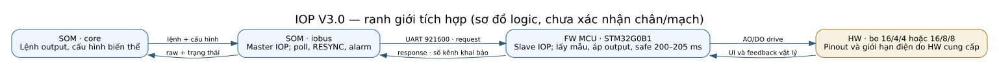
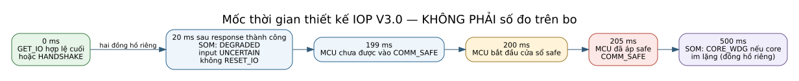
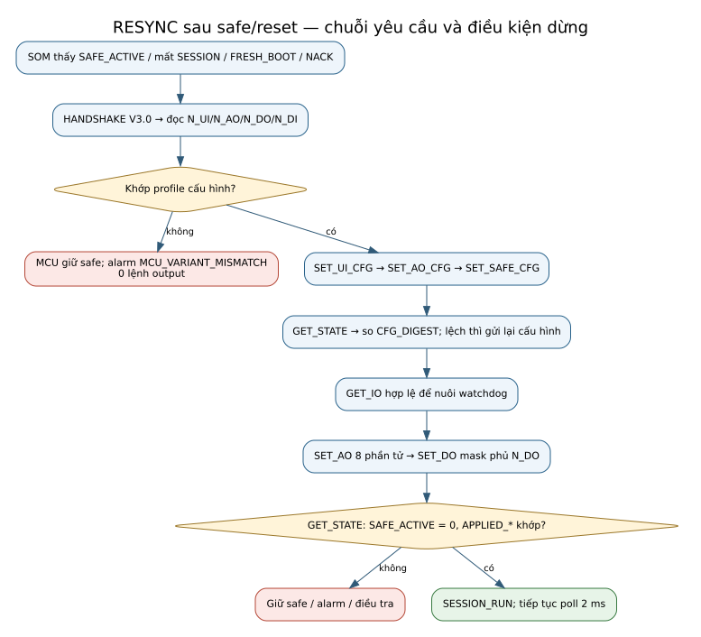

# Ví dụ tích hợp SOM ↔ MCU — Kinexus-IOP V3.0

**Document ID:** IOP-EX-MK-DDC-24-VI

**Phiên bản:** 1.0

**Ngày:** 2026-09-30

**Trạng thái:** Draft để HW, FW MCU và SOM review; ví dụ là dữ liệu minh họa, không phải log từ bo

**Chủ quản:** System Architect

**Nguồn chuẩn:** [ICD V3.0](SWFW_INTERFACE_SPEC_MK-DDC-24_VI.md) và [header nháp](iop_protocol_v3_DRAFT.h); nếu ví dụ mâu thuẫn byte/hành vi với hai nguồn này thì sửa ví dụ

**Phạm vi:** hành vi giao diện quan sát được ở hai profile Rev A và khi mất liên lạc; không quy định pinout, RTOS, DMA hoặc driver bên trong MCU

## 1. Cách đọc

`SEQ` trong mỗi **chuỗi giao dịch** tăng cho request mới; các vector `Vxx` trong ICD §15.1 là **vector độc lập** và có thể dùng SEQ khác chuỗi ví dụ. Payload nhiều byte dùng big-endian. `AO5..AO8 = 0` trên profile 4/4 là 8 byte `00`, không phải cắt bớt `SET_AO`. `MASK = 0x0F` là phủ mọi DO của 4/4; `MASK = 0xFF` là phủ mọi DO của 8/8.

Nguồn chỉnh sửa hình: [01_ranh_gioi.dot](assets/iop-v3/01_ranh_gioi.dot). Sơ đồ chỉ thể hiện ranh giới logic; HW còn phải cung cấp hồ sơ vật lý theo [phiếu đầu vào](IOP_V3_HW_INPUT_FORM_MK-DDC-24_VI.md).

## 2. EX-01 — Khởi động profile 16 UI / 4 AO / 4 DO

**Điều kiện đầu vào:** SOM cấu hình profile 16/4/4/0; MCU ở `BOOT_SAFE`, output safe, không có lỗi phần cứng ngăn chạy. UI mode minh họa dùng payload V15; AO2 chọn 4–20 mA (`AO_MODE_MASK = 0x02`); safe AO/DO đều 0. Core yêu cầu AO1 raw `0x8000`, các AO khác 0, và đóng DO1/DO3 (`VALUE = 0x05`). Đây là dữ liệu minh họa, **không phải cấu hình điện đã được Safety duyệt**.

| Bước | Request SOM → MCU | Response / kiểm tại SOM | MCU/output sau bước |
|---:|---|---|---|
| 1 | `HANDSHAKE`, SEQ 0, version `0x0300`, capability `0x0003`; frame V05: `AA 04 30 00 03 00 00 03 79 CA` | `HANDSHAKE_RESP` V06: `N_UI/N_AO/N_DO/N_DI = 16/4/4/0`, status `OK` | `SESSION_SAFE`, `CFG_VALID=0`, output safe |
| 2 | `SET_UI_CFG` 16 byte theo mode của V15; `SET_AO_CFG [02]`; `SET_SAFE_CFG` 17 byte 0. Mỗi lệnh là request mới với SEQ kế tiếp và chờ ACK riêng. | Ba ACK đúng `ECHOED_CMD`; lệnh sai mode phải NACK `ERR_BAD_VALUE` và giữ cấu hình cũ | `CFG_VALID=1`, output vẫn safe |
| 3 | `GET_STATE`; so `CFG_DIGEST` của 16 byte UI mode + `02` + 17 byte 0 | Digest mong đợi `0x6E4CCFF2` (tính bằng CRC-32/ISO-HDLC); lệch thì gửi lại cấu hình, chưa ghi output | `SESSION_SAFE` |
| 4 | `GET_IO` hợp lệ sau handshake | `IO_RESP` cùng SEQ, `SESSION=1`, `SAFE_ACTIVE=1` | Watchdog liên lạc được nuôi; output vẫn safe |
| 5 | `SET_AO` dài **16 byte**, AO1=`0x8000`, AO2..AO8=0; `SET_DO [0F 05]`. | ACK cho `SET_AO` nếu đang chờ; ACK của lệnh output cuối chỉ sau khi toàn bộ AO/DO thực lắp được áp. | Chỉ khi đủ hai lệnh và `MASK` phủ 4 DO mới vào `SESSION_RUN`; AO5..AO8 không được áp vật lý |
| 6 | `GET_STATE` | `SAFE_ACTIVE=0`, `APPLIED_AO_RAW[0]=0x8000`, `[4..7]=0`, `APPLIED_DO_MASK=0x05`, `APPLIED_AO_MODE=0x02` | SOM tiếp tục poll 2 ms |

**Ca âm phải kiểm:** nếu SOM gửi AO5 khác 0 trong `SET_AO`, MCU trả `NACK(ERR_BAD_VALUE)` cho cả frame, không cập nhật AO1; nếu SOM nhận khai báo 16/8/8/0 ở bước 1 khi đang cấu hình 4/4, phát `MCU_VARIANT_MISMATCH` và **0 lệnh output**. Test tương ứng: `ICD-T-03`, `ICD-T-06`, `ICD-T-16`.

## 3. EX-02 — Khởi động profile 16 UI / 8 AO / 8 DO

**Điều kiện đầu vào:** SOM cấu hình 16/8/8/0. Để minh họa bit tính năng, giả sử bo **có** feedback relay (`BOARD_FEATURES.DO_FB = 1`); đây là fixture host, **không xác nhận** mạch 8/8 thật có feedback. AO1 raw `0x8000`, AO8 raw `0xFFFF`; DO theo mẫu `0xA5`.

| Bước | Giao dịch và ví dụ byte | Kỳ vọng |
|---:|---|---|
| 1 | `HANDSHAKE` V05; response V07 `AA 0C 31 00 03 00 01 00 00 00 00 02 10 08 08 00 18 D2` | MCU khai `16/8/8/0`, SOM so khớp cấu hình trước lệnh ghi; `DO_FB` chỉ dùng khi HW xác nhận |
| 2 | `SET_UI_CFG`, `SET_AO_CFG`, `SET_SAFE_CFG`; `GET_STATE` so digest; `GET_IO` hợp lệ | `CFG_VALID=1`, watchdog đã được nuôi, output vẫn safe |
| 3 | `SET_AO` 16 byte: vector độc lập V10 có AO1=`0x8000`, AO8=`0xFFFF`; `SET_DO` 2 byte: vector độc lập V09 có `MASK=0xFF`, `VALUE=0xA5` | `MASK` phủ đúng 8 DO; sau lệnh output cuối, AO/DO thực lắp được áp trước ACK; `SESSION_RUN` |
| 4 | `GET_STATE` | `SAFE_ACTIVE=0`, `APPLIED_AO_RAW[0]=0x8000`, `[7]=0xFFFF`, `APPLIED_DO_MASK=0xA5` |

**Ca âm:** `HANDSHAKE_RESP` khai profile lạ (ví dụ 16/8/4/0) hoặc khác profile cấu hình SOM → giữ safe và không phát lệnh output. Bit `BOARD_FEATURES.DO_FB` không thay đổi số kênh. Test `ICD-T-10`, `ICD-T-16`.

## 4. EX-03 — Mất poll, MCU vào safe rồi RESYNC

**Điều kiện đầu vào:** đang `SESSION_RUN`, frame `GET_IO` hợp lệ vừa kết thúc tại `t=0` theo đồng hồ MCU. Không có poll hợp lệ tiếp theo; core vẫn hoạt động. Các mốc dưới đây là **giới hạn thiết kế**, không phải số đo. SOM tính ngưỡng 20 ms từ **response thành công cuối** (thường muộn hơn `t=0`); đường `CORE_WDG` 500 ms dùng đồng hồ heartbeat core riêng. Hình đặt các mốc cạnh nhau để so thứ tự, không tuyên bố chúng cùng điểm gốc thời gian.

Nguồn chỉnh sửa hình: [04_moc_thoi_gian.dot](assets/iop-v3/04_moc_thoi_gian.dot).

| Mốc | SOM | MCU / output | Quan sát và test |
|---|---|---|---|
| 20 ms từ response thành công cuối (đồng hồ SOM) | Chuyển `DEGRADED`, input `UNCERTAIN`, ngừng lệnh ghi; **không gửi `RESET_IO`** | Giữ lệnh output cuối | `ICD-T-08` |
| `t=199 ms` | Tiếp tục tìm response hợp lệ | Chưa được vào `COMM_SAFE` | `ICD-T-04` |
| `t=200..205 ms` | Có thể chưa liên lạc được | MCU áp safe và vào `COMM_SAFE`, `SESSION=0`, `SAFE_ACTIVE=1`, `LAST_SAFE_REASON=COMM_TIMEOUT` | đo HIL/P2; `ICD-T-04`, `ICD-T-15` |
| Khi UART hồi phục | SOM thấy `SAFE_ACTIVE`/mất phiên hoặc NACK; chạy `ICD-R-13` | Không tự phục hồi output cũ | `ICD-T-07` |

Nguồn chỉnh sửa hình: [03_resync.dot](assets/iop-v3/03_resync.dot). Thứ tự bắt buộc: `HANDSHAKE` → so profile → ba lệnh cấu hình → `GET_STATE`/digest → `GET_IO` hợp lệ → `SET_AO` + `SET_DO` đủ mask → `GET_STATE` xác nhận. Sai profile hoặc digest chưa khớp thì giữ safe; SOM phát alarm kèm `LAST_SAFE_REASON` và `RESET_CAUSE`.

**Phân biệt hai đồng hồ:** nếu core im lặng 500 ms, SOM gửi `RESET_IO(CORE_WDG)` theo `ICD-R-15` dù UART còn tốt; đây là tình huống khác mất poll và có bài `ICD-T-09` riêng.

## 5. Tự rà trước khi chuyển review

| Nội dung | Kết quả hiện tại | Cổng còn cần |
|---|---|---|
| Mỗi ví dụ có điều kiện, bước, trạng thái/output, ca âm và test | Có, EX-01..03; CRC/digest phải kiểm bằng script ở gói | Hai team đối chiếu host ở P1 |
| Hình có SVG đọc ngoại tuyến và nguồn DOT | Có 3 hình dùng ở đây; hình xử lý frame nằm ở [kế hoạch kiểm chứng](IOP_V3_VERIFICATION_PLAN_MK-DDC-24_VI.md) | HW/FW review ranh giới, không coi hình là pinout |
| Giá trị điện, phản hồi relay và tính nguyên khối trên bo | Chưa có hồ sơ HW 8/8 và chưa đo | [Phiếu HW](IOP_V3_HW_INPUT_FORM_MK-DDC-24_VI.md), O-9 và G-MCU-2/3 |

## Lịch sử sửa đổi

| Phiên bản | Ngày | Thay đổi |
|---|---|---|
| 1.0 | 2026-09-30 | Thêm ba ví dụ và ba hình: 4/4, 8/8, mất poll/RESYNC; dữ liệu minh họa, chưa đo trên bo. |
