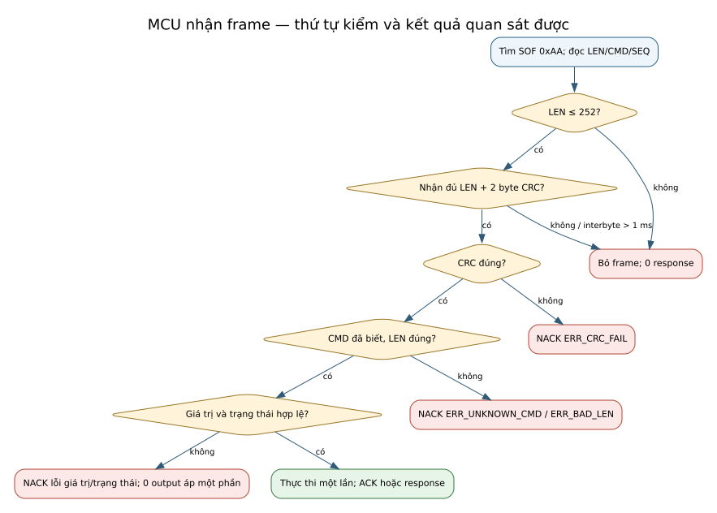

# Kế hoạch và ma trận kiểm chứng tích hợp IOP V3.0

**Document ID:** IOP-VVP-MK-DDC-24-VI

**Phiên bản:** 1.0

**Ngày:** 2026-09-30

**Trạng thái:** Kế hoạch Draft; **không có Test Result của FW MCU/bo thật** trong gói này

**Chủ quản:** Verification lead; SOM lead và MCU lead cùng thực hiện test cặp

**Nguồn:** [ICD V3.0](SWFW_INTERFACE_SPEC_MK-DDC-24_VI.md) §15, [74 yêu cầu FW MCU](FW_REQUIREMENTS_MK-DDC-24_VI.md) §4, [ví dụ tích hợp](IOP_V3_INTEGRATION_EXAMPLES_MK-DDC-24_VI.md), [phiếu đầu vào HW](IOP_V3_HW_INPUT_FORM_MK-DDC-24_VI.md)

**Quy ước kết quả:** `NOT RUN` là chưa chạy; `BLOCKED` cần điều kiện mở; `PASS`/`FAIL` chỉ ghi sau khi có log và người review. Bảng dưới là **kế hoạch**, không phải bằng chứng đạt.

## 1. Môi trường, nhận dạng và cổng

| Cổng | Môi trường/fixture tối thiểu | Bằng chứng phải lưu | Tình trạng hiện tại |
|---|---|---|---|
| P0 | ICD/header/FW-REQ đã ký; O-1/O-3/O-4/O-5/O-9 đóng | Biên bản ký, SHA-256 của ba nguồn, quyết định O-* | `BLOCKED`: chưa ký |
| P1 / G-MCU-1 | SOM iobus V3.0, firmware MCU build host qua PTY, chọn được profile 4/4 và 8/8; fake MCU V3.0 chèn lỗi | commit và hash của **cả hai** phía, lệnh test, seed, stdout/stderr, frame capture, kết quả theo test ID | `NOT RUN`: source SOM/MCU chưa chuyển V3.0 |
| P2 / G-MCU-2 | SOM ↔ STM32G0B1 qua UART thật, bo/revision và đấu nối đã được HW duyệt, logic analyzer đồng bộ thời gian | log UART/logic analyzer, phiên bản firmware, bo/revision, 24 h capture, hiệu chuẩn thiết bị | `BLOCKED`: cần HW và firmware thật |
| P3 / G-MCU-3 | Carrier của **từng** biến thể, DAQ/nguồn và đồ gá an toàn, giới hạn điện đã được HW/Safety duyệt | waveform, số đo điện, ảnh setup, hiệu chuẩn, kết quả HIL và người ký | `BLOCKED`: cần HWIF-01..10 và carrier |

Mỗi kết quả phải ghi `test ID`, ngày/giờ, profile, bo/revision (nếu có), commit/hash SOM và MCU, ICD/header revision, thiết bị/hiệu chuẩn, bước thực tế, số đo, log nguyên gốc, người chạy và người review. Không suy `PASS` P2/P3 từ P1.

Nguồn chỉnh sửa hình: [02_xu_ly_frame.dot](assets/iop-v3/02_xu_ly_frame.dot). CRC của khung đủ byte trong miền LEN được kiểm **trước** CMD/LEN/giá trị; khung thiếu hoặc LEN > 252 không tạo response.

## 2. Quy trình `ICD-T-01..16`

Mỗi bài chạy trên **hai profile** khi không ghi ngoại lệ; nếu không có bo 8/8 ở P2/P3 thì phần đó để `BLOCKED`, không đánh dấu PASS chung. Trình tự khởi tạo an toàn theo [EX-01/EX-02](IOP_V3_INTEGRATION_EXAMPLES_MK-DDC-24_VI.md). Mẫu kết quả dùng ở §5.

### ICD-T-01 — Byte contract và digest (P1)

- **Trước:** hai bản build dùng cùng header nháp đã ghim SHA-256; vector V01–V21 từ ICD §15.1.
- **Chạy:** phía SOM và MCU build/parse từng vector; kiểm `LEN`, CMD, SEQ, payload, CRC byte cao trước; tính digest của 34 byte 0 và ví dụ V15 + AO mode `0x82` + V16.
- **Đạt:** 21/21 frame khớp từng byte; digest `0x41716C2A`, `0xFD6F0284`; sai một byte là FAIL. **Kiểm header ở máy soạn tài liệu không thay bài kiểm hai phía này.**
- **Bằng chứng:** vector diff và log hai binary, tên/hash build.

### ICD-T-02 — Luồng byte và ưu tiên lỗi (P1)

- **Trước:** MCU `BOOT_SAFE`, parser sạch; có khả năng chia byte và đưa timestamp.
- **Chạy:** gửi SOF rác, frame chia mảnh, hai frame dính liền, gap 1001 µs, LEN 253, LEN sai nhưng CRC đúng, CMD lạ CRC đúng, CMD/LEN sai **và** CRC sai; sau mỗi ca gửi GET_IO hợp lệ.
- **Đạt:** khung thiếu/gap/LEN > 252 có 0 response; khung đủ byte trong miền LEN CRC sai có đúng một `ERR_CRC_FAIL` kể cả khi CMD/LEN cũng sai; CRC đúng mới trả `ERR_BAD_LEN`/`ERR_UNKNOWN_CMD`; parser hồi phục ở frame hợp lệ tiếp theo, 0 áp output/tràn/treo.
- **Bằng chứng:** byte stream, mốc thời gian, response từng ca, log fuzz 10⁷ byte cho FW-IOP-010.

### ICD-T-03 — Ma trận trạng thái và điều kiện rời safe (P1/P2)

- **Trước:** có lệnh cho từng trạng thái `BOOT_SAFE`, `SESSION_SAFE`, `SESSION_RUN`, `COMM_SAFE`.
- **Chạy:** quét từng ô ICD §7.3; thử `SET_AO` trước cấu hình, trước `GET_IO`, khi lỗi ADC/DAC/VDD; thử `SET_AO` + `SET_DO` chưa phủ đủ DO; lặp trên 4/4 và 8/8.
- **Đạt:** 100% ô đúng; `SESSION_RUN` chỉ sau `CFG_VALID=1`, `GET_IO` hợp lệ và hai lệnh output với mask đủ; 0 output áp từ frame sai/trạng thái chưa đủ.
- **Bằng chứng:** bảng ô × profile × response/state/output.

### ICD-T-04 — Watchdog liên lạc và quấn đồng hồ (P1/P2)

- **Trước:** `SESSION_RUN`; đánh dấu stop bit của GET_IO hợp lệ cuối là `t=0` (chạy thêm ca chưa có GET_IO, lấy cuối HANDSHAKE làm mốc).
- **Chạy:** ngừng GET_IO; quan sát tại 199, 200, 201 và 205 ms; xen lệnh khác, frame CRC lỗi; chạy lại với bộ đếm thời gian gần quấn.
- **Đạt:** không vào `COMM_SAFE` trước 200 ms; mọi output về safe và `SAFE_ENTRY_CNT` tăng đúng một lần trong [200;205] ms; lệnh khác/frame lỗi không gia hạn mốc; quấn đồng hồ không phá giới hạn.
- **Bằng chứng:** waveform/time trace có độ phân giải đủ phân biệt 1 ms.

### ICD-T-05 — Retry/idempotency (P1)

- **Trước:** `SESSION_RUN`, có bộ đếm ghi DO quan sát được.
- **Chạy:** gửi `SET_DO` một lần, gửi lại đúng byte/SEQ/CRC, rồi gửi cùng SEQ nhưng CRC khác; thêm thử SEQ 255→0 với request mới.
- **Đạt:** frame lặp gửi lại cùng response, bộ đếm thực thi không tăng lần hai, `IOP_SEQ_ERR` tăng; cùng SEQ khác CRC là lệnh mới; wrap SEQ không làm mất response.
- **Bằng chứng:** frame capture + bộ đếm/hook output.

### ICD-T-06 — ACK, ghi lỗi và tính nguyên khối (P1/P2/P3)

- **Trước:** `SESSION_SAFE` đủ cấu hình; chèn được lỗi ghi DAC/DO; có điểm đo từng output cho 4/4 và 8/8.
- **Chạy:** gửi `SET_AO` rồi `SET_DO` phủ mọi DO; chèn lỗi ở kênh giữa; đo cạnh cập nhật AO/DO so start bit ACK; lặp `RESET_IO`.
- **Đạt:** ACK lệnh cuối chỉ sau khi output thực lắp được áp; lỗi trả `ERR_HW_FAULT`, về safe, không để output áp một phần. **Giới hạn lệch thời gian giữa kênh chưa được HW/Safety chốt (O-9): phần vật lý `BLOCKED`, chưa thể PASS P3.**
- **Bằng chứng:** log host và waveform đủ kênh, quyết định O-9, revision HW.

### ICD-T-07 — RESYNC sau reset/mất poll (P1/P2)

- **Trước:** `SESSION_RUN`, core còn lệnh AO/DO; có thể reset MCU, restart iobus hoặc chặn poll 250 ms.
- **Chạy:** từng lỗi một; ghi `STATE_RESP`/reason/cause; cho liên kết hồi phục và quan sát đúng thứ tự `HANDSHAKE → CFG → GET_STATE → GET_IO → SET_AO → SET_DO → GET_STATE`.
- **Đạt:** không tự hồi phục output trước chuỗi; profile sai dừng ở safe; profile đúng trở lại lệnh core trong ≤1 s sau khi liên kết hồi phục; alarm có lý do.
- **Bằng chứng:** trace request/response, state/output và thời điểm hồi phục.

### ICD-T-08 — Gap 50 ms không ép RESET_IO (P1/P2)

- **Trước:** `SESSION_RUN`, output khác safe, core còn sống.
- **Chạy:** tạo gap GET_IO 50 ms rồi nối lại trước 200 ms.
- **Đạt:** SOM đánh input `UNCERTAIN` từ 20 ms sau **response thành công cuối**, dừng ghi và **0 frame RESET_IO** do gap; MCU giữ output, không vào `COMM_SAFE`.
- **Bằng chứng:** trace UART, quality và waveform output.

### ICD-T-09 — Core im lặng 500 ms (P1/P2)

- **Trước:** UART/poll MCU vẫn tốt, core heartbeat có timestamp độc lập.
- **Chạy:** dừng heartbeat core, không dừng GET_IO; quan sát `RESET_IO(CORE_WDG)`.
- **Đạt:** SOM gửi đúng reason tại ≥500 ms; output về safe trước ACK, không muộn hơn 510 ms từ heartbeat cuối; alarm phát; core hồi phục thì RESYNC.
- **Bằng chứng:** trace heartbeat, UART, output và alarm.

### ICD-T-10 — Phiên bản và profile (P1)

- **Trước:** host MCU V3.0 chọn 4/4 rồi 8/8; host SOM thử version 3.0, 2.0 và 1.x.
- **Chạy:** HANDSHAKE từng version; giải mã response và số kênh kể cả khi `INCOMPAT`; thử SOM cấu hình sai profile.
- **Đạt:** V3 cùng major vận hành theo minor thương lượng; V2/V1 `INCOMPAT` và 0 output; profile sai phát `MCU_VARIANT_MISMATCH` và 0 lệnh output.
- **Bằng chứng:** ma trận version/profile và byte capture.

### ICD-T-11 — Tải 500 Hz trong 24 h (P2)

- **Trước:** UART thật sạch, 0 lỗi CRC phía nhận, đồng hồ logic analyzer và build/revision đã ghim.
- **Chạy:** GET_IO 500 Hz trong 24 h với lệnh ghi theo ICD-R-11; tính `T_turn` từ stop bit CRC_LO request tới start bit response; đếm response sai/thiếu.
- **Đạt:** p99,9 ≤0,5 ms, max ≤1,0 ms; tỷ lệ giao dịch thiếu response đúng ≤10⁻⁶ (24 h × 500 Hz = 43,2 triệu giao dịch danh định, tối đa 43 giao dịch lỗi); 0 frame tự phát.
- **Bằng chứng:** capture gốc, script thống kê, phân bố `T_turn`, số giao dịch/CRC/error.

### ICD-T-12 — UI mode và settling (P2/P3)

- **Trước:** lấy mẫu ổn định từng ADC, biết mapping UI từ HWIF-05.
- **Chạy:** đổi mode từng UI, giữ các kênh còn lại không đổi; đo từ ACK tới lúc `SETTLING` tắt và đếm mẫu mất ở kênh không đổi.
- **Đạt:** `SETTLING` tắt ≤100 ms sau ACK; kênh không đổi mất ≤1 mẫu; mode không hợp lệ NACK và giữ cấu hình cũ.
- **Bằng chứng:** log ADC/IO_RESP, waveform mode latch và bảng 16 kênh.

### ICD-T-13 — Cấu hình lưu bền/cắt nguồn (P2)

- **Trước:** hai cấu hình AO mode/safe value có digest khác nhau, ảnh chụp nguồn và bộ đếm ghi flash.
- **Chạy:** gửi 1000 cấu hình giống nhau; sau đó ≥100 lần cắt nguồn ngẫu nhiên lúc ghi cấu hình đổi; reboot và đọc state/digest.
- **Đạt:** 0 lần ghi flash vì 1000 lệnh trùng; sau mỗi cắt nguồn chỉ có cấu hình cũ, mới hoặc mặc định hợp lệ; không có cấu hình hỏng và output luôn safe lúc khởi động.
- **Bằng chứng:** log power cut, digest, bộ đếm ghi và hash firmware.

### ICD-T-14 — FAULT_OUT (P2/P3)

- **Trước:** HWIF-04 đã xác nhận mức điện, pull và fail-safe khi mất nguồn.
- **Chạy:** lần lượt BOOT_SAFE, SESSION_SAFE/RUN, ADC/DAC/VDD fault, OUTPUT_MISMATCH, mất nguồn MCU và đứt đường FAULT_OUT.
- **Đạt:** SOM chỉ đọc “bình thường” khi `SESSION_RUN` và không có fault/mismatch theo ICD §3.3; mất nguồn/đứt dây đọc là “lỗi”.
- **Bằng chứng:** waveform mức điện + state/FAULT_FLAGS, mã bo và sơ đồ nguồn.

### ICD-T-15 — Output điện và safe value (P3)

- **Trước:** HWIF-05..09 và dung sai đã được HW/Safety duyệt; thiết bị đo hiệu chuẩn.
- **Chạy:** ở từng mode và mọi AO/DO thực lắp trên **cả hai** carrier, đo giá trị thường/safe, feedback relay, VDD fault, RESET_IO và mất poll.
- **Đạt:** giá trị điện trong giới hạn HW được ký; mọi ca fault về safe trong giới hạn ICD; không thể chấm PASS khi thiếu giới hạn hoặc carrier.
- **Bằng chứng:** bảng điểm đo, ảnh setup, số hiệu hiệu chuẩn, waveform và chữ ký Safety.

### ICD-T-16 — Biến thể 4/4 và 8/8 (P1/P2)

- **Trước:** host/bo chọn được từng profile; SOM cấu hình tương ứng và cấu hình sai có chủ ý.
- **Chạy:** đọc `HANDSHAKE_RESP`; thử AO/DO không lắp khác 0, mask thiếu/đủ DO; thử profile khai khác SOM và `BOARD_FEATURES.DO_FB` 0/1 theo fixture.
- **Đạt:** khai đúng 16/4/4/0 hoặc 16/8/8/0; giá trị kênh không lắp bị NACK toàn bộ; chỉ mask phủ đủ DO mới rời safe; 0 lệnh output khi lệch profile; bit DO_FB theo HW ở P2.
- **Bằng chứng:** ma trận profile × command × state × response, bản HWIF-01/07 cho P2.

## 3. Nhóm kiểm bổ sung cho yêu cầu FW ngoài 16 bài ICD

| ID | Phạm vi và bước chính | Kết quả cần có | Mức/bằng chứng |
|---|---|---|---|
| FW-T-01 | Bơm mẫu/điện áp vào 16 UI theo HWIF-05; so raw trung bình, mở rộng dấu, rate, fault từng ADC, UI_OV và mode | Các ngưỡng của FW-IO-* ở [FW-REQ §4.2](FW_REQUIREMENTS_MK-DDC-24_VI.md); không suy từ host sang điện vật lý | H/B/L, log SPI/DAQ |
| FW-T-02 | Đặt AO/DO từng kênh và safe theo HWIF-06/07; thử 0–10 V, 4–20 mA, relay feedback/stuck, VDD fault | Các ngưỡng FW-AO-*, FW-DO-*; O-9 phải có giới hạn được ký | B/L, waveform và bảng điểm đo |
| FW-T-03 | Chèn treo lấy mẫu/IOP, reset, self-test ADC/DAC/VDD, 20 lần power-on và 20 lần nRESET | Các ngưỡng FW-WDG-*, FW-BOOT-*; safe từ khởi động, boot ready ≤500 ms | B/L, reset cause và waveform |
| FW-T-04 | Mô phỏng nhiệt/VDD, đọc DIAG và FAULT_OUT, kiểm sticky/counter/hysteresis | Các ngưỡng FW-DIAG-* và FW-IOP-008/014 | H/B/L, DIAG_RESP và log cảm biến |
| FW-T-05 | Gửi cấu hình giống nhau/đổi cấu hình, power cut và đọc digest sau reboot; phân tích độ bền flash | FW-CFG-001..005, 0 ghi flash khi 1000 lệnh trùng, ≥100 lần cắt nguồn | H/B/A, log flash và power-cut |
| FW-T-06 | Đối chiếu schematic/pinout, USART baud, image↔revision, `BOARD_FEATURES` và số kênh | FW-HW-001..004, FW-IOP-015 trên từng revision | I/B/P, bản HWIF đã ký và phép đo baud |
| FW-T-07 | Nạp 3 bo trắng qua SWD; kiểm metadata ELF/HEX/BIN, SHA-256, map, release note, bản host PTY cho hai profile | FW-OTA-006, FW-REL-001..008; bản host và firmware thật cùng hành vi IOP | I/H/B/P, manifest build và log nạp |
| FW-T-08 | Review source/thiết kế những yêu cầu không chứng minh trực tiếp bằng I/O: không lọc thêm, không lưu UI mode, SPI master duy nhất, flash trống/độ bền, coding standard | Tiêu chí riêng của FW-IO-002, FW-CFG-003/005, FW-HW-002, FW-REL-003/006/007 | I/A, biên bản review và map file |

## 4. Ma trận 74 yêu cầu FW MCU → quy trình

Mỗi dòng là **kế hoạch phủ**, không phải Test Result. Cột “Tiêu chí” lấy từ [yêu cầu gốc](FW_REQUIREMENTS_MK-DDC-24_VI.md) §4; nếu thay đổi tiêu chí phải sửa cả hai tài liệu trong cùng revision. `NOT RUN` ở mọi dòng cho tới khi có bằng chứng theo §1. `SHOULD` không đạt phải có giải trình được review, không tự chuyển thành PASS.

| ID | Mức | Phương pháp | Quy trình dự kiến | Tiêu chí gốc từ FW-REQ §4 | Kết quả |
|---|---|---|---|---|---|
| `FW-IOP-001` | MUST | H, P | ICD-T-01, ICD-T-02, ICD-T-03, ICD-T-04, ICD-T-05, ICD-T-06, ICD-T-10, ICD-T-16 | `ICD-T-01..06`, `ICD-T-10`, `ICD-T-16` PASS | `NOT RUN` |
| `FW-IOP-003` | MUST | B, P | ICD-T-11 | `ICD-T-11`: 24 h ở poll 500 Hz, log logic analyzer hoặc dấu thời gian phía SOM | `NOT RUN` |
| `FW-IOP-004` | MUST | H | ICD-T-02 | `ICD-T-01`, `ICD-T-02`; CMD/LEN sai đồng thời CRC sai phải trả `ERR_CRC_FAIL` | `NOT RUN` |
| `FW-IOP-005` | MUST | H | ICD-T-02, ICD-T-03 | `ICD-T-02`, `ICD-T-03` | `NOT RUN` |
| `FW-IOP-006` | MUST | H, P, I | ICD-T-10, FW-T-06 | `ICD-T-10` kể cả vector âm; `BOARD_FEATURES` khớp bo | `NOT RUN` |
| `FW-IOP-007` | MUST | H, B | ICD-T-04 | `ICD-T-04`: frame khác và frame lỗi không làm lùi thời điểm vào safe | `NOT RUN` |
| `FW-IOP-008` | MUST | H, B | FW-T-04 | từng bit bật và xoá đúng điều kiện | `NOT RUN` |
| `FW-IOP-010` | MUST | H, B | ICD-T-02 | `ICD-T-02`; fuzz ≥ 10⁷ byte ngẫu nhiên không crash, không treo, vẫn trả lời `GET_IO` hợp lệ ngay sau đó | `NOT RUN` |
| `FW-IOP-011` | MUST | H, P | ICD-T-02, ICD-T-11 | 24 h capture: số response = số request nhận đủ khung trong miền LEN; 0 frame tự phát | `NOT RUN` |
| `FW-IOP-012` | MUST | H | ICD-T-05 | `ICD-T-05` | `NOT RUN` |
| `FW-IOP-013` | MUST | P | ICD-T-11 | `ICD-T-11` | `NOT RUN` |
| `FW-IOP-014` | MUST | H, P | ICD-T-03, ICD-T-07 | kiểm từng field qua các chuyển trạng thái §7.2 của ICD | `NOT RUN` |
| `FW-IOP-015` | MUST | H, B, P | ICD-T-16, FW-T-06 | `ICD-T-16` trên từng biến thể | `NOT RUN` |
| `FW-IO-001` | MUST | B, L | FW-T-01 | `ADC_SAMPLE_RATE` ≥ 1000; `UI_RAW` lệch ≤ 1 LSB so với trung bình tính từ bản ghi SPI cùng khoảng | `NOT RUN` |
| `FW-IO-002` | MUST | I, H | FW-T-01, FW-T-08 | review mã nguồn của team MCU; test bước nhảy thấy đúng trung bình | `NOT RUN` |
| `FW-IO-004` | MUST | H | ICD-T-01, FW-T-01 | biên `0x7FFFFF`, `0x800000`, `0xFFFFFF` ra đúng +8388607, −8388608, −1 | `NOT RUN` |
| `FW-IO-005` | MUST | H, B | FW-T-01 | ở 1 kSPS tăng 2 ± 1 mỗi poll 2 ms | `NOT RUN` |
| `FW-IO-006` | MUST | B, L | FW-T-01 | ngắt từng chip: chỉ bit của chip đó bật, trong 100–150 ms | `NOT RUN` |
| `FW-IO-008` | SHOULD | B | FW-T-01 | nối lại chip: bit lỗi tự tắt trong ≤ 2 s | `NOT RUN` |
| `FW-IO-010` | MUST | B, L | ICD-T-12, FW-T-01 | 5 mode × 16 kênh, đo đường tín hiệu đúng mode | `NOT RUN` |
| `FW-IO-011` | MUST | B | ICD-T-12 | `ICD-T-12` | `NOT RUN` |
| `FW-IO-012` | MUST | B, L | ICD-T-12 | `ICD-T-12` | `NOT RUN` |
| `FW-IO-013` | MUST | H | ICD-T-01, ICD-T-03 | vector §6.12 của ICD; lệnh có một kênh sai giữ nguyên toàn bộ mode cũ | `NOT RUN` |
| `FW-IO-014` | MUST | I | ICD-T-10 | `HANDSHAKE_RESP` | `NOT RUN` |
| `FW-IO-015` | MUST | B, L | FW-T-01, FW-T-03 | đo khi cấp nguồn 20 lần | `NOT RUN` |
| `FW-IO-016` | MUST | H | FW-T-01 | biên 8 136 949 / 8 136 950 | `NOT RUN` |
| `FW-IO-024` | MUST | I | ICD-T-10 | — | `NOT RUN` |
| `FW-AO-001` | MUST | B | ICD-T-06, FW-T-02 | `ICD-T-06`: cạnh cập nhật DAC xảy ra trước ACK trên cả biến thể 4 và 8 AO | `NOT RUN` |
| `FW-AO-003` | MUST | H, B | ICD-T-06, FW-T-02 | chèn lỗi SPI | `NOT RUN` |
| `FW-AO-004` | MUST | B, L | ICD-T-06, FW-T-02 | đo ở đầu ra DAC | `NOT RUN` |
| `FW-AO-005` | MUST | H, L | ICD-T-04 | `ICD-T-04` | `NOT RUN` |
| `FW-AO-006` | MUST | H | ICD-T-16 | V19 của ICD; biến thể 4 AO nhận AO5..AO8 ≠ 0 | `NOT RUN` |
| `FW-AO-007` | MUST | B, L | ICD-T-03, FW-T-02 | đo cả hai mode ở mọi AO thực lắp | `NOT RUN` |
| `FW-AO-008` | MUST | B | FW-T-05, FW-T-02 | cắt nguồn sau khi đặt 4–20 mA: khởi động lên vẫn 4–20 mA | `NOT RUN` |
| `FW-AO-009` | MUST | L | ICD-T-15, FW-T-02 | đo tại cực ở cả hai mode | `NOT RUN` |
| `FW-AO-010` | MUST | B, L | ICD-T-15, FW-T-02 | hạ rồi khôi phục VDD: output giữ safe tới khi RESYNC, đo tại cực | `NOT RUN` |
| `FW-DO-001` | MUST | B | ICD-T-06, FW-T-02 | `ICD-T-06` trên cả biến thể 4 và 8 DO | `NOT RUN` |
| `FW-DO-002` | MUST | B, L | ICD-T-15, FW-T-02 | theo từng biến thể bo | `NOT RUN` |
| `FW-DO-003` | MUST | L | FW-T-02 | kẹt cơ khí hoặc ngắt cuộn relay | `NOT RUN` |
| `FW-DO-004` | MUST | L | ICD-T-15, FW-T-02 | đo tiếp điểm | `NOT RUN` |
| `FW-DO-007` | MUST | H | ICD-T-16 | biến thể 4 DO nhận bit 4..7 ≠ 0 | `NOT RUN` |
| `FW-WDG-001` | MUST | B, L | FW-T-03 | build test có điểm chèn treo; đo output và `RESET_CAUSE` | `NOT RUN` |
| `FW-WDG-005` | MUST | H, B, L | ICD-T-04, ICD-T-15 | `ICD-T-04`; HIL đo bằng logic analyzer và DAQ | `NOT RUN` |
| `FW-WDG-006` | MUST | B | FW-T-03, FW-T-04 | tạo từng loại reset: POR, NRST, watchdog, phần mềm | `NOT RUN` |
| `FW-WDG-007` | MUST | L | FW-T-03, ICD-T-15 | scope 20 lần cấp nguồn và 20 lần xung nRESET | `NOT RUN` |
| `FW-WDG-008` | MUST | H, P | ICD-T-03, ICD-T-07, ICD-T-16 | `ICD-T-03`, `ICD-T-07`, `ICD-T-16`; thiếu bất kỳ điều kiện nào thì output giữ safe | `NOT RUN` |
| `FW-BOOT-001` | MUST | B | FW-T-03 | 20 lần đo | `NOT RUN` |
| `FW-BOOT-004` | MUST | B | FW-T-03 | chèn lỗi từng khối | `NOT RUN` |
| `FW-BOOT-005` | MUST | H, B | ICD-T-03, FW-T-03 | — | `NOT RUN` |
| `FW-DIAG-001` | MUST | B | FW-T-04 | so với nhiệt kế ngoài, sai số theo datasheet STM32 | `NOT RUN` |
| `FW-DIAG-002` | MUST | H, B | FW-T-04 | mô phỏng giá trị nhiệt | `NOT RUN` |
| `FW-DIAG-003` | MUST | B | FW-T-04 | sai số ≤ ±50 mV so với đồng hồ | `NOT RUN` |
| `FW-DIAG-004` | MUST | B, L | FW-T-04, ICD-T-15 | nguồn điều chỉnh được | `NOT RUN` |
| `FW-DIAG-005` | MUST | H | FW-T-04 | — | `NOT RUN` |
| `FW-DIAG-006` | SHOULD | B | FW-T-04 | — | `NOT RUN` |
| `FW-DIAG-007` | MUST | B, P | ICD-T-14 | `ICD-T-14` | `NOT RUN` |
| `FW-CFG-001` | MUST | B | ICD-T-13, FW-T-05 | đếm số lần ghi sau 1000 lệnh cấu hình trùng giá trị: 0; nạp firmware khác biến thể: dùng mặc định | `NOT RUN` |
| `FW-CFG-002` | MUST | B | ICD-T-13, FW-T-05 | `ICD-T-13`: ≥ 100 lần cắt nguồn ngẫu nhiên trong lúc ghi | `NOT RUN` |
| `FW-CFG-003` | MUST | I, B | FW-T-08 | — | `NOT RUN` |
| `FW-CFG-004` | MUST | H | ICD-T-01, FW-T-05 | 2 vector trong ICD | `NOT RUN` |
| `FW-CFG-005` | MUST | A | FW-T-05, FW-T-08 | phân tích độ bền flash theo datasheet và cách ghi của team MCU | `NOT RUN` |
| `FW-OTA-006` | MUST | I, B | FW-T-07 | nạp theo hướng dẫn trên 3 bo trắng | `NOT RUN` |
| `FW-HW-001` | MUST | I | FW-T-06 | đối chiếu cấu hình chân với tài liệu HW | `NOT RUN` |
| `FW-HW-002` | MUST | I | FW-T-08 | — | `NOT RUN` |
| `FW-HW-003` | MUST | B | FW-T-06 | đo baud thực | `NOT RUN` |
| `FW-HW-004` | MUST | I, B, P | ICD-T-16, FW-T-06 | `ICD-T-16` PASS trên cả hai biến thể; release note nêu rõ image nào cho biến thể nào | `NOT RUN` |
| `FW-REL-001` | MUST | I, P | FW-T-07 | đọc chuỗi trong ELF và `HANDSHAKE_RESP` | `NOT RUN` |
| `FW-REL-002` | MUST | I | FW-T-07 | checklist bàn giao | `NOT RUN` |
| `FW-REL-003` | SHOULD | I | FW-T-07, FW-T-08 | build lại một lần ở phía nhận | `NOT RUN` |
| `FW-REL-004` | MUST | I | FW-T-07 | báo cáo có số đo thật, ngày chạy, commit | `NOT RUN` |
| `FW-REL-005` | MUST | I | FW-T-07 | — | `NOT RUN` |
| `FW-REL-006` | SHOULD | I | FW-T-08 | map file | `NOT RUN` |
| `FW-REL-007` | SHOULD | I | FW-T-08 | báo cáo phân tích tĩnh | `NOT RUN` |
| `FW-REL-008` | MUST | I, P | FW-T-07, ICD-T-10 | iobus chạy với bản này qua `ICD-T-01..10` và `ICD-T-16` cho cả hai biến thể | `NOT RUN` |

### 4.1 Rủi ro giao diện và đường kiểm

Đây là **danh mục rủi ro tích hợp**, không thay phân tích an toàn của sản phẩm. Chưa có xác suất/mức nghiêm trọng được Safety duyệt, nên **rủi ro còn lại chưa được chấp nhận**. `PASS` test không tự đóng rủi ro; Safety và bên tiêu thụ phải review kết quả trên đúng bo/revision.

| ID | Nguyên nhân → sự kiện → tác động | Kiểm soát trong hợp đồng | Bài kiểm và bằng chứng cần có | Chủ quyết định / trạng thái |
|---|---|---|---|---|
| `RSK-IOP-001` | Khai sai 4/4 ↔ 8/8 → SOM ghi kênh không lắp → output không đúng cấu hình | So toàn bộ `N_*`, 0 lệnh output khi mismatch | `ICD-T-10/16`, HWIF-01 và log handshake từng revision | SOM + HW + Safety; chưa chấp nhận |
| `RSK-IOP-002` | Mất poll → output giữ quá lâu → hành vi điều khiển không an toàn | MCU safe trong [200;205] ms, SOM không RESET_IO ở 20 ms | `ICD-T-04/08/15`, waveform output và log UART | MCU + Safety; chưa chấp nhận |
| `RSK-IOP-003` | AO/DO áp từng phần → trạng thái trung gian ngoài ý muốn → sai tác động vật lý | Điều kiện rời safe nguyên khối và ACK sau áp; O-9 cần HW định lượng | `ICD-T-06/15`, HWIF-09, waveform mọi kênh | HW + MCU + Safety; **O-9 chặn P0**, vật lý chờ P3 |
| `RSK-IOP-004` | CRC/SEQ lỗi hoặc retry lặp → lệnh ghi sai/lặp → output không dự kiến | CRC trước CMD/LEN, SEQ, idempotency, NACK toàn lệnh | `ICD-T-01/02/05`, byte capture và bộ đếm ghi | MCU + SOM; chưa chấp nhận |
| `RSK-IOP-005` | Lỗi nguồn/ADC/DAC/relay không lộ ra → SOM tiếp tục tin output/input | `FAULT_FLAGS`, `MCU_STATE`, `FAULT_OUT`, safe/RESYNC | `ICD-T-03/14/15`, HWIF-04/08, waveform và alarm | HW + SOM + Safety; chưa chấp nhận |

## 5. Mẫu Test Result để team thực hiện điền

| Trường | Giá trị phải ghi |
|---|---|
| ID và profile | `ICD-T-__` hoặc `FW-T-__`; 16/4/4 hoặc 16/8/8; host/P2/P3 |
| Nguồn | ICD, FW-REQ, header SHA-256; commit/hash SOM và firmware MCU; bo/revision và HWIF (nếu có) |
| Fixture/bước | lệnh thực tế, seed, setup, thiết bị đo và hiệu chuẩn, thời điểm chạy |
| Kết quả | `NOT RUN` / `BLOCKED` / `PASS` / `FAIL`; giá trị đo, giới hạn, từng ca âm; link log/capture gốc |
| Review | người chạy, người review độc lập, ngày, finding và quyết định đóng/mở |

Ví dụ **dòng kế hoạch, chưa phải kết quả**: `FW-WDG-005 → ICD-T-04 + FW-T-03 → P2/P3 → t=199 ms chưa safe; t∈[200;205] ms đã safe → cần waveform và revision bo → NOT RUN`.

## 6. Tự rà và điều kiện nâng mức

| Kiểm | Hiện tại | Điều kiện tiếp theo |
|---|---|---|
| 16 ICD-T có điều kiện, kích thích, kỳ vọng định lượng và bằng chứng | Có ở §2; chưa chạy | SOM/MCU review quy trình, đóng finding |
| 74 yêu cầu hiệu lực có đường tới quy trình và tiêu chí nguồn | §4, phải được kiểm tự động 74/74 | Bên tiêu thụ xác nhận ma trận, không suy PASS từ mapping |
| Đầu vào HW cho test vật lý | [HWIF-01..10](IOP_V3_HW_INPUT_FORM_MK-DDC-24_VI.md) chưa được điền | HW/Safety cung cấp và ký trước P2/P3 |
| Test Result P1/P2/P3 | Chưa có | Chỉ lên M4/M5/đóng gate sau review và chữ ký có thẩm quyền |
| Rủi ro giao diện → kiểm soát → test → chủ chấp nhận | §4.1, 5/5 rủi ro có đường kiểm | Safety cần chấm S/L và chấp nhận rủi ro còn lại sau bằng chứng P2/P3 |

## Lịch sử sửa đổi

| Phiên bản | Ngày | Thay đổi |
|---|---|---|
| 1.0 | 2026-09-30 | Viết 16 quy trình ICD-T, 8 nhóm kiểm FW, ma trận kế hoạch cho 74 yêu cầu và 5 rủi ro giao diện nối tới kiểm soát/test; mọi kết quả ở trạng thái chưa chạy. |
