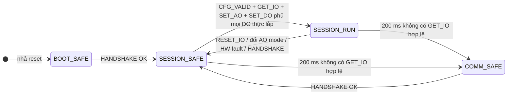
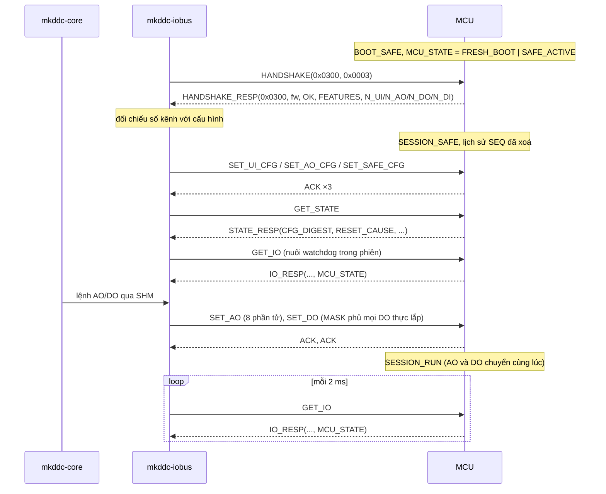

# ICD giao tiếp SOM ↔ MCU — Kinexus-IOP v3.0

**Document ID:** IOP-SPEC-MK-DDC-24-VI
**Phiên bản:** 3.0
**Bản rà soát:** R2 — chỉnh P0/P1, bổ sung ví dụ, hình và kế hoạch kiểm chứng; giao thức trên dây vẫn V3.0
**Cập nhật:** 2026-09-30
**Trạng thái:** Phiên bản **V3.0 duy nhất đã được chủ dự án chọn** theo ADR-064; chi tiết ICD vẫn Draft để **team SOM, team MCU và Safety thống nhất**, chưa ký (§17)
**Chủ quản:** System Architect (chủ sở hữu giao diện)
**Bên tham gia:** Team SOM (`mkddc-iobus`, `mkddc-core`) · Team MCU (firmware STM32G0B1, team riêng)
**Người review:** SOM lead, MCU team lead, Safety
**Người phê duyệt:** System Architect; Safety cho các mục §7–§9 và §13
**Đi cùng:** [Yêu cầu FW MCU `FW-REQ-MK-DDC-24-VI` v3.1](FW_REQUIREMENTS_MK-DDC-24_VI.md) · [Header nháp `iop_protocol_v3_DRAFT.h`](iop_protocol_v3_DRAFT.h) · [Ví dụ tích hợp](IOP_V3_INTEGRATION_EXAMPLES_MK-DDC-24_VI.md) · [Kế hoạch và ma trận kiểm chứng](IOP_V3_VERIFICATION_PLAN_MK-DDC-24_VI.md) · [Phiếu đầu vào HW](IOP_V3_HW_INPUT_FORM_MK-DDC-24_VI.md)
**Thay thế về mục tiêu tích hợp:** bản 2.0 (IOP v2.1, chưa phát hành) và bản 1.2 (IOP v1) của chính file này, [IOP_PROTOCOL.md Rev 2.1](../04_design/hardware/05_mcu_io/IOP_PROTOCOL.md), phần hợp đồng trong [guide 05](../03_implementation/05_IOP_UART_IMPLEMENTATION_GUIDE.md), và phần layout V2 của [ADR-010](../adr/ADR-010-iop-v2-poll-capability-map.md). Những file V2 chỉ còn vai trò lịch sử/source hiện có, không là phương án tích hợp dự phòng.
**Nguồn rà soát:** [`REC-DDC-FWSOM-MCU-PAIR-20260930`](../07_records/reviews/DDC24_FW_SOM_MCU_PAIR_INTEGRATION_REVIEW_2026-09-30.md)

---

## 0. Đọc nhanh

| Câu hỏi | Trả lời |
|---|---|
| Tài liệu này để làm gì? | Là **hợp đồng duy nhất** giữa hai team: frame, lệnh, payload, ngữ nghĩa từng field, trạng thái phiên, thời gian, xử lý lỗi, phiên bản, cấu hình, chẩn đoán và bài kiểm tích hợp. Mỗi bên implement độc lập mà vẫn khớp nhau nếu cùng tuân tài liệu này. |
| Phục vụ bo nào? | **Cả hai biến thể**: 16 UI / 4 AO / 4 DO và 16 UI / 8 AO / 8 DO. Mảng AO/DO trên dây luôn có đủ 8 phần tử; MCU khai **số kênh thực lắp** trong `HANDSHAKE_RESP` (§2.1). |
| Tài liệu này **không** quy định gì? | Thiết kế bên trong MCU: RTOS hay superloop, task, driver, DMA, bộ nhớ, bộ lọc nội bộ (thuộc team MCU). Thiết kế bên trong SOM (thuộc team SOM). Mạch, chân, cách ly (thuộc HW). |
| Byte và hằng số lấy ở đâu? | [`iop_protocol_v3_DRAFT.h`](iop_protocol_v3_DRAFT.h), header nháp. Khi ký, file này thành `contracts/iop/iop_protocol.h` v3.0. `contracts/iop/iop_protocol.h` v2.0 hiện là thứ SOM đang chạy với fake MCU. |
| Khác gì v2.0? | **Breaking**, major 3: `SET_AO` 8 → 16 byte và `HANDSHAKE_RESP` 8 → 12 byte (khai số kênh). Gộp các bổ sung đã soạn cho v2.1: `MCU_STATE`, `SET_UI_CFG`, `SET_SAFE_CFG`, `GET_STATE`, 3 mã NACK, luật phiên. V2.x chỉ còn mô tả source/lịch sử, không được dùng cho cặp tích hợp mới (§12.2). |
| Ai quyết định safe khi mất liên lạc? | **Chỉ MCU**: không có `GET_IO` hợp lệ trong 200 ms thì vào safe. SOM không ép safe vì lỗi liên lạc ngắn (§8). |
| Còn mở gì? | 6 mục chờ quyết định ở §16.1. Mỗi mục có đề xuất mặc định; tài liệu này viết theo đề xuất đó. |

## 1. Phạm vi, thẩm quyền, quy ước

### 1.1 Phạm vi

**Trong phạm vi:** tham số UART và hành vi logic của 3 đường điều khiển; frame, CRC, SEQ; danh mục lệnh và payload; ngữ nghĩa dữ liệu; khai báo biến thể bo; trạng thái MCU nhìn từ ngoài và luật phiên; thời gian; xử lý lỗi; phiên bản; quyền sở hữu cấu hình kênh và safe value; chẩn đoán; vector và bài kiểm tích hợp; quy trình thay đổi.

**Ngoài phạm vi:**

| Nội dung | Thuộc |
|---|---|
| Kiến trúc firmware bên trong MCU | Team MCU |
| Đổi raw → V/mA/°C, hiệu chuẩn, SHM, core, Web, BACnet | Team SOM |
| Mạch UI/AO/DO, số chip DAC, driver relay, chân MCU, cổng UART phía SOM, cách ly, mức điện | HW, theo tài liệu của từng biến thể bo |
| Cập nhật firmware MCU qua SOM (OTA) | Rev B ([DECISIONS.md](../00_governance/DECISIONS.md), 2026-08-20) |

### 1.2 Thứ tự thẩm quyền

1. Header byte v3.0: nháp [`iop_protocol_v3_DRAFT.h`](iop_protocol_v3_DRAFT.h), sau khi ký là `contracts/iop/iop_protocol.h`. **Thắng** mọi tài liệu về byte.
2. Tài liệu này: hành vi, ngữ nghĩa, thời gian, bài kiểm. Thắng mọi tài liệu khác về hành vi giao tiếp.
3. [FW_REQUIREMENTS v3.1](FW_REQUIREMENTS_MK-DDC-24_VI.md) và yêu cầu phía SOM trỏ về đây, không định nghĩa lại.

Header và tài liệu này phải đổi **trong cùng một thay đổi** (§12.4).

### 1.3 Quy ước

- **PHẢI / NÊN / CÓ THỂ** tương ứng MUST / SHOULD / MAY.
- Field nhiều byte là **big-endian**. Bit 0 là bit thấp nhất.
- **Frame hợp lệ:** SOF đúng, nhận đủ `LEN + 6` byte, CRC đúng, CMD/LEN/giá trị/trạng thái được kiểm theo thứ tự §4.3 và §10.1. `HANDSHAKE` khác major vẫn là frame hợp lệ và nhận `HANDSHAKE_RESP(INCOMPAT)`.
- **Phiên:** khoảng từ lúc HANDSHAKE thành công tới khi MCU rời trạng thái có phiên (§7).
- `N_UI`, `N_AO`, `N_DO`, `N_DI`: số kênh thực lắp do MCU khai (§2.1). **Kênh thực lắp** của AO là AO1..AO`N_AO`; tương tự cho DO.
- Thời gian đo tại chân UART phía MCU bằng logic analyzer, trừ khi ghi khác. "Hết frame" là stop bit của byte CRC_LO.
- Luật `ICD-R-xx` (§8); bài kiểm `ICD-T-xx` (§15).
- **[=v2]** = giữ nguyên như v2.0; **[v3]** = mới hoặc đổi ở v3.0.

## 2. Tổng quan và phân vai

```text
 mkddc-core ──SHM── mkddc-iobus ══ UART 921600 (cách ly) ══ STM32G0B1 ── ADC ×2 / DAC / relay / mode latch
                        │  ── nRESET, BOOT0 ──────────────────►│
                        │◄─────────────────────── FAULT_OUT ────│
```

- **SOM là master**, khởi tạo mọi giao dịch. **MCU là slave**, chỉ trả lời, **không bao giờ tự gửi**.
- Mỗi thời điểm có **tối đa một** request đang chờ trả lời (§4.7).

| Dữ liệu / quyết định | Chủ sở hữu | Bên kia |
|---|---|---|
| Lấy mẫu UI, trạng thái ADC | MCU | SOM đọc qua `IO_RESP` |
| Đổi raw → đại lượng kỹ thuật, quality, lọc, debounce dry-contact | SOM | — |
| Giá trị output được lệnh | SOM (core quyết định, iobus gửi) | MCU áp |
| **Safe khi mất liên lạc** | **MCU (duy nhất)** | SOM quan sát qua `MCU_STATE` |
| Safe khi có lý do chủ động (operator, OTA, core chết) | SOM gửi `RESET_IO` | MCU thực thi |
| Cấu hình kênh (UI mode, AO mode) và safe value | SOM | MCU áp và cache (§13) |
| Khai biến thể bo (số kênh, tính năng) | MCU | SOM cấu hình theo (§2.1) |
| Phát hiện lỗi DAC, relay, ADC, VDD, nhiệt | MCU | SOM phát alarm |
| Reset phần cứng MCU (nRESET) | SOM | — |

### 2.1 Biến thể bo [v3]

| Biến thể | `N_UI` | `N_AO` | `N_DO` | `N_DI` |
|---|---:|---:|---:|---:|
| 16 UI / 4 AO / 4 DO | 16 | 4 | 4 | 0 |
| 16 UI / 8 AO / 8 DO | 16 | 8 | 8 | 0 |

- MCU PHẢI khai **đúng** số kênh của bo đang chạy trong `HANDSHAKE_RESP` (§6.10). Cách firmware biết mình đang ở biến thể nào (image riêng hay đọc chân nhận diện) do team MCU và HW thống nhất.
- SOM PHẢI đọc số kênh từ `HANDSHAKE_RESP` và **đối chiếu với biến thể được cấu hình**. Lệch thì phát alarm `MCU_VARIANT_MISMATCH`, không gửi **bất kỳ lệnh output nào**, giữ MCU ở safe cho tới khi cấu hình/firmware đúng biến thể và RESYNC hoàn tất.
- Trên dây, mảng AO và DO **luôn đủ 8 phần tử**. Kênh không lắp PHẢI mang giá trị 0 (§6).
- Giá trị khác hai dòng trên (đặc biệt `N_DI > 0`) **chưa được phép vận hành ở Rev A**; SOM báo `MCU_VARIANT_MISMATCH`, giữ output safe và chờ bản ICD mới quy định ngữ nghĩa DI.

## 3. Lớp vật lý và đường điều khiển

### 3.1 UART [=v2]

| Thông số | Giá trị |
|---|---|
| Tốc độ | 921 600 bit/s, 8N1, không flow control |
| Sai số baud | Mỗi bên PHẢI ≤ ±1,5 % so với danh định |
| Mức logic, cách ly, chân MCU, cổng phía SOM | Theo tài liệu HW của biến thể bo; **ngoài ICD** |
| Thời lượng 1 byte | 10,85 µs |

### 3.2 Nhịp byte trong frame [v3]

- Bên gửi PHẢI phát liền một frame; khoảng trống giữa hai byte liên tiếp **≤ 0,5 ms**.
- Bên nhận PHẢI **bỏ frame đang dở** khi khoảng trống giữa hai byte **> 1 ms**, đếm lỗi, rồi quay lại tìm SOF.
- Bên nhận không được coi một lần line-idle ngắn (1–2 byte) là hết frame.

### 3.3 Hành vi logic của đường điều khiển [v3]

Mức điện, chân và cách ly thuộc HW. ICD chỉ quy định **hành vi logic**:

| Đường | Hướng | Hành vi bắt buộc |
|---|---|---|
| `nRESET` | SOM → MCU | Tích cực (assert) **≥ 1 ms** thì MCU reset. Sau khi nhả, MCU trả lời được IOP trong ≤ 500 ms. SOM chỉ dùng theo `ICD-R-16`. |
| `BOOT0` | SOM → MCU | **Rev A: SOM giữ ở mức khởi động bình thường liên tục.** Chỉ dùng cho OTA ở Rev B. |
| `FAULT_OUT` | MCU → SOM | Ở trạng thái **"bình thường"** khi và chỉ khi MCU đang `SESSION_RUN` **và** không có bit lỗi phần cứng (`ADC1`, `ADC2`, `DAC`, `RELAY_STUCK`, `MCU_OVERTEMP`, `VDD`) **và** `OUTPUT_MISMATCH = 0`. Mọi trường hợp khác là **"lỗi"**. HW PHẢI chọn mức điện sao cho MCU mất nguồn hoặc đứt dây đọc thành **"lỗi"**. |

## 4. Khung (frame) [=v2]

### 4.1 Cấu trúc

```text
┌──────┬──────┬──────┬──────┬───────────────────┬────────┬────────┐
│ SOF  │ LEN  │ CMD  │ SEQ  │ PAYLOAD[LEN]      │ CRC_HI │ CRC_LO │
│ 0xAA │ 1 B  │ 1 B  │ 1 B  │ 0..252 B          │  1 B   │  1 B   │
└──────┴──────┴──────┴──────┴───────────────────┴────────┴────────┘
Tổng = LEN + 6 byte; tối thiểu 6, tối đa 258.
```

### 4.2 CRC

- **CRC-16/MODBUS:** đa thức 0x8005 (dạng phản xạ 0xA001), init 0xFFFF, phản xạ vào/ra, xorout 0x0000.
- Tính trên `SOF..PAYLOAD`.
- **CRC_HI truyền trước, CRC_LO sau.** Ngược với Modbus RTU (Modbus RTU gửi byte thấp trước). Đây là chỗ hay sai khi dùng lại thư viện Modbus.
- Hàm chuẩn: `iop_crc16()` trong header. Kiểm bằng bộ vector §15.1.

### 4.3 Kiểm LEN [v3]

- LEN của mỗi CMD là **cố định** (bảng §5), **không phụ thuộc biến thể bo**.
- `LEN > 252` là khung vượt giới hạn: bên nhận bỏ đúng `LEN + 2` byte còn lại bằng bộ đếm có chặn trên (tối đa 257 byte), **không** gửi response và không đổi trạng thái/output; quá 1 ms giữa byte thì hủy sớm và tìm SOF mới.
- Với `LEN ≤ 252`, bên nhận PHẢI đọc đủ `LEN + 2` byte sau header, hoặc hủy khi khoảng trống byte > 1 ms. **Kiểm CRC trước**; CRC sai thì NACK `ERR_CRC_FAIL`, không làm đổi trạng thái/output. CRC đúng mới kiểm CMD rồi LEN cố định: CMD lạ → `ERR_UNKNOWN_CMD`; CMD đã biết nhưng LEN sai → `ERR_BAD_LEN`. Không quét SOF bên trong payload của frame lỗi để tạo thêm response.

### 4.4 Đồng bộ và tái đồng bộ

- Khi chưa có frame, bên nhận bỏ mọi byte khác `0xAA` và đếm số byte bị bỏ.
- Sau lỗi CRC, LEN hoặc khoảng trống byte, bên nhận quay lại tìm SOF từ byte kế tiếp.
- Bên nhận PHẢI xử lý đúng khi một frame đến thành nhiều mảnh, và khi nhiều frame dính liền nhau trong một lần đọc.

### 4.5 SEQ

- SOM tăng SEQ thêm 1 cho **mỗi request mới** (255 → 0). **Retry gửi lại đúng từng byte cũ**, giữ nguyên SEQ.
- MCU **luôn chép SEQ của request** vào response; MCU không tự sinh SEQ.
- Luật frame lặp ở `ICD-R-06`. HANDSHAKE xoá lịch sử SEQ phía MCU (`ICD-R-04`).

### 4.6 Ghép response với request (phía SOM)

Response được nhận khi **cùng SEQ** với request đang chờ và **đúng loại**:

- `GET_IO` → `IO_RESP`
- `GET_DIAG` → `DIAG_RESP`
- `GET_STATE` → `STATE_RESP`
- `HANDSHAKE` → `HANDSHAKE_RESP`
- lệnh ghi → `ACK` có `ECHOED_CMD` bằng CMD của request
- mọi lệnh → `NACK` có `REJECTED_CMD` bằng CMD của request

Frame khác bị bỏ và đếm `seq_err`.

### 4.7 Một giao dịch tại một thời điểm

SOM PHẢI chờ response hoặc hết timeout rồi mới gửi request kế tiếp. MCU xử lý tuần tự; `ERR_BUSY` **không dùng** trong Rev A.

## 5. Danh mục lệnh

| CMD | Tên | Hướng | LEN | Phản hồi | Nhãn |
|---:|---|---|---:|---|---|
| `0x01` | `GET_IO` | SOM → MCU | 0 | `IO_RESP` | =v2 |
| `0x02` | `IO_RESP` | MCU → SOM | 74 | — | v3: byte 73 = `MCU_STATE`; `DO_FB_MASK` dùng tới 8 bit |
| `0x10` | `SET_AO` | SOM → MCU | **16** | `ACK` / `NACK` | **v3 (breaking)**: 8 kênh |
| `0x11` | `SET_DO` | SOM → MCU | 2 | `ACK` / `NACK` | v3: dùng tới 8 bit |
| `0x12` | `ACK` | MCU → SOM | 1 | — | =v2 |
| `0x13` | `SET_AO_CFG` | SOM → MCU | 1 | `ACK` / `NACK` | v3: dùng tới 8 bit; luật đổi mode |
| `0x14` | `SET_UI_CFG` | SOM → MCU | 16 | `ACK` / `NACK` | **v3** |
| `0x15` | `SET_SAFE_CFG` | SOM → MCU | 17 | `ACK` / `NACK` | **v3** |
| `0x20` | `GET_DIAG` | SOM → MCU | 0 | `DIAG_RESP` | =v2 |
| `0x21` | `DIAG_RESP` | MCU → SOM | 20 | — | =v2 |
| `0x22` | `GET_STATE` | SOM → MCU | 0 | `STATE_RESP` | **v3** |
| `0x23` | `STATE_RESP` | MCU → SOM | 32 | — | **v3** |
| `0x30` | `HANDSHAKE` | SOM → MCU | 4 | `HANDSHAKE_RESP` | =v2 (giá trị version là `0x0300`) |
| `0x31` | `HANDSHAKE_RESP` | MCU → SOM | **12** | — | **v3 (breaking)**: khai số kênh |
| `0x40` | `RESET_IO` | SOM → MCU | 1 | `ACK` | =v2 |
| `0xFE` | `NACK` | MCU → SOM | 2 | — | v3: thêm mã `0x07`–`0x09` |

Ma trận lệnh được chấp nhận theo trạng thái ở §7.3.

## 6. Payload và ngữ nghĩa

### 6.1 `GET_IO` (LEN 0) → `IO_RESP` (LEN 74)

| Offset | Field | Kiểu | Ngữ nghĩa |
|---|---|---|---|
| 0..63 | `UI_RAW[16]` | int32 BE × 16 | Mã ADC 24 bit có dấu của ADS131M08, **mở rộng dấu** lên int32, kênh UI1..UI16. Giá trị = **trung bình số học (cắt về 0) mọi mẫu hợp lệ của kênh đó kể từ `IO_RESP` trước**. Không có mẫu mới thì lặp lại giá trị cũ và chip tương ứng có `DRDY_OK = 0`. Kênh `DISABLED` hoặc không lắp luôn là 0. Không có bộ lọc nào khác. |
| 64 | `ADC1_STAT` | uint8 | Trạng thái ADC của UI1..UI8 (§6.1.1) |
| 65 | `ADC2_STAT` | uint8 | Trạng thái ADC của UI9..UI16 |
| 66..67 | `MCU_TEMP` | int16 BE | Nhiệt độ die, 0,1 °C |
| 68..69 | `FAULT_FLAGS` | uint16 BE | §6.1.2 |
| 70..71 | `SAMPLE_CNT` | uint16 BE | Số chu kỳ chuyển đổi đã hoàn tất của ADC UI1..UI8, mod 65536. Ở 1 kSPS tăng khoảng 2 mỗi lần poll 2 ms. Không đổi qua ≥ 3 `IO_RESP` liên tiếp nghĩa là lấy mẫu đã dừng. |
| 72 | `DO_FB_MASK` | uint8 | Bit i = DO(i+1), i < `N_DO`. Nếu `FEATURES.DO_FB = 1`: trạng thái relay **đo được**. Nếu `= 0`: trạng thái chân drive. Bit ≥ `N_DO` = 0. |
| 73 | `MCU_STATE` | uint8 | §6.1.3 |

#### 6.1.1 `ADC1_STAT` / `ADC2_STAT`

| Bit | Tên | Bật khi |
|---|---|---|
| 0 | `DRDY_OK` | có ít nhất một mẫu hợp lệ kể từ `IO_RESP` trước |
| 1 | `LOCK` | ADC báo LOCK (lỗi giao tiếp SPI) |
| 2 | `CRC_FAULT` | ADC báo REGMAP_CRC_ERR |
| 3 | `DRDY_TIMEOUT` | không thấy DRDY trong cửa sổ mong đợi |
| 4 | `SPI_TIMEOUT` | giao dịch SPI tới chip không hoàn tất |
| 5 | `SETTLING` | có kênh của chip này vừa đổi mode, chưa xong settle và bỏ mẫu đầu. SOM coi mọi kênh của chip là UNCERTAIN khi bit này bật. |
| 6..7 | reserved | luôn 0 |

#### 6.1.2 `FAULT_FLAGS`

| Bit | Tên | Bật khi | Xoá khi | Sticky |
|---|---|---|---|---|
| 0 | `ADC1_FAULT` | ADC UI1..UI8 không có mẫu hợp lệ trong 100 ms | tái khởi tạo được và có mẫu hợp lệ | không |
| 1 | `ADC2_FAULT` | tương tự cho UI9..UI16 | tương tự | không |
| 2 | `DAC_FAULT` | ghi **bất kỳ** DAC nào thất bại. Kênh cụ thể thấy qua `APPLIED_AO_RAW` và `OUTPUT_MISMATCH` | ghi thành công | không |
| 3 | `UI_OV` | có kênh đang bật mà \|UI_RAW\| ≥ 8 136 950 (97 % dải ADC). Quá dải theo mode do SOM tự tính. | mọi kênh dưới ngưỡng | không |
| 4 | `RELAY_STUCK` | chỉ khi `FEATURES.DO_FB = 1`: có relay mà feedback ≠ lệnh liên tục > 20 ms | khớp lại | không |
| 5 | `WDG_RESET` | khởi động sau reset do watchdog | MCU nhận `GET_DIAG` đầu tiên sau khi khởi động | **có** |
| 6 | `MCU_OVERTEMP` | `MCU_TEMP` > 85,0 °C | `MCU_TEMP` < 80,0 °C | không |
| 7 | `VDD_FAULT` | VDD ngoài [3,0 ; 3,6] V; lúc này AO bị đưa về safe | VDD trở lại trong dải | không |
| 8..15 | reserved | luôn 0 | — | — |

#### 6.1.3 `MCU_STATE`

| Bit | Tên | Ý nghĩa |
|---|---|---|
| 0 | `SESSION` | 1 khi MCU đang ở `SESSION_SAFE` hoặc `SESSION_RUN` |
| 1 | `SAFE_ACTIVE` | 1 khi output đang ở safe value (mọi trạng thái trừ `SESSION_RUN`) |
| 2 | `CFG_VALID` | 1 khi trong phiên này đã áp thành công và ACK đủ `SET_UI_CFG`, `SET_AO_CFG` và `SET_SAFE_CFG`; về 0 sau HANDSHAKE mới |
| 3 | `FRESH_BOOT` | 1 từ lúc khởi động tới khi MCU gửi `STATE_RESP` đầu tiên |
| 4 | `OUTPUT_MISMATCH` | 1 khi trạng thái output đang áp khác lệnh đã chấp nhận (ghi phần cứng lỗi, VDD fault). MCU không tự giới hạn tần suất đóng/cắt relay; bảo vệ relay do SOM đảm nhiệm (khối `RELAY_GUARD`). |
| 5..7 | reserved | 0 |

### 6.2 `SET_AO` (LEN 16) [v3]

- Payload: `AO1..AO8`, mỗi kênh uint16 BE.
- Ánh xạ: 0–10 V thì `V = raw / 65535 × 10`; 4–20 mA thì `mA = 4 + raw / 65535 × 16`.
- Kênh thực lắp: mọi giá trị 0..65535 hợp lệ. **Kênh không lắp (≥ `N_AO`) PHẢI = 0**; khác 0 thì NACK `ERR_BAD_VALUE` và không áp kênh nào.
- Là lệnh **trạng thái tuyệt đối**: luôn mang đủ 8 kênh.
- Ở `SESSION_RUN`: áp ngay, rồi mới ACK (`ICD-R-07`). Ở `SESSION_SAFE`: lưu làm giá trị chờ (`ICD-R-05`).

### 6.3 `SET_DO` (LEN 2) [v3]

- Payload: `[0] MASK`, `[1] VALUE`. Với mỗi bit i < `N_DO` có `MASK_i = 1`: `DO(i+1) := VALUE_i` (1 = đóng relay).
- Bit ≥ `N_DO` của cả hai byte PHẢI là 0; sai thì NACK `ERR_BAD_VALUE`, không áp phần nào.
- Ví dụ bo 4 DO: đóng DO1, mở DO2, giữ DO3/DO4 thì `MASK = 0x03`, `VALUE = 0x01`. Bo 8 DO: đặt cả 8 relay theo mẫu 1010 0101 thì `MASK = 0xFF`, `VALUE = 0xA5`.

### 6.4 `ACK` (LEN 1)

`[0] ECHOED_CMD` là CMD được xác nhận. Ý nghĩa của ACK ở `ICD-R-07`.

### 6.5 `SET_AO_CFG` (LEN 1) [v3]

- `[0]` bit i = mode AO(i+1): 0 = 0–10 V, 1 = 4–20 mA. Bit ≥ `N_AO` PHẢI là 0; sai thì NACK `ERR_BAD_VALUE`.
- Nếu lệnh **đổi** mode của bất kỳ kênh nào khi MCU đang `SESSION_RUN`: MCU đưa mọi output về safe, chuyển `SESSION_SAFE` (`LAST_SAFE_REASON = CONFIG_CHANGE`), **sau đó** mới đổi mode phần cứng và ACK. SOM phải RESYNC. Lý do: cùng một raw sẽ ra đại lượng vật lý khác nhau ở mode khác nhau.
- Gửi lại đúng mode đang áp thì không đổi trạng thái.

### 6.6 `SET_UI_CFG` (LEN 16) [v3]

`[i]` là mode của UI(i+1):

| Giá trị | Mode | Ghi chú |
|---:|---|---|
| 0 | `DISABLED` | mặc định khi khởi động |
| 1 | `VOLTAGE_0_10V` | đường chia áp |
| 2 | `CURRENT_4_20MA` | đường shunt |
| 3 | `NTC` | đường kích thích tỉ lệ |
| 4 | `DRY_CONTACT` | kéo lên, không cách ly. Ngưỡng và debounce **do SOM** xử lý từ raw. |
| 5..255 | reserved | NACK `ERR_BAD_VALUE`; không áp một phần nào của lệnh |

- MCU PHẢI ACK sau khi mode đã được chốt vào phần cứng.
- Kênh đổi mode bật `SETTLING` trên ADC tương ứng; `SETTLING` PHẢI tắt trong ≤ 100 ms sau ACK.
- Kênh không đổi mode PHẢI không mất quá 1 mẫu vì lệnh này.
- PT100/PT1000 không có trong Rev A (`FEATURES.RTD = 0`).

### 6.7 `SET_SAFE_CFG` (LEN 17) [v3]

| Offset | Field | Ý nghĩa |
|---|---|---|
| 0..15 | `AO_SAFE_RAW[8]` | uint16 BE mỗi kênh, cùng ánh xạ như `SET_AO`. Mặc định 0 (0 V hoặc 4 mA). Kênh không lắp PHẢI = 0. |
| 16 | `DO_SAFE_MASK` | bit i = trạng thái safe của DO(i+1): 0 = mở (mặc định), 1 = đóng. Bit ≥ `N_DO` PHẢI là 0. |

Safe value áp cho **mọi** trạng thái `*_SAFE` và cho `RESET_IO`. Đổi safe value không làm đổi output đang chạy ở `SESSION_RUN`.
Nếu đang ở trạng thái safe, MCU áp safe value mới cho mọi output thực lắp trước ACK. Ghi không thành công thì NACK `ERR_HW_FAULT`, giữ trạng thái safe và báo `OUTPUT_MISMATCH`.

### 6.8 `GET_DIAG` (LEN 0) → `DIAG_RESP` (LEN 20) [=v2]

| Offset | Field | Ngữ nghĩa |
|---|---|---|
| 0..1 | `FW_VERSION` | major << 8 \| minor của firmware MCU |
| 2..3 | `UPTIME_S` | giây kể từ khi khởi động, bão hòa ở 65535 |
| 4..5 | `IOP_RX_CNT` | số frame hợp lệ nhận được kể từ khi khởi động, mod 65536 |
| 6..7 | `IOP_CRC_ERR` | số frame sai CRC, mod 65536 |
| 8..9 | `IOP_SEQ_ERR` | số frame lặp bị phát hiện theo `ICD-R-06`, mod 65536 |
| 10..11 | `WDG_RESET_CNT` | số lần reset do watchdog kể từ lần cấp nguồn gần nhất |
| 12..13 | `ADC_SAMPLE_RATE` | tốc độ lấy mẫu **đo được** (Hz) của ADC UI1..UI8 |
| 14..15 | `MCU_TEMP_MAX` | int16, nhiệt độ cao nhất kể từ khi khởi động (0,1 °C) |
| 16..17 | `VDD_MV` | VDD tính bằng mV |
| 18..19 | reserved | 0 |

Nhận `GET_DIAG` thì xoá bit sticky `WDG_RESET`.

### 6.9 `GET_STATE` (LEN 0) → `STATE_RESP` (LEN 32) [v3]

| Offset | Field | Ngữ nghĩa |
|---|---|---|
| 0 | `MCU_STATE` | như §6.1.3 |
| 1 | `LAST_SAFE_REASON` | lý do của lần vào safe gần nhất (bảng dưới) |
| 2 | `RESET_CAUSE` | nguyên nhân lần reset gần nhất (bảng dưới) |
| 3 | reserved | 0 |
| 4..5 | `SAFE_ENTRY_CNT` | số lần vào trạng thái `*_SAFE` kể từ khi khởi động, bão hòa |
| 6..7 | `LAST_VALID_RX_AGE_MS` | ms kể từ `GET_IO` hợp lệ gần nhất trong phiên, bão hòa ở 65535. Chưa có `GET_IO` trong phiên hoặc chưa có phiên thì 65535. |
| 8..9 | `MAX_RX_GAP_MS` | khoảng lớn nhất giữa hai `GET_IO` hợp lệ liên tiếp kể từ `STATE_RESP` trước, bão hòa. Đặt lại 0 sau mỗi lần gửi. |
| 10..13 | `CFG_DIGEST` | uint32 BE, §6.12 |
| 14..29 | `APPLIED_AO_RAW[8]` | uint16 BE, raw **đang áp thật** (kể cả safe value); kênh không lắp = 0 |
| 30 | `APPLIED_DO_MASK` | trạng thái drive **đang áp** DO1..DO8; bit ≥ `N_DO` = 0 |
| 31 | `APPLIED_AO_MODE` | mode AO đang áp, định dạng như `SET_AO_CFG` |

Gửi `STATE_RESP` thì xoá `FRESH_BOOT`.

| `LAST_SAFE_REASON` | Ý nghĩa |
|---:|---|
| 0 | chưa từng vào safe (không xảy ra trong thực tế vì khởi động luôn là safe) |
| 1 | `BOOT` |
| 2 | `COMM_TIMEOUT`: không có `GET_IO` hợp lệ ≥ 200 ms |
| 3 | `RESET_IO` |
| 4 | `HANDSHAKE`: SOM bắt tay lại khi đang có phiên |
| 5 | `VDD` |
| 6 | `SELF_TEST`: tự kiểm khi khởi động thất bại |
| 7 | `HW_FAULT`: ghi output thất bại |
| 8 | `CONFIG_CHANGE`: đổi AO mode ở `SESSION_RUN` |

| `RESET_CAUSE` | Ý nghĩa (khi nhiều cờ cùng bật, chọn giá trị **nhỏ nhất** khác 0) |
|---:|---|
| 1 | watchdog độc lập |
| 2 | watchdog cửa sổ |
| 3 | reset phần mềm |
| 4 | low-power |
| 5 | nạp option byte |
| 6 | nguồn (POR/PDR/BOR) |
| 7 | chân NRST, bao gồm xung `nRESET` từ SOM |
| 0 | không xác định |

### 6.10 `HANDSHAKE` (LEN 4) → `HANDSHAKE_RESP` (LEN 12) [v3]

`HANDSHAKE`:

- `[0..1]` `SOM_IOP_VERSION` = major << 8 | minor. SOM v3.0 gửi `0x0300`.
- `[2..3]` `SOM_CAPABILITIES`: bit 0 `CAP_DIAG`, bit 1 `CAP_RESET_IO`, các bit còn lại 0.

`HANDSHAKE_RESP`:

| Offset | Field | Ngữ nghĩa |
|---|---|---|
| 0..1 | `MCU_IOP_VERSION` | major << 8 \| minor của MCU |
| 2..3 | `MCU_FW_VERSION` | như `FW_VERSION` |
| 4 | `HS_STATUS` | 0 `OK` (cùng major, cùng minor) · 1 `WARN` (cùng major, khác minor) · 2 `INCOMPAT` (khác major) |
| 5 | reserved | 0 |
| 6..7 | `BOARD_FEATURES` | uint16 BE: bit 0 `RTD` (Rev A = 0) · bit 1 `DO_FB` (relay có mạch đọc trạng thái thật) · bit 2..15 = 0 |
| 8 | `N_UI` | số UI thực lắp (Rev A: 16) |
| 9 | `N_AO` | số AO thực lắp (4 hoặc 8) |
| 10 | `N_DO` | số DO thực lắp (4 hoặc 8) |
| 11 | `N_DI` | số DI thực lắp (Rev A: 0) |

Khi `HS_STATUS = INCOMPAT`, các byte 6..11 vẫn điền đúng để SOM ghi log, nhưng SOM không vận hành. Ý nghĩa của HANDSHAKE đối với phiên ở `ICD-R-04`.

### 6.11 `RESET_IO` (LEN 1) và `NACK` (LEN 2)

`RESET_IO [0] REASON`: MCU làm giống nhau với mọi reason. Output về safe value, chuyển về `SESSION_SAFE` (nếu đang có phiên), ghi reason vào log, ACK.

| Reason | Tên | SOM dùng khi |
|---:|---|---|
| `0x00` | `NORMAL` | khởi động, để đưa output về trạng thái đã biết |
| `0x01` | `CORE_WDG` | core im lặng ≥ 500 ms (`ICD-R-15`) |
| `0x02` | `BMS_TIMEOUT` | dự phòng, Rev A chưa dùng |
| `0x03` | `OPERATOR` | lệnh commissioning của người vận hành |
| `0x04` | `OTA` | Rev B |
| `0x05` | `IOP_FAULT` | **SOM v3 không gửi** (`ICD-R-12`); MCU vẫn chấp nhận |
| khác | — | MCU vẫn safe và ACK, ghi reason lạ |

`NACK`: `[0] REJECTED_CMD`, `[1] ERROR_CODE`.

| Mã | Tên | Khi nào |
|---:|---|---|
| `0x01` | `ERR_UNKNOWN_CMD` | CMD không biết (§4.3) |
| `0x02` | `ERR_BAD_LEN` | LEN sai với CMD đã biết |
| `0x03` | `ERR_CRC_FAIL` | CRC sai |
| `0x04` | `ERR_BUSY` | không dùng trong Rev A |
| `0x05` | `ERR_SAFE_STATE` | `SET_AO`/`SET_DO` khi MCU ở `BOOT_SAFE` hoặc `COMM_SAFE` |
| `0x06` | `ERR_VERSION_INCOMPAT` | lệnh ngoài phiên bản đã thương lượng |
| `0x07` | `ERR_HW_FAULT` | ghi DAC hoặc GPIO thất bại **[v3]** |
| `0x08` | `ERR_NO_SESSION` | lệnh cấu hình khi chưa có phiên **[v3]** |
| `0x09` | `ERR_BAD_VALUE` | giá trị ngoài miền: bit hoặc kênh không lắp khác 0, UI mode lạ **[v3]** |

### 6.12 `CFG_DIGEST` [v3]

- Thuật toán: **CRC-32/ISO-HDLC** (như `zlib.crc32`; `iop_crc32()` trong header).
- Dữ liệu: 34 byte ghép theo thứ tự `UI_MODE[16]` ‖ `AO_MODE_MASK[1]` ‖ `SET_SAFE_CFG payload[17]`, lấy theo giá trị **đang áp**. Truyền dưới dạng uint32 BE.
- Vector:
  - cấu hình mặc định (34 byte 0x00) → `0x41716C2A`;
  - ví dụ V15 ‖ AO mode `0x82` ‖ payload V16 → `0xFD6F0284`.

## 7. Trạng thái MCU nhìn từ ngoài

Team MCU được tự do tổ chức bên trong. **Chỉ hành vi quan sát được dưới đây là ràng buộc.**

### 7.1 Trạng thái

| Trạng thái | Output | `SESSION` | `SAFE_ACTIVE` | Watchdog liên lạc |
|---|---|:---:|:---:|---|
| `BOOT_SAFE` | safe value (cache hoặc mặc định) | 0 | 1 | chưa chạy |
| `SESSION_SAFE` | safe value; lệnh ghi được lưu làm giá trị chờ | 1 | 1 | chạy |
| `SESSION_RUN` | theo lệnh của SOM | 1 | 0 | chạy |
| `COMM_SAFE` | safe value | 0 | 1 | dừng (đã hết hạn) |

### 7.2 Chuyển trạng thái

| Từ | Sự kiện | Sang | Hành động |
|---|---|---|---|
| (reset) | nhả reset | `BOOT_SAFE` | output về safe trước khi xử lý byte UART nào; `FRESH_BOOT = 1`; `LAST_SAFE_REASON = BOOT` |
| mọi trạng thái | `HANDSHAKE` cùng major | `SESSION_SAFE` | xoá lịch sử SEQ; `CFG_VALID = 0`; xoá giá trị chờ; output về/giữ safe. Nếu trước đó có phiên thì `LAST_SAFE_REASON = HANDSHAKE`. |
| mọi trạng thái | `HANDSHAKE` khác major | `BOOT_SAFE` | trả `INCOMPAT`; output safe |
| `SESSION_SAFE` | `CFG_VALID = 1`, không có lỗi phần cứng ngăn chạy (`ADC1_FAULT`, `ADC2_FAULT`, `DAC_FAULT`, `VDD_FAULT`), có ít nhất một `GET_IO` hợp lệ sau HANDSHAKE, rồi nhận `SET_AO` **và** tích lũy `MASK` của `SET_DO` phủ **mọi DO thực lắp** (bằng `(1 << N_DO) − 1`) | `SESSION_RUN` | áp nguyên khối giá trị chờ (AO và DO cùng lúc) trước ACK cho lệnh output cuối |
| `SESSION_RUN` | `RESET_IO` | `SESSION_SAFE` | safe value; `LAST_SAFE_REASON = RESET_IO` |
| `SESSION_RUN` | `SET_AO_CFG` đổi mode | `SESSION_SAFE` | `LAST_SAFE_REASON = CONFIG_CHANGE` |
| `SESSION_RUN` | ghi phần cứng thất bại | `SESSION_SAFE` | NACK `ERR_HW_FAULT`; `LAST_SAFE_REASON = HW_FAULT` |
| `SESSION_*` | không có `GET_IO` hợp lệ ≥ 200 ms | `COMM_SAFE` | `LAST_SAFE_REASON = COMM_TIMEOUT` |
| `SESSION_RUN` | VDD fault | `SESSION_SAFE`; mọi AO/DO về safe | `OUTPUT_MISMATCH = 1`; `LAST_SAFE_REASON = VDD`; không tự chạy lại khi VDD hồi phục, SOM phải RESYNC |



### 7.3 Lệnh được chấp nhận theo trạng thái

| Lệnh | `BOOT_SAFE` | `SESSION_SAFE` | `SESSION_RUN` | `COMM_SAFE` |
|---|---|---|---|---|
| `GET_IO`, `GET_DIAG`, `GET_STATE` | thực thi | thực thi | thực thi | thực thi (`GET_IO` **không** nuôi watchdog) |
| `HANDSHAKE` | thực thi | thực thi | thực thi | thực thi |
| `SET_UI_CFG`, `SET_AO_CFG`, `SET_SAFE_CFG` | NACK `ERR_NO_SESSION` | thực thi | thực thi | NACK `ERR_NO_SESSION` |
| `SET_AO`, `SET_DO` | NACK `ERR_SAFE_STATE` | nếu `CFG_VALID = 0` hoặc chưa có `GET_IO` hợp lệ sau HANDSHAKE thì NACK `ERR_SAFE_STATE`; có lỗi phần cứng ngăn chạy thì NACK `ERR_HW_FAULT`; còn lại lưu giá trị chờ, ACK (hoặc áp trước ACK nếu đủ `ICD-R-05`) | áp, ACK | NACK `ERR_SAFE_STATE` |
| `RESET_IO` | ACK | ACK | áp safe, ACK | ACK |

Kiểm giá trị (`ERR_BAD_VALUE`) đứng trước kiểm trạng thái: lệnh vừa sai giá trị vừa sai trạng thái thì trả `ERR_BAD_VALUE`.

## 8. Luật phiên

**Phía MCU**

| # | Luật |
|---|---|
| `ICD-R-01` | Đồng hồ watchdog liên lạc bắt đầu ở cuối `HANDSHAKE_RESP(OK/WARN)`. Chỉ **`GET_IO` hợp lệ khi đang có phiên** mới cập nhật mốc này. Frame lỗi, frame ngoài phiên và các lệnh khác không nuôi. Nếu chưa có `GET_IO`, dùng cuối HANDSHAKE làm mốc tính hạn; `LAST_VALID_RX_AGE_MS` vẫn là 65535. |
| `ICD-R-02` | Khi khoảng từ `GET_IO` hợp lệ gần nhất (hoặc cuối HANDSHAKE nếu chưa có `GET_IO`) **< 200 ms**, MCU giữ lệnh hợp lệ cuối cùng (hold-last chỉ đúng trong cửa sổ này). |
| `ICD-R-03` | Khi khoảng đó **≥ 200 ms**, MCU PHẢI đưa output về safe value **trong khoảng [200 ; 205] ms** kể từ khi hết frame `GET_IO` hợp lệ cuối (hoặc cuối HANDSHAKE nếu chưa có `GET_IO`). Không được vào `COMM_SAFE` khi khoảng mới 199 ms. |
| `ICD-R-04` | Chỉ HANDSHAKE mới đưa MCU ra khỏi `BOOT_SAFE` hoặc `COMM_SAFE`, và sau HANDSHAKE output **vẫn ở safe** (`SESSION_SAFE`). MCU không tự quay về giá trị trước khi mất liên lạc. |
| `ICD-R-05` | Rời `SESSION_SAFE` sang `SESSION_RUN` là **nguyên khối**: chỉ khi `CFG_VALID = 1`, không có lỗi phần cứng ngăn chạy ở §7.2, có `GET_IO` hợp lệ sau HANDSHAKE, rồi nhận `SET_AO` và tích lũy đủ bit của **mọi DO thực lắp**; AO và DO chuyển cùng một thời điểm, trước ACK của lệnh output cuối. Thiếu điều kiện thì giữ safe; lỗi phần cứng trả `ERR_HW_FAULT`. Nếu đổi cấu hình hoặc vào safe, xóa giá trị chờ; RESYNC gửi lại đủ lệnh. |
| `ICD-R-06` | **Frame lặp** là lệnh ghi (`SET_*`, `RESET_IO`) có cùng SEQ **và** cùng CRC với frame hợp lệ liền trước trong phiên. MCU gửi lại đúng response đã gửi, **không thực thi lại**, và tăng `IOP_SEQ_ERR`. Lệnh đọc (`GET_*`) luôn thực thi mới. Cùng SEQ nhưng khác CRC thì coi là lệnh mới. |
| `ICD-R-07` | **ACK nghĩa là lệnh hợp lệ và đã ghi xong xuống phần cứng**: DAC đã cập nhật, chân drive đã đặt, mode đã chốt. Riêng `SET_AO`/`SET_DO` ở `SESSION_SAFE` khi **chưa đủ** điều kiện `ICD-R-05`, ACK nghĩa là đã lưu làm giá trị chờ; với lệnh cuối làm đủ điều kiện, ACK chỉ gửi **sau khi** AO và DO đã áp nguyên khối. Ghi thất bại thì NACK `ERR_HW_FAULT`. Không có ACK cho lệnh áp dụng một phần. Read-back vật lý của relay báo sau qua `DO_FB_MASK` / `RELAY_STUCK` / `OUTPUT_MISMATCH`. |
| `ICD-R-08` | Mỗi request nhận đủ khung với `LEN ≤ 252` nhận **đúng một** response (kể cả NACK cho CRC/CMD/LEN/giá trị/trạng thái sai). Khung thiếu byte, quá dài hoặc bị hủy vì khoảng trống byte không nhận response. MCU **không bao giờ** tự gửi frame. |
| `ICD-R-09` | Lệnh sai giá trị, kể cả giá trị khác 0 ở kênh không lắp, bị từ chối **toàn bộ**, không áp phần nào. |

**Phía SOM**

| # | Luật |
|---|---|
| `ICD-R-10` | Poll `GET_IO` mỗi 2 ms danh định. Timeout response 3 ms. Retry tối đa 3 lần bằng **đúng các byte cũ**. Mỗi thời điểm một giao dịch (§4.7). |
| `ICD-R-11` | Lệnh ghi được chen giữa các `GET_IO` và có thể làm `GET_IO` kế tiếp trễ tối đa 3 ms. Không được bỏ quá 2 `GET_IO` liên tiếp vì giao dịch khác. |
| `ICD-R-12` | **Liên kết suy giảm (`DEGRADED`):** SOM tự đo khoảng từ lần trao đổi thành công gần nhất. Khoảng ≥ 20 ms thì input chuyển UNCERTAIN, dừng gửi lệnh ghi và tiếp tục thử `GET_IO`. **Không gửi `RESET_IO`.** |
| `ICD-R-13` | **RESYNC:** khi thấy `SAFE_ACTIVE = 1`, `SESSION = 0`, `FRESH_BOOT = 1`, NACK `ERR_SAFE_STATE` hoặc `ERR_NO_SESSION` trong lúc đang ở trạng thái bình thường, SOM chạy lần lượt: `HANDSHAKE` (đối chiếu số kênh, §2.1; lệch thì dừng ở safe) → `SET_UI_CFG` → `SET_AO_CFG` → `SET_SAFE_CFG` → `GET_STATE` (so `CFG_DIGEST` với cấu hình đang giữ; lệch thì gửi lại) → `GET_IO` hợp lệ để nuôi watchdog → `SET_AO` đủ 8 phần tử + `SET_DO` với `MASK = (1 << N_DO) − 1`, lấy từ lệnh hiện hành của core → `GET_STATE` xác nhận `SAFE_ACTIVE = 0`. Đồng thời phát alarm kèm `LAST_SAFE_REASON` và `RESET_CAUSE`. |
| `ICD-R-14` | **Gửi lại định kỳ:** mỗi 1 s, SOM gửi lại toàn bộ `SET_AO` và `SET_DO` (`MASK` phủ mọi DO thực lắp) dù không đổi, rồi đọc `GET_STATE` và so `APPLIED_*` với lệnh. Lệch thì gửi lại ngay và phát alarm nếu còn lệch sau 3 lần. |
| `ICD-R-15` | Core im lặng (không cập nhật heartbeat trong SHM) **≥ 500 ms** thì SOM gửi `RESET_IO(CORE_WDG)` và phát alarm. Khi core hoạt động lại thì RESYNC. |
| `ICD-R-16` | Liên kết suy giảm ≥ 5 s: gắn reliability `COMMUNICATION_FAILURE` cho mọi UI và thử `HANDSHAKE` mỗi 5 s. **3 lần HANDSHAKE thất bại liên tiếp** thì phát xung `nRESET` rồi thử tiếp. |
| `ICD-R-17` | `FAULT_OUT` chuyển sang "lỗi" thì SOM đọc `GET_STATE` ngay và phát alarm; không chờ vòng 1 s. |
| `ICD-R-18` | SOM chỉ gửi lệnh output khi `N_UI/N_AO/N_DO/N_DI` khớp toàn bộ biến thể được cấu hình; lệch thì phát `MCU_VARIANT_MISMATCH` và giữ MCU ở safe (§2.1). |

## 9. Thời gian

### 9.1 Hằng số và chủ sở hữu

| Mốc | Giá trị | Chủ | Hành động | Hằng số trong header |
|---|---:|---|---|---|
| Chu kỳ `GET_IO` | 2 ms | SOM | poll | `IOP_GET_IO_PERIOD_MS` |
| Timeout response | 3 ms | SOM | retry (≤ 3) | `IOP_RESP_TIMEOUT_MS`, `IOP_MAX_RETRY` |
| Liên kết suy giảm | 20 ms | SOM | UNCERTAIN, dừng ghi; **không `RESET_IO`** | `IOP_FAULT_TIMEOUT_MS` |
| Safe do mất liên lạc | 200 ms (cửa sổ 200–205 ms) | **MCU** | `COMM_SAFE` | `IOP_SAFE_TIMEOUT_MS`, `IOP_SAFE_WINDOW_MAX_MS` |
| Core chết | 500 ms | SOM | `RESET_IO(CORE_WDG)` | `IOP_CORE_DEAD_MS` |
| Gửi lại output, đọc `GET_STATE` | 1 s | SOM | `ICD-R-14` | `IOP_REASSERT_PERIOD_MS` |
| Handshake timeout | 1 s | SOM | coi là thất bại | `IOP_HANDSHAKE_TIMEOUT_MS` |
| Reconnect / `COMMUNICATION_FAILURE` | 5 s | SOM | `ICD-R-16` | `IOP_RECONNECT_PERIOD_MS` |
| MCU sẵn sàng sau reset | ≤ 500 ms | MCU | trả lời IOP | `IOP_BOOT_READY_MS` |

Mỗi mốc có đúng một chủ. Mốc sau phải lớn hơn mốc trước ít nhất hai lần jitter đo được ở chặng P2 (§15.3).

### 9.2 Yêu cầu thời gian phía MCU

| Đại lượng | Giới hạn | Điểm đo |
|---|---|---|
| `T_turn`: từ hết frame request tới start bit của response | ≤ 0,5 ms ở p99,9 và ≤ 1,0 ms tối đa, mọi lệnh, trong 24 h ở tải poll 500 Hz | chân TX/RX của MCU |
| Output cập nhật sau `SET_AO`/`SET_DO` | **trước** start bit của ACK, cho cả 8 kênh | chân cập nhật DAC, chân drive DO |
| Vào safe do mất liên lạc | [200 ; 205] ms | như trên, so với frame `GET_IO` cuối |
| Output về safe sau `RESET_IO` | trước start bit của ACK | như trên |
| `SETTLING` tắt sau `SET_UI_CFG` | ≤ 100 ms | bit trong `IO_RESP` |

### 9.3 Tải đường truyền (tham khảo)

| Giao dịch | Byte trên dây | Thời gian dây |
|---|---:|---:|
| `GET_IO` + `IO_RESP` | 6 + 80 | 0,93 ms |
| `SET_AO` + `ACK` | 22 + 7 | 0,31 ms |
| `SET_DO` + `ACK` | 8 + 7 | 0,16 ms |
| `GET_STATE` + `STATE_RESP` | 6 + 38 | 0,48 ms |
| `GET_DIAG` + `DIAG_RESP` | 6 + 26 | 0,35 ms |

Poll 2 ms chiếm khoảng 47 % đường truyền; phần còn lại đủ cho lệnh ghi, RESYNC và đọc 1 s.

### 9.4 Ngân sách trễ đầu–cuối (tham khảo, phải đo ở P2/P3)

| Đoạn | Xấu nhất ước lượng |
|---|---:|
| Mẫu ADC → sẵn trong `IO_RESP` | ≈ 2 ms (trung bình kể từ lần poll trước) |
| `IO_RESP` tới SOM | ≤ 2 ms chờ poll + 0,9 ms dây |
| iobus đổi đơn vị → SHM | < 1 ms |
| Chu kỳ core | ≤ 10 ms (ADR-061) |
| SHM → lệnh ghi trên dây | ≤ 3 ms (`ICD-R-11`) |
| MCU áp lệnh | ≤ 1 ms (`T_turn`) |
| **Tổng phần số** | **≈ 20 ms**, chưa gồm bộ lọc trong ADC, settle của DAC và thời gian cơ khí relay |

## 10. Xử lý lỗi

### 10.1 Phía MCU khi nhận

| Tình huống | Hành vi |
|---|---|
| Byte rác trước SOF | bỏ, đếm |
| `LEN > 252` | bỏ phần còn lại theo §4.3; không trả lời, không đổi trạng thái/output |
| Khoảng trống giữa byte > 1 ms | bỏ frame dở, đếm, không trả lời |
| CMD đã biết, LEN sai | NACK `ERR_BAD_LEN` (SEQ/CMD lấy từ header nhận được) |
| CMD chưa biết | đọc hết, CRC đúng thì NACK `ERR_UNKNOWN_CMD` |
| CRC sai | NACK `ERR_CRC_FAIL` (SEQ/CMD lấy từ header nhận được) |
| Giá trị ngoài miền, gồm kênh không lắp khác 0 | NACK `ERR_BAD_VALUE`, không áp phần nào |
| Sai trạng thái | theo §7.3 |
| Ghi phần cứng thất bại | NACK `ERR_HW_FAULT`, sang `SESSION_SAFE` |
| Frame lặp | `ICD-R-06` |

### 10.2 Phía SOM khi nhận kết quả

| Kết quả | Hành vi |
|---|---|
| Hết timeout | retry đúng byte cũ, tối đa 3 lần |
| NACK `ERR_CRC_FAIL` | retry |
| NACK `ERR_BAD_LEN` / `ERR_UNKNOWN_CMD` / `ERR_VERSION_INCOMPAT` | không retry; ghi lỗi (sai phiên bản hoặc lỗi phần mềm) |
| NACK `ERR_SAFE_STATE` / `ERR_NO_SESSION` | RESYNC (`ICD-R-13`) |
| NACK `ERR_HW_FAULT` | alarm; RESYNC |
| NACK `ERR_BAD_VALUE` | alarm cấu hình (thường là lệch biến thể); không retry |
| Response sai SEQ/loại | bỏ, đếm `seq_err`, chờ tiếp tới hết timeout |
| `HS_STATUS = INCOMPAT` | alarm `IOP_INIT_FAIL`, không vận hành, thử lại theo `ICD-R-16` |
| Số kênh khai ≠ cấu hình SOM | alarm `MCU_VARIANT_MISMATCH`; dừng RESYNC trước lệnh output, giữ MCU ở safe |

## 11. Chuỗi tương tác

### 11.1 Khởi động



### 11.2 Các tình huống khác

Mọi khôi phục đi **cùng một đường**: SOM phát hiện, rồi RESYNC (`ICD-R-13`).

| Tình huống | SOM thấy gì | Kết quả |
|---|---|---|
| MCU reset khi đang chạy (brownout, watchdog, nRESET) | timeout, sau đó `FRESH_BOOT = 1` và `RESET_CAUSE` | RESYNC; alarm `MCU_RESET` |
| SOM (iobus) khởi động lại | MCU đã `COMM_SAFE` sau 200 ms | iobus khởi động với RESYNC; alarm `MCU_SAFE_ENTERED` với `COMM_TIMEOUT` |
| Thread poll của SOM bị nghẽn ≥ 200 ms | `IO_RESP` có `SAFE_ACTIVE = 1`, `SESSION = 0` | RESYNC. Không có kịch bản kẹt, vì trạng thái safe **nhìn thấy được**. |
| Đứt dây UART | `DEGRADED`, sau 5 s `COMMUNICATION_FAILURE` | MCU tự safe ở 200 ms; nối lại thì RESYNC |
| Core chết | heartbeat core ≥ 500 ms | `RESET_IO(CORE_WDG)`; core lên lại thì RESYNC |
| Operator đưa về safe | — | `RESET_IO(OPERATOR)`; ra khỏi safe bằng lệnh output đầy đủ |
| Đổi AO mode khi đang chạy | ACK, sau đó `SAFE_ACTIVE = 1` với `CONFIG_CHANGE` | RESYNC với giá trị AO đã quy đổi theo mode mới |
| Lắp firmware 8/8 lên bo 4/4, hoặc cấu hình SOM sai biến thể | `HANDSHAKE_RESP` khai số kênh khác cấu hình | alarm `MCU_VARIANT_MISMATCH`; không phát bất kỳ lệnh output nào |

## 12. Phiên bản và tương thích

### 12.1 Thương lượng

- Khác major thì không vận hành (`INCOMPAT`).
- Cùng major: phiên bản dùng = **minor nhỏ hơn** của hai bên; tính năng của minor cao hơn chỉ dùng khi cả hai cùng hỗ trợ.

### 12.2 Ma trận cặp

| SOM \ MCU | MCU v2.x | MCU v3.0 |
|---|---|---|
| **SOM v2.x** (source cũ) | **Ngoài baseline tích hợp mới**; không nghiệm thu tại P1–P3 | không vận hành: MCU trả `INCOMPAT` trong khung v3 dài 12 byte; SOM v2 có thể chỉ báo sai LEN/timeout |
| **SOM v3.0** | không vận hành: MCU v2 trả khung dài 8 byte hoặc không nhận major 3 | **Cặp duy nhất mục tiêu Rev A** sau P0–P3, cả hai biến thể; chưa có bằng chứng cặp thật |

Repo có prototype firmware MCU V2.x với test host/ARM, và SOM có fake MCU, nhưng đó chỉ là source cũ. **Không triển khai dual-stack và không dùng V2.x làm đường fallback.** Phía SOM (iobus và fake MCU) PHẢI thay V2.x bằng V3.0 trước chặng P1.

Đổi phía SOM còn phải mở rộng capacity AO/DO trong `contracts/shm/mkddc_shm.h`, iobus, core, cấu hình và các consumer hiển thị từ 4 lên 8 có kiểm biến thể; đây là **việc implementation sau khi ICD được ký**, chưa phải hiện trạng. Không được coi việc tài liệu và header nháp có mặt là bằng chứng SOM đã hỗ trợ 8/8.

### 12.3 Hồ sơ cặp trong release

Mỗi release PHẢI ghi:

- phiên bản iobus;
- `MCU_FW_VERSION` kèm SHA-256 image;
- IOP version thương lượng;
- `BOARD_FEATURES` và `N_UI/N_AO/N_DO/N_DI` đọc được từ bo.

Rollback chỉ về một cặp đã từng PASS §15.

### 12.4 Quy trình thay đổi

1. Đề xuất thay đổi bằng văn bản, sửa tài liệu này.
2. Cả hai team review. System Architect ký; Safety ký nếu chạm §7–§9 hoặc §13.
3. Trong **cùng một PR**: sửa header (lúc đầu là file nháp, sau khi ký là `contracts/iop/iop_protocol.h`), tài liệu này và bảng vector §15.1. Cập nhật phía SOM (iobus, fake MCU) trong cùng đợt.
4. Team MCU giao firmware mới kèm kết quả bộ kiểm §15.
5. Đổi minor phải tương thích ngược; đổi major phải có kế hoạch nâng đồng thời.

## 13. Cấu hình kênh và safe value

| Nội dung | Chủ | MCU lưu bền? | Khi khởi động |
|---|---|---|---|
| UI mode (16 kênh) | SOM (`io_config`) | **Không** | `DISABLED` cho tới khi có `SET_UI_CFG` |
| AO mode (kênh thực lắp) | SOM (`io_config`) | **Có**, bản sao | mode đã lưu; không có bản lưu hợp lệ thì 0–10 V |
| Safe value AO/DO | SOM | **Có**, bản sao | giá trị đã lưu; không có thì AO raw 0, DO mở |
| Ngưỡng và debounce dry-contact | SOM | — | không qua IOP |

- **SOM luôn thắng.** Sau mỗi HANDSHAKE, SOM gửi lại toàn bộ cấu hình và so `CFG_DIGEST`.
- MCU chỉ ghi bộ nhớ bền khi giá trị **thực sự đổi**. Mất điện giữa lúc ghi không được để lại cấu hình hỏng; bản lưu hỏng thì dùng mặc định.
- Bản lưu có số kênh khác biến thể hiện tại (ví dụ đổi firmware giữa hai biến thể) thì coi như không hợp lệ và dùng mặc định.
- Safe value là **hành vi phần cứng khi mất liên lạc**, tách khỏi `Relinquish_Default` của BACnet ([ADR-012](../adr/ADR-012-ao-channel-config-model.md) cần amendment, §16.1 mục O-3).

## 14. Chẩn đoán và cảnh báo phía SOM

| Tín hiệu từ MCU | Alarm phía SOM | Mức |
|---|---|---|
| `SAFE_ACTIVE = 1` ngoài dự kiến, kèm `LAST_SAFE_REASON` | `MCU_SAFE_ENTERED` | critical |
| `FRESH_BOOT = 1` hoặc `RESET_CAUSE` mới | `MCU_RESET` | critical nếu cause là watchdog; warning với các cause khác |
| `OUTPUT_MISMATCH = 1`, hoặc `APPLIED_*` ≠ lệnh sau 3 lần gửi lại | `MCU_OUTPUT_MISMATCH` | critical |
| `CFG_DIGEST` lệch sau khi gửi lại | `MCU_CONFIG_MISMATCH` | critical |
| Số kênh khai ≠ cấu hình SOM | `MCU_VARIANT_MISMATCH` | critical |
| `FAULT_FLAGS` bit 0–7 | theo từng bit, như bảng alarm của iobus | theo bit |
| `MAX_RX_GAP_MS` ≥ 100 ms | `IOP_GAP_HIGH` | warning |
| `FAULT_OUT` ở trạng thái "lỗi" | `MCU_FAULT_LINE` | critical |

## 15. Kiểm chứng tích hợp

[Ba ví dụ theo luồng](IOP_V3_INTEGRATION_EXAMPLES_MK-DDC-24_VI.md) giải thích cách dùng frame/trạng thái cho 4/4, 8/8 và mất poll. [Kế hoạch kiểm chứng](IOP_V3_VERIFICATION_PLAN_MK-DDC-24_VI.md) biến `ICD-T-01..16` thành bước chạy, tiêu chí và mẫu bằng chứng; [phiếu HW](IOP_V3_HW_INPUT_FORM_MK-DDC-24_VI.md) ghi đầu vào vật lý còn thiếu. Các hình SVG trong hai tài liệu là minh họa giao diện, không phải số đo bo hoặc pinout chuẩn.

### 15.1 Vector frame chuẩn

Sinh bằng chính [`iop_protocol_v3_DRAFT.h`](iop_protocol_v3_DRAFT.h) (biên dịch C99, C11, C++11, C++17, ARM Cortex-M0+), rồi đối chiếu độc lập bằng một bản tính riêng ngày 2026-09-30: 21/21 frame và 2/2 digest khớp. V01–V04, V08, V12–V14 và V18 là frame hợp lệ cả ở v2.0 (định dạng không đổi); các frame còn lại chỉ có ở v3.0.

| # | Frame | Byte trước CRC | CRC |
|---|---|---|---|
| V01 | `GET_IO` SEQ 0 | `AA 00 01 00` | `0x6C20` |
| V02 | `GET_IO` SEQ 1 | `AA 00 01 01` | `0xACE1` |
| V03 | `GET_IO` SEQ 255 | `AA 00 01 FF` | `0x2C60` |
| V04 | `GET_DIAG` SEQ 2 | `AA 00 20 02` | `0xFDB9` |
| V05 | `HANDSHAKE` SEQ 0, ver `0x0300`, cap `0x0003` | `AA 04 30 00 03 00 00 03` | `0x79CA` |
| V06 | `HANDSHAKE_RESP` SEQ 0, bo 16/4/4: ver `0x0300`, fw `0x0100`, OK, features `0x0000`, N = 16/4/4/0 | `AA 0C 31 00 03 00 01 00 00 00 00 00 10 04 04 00` | `0xDB6E` |
| V07 | `HANDSHAKE_RESP` SEQ 0, bo 16/8/8 có feedback relay: features `0x0002`, N = 16/8/8/0 | `AA 0C 31 00 03 00 01 00 00 00 00 02 10 08 08 00` | `0x18D2` |
| V08 | `SET_DO` SEQ 3, mask 01, value 01 | `AA 02 11 03 01 01` | `0xBD54` |
| V09 | `SET_DO` SEQ 4, bo 8 DO: mask FF, value A5 | `AA 02 11 04 FF A5` | `0xA7A4` |
| V10 | `SET_AO` SEQ 5, bo 8 AO: AO1 = `0x8000`, AO8 = `0xFFFF`, còn lại 0 | `AA 10 10 05 80 00 00 00 00 00 00 00 00 00 00 00 00 00 FF FF` | `0x4E97` |
| V11 | `SET_AO_CFG` SEQ 6, bo 8 AO: `0x82` (AO2, AO8 = 4–20 mA) | `AA 01 13 06 82` | `0xE04F` |
| V12 | `RESET_IO` SEQ 7, `OPERATOR` | `AA 01 40 07 03` | `0x017E` |
| V13 | `ACK` SEQ 3, echo `SET_DO` | `AA 01 12 03 11` | `0x1D5D` |
| V14 | `NACK` SEQ 8, `GET_IO` + `ERR_CRC_FAIL` | `AA 02 FE 08 01 03` | `0x6A90` |
| V15 | `SET_UI_CFG` SEQ 9: UI1–4 = 1, UI5–8 = 2, UI9–12 = 3, UI13–14 = 4, UI15–16 = 0 | `AA 10 14 09 01 01 01 01 02 02 02 02 03 03 03 03 04 04 00 00` | `0xBE4C` |
| V16 | `SET_SAFE_CFG` SEQ 10, bo 8/8: AO3 = `0x8000`, AO8 = `0x4000`, DO safe `0x80` | `AA 11 15 0A 00 00 00 00 80 00 00 00 00 00 00 00 00 00 40 00 80` | `0x3922` |
| V17 | `GET_STATE` SEQ 11 | `AA 00 22 0B` | `0x9B78` |
| V18 | `NACK` SEQ 12, `SET_DO` + `ERR_SAFE_STATE` | `AA 02 FE 0C 11 05` | `0x695C` |
| V19 | `NACK` SEQ 13, `SET_AO` + `ERR_BAD_VALUE` (ví dụ bo 4 AO nhận AO5..AO8 ≠ 0) | `AA 02 FE 0D 10 09` | `0x3C0C` |
| V20 | `IO_RESP` SEQ 1 trên profile 8/8: UI1 = +0x100000, UI2 = −0x100000, còn lại 0; ADC_STAT 01/01; 25,0 °C; FAULT 0; CNT 100; DO_FB A5; MCU_STATE 05 | xem dòng dưới | `0x071D` |
| V21 | `STATE_RESP` SEQ 11 trên profile 8/8: state 05, reason `COMM_TIMEOUT`, cause 1 (watchdog độc lập), safe_cnt 3, age 2, gap 4, digest `0xFD6F0284`, AO3 = `0x8000`, AO8 = `0x4000`, DO A5, AO mode 82 | `AA 20 23 0B 05 02 01 00 00 03 00 02 00 04 FD 6F 02 84 00 00 00 00 80 00 00 00 00 00 00 00 00 00 40 00 A5 82` | `0xB1AB` |

V20 đầy đủ (80 byte): `AA 4A 02 01 00 10 00 00 FF F0 00 00` + 56 byte `00` + `01 01 00 FA 00 00 00 64 A5 05 07 1D`.

> Vector âm: `HANDSHAKE` ver `0x0200` (v2.0) hoặc `0x0101` (v1) có CRC đúng, nhưng MCU v3 PHẢI trả `HS_STATUS = INCOMPAT`.

### 15.2 Bài kiểm

| ID | Nội dung | Bên | Mức | Tiêu chí PASS |
|---|---|---|---|---|
| `ICD-T-01` | CRC và build/parse đủ V01–V21, 2 digest | cả hai | host | đúng từng byte |
| `ICD-T-02` | Luồng byte: chia mảnh, dính frame, rác trước SOF, khoảng trống > 1 ms, LEN sai, LEN > 252, CMD lạ, CRC sai cùng LEN/CMD sai | cả hai | host | đúng bảng §10.1; một NACK theo thứ tự ưu tiên cho khung đủ byte; 0 response cho khung thiếu/quá dài; không treo, không tràn |
| `ICD-T-03` | Ma trận lệnh × trạng thái §7.3, kiểm CRC trước LEN/CMD và điều kiện `CFG_VALID` + `GET_IO` trước khi rời safe | MCU | host + bench | 100 % ô đúng; 0 lần áp output từ frame sai CRC hoặc cấu hình thiếu |
| `ICD-T-04` | Mốc 199 / 200 / 201 ms và quấn bộ đếm thời gian | MCU | host + bench | 199: không safe; 200–205: vào safe; đếm vào safe tăng đúng 1 |
| `ICD-T-05` | Frame lặp và retry: SET_DO gửi lại cùng byte không thực thi 2 lần; cùng SEQ khác CRC thì thực thi | MCU | host | đúng `ICD-R-06` |
| `ICD-T-06` | ACK sau khi ghi phần cứng; ghi lỗi thì NACK `ERR_HW_FAULT`, không áp một phần | MCU | host + bench | đúng `ICD-R-07`, `ICD-R-09` |
| `ICD-T-07` | RESYNC sau MCU reset, SOM restart, poll nghẽn 250 ms | cặp | P1 + P2 | output về lệnh core ≤ 1 s sau khi liên kết hồi phục; không có trạng thái kẹt |
| `ICD-T-08` | Không `RESET_IO` ở 20 ms: tạo gap 50 ms phía SOM | cặp | P1 + P2 | output không đổi; input UNCERTAIN trong khoảng gap |
| `ICD-T-09` | Core chết 500 ms → `RESET_IO(CORE_WDG)` | SOM | P1 + P2 | safe trong ≤ 510 ms kể từ heartbeat cuối |
| `ICD-T-10` | Thương lượng phiên bản theo §12.2, gồm vector âm v2.0/v1 | cặp | P1 | đúng từng ô |
| `ICD-T-11` | `T_turn` và tỉ lệ giao dịch lỗi trong 24 h ở 500 Hz | cặp | P2 | `T_turn` đạt §9.2; giao dịch không có response đúng ≤ 1 × 10⁻⁶ khi CRC error phía nhận = 0 |
| `ICD-T-12` | `SET_UI_CFG`: `SETTLING` ≤ 100 ms; kênh không đổi mất ≤ 1 mẫu | MCU | bench | đúng §6.6 |
| `ICD-T-13` | Lưu bền AO mode/safe value, mất điện giữa lúc ghi | MCU | bench | sau mọi lần cắt điện: hoặc giá trị cũ, hoặc mới, hoặc mặc định |
| `ICD-T-14` | `FAULT_OUT` đúng §3.3, kể cả khi MCU mất nguồn | cặp | P2 + P3 | SOM đọc đúng ở mọi trạng thái |
| `ICD-T-15` | Output điện: safe value thật ở từng mode, DO feedback, VDD fault | cặp | P3 (HIL) | đo bằng thiết bị đã hiệu chuẩn |
| `ICD-T-16` | **Biến thể bo**, chạy cho **cả 4/4 và 8/8**: khai số kênh đúng; kênh/bit không lắp khác 0 thì `ERR_BAD_VALUE`; rời safe cần đủ bit DO thực lắp; SOM phát `MCU_VARIANT_MISMATCH` khi cấu hình lệch | cặp | P1 + P2 | đúng §2.1, §6.2–§6.7, §7.2 cho từng biến thể; 0 lệnh output khi lệch biến thể |

### 15.3 Chặng tích hợp

| Chặng | Nội dung | Điều kiện ra |
|---|---|---|
| P0 | Chốt các quyết định O-1/O-3/O-4/O-5/O-9 và ký tài liệu này cùng `FW-REQ` v3.1; thống nhất kế hoạch chuyển source SOM | §17 đủ chữ ký, quyết định có biên bản và phiên bản header được ghim |
| P1 | Chuyển iobus, fake MCU và các consumer SOM cần thiết sang V3.0 trước khi kiểm trên host; bản build host firmware MCU nối iobus qua PTY, fake MCU dùng để chèn lỗi | `ICD-T-01..10` và `ICD-T-16` PASS trên cả hai profile; không chạy V2.x làm fallback |
| P2 | Cặp thật trên bo rời (ví dụ NUCLEO-G0B1RE ↔ bo SOM qua UART thật) | `ICD-T-03..14`, `ICD-T-16` PASS trên phần cứng, có log logic analyzer |
| P3 | HIL trên carrier của từng biến thể có sẵn | `ICD-T-15` và ma trận HIL vật lý PASS |

## 16. Mục mở và thay đổi

### 16.1 Quyết định

**Đã chốt (chủ sở hữu, 2026-09-30):**

| # | Quyết định |
|---|---|
| Đ-1 | Giao thức phục vụ **cả hai biến thể** 16/4/4 và 16/8/8, bằng khai số kênh (§2.1) |
| Đ-2 | **IOP V3.0 là phiên bản tích hợp duy nhất** (breaking), gộp các bổ sung đã soạn cho v2.1; không giữ V2.x làm fallback (ADR-064) |
| Đ-3 | Gói bàn giao chỉ gồm tài liệu tích hợp; phần cứng do HW cung cấp riêng theo biến thể |
| Đ-4 | Kèm header nháp `iop_protocol_v3_DRAFT.h` |

**Còn chờ.** Tài liệu này viết theo cột "Mặc định"; đổi quyết định thì sửa các mục liên quan trước khi ký.

| # | Câu hỏi | Mặc định | Ảnh hưởng | Ai quyết | Cổng và điều kiện mở |
|---|---|---|---|---|---|
| O-1 | Output khi mất liên lạc | safe ở 200 ms; hold-last chỉ trong cửa sổ | §7, §8 | Safety + Product | P0: hai vai ký hành vi [200;205] ms và safe value |
| O-3 | Ai giữ cấu hình; MCU lưu gì | SOM chủ; MCU lưu AO mode + safe value; UI khởi động `DISABLED`; tách safe value khỏi `Relinquish_Default` | §13, ADR-012 | Safety + team MCU | P0: ký sơ đồ ownership và chính sách lưu bền/khởi động |
| O-4 | Bỏ `RESET_IO` khi liên kết suy giảm 20 ms | có | `ICD-R-12` | SOM lead + Safety | P0: ký hành vi DEGRADED và bài `ICD-T-08` |
| O-5 | Core chết | `RESET_IO(CORE_WDG)` sau 500 ms | `ICD-R-15` | Runtime + Safety | P0: ký mốc heartbeat và bài `ICD-T-09` |
| O-8 | Cho phép BSP tối thiểu trên bo rời (ví dụ NUCLEO-G0B1RE) cho chặng P2 | có, chỉ UART/timer/watchdog/GPIO | §15.3 | Product Owner/CTO | P2: ký phạm vi bo rời và sơ đồ đấu nối an toàn trước khi test |
| O-9 | Có thể chuyển toàn bộ AO/DO thực lắp nguyên khối trước ACK trên cả hai biến thể? | yêu cầu như `ICD-R-05`, FW-AO-001, FW-DO-001; không nới thành ACK cho output áp một phần | §7.2, §8, §9.2 | Safety + HW + team MCU | P0: thống nhất ngữ nghĩa/giới hạn lệch thời gian; P3: đo trên từng revision bo trước khi chấm PASS |

Các mục của bản 2.0 đã khép: O-2 đóng bởi Đ-2; O-6 (relay có feedback) và O-7 (chân, cách ly, mức điện) chuyển thành việc của HW, không còn chặn ICD, vì ICD dùng bit `DO_FB` và chỉ quy định hành vi logic.

### 16.2 Khác biệt v2.0 → v3.0

1. **Breaking:**
   - `SET_AO` 8 → 16 byte (8 kênh);
   - `HANDSHAKE_RESP` 8 → 12 byte: bỏ các bit `UI_16/DI_8/DO_4/AO_4`, thay bằng `BOARD_FEATURES` cộng `N_UI/N_AO/N_DO/N_DI`;
   - version `0x0300`.
2. Cho phép 8 bit ở `SET_DO`, `SET_AO_CFG`, `DO_FB_MASK`. Kênh/bit không lắp PHẢI = 0.
3. `IO_RESP[73]`: reserved → `MCU_STATE`. `ADC_STAT` thêm bit 3–5.
4. Thêm lệnh `SET_UI_CFG` (0x14), `SET_SAFE_CFG` (0x15, 17 byte), `GET_STATE`/`STATE_RESP` (0x22/0x23, 32 byte). Thêm NACK `0x07`–`0x09`. `CFG_DIGEST` trên 34 byte.
5. Làm rõ ngữ nghĩa:
   - `UI_RAW` là trung bình kể từ lần poll trước; `UI_OV` là sát bão hòa ADC; `SAMPLE_CNT`;
   - ACK sau khi ghi phần cứng;
   - luật LEN cho CMD lạ; khoảng trống byte 1 ms.
6. Hành vi:
   - HANDSHAKE xoá lịch sử SEQ và giữ safe; rời safe nguyên khối, phủ mọi DO thực lắp;
   - SOM không `RESET_IO` ở 20 ms; `CORE_WDG` được kích hoạt;
   - gửi lại output mỗi 1 s; RESYNC; kiểm lệch biến thể.
7. Bỏ khỏi giao diện:
   - debounce dry-contact trên MCU;
   - lọc MA-8 trên MCU;
   - giảm tốc lấy mẫu khi quá nhiệt;
   - giới hạn tần suất relay trên MCU;
   - helper `iop_be24`/`iop_s24` (đã lỗi thời từ v2).

### 16.3 Tài liệu V2.x không còn là authority mục tiêu

| Tài liệu | Phần bị thay |
|---|---|
| Bản 2.0 và 1.2 của file này | toàn bộ; chỉ tra lịch sử trong Git |
| [IOP_PROTOCOL.md](../04_design/hardware/05_mcu_io/IOP_PROTOCOL.md) Rev 2.1 | toàn bộ phần giao tiếp mục tiêu |
| [guide 05](../03_implementation/05_IOP_UART_IMPLEMENTATION_GUIDE.md) | §1–§9, §11.2, §12.2, §13–§15 về hợp đồng cũ |
| [ADR-010](../adr/ADR-010-iop-v2-poll-capability-map.md) | phần phiên bản/layout V2 đã bị ADR-064 thay; nguyên tắc poll và int32 vẫn giữ |
| `contracts/iop/iop_protocol.h` v2.0 | source cũ phải được thay đồng bộ bằng V3.0 **ở đầu P1, trước khi chạy test host**, sau khi chi tiết ICD được ký |

### 16.4 Tự rà mức sẵn sàng review của ICD

Đây là **ICD giao diện**, không áp thiết kế RTOS/driver bên trong MCU. Tự rà theo phần áp dụng của [DOC-GOV-001](../00_governance/DOC_GOVERNANCE.md); bảng này không thay kết luận của team tiêu thụ hoặc chữ ký.

| Kiểm | Bằng chứng | Trạng thái / điều kiện còn cần |
|---|---|---|
| Metadata, phiên bản, thẩm quyền, lịch sử | Đầu tài liệu, §1, lịch sử cuối file | Có; cần ghim hash bản ký ở P0 |
| Layout byte và biến thể | Header nháp, §4–§6, §15.1, EX-01/02 | Có cho review; 8/8 chưa có tài liệu HW chuẩn |
| State, lỗi, thời gian, safe | §7–§10, EX-03, hình ở tài liệu ví dụ/kiểm chứng | Có hành vi Draft; O-1/O-3/O-4/O-5/O-9 cần người có thẩm quyền chốt |
| Kiểm chứng truy vết | §15 và [VVP §2–§4](IOP_V3_VERIFICATION_PLAN_MK-DDC-24_VI.md) | Có **kế hoạch**; P1/P2/P3 chưa chạy, không được ghi PASS |
| Đầu vào vật lý và khả năng nguyên khối | [HWIF-01..10](IOP_V3_HW_INPUT_FORM_MK-DDC-24_VI.md), O-9 | HW/MCU/Safety phải phản hồi theo revision bo trước P2/P3 |
| Review của bên tiêu thụ và phê duyệt | §17 | Chưa ký; chưa đạt M4/M5 theo DOC-GOV-001 |

## 17. Phê duyệt

| Vai trò | Người | Trạng thái |
|---|---|---|
| System Architect | — | Chưa ký |
| SOM lead (`mkddc-iobus`) | — | Chưa ký |
| MCU team lead | — | Chưa ký |
| Safety (§7–§9, §13) | — | Chưa ký |

## Lịch sử sửa đổi

| Phiên bản | Ngày | Thay đổi |
|---|---|---|
| 3.0 | 2026-09-30 | Nâng **IOP v3.0** theo quyết định chủ sở hữu: phục vụ cả biến thể 16/4/4 và 16/8/8 bằng khai số kênh trong `HANDSHAKE_RESP`; `SET_AO` 16 byte, `SET_SAFE_CFG` 17 byte, `STATE_RESP` 32 byte, `CFG_DIGEST` 34 byte; gộp bổ sung v2.1; kèm header nháp, 21 vector và 2 digest. Bản rà soát R2 sửa phân vai P0/P1, liên kết ba ví dụ, bốn hình, VVP 74/74 và phiếu HW; không đổi byte trên dây. Chưa ký. |
| 2.0 | 2026-09-30 | Viết lại thành ICD cho IOP v2.1 (không phát hành, thay bởi 3.0 cùng ngày) |
| 1.2 | 2026-06-15 | §8/§9.1 đổi tên service và SHM theo ADR-005 (IOP v1) |
| 1.1 | 2026-06-11 | Contract Freeze: FAULT bit6 VDD_FAULT, bảng RESET reason, sửa vector CRC (IOP v1) |
| 1.0 | 2026-05-28 | Bản đầu, IOP v1 |
