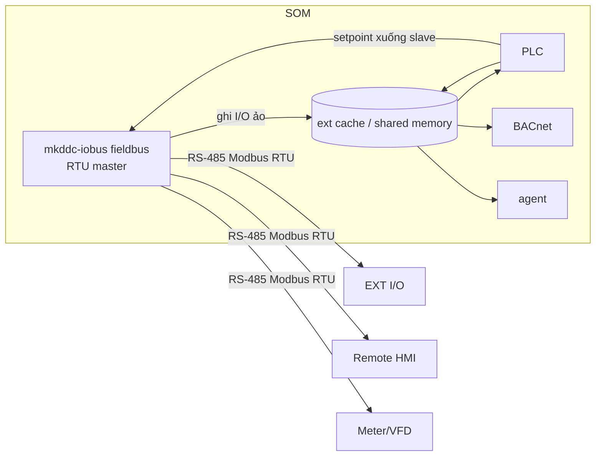

# Service Design — Fieldbus module in `mkddc-iobus` (SW)
## Modbus RTU Master / Expansion Field Bus — code-ready

> ## ⚠ SUPERSEDED một phần — 2026-08-04
>
> Tài liệu này mô tả thiết kế service fieldbus **As-Built v1** và được giữ để truy
> nguyên. Các phát biểu sau **không còn** là authority:
>
> | Phát biểu trong tài liệu này | Thay bằng |
> |---|---|
> | Fieldbus ghi trực tiếp vào shared memory (§2) | [DDD-FW-MBRTU-001 §7](MODBUS_RTU_FW_SOM_DESIGN.md) — iobus publish snapshot qua `fieldbus.sock`, core sở hữu Point Table |
> | Một bus RS-485 / một master | [DDD-FW-MBRTU-001 §2–3](MODBUS_RTU_FW_SOM_DESIGN.md) — hai BusWorker độc lập (chờ `OD-MBRTU-001`) |
> | Quality theo mô hình cũ, alarm E302/E303 là contract chất lượng | [DDD-DM-MBRTU-001 §6](MODBUS_RTU_DATA_MODEL.md) — GOOD/STALE/OFFLINE/BAD/CONFIG_ERROR + reason code |
> | Ghi xuống slave từ "PLC/BMS đặt giá trị" | [DDD-FW-MBRTU-001 §8](MODBUS_RTU_FW_SOM_DESIGN.md) — write request/result qua core arbitration, không blind replay |
> | Lệnh ghi xuống slave ở "vòng poll kế" (§5, §10.1, §10.5); iobus đọc `setpoint/dirty` không giữ seqlock và tự xoá `dirty` | [DDD-FW-MBRTU-001 §4.1, §8](MODBUS_RTU_FW_SOM_DESIGN.md) ghi chú As-Built G7 (2026-09-26) — iobus đọc bằng seqlock, KHÔNG ghi `plc_shm`; danh tính lệnh là `ext_cmd_seq` (`MBA-FW-08`); luồng `mb-extcmd` soi 5 ms, BusWorker thức theo sự kiện, ghi trước đọc có trần |
> | `profile` là mô hình cấu hình do người dùng viết | [DDD-DM-MBRTU-001 §7.1](MODBUS_RTU_DATA_MODEL.md) — profile là artifact **dẫn xuất** do BE sinh |
>
> Bộ tài liệu thay thế đang `In Review`. Cho tới khi ADR-024 Accepted, cả hai bên
> đều không được dùng để claim implementation.

> **Document ID:** DDD-SWSVC-FIELDBUS-MK-DDC-24-VI · **Rev** 1.2 | 2026-06-16 (close FB-Q-001/Q-002; thêm §9 ext IPC API) · 1.1 | 2026-06-13 (mkddc-iobus module; implementation plan 25) · 1.0 | 2026-05-30
> 📘 [README](../../01_specs/README.md) · **Trace:** `SW-MOD-001..011`, `RTU-001..008` · ICD: [D-2](../interfaces/MODBUS_REGISTER_MAP_MK-DDC-24_VI.md) · Config: [D-5 §5b](../interfaces/CONFIG_SCHEMA_MK-DDC-24_VI.md)

> Module này trong `mkddc-iobus` biến DDC thành **Modbus RTU master**: poll các **thiết bị phụ** (module mở rộng I/O, màn hình phụ, thiết bị bên thứ 3) trên RS-485, đưa dữ liệu vào hệ thống như **I/O ảo**. Khung mở: thêm loại thiết bị = thêm **device profile**, không đổi code. Chi tiết task/code path xem [Implementation 25](../../03_implementation/archive/26_MODBUS_IMPLEMENTATION_PLAN.md).

---

## 1. Nhiệm vụ
- Mở `/dev/ttyXXX` (RS-485) làm **master**; poll danh sách slave theo `fieldbus.conf`.
- Mỗi slave dùng **device profile** (template register-map) để biết đọc/ghi gì.
- Ghi dữ liệu slave vào **shared memory vùng mở rộng** → PLC/BACnet/MQTT/HMI dùng.
- Ghi xuống slave (FC06/16) khi PLC/BMS đặt giá trị.
- Phát hiện slave offline → bad quality + alarm.

## 2. Vị trí trong kiến trúc


## 3. Vòng lặp master (poll scheduler)
```c
open_rtu(cfg.rs485.device, baud, parity);  // libmodbus master; device từ fieldbus.conf rs485.device
load_profiles();                            // đọc profiles/*.json
load_slaves("fieldbus.conf");
for (;;) {
  now = monotonic_ms();
  for (s in slaves) {
    if (now - s.last_poll < s.poll_ms) continue;
    modbus_set_slave(ctx, s.addr);
    for (blk in s.profile.read_blocks) {           // gộp point liền kề thành block
       if (modbus_read(ctx, blk.fc, blk.addr, blk.count, buf) == OK) {
          decode(blk, buf) -> shm_ext_write(s, points);   // type/scale/byte_order
          s.online = true; s.err = 0;
       } else {
          if (++s.err >= 2) { s.online = false; mark_bad(s); alarm(E302, s); }
       }
    }
    for (w in pending_writes(s))                    // PLC/BMS đặt giá trị
       modbus_write(ctx, w.fc, w.addr, w.value);
    s.last_poll = now;
  }
  sleep_until_next_due();
}
```
- **Không chặn hot-path:** chạy process riêng, không ảnh hưởng io-driver/PLC. Ưu tiên thường (không SCHED_FIFO).
- **Gộp block:** point liền kề cùng FC → đọc 1 lần để giảm giao dịch.

## 4. Device Profile (engine)
- Profile = JSON (xem [D-2 §3](../interfaces/MODBUS_REGISTER_MAP_MK-DDC-24_VI.md)): list point với `fc/addr/count/type/scale/offset/byte_order/writable/map_to`.
- Engine generic decode theo `type` + `byte_order` (AB/BA/ABCD/CDAB) + `scale/offset`.
- Profile chuẩn ở `/usr/share/kinexus/profiles/`; profile người dùng ở `/data/config/profiles/`.

## 5. Ánh xạ vào shared memory / PLC
- Vùng `shm_ext`: mảng điểm mở rộng (value + quality + timestamp + slave_id).
- PLC truy cập như biến (vd `%EXT.EXT-1.DI[0]`); có thể expose thành BACnet AV/BV/AI bổ sung (cấu hình).
- Ghi: PLC/BMS set `shm_ext[x].setpoint` + dirty flag → fieldbus ghi xuống slave vòng kế.

## 6. Xử lý lỗi & chẩn đoán
| Tình huống | Hành động |
|-----------|-----------|
| Timeout/CRC 1 slave | retry 2 → offline → điểm "bad" + **E302** |
| Tỉ lệ lỗi bus > 10% | **E303** (kiểm tra dây/termination/baud) |
| Profile lỗi | log + skip slave, không crash |
| Bus contention | master duy nhất → không có; đảm bảo chỉ 1 process mở cổng |
- Expose thống kê qua REST `/fieldbus/status` (mỗi slave: online, err_rate, last_seen).

## 7. Cấu hình & nạp lại
- `fieldbus.conf` (D-5 §5b): rs485 baud/parity, list slave (addr+profile+poll_ms).
- Đổi danh sách slave: reload nóng (SIGHUP) nếu không đổi baud; đổi baud → restart service.

## 8. Test
- Dùng slave giả lập (`diagslave`/`modbus-slave`) trả dữ liệu → kiểm decode/scale/byte_order (T-SW-120..124).
- Rút 1 slave → offline + E302 ≤ (timeout×2) (T-SW-127).
- 16 slave poll đồng thời đúng lịch (T-SW-128).

## 9. Quyết định đã chốt (closed open points)

### FB-Q-001 — Thư viện Modbus: **libmodbus C** ✅ CLOSED 2026-06-16

**Quyết định:** Dùng `libmodbus` (C), không dùng Python runtime.

**Lý do:**
- `mkddc-iobus` là C++; `libmodbus` link trực tiếp, không cần subprocess/IPC riêng.
- Python runtime (pymodbus) yêu cầu process riêng → thêm IPC, latency, dependency quản lý GIL.
- `libmodbus` đã mature, license LGPL-2.1, dùng rộng rãi trong embedded Linux.

**Ràng buộc:** pin version `libmodbus >= 3.1.6`; link dynamic (`-lmodbus`) hoặc static tùy packaging.

---

### FB-Q-002 — Expose ext points lên BACnet: **cấu hình per-profile** ✅ CLOSED 2026-06-16

**Quyết định:** Không tự động expose toàn bộ ext points lên BACnet. Operator cấu hình từng point trong device profile JSON.

**Cách cấu hình** (thêm field vào profile point):

```json
{
  "name": "kWh",
  "fc": 4, "addr": 1000, "type": "float32",
  "expose_bacnet": true,
  "bacnet_object_type": "AV",
  "bacnet_instance": 100
}
```

| Field | Mô tả |
|-------|-------|
| `expose_bacnet` | `true` = expose; `false`/absent = không expose |
| `bacnet_object_type` | `"AV"` (float), `"BV"` (bool), `"AI"` (read-only float) |
| `bacnet_instance` | instance number trong BACnet object tree; phải unique trong type |

**Rule:**
- Point không có `expose_bacnet: true` → không xuất hiện trong BACnet object list.
- `AI` là read-only (không commandable); `AV`/`BV` là commandable nếu `writable: true` trong profile.
- `bacnet_instance` operator tự quản lý; conflict instance → log ERROR + skip.

---

## 10. Ext IPC API — fieldbus ↔ core ↔ plc_shm

### 10.1 Kiến trúc (Rev A)

```
iobus fieldbus loop          core scan loop
──────────────────           ──────────────────────────────────────
poll Modbus slaves           scan_loop() mỗi 1s:
  → ext internal cache         [1] nhận ext snapshot từ fieldbus.sock
  → push snapshot              [2] cập nhật point table ext[]
    vào /run/mkddc/            [3] resolve priority
    fieldbus.sock      ──►     [4] ghi plc_shm.ext[] (seqlock, core là writer duy nhất)
                               [5] iobus đọc plc_shm.ext[].setpoint/dirty
                       ◄──         → ghi xuống slave vòng poll kế
```

**Invariant quan trọng:** `plc_shm` có seqlock single-writer là `mkddc-core`. Fieldbus (iobus)
KHÔNG ghi trực tiếp vào `plc_shm`. Tất cả dữ liệu ext đi qua `fieldbus.sock` → core → plc_shm.

---

### 10.2 `/run/mkddc/fieldbus.sock` — UNIX datagram socket

| Thuộc tính | Giá trị |
|------------|---------|
| Type | `SOCK_DGRAM` (UNIX domain) |
| Server | `mkddc-core` (bind + recv) |
| Client | `mkddc-iobus` fieldbus thread (sendto) |
| Chu kỳ push | mỗi vòng poll fieldbus (≥ poll_ms tổng, default ~1s) |
| Max datagram | `sizeof(kx_ext_snapshot_msg_t)` ≈ 8 + 64×36 = ~2320 bytes |

**Lý do SOCK_DGRAM (không SOCK_STREAM):**
- Ext snapshot là ảnh chụp tại thời điểm — không cần ordering/fragmentation.
- Nếu core bận 1 scan: datagram bị drop → core dùng snapshot cũ (acceptable, ext data stale theo ts_ns).
- Không cần kết nối quản lý → đơn giản hơn cho restart độc lập hai service.

---

### 10.3 Message format

> **Gap CLOSED 2026-06-17:** `kx_ext_snapshot_msg_t` đã được thêm vào `shared/mkddc_shm.h`
> (cùng file với `kx_ext_point_t`). Cả iobus lẫn core chỉ cần `#include "mkddc_shm.h"`.
> Magic constant `KX_EXT_SNAP_MAGIC = 0x45585401` ("EXT\1") cũng trong header đó.

```c
/* Định nghĩa CHÍNH THỨC trong shared/mkddc_shm.h — KHÔNG định nghĩa lại ở đây */
/* #include "mkddc_shm.h" để dùng kx_ext_snapshot_msg_t, KX_EXT_SNAP_MAGIC */
```

Field `kx_ext_point_t` (đã có trong `shared/mkddc_shm.h`):

| Field | Writer | Mô tả |
|-------|--------|-------|
| `name[24]` | iobus fieldbus | ID điểm: `"EXT-<slave>.<point>[idx]"` |
| `value` | iobus fieldbus | giá trị đã decode + scale |
| `quality` | iobus fieldbus | GOOD/UNCERTAIN/BAD |
| `slave_addr` | iobus fieldbus | địa chỉ Modbus slave |
| `online` | iobus fieldbus | slave online? |
| `writable` | iobus fieldbus | point có thể ghi xuống slave không |
| `setpoint` | **core** | giá trị core muốn ghi xuống slave |
| `dirty` | **core** | `1` = có setpoint chưa gửi |

> `setpoint` và `dirty` trong snapshot gửi từ iobus→core là **không dùng** (core bỏ qua);
> chúng chỉ có ý nghĩa khi đọc từ `plc_shm.ext[]` (core đã ghi vào đó).

#### 10.3.1 Cấp phát ext slot — một slot = một ĐIỂM LUẬN LÝ

*(Bổ sung Rev 1.3 — 2026-07-30, đóng finding F-17 của review lịch sử; record
gốc phục hồi tại commit `b69fdf1`, evidence deploy nằm tại
`docs/07_records/test-evidence/fw-som/2026-07-30-aarch64-deploy-review-fixes.md`.)*

Dải `ext[0..KX_N_EXT-1]` (64 slot) được cấp phát tuần tự: RTU slave trước, TCP
slave sau (`ext_offset = ModbusMaster::total_ext_count()`). Một slot ứng với
**một điểm luận lý**, KHÔNG phải một register:

| FC | Slot tiêu thụ cho mỗi point |
|----|------------------------------|
| 1, 2 (coil / discrete input) | `count` (1 bit = 1 điểm) |
| 3, 4 với type 16-bit (`int16`/`uint16`/`bool`) | `count` |
| 3, 4 với type 32-bit (`int32`/`uint32`/`float32`) | `count / 2` (2 register = 1 điểm) |
| 5, 6, 15, 16 (FC ghi) | `0` — vòng đọc bỏ qua FC ghi nên đặt trước slot cho chúng chỉ sinh slot rỗng |

Luật này được hiện thực **một lần duy nhất** trong
`apps/iobus/adapters/modbus_rtu/device_profile.{hpp,cpp}`:

```cpp
bool     point_type_is_32bit(PointType t);
uint16_t ext_slots_for_point(const ProfilePoint& pt);
uint16_t ext_slots_for_profile(const DeviceProfile& prof);
```

Mọi chỗ cần biết số slot (`ModbusMaster::open`, `ModbusTcp::open`, các vòng đọc,
`drain_ext_writes`) **phải** gọi các hàm này. Trước Rev 1.3, luật được viết lại
bốn lần ở bốn chỗ và chúng lệch nhau: `open()` đếm theo số register nên profile
32-bit đặt trước gấp đôi số slot cần → mất nửa dung lượng 64 slot và để lại slot
rỗng (`name=""`, `quality=BAD`) lọt vào `push_snapshot` thành dòng vô danh trên
bảng điểm web/HMI.

**Tràn dải là FAIL-CLOSED**: slave không được cấp đủ slot (hoặc thiếu profile,
hoặc profile không có điểm đọc nào) bị đánh **lỗi cấu hình** — log `ERROR` nêu rõ
tên slave, số slot cần vs còn lại, KHÔNG được poll, và **không bao giờ báo
online** (RTU đi đường `on_poll_error` + alarm E302; TCP không mở kết nối).

---

### 10.4 Core integration — đọc ext snapshot

```cpp
// Trong scan_loop.cpp, bước đầu scan (trước resolve):
void scan_step_read_ext() {
    kx_ext_snapshot_msg_t msg;
    ssize_t n = recv(fieldbus_sockfd, &msg, sizeof(msg), MSG_DONTWAIT);
    if (n < 0 || msg.magic != 0x45585401u) return; // không có snapshot mới, dùng cũ

    KX_WRITE_BEGIN(&plc_shm);
    plc_shm->ext_count = std::min<uint16_t>(msg.count, KX_N_EXT);
    for (uint16_t i = 0; i < plc_shm->ext_count; ++i) {
        plc_shm->ext[i].value     = msg.points[i].value;
        plc_shm->ext[i].quality   = msg.points[i].quality;
        plc_shm->ext[i].online    = msg.points[i].online;
        plc_shm->ext[i].slave_addr = msg.points[i].slave_addr;
        plc_shm->ext[i].writable  = msg.points[i].writable;
        memcpy(plc_shm->ext[i].name, msg.points[i].name, 24);
        // setpoint/dirty GIỮ NGUYÊN (đã ghi bởi core ở bước trước)
    }
    KX_WRITE_END(&plc_shm);
}
```

---

### 10.5 Write path — ghi xuống slave

```
Web/BACnet → core priority_resolver
    → core ghi plc_shm.ext[i].setpoint + dirty = 1  (seqlock write)
    → iobus fieldbus mỗi vòng poll:
        đọc plc_shm.ext[i].dirty (không cần lock, single-writer = core)
        nếu dirty: ghi xuống slave, xóa dirty = 0 (core set lại sau ACK)
```

> **Lưu ý seqlock:** iobus fieldbus ĐỌC `plc_shm.ext[i].setpoint/dirty` mà không giữ seqlock (chỉ core write seqlock). Pattern này an toàn vì fieldbus chỉ đọc 2 field nhỏ (atomic-enough trên aarch64 với `dirty` là `uint8_t`); nếu cần chính xác hơn, fieldbus dùng seqlock-read pattern chuẩn như reader khác.

---

## 11. Trace REQ
`SW-MOD-001..011`, `RTU-001..008`, `FR-024`, `FR-025`, `PRD UC-06`.
TCP: `FR-026` (Modbus TCP client, REVA_SCOPE §2 T2).

---

## 12. Modbus TCP client — thiết kế (MOD-013)

> **Trạng thái:** DRAFT — chờ owner approve trước khi implement (LUẬT 1).
> **Task:** [MOD-013](../../03_implementation/11_TASK_CHECKLIST.md) trong Phase 3/4.
> **Scope:** REVA_SCOPE §2 T2 "Modbus TCP + hoàn thiện fallback"; 1 module TCP mới trong mkddc-iobus.

### 12.1 Vị trí trong kiến trúc

```
mkddc-iobus
  ├── modbus_master_rtu.cpp   (đã có — RTU over RS-485)
  └── modbus_tcp.cpp          (MỚI — TCP client, libmodbus TCP context)
        ↓ ext_cache
      fieldbus.sock → mkddc-core (không thay đổi IPC path)
```

Dùng cùng `ext_cache`, `poll_scheduler`, `register_codec` với RTU. TCP chỉ thêm **transport layer** mới.

### 12.2 Config (`fieldbus.conf` — bổ sung phần `tcp`)

```toml
[modbus.tcp]
# Mỗi entry là 1 TCP slave
[[modbus.tcp.slaves]]
host        = "192.168.1.50"
port        = 502               # default 502
unit        = 1                 # Modbus unit ID
poll_ms     = 1000
reconnect_s = 5                 # giây chờ trước khi reconnect sau disconnect
timeout_ms  = 500               # read/write timeout per request
profile     = "generic-power-meter"

[[modbus.tcp.slaves]]
host        = "192.168.1.51"
port        = 502
unit        = 3
poll_ms     = 2000
reconnect_s = 10
timeout_ms  = 500
profile     = "vfd-generic"
```

### 12.3 Module `modbus_tcp` — contract

```cpp
// apps/iobus/adapters/modbus_rtu/modbus_tcp.hpp
class ModbusTcp {
public:
    bool open(const TcpSlaveConfig& cfg);   // modbus_new_tcp() + modbus_connect()
    void close();
    bool poll_once(uint16_t addr, int fc, int count,
                   uint16_t* regs_out);     // modbus_read_registers / modbus_read_bits
    bool write_once(uint16_t addr, int fc,
                    const uint16_t* data, int count);
    bool is_connected() const;
    void reconnect_if_needed();             // gọi trong poll loop nếu !connected
};
```

Mỗi TCP slave = 1 `ModbusTcp` instance. Poll thread chạy cùng scheduler RTU (chia sẻ `PollScheduler`).

### 12.4 Reconnect logic

```
state: DISCONNECTED → connect() → CONNECTED → poll → (timeout/error) → DISCONNECTED
  DISCONNECTED: chờ reconnect_s → connect() lại (không block poll RTU)
  Trong lúc DISCONNECTED: ext_cache quality = BAD, fallback active
  Sau connect(): quality trở lại GOOD khi poll thành công lần đầu
```

Connection được giữ persistent (1 TCP socket per slave). Không reconnect trong mỗi poll.

### 12.5 ext_cache integration

TCP slave points dùng cùng `ExtCache` với RTU:

```cpp
struct ExtPoint {
    float   value;
    uint8_t quality;     // GOOD=1 / BAD=0
    int64_t ts_ns;
    char    host[64];    // dùng để phân biệt TCP vs RTU
    uint8_t unit;
    uint16_t addr;
};
```

`host + unit + addr` là key duy nhất cho TCP point; `bus + slave + addr` cho RTU.

### 12.6 GRAPH_SCHEMA integration

`Modbus_TCP_Read` node trong graph.json tham chiếu `host` + `unit` + `addr` — validator kiểm
host có trong `modbus.tcp[]` config (check #5). Khi core scan, graph_runtime đọc ext_cache
theo key `(host, unit, addr)` → output `out:float`.

### 12.7 Thread model

TCP slave poll chạy trong **cùng fieldbus thread** (hoặc pool) với RTU. Không tạo thread riêng per slave. `PollScheduler` đã support multi-slave (MOD-005); TCP slave được add vào scheduler như RTU slave với transport = TCP.

### 12.8 DoD MOD-013

```
[ ] modbus_tcp.cpp/hpp tạo mới — ModbusTcp class theo §12.3
[ ] fieldbus.conf parser bổ sung [modbus.tcp] section — extend ModbusConfig
[ ] poll_scheduler extend: TCP transport type, reconnect state machine
[ ] ext_cache: TCP key (host+unit+addr) phân biệt với RTU key (bus+slave+addr)
[ ] graph_runtime: Modbus_TCP_Read node tick() đọc ext_cache TCP
[ ] graph validator check #5: host trong TCP_Read phải có trong modbus.tcp[] config
[ ] Unit test: fake TCP server (diagslave -m tcp hoặc socat TCP) — FC03 read OK
[ ] Unit test: TCP disconnect → quality BAD → reconnect → quality GOOD
[ ] Unit test: fallback khi stale > poll_ms×3
[ ] CMake option MKDDC_ENABLE_MODBUS_TCP (default ON khi MODBUS=ON)
[ ] Smoke test: 30 phút kết nối TCP thật với thiết bị hoặc diagslave
```

---

## Revision History
| Version | Ngày | Người | Thay đổi |
|---------|------|-------|----------|
| 1.5 | 2026-09-11 | Implementer | DD-10: ánh xạ repository §10 và §12.3 trỏ `apps/iobus/adapters/modbus_rtu/` thay `services/iobus/` đã xoá theo PLAN-ARCH-RESTRUCT-002 (#592) |
| 1.4 | 2026-06-26 | Dev SOM | §12: Modbus TCP client design (MOD-013) — DRAFT chờ approve |
| 1.3 | 2026-06-17 | Dev SOM | §10.3: kx_ext_snapshot_msg_t chuyển vào mkddc_shm.h (gap closed); cập nhật rs485 device config path |
| 1.2 | 2026-06-16 | Dev SOM | Close FB-Q-001 (libmodbus), FB-Q-002 (expose_bacnet per-profile); thêm §9 ext IPC API |
| 1.1 | 2026-06-13 | Codex | Active name = module trong `mkddc-iobus`; link implementation plan 25 |
| 1.0 | 2026-05-30 | SW Lead | Phát hành đầu — service Modbus RTU master / expansion (theo ARCH-R010) |
