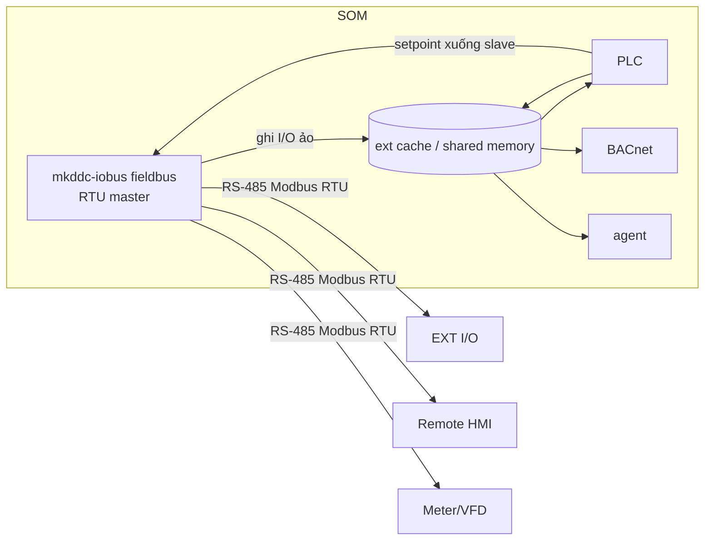

# Service Design — Fieldbus module in `mkddc-iobus` (SW)
## Modbus RTU Master / Expansion Field Bus — code-ready

> **Document ID:** DDD-SWSVC-FIELDBUS-MK-DDC-24-VI · **Rev** 1.1 | 2026-06-13 (mkddc-iobus module; implementation plan 25) · 1.0 | 2026-05-30
> 📘 [README](../../01_specs/README.md) · **Trace:** `SW-MOD-001..011`, `RTU-001..008` · ICD: [D-2](../interfaces/MODBUS_REGISTER_MAP_MK-DDC-24_VI.md) · Config: [D-5 §5b](../interfaces/CONFIG_SCHEMA_MK-DDC-24_VI.md)

> Module này trong `mkddc-iobus` biến DDC thành **Modbus RTU master**: poll các **thiết bị phụ** (module mở rộng I/O, màn hình phụ, thiết bị bên thứ 3) trên RS-485, đưa dữ liệu vào hệ thống như **I/O ảo**. Khung mở: thêm loại thiết bị = thêm **device profile**, không đổi code. Chi tiết task/code path xem [Implementation 25](../../03_implementation/25_MODBUS_IMPLEMENTATION_PLAN.md).

---

## 1. Nhiệm vụ
- Mở `/dev/ttyXXX` (RS-485) làm **master**; poll danh sách slave theo `fieldbus.conf`.
- Mỗi slave dùng **device profile** (template register-map) để biết đọc/ghi gì.
- Ghi dữ liệu slave vào **shared memory vùng mở rộng** → PLC/BACnet/MQTT/HMI dùng.
- Ghi xuống slave (FC06/16) khi PLC/BMS đặt giá trị.
- Phát hiện slave offline → bad quality + alarm.

## 2. Vị trí trong kiến trúc


## 3. Vòng lặp master (poll scheduler)
```c
open_rtu("/dev/ttyS3", baud, parity);   // libmodbus master
load_profiles();                        // đọc profiles/*.json
load_slaves("fieldbus.conf");
for (;;) {
  now = monotonic_ms();
  for (s in slaves) {
    if (now - s.last_poll < s.poll_ms) continue;
    modbus_set_slave(ctx, s.addr);
    for (blk in s.profile.read_blocks) {           // gộp point liền kề thành block
       if (modbus_read(ctx, blk.fc, blk.addr, blk.count, buf) == OK) {
          decode(blk, buf) -> shm_ext_write(s, points);   // type/scale/byte_order
          s.online = true; s.err = 0;
       } else {
          if (++s.err >= 2) { s.online = false; mark_bad(s); alarm(E302, s); }
       }
    }
    for (w in pending_writes(s))                    // PLC/BMS đặt giá trị
       modbus_write(ctx, w.fc, w.addr, w.value);
    s.last_poll = now;
  }
  sleep_until_next_due();
}
```
- **Không chặn hot-path:** chạy process riêng, không ảnh hưởng io-driver/PLC. Ưu tiên thường (không SCHED_FIFO).
- **Gộp block:** point liền kề cùng FC → đọc 1 lần để giảm giao dịch.

## 4. Device Profile (engine)
- Profile = JSON (xem [D-2 §3](../interfaces/MODBUS_REGISTER_MAP_MK-DDC-24_VI.md)): list point với `fc/addr/count/type/scale/offset/byte_order/writable/map_to`.
- Engine generic decode theo `type` + `byte_order` (AB/BA/ABCD/CDAB) + `scale/offset`.
- Profile chuẩn ở `/usr/share/kinexus/profiles/`; profile người dùng ở `/data/config/profiles/`.

## 5. Ánh xạ vào shared memory / PLC
- Vùng `shm_ext`: mảng điểm mở rộng (value + quality + timestamp + slave_id).
- PLC truy cập như biến (vd `%EXT.EXT-1.DI[0]`); có thể expose thành BACnet AV/BV/AI bổ sung (cấu hình).
- Ghi: PLC/BMS set `shm_ext[x].setpoint` + dirty flag → fieldbus ghi xuống slave vòng kế.

## 6. Xử lý lỗi & chẩn đoán
| Tình huống | Hành động |
|-----------|-----------|
| Timeout/CRC 1 slave | retry 2 → offline → điểm "bad" + **E302** |
| Tỉ lệ lỗi bus > 10% | **E303** (kiểm tra dây/termination/baud) |
| Profile lỗi | log + skip slave, không crash |
| Bus contention | master duy nhất → không có; đảm bảo chỉ 1 process mở cổng |
- Expose thống kê qua REST `/fieldbus/status` (mỗi slave: online, err_rate, last_seen).

## 7. Cấu hình & nạp lại
- `fieldbus.conf` (D-5 §5b): rs485 baud/parity, list slave (addr+profile+poll_ms).
- Đổi danh sách slave: reload nóng (SIGHUP) nếu không đổi baud; đổi baud → restart service.

## 8. Test
- Dùng slave giả lập (`diagslave`/`modbus-slave`) trả dữ liệu → kiểm decode/scale/byte_order (T-SW-120..124).
- Rút 1 slave → offline + E302 ≤ (timeout×2) (T-SW-127).
- 16 slave poll đồng thời đúng lịch (T-SW-128).

## 9. Open points
| ID | Vấn đề | Owner |
|----|--------|-------|
| FB-Q-001 | Ngôn ngữ: C (libmodbus) hay Python (pymodbus) cho master | SW Lead |
| FB-Q-002 | Cách expose điểm mở rộng lên BACnet (tự động vs cấu hình) | SW |

## 10. Trace REQ
`SW-MOD-001..011`, `RTU-001..008`, `FR-024`, `FR-025`, `PRD UC-06`.

---
## Revision History
| Version | Ngày | Người | Thay đổi |
|---------|------|-------|----------|
| 1.1 | 2026-06-13 | Codex | Active name = module trong `mkddc-iobus`; link implementation plan 25 |
| 1.0 | 2026-05-30 | SW Lead | Phát hành đầu — service Modbus RTU master / expansion (theo ARCH-R010) |
