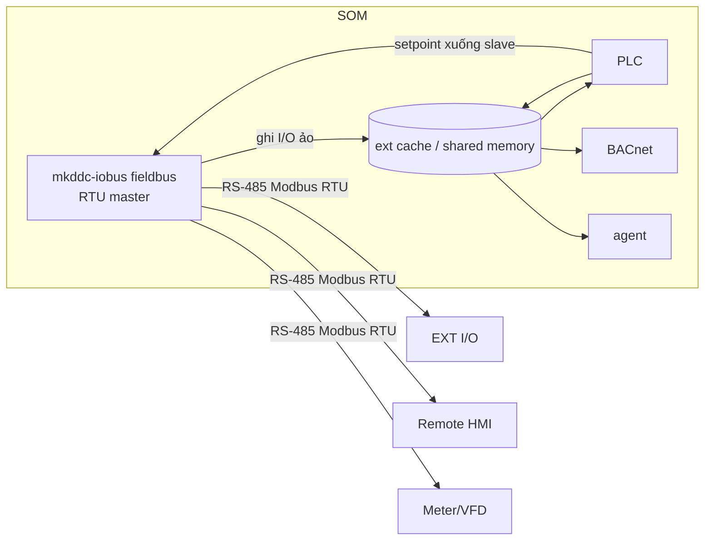

# Service Design — Fieldbus module in `mkddc-iobus` (SW)
## Modbus RTU Master / Expansion Field Bus — code-ready

> **Document ID:** DDD-SWSVC-FIELDBUS-MK-DDC-24-VI · **Rev** 1.2 | 2026-06-16 (close FB-Q-001/Q-002; thêm §9 ext IPC API) · 1.1 | 2026-06-13 (mkddc-iobus module; implementation plan 25) · 1.0 | 2026-05-30
> 📘 [README](../../01_specs/README.md) · **Trace:** `SW-MOD-001..011`, `RTU-001..008` · ICD: [D-2](../interfaces/MODBUS_REGISTER_MAP_MK-DDC-24_VI.md) · Config: [D-5 §5b](../interfaces/CONFIG_SCHEMA_MK-DDC-24_VI.md)

> Module này trong `mkddc-iobus` biến DDC thành **Modbus RTU master**: poll các **thiết bị phụ** (module mở rộng I/O, màn hình phụ, thiết bị bên thứ 3) trên RS-485, đưa dữ liệu vào hệ thống như **I/O ảo**. Khung mở: thêm loại thiết bị = thêm **device profile**, không đổi code. Chi tiết task/code path xem [Implementation 25](../../03_implementation/25_MODBUS_IMPLEMENTATION_PLAN.md).

---

## 1. Nhiệm vụ
- Mở `/dev/ttyXXX` (RS-485) làm **master**; poll danh sách slave theo `fieldbus.conf`.
- Mỗi slave dùng **device profile** (template register-map) để biết đọc/ghi gì.
- Ghi dữ liệu slave vào **shared memory vùng mở rộng** → PLC/BACnet/MQTT/HMI dùng.
- Ghi xuống slave (FC06/16) khi PLC/BMS đặt giá trị.
- Phát hiện slave offline → bad quality + alarm.

## 2. Vị trí trong kiến trúc


## 3. Vòng lặp master (poll scheduler)
```c
open_rtu("/dev/ttyS3", baud, parity);   // libmodbus master
load_profiles();                        // đọc profiles/*.json
load_slaves("fieldbus.conf");
for (;;) {
  now = monotonic_ms();
  for (s in slaves) {
    if (now - s.last_poll < s.poll_ms) continue;
    modbus_set_slave(ctx, s.addr);
    for (blk in s.profile.read_blocks) {           // gộp point liền kề thành block
       if (modbus_read(ctx, blk.fc, blk.addr, blk.count, buf) == OK) {
          decode(blk, buf) -> shm_ext_write(s, points);   // type/scale/byte_order
          s.online = true; s.err = 0;
       } else {
          if (++s.err >= 2) { s.online = false; mark_bad(s); alarm(E302, s); }
       }
    }
    for (w in pending_writes(s))                    // PLC/BMS đặt giá trị
       modbus_write(ctx, w.fc, w.addr, w.value);
    s.last_poll = now;
  }
  sleep_until_next_due();
}
```
- **Không chặn hot-path:** chạy process riêng, không ảnh hưởng io-driver/PLC. Ưu tiên thường (không SCHED_FIFO).
- **Gộp block:** point liền kề cùng FC → đọc 1 lần để giảm giao dịch.

## 4. Device Profile (engine)
- Profile = JSON (xem [D-2 §3](../interfaces/MODBUS_REGISTER_MAP_MK-DDC-24_VI.md)): list point với `fc/addr/count/type/scale/offset/byte_order/writable/map_to`.
- Engine generic decode theo `type` + `byte_order` (AB/BA/ABCD/CDAB) + `scale/offset`.
- Profile chuẩn ở `/usr/share/kinexus/profiles/`; profile người dùng ở `/data/config/profiles/`.

## 5. Ánh xạ vào shared memory / PLC
- Vùng `shm_ext`: mảng điểm mở rộng (value + quality + timestamp + slave_id).
- PLC truy cập như biến (vd `%EXT.EXT-1.DI[0]`); có thể expose thành BACnet AV/BV/AI bổ sung (cấu hình).
- Ghi: PLC/BMS set `shm_ext[x].setpoint` + dirty flag → fieldbus ghi xuống slave vòng kế.

## 6. Xử lý lỗi & chẩn đoán
| Tình huống | Hành động |
|-----------|-----------|
| Timeout/CRC 1 slave | retry 2 → offline → điểm "bad" + **E302** |
| Tỉ lệ lỗi bus > 10% | **E303** (kiểm tra dây/termination/baud) |
| Profile lỗi | log + skip slave, không crash |
| Bus contention | master duy nhất → không có; đảm bảo chỉ 1 process mở cổng |
- Expose thống kê qua REST `/fieldbus/status` (mỗi slave: online, err_rate, last_seen).

## 7. Cấu hình & nạp lại
- `fieldbus.conf` (D-5 §5b): rs485 baud/parity, list slave (addr+profile+poll_ms).
- Đổi danh sách slave: reload nóng (SIGHUP) nếu không đổi baud; đổi baud → restart service.

## 8. Test
- Dùng slave giả lập (`diagslave`/`modbus-slave`) trả dữ liệu → kiểm decode/scale/byte_order (T-SW-120..124).
- Rút 1 slave → offline + E302 ≤ (timeout×2) (T-SW-127).
- 16 slave poll đồng thời đúng lịch (T-SW-128).

## 9. Quyết định đã chốt (closed open points)

### FB-Q-001 — Thư viện Modbus: **libmodbus C** ✅ CLOSED 2026-06-16

**Quyết định:** Dùng `libmodbus` (C), không dùng Python runtime.

**Lý do:**
- `mkddc-iobus` là C++; `libmodbus` link trực tiếp, không cần subprocess/IPC riêng.
- Python runtime (pymodbus) yêu cầu process riêng → thêm IPC, latency, dependency quản lý GIL.
- `libmodbus` đã mature, license LGPL-2.1, dùng rộng rãi trong embedded Linux.

**Ràng buộc:** pin version `libmodbus >= 3.1.6`; link dynamic (`-lmodbus`) hoặc static tùy packaging.

---

### FB-Q-002 — Expose ext points lên BACnet: **cấu hình per-profile** ✅ CLOSED 2026-06-16

**Quyết định:** Không tự động expose toàn bộ ext points lên BACnet. Operator cấu hình từng point trong device profile JSON.

**Cách cấu hình** (thêm field vào profile point):

```json
{
  "name": "kWh",
  "fc": 4, "addr": 1000, "type": "float32",
  "expose_bacnet": true,
  "bacnet_object_type": "AV",
  "bacnet_instance": 100
}
```

| Field | Mô tả |
|-------|-------|
| `expose_bacnet` | `true` = expose; `false`/absent = không expose |
| `bacnet_object_type` | `"AV"` (float), `"BV"` (bool), `"AI"` (read-only float) |
| `bacnet_instance` | instance number trong BACnet object tree; phải unique trong type |

**Rule:**
- Point không có `expose_bacnet: true` → không xuất hiện trong BACnet object list.
- `AI` là read-only (không commandable); `AV`/`BV` là commandable nếu `writable: true` trong profile.
- `bacnet_instance` operator tự quản lý; conflict instance → log ERROR + skip.

---

## 10. Ext IPC API — fieldbus ↔ core ↔ plc_shm

### 10.1 Kiến trúc (Rev A)

```
iobus fieldbus loop          core scan loop
──────────────────           ──────────────────────────────────────
poll Modbus slaves           scan_loop() mỗi 1s:
  → ext internal cache         [1] nhận ext snapshot từ fieldbus.sock
  → push snapshot              [2] cập nhật point table ext[]
    vào /run/mkddc/            [3] resolve priority
    fieldbus.sock      ──►     [4] ghi plc_shm.ext[] (seqlock, core là writer duy nhất)
                               [5] iobus đọc plc_shm.ext[].setpoint/dirty
                       ◄──         → ghi xuống slave vòng poll kế
```

**Invariant quan trọng:** `plc_shm` có seqlock single-writer là `mkddc-core`. Fieldbus (iobus)
KHÔNG ghi trực tiếp vào `plc_shm`. Tất cả dữ liệu ext đi qua `fieldbus.sock` → core → plc_shm.

---

### 10.2 `/run/mkddc/fieldbus.sock` — UNIX datagram socket

| Thuộc tính | Giá trị |
|------------|---------|
| Type | `SOCK_DGRAM` (UNIX domain) |
| Server | `mkddc-core` (bind + recv) |
| Client | `mkddc-iobus` fieldbus thread (sendto) |
| Chu kỳ push | mỗi vòng poll fieldbus (≥ poll_ms tổng, default ~1s) |
| Max datagram | `sizeof(kx_ext_snapshot_msg_t)` ≈ 8 + 64×36 = ~2320 bytes |

**Lý do SOCK_DGRAM (không SOCK_STREAM):**
- Ext snapshot là ảnh chụp tại thời điểm — không cần ordering/fragmentation.
- Nếu core bận 1 scan: datagram bị drop → core dùng snapshot cũ (acceptable, ext data stale theo ts_ns).
- Không cần kết nối quản lý → đơn giản hơn cho restart độc lập hai service.

---

### 10.3 Message format

```c
/* Gửi từ iobus → core qua fieldbus.sock */
typedef struct {
    uint32_t magic;          /* = 0x45585401  "EXT\1" */
    uint16_t count;          /* số điểm hợp lệ trong points[] */
    uint16_t _pad;
    kx_ext_point_t points[KX_N_EXT];   /* từ shared/mkddc_shm.h */
} kx_ext_snapshot_msg_t;
```

Field `kx_ext_point_t` (đã có trong `shared/mkddc_shm.h`):

| Field | Writer | Mô tả |
|-------|--------|-------|
| `name[24]` | iobus fieldbus | ID điểm: `"EXT-<slave>.<point>[idx]"` |
| `value` | iobus fieldbus | giá trị đã decode + scale |
| `quality` | iobus fieldbus | GOOD/UNCERTAIN/BAD |
| `slave_addr` | iobus fieldbus | địa chỉ Modbus slave |
| `online` | iobus fieldbus | slave online? |
| `writable` | iobus fieldbus | point có thể ghi xuống slave không |
| `setpoint` | **core** | giá trị core muốn ghi xuống slave |
| `dirty` | **core** | `1` = có setpoint chưa gửi |

> `setpoint` và `dirty` trong snapshot gửi từ iobus→core là **không dùng** (core bỏ qua);
> chúng chỉ có ý nghĩa khi đọc từ `plc_shm.ext[]` (core đã ghi vào đó).

---

### 10.4 Core integration — đọc ext snapshot

```cpp
// Trong scan_loop.cpp, bước đầu scan (trước resolve):
void scan_step_read_ext() {
    kx_ext_snapshot_msg_t msg;
    ssize_t n = recv(fieldbus_sockfd, &msg, sizeof(msg), MSG_DONTWAIT);
    if (n < 0 || msg.magic != 0x45585401u) return; // không có snapshot mới, dùng cũ

    KX_WRITE_BEGIN(&plc_shm);
    plc_shm->ext_count = std::min<uint16_t>(msg.count, KX_N_EXT);
    for (uint16_t i = 0; i < plc_shm->ext_count; ++i) {
        plc_shm->ext[i].value     = msg.points[i].value;
        plc_shm->ext[i].quality   = msg.points[i].quality;
        plc_shm->ext[i].online    = msg.points[i].online;
        plc_shm->ext[i].slave_addr = msg.points[i].slave_addr;
        plc_shm->ext[i].writable  = msg.points[i].writable;
        memcpy(plc_shm->ext[i].name, msg.points[i].name, 24);
        // setpoint/dirty GIỮ NGUYÊN (đã ghi bởi core ở bước trước)
    }
    KX_WRITE_END(&plc_shm);
}
```

---

### 10.5 Write path — ghi xuống slave

```
Web/BACnet → core priority_resolver
    → core ghi plc_shm.ext[i].setpoint + dirty = 1  (seqlock write)
    → iobus fieldbus mỗi vòng poll:
        đọc plc_shm.ext[i].dirty (không cần lock, single-writer = core)
        nếu dirty: ghi xuống slave, xóa dirty = 0 (core set lại sau ACK)
```

> **Lưu ý seqlock:** iobus fieldbus ĐỌC `plc_shm.ext[i].setpoint/dirty` mà không giữ seqlock (chỉ core write seqlock). Pattern này an toàn vì fieldbus chỉ đọc 2 field nhỏ (atomic-enough trên aarch64 với `dirty` là `uint8_t`); nếu cần chính xác hơn, fieldbus dùng seqlock-read pattern chuẩn như reader khác.

---

## 11. Trace REQ
`SW-MOD-001..011`, `RTU-001..008`, `FR-024`, `FR-025`, `PRD UC-06`.

---
## Revision History
| Version | Ngày | Người | Thay đổi |
|---------|------|-------|----------|
| 1.2 | 2026-06-16 | Dev SOM | Close FB-Q-001 (libmodbus), FB-Q-002 (expose_bacnet per-profile); thêm §9 ext IPC API: fieldbus.sock UNIX datagram, message format, core integration, write path |
| 1.1 | 2026-06-13 | Codex | Active name = module trong `mkddc-iobus`; link implementation plan 25 |
| 1.0 | 2026-05-30 | SW Lead | Phát hành đầu — service Modbus RTU master / expansion (theo ARCH-R010) |
