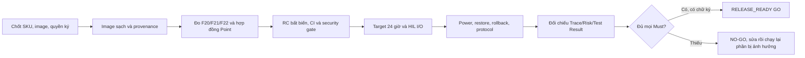

# 15 — Release Handover Checklist
## MK-DDC-24 — Trước khi bàn giao

> **Document ID:** IMPL-HANDOVER-MK-DDC-24-VI
> **Phiên bản:** 1.3 | 2026-09-27 (kế hoạch đóng release theo source/record hiện có)
> **Trạng thái:** Kế hoạch thi hành; `RELEASE_READY=NO-GO`, không có chữ ký release
> **Owner:** PM/Lead. Bàn giao chỉ khi MỌI ô tick + ký.

---

## 1. Build & version

```
[ ] Build clean từ repo CLONE MỚI (không dùng workspace cũ) — cả 4 phần:
      firmware/ · apps/iobus · apps/core · apps/web-api + apps/web-ui
[ ] Firmware version rõ (DIAG_RESP FW_VERSION khớp tag git).
[ ] SOM service version rõ (mkddc-core/iobus/netcfg/web --version khớp tag).
[ ] IOP version đúng (IOP_VER_MAJOR.MINOR = 2.0 theo `contracts/iop/iop_protocol.h`) khớp 2 phía.
[ ] shared/iop_protocol.h + mkddc_shm.h không bị fork (1 nguồn).
```

## 2. Cấu hình & triển khai

```
[ ] Config mặc định có sẵn (io_config, network, netcfg allowlist, device, safe_state, users).
[ ] systemd core/iobus/netcfg/web enable được; HMI chỉ enable theo SKU/hardware.
[ ] Sau reboot: netcfg sẵn sàng trước Web transaction; systemd dependency verify PASS.
[ ] WatchdogSec + hardware watchdog hoạt động.
[ ] Quyền user/socket đúng; netcfg chỉ giữ capability bắt buộc, HMI không truy cập trực tiếp netcfg.sock.
```

## 3. Chức năng (smoke test trên board thật)

```
[ ] Web login được.
[ ] Point list chạy (24 IO, value/unit/quality).
[ ] DO test pass (web bật/tắt relay THẬT).
[ ] AO test pass (web đặt giá trị, đo V/mA THẬT).
[ ] DI/UI test pass (đổi ngoài → web cập nhật).
[ ] Fault test pass (rút UART → báo lỗi + safe-state → cắm lại recover).
[ ] Commissioning export report nghiệm thu chạy.
[ ] Alarm list + ack chạy.
[ ] Validator chặn graph lỗi; deploy graph hợp lệ pass.
[ ] Nếu HMI SKU enable: 5 surface local hiển thị đúng và target DRM/touch/6 nút pass.
[ ] HMI setpoint/mode/override/release chỉ cho point whitelist; broker/core/audit path pass.
[ ] HMI alarm ACK authoritative; broker loss chuyển read-only; không blind replay.
[ ] HMI không có CAP_SYS_BOOT/direct signal/direct SHM write; maintenance unsupported bị disable.
[ ] Network GET status cho viewer+; mọi POST transaction chỉ Admin.
[ ] Strict protocol v1 từ chối unknown field/version/action; capability exact có dns + management-hostname.
[ ] DNS preserve/auto/manual validate đúng; DNS rollback cùng IPv4, không có writer riêng.
[ ] Management hostname chỉ đọc trong authority; package chỉ cài hostname tool/template, không tự apply.
[ ] HMI surface Service đọc status; mutation Admin-only, Stage double-confirm 5 s và countdown monotonic.
[ ] Physical end1 static/DHCP/DNS, confirm/120 s rollback, reboot/power/disk fault PASS có raw evidence.
[ ] Stable hostname/mDNS IP handoff, REST/WebSocket reconnect, BACnet I-Am packet capture và Modbus reconnect PASS.
[ ] Core/IOP/STM32/output continuity qua đổi IP được đo trên hardware thật.
```

## 4. Sạch demo/bypass (BẮT BUỘC)

```
[ ] KHÔNG còn mock/demo path (grep MOCK/FAKE/random IO = 0 trong build release).
[ ] KHÔNG còn bypass Web → UART (lsof mkddc-web: 0 fd /dev/ttyS2).
[ ] Web KHÔNG gọi thẳng MCU (không import serial/IOP trong web).
[ ] Mọi DO/AO đi qua priority resolver (core) — không đường ghi tắt.
[ ] HMI không ghi SHM/hardware, không kill core/iobus và không tự reboot host.
[ ] iobus không tự quyết logic relay; MCU không chạy logic hệ thống.
```

## 5. Chất lượng & độ ổn định

```
[ ] Long-run 24h pass (group 8): 0 crash, RSS ổn định, scan_overrun=0.
[ ] iop_crc_err/timeout/seq_err trong ngưỡng chấp nhận.
[ ] Không memory leak (valgrind/asan trên core+iobus ở môi trường test).
[ ] Log không spam, mức log hợp lý.
```

## 6. Tài liệu bàn giao

```
[ ] Release note (tính năng, version, ngày).
[ ] Known issues (lỗi còn lại + workaround).
[ ] Bring-up guide ([13](14_BRINGUP_GUIDE.md)) cập nhật khớp thực tế.
[ ] Sơ đồ đấu dây IO + bảng điểm (point list) bàn giao.
[ ] Hướng dẫn vận hành cơ bản cho người dùng cuối.
[ ] Backup config mặc định + script restore.
[ ] Network evidence ghi commit/toolchain/target/artifact hash, old/new/DNS/management path và reviewer.
[ ] Known issues nói rõ Network gate RED nếu còn bất kỳ physical/HIL/security item chưa đóng.
```

## 7. Bảo mật (tối thiểu)

```
[ ] TLS 1.3 bật cho web (prod).
[ ] Không hardcode secret/password trong code/repo.
[ ] User mặc định buộc đổi mật khẩu lần đầu.
[ ] SSH key-only (port 2222), tắt password login.
[ ] Firewall (nftables) chỉ mở port cần thiết.
```

---

## Ký bàn giao

| Vai trò | Tên | Ngày | Ký |
|---------|-----|------|-----|
| FW Lead | | | |
| SW Lead | | | |
| Web Lead | | | |
| Tester | | | |
| PM | | | |

> Chỉ phát hành khi đủ chữ ký + mọi ô §1–§7 tick. Bất kỳ ô §4 chưa tick = **chặn release**.

## 8. Kế hoạch chốt RC và release — 2026-09-27

**Quy tắc:** mỗi thẻ dưới đây chỉ chuyển `PASS` khi có Test Result ghi RC commit,
image/binary hash, target/SKU, fixture, raw log, người chạy, reviewer độc lập và
đường rollback. `DONE` của implementation, host test, Fake MCU, UI snapshot và
soak trên image đã bị xâm nhập không thay HIL/release. Không dùng ngày dự kiến
thay cho điều kiện đóng. [Plan 59](59_PROGRAMMING_DOC_TO_CODE_IMPLEMENTATION_PLAN.md)
giữ tracker Programming; bảng này là trình tự đóng cổng toàn sản phẩm.



| Thẻ/ưu tiên | Chủ chịu trách nhiệm | Nơi sửa hoặc quyết định | Tiêu chí đóng và bằng chứng | Hiện trạng |
|---|---|---|---|---|
| `REL-01` P0 — cấu hình phát hành | Product Owner + HW + Ops | `PROD-BASE-001`, `PROD-PROG-001`, image/BSP manifest | Chọn và ký SKU/SOM, OS, MCU, số RS485, HMI option, kernel/governor; giải quyết Radxa/Debian so với Foxlinx/Buildroot. Golden image và cách rollback có hash. | **OPEN**; target lab không tương đương baseline sản phẩm. |
| `REL-02` P0 — lại image tin cậy | Security + Ops | `SEC-INC-20260926-FOXLINX`, packaging/SSH/firewall | Cài mới từ image xác thực, xoay toàn bộ credential liên quan, bỏ NAT WAN 2223, xác nhận SSH key-only và không dịch vụ debug/FTP ngoài policy; provenance từ boot sạch. | **BLOCKED**: bo đã bị xâm nhập; quarantine không chứng minh sạch. |
| `REL-03` P0 — F20/F22 thay package | Runtime/Core + Iobus + Product | `programming_runtime_coordinator.cpp`, `st_process_image.cpp`, PointWriter/Modbus write result | Package A có DO/AO local+EXT đang bật, B bỏ Program: tại boundary rút owner mức 5, giữ owner ưu tiên cao hơn, EXT đi tới `safe_value` hoặc policy được ký; Restore/rollback, offline/reconnect không replay. Unit/integration và đo physical/read-back PASS. | **SOURCE FIXED; PHYSICAL NOT RUN**: F20 sửa ở PR #779 (AO/DO nhả mức 5, EXT về `safe_value` tại boundary đổi gói), PASS target 2026-09-27 qua lần đổi gói của soak lần 3; F22 (graph dự phòng ghi đè EXT dưới `PROGRAM_ONLY`) sửa ở PR #778. Còn policy khi `safe_value` thiếu, offline/reconnect không replay và đo physical/read-back. |
| `REL-04` P0 — F21 SafeState | Runtime/Core + Safety | `scan_loop.cpp`, `safe_state.cpp` | Truyền owner thực cho SafeState; với graph load làm backup và `PROGRAM_ONLY`, T6/T7, fault, restart, no-controller cho output đúng policy. Host fault test + target HIL PASS. | **SOURCE FIXED; TARGET/HIL NOT RUN**: PR #778 truyền `active_mode != PROGRAM_ONLY` vào `safe->apply`; test `ScanLoop.ProgramOnlyWithLoadedGraphAndNoControllerEntersSafeState` đỏ trên mã cũ, xanh trên mã sửa. Bo lab không có `graph.json` nên chưa đo target đường graph dự phòng. |
| `REL-05` P0 — RC/CI | Release Engineering + QA | `scripts/verify-project.sh`, CI, manifest/contract | RC commit/tag bất biến; full C++ Modbus/BACnet/HMI, Go `-count=1`, FE, browser E2E, docs harness/pin, reproducible ARM build, signed artifact và hash đọc ngược trên board; required CI xanh, không waived cho release. | **NOT RUN trên RC mới**. |
| `REL-06` P0 — timing và HIL | Core + FW/HW + V&V | ADR-061, `VVP-PROG-001`, `T59-702/703/704/706` | 10 Program/≥3 chu kỳ, signal/fault/RETAIN, 24 h C1–C4 trên image sạch/production SKU; 0 overrun/miss/violation, IOP poll gap <200 ms; đo AO/DO/relay ST+FBD bằng thiết bị, power-cut ≥10, watchdog và recovery. Modbus FC05/read-back có cổng thời gian riêng. | **NOT PASS**: soak lần 1 FAIL C4 (F17, đã sửa); soak lần 2 0 vi phạm trong 15 h 53 ph (dừng sớm để deploy); soak lần 3 PASS ngưỡng `VS-PROG-009` v2.4 trong 10 ph 08 s. Cả ba chạy trên bo từng bị xâm nhập nên chỉ là điều tra; chưa có soak 24 h trên image sạch; physical HIL chưa đủ. |
| `REL-07` P1 — protocol và thao tác | Iobus + BE + QA | BACnet Export Registry, `MBA-GAP-01`, network/handover | BACnet object identity/quality/read-write từ Point thật, không suy 88 object hardcoded là đã export; Modbus write result accepted/applied/rejected/timeout end-to-end, bus reconnect; network đổi IP không gián đoạn physical I/O. Packet capture + HIL + UI result. | **OPEN**; cần xác nhận phạm vi SKU/protocol claim. |
| `REL-08` P0 — phục hồi/thay controller | Ops + BE/Core + QA | `T59-705`, release runbook/backup | Fresh install, upgrade, rollback **binary+DB**, backup/restore, thay controller, LKG/RETAIN/enable intent, power failure ở từng bước; hash và trạng thái output đọc ngược. | **PARTIAL**; chưa có diễn tập đầy đủ trên cấu hình tin cậy. |
| `REL-09` P0 — quyết định cuối | Product + Architect + Verification + Safety + Security + Ops | Trace/Risk, Test Result, release record mới | Mọi Must có verdict đúng authority; P0/P1 risk đóng hoặc residual được người có quyền ký; user test/UX và security đúng phạm vi; phát hành record RC mới với GO/NO-GO cùng chữ ký. | **NO-GO**; record 2026-08-23 là lịch sử của commit khác. |

**Thứ tự tối thiểu:** `REL-01→02→03/04/07→05→06/08→09` (các nhánh 03/04/07
có thể triển khai song song sau khi policy được ký). Mọi sửa source hoặc image
sau `REL-05` làm mất hiệu lực phần evidence chịu ảnh hưởng; chốt RC lại, đọc
ngược hash và chạy lại gate tương ứng. Không ghi “PASS” khi chỉ có plan.

---
**Rev** 1.3 | 2026-09-27 — thêm thẻ triển khai, dependency và tiêu chí chứng cứ cho RC/release; giữ NO-GO. · 1.2 | 2026-07-28 — thêm Network/HMI/HIL checklist. · 1.1 | 2026-07-22 · 1.0 | 2026-06-10 · Liên quan: [13_DEFINITION_OF_DONE](13_DEFINITION_OF_DONE.md) · [12_INTEGRATION_TEST_PLAN](12_INTEGRATION_TEST_PLAN.md)
