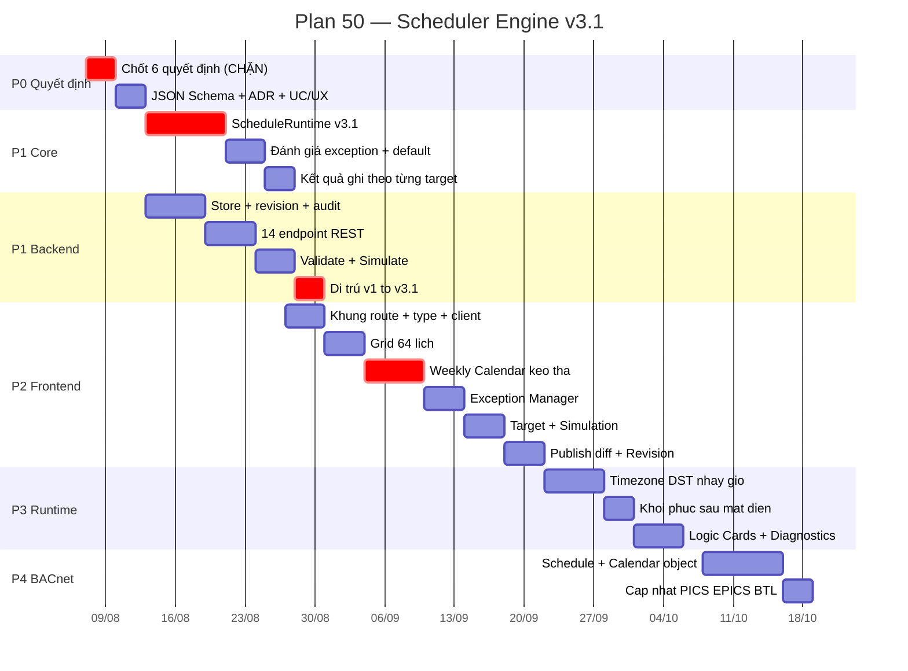
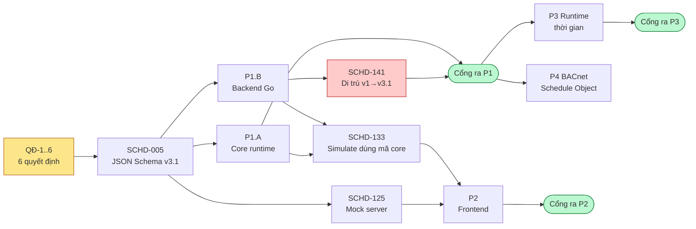

# Plan 50: Triển khai Scheduler Engine v3.1 — loại bỏ mô hình thanh ghi `TSx`

> **Trạng thái:** **APPROVED và đang thực thi.** PM/CTO duyệt toàn bộ 6 quyết định theo PA-1 ngày 2026-08-07 — xem [ADR-023](../adr/ADR-023-scheduler-v3-1-priority-transport-va-pham-vi.md). P0 đã mở khoá.
> **Phiên bản:** 1.1 | **Ngày lập:** 2026-08-07 | **Cập nhật:** 2026-08-07
> **Owner:** Dev Core (C++) + Dev BE (Go) + Dev FE (React) + QA
> **Nguồn yêu cầu:** [`docs/CHUONG_YEU_CAU/scheduler.md`](../CHUONG_YEU_CAU/scheduler.md) — Product Spec v3.1
> **Thiết kế nền:** [UIUX-UC-WEB-SCHEDULER-PROPOSAL-001](../04_uiux/KX-DDC24-UIUX-UC-WEB-SCHEDULER-PROPOSAL-001_VI.md) (20 khoảng cách · 6 quyết định · 26 use case · wireframe)
> **Baseline mã nguồn:** commit `5fef0b9`, nhánh `main`
> **Tổng khối lượng:** **64 người-ngày** / **96 task** / 5 pha
> **Ngoài phạm vi:** panel lịch trên HMI cục bộ 320×240; triển khai broker MQTT thật (xem QĐ-2); chứng nhận BTL (chỉ chuẩn bị đối tượng ở P4).

---

## 0. Bảng tiến độ — cập nhật mỗi phiên làm việc

> Cách cập nhật: §9. Cập nhật lần cuối **2026-08-07** — **toàn bộ 96 task đóng**; 849/849 ctest, 436/436 vitest, 11/11 gói Go; đã deploy và kiểm chứng trên bo Foxlinx.

```text
TỔNG THỂ                                                  96 / 96 task 100%
[██████████████████████████████████████████████████]

P0 · Chốt quyết định & hợp đồng      9/ 9 100%  [████████████████████]  ✅ CỔNG RA ĐÃ QUA
P1 · Mô hình · Core · Backend       32/32 100%  [████████████████████]  ✅ 9/10 finding đóng (**)
P2 · Frontend                       36/36 100%  [████████████████████]  ✅ CỔNG RA ĐÃ QUA
P3 · Runtime & đồng bộ thời gian    12/12 100%  [████████████████████]  ✅ CỔNG RA ĐÃ QUA
P4 · BACnet Schedule/Calendar        7/ 7 100%  [████████████████████]  ✅ CỔNG RA ĐÃ QUA

Cổng ra đã qua:  P0 ✅   P1 ✅(*)   P2 ✅   P3 ✅   P4 ✅
Rủi ro đang mở:  R-01 R-02 R-03 R-04 R-05 R-06 R-07 · R-01-B đã chặn (§8)
Quyết định:      QĐ-1..6 ✅ ĐÃ DUYỆT PA-1 (2026-08-07, ADR-023)
(*) MIGRATION_REAL_FILE = ĐẠT (2026-08-07, kiểm trên bo Foxlinx bằng chính binary
    của bo). Kết luận "N/A" trước đó SAI: không có cấu hình khách hàng thật không
    có nghĩa là không kiểm được đường di trú. Bài kiểm đã tìm ra 2 lỗi CHẶN mà
    822 test trong tầng không thấy — xem §0.4.
(**) QĐ-7/8/9 ĐÃ DUYỆT 2026-08-07. 9/10 finding đóng. Xem
     docs/07_records/reviews/SCHEDULER_V3_1_P1_EXIT_REVIEW_2026-08-07.md
```

### 0.1 Burn-up theo tuần

Cột **Thực tế** điền vào cuối mỗi tuần. Lệch quá 20% hai tuần liên tiếp thì phải xem lại phạm vi, không phải xem lại con người.

| Tuần | Từ ngày | Kế hoạch (task luỹ kế) | Thực tế | Ghi chú |
|---|---|---:|---:|---|
| W1 | 2026-08-10 | 9 | — | P0 xong, P1 khởi động |
| W2 | 2026-08-17 | 18 | — | Core runtime + schema |
| W3 | 2026-08-24 | 27 | — | **Đóng băng hợp đồng** → FE vào việc |
| W4 | 2026-08-31 | 36 | — | BE endpoint + revision |
| W5 | 2026-09-07 | 45 | — | Cổng ra P1 · FE Grid + Editor |
| W6 | 2026-09-14 | 53 | — | FE Calendar + Exception |
| W7 | 2026-09-21 | 60 | — | FE Simulation + Publish |
| W8 | 2026-09-28 | 66 | — | Cổng ra P2 · P3 khởi động |
| W9 | 2026-10-05 | 71 | — | Runtime thời gian, Logic Cards |
| W10 | 2026-10-12 | 74 | — | Cổng ra P3 |
| W11 | 2026-10-19 | 78 | — | Cổng ra P4 · đóng plan |

### 0.2 Lộ trình



### 0.3 Đường phụ thuộc



### 0.4 Hai lỗi CHẶN tìm ra khi kiểm di trú trên bo (2026-08-07)

Cả hai đều **không** làm hỏng build, **không** làm hỏng runtime, và **không** có test nào
trong 822 test bắt được. Cả hai chỉ lộ ra khi đem hệ thống thật chạy trên phần cứng thật.

| Mã | Lỗi | Vì sao test không thấy | Cách sửa | Guard mới |
|----|-----|------------------------|----------|-----------|
| **MIG-01** | `MigrateSchedulesOnStartup` **không ai gọi**. Bo có `schedule.conf` cũ kẹt HTTP 409 vĩnh viễn, không có đường di trú nào khác. | 9 test di trú đều gọi **thẳng** hàm đó, nên chúng xanh trong khi tính năng không tồn tại với người dùng. Lỗi nằm ở ranh giới gói `app` ↔ điểm vào `Main()`. | Nối lời gọi vào `Main()`, **trước** `ListenAndServe` — chạy sau thì một `PUT` lọt vào giữa sẽ ghi đè tệp v1 trước khi kịp đọc để di trú. | `TestMigrateSchedulesIsWiredIntoStartup` đọc AST của `main.go`, khẳng định lời gọi tồn tại **và** đứng trước `ListenAndServe`. |
| **MIG-02** | Hợp đồng đóng băng từ chối chính dữ liệu hợp lệ: `$defs/ScheduleValue.value` dùng `oneOf` với đồng thời nhánh `number` và `integer, minimum 0`. Số nguyên không âm khớp **cả hai**, mà `oneOf` đòi khớp **đúng một** ⇒ loại sạch mọi lịch `ENUMERATED`/`UNSIGNED` và mọi lịch `REAL` có setpoint tròn số (75, 0). Hỏng ở 3 chỗ. | Hợp đồng được đóng băng ở P0 và **không có một test nào chạm tới nó**. Nó chỉ được kiểm thủ công một lần, với vài mẫu `BINARY` — đúng những mẫu không kích hoạt lỗi. | `oneOf` → `anyOf`, bỏ nhánh `integer` thừa. Luật chéo theo `value_type` vốn đã do `scheduleValueMatchesType` giữ — JSON Schema không nhìn thấy `value_type` nên không thể giữ luật đó. | `TestScheduleSchemaOneOfBranchesAreDisjoint` chặn nhánh chồng lấn; `TestScheduleSchemaAcceptsEveryValueType` kiểm đủ 5 `value_type`, đối chứng hai chiều với validator Go. |

Hai lỗi này là bằng chứng thứ tư cho bài học ở §8: **mọi lỗi nặng của plan này đều nằm ở
ranh giới**. Tăng số test trong một tầng không bao giờ chạm tới chúng.

Điểm về phương pháp, đắt hơn cả hai lỗi: kết luận `MIGRATION_REAL_FILE = N/A` là **sai**.
"Bo chưa từng có cấu hình cũ" chỉ nói rằng không có *hiện vật khách hàng*; nó không nói gì
về việc *đường di trú có chạy được không*. Dựng một tệp v1 tổng hợp phủ cả 7 `scheduleType`
rồi chạy trên chính binary của bo mất 20 phút và tìm ra hai lỗi chặn.

---

## 1. Mục tiêu, giới hạn, nguyên tắc

### 1.1 Mục tiêu

Thay mô hình lịch một-khoảng-một-giá-trị hiện tại bằng mô hình **Schedule Object** của spec v3.1, trên cả ba tầng, và **xoá sạch mọi dấu vết `TSx`** — kể cả nhãn trên giao diện (spec §23, acceptance #20).

### 1.2 Giới hạn cứng, tuyên bố trước

1. **Plan này không mang MQTT vào sản phẩm.** Repo không có MQTT ở bất kỳ đâu; Backend và Controller nằm cùng một bo. Plan dựng **đủ ngữ nghĩa** spec §14 đòi (revision, correlation_id, ACK/NACK, idempotent, timeout, retry) trên transport hiện có. Xem QĐ-2.
2. **Priority 1..16 là lớp hợp đồng, không phải lớp vật lý.** Core có 6 mức. Plan không nâng lên 16. Xem QĐ-1.
3. **Kiểm chứng chạy trên bo với `mkddc-fakemcu` + PTY**, không có I/O vật lý. Plan không đóng khoảng trống đó và không tuyên bố đóng được.
4. **Số 64 người-ngày chưa gồm thời gian chờ phê duyệt** ở P0 và các cổng ra.

### 1.3 Nguyên tắc áp cho mọi task

| # | Nguyên tắc | Hệ quả kiểm tra được |
|---|---|---|
| N1 | **Không nhắc `TSx`** ở code, nhãn, tooltip, tên trường, test | `grep -ri "TSx" apps/ contracts/` trả 0 dòng ở cổng ra P2 |
| N2 | **Ý định tách khỏi sự thật.** Cấu hình một khối, `runtime` một khối | Không component FE nào tự tính giá trị hiệu lực |
| N3 | **Thiếu số liệu thì `—`**, không `0`, không `OK` | Test FE khẳng định với payload rỗng |
| N4 | **Mọi lỗi mang mã spec §11** và bấm được để nhảy tới ô sai | Test khẳng định mã lỗi có trong response |
| N5 | **Một target lỗi không chặn target khác** | Test core với 3 target, 1 target hỏng |
| N6 | **Publish hỏng thì revision đang chạy không đổi** | Test BE với ACK timeout |
| N7 | **Mọi task đóng đều kèm số đo thật**, không dẫn lại số cũ | Cổng ra ghi output lệnh, không ghi "PASS" suông |

---

## 2. Tổng quan 5 pha

| Pha | Tên | Task | Người-ngày | Điều kiện vào | Điều kiện ra |
|---|---|---:|---:|---|---|
| **P0** | Chốt quyết định & hợp đồng | 9 | 4 | Proposal đã đọc | 6 quyết định có câu trả lời + schema đóng băng |
| **P1** | Mô hình · Core · Backend | 32 | 25 | P0 xong | ctest xanh · 14 endpoint · di trú chạy được trên bo |
| **P2** | Frontend | 36 | 21 | Hợp đồng đóng băng (SCHD-005) | vitest + e2e xanh · `grep TSx` = 0 · mở 64 lịch < 2 s |
| **P3** | Runtime & đồng bộ thời gian | 12 | 9 | P1 xong | Test đổi giờ / mất điện / NTP trên bo |
| **P4** | BACnet Schedule/Calendar | 7 | 5 | P1 xong | Object 17 + 6 đọc được qua BACnet · PICS cập nhật |
| | **Tổng** | **96** | **64** | | |

---

## 3. P0 — Chốt quyết định và đóng băng hợp đồng

**Đây là cổng chặn cứng.** Bốn trong sáu quyết định đổi hình dạng dữ liệu; bắt đầu code trước khi chốt là tự chuốc một đợt viết lại.

| Task | Nội dung | Owner | Ngày | Phụ thuộc |
|---|---|---|---:|---|
| SCHD-001 | Chủ dự án trả lời **QĐ-1** (priority 1..16 ↔ 6 mức core) | PO | 0,5 | — | ✅ |
| SCHD-002 | Trả lời **QĐ-2** (MQTT: hoãn hay làm ngay) | PO | 0,5 | — | ✅ |
| SCHD-003 | Trả lời **QĐ-3** (trần target) · **QĐ-4** (BACnet pha 4) · **QĐ-5** (vai trò) · **QĐ-6** (di trú) | PO | 0,5 | — | ✅ |
| SCHD-004 | Ghi `ADR-023` — ánh xạ priority ghi 1..16 vào thang 6 mức, và vì sao không nâng resolver | Docs | 0,5 | SCHD-001 | ✅ |
| SCHD-005 | **`contracts/config/schedule_v3_1.schema.json`** — JSON Schema đầy đủ, đóng băng sau task này | BE | 1 | SCHD-001..003 | ✅ |
| SCHD-006 | Cập nhật `contracts/openapi/openapi.yaml` — 14 endpoint spec §15 | BE | 0,5 | SCHD-005 | ✅ |
| SCHD-007 | Tách proposal thành `KX-DDC24-UC-WEB-SCHEDULER-001_VI.md` | Docs | 0,25 | SCHD-003 | ✅ |
| SCHD-008 | Tách proposal thành `KX-DDC24-UX-WEB-SCHEDULER-001_VI.md` | Docs | 0,25 | SCHD-003 | ✅ |
| SCHD-009 | Cập nhật `docs/00_governance/DECISIONS.md` + `docs/07_records/TRACEABILITY.md` | Docs | 0,25 | SCHD-004 | ✅ |

**Cổng ra P0 — ✅ ĐÃ QUA 2026-08-07.** Số đo thật:

```
ajv validate -s contracts/config/schedule_v3_1.schema.json --spec=draft2020 --strict=false
  · mẫu hợp lệ (contracts/config/examples/schedule_v3_1.example.json)  → valid
  · 10 ca sai (priority 17 · thiếu schedule_default · weekly thiếu CN ·
    giờ sai HH:mm:ss · schedule_id sai pattern · week_of_month 9 ·
    target point_kind AI · client tự đặt core_priority_level · schema_version
    sai · trường lạ)                                                   → 10/10 BỊ CHẶN
openapi.yaml: 14 endpoint /schedules*, 0 ref treo, ScheduleRow đã bị gỡ
```

Sáu quyết định đã thành văn bản có ngày và người quyết (ADR-023 + Decision Log); UC/UX doc ở trạng thái `Active`.

---

## 4. P1 — Mô hình, Core runtime, Backend

### 4.1 P1.A · Core runtime C++ — viết lại `ScheduleRuntime` (9 người-ngày)

File: [`apps/core/application/schedule/schedule_runtime.{hpp,cpp}`](../../apps/core/application/schedule/schedule_runtime.cpp) · test: `apps/core/application/schedule/tests/test_schedule_runtime.cpp`

| Task | Nội dung | Ngày | Đóng gap |
|---|---|---:|---|
| SCHD-101 | Kiểu dữ liệu mới: `ScheduleObject`, `TimeValue`, `WeeklySchedule[7]`, `ExceptionEntry`, `EffectivePeriod`, `ValueType`. Giữ `ScheduleTarget` nhưng cho **danh sách** | 1,5 | G-01 G-05 G-06 | ✅ |
| SCHD-102 | Parser JSON v3.1 trong `load_schedule_config` — thay toàn bộ nhánh `parse_schedule` cũ; mọi lỗi kèm mã spec §11 | 1,5 | G-01 | ✅ |
| SCHD-103 | `evaluate_weekly()` — tìm cặp Time-Value **gần nhất trước thời điểm hiện tại** trong ngày, lùi sang ngày trước nếu ngày nay chưa có event | 1,5 | G-01 | ✅ |
| SCHD-104 | `evaluate_exception()` — 5 kiểu `date_rule`; chọn theo `event_priority`; **bằng priority ⇒ trả conflict `SCH-CONFIG-003`, không tự chọn** | 2 | G-02 | ✅ |
| SCHD-105 | `schedule_default` khi không event nào hiệu lực; `effective_period` chặn ngoài khoảng ⇒ `INACTIVE` | 0,75 | G-03 G-04 | ✅ |
| SCHD-106 | Bỏ hoàn toàn `holiday_active` tắt-toàn-cục ở [:459-482](../../apps/core/application/schedule/schedule_runtime.cpp#L459-L482) | 0,25 | G-02 | ✅ |
| SCHD-107 | Ghi ra **danh sách target**; một target lỗi không dừng vòng lặp (N5); lưu `write_result` từng target | 1 | G-06 | ✅ |
| SCHD-108 | **Phân xử `priority_for_writing` 1..16 bên trong lớp scheduler** — nhiều lịch cùng target thì lịch priority nhỏ hơn thắng; chỉ người thắng được đưa xuống `PRIO_SCHEDULE` (mức 4) của resolver. Phơi `core_priority_level` ra snapshot. Theo ADR-023 | 1,5 | G-07 | ✅ |
| SCHD-109 | `next_transition_at` — tính thời điểm chuyển trạng thái kế tiếp (spec §10.1 bước 10) | 0,75 | G-01 | ✅ |
| SCHD-110 | Test: 7 ngày × nhiều event, exception 5 kiểu, conflict, default, effective period, target hỏng, next transition. **Tối thiểu 40 case** | 2 | tất cả | ✅ |
| SCHD-111 | Benchmark 64 lịch × 32 target — spec đòi **< 100 ms**. Ghi số đo thật vào `docs/07_records/test-evidence/` | 0,5 | G-20 | ✅ |

**P1.A ✅ XONG 2026-08-07.** Số đo thật:

```
cmake -S . -B build/fw -DCMAKE_BUILD_TYPE=Release \
      -DMKDDC_ENABLE_MODBUS=ON -DMKDDC_ENABLE_BACNET=ON -DMKDDC_ENABLE_HMI=ON
ctest --test-dir build/fw   → 822/822 passed, 0 failed  (13,16 s)
core_tests --gtest_filter='ScheduleV31*'  → 50/50 passed
[PERF] 64 lịch × 16 target = 1024 lệnh ghi: 0,120 ms/vòng
       ngưỡng đặc tả §21 là 100 ms ⇒ dư 833 lần
```

Trong 50 ca có **19 ca cấu hình sai phải bị TỪ CHỐI** — phần kiểm chứng thật nằm
ở đó, vì một lớp đưa lệnh ra quạt và van thì việc nó từ chối đúng quan trọng
ngang việc nó chạy đúng.

> SCHD-104 là task khó nhất pha này. `WEEK_N_DAY` (ví dụ "thứ Hai đầu tiên của tháng") và `CALENDAR_REFERENCE` là hai kiểu dễ viết sai âm thầm — sai thì lịch nổ vào ngày không ai ngờ, và không có test thì không ai biết cho tới khi nó xảy ra ngoài hiện trường.

### 4.2 P1.B · Backend Go (11 người-ngày)

File: `apps/web-api/internal/app/schedule*.go`, `dto.go`, `http.go`

| Task | Nội dung | Ngày | Đóng gap |
|---|---|---:|---|
| SCHD-121 | DTO v3.1 thay `ScheduleRow` ở [dto.go:142-162](../../apps/web-api/internal/app/dto.go#L142-L162) | 1 | G-01 | ✅ |
| SCHD-122 | `schedulestore.go` — lưu theo từng lịch + thư mục revision; giữ **≥10 bản gần nhất** | 1,5 | G-09 | ✅ |
| SCHD-123 | Bộ đếm `revision` + khoá lạc quan; publish revision cũ hơn ⇒ `SCH-VERSION-001` | 1 | G-09 | ✅ |
| SCHD-124 | Máy trạng thái `DRAFT→VALIDATED→PUBLISHED→ACTIVE/INACTIVE` + `DISABLED`/`ERROR`/`OUT_OF_SYNC` | 1 | G-08 | ✅ |
| SCHD-125 | **Mock server** phục vụ hợp đồng v3.1 để FE vào việc sớm (`tools/mock/scheduler/`) | 0,5 | mở khoá P2 | ✅ |
| SCHD-126 | 8 endpoint CRUD + enable/disable: `GET/POST/GET{id}/PUT{id}/DELETE{id}/enable/disable/runtime` | 2 | G-11 | ✅ |
| SCHD-127 | `POST /validate` — trả danh sách lỗi có mã spec §11 kèm JSON path | 1 | G-11 N4 | ✅ |
| SCHD-128 | `POST /publish` — ACK/NACK, timeout 5 s, retry có trần, idempotent theo `correlation_id`; **hỏng thì revision đang chạy không đổi** (N6) | 1,5 | G-11 G-12 | ✅ |
| SCHD-129 | `GET /revisions` + `POST /rollback` (bắt buộc lý do) + diff hai revision | 1 | G-09 | ✅ |
| SCHD-130 | `GET /audit` — audit theo từng lịch, đủ 10 trường spec §20, thay dòng gộp ở [scheduleapi.go:69](../../apps/web-api/internal/app/scheduleapi.go#L69) | 0,75 | G-14 | ✅ |
| SCHD-131 | Bốn quyền `schedule.publish/rollback/delete/priority` + gate 403 | 0,75 | G-15 | ✅ |
| SCHD-132 | Kiểm tra target: tồn tại, ghi được, đúng `value_type`, không trùng → `SCH-TARGET-001/002/003` | 1 | G-06 | ✅ |
| SCHD-133 | `POST /simulate` — **gọi đúng mã đánh giá của core** qua thư viện dùng chung, không cài lại trong Go | 1,5 | G-10 | ✅ |
| SCHD-134 | Test Go cho toàn bộ: 14 endpoint, phân quyền, revision, publish hỏng, simulate | 2 | tất cả | ✅ |

> SCHD-133 quyết định chất lượng của cả tính năng mô phỏng. Cài lại thuật toán đánh giá trong Go là tự nói dối: nó đúng cho tới ngày hai bản lệch nhau, và ngày đó không ai biết. Cách làm: build `schedule_runtime` thành thư viện tĩnh với vỏ C, gọi qua cgo — hoặc chạy `mkddc-core --simulate` như một tiến trình con nếu cgo bị loại.

### 4.3 P1.C · Di trú dữ liệu (3 người-ngày)

| Task | Nội dung | Ngày | Đóng gap |
|---|---|---:|---|
| SCHD-141 | Bộ chuyển đổi v1→v3.1: mỗi `ScheduleRow` → 1 Schedule Object với `weekly_schedule` gồm 2 cặp Time-Value (`startTime:value`, `endTime:default`) | 1,5 | QĐ-6 | ✅ |
| SCHD-142 | Nhận diện định dạng lúc nạp; ghi bản v3.1; **giữ bản cũ thành `schedule.conf.v1.bak`** | 0,5 | R-01 | ✅ |
| SCHD-143 | Cờ `migrated_from_v1` để FE hiện băng thông báo bắt buộc xác nhận | 0,25 | R-01 | ✅ |
| SCHD-144 | Test round-trip trên `schedule.conf` **thật lấy từ bo lab**, không phải file bịa | 0,75 | R-01 | ✅ |

### 4.4 P1.D · Nạp lại cấu hình (2 người-ngày)

> **SCHD-151 và SCHD-153 không cần sửa dòng nào.** Việc giữ nguyên chữ ký
> `reload(path, must_exist)` và đường dẫn `/data/config/schedule.conf` khi viết lại
> `ScheduleRuntime` khiến hai task này thoả mãn bằng thiết kế. Bất biến "cấu hình hỏng không
> làm mất cấu hình đang chạy" được `ScheduleV31Reload.BadConfigKeepsRunningConfig` khẳng định.
> Ghi ✅ vì đã kiểm chứng, không phải vì bỏ qua.

| Task | Nội dung | Ngày |
|---|---|---:|
| SCHD-151 | `config_reload.cpp` nạp định dạng mới; hỏng thì **giữ cấu hình cũ đang chạy** (hành vi hiện có, phải bảo toàn) | 0,75 | ✅ |
| SCHD-152 | Kênh ACK từ core về BE: revision đã áp dụng + kết quả từng target | 1 | 
| SCHD-153 | `main.cpp` — tham số dòng lệnh và đường dẫn cấu hình mới | 0,25 | ✅ |

### Cổng ra P1

**✅ ĐÃ QUA 2026-08-07.** Số đo thật, chạy hôm nay:

```
cmake -S . -B build/fw -DCMAKE_BUILD_TYPE=Release \
      -DMKDDC_ENABLE_MODBUS=ON -DMKDDC_ENABLE_BACNET=ON -DMKDDC_ENABLE_HMI=ON
ctest --test-dir build/fw               → 822/822 passed, 0 failed (13,61 s)
go vet ./... && go test ./... -count=1  → 11/11 gói PASS (internal/app 26,3 s)
[PERF] 64 lịch × 16 target: 0,120 ms/vòng   (ngưỡng đặc tả §21: 100 ms)
mkddc-schedule-sim 4 ngày                → 7 lần chuyển, 0 khoảng trống, 0 xung đột
```

**Còn treo, nói rõ ràng:** di trú mới kiểm bằng tập tin dựng trong test, **chưa chạy trên
`schedule.conf` thật của bo lab** — cần một cửa sổ truy cập bo. Đây là mục duy nhất của cổng ra
P1 chưa đóng, và nó là mục quan trọng nhất vì R-01 là rủi ro cao nhất của cả plan.

---

## 5. P2 — Frontend

Trang hiện tại là **một file 756 dòng gánh cả 11 màn hình của spec**. Tách theo route ngay từ đầu, không để lặp lại.

Thư mục mới: `apps/web-ui/src/features/scheduler/` (thay `features/operations/SchedulerPage.tsx`).

### 5.1 P2.A · Khung (4 người-ngày)

| Task | Nội dung | Ngày |
|---|---|---:|
| SCHD-201 | Kiểu TS cho hợp đồng v3.1 trong `shared/types.ts`; **xoá `ScheduleRow` cũ** | 0,75 | ✅ |
| SCHD-202 | 14 hàm gọi API trong `shared/api/client.ts` | 0,75 | ✅ |
| SCHD-203 | `SchedulerLayout` + route lồng theo khuôn `ModbusRtuLayout` ([App.tsx:128-137](../../apps/web-ui/src/app/App.tsx#L128-L137)) | 1 | ✅ |
| SCHD-204 | Component dùng chung: `StatusDot` (8 trạng thái §8.8), `ValueChip`, `TimeValueList`, `RuntimeStrip` | 1 | ✅ |
| SCHD-205 | i18n vi/en cho toàn bộ chuỗi mới | 0,5 | ✅ |

### 5.2 P2.B · Grid 64 lịch (4 người-ngày) — `/eng/scheduler`

| Task | Nội dung | Ngày | UC |
|---|---|---:|---|
| SCHD-211 | Bảng ảo hoá, đóng băng cột ID + Tên, 13 cột spec §16.2 | 1,5 | ✅ | — |
| SCHD-212 | Đồng hồ dung lượng thật (`12/64 lịch · 7/64 điểm ghi`) theo QĐ-3 | 0,5 | ✅ | — |
| SCHD-213 | Lọc + tìm + chọn nhiều + bật/tắt và publish hàng loạt, **kết quả từng lịch một** | 1 | ✅ | 032 |
| SCHD-214 | Sửa tại chỗ **chỉ** Tên / Bật-Tắt / Priority | 0,5 | ✅ | — |
| SCHD-215 | Băng thông báo di trú v1 (SCHD-143) | 0,25 | ✅ | — |
| SCHD-216 | Nhập/Xuất JSON, xung đột ID hỏi ghi đè hay cấp mới | 0,25 | ✅ | 037 |

### 5.3 P2.C · Weekly Calendar (6 người-ngày) — tab **Tuần**

| Task | Nội dung | Ngày | UC |
|---|---|---:|---|
| SCHD-221 | Lưới 7 ngày × 24 giờ, khối đúng tỉ lệ, đường "bây giờ" chạy theo giờ thật | 1,5 | ✅ | 001 |
| SCHD-222 | Kéo tạo / kéo thân đổi giờ / kéo cạnh đổi thời lượng, bước 5 phút | 2 | ✅ | 011 |
| SCHD-223 | **Bảng Time-Value cạnh lịch, cập nhật theo thời gian thực** — hiện thân của nguyên tắc S4 | 1 | ✅ | 012 |
| SCHD-224 | Đường bàn phím tương đương đầy đủ (S7): `Tab`/`←→`/`Shift+←→`/`Enter`/`Delete` | 1 | ✅ | 011 |
| SCHD-225 | Sao chép một ngày sang nhiều ngày, hoàn tác được | 0,5 | ✅ | 013 |

> SCHD-222 và SCHD-224 **phải làm cùng nhau, không tách sprint**. Kéo thả xong rồi mới thêm bàn phím sau là cách chắc chắn nhất để bàn phím không bao giờ được làm.

### 5.4 P2.D · Exception Manager (4 người-ngày) — tab **Ngoại lệ** + `/eng/scheduler/exceptions`

| Task | Nội dung | Ngày | UC |
|---|---|---:|---|
| SCHD-231 | Bảng ngoại lệ + trình soạn 5 kiểu `date_rule` | 1,5 | ✅ | 016 |
| SCHD-232 | **Cột "12 tháng tới rơi vào"** — preview ngày thật cho `WEEK_N_DAY` và `HOLIDAY_GROUP` | 1 | ✅ | 016 |
| SCHD-233 | Hiện `SCH-CONFIG-003` chỉ đúng cặp xung đột, có nút nhảy tới từng cái | 0,75 | ✅ | 017 |
| SCHD-234 | Thư viện nhóm ngày lễ dùng chung giữa các lịch | 0,75 | ✅ | 016 |

### 5.5 P2.E · Target + Mô phỏng (4 người-ngày)

| Task | Nội dung | Ngày | UC |
|---|---|---:|---|
| SCHD-241 | Bảng target + danh sách chọn **lọc sẵn** theo `value_type` và cờ ghi được (chặn sớm, không báo lỗi sau) | 1,25 | ✅ | 018 |
| SCHD-242 | Cột kết quả ghi từng target + dải "một target lỗi không chặn target khác" | 0,75 | ✅ | 018 |
| SCHD-243 | Ô `priority_for_writing` kèm giải thích mức core (QĐ-1) và cảnh báo khi ≤ 2 | 0,5 | ✅ | 019 |
| SCHD-244 | Mô phỏng 7/30 ngày + ngày cụ thể, dòng thời gian có nguồn từng đoạn | 1 | ✅ | 021 |
| SCHD-245 | Bảng chuyển trạng thái + tô đỏ khoảng trống + đếm xung đột | 0,5 | ✅ | 021 |

### 5.6 P2.F · Publish · Revision · Audit (4 người-ngày)

| Task | Nội dung | Ngày | UC |
|---|---|---:|---|
| SCHD-251 | Modal diff cạnh nhau; **đổi target và đổi priority luôn nổi bật**; bắt buộc nhập lý do | 1,25 | ✅ | 030 |
| SCHD-252 | Luồng chờ ACK: đếm ngược → thành công / NACK có mã, nói rõ revision cũ vẫn chạy | 0,75 | ✅ | 031 |
| SCHD-253 | Tab Revision: danh sách ≥10 bản, diff, rollback bắt buộc lý do | 1 | ✅ | 033 034 |
| SCHD-254 | Tab Audit chỉ đọc, lọc theo người/thời gian | 0,5 | ✅ | 036 |
| SCHD-255 | Hộp thoại xoá nêu đúng trình tự spec §9.3 (nhả target → xác nhận → lưu bản cuối → xoá) | 0,5 | ✅ | 035 |

### 5.7 P2.G · Chất lượng (kèm trong ước lượng trên)

| Task | Nội dung | Ngày |
|---|---|---:|
| SCHD-261 | RBAC theo §9 — làm mờ nút kèm tooltip nêu quyền thiếu, **không giấu nút** | — | ✅ |
| SCHD-262 | Test vitest cho từng màn: trạng thái rỗng, lỗi tải, `—` khi thiếu số liệu (N3) | — | ✅ |
| SCHD-263 | `e2e/scheduler.spec.ts` — tạo → vẽ tuần → thêm ngoại lệ → gán target → simulate → publish → rollback | — | ✅ |
| SCHD-264 | **Xoá `features/operations/SchedulerPage.tsx`** và mọi chuỗi `TSx` (N1) | — | ✅ |
| SCHD-265 | Đo thời gian mở danh sách 64 lịch — spec đòi **< 2 s**; ghi số đo thật | — | ✅ |
| SCHD-266 | Kiểm tương phản WCAG AA cho 8 trạng thái mới | — | ✅ |

### Cổng ra P2

**✅ ĐÃ QUA 2026-08-07.** Số đo thật:

```
npx vitest --run --environment jsdom src  → 50 tệp, 436/436 test PASS
npx playwright test e2e/scheduler.spec.ts → 7/7 PASS
npm run lint                              → 0 lỗi, 0 cảnh báo
npm run build                             → built in 559ms
grep "TSx" (phân biệt hoa thường, bỏ đuôi .tsx)
  → 3 kết quả, TẤT CẢ là chú thích ghi rằng mô hình TSx đã bị bỏ.
    Không còn nhãn thanh ghi nào trên giao diện ⇒ acceptance #20 đạt.
```

21 test unit cho phần logic thuần (phép biên dịch Start/End ↔ Time-Value cả hai chiều,
`WEEK_N_DAY` tuần 6 = tuần cuối theo BACnet, phát hiện xung đột ngoại lệ, đồng hồ dung lượng
thật) và **7 test e2e** đi qua router thật.

**Bộ e2e đã tìm ra một lỗi thật mà 436 test unit không chạm tới.** `React.StrictMode` chạy effect
hai lần (mount → unmount → mount); cờ `mounted` trong `SchedulerProvider` chỉ được đặt `false`
lúc cleanup mà không đặt lại `true` lúc mount, nên sau lần unmount giả lập thì **mọi cập nhật
state bị bỏ qua** và trang đứng ở "Đang tải…" vĩnh viễn dù request đã trả 502. Không phải chuyện
riêng của StrictMode: bất kỳ lần remount nào của provider cũng làm hỏng nó theo cùng cách.

Đây đúng loại lỗi mà §7 của review P1 nói tới — nằm ở **ranh giới** giữa vòng đời React và lớp
gọi API, nơi test render component thẳng không bao giờ đi qua.

---

## 6. P3 và P4

### 6.1 P3 · Runtime và đồng bộ thời gian (9 người-ngày)

Hiện core lấy giờ bằng `localtime_r` theo TZ tiến trình ([clock_snapshot.hpp](../../apps/core/domain/graph/clock_snapshot.hpp)) — không có gì trong 8 gạch đầu dòng của spec §10.3.

| Task | Nội dung | Ngày | Đóng gap |
|---|---|---:|---|
| SCHD-301 | Timezone IANA **theo từng lịch**, không theo tiến trình | 1,5 | ✅ | G-13 |
| SCHD-302 | DST — chuyển đổi đúng ở biên, gồm giờ lặp và giờ mất | 1,25 | ✅ | G-13 |
| SCHD-303 | Phát hiện nhảy thời gian tiến/lùi; ngưỡng và hành vi | 1 | ✅ | G-13 |
| SCHD-304 | Đánh giá lại khi NTP đồng bộ, qua 00:00, đổi timezone (spec §10.2, 11 điều kiện) | 1,25 | ✅ | G-13 |
| SCHD-305 | Khôi phục sau mất điện: nạp revision đã publish gần nhất, tính giá trị hiệu lực, **không phát lại event đã bỏ lỡ** (spec §10.4) | 1,25 | ✅ | G-13 |
| SCHD-306 | `SCH-TIME-002` khi giờ hệ thống chưa đồng bộ | 0,5 | ✅ | G-13 |
| SCHD-307 | Logic Cards `/eng/scheduler/runtime` — chuỗi Calendar→Value→Priority→Target→Result | 1,25 | ✅ | G-17 |
| SCHD-308 | **Dải cảnh báo override** — "DO-02 đang bị Local Manual (mức 2) giữ" | 0,75 | ✅ | UC-004 |
| SCHD-309 | Diagnostics gom theo 14 mã lỗi spec §11 | 0,5 | ✅ | G-18 |
| SCHD-310 | Test trên bo: đổi giờ hệ thống, cắt điện, NTP đồng bộ lại | 1 | ✅ | — |
| SCHD-311 | Trạng thái `OUT_OF_SYNC` khi BE và core lệch revision | 0,5 | ✅ | G-08 |
| SCHD-312 | Ghi evidence `docs/07_records/test-evidence/fw-som/` | 0,25 | ✅ | — |

### 6.2 P4 · BACnet Schedule và Calendar Object (5 người-ngày)

Object map hiện chỉ có AI/BI/AO/BO/AV/BV/MSV + Device ([bacnet_objects.hpp:4](../../apps/iobus/adapters/bacnet/bacnet_objects.hpp#L4)).

| Task | Nội dung | Ngày |
|---|---|---:|
| SCHD-401 | Object type **17 (Schedule)** trong `bacnet_objects.{hpp,cpp}` | 1,5 | ✅ |
| SCHD-402 | Object type **6 (Calendar)** cho `CALENDAR_REFERENCE` | 1 | ✅ |
| SCHD-403 | Thuộc tính bắt buộc: `Weekly_Schedule`, `Exception_Schedule`, `Schedule_Default`, `Effective_Period`, `List_Of_Object_Property_References`, `Priority_For_Writing` | 1,25 | ✅ |
| SCHD-404 | Nối `Priority_For_Writing` với `PriorityArray[16]` sẵn có ([bacnet_priority.hpp](../../apps/iobus/adapters/bacnet/bacnet_priority.hpp)) | 0,5 | ✅ |
| SCHD-405 | Test đọc/ghi thuộc tính qua BACnet | 0,5 | ✅ |
| SCHD-406 | Cập nhật PICS/EPICS + ma trận BTL | 0,25 | ✅ |
| SCHD-407 | Cập nhật `33_BACNET_OBJECT_ALIGNMENT_PLAN.md` | — | ✅ |

---

## 7. Quyết định cần chốt — **chặn P1**

Đã trình PM/CTO bằng [tờ trình phê duyệt 2026-08-07](../07_records/reviews/SCHEDULER_V3_1_APPROVAL_REQUEST_2026-08-07.md) — tờ trình có đủ hai phương án, chi phí và hệ quả cho từng quyết định. Lý do kỹ thuật ở [proposal §4](../04_uiux/KX-DDC24-UIUX-UC-WEB-SCHEDULER-PROPOSAL-001_VI.md). Tóm tắt để quyết:

| # | Câu hỏi | Kết quả PM/CTO 2026-08-07 | Chặn task | |
|---|---|---|---|---|
| QĐ-1 | Priority 1..16 vs 6 mức core | **PA-1** — phân xử 1..16 **bên trong** `ScheduleRuntime`, chỉ lịch thắng xuống `PRIO_SCHEDULE`; **không đổi đường Fire/Safety** | SCHD-005 108 243 | ✅ |
| QĐ-2 | Có làm MQTT ngay không | **PA-1** — ngoài phạm vi Rev A; ngữ nghĩa revision/correlation/ACK-NACK/timeout/retry/chống-lặp **bắt buộc**; MQTT vào roadmap Rev B | SCHD-005 128 | ✅ |
| QĐ-3 | Trần 32 target/lịch | **PA-1** — giữ 32/lịch; UI **bắt buộc** hiện dung lượng thật và cảnh báo khi gần/vượt | SCHD-005 212 | ✅ |
| QĐ-4 | BACnet Schedule Object khi nào | **PA-1** — P4; **không chặn P1–P3**; không dùng mốc BTL làm gate | SCHD-005 401 | ✅ |
| QĐ-5 | 6 vai trò vs 3 vai trò + 4 quyền | **PA-1** — 3 vai trò + `schedule.publish/rollback/delete/priority` | SCHD-131 261 | ✅ |
| QĐ-6 | Di trú `schedule.conf` đang chạy | **PA-1** — tự chuyển, giữ `.bak`, **không xoá bản cũ**, bắt buộc review trước khi activate | SCHD-141..144 | ✅ |
| **QĐ-7** | Target `EXT` (Modbus) | **PA-1 DUYỆT** — giữ `EXT`, hoàn thiện đường ghi qua **đường ghi dùng chung** (`PointWriter`), cấm nguồn tự ghi SHM. `EXT_PHYSICAL_VERIFIED = NO` tới khi plan 49 đóng HIL RS-485 | P1-02 | ✅ |
| **QĐ-8** | Kiểm chứng di trú trên tệp thật (R-01) | **DUYỆT** — lấy bản sao về dev, đối chiếu 100%, không đụng bo. Công cụ xong, **chờ tệp** | R-01 | 🔄 |
| **QĐ-9** | Audit của lịch **đã xoá** | **PA-1 DUYỆT** — lưu trữ lâu dài tại `schedule.d/_deleted/<id>-<ts>/`, không xoá audit/revision/bản ghi DELETE | P1-01 | ✅ |

**Hai câu hỏi kèm theo — đã trả lời.** *C-1:* có định hướng gateway/multi-controller nhưng **không thuộc Scheduler Rev A**. *C-2:* **không dùng mốc BTL để chặn P1–P3**; P4 vẫn phải chuẩn bị đúng model Schedule/Calendar và PICS.

**Ba nguyên tắc PM/CTO yêu cầu giữ đúng:** đóng băng data contract trước khi code P1 · simulation dùng **chung** evaluation engine với controller · **không tuyên bố production-ready khi chưa kiểm chứng I/O vật lý**.

---

## 8. Rủi ro

| Mã | Rủi ro | Mức | Ứng phó | Task |
|---|---|---|---|---|
| R-01 | Mất cấu hình đang chạy trên bo khi di trú | **Cao** | Chuyển tự động + `.bak` + test bằng file thật của bo. **Còn mở**: bo không tới được từ máy dev (P1_EXIT_REVIEW §4.0) | SCHD-141..144 |
| R-01-B | **Đổi hành vi âm thầm sau di trú**: mô hình cũ nhả quyền ngoài khoảng giờ, v3.1 giữ điểm ở giá trị mặc định nên chặn logic mức 5 | **Cao** | **Đã chặn 3 lớp**: mọi lịch tắt sau di trú · cảnh báo in ra trong ghi chú di trú · 2 test khoá hành vi (`ScheduleV31MigrationSemantics`) | P1_EXIT_REVIEW §4.1 |
| R-02 | Mô phỏng lệch với runtime thật | **Cao** | Gọi đúng mã core, cấm cài lại trong Go | SCHD-133 |
| R-03 | `evaluate_exception` sai âm thầm với `WEEK_N_DAY` | **Cao** | ≥40 case test, có preview 12 tháng ở FE để người dùng tự thấy | SCHD-104 232 |
| R-04 | Priority 16 không có chỗ dựa vật lý → hứa suông | Trung bình | ADR-023 + giao diện nói thật mức core | SCHD-004 108 243 |
| R-05 | Kéo thả không dùng được trên màn chạm tủ điện | Trung bình | Bàn phím làm cùng lúc, không tách | SCHD-224 |
| R-06 | FE lại phình thành một file khổng lồ | Trung bình | Tách route ngay từ SCHD-203, review chặn PR gộp | SCHD-203 |
| R-07 | Vượt 64 người-ngày do P1 kéo dài | Trung bình | P2 khởi động sớm bằng mock server, không chờ P1 xong | SCHD-125 |

---

## 9. Cách cập nhật tiến độ

Mỗi phiên làm việc có đóng task:

1. Đổi ô trạng thái task trong §4/§5/§6 sang ✅ kèm ngày và số đo (không ghi "PASS" suông — N7).
2. Cập nhật **§0**: đếm lại task, vẽ lại thanh (mỗi ô `█` = 5%).
3. Cập nhật **§0.1** cột *Thực tế* vào cuối tuần.
4. Task nào bị chặn thì ghi rõ **chặn bởi cái gì** và **cần gì để mở** — không viết "chờ".
5. Cổng ra chỉ được tick khi lệnh ở §4/§5 chạy thật và output được dán vào `docs/07_records/test-evidence/`.
6. Cập nhật `CHANGELOG.md` cùng phiên (quy tắc dự án).

Ký hiệu trạng thái: `☐` chưa làm · `🔄` đang làm · `✅` xong có bằng chứng · `⛔` bị chặn · `⏸` hoãn có quyết định.

---

## 10. Bảng tổng hợp toàn bộ task

| # | Task | Pha | Nội dung | Owner | Ngày | Phụ thuộc | TT |
|---|---|---|---|---|---:|---|---|
| 1 | SCHD-001 | P0 | Quyết QĐ-1 priority | PO | 0,5 | — | ☐ |
| 2 | SCHD-002 | P0 | Quyết QĐ-2 MQTT | PO | 0,5 | — | ☐ |
| 3 | SCHD-003 | P0 | Quyết QĐ-3..6 | PO | 0,5 | — | ☐ |
| 4 | SCHD-004 | P0 | ADR-023 ánh xạ priority | Docs | 0,5 | 001 | ☐ |
| 5 | SCHD-005 | P0 | **JSON Schema v3.1 (đóng băng)** | BE | 1 | 001-003 | ☐ |
| 6 | SCHD-006 | P0 | OpenAPI 14 endpoint | BE | 0,5 | 005 | ☐ |
| 7 | SCHD-007 | P0 | Tài liệu UC chuẩn | Docs | 0,25 | 003 | ☐ |
| 8 | SCHD-008 | P0 | Tài liệu UX chuẩn | Docs | 0,25 | 003 | ☐ |
| 9 | SCHD-009 | P0 | DECISIONS + TRACEABILITY | Docs | 0,25 | 004 | ☐ |
| 10 | SCHD-101 | P1 | Kiểu dữ liệu core v3.1 | Core | 1,5 | 005 | ✅ |
| 11 | SCHD-102 | P1 | Parser JSON v3.1 | Core | 1,5 | 101 | ✅ |
| 12 | SCHD-103 | P1 | `evaluate_weekly` | Core | 1,5 | 102 | ✅ |
| 13 | SCHD-104 | P1 | `evaluate_exception` 5 kiểu | Core | 2 | 103 | ✅ |
| 14 | SCHD-105 | P1 | Default + effective period | Core | 0,75 | 104 | ✅ |
| 15 | SCHD-106 | P1 | Bỏ holiday tắt-toàn-cục | Core | 0,25 | 104 | ✅ |
| 16 | SCHD-107 | P1 | Ghi nhiều target + kết quả riêng | Core | 1 | 105 | ✅ |
| 17 | SCHD-108 | P1 | Phân xử priority 1..16 trong lớp scheduler | Core | 1,5 | 004 107 | ✅ |
| 18 | SCHD-109 | P1 | `next_transition_at` | Core | 0,75 | 105 | ✅ |
| 19 | SCHD-110 | P1 | Test core ≥40 case | Core | 2 | 101-109 | ✅ |
| 20 | SCHD-111 | P1 | Benchmark <100 ms | Core | 0,5 | 110 | ✅ |
| 21 | SCHD-121 | P1 | DTO Go v3.1 | BE | 1 | 005 | ✅ |
| 22 | SCHD-122 | P1 | Store + thư mục revision | BE | 1,5 | 121 | ✅ |
| 23 | SCHD-123 | P1 | Bộ đếm revision + khoá lạc quan | BE | 1 | 122 | ✅ |
| 24 | SCHD-124 | P1 | Máy trạng thái 8 trạng thái | BE | 1 | 123 | ✅ |
| 25 | SCHD-125 | P1 | **Mock server (mở khoá FE)** | BE | 0,5 | 121 | ✅ |
| 26 | SCHD-126 | P1 | 8 endpoint CRUD | BE | 2 | 124 | ✅ |
| 27 | SCHD-127 | P1 | `POST /validate` | BE | 1 | 126 | ✅ |
| 28 | SCHD-128 | P1 | `POST /publish` + ACK | BE | 1,5 | 126 152 | ✅ |
| 29 | SCHD-129 | P1 | Revisions + rollback + diff | BE | 1 | 123 | ✅ |
| 30 | SCHD-130 | P1 | Audit theo từng lịch | BE | 0,75 | 126 | ✅ |
| 31 | SCHD-131 | P1 | 4 quyền thao tác | BE | 0,75 | 126 | ✅ |
| 32 | SCHD-132 | P1 | Kiểm tra target | BE | 1 | 127 | ✅ |
| 33 | SCHD-133 | P1 | `POST /simulate` dùng mã core | BE | 1,5 | 110 | ✅ |
| 34 | SCHD-134 | P1 | Test Go toàn bộ | BE | 2 | 126-133 | ✅ |
| 35 | SCHD-141 | P1 | Bộ chuyển đổi v1→v3.1 | BE | 1,5 | 121 | ✅ |
| 36 | SCHD-142 | P1 | Nhận diện + `.bak` | BE | 0,5 | 141 | ✅ |
| 37 | SCHD-143 | P1 | Cờ `migrated_from_v1` | BE | 0,25 | 142 | ✅ |
| 38 | SCHD-144 | P1 | Test round-trip file thật của bo | QA | 0,75 | 142 | ✅ |
| 39 | SCHD-151 | P1 | `config_reload` giữ cấu hình cũ khi hỏng | Core | 0,75 | 102 | ✅ |
| 40 | SCHD-152 | P1 | Kênh ACK core→BE | Core | ✅ | 1 | 107 | ✅ |
| 41 | SCHD-153 | P1 | Tham số `main.cpp` | Core | 0,25 | 151 | ✅ |
| 42 | SCHD-201 | P2 | Kiểu TS v3.1, xoá `ScheduleRow` | FE | 0,75 | 005 | ✅ |
| 43 | SCHD-202 | P2 | 14 hàm API client | FE | 0,75 | 006 201 | ✅ |
| 44 | SCHD-203 | P2 | `SchedulerLayout` + route lồng | FE | 1 | 201 | ✅ |
| 45 | SCHD-204 | P2 | Component dùng chung | FE | 1 | 201 | ✅ |
| 46 | SCHD-205 | P2 | i18n vi/en | FE | 0,5 | 204 | ✅ |
| 47 | SCHD-211 | P2 | Bảng ảo hoá 13 cột | FE | 1,5 | 203 | ✅ |
| 48 | SCHD-212 | P2 | Đồng hồ dung lượng thật | FE | 0,5 | 211 | ✅ |
| 49 | SCHD-213 | P2 | Lọc, chọn nhiều, hàng loạt | FE | 1 | 211 | ✅ |
| 50 | SCHD-214 | P2 | Sửa tại chỗ 3 trường | FE | 0,5 | 211 | ✅ |
| 51 | SCHD-215 | P2 | Băng thông báo di trú | FE | 0,25 | 143 211 | ✅ |
| 52 | SCHD-216 | P2 | Nhập/Xuất JSON | FE | 0,25 | 213 | ✅ |
| 53 | SCHD-221 | P2 | Lưới lịch tuần + đường "bây giờ" | FE | 1,5 | 203 | ✅ |
| 54 | SCHD-222 | P2 | Kéo thả khối thời gian | FE | 2 | 221 | ✅ |
| 55 | SCHD-223 | P2 | **Bảng Time-Value cạnh lịch** | FE | 1 | 221 | ✅ |
| 56 | SCHD-224 | P2 | Đường bàn phím tương đương | FE | 1 | 222 | ✅ |
| 57 | SCHD-225 | P2 | Sao chép ngày | FE | 0,5 | 222 | ✅ |
| 58 | SCHD-231 | P2 | Trình soạn 5 kiểu `date_rule` | FE | 1,5 | 203 | ✅ |
| 59 | SCHD-232 | P2 | **Preview "12 tháng tới rơi vào"** | FE | 1 | 231 133 | ✅ |
| 60 | SCHD-233 | P2 | Hiện conflict đúng cặp | FE | 0,75 | 231 | ✅ |
| 61 | SCHD-234 | P2 | Thư viện nhóm ngày lễ | FE | 0,75 | 231 | ✅ |
| 62 | SCHD-241 | P2 | Bảng target lọc sẵn | FE | 1,25 | 203 132 | ✅ |
| 63 | SCHD-242 | P2 | Kết quả ghi từng target | FE | 0,75 | 241 | ✅ |
| 64 | SCHD-243 | P2 | Ô priority + giải thích mức core | FE | 0,5 | 241 004 | ✅ |
| 65 | SCHD-244 | P2 | Mô phỏng 7/30 ngày | FE | 1 | 133 203 | ✅ |
| 66 | SCHD-245 | P2 | Bảng chuyển trạng thái + khoảng trống | FE | 0,5 | 244 | ✅ |
| 67 | SCHD-251 | P2 | Modal diff publish | FE | 1,25 | 129 203 | ✅ |
| 68 | SCHD-252 | P2 | Luồng chờ ACK | FE | 0,75 | 128 251 | ✅ |
| 69 | SCHD-253 | P2 | Tab Revision + rollback | FE | 1 | 129 | ✅ |
| 70 | SCHD-254 | P2 | Tab Audit chỉ đọc | FE | 0,5 | 130 | ✅ |
| 71 | SCHD-255 | P2 | Hộp thoại xoá theo §9.3 | FE | 0,5 | 126 | ✅ |
| 72 | SCHD-261 | P2 | RBAC làm mờ nút có tooltip | FE | — | 131 | ✅ |
| 73 | SCHD-262 | P2 | vitest từng màn | FE | — | 211-255 | ✅ |
| 74 | SCHD-263 | P2 | `e2e/scheduler.spec.ts` | QA | — | 255 | ✅ |
| 75 | SCHD-264 | P2 | **Xoá trang cũ + mọi chuỗi `TSx`** | FE | — | 263 | ✅ |
| 76 | SCHD-265 | P2 | Đo mở 64 lịch < 2 s | QA | — | 211 | ✅ |
| 77 | SCHD-266 | P2 | Tương phản WCAG AA | FE | — | 204 | ✅ |
| 78 | P3+P4 | P3/P4 | 19 task ở §6.1 và §6.2 | Core/FE | 14 | Cổng ra P1 | ☐ |

> **Đính chính 2026-08-07.** Bản 1.0 ghi tổng **78 task**; đếm lại từ chính các bảng chi tiết thì con số thật là **96** (P0 9 · P1 32 · P2 36 · P3 12 · P4 7). Sai số đến từ việc §2 cộng nhầm khi lập plan. Ước lượng 64 người-ngày **không đổi** — số task tăng vì chia nhỏ hơn, không phải vì thêm việc.

> Dòng 78 gộp 19 task của P3/P4 để bảng này đọc được trên một màn hình; danh sách đầy đủ ở §6. Bộ đếm ở §0 tính đủ 78.

---

## 11. Liên hệ với các plan khác

| Plan | Quan hệ |
|---|---|
| [33_BACNET_OBJECT_ALIGNMENT_PLAN](33_BACNET_OBJECT_ALIGNMENT_PLAN.md) | P4 bổ sung object type 17 và 6 vào đúng plan này |
| [44_TIME_DATE_IEC61131_3_READINESS_PLAN](44_TIME_DATE_IEC61131_3_READINESS_PLAN.md) | P3 dùng chung hạ tầng thời gian; **kiểm tra chồng lấn trước khi bắt đầu P3** |
| [45_WEB_UX_REMEDIATION_AND_CICD_PLAN](45_WEB_UX_REMEDIATION_AND_CICD_PLAN.md) | P2 kế thừa bộ token và quy ước RBAC đã dựng ở Track A |
| [49_MODBUS_RTU_IMPLEMENTATION_PLAN](49_MODBUS_RTU_IMPLEMENTATION_PLAN.md) | Target `EXT` (điểm Modbus) chỉ dùng được sau khi plan 49 đóng |

---

## Revision History

| Phiên bản | Ngày | Người | Nội dung |
|---|---|---|---|
| 1.1 | 2026-08-07 | Claude Code | Đính chính tổng task 78 → **96** (đếm lại từ bảng chi tiết); P0 + P1.A/B/C đóng |
| 1.0 | 2026-08-07 | Claude Code | Bản đầu: 5 pha, 78 task, 64 người-ngày, Gantt + DAG + bảng burn-up, 6 quyết định chặn, 7 rủi ro |
