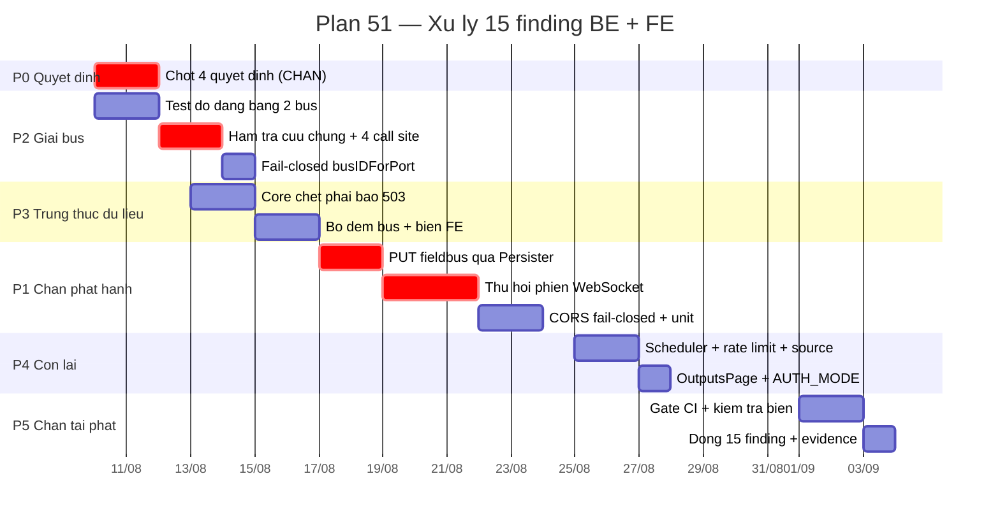
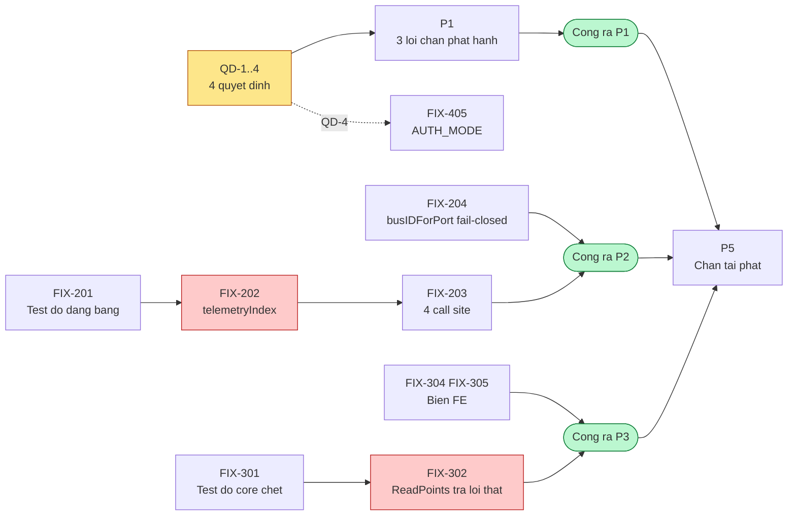

# Plan 51: Xử lý 15 finding rà soát BE + FE — vá lỗ hổng, hợp nhất đường giải bus, chặn tái phát

> **Trạng thái:** **DRAFT — chờ duyệt 4 quyết định ở §7.** P0 là cổng chặn cứng; không task nào của P1 được bắt đầu trước khi 4 quyết định có câu trả lời thành văn.
> **Phiên bản:** 1.0 | **Ngày lập:** 2026-08-06 | **Cập nhật:** 2026-08-06
> **Owner:** Dev BE (Go) + Dev FE (React) + DevOps + QA
> **Nguồn yêu cầu:** [`CODE_REVIEW_BE_FE_2026-08-06.md`](../07_records/reviews/CODE_REVIEW_BE_FE_2026-08-06.md) — 15 finding
> **Baseline mã nguồn:** commit `2a820c6`, nhánh `main`
> **Tổng khối lượng:** **24,75 người-ngày** / **35 task** / 6 pha
> **Ngoài phạm vi:** bật `ttyS1` cho cổng RS-485-2 (xem [ENABLE_TTYS1_RS485_2](../08_hardware/foxlinx-som-ddc24/ENABLE_TTYS1_RS485_2.md)); kiểm chứng I/O vật lý với slave Modbus thật (`MBR-B403`); viết lại kiến trúc phiên đăng nhập.

---

## 0. Bảng tiến độ — cập nhật mỗi phiên làm việc

> Cách cập nhật: §9.

```text
TỔNG THỂ                                                   0 / 35 task   0%
[░░░░░░░░░░░░░░░░░░░░░░░░░░░░░░░░░░░░░░░░░░░░░░░░░░]

P0 · Chốt 4 quyết định               0/ 4   0%  [░░░░░░░░░░░░░░░░░░░░]  🔄 đang chờ PO/CTO
P1 · Ba lỗi chặn phát hành           0/ 9   0%  [░░░░░░░░░░░░░░░░░░░░]  ⛔ bị P0 chặn
P2 · Hợp nhất đường giải bus         0/ 6   0%  [░░░░░░░░░░░░░░░░░░░░]  🔄 không bị chặn
P3 · Trung thực dữ liệu              0/ 6   0%  [░░░░░░░░░░░░░░░░░░░░]  🔄 không bị chặn
P4 · Còn lại                         0/ 6   0%  [░░░░░░░░░░░░░░░░░░░░]  ⛔ FIX-405 bị QĐ-4 chặn
P5 · Chặn tái phát                   0/ 4   0%  [░░░░░░░░░░░░░░░░░░░░]  ⛔ bị P2 P3 chặn

Cổng ra đã qua:  P0 ☐   P1 ☐   P2 ☐   P3 ☐   P4 ☐   P5 ☐
Rủi ro đang mở:  R-01 R-02 R-03 R-04 R-05 R-06 R-07   (§8)
Quyết định:      QĐ-1..4 ☐ CHƯA DUYỆT — chặn P1 và FIX-405
```

### 0.1 Burn-up theo tuần

Cột **Thực tế** điền vào cuối mỗi tuần. Lệch quá 20% hai tuần liên tiếp thì phải xem lại phạm vi, không phải xem lại con người.

| Tuần | Từ ngày | Kế hoạch (task luỹ kế) | Thực tế | Ghi chú |
|---|---|---:|---:|---|
| W1 | 2026-08-10 | 10 | — | P0 xong; P2 chạy song song (không bị chặn) |
| W2 | 2026-08-17 | 19 | — | Cổng ra P2 · P1 vào việc |
| W3 | 2026-08-24 | 25 | — | Cổng ra P1 (3 lỗi chặn phát hành đóng) |
| W4 | 2026-08-31 | 31 | — | Cổng ra P3 · P4 |
| W5 | 2026-09-07 | 35 | — | Cổng ra P5 · đóng plan |

### 0.2 Lộ trình



### 0.3 Đường phụ thuộc



---

## 1. Mục tiêu, giới hạn, nguyên tắc

### 1.1 Mục tiêu

Đóng **15 finding** của rà soát 2026-08-06, và — quan trọng hơn — **đóng cái cơ chế đã để chúng lọt**: cả 15 finding đều nằm ngoài vùng phủ của một bộ test đang xanh hoàn toàn (`go vet` sạch · 11/11 package · vitest 417/417 · ctest 786/786).

Plan này coi **"bộ test xanh nhưng không phủ"** là finding thứ 16, và P5 tồn tại để xử lý nó.

### 1.2 Giới hạn cứng, tuyên bố trước

1. **Plan này không viết lại kiến trúc phiên đăng nhập.** `REV-BE-02` được đóng bằng cách cho WebSocket **tra được danh sách thu hồi** và tự đóng, không phải bằng cách đổi sang mô hình session/refresh token. Đổi mô hình là việc riêng, có rủi ro riêng.
2. **Kiểm chứng chạy trên bo lab duy nhất** (`SOM-DDC-24-foxlinx`) với `mkddc-fakemcu` + PTY, **không có slave Modbus vật lý**. Mọi số đo về bus 2 và về thiết bị thật vẫn nằm ngoài tầm — plan không đóng khoảng trống đó và không tuyên bố đóng được.
3. **Không đổi hành vi ngoài phạm vi finding.** Mỗi bản vá chạm đúng đường mà finding mô tả. Thấy thêm lỗi khác thì ghi thành finding mới, không nhét vào cùng commit.
4. **24,75 người-ngày chưa gồm thời gian chờ phê duyệt** ở P0 và các cổng ra.

### 1.3 Nguyên tắc áp cho mọi task

| # | Nguyên tắc | Hệ quả kiểm tra được |
|---|---|---|
| **N1** | **Test đỏ trước bản vá.** Mỗi finding phải có test **FAIL trên mã hiện tại** trước khi sửa | Output lệnh test đỏ dán vào `docs/07_records/test-evidence/` — không có nó thì task không được đóng |
| **N2** | **Sửa nguồn, không sửa triệu chứng.** Cùng một lỗi ở *n* chỗ ⇒ gom về **một** chỗ | `REV-BE-03/04` không được vá bằng 4 bản vá rời (§4.2) |
| **N3** | **Thiếu số liệu thì `—`/`null`/`undefined`**, không `0`, không mặc định (D-07) | Test khẳng định payload rỗng ra `NO_DATA`, không ra `0` |
| **N4** | **Không nuốt lỗi.** Mọi `err` phải đi tiếp hoặc được xử lý tường minh, có log | `grep -n '_ = err\|, _ :=' ` trên đường đã sửa cho 0 dòng nuốt lỗi |
| **N5** | **Fail-closed ở biên an ninh.** Giá trị rỗng nghĩa là **từ chối**, không phải cho qua | `CORS_ORIGIN` rỗng ⇒ không mở allowlist loopback |
| **N6** | **Sửa xong phải chạy được trên bo**, không chỉ xanh trên máy dev | Mỗi cổng ra có mục "kiểm chứng trên bo" với output thật |
| **N7** | **Mọi task đóng kèm số đo thật**, không dẫn lại số cũ | Cổng ra ghi output lệnh, không ghi "PASS" suông |

---

## 2. Tổng quan 6 pha

| Pha | Tên | Task | Người-ngày | Điều kiện vào | Điều kiện ra |
|---|---|---:|---:|---|---|
| **P0** | Chốt 4 quyết định | 4 | 1,5 | Báo cáo rà soát đã đọc | 4 quyết định thành văn có ngày và người quyết |
| **P1** | Ba lỗi chặn phát hành | 9 | 7,5 | P0 xong | 3 test đỏ chuyển xanh · kiểm chứng trên bo |
| **P2** | Hợp nhất đường giải bus | 6 | 5 | — (không bị chặn) | Một hàm tra cứu duy nhất · test bảng phủ mọi endpoint telemetry |
| **P3** | Trung thực dữ liệu | 6 | 4,5 | — (không bị chặn) | Core chết ⇒ 503 · không còn số bịa ở BE lẫn FE |
| **P4** | Còn lại | 6 | 3,75 | P0 (chỉ FIX-405) | 5 finding trung bình đóng |
| **P5** | Chặn tái phát | 4 | 2,5 | P1 P2 P3 xong | Gate CI chạy đủ 4 bộ · 15 finding đóng có bằng chứng |
| | **Tổng** | **35** | **24,75** | | |

**P2 và P3 không bị P0 chặn** — hai pha này là lỗi logic thuần, không cần quyết định nào. Chạy song song ngay từ tuần 1 để P1 không thành đường găng duy nhất.

---

## 3. P0 — Chốt 4 quyết định

**Đây là cổng chặn cứng của P1.** Ba trong bốn quyết định đổi **hành vi vận hành** của bo đang chạy; sửa trước khi chốt là tự chuốc một lần rollback trên hiện trường.

| Task | Nội dung | Owner | Ngày | Phụ thuộc | TT |
|---|---|---|---:|---|---|
| FIX-001 | Trả lời **QĐ-1** — giá trị `CORS_ORIGIN` cho bo production, và có **fail-closed** khi rỗng không | CTO + DevOps | 0,5 | — | ☐ |
| FIX-002 | Trả lời **QĐ-2** — chiến lược thu hồi phiên WebSocket (đóng ngay khi revoke / revalidate theo chu kỳ / cả hai) | CTO | 0,5 | — | ☐ |
| FIX-003 | Trả lời **QĐ-3** — số phận `PUT /system/config/fieldbus`: giữ và siết, hay bỏ hẳn vì đã trùng `/modbus/config/apply` | PO + BE | 0,25 | — | ☐ |
| FIX-004 | Trả lời **QĐ-4** — `AUTH_MODE=apikey`: cài phía BE hay **bỏ hẳn khỏi FE** | PO + BE | 0,25 | — | ☐ |

**Cổng ra P0.** Bốn quyết định có câu trả lời **thành văn, có ngày và người quyết**, ghi vào `docs/00_governance/DECISIONS.md`. Không chấp nhận "để sau" — mỗi câu chưa trả lời là một task P1 không được bắt đầu.

---

## 4. P1 và P2 — Chặn phát hành và hợp nhất

### 4.1 P1 · Ba lỗi chặn phát hành (7,5 người-ngày)

#### `REV-BE-01` — PUT fieldbus xoá sạch cấu hình

File: [`internal/app/configapi.go:264`](../../apps/web-api/internal/app/configapi.go)

| Task | Nội dung | Ngày | Đóng finding | TT |
|---|---|---:|---|---|
| FIX-101 | **Test đỏ**: `PUT /system/config/fieldbus` với `{}` trên cấu hình có 2 bus + 2 device + 3 point ⇒ khẳng định cấu hình **còn nguyên**. Test này phải FAIL trước khi sửa | 0,5 | REV-BE-01 | ☐ |
| FIX-102 | Mọi đường ghi `fieldbus.conf` đi qua `webModbus.Persister`: giữ `pointConfigMu`, ghi journal, có rollback. Nhánh "không device/point" **không còn** rơi xuống `handlePutConfigValue` | 1,5 | REV-BE-01 | ☐ |
| FIX-103 | Bảo toàn `revision`/`checksum` trên **mọi** nhánh (hiện chỉ nhánh `len>0` có `cfg.Revision = current.Revision`); body rỗng ⇒ `400` với mã lỗi, không phải ghi đè | 0,75 | REV-BE-01 | ☐ |

> FIX-102 phụ thuộc **QĐ-3**. Nếu PO chọn bỏ hẳn endpoint thì FIX-102/103 rút còn 0,5 ngày (xoá route + test khẳng định 404). Ước lượng ở đây là phương án "giữ và siết" — phương án đắt hơn.

#### `REV-BE-02` — WebSocket giữ quyền ghi sau logout

File: [`internal/app/ws.go:71`](../../apps/web-api/internal/app/ws.go)

| Task | Nội dung | Ngày | Đóng finding | TT |
|---|---|---:|---|---|
| FIX-104 | **Test đỏ**: mở WS bằng token hợp lệ → `Revoke` phiên → gửi `op:"force"` ⇒ khẳng định bị từ chối và socket đóng. Cộng một ca token hết hạn theo `TTL` | 0,75 | REV-BE-02 | ☐ |
| FIX-105 | `AuthService` phơi ra đường **tra trạng thái thu hồi** của một phiên (theo `jti`/`session_id`), dùng được từ goroutine của WS | 1 | REV-BE-02 | ☐ |
| FIX-106 | WS **revalidate theo chu kỳ** (mặc định 30 s) và **đóng socket ngay** khi phiên bị thu hồi; `handleMonitorForce` kiểm lại trước mỗi lệnh ghi. Đóng bằng close-code có nghĩa để FE hiện thông báo, không im lặng rớt | 1,5 | REV-BE-02 | ☐ |

> Chu kỳ 30 s là **con số đề xuất, chưa đo**. Nó là đánh đổi giữa cửa sổ tồn tại của một phiên đã thu hồi và tải kiểm token. Chốt cuối theo **QĐ-2**.

#### `REV-PLT-01` — CORS/WS allowlist chế độ dev trên bo production

File: [`platform/systemd/mkddc-web-pi.service:11`](../../platform/systemd/mkddc-web-pi.service)

| Task | Nội dung | Ngày | Đóng finding | TT |
|---|---|---:|---|---|
| FIX-107 | **Test đỏ**: `CORSOrigin = ""` ⇒ khẳng định `isAllowedOrigin` và `wsOriginPatterns` **từ chối** origin loopback lạ | 0,5 | REV-PLT-01 | ☐ |
| FIX-108 | `CORS_ORIGIN` vào `mkddc-web-pi.service` và `platform/packaging/install.sh`; ghi vào runbook deploy giá trị phải đặt cho từng loại triển khai | 0,75 | REV-PLT-01 | ☐ |
| FIX-109 | **Fail-closed (N5)**: rỗng ⇒ chỉ same-origin, và ghi `WARN` một lần lúc khởi động nói rõ đang chạy chế độ nào. Nhánh dev-loopback chỉ bật bằng biến môi trường tường minh | 0,75 | REV-PLT-01 | ☐ |

> FIX-109 phụ thuộc **QĐ-1**. Rủi ro `R-02`: bật fail-closed mà quên đặt giá trị trên bo sẽ làm giao diện **không truy cập được từ xa**. Bắt buộc thử trên bo lab trước, và runbook phải có bước kiểm.

#### Cổng ra P1

```bash
go vet ./... && go test ./... -count=1          # PASS, không skip
# Ba test đỏ của FIX-101 / FIX-104 / FIX-107 phải chuyển XANH
```

Kiểm chứng **trên bo** (N6), dán output vào evidence:

```
1. PUT /api/v1/system/config/fieldbus  {}   → 400, fieldbus.conf không đổi (so checksum trước/sau)
2. Mở WS → logout → gửi force            → từ chối + socket đóng có close-code
3. curl -H 'Origin: http://localhost:9999' → bị từ chối; origin hợp lệ vẫn qua
4. Giao diện vẫn mở được từ mekong-fac.ddns.net:8082 sau khi đặt CORS_ORIGIN
```

### 4.2 P2 · Hợp nhất đường giải bus (5 người-ngày)

**Đây là pha quan trọng nhất về mặt phương pháp.** `REV-BE-03`/`04` **chính là lỗi đã sửa** ở `handleModbusDiagnostics` (commit `b39652c`) nhưng không lan sang bốn call site còn lại. Vá bốn chỗ rời là lặp lại đúng sai lầm đó ở quy mô lớn hơn.

| Task | Nội dung | Ngày | Đóng finding | TT |
|---|---|---:|---|---|
| FIX-201 | **Test đỏ dạng bảng**: cấu hình 2 bus, mỗi bus một device ở `slave_id = 1`, telemetry cho hai kết quả khác nhau. Chạy qua **mọi** endpoint dùng telemetry: `/modbus/buses`, `/modbus/overview`, `/modbus/diagnostics`, `recordModbusEvents`. Khẳng định từng endpoint gán đúng thiết bị | 1,25 | REV-BE-03 REV-BE-04 | ☐ |
| FIX-202 | `telemetryIndex` — **một** hàm tra cứu duy nhất khoá `(bus, slave)`, có nhánh lùi về bus 1 cho cấu hình một-bus cũ. Là nơi **duy nhất** được phép ánh xạ telemetry sang device | 1 | REV-BE-03 REV-BE-04 | ☐ |
| FIX-203 | Chuyển 4 call site sang hàm chung; **xoá sạch** `map[int]…` cục bộ ở `modbus_rtu.go:471/533/600/698` | 1 | REV-BE-03 REV-BE-04 | ☐ |
| FIX-204 | `busIDForPort` **fail-closed**: cổng không khớp manifest ⇒ trả `""`, không im lặng về `rs485-1`. Khớp lại với chính sách `NumericID` đã phát biểu ở cùng file | 0,5 | REV-BE-09 | ☐ |
| FIX-205 | Validator từ chối device có `rs485_port` ngoài capability manifest, kèm mã lỗi và danh sách cổng hợp lệ | 0,5 | REV-BE-09 | ☐ |
| FIX-206 | Kiểm tra tĩnh trong test: quét package `app`, **cấm** map telemetry khoá theo mỗi `Addr`. Call site thứ năm ra đời sau sẽ bị chặn tại CI thay vì ở hiện trường | 0,75 | N2 | ☐ |

> FIX-206 là task **rẻ nhất và có giá trị dài nhất** của cả plan. Không có nó, plan này chỉ dọn hiện trạng chứ không đổi được xác suất lỗi tái phát.
>
> Rủi ro `R-05`: FIX-204 làm cấu hình cũ trên bo (nếu có device trỏ cổng lạ) **bị từ chối khi nạp**. Bắt buộc thử với `fieldbus.conf` **thật lấy từ bo**, không phải file bịa.

#### Cổng ra P2

```bash
go test ./internal/app/ ./internal/modbusrtu/ -count=1 -run 'Telemetry|Bus'
grep -rn 'map\[int\].*Addr' apps/web-api/internal/app/    # kỳ vọng: 0 dòng
```

Trên bo: cấu hình 2 device cùng `slave_id` khác bus (dùng `/dev/rs485-1` cho cả hai nếu `ttyS1` chưa bật, mô phỏng bằng cách sửa `bus_id` trong `fieldbus.conf`), khẳng định `/modbus/diagnostics` và `/modbus/buses` **không** đổi chỗ hai thiết bị.

---

## 5. P3 và P4

### 5.1 P3 · Trung thực dữ liệu (4,5 người-ngày)

Bốn finding cùng một khuôn: **bịa một giá trị hợp lý thay vì nói "chưa biết"**. Chúng nguy hiểm hơn lỗi ồn ào vì không có triệu chứng — một con số hợp lý, không đổi bao giờ, và không ai nghĩ để nghi ngờ.

| Task | Nội dung | Ngày | Đóng finding | TT |
|---|---|---:|---|---|
| FIX-301 | **Test đỏ**: `readPLCShm` lỗi ⇒ khẳng định `GET /api/v1/points` trả **503**, WS phát khung lỗi, `Sampler` **bỏ qua mẫu** thay vì ghi "0 point" | 0,5 | REV-BE-07 | ☐ |
| FIX-302 | `CoreClient.ReadPoints` **trả lỗi thật** thay vì `[]PointDTO{}, nil`; sửa ba nơi gọi (`points.go:41`, `sendMonitorSnapshot`, `sampler.go:120`) để tôn trọng lỗi đó | 1,5 | REV-BE-07 | ☐ |
| FIX-303 | Bộ đếm bus ở `modbus_rtu.go:612`: thôi gán `TotalErrors` vào `TimeoutErrors`, thôi xoá trắng `CrcErrors`, thôi cộng chồng của slave lên trên. Kèm test số học với bus 100 lỗi / slave 40+30 | 0,75 | REV-BE-10 | ☐ |
| FIX-304 | FE: `open` và `closed` **không còn cùng map sang `true`**; đối chiếu với `DoSafeState` là nguồn chân lý | 0,5 | REV-FE-01 | ☐ |
| FIX-305 | FE: `pointValue` trả `undefined` khi không có giá trị, **không phải `0`**; `isPhysicalTrendPoint` và `appendLiveTrendSample` bỏ qua mẫu chưa đo; bảng hiện `NO_DATA` | 1 | REV-FE-04 | ☐ |
| FIX-306 | Rà toàn bộ biên FE tìm các `?? 0` / `?? <mặc định>` còn lại; mỗi chỗ hoặc chứng minh được là đúng, hoặc thành finding mới | 0,25 | N3 | ☐ |

> `R-03`: FIX-302 đổi chữ ký hành vi của một hàm được gọi ở nhiều nơi. Rủi ro không phải ở bản thân bản vá mà ở **những nơi gọi chưa được rà**. Bắt buộc `grep` toàn bộ call site trước khi đổi, và liệt kê chúng trong PR.
>
> `R-06`: FIX-305 đổi `0` → `undefined` có thể làm biểu đồ/bảng nào đó nổ ở chỗ chưa có test. Đây là lý do FIX-306 tồn tại.

### 5.2 P4 · Còn lại (3,75 người-ngày)

| Task | Nội dung | Ngày | Đóng finding | TT |
|---|---|---:|---|---|
| FIX-401 | `applyVirtualPointSchedules` **chạy tiếp** khi một VP lỗi; gom lỗi thành danh sách; báo ra giao diện thay vì chỉ một dòng WARN. Test với 3 lịch, lịch giữa hỏng | 1 | REV-BE-05 | ☐ |
| FIX-402 | `handleModbusWriteTest` gọi `commissionLimit.allow("write:"+user, 2, …)` đúng như `OD-MBRTU-007` mô tả; test khẳng định lần thứ 3 trong một phút bị chặn | 0,5 | REV-BE-06 | ☐ |
| FIX-403 | `overlayPointMetadata` **không ghi đè** `Source` do core cấp; chỉ điền khi `Source` rỗng. Giữ nguyên hợp đồng `core_unavailable` mà `ws.go:296` dựa vào | 1 | REV-BE-08 | ☐ |
| FIX-404 | `OutputsPage`: bỏ `selectedId` khỏi deps của effect nạp; đổi kênh khi còn chỉnh sửa chưa lưu ⇒ **hỏi trước**, không im lặng vứt bỏ | 0,75 | REV-FE-02 | ☐ |
| FIX-405 | `AUTH_MODE=apikey` theo **QĐ-4**: cài `X-API-Key` phía BE, hoặc **bỏ hẳn** nhánh này khỏi FE. Không giữ nguyên trạng — một chế độ đăng nhập luôn 401 tệ hơn không có chế độ đó | 0,5 | REV-FE-03 | ☐ |
| FIX-406 | Cập nhật `DATA_MODEL` / `CONFIG_SCHEMA` / `MODBUS_RTU_API_SPEC` theo mọi thay đổi hợp đồng của P1–P4 | — | N6 | ☐ |

#### Cổng ra P3 + P4

```bash
go vet ./... && go test ./... -count=1
npx vitest --run --environment jsdom src && npm run lint && npm run build
```

Trên bo: dừng `mkddc-core`, khẳng định `/api/v1/points` trả **503** (không phải `200 []`) và giao diện hiện lỗi kết nối chứ không hiện bảng rỗng với huy hiệu khoẻ.

---

## 6. P5 — Chặn tái phát (2,5 người-ngày)

> Pha này xử lý **finding thứ 16**: bộ test xanh hoàn toàn mà không phủ một finding nào trong 15 cái trên.

| Task | Nội dung | Ngày | TT |
|---|---|---:|---|
| FIX-501 | Gate CI chạy **đủ 4 bộ** test và **thất bại khi test thất bại**. Rà lại ba gate từng bị ghi là rỗng trong [review 2026-07-30](../07_records/reviews/KX-DDC24-CODE-REVIEW-FE-BE-FWSOM-2026-07-30.md) — nếu vẫn rỗng thì đây là nguyên nhân gốc của cả plan này | 1 | ☐ |
| FIX-502 | Kiểm tra biên tự động: normalizer FE **không được** trả literal mặc định cho dữ liệu vắng; thêm test bảng cho `pointValue` với mọi tổ hợp trường vắng | 0,5 | ☐ |
| FIX-503 | Ghi vào `AGENTS.md`/`CLAUDE.md` quy tắc rút ra: **sửa một lỗi thì phải `grep` các chỗ cùng khuôn**, và bản vá phải kèm test chặn call site mới | 0,5 | ☐ |
| FIX-504 | Cập nhật báo cáo rà soát: đánh dấu 15 finding đã đóng kèm commit và output kiểm chứng; ghi hồ sơ vào `docs/07_records/test-evidence/` | 0,5 | ☐ |

#### Cổng ra P5

Toàn bộ 15 finding ở trạng thái **ĐÃ ĐÓNG** với: commit vá · test đỏ trước và xanh sau · output kiểm chứng trên bo. **Không finding nào được đóng bằng "đã xem, không phải lỗi" mà thiếu lập luận viết ra.**

---

## 7. Quyết định cần chốt — **chặn P1**

| # | Câu hỏi | Phương án | Chặn task |
|---|---|---|---|
| **QĐ-1** | `CORS_ORIGIN` trên bo production đặt giá trị gì, và rỗng thì làm gì? | **PA-1** — đặt tường minh theo từng triển khai; rỗng ⇒ **chỉ same-origin** (fail-closed). **PA-2** — giữ loopback allowlist, chấp nhận rủi ro, ghi vào sổ rủi ro | FIX-108 FIX-109 |
| **QĐ-2** | Thu hồi phiên WebSocket làm theo cách nào? | **PA-1** — đóng socket **ngay** khi `Revoke` (cần kênh thông báo). **PA-2** — revalidate theo chu kỳ 30 s (đơn giản hơn, có cửa sổ tồn tại). **PA-3** — cả hai | FIX-105 FIX-106 |
| **QĐ-3** | `PUT /system/config/fieldbus` giữ hay bỏ? | **PA-1** — **bỏ hẳn**, đã trùng `/modbus/config/apply` (rẻ hơn, bớt một đường ghi). **PA-2** — giữ và bắt đi qua `Persister` | FIX-102 FIX-103 |
| **QĐ-4** | `AUTH_MODE=apikey` cài hay bỏ? | **PA-1** — **bỏ khỏi FE** (chưa ai dùng, BE không có gì đỡ). **PA-2** — cài `X-API-Key` phía BE cho kịch bản tích hợp máy-máy | FIX-405 |

**Khuyến nghị kỹ thuật:** QĐ-1 → PA-1 · QĐ-2 → PA-3 (PA-2 một mình để lại cửa sổ 30 giây cho một phiên đã thu hồi, trên kênh có quyền ghi xuống thiết bị) · QĐ-3 → PA-1 · QĐ-4 → PA-1.

Ba trong bốn khuyến nghị là **bỏ bớt đường đi**, không phải thêm mã. Mỗi đường ghi thừa là một đường phải bảo vệ, và `REV-BE-01` chính là hậu quả của một đường như vậy.

---

## 8. Rủi ro

| Mã | Rủi ro | Mức | Ứng phó | Task |
|---|---|---|---|---|
| R-01 | Thu hồi phiên làm rớt WS của người vận hành đang thao tác | **Cao** | Đóng bằng close-code có nghĩa; FE hiện thông báo và tự kết nối lại sau khi đăng nhập | FIX-106 |
| R-02 | Bật CORS fail-closed mà quên đặt giá trị ⇒ bo **không truy cập được từ xa** | **Cao** | Thử trên bo lab trước; runbook có bước kiểm; `WARN` lúc khởi động nói rõ chế độ đang chạy | FIX-108 FIX-109 |
| R-03 | `ReadPoints` trả lỗi làm vỡ những nơi gọi chưa được rà | **Cao** | `grep` toàn bộ call site **trước** khi đổi và liệt kê trong PR | FIX-302 |
| R-04 | Hàm tra cứu chung bỏ sót một call site | Trung bình | Kiểm tra tĩnh FIX-206 chặn tại CI, không dựa vào mắt người | FIX-203 FIX-206 |
| R-05 | `busIDForPort` fail-closed từ chối cấu hình cũ đang chạy trên bo | Trung bình | Test bằng `fieldbus.conf` **thật lấy từ bo**; có đường di trú hoặc cảnh báo rõ | FIX-204 |
| R-06 | FE đổi `0` → `undefined` làm biểu đồ/bảng nổ ở chỗ chưa có test | Trung bình | FIX-306 rà toàn biên; chạy e2e trên bo trước khi merge | FIX-305 FIX-306 |
| R-07 | Chỉ có **một** bo lab để kiểm chứng; hỏng là mất luôn môi trường | Trung bình | Sao lưu cấu hình + binary trước mỗi lần deploy; giữ 5 bản gần nhất | mọi cổng ra |

---

## 9. Cách cập nhật tiến độ

Mỗi phiên làm việc có đóng task:

1. Đổi ô **TT** của task trong §3–§6 sang ✅ kèm ngày và số đo (không ghi "PASS" suông — N7).
2. Cập nhật **§0**: đếm lại task, vẽ lại thanh (mỗi ô `█` = 5%).
3. Cập nhật **§0.1** cột *Thực tế* vào cuối tuần.
4. Task bị chặn thì ghi rõ **chặn bởi cái gì** và **cần gì để mở** — không viết "chờ".
5. Cổng ra chỉ được tick khi lệnh ở §4–§6 chạy thật và output được dán vào `docs/07_records/test-evidence/`.
6. **Test đỏ phải có bằng chứng đỏ** (N1): dán output lần chạy FAIL trước khi sửa. Task nào chỉ có bằng chứng xanh thì **chưa đóng được**.
7. Cập nhật `CHANGELOG.md` cùng phiên (quy tắc dự án).

Ký hiệu trạng thái: `☐` chưa làm · `🔄` đang làm · `✅` xong có bằng chứng · `⛔` bị chặn · `⏸` hoãn có quyết định.

---

## 10. Bảng tổng hợp toàn bộ task

| # | Task | Pha | Nội dung | Owner | Ngày | Phụ thuộc | Finding | TT |
|---|---|---|---|---|---:|---|---|---|
| 1 | FIX-001 | P0 | QĐ-1 `CORS_ORIGIN` | CTO | 0,5 | — | REV-PLT-01 | ☐ |
| 2 | FIX-002 | P0 | QĐ-2 thu hồi phiên WS | CTO | 0,5 | — | REV-BE-02 | ☐ |
| 3 | FIX-003 | P0 | QĐ-3 số phận PUT fieldbus | PO | 0,25 | — | REV-BE-01 | ☐ |
| 4 | FIX-004 | P0 | QĐ-4 `AUTH_MODE=apikey` | PO | 0,25 | — | REV-FE-03 | ☐ |
| 5 | FIX-101 | P1 | **Test đỏ** PUT rỗng xoá cấu hình | BE | 0,5 | 003 | REV-BE-01 | ☐ |
| 6 | FIX-102 | P1 | Mọi ghi fieldbus qua `Persister` | BE | 1,5 | 101 | REV-BE-01 | ☐ |
| 7 | FIX-103 | P1 | Bảo toàn revision/checksum mọi nhánh | BE | 0,75 | 102 | REV-BE-01 | ☐ |
| 8 | FIX-104 | P1 | **Test đỏ** WS giữ quyền sau logout | BE | 0,75 | 002 | REV-BE-02 | ☐ |
| 9 | FIX-105 | P1 | Tra trạng thái thu hồi phiên | BE | 1 | 104 | REV-BE-02 | ☐ |
| 10 | FIX-106 | P1 | WS revalidate + đóng socket | BE | 1,5 | 105 | REV-BE-02 | ☐ |
| 11 | FIX-107 | P1 | **Test đỏ** CORS rỗng nhận loopback | BE | 0,5 | 001 | REV-PLT-01 | ☐ |
| 12 | FIX-108 | P1 | `CORS_ORIGIN` vào unit + install.sh | DevOps | 0,75 | 107 | REV-PLT-01 | ☐ |
| 13 | FIX-109 | P1 | Fail-closed khi rỗng | BE | 0,75 | 108 | REV-PLT-01 | ☐ |
| 14 | FIX-201 | P2 | **Test đỏ dạng bảng** 2 bus cùng slave | BE | 1,25 | — | REV-BE-03/04 | ☐ |
| 15 | FIX-202 | P2 | `telemetryIndex` khoá (bus, slave) | BE | 1 | 201 | REV-BE-03/04 | ☐ |
| 16 | FIX-203 | P2 | Chuyển 4 call site sang hàm chung | BE | 1 | 202 | REV-BE-03/04 | ☐ |
| 17 | FIX-204 | P2 | `busIDForPort` fail-closed | BE | 0,5 | — | REV-BE-09 | ☐ |
| 18 | FIX-205 | P2 | Validator từ chối cổng ngoài manifest | BE | 0,5 | 204 | REV-BE-09 | ☐ |
| 19 | FIX-206 | P2 | **Kiểm tra tĩnh chặn call site mới** | BE | 0,75 | 203 | N2 | ☐ |
| 20 | FIX-301 | P3 | **Test đỏ** core chết ⇒ 503 | BE | 0,5 | — | REV-BE-07 | ☐ |
| 21 | FIX-302 | P3 | `ReadPoints` trả lỗi thật | BE | 1,5 | 301 | REV-BE-07 | ☐ |
| 22 | FIX-303 | P3 | Sửa bộ đếm bus đếm trùng | BE | 0,75 | — | REV-BE-10 | ☐ |
| 23 | FIX-304 | P3 | FE `open` ≠ `closed` | FE | 0,5 | — | REV-FE-01 | ☐ |
| 24 | FIX-305 | P3 | FE thiếu giá trị ⇒ `undefined` | FE | 1 | 304 | REV-FE-04 | ☐ |
| 25 | FIX-306 | P3 | Rà `?? 0` còn lại ở biên FE | FE | 0,25 | 305 | N3 | ☐ |
| 26 | FIX-401 | P4 | Scheduler chạy tiếp khi một VP lỗi | BE | 1 | — | REV-BE-05 | ☐ |
| 27 | FIX-402 | P4 | Giới hạn ghi thử 2/phút | BE | 0,5 | — | REV-BE-06 | ☐ |
| 28 | FIX-403 | P4 | Không ghi đè `Source` của core | BE | 1 | — | REV-BE-08 | ☐ |
| 29 | FIX-404 | P4 | OutputsPage deps + chặn mất sửa | FE | 0,75 | — | REV-FE-02 | ☐ |
| 30 | FIX-405 | P4 | `AUTH_MODE=apikey` theo QĐ-4 | FE/BE | 0,5 | 004 | REV-FE-03 | ☐ |
| 31 | FIX-406 | P4 | Cập nhật 3 tài liệu hợp đồng | Docs | — | 102 202 302 | N6 | ☐ |
| 32 | FIX-501 | P5 | **Gate CI chạy đủ 4 bộ test** | DevOps | 1 | Cổng ra P1/P2/P3 | finding #16 | ☐ |
| 33 | FIX-502 | P5 | Kiểm tra biên normalizer FE | FE | 0,5 | 305 | N3 | ☐ |
| 34 | FIX-503 | P5 | Ghi quy tắc "grep chỗ cùng khuôn" vào AGENTS/CLAUDE | Docs | 0,5 | 206 | N2 | ☐ |
| 35 | FIX-504 | P5 | Đóng 15 finding + hồ sơ kiểm chứng | QA | 0,5 | tất cả | tất cả | ☐ |

---

## 11. Liên hệ với các plan khác

| Plan | Quan hệ |
|---|---|
| [49_MODBUS_RTU_IMPLEMENTATION_PLAN](49_MODBUS_RTU_IMPLEMENTATION_PLAN.md) | 7/15 finding nằm trong phạm vi Modbus RTU; P2 đóng nốt phần `(bus, slave)` mà plan 49 mở ra khi chốt 2 cổng |
| [50_SCHEDULER_V3_1_IMPLEMENTATION_PLAN](50_SCHEDULER_V3_1_IMPLEMENTATION_PLAN.md) | `REV-BE-05` chạm `virtualpoint_scheduler.go`. **Làm FIX-401 trước khi plan 50 vào P1**, nếu không bản viết lại sẽ mang theo lỗi bỏ dở vòng lặp |
| [45_WEB_UX_REMEDIATION_AND_CICD_PLAN](45_WEB_UX_REMEDIATION_AND_CICD_PLAN.md) | FIX-501 là phần CI/CD còn nợ của plan 45 — ba gate rỗng ghi trong [review 2026-07-30](../07_records/reviews/KX-DDC24-CODE-REVIEW-FE-BE-FWSOM-2026-07-30.md) |
| [ENABLE_TTYS1_RS485_2](../08_hardware/foxlinx-som-ddc24/ENABLE_TTYS1_RS485_2.md) | FIX-201 kiểm chứng đầy đủ hai bus **chỉ khi** `ttyS1` được bật; trước đó phải mô phỏng bằng `bus_id` trong `fieldbus.conf` |

---

## Revision History

| Phiên bản | Ngày | Người | Nội dung |
|---|---|---|---|
| 1.0 | 2026-08-06 | Claude Code | Bản đầu: 6 pha, 35 task, 24,75 người-ngày; 4 quyết định chặn P1; 7 rủi ro; nguyên tắc N1 "test đỏ trước bản vá"; P5 xử lý finding thứ 16 — bộ test xanh mà không phủ |
