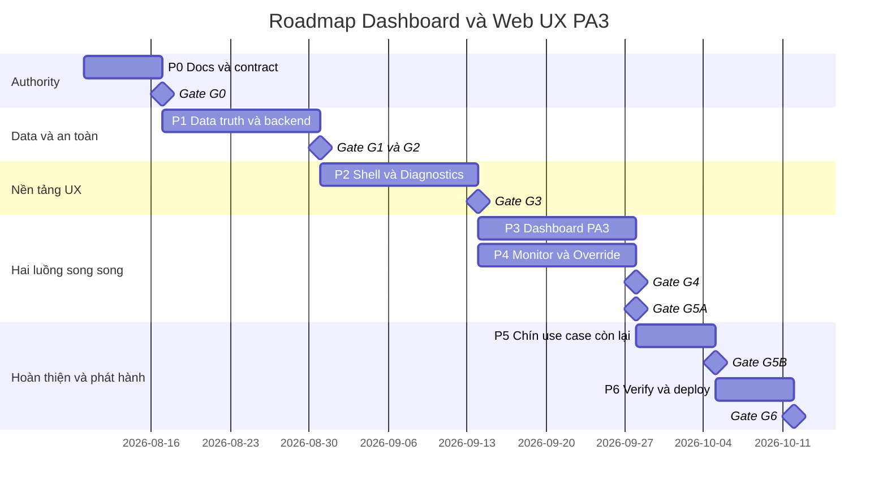

# PLAN-WEB-PA3-052 — Kế hoạch triển khai Dashboard và Web UX PA3

> **Trạng thái:** HOÀN TẤT — 50/50 task, G0–G6 đạt, đã deploy và diễn tập rollback trên Foxlinx  
> **Ngày lập:** 2026-08-08  
> **Owner:** Product/UX Owner + Web Lead + Backend Lead + Verification Lead  
> **Baseline phân tích:** `1b02d415f9bb2eb9e69f94bb772fe4402c32cfa8` (`main`)  
> **Đầu vào:** `docs/CHUONG_YEU_CAU/dashboard.md`,
> `docs/CHUONG_YEU_CAU/UX_DESIGN_MK-DDC-24_PA3.md`  
> **Đích chạy:** Foxlinx SOM DDC24, HTTP nội bộ `8081`, cổng công bố hiện tại `8082`  
> **Ước lượng:** 7 pha, 50 task, 56 người-ngày, mục tiêu 9 tuần lịch; chưa gồm thời gian
> chờ owner duyệt UX hoặc cửa sổ deploy target

## 1. Kết luận điều hành

PA3 không phải một lần “đổi giao diện” đơn thuần. Dashboard hiện tại là trang chẩn đoán
kỹ thuật: CPU, RAM, nhiệt độ, service, tiến trình, sơ đồ controller và cả `RS485-2` không có
authority thật. Trong khi đó, PA3 yêu cầu landing page dành cho vận hành: biết hệ thống có
ổn không, việc gì cần xử lý, đối tượng nào đang chạy/ép tay/lỗi, rồi mới drill-down sang
engineering.

Kế hoạch này triển khai theo thứ tự **hợp đồng dữ liệu → shell → Dashboard → Monitor/Point
Detail → các use case liên quan → kiểm chứng và deploy**. Không được vẽ UI trước rồi bịa dữ
liệu lấp chỗ trống. Các cổng nghiệm thu là:

| Cổng | Điều kiện qua cổng |
|---|---|
| G0 — Authority | Chốt vocabulary, trạng thái, quyền, severity, point inventory và owner dữ liệu |
| G1 — Data truth | Overview/Activity/Point DTO có nguồn thật; unknown/stale/offline/bad tách biệt |
| G2 — Safe command | Override dùng TTL của Core; role và audit được cưỡng chế ở backend |
| G3 — UX foundation | Shell, token, responsive, focus, keyboard và Diagnostics route đạt contract |
| G4 — Dashboard | Attention, Operating Summary, My Workspace, Trend preview, Activity hoạt động |
| G5A — Point safety | Monitor/Point Detail/Override đạt data truth, role và Core TTL |
| G5B — Use cases | Đủ 12 use case có đường điều hướng và tiêu chí nghiệm thu theo role |
| G6 — Target | Automated gates PASS, Chrome desktop/mobile PASS, board deploy và rollback PASS |

Không được deploy PA3 lên bo chỉ vì FE build thành công. G6 cần bằng chứng API, UI, Console,
Network, role, reload, restart service và rollback trên đúng bundle.

## 2. Phạm vi và biên an toàn

### 2.1 Trong phạm vi

- Chuẩn hóa tài liệu yêu cầu, thiết kế, hợp đồng API, traceability và checklist nghiệm thu.
- Thiết kế lại shell Web và Dashboard theo PA3 Adaptive Hybrid Control Workspace.
- Hoàn thiện Monitor, Point Detail, Manual Override/Release, Alarm, Trends, Scheduler,
  Commissioning, Modbus, Configuration, Network và User/System Admin ở mức luồng UX.
- Bổ sung read model cho Overview, Activity và các trường point hiện bị FE làm rơi.
- Kiểm chứng React/Vite trên trình duyệt thật và deploy lên Foxlinx bằng quy trình có rollback.

### 2.2 Ngoài phạm vi

- Không biến Web PA3 thành HMI native LVGL/DRM.
- Không tự mở rộng phần cứng base SKU: chỉ `UI16/AO4/DO4`; `DI` chỉ hiện khi capability
  authority trả về có thật.
- Không dựng giả `RS485-2`, OTA, reboot/restart, BACnet object browser hoặc endpoint chưa có.
- Không thay đổi thuật toán control/PLC chỉ để phục vụ layout.
- Không tăng quyền mutation ở FE; backend vẫn là nơi cưỡng chế cuối cùng.

### 2.3 Guardrail bắt buộc

1. `unknown`, `stale`, `offline`, `bad` là bốn trạng thái khác nhau, không gom thành màu đỏ.
2. Mọi số hiển thị phải có timestamp/source; thiếu timestamp không được thay bằng thời gian hiện tại.
3. FE không optimistic-confirm một lệnh điều khiển trước khi authority xác nhận.
4. Viewer/Operator/Admin là ba role duy nhất; control bị disable kèm lý do khi thiếu quyền.
5. Trend không nối qua khoảng trống dữ liệu và phải biểu diễn `complete=false`.
6. Network giữ nguyên giao dịch `validate → stage → apply → confirm/rollback`.
7. Audit không chứa secret, password, token hoặc toàn bộ payload nhạy cảm.

## 3. Quyết định thiết kế mặc định cần owner phê duyệt ở G0

| ID | Quyết định đề xuất |
|---|---|
| PA3-D01 | PA3 áp dụng cho Web UI; HMI native giữ luồng riêng theo giới hạn panel |
| PA3-D02 | Thêm `GET /api/v1/overview`, quyền Viewer, là read model duy nhất của Landing |
| PA3-D03 | Activity có kho lưu bền vững, API phân trang và retention; không parse journal trong request |
| PA3-D04 | My Workspace lưu ID đối tượng trong `localStorage`, namespace theo controller + username |
| PA3-D05 | REST và WebSocket override cùng gọi `CoreClient.CommandPoint(..., ttlS)`; Core sở hữu TTL |
| PA3-D06 | Drill-down dùng resolver theo loại/ID; không cho URL tùy ý từ dữ liệu backend |
| PA3-D07 | Diagnostics nhận toàn bộ CPU/RAM/service/process đang nằm sai trên Dashboard |
| PA3-D08 | Landing tối đa 4 trend series; Trends đầy đủ tối đa 8 series theo hợp đồng hiện tại |

Nếu owner thay đổi một quyết định, phải cập nhật yêu cầu, thiết kế, API contract, traceability và
test trước khi merge code tương ứng.

## 4. Baseline source và khoảng cách so với PA3

### 4.1 Thành phần có thể tái sử dụng

| Năng lực | Source authority hiện tại | Hướng dùng lại |
|---|---|---|
| Routing và role | `apps/web-ui/src/app/App.tsx`, `shared/auth/roles.ts` | Giữ route guard, sửa ma trận Scheduler |
| Shell | `AppShell.tsx`, `TopBar.tsx`, `NavRail.tsx` | Tách status strip, command bar và responsive nav |
| Point live | `/api/v1/points`, `/ws`, `PointDTO` | Mở rộng TS model/normalizer, không tạo nguồn song song |
| Alarm | `/api/v1/alarms`, `AlarmsPage.tsx` | Thêm role-aware action và attention aggregation |
| Historian | `shared/api/history.ts`, `TrendChart.tsx` | Dùng gaps/complete/min/max; bổ sung min/max band |
| Scheduler | API/FE Scheduler hiện tại | Mở read-only cho Viewer, mutation theo Operator/Admin |
| Modbus | Bus/Device/Point và test route hiện tại | Bổ sung hierarchy/drill-down, đưa point vào Monitor |
| Network | netcfg transaction flow hiện tại | Giữ nguyên transaction, chỉ đồng bộ visual language |

### 4.2 Finding phải xử lý

| ID | Mức | Finding source | Tác động/biện pháp |
|---|---|---|---|
| PA3-F01 | P0 | Dashboard đang hiển thị CPU/RAM/temp/service/process/controller diagram | Chuyển sang Diagnostics; Landing chỉ operation summary |
| PA3-F02 | P0 | Dashboard hard-code `RS485-2` | Xóa; chỉ render bus từ authority/capability |
| PA3-F03 | P0 | `PointDTO` có `override_expires_in_s`, quality reason, bus/slave/exception/online nhưng TS làm rơi | Mở rộng type và normalizer, thêm contract test |
| PA3-F04 | P0 | `normalizePoint()` dùng `nowIso()` khi thiếu timestamp | Không được làm dữ liệu thiếu thời gian trông như fresh |
| PA3-F05 | P0 | REST force TTL=0; WS/browser tự đặt timer release | Chuyển TTL sang Core authority, xóa timer theo connection/browser |
| PA3-F06 | P0 | Point Detail tạo 5 history row giả, activation count `15`, fallback `Dry Contact` | Xóa dữ liệu giả; hiện `Không có dữ liệu` hoặc lấy API thật |
| PA3-F07 | P1 | Analog bị ép `Boolean(value)` rồi gắn Active/logic 1 | Render engineering value/state theo signal type |
| PA3-F08 | P1 | Monitor thiếu Modbus group và nhiều filter PA3 | Dùng unified point collection + filter model có URL state |
| PA3-F09 | P1 | Scheduler route FE ép Admin dù backend cho Viewer đọc và Operator enable/disable | Sửa route access, giữ action gate theo role |
| PA3-F10 | P1 | Alarm action hiện với Viewer rồi nhận 403 | Disable action kèm lý do theo role; backend vẫn chặn |
| PA3-F11 | P1 | Audit chỉ ghi log, không có Activity query an toàn | Thêm durable activity store/API có redaction/retention |
| PA3-F12 | P1 | AppShell và Dashboard polling trùng; không có overall state/last data age | Thêm OverviewProvider và một read model versioned |
| PA3-F13 | P2 | `SystemHealthPage` chỉ re-export Dashboard và chưa thành Diagnostics route | Tạo Diagnostics thật, role Viewer đọc được |
| PA3-F14 | P2 | Notes có nút Save không persistence | Hoặc có API lưu thật, hoặc bỏ control khỏi release PA3 |
| PA3-F15 | P2 | Local demo thiếu `favicon.ico` | Bổ sung asset hoặc bỏ reference để Network sạch lỗi 404 |

### 4.3 Bằng chứng runtime baseline 2026-08-08

- Desktop `1440×900`: Landing hiện debug cards/service list và `RS485-2`; không có Attention,
  Operating Summary, My Workspace hay Activity đúng PA3.
- Mobile `390×844`: layout co được nhưng vẫn mang nguyên information architecture sai của desktop.
- Monitor render lịch sử/activation count giả như finding PA3-F06.
- Console không có error; Network tải asset chính `200`, riêng `favicon.ico` trả `404`.
- Bo Foxlinx: `mkddc-web-pi.service` active, binary dùng `PORT=8081`, static root
  `/opt/mkddc-web/dist`; cổng truy cập công bố đang là `8082`.

Ảnh baseline cục bộ chỉ là bằng chứng phân tích, không phải bằng chứng nghiệm thu PA3.

## 5. Kiến trúc đích tối thiểu

### 5.1 Overview read model

`GET /api/v1/overview` trả một snapshot có `schema_version`, `generated_at`, controller identity,
connectivity, `last_data_at`, overall state, alarm counts theo 5 severity, attention items, point
summary và health theo domain. Mỗi domain health phải có `state`, `reason_code`, `source` và
`observed_at`. Backend tổng hợp từ authority hiện hữu; FE không tự suy diễn bằng nhiều poll độc lập.

Overall state ưu tiên theo thứ tự: mất authority/offline → alarm Critical/High chưa xử lý → stale/bad
đáng kể → degraded → healthy. Quy tắc và ngưỡng phải được ghi trong Requirement/Design, không
hard-code kín trong component.

### 5.2 Activity model

Activity là sự kiện người dùng/hệ thống đã được chuẩn hóa: ID, thời gian, actor, role, action,
object type/ID, outcome, reason code và correlation ID. Store phải có retention/capacity, phân trang,
thứ tự ổn định và redaction. API read cho Viewer; export hoặc mutation nếu có phải có quyền riêng.

### 5.3 Point command flow

```text
UI xác nhận lệnh + duration
  → REST/WS command có request_id và ttl_s
  → Web API kiểm role, range, writable, freshness
  → CoreClient.CommandPoint
  → Core nhận ownership TTL và trả trạng thái authoritative
  → Point stream phát forced/value/remaining TTL
  → audit ghi outcome
```

Không còn `window.setTimeout`, timer theo WebSocket connection hay fake forced state trong FE.
Reload browser, mất WebSocket hoặc restart web-api không được làm mất lệnh TTL mà Core đang sở hữu.

### 5.4 Frontend state

- `OverviewProvider`: một poll/stream chia sẻ cho TopBar, health strip và Landing.
- Query cache keyed theo API object; không duplicate poll trong từng card.
- Filter/sort/search của Monitor/Alarm/Activity nằm trong URL để refresh/back giữ ngữ cảnh.
- My Workspace chỉ lưu object IDs; resolver tải dữ liệu live và bỏ pin không còn hợp lệ có cảnh báo.
- Mọi component có đủ loading/empty/stale/offline/error/permission-denied states.

## 6. Roadmap triển khai và các cổng kiểm soát

### 6.1 Giả định lập lịch

- `T0 = 2026-08-10` chỉ là mốc quy ước để dựng roadmap. Nếu G0 chưa được kickoff trong ngày
  này, Tech Lead phải dịch toàn bộ mốc theo ngày kickoff thật; không được giữ ngày cũ rồi báo trễ.
- `56 người-ngày` là effort, không phải 56 ngày lịch. P3 và P4 chạy song song với hai owner FE
  độc lập sau khi P2 qua G3, nên mục tiêu lịch là 9 tuần.
- Mermaid Gantt tính ngày liên tục và không loại cuối tuần/ngày lễ. Bảng `W1..W9` là authority
  theo dõi ở cấp roadmap; lịch sprint thực tế phải được rebaseline khi có tên owner và capacity.
- Không mở pha sau chỉ theo ngày. Gate predecessor phải có bằng chứng và người duyệt xác nhận.

### 6.2 Biểu đồ roadmap 9 tuần



### 6.3 Bảng roadmap cấp pha

| Pha | Mốc | Effort | Phụ thuộc mở pha | Gate đóng pha | Điều kiện thoát chính | Trạng thái |
|---|---:|---:|---|---|---|---|
| P0 | W1 | 6 người-ngày | Kickoff | G0 | Authority, AC, contract và wireflow được duyệt | HOÀN TẤT |
| P1 | W2–W3 | 12 người-ngày | G0 | G1/G2 | Read model thật; Core sở hữu TTL; contract tests đạt | HOÀN TẤT |
| P2 | W4–W5 | 8 người-ngày | G1/G2 | G3 | Shell/Diagnostics/responsive/a11y foundation đạt | HOÀN TẤT |
| P3 | W6–W7 | 10 người-ngày | G3 | G4 | Landing operation-first đạt tiêu chí 10 giây | HOÀN TẤT |
| P4 | W6–W7 | 9 người-ngày | G3 | G5A | Point/Override đúng data truth, role và Core TTL | HOÀN TẤT |
| P5 | W8 | 7 người-ngày | G4 + G5A | G5B | Đủ 12 UC với happy/degraded/role/navigation path | HOÀN TẤT |
| P6 | W9 | 4 người-ngày | G5B | G6 | Automated/browser/target/rollback evidence đạt | HOÀN TẤT |

Critical path theo kế hoạch: `P0 → P1 → P2 → max(P3, P4) → P5 → P6`. P3 và P4 chỉ thực sự
song song khi đã có hai owner độc lập; nếu dùng chung một owner FE thì phải rebaseline lịch trước
khi bắt đầu W6, không được âm thầm giữ mốc W7.

## 7. Work breakdown structure

### P0 — Chuẩn hóa tài liệu và contract (6 task, 6 người-ngày)

| Task | Nội dung | Deliverable |
|---|---|---|
| PA3-001 | Hợp nhất vocabulary/trạng thái/5 severity/3 role | Requirements + glossary |
| PA3-002 | Chuyển 12 UC thành requirement ID và acceptance criteria | Requirements |
| PA3-003 | Chốt D01..D08 và overall-state algorithm | Decision/Design |
| PA3-004 | Đặc tả Overview, Activity, Point command/TTL | OpenAPI + interface design |
| PA3-005 | Lập matrix requirement → source → test → target evidence | Traceability |
| PA3-006 | Chốt wireflow desktop/mobile và content tiếng Việt | UX spec |

**Gate G0:** không còn dữ liệu/role/capability/threshold “sẽ quyết sau” trong slice P1–P4.

### P1 — Data truth và backend read model (8 task, 12 người-ngày)

| Task | Nội dung |
|---|---|
| PA3-101 | Bổ sung DTO/API Overview versioned, deterministic tests |
| PA3-102 | Tổng hợp alarm/point/domain health bằng authority thật |
| PA3-103 | Thêm Activity store, migration, retention, pagination và redaction |
| PA3-104 | Nối audit hiện hữu vào Activity với correlation ID |
| PA3-105 | Mở rộng TS Point model và normalizer bằng đủ field backend |
| PA3-106 | Loại bỏ timestamp fallback làm sai freshness; thêm fixture missing timestamp |
| PA3-107 | Hợp nhất REST/WS override qua `CommandPoint` và Core TTL |
| PA3-108 | Contract/role/range/restart/reconnect tests cho API mới |

**Gate G1/G2:** không dữ liệu giả; override vẫn hết hạn đúng khi đóng browser hoặc restart web-api.

### P2 — UX foundation, shell và Diagnostics (6 task, 8 người-ngày)

| Task | Nội dung |
|---|---|
| PA3-201 | Token màu/type/spacing/focus/motion và primitive status chuẩn |
| PA3-202 | Responsive shell: desktop rail, mobile navigation, skip link, landmarks |
| PA3-203 | TopBar: device, overall state, last data age, alarm count theo severity |
| PA3-204 | Command palette/breadcrumb/drill-down resolver an toàn |
| PA3-205 | `OverviewProvider`, loading/error/offline và polling ownership |
| PA3-206 | Tạo Diagnostics route, chuyển toàn bộ debug metrics khỏi Landing |

**Gate G3:** keyboard, focus, contrast, 1440×900 và 390×844 đạt; không mất chức năng chẩn đoán.

### P3 — Dashboard PA3 (8 task, 10 người-ngày)

| Task | Nội dung |
|---|---|
| PA3-301 | Health strip có source/timestamp và drill-down |
| PA3-302 | Attention list ưu tiên alarm/fault/offline/stale/forced |
| PA3-303 | Operating Summary theo point inventory/capability thật |
| PA3-304 | My Workspace pin/unpin và localStorage namespace |
| PA3-305 | Trend preview tối đa 4 series, gap/complete/min-max đúng |
| PA3-306 | Activity split user/system, filter và deep link |
| PA3-307 | Empty/loading/error/permission states và tiếng Việt thống nhất |
| PA3-308 | Unit/component/E2E/a11y tests cho Landing |

**Gate G4:** trong 10 giây Operator trả lời được “có vấn đề gì, ở đâu, hành động tiếp theo là gì”.

### P4 — Monitor, Point Detail và Manual Override (8 task, 9 người-ngày)

| Task | Nội dung |
|---|---|
| PA3-401 | Unified point inventory: UI/AO/DO/Virtual/Modbus; DI capability-gated |
| PA3-402 | Filter query/kind/quality/online/forced/fault/writable/logging/source/group |
| PA3-403 | Point Detail dùng history/config/activity thật; xóa mọi số liệu giả |
| PA3-404 | Hiển thị engineering value/state đúng signal type và quality reason |
| PA3-405 | Override dialog có target/duration/risk/confirm và countdown authority |
| PA3-406 | Release/expired/rejected/connection-loss states và audit deep link |
| PA3-407 | Disable mutation theo role với lý do; backend authorization tests |
| PA3-408 | E2E reload/reconnect/concurrent command/TTL expiry |

**Gate G5A:** Viewer không mutation; Operator command an toàn; Admin không có shortcut bỏ audit/range.

### P5 — Hoàn thiện 9 use case còn lại (7 task, 7 người-ngày)

| Task | Nội dung |
|---|---|
| PA3-501 | Alarm: 5 severity, role-aware ack/shelve, attention/deep link |
| PA3-502 | Trends: presets, 1–8 series, min/max band, gaps, partial/export state |
| PA3-503 | Scheduler: Viewer đọc/simulate, Operator enable-disable, Admin edit/publish |
| PA3-504 | Commissioning: prerequisite, progress, result, abort/recovery, audit |
| PA3-505 | Modbus hierarchy Bus→Device→Point, health và unified point drill-down |
| PA3-506 | Configuration/Network: unsaved state, diff, confirm/rollback và reconnect UX |
| PA3-507 | User/System Admin: truthful capabilities; ẩn chức năng chưa có authority |

**Gate G5B:** 12 UC có happy path, degraded/error path, role path và navigation path được test.

### P6 — Verification, release và deploy Foxlinx (7 task, 4 người-ngày)

| Task | Nội dung |
|---|---|
| PA3-601 | Chạy sạch C++/Go/FE unit, lint, build và contract tests |
| PA3-602 | Playwright PA3 desktop/mobile và role matrix |
| PA3-603 | Chrome DevTools: visual, Console, Network, accessibility, responsiveness |
| PA3-604 | Đóng package có provenance, checksum và manifest |
| PA3-605 | Backup + deploy `mkddc-web-pi`/static assets theo checklist |
| PA3-606 | Smoke real board, restart/reload/TTL/network rollback và collect evidence |
| PA3-607 | Cập nhật traceability, changelog, as-built, release/rollback record |

**Gate G6:** mọi automated gate PASS và target evidence chỉ đúng bundle/checksum vừa deploy.

## 8. Bảng theo dõi task master

### 8.1 Quy tắc cập nhật

**Cập nhật gần nhất:** 2026-08-08 · **Tiến độ:** 50/50 task (100%) · **Gate hiện tại:** G0–G6 đều đạt.

Bằng chứng dùng chung cho các task đã đóng:
[`docs/07_records/test-evidence/fw-som/2026-08-08-web-pa3-dashboard.md`](../07_records/test-evidence/fw-som/2026-08-08-web-pa3-dashboard.md)
(checksum gói, số đo gate, log runtime trên bo, và 4 finding còn mở PA3-N01..N04).

Trạng thái hợp lệ: `CHƯA BẮT ĐẦU`, `ĐANG LÀM`, `CHỜ REVIEW`, `BỊ CHẶN`, `HOÀN TẤT`.

1. Trước khi chuyển sang `ĐANG LÀM`, thay owner vai trò bằng tên người chịu trách nhiệm và gắn
   issue/branch trong cột PR/Bằng chứng.
2. Chỉ chuyển `HOÀN TẤT` khi acceptance criteria đạt và cột PR/Bằng chứng có link thật. Merge code
   nhưng thiếu test/evidence vẫn là `CHỜ REVIEW`.
3. `BỊ CHẶN` phải ghi ngay nguyên nhân, owner mở khóa và ngày review kế tiếp trong cột PR/Bằng chứng.
4. Khi trạng thái đổi, cập nhật cùng lúc tổng `x/50`, bảng roadmap cấp pha, tag `active/done` trong
   Gantt khi phù hợp, `CHANGELOG.md` và traceability nếu contract/evidence thay đổi.
5. Mốc W1..W9 là target cấp pha. Ngày thực tế nằm trong issue/PR/evidence; không sửa lịch sử để
   làm số liệu trông đúng kế hoạch.

### 8.2 Tổng hợp tiến độ theo pha

| Pha | Tổng task | Hoàn tất | Một phần | Chưa bắt đầu | Tiến độ |
|---|---:|---:|---:|---:|---:|
| P0 | 6 | 6 | 0 | 0 | 100% |
| P1 | 8 | 8 | 0 | 0 | 100% |
| P2 | 6 | 6 | 0 | 0 | 100% |
| P3 | 8 | 8 | 0 | 0 | 100% |
| P4 | 8 | 8 | 0 | 0 | 100% |
| P5 | 7 | 7 | 0 | 0 | 100% |
| P6 | 7 | 7 | 0 | 0 | 100% |
| **Tổng** | **50** | **50** | **0** | **0** | **100%** |

> 50/50 task đóng nghĩa là mọi deliverable trong WBS đã có source, test và bằng
> chứng. Nó KHÔNG có nghĩa là không còn việc: hai finding kỹ thuật vẫn mở và
> được theo dõi riêng trong EV-WEB-PA3-001 (`PA3-N01` — PLC SHM chưa mang mốc
> lấy mẫu, cần đổi hợp đồng SHM và deploy lại Core; `PA3-N04` — vai trò không
> nghiệm thu được ở tầng E2E vì auth mock luôn cấp admin). Đóng task mà giấu
> finding là cách nhanh nhất để một bảng tiến độ trông đúng trong khi sản phẩm
> thì không.

### 8.3 Tracker chi tiết 50 task

| Task | Mốc | Chủ trì | Phụ thuộc | Trạng thái | Đầu ra đóng task | PR/Bằng chứng |
|---|---|---|---|---|---|---|
| PA3-001 | W1 | Product Owner + UX Lead | — | HOÀN TẤT | Từ vựng, 5 severity, 3 role và trạng thái chốt trong §1 | [UX-REQ-PA3-WEB-001](../02_requirements/UX_REQ_PA3_WEB.md) |
| PA3-002 | W1 | Product Owner + Verification Lead | PA3-001 | HOÀN TẤT | 12 UC thành 56 requirement có ID và tiêu chí kiểm chứng | [UX-REQ-PA3-WEB-001](../02_requirements/UX_REQ_PA3_WEB.md) |
| PA3-003 | W1 | Tech Lead + Product Owner | PA3-001, PA3-002 | HOÀN TẤT | D01..D08 áp dụng trong `overview.go`; overall-state algorithm có test | [EV-WEB-PA3-001](../07_records/test-evidence/fw-som/2026-08-08-web-pa3-dashboard.md) |
| PA3-004 | W1 | Web API Lead | PA3-003 | HOÀN TẤT | OpenAPI có `/overview`, `/activity`, `ttlS`, `overrideExpiresInS` | contracts/openapi/openapi.yaml |
| PA3-005 | W1 | Verification Lead | PA3-002, PA3-004 | HOÀN TẤT | Ma trận requirement→source→test→evidence, 56 hàng | [TRACE-WEB-PA3-001](../05_verification/UX_PA3_TRACEABILITY.md) |
| PA3-006 | W1 | UX Lead | PA3-001, PA3-002 | HOÀN TẤT | Wireflow desktop/mobile và bảng nội dung tiếng Việt trong §3 | [UX-REQ-PA3-WEB-001](../02_requirements/UX_REQ_PA3_WEB.md) |
| PA3-101 | W2–W3 | Web API Lead | G0, PA3-004 | HOÀN TẤT | `GET /api/v1/overview` versioned + `pa3_contract_test.go` | [EV-WEB-PA3-001](../07_records/test-evidence/fw-som/2026-08-08-web-pa3-dashboard.md) |
| PA3-102 | W2–W3 | Web API Lead + Core Lead | PA3-101 | HOÀN TẤT | Aggregation từ core/points/alarms/modbus/historian thật | [EV-WEB-PA3-001](../07_records/test-evidence/fw-som/2026-08-08-web-pa3-dashboard.md) |
| PA3-103 | W2–W3 | Web API Lead | G0, PA3-004 | HOÀN TẤT | Kho `activity.jsonl` có retention 2000/nén/phân trang/redaction | [EV-WEB-PA3-001](../07_records/test-evidence/fw-som/2026-08-08-web-pa3-dashboard.md) |
| PA3-104 | W2–W3 | Web API Lead | PA3-103 | HOÀN TẤT | `AuditLogger` có sink; mọi vết audit vào Activity | [EV-WEB-PA3-001](../07_records/test-evidence/fw-som/2026-08-08-web-pa3-dashboard.md) |
| PA3-105 | W2–W3 | Frontend Lead | PA3-004 | HOÀN TẤT | Normalizer giữ TTL/quality_reason/bus/slave/exception/online | [EV-WEB-PA3-001](../07_records/test-evidence/fw-som/2026-08-08-web-pa3-dashboard.md) |
| PA3-106 | W2–W3 | Frontend Lead | PA3-105 | HOÀN TẤT | Bỏ `?? nowIso()`; fixture thiếu timestamp đạt | [EV-WEB-PA3-001](../07_records/test-evidence/fw-som/2026-08-08-web-pa3-dashboard.md) |
| PA3-107 | W2–W3 | Core Lead + Web API Lead | G0, PA3-004 | HOÀN TẤT | REST `ttlS` + WS `expire_s` → Core; gỡ mọi timer FE/WS | [EV-WEB-PA3-001](../07_records/test-evidence/fw-som/2026-08-08-web-pa3-dashboard.md) |
| PA3-108 | W2–W3 | Verification Lead + Web API Lead | PA3-101..PA3-107 | HOÀN TẤT | Contract/role/range/restart tests đạt | [EV-WEB-PA3-001](../07_records/test-evidence/fw-som/2026-08-08-web-pa3-dashboard.md) |
| PA3-201 | W4–W5 | UX Lead + Frontend Lead | G1/G2 | HOÀN TẤT | Primitive Health/Severity/Quality/Forced có icon + nhãn chữ | [EV-WEB-PA3-001](../07_records/test-evidence/fw-som/2026-08-08-web-pa3-dashboard.md) |
| PA3-202 | W4–W5 | Frontend Lead | PA3-201 | HOÀN TẤT | Shell responsive; e2e 1440×900 và 390×844 đạt | [EV-WEB-PA3-001](../07_records/test-evidence/fw-som/2026-08-08-web-pa3-dashboard.md) |
| PA3-203 | W4–W5 | Frontend Lead | PA3-101, PA3-201 | HOÀN TẤT | TopBar có overall state, tuổi dữ liệu, severity thật | [EV-WEB-PA3-001](../07_records/test-evidence/fw-som/2026-08-08-web-pa3-dashboard.md) |
| PA3-204 | W4–W5 | Frontend Lead | PA3-201 | HOÀN TẤT | Command palette Ctrl+K, breadcrumb, skip link | [EV-WEB-PA3-001](../07_records/test-evidence/fw-som/2026-08-08-web-pa3-dashboard.md) |
| PA3-205 | W4–W5 | Frontend Lead | PA3-101, PA3-201 | HOÀN TẤT | `OverviewProvider` sở hữu nhịp poll dùng chung | [EV-WEB-PA3-001](../07_records/test-evidence/fw-som/2026-08-08-web-pa3-dashboard.md) |
| PA3-206 | W4–W5 | Frontend Lead | PA3-201, PA3-202 | HOÀN TẤT | Route `/diagnostics` thật, viewer đọc được | [EV-WEB-PA3-001](../07_records/test-evidence/fw-som/2026-08-08-web-pa3-dashboard.md) |
| PA3-301 | W6–W7 | Frontend Dashboard Owner | G3, PA3-101, PA3-205 | HOÀN TẤT | Health strip 5 domain có source/observedAt/drill-down | [EV-WEB-PA3-001](../07_records/test-evidence/fw-som/2026-08-08-web-pa3-dashboard.md) |
| PA3-302 | W6–W7 | Frontend Dashboard Owner | G3, PA3-102, PA3-205 | HOÀN TẤT | Attention xếp theo severity, có target drill-down | [EV-WEB-PA3-001](../07_records/test-evidence/fw-som/2026-08-08-web-pa3-dashboard.md) |
| PA3-303 | W6–W7 | Frontend Dashboard Owner | G3, PA3-102, PA3-205 | HOÀN TẤT | Operating Summary theo capability thật, không có DI | [EV-WEB-PA3-001](../07_records/test-evidence/fw-som/2026-08-08-web-pa3-dashboard.md) |
| PA3-304 | W6–W7 | Frontend Dashboard Owner | G3, PA3-204, PA3-205 | HOÀN TẤT | My Workspace namespace controller+username, báo ghim mồ côi | [EV-WEB-PA3-001](../07_records/test-evidence/fw-som/2026-08-08-web-pa3-dashboard.md) |
| PA3-305 | W6–W7 | Frontend Dashboard Owner | G3, PA3-201, PA3-205 | HOÀN TẤT | Preview ≤4 series; dải min–max và gap đứt đúng | [EV-WEB-PA3-001](../07_records/test-evidence/fw-som/2026-08-08-web-pa3-dashboard.md) |
| PA3-306 | W6–W7 | Frontend Dashboard Owner | G3, PA3-103, PA3-104, PA3-205 | HOÀN TẤT | Activity tách user/system, có bộ lọc | [EV-WEB-PA3-001](../07_records/test-evidence/fw-som/2026-08-08-web-pa3-dashboard.md) |
| PA3-307 | W6–W7 | UX Lead + Frontend Dashboard Owner | PA3-301..PA3-306 | HOÀN TẤT | Đủ loading/empty/error/permission, nội dung tiếng Việt | [EV-WEB-PA3-001](../07_records/test-evidence/fw-som/2026-08-08-web-pa3-dashboard.md) |
| PA3-308 | W6–W7 | Verification Lead | PA3-301..PA3-307 | HOÀN TẤT | Unit + e2e Landing đạt | [EV-WEB-PA3-001](../07_records/test-evidence/fw-som/2026-08-08-web-pa3-dashboard.md) |
| PA3-401 | W6–W7 | Frontend Monitor Owner | G3, PA3-105, PA3-106 | HOÀN TẤT | Inventory gồm UI/AO/DO/Virtual/Modbus; DI không dựng | [EV-WEB-PA3-001](../07_records/test-evidence/fw-som/2026-08-08-web-pa3-dashboard.md) |
| PA3-402 | W6–W7 | Frontend Monitor Owner | PA3-401 | HOÀN TẤT | Bộ lọc đầy đủ và giữ state trong URL | [EV-WEB-PA3-001](../07_records/test-evidence/fw-som/2026-08-08-web-pa3-dashboard.md) |
| PA3-403 | W6–W7 | Frontend Monitor Owner + Web API Lead | PA3-103, PA3-401 | HOÀN TẤT | Point Detail dùng historian thật; xoá 5 dòng lịch sử giả | [EV-WEB-PA3-001](../07_records/test-evidence/fw-som/2026-08-08-web-pa3-dashboard.md) |
| PA3-404 | W6–W7 | Frontend Monitor Owner | PA3-105, PA3-106, PA3-401 | HOÀN TẤT | Giá trị kỹ thuật/raw theo signal type; bỏ ép Boolean | [EV-WEB-PA3-001](../07_records/test-evidence/fw-som/2026-08-08-web-pa3-dashboard.md) |
| PA3-405 | W6–W7 | Frontend Monitor Owner + Core Lead | PA3-107, PA3-201 | HOÀN TẤT | Dialog có object/current/new/owner/actor + countdown Core | [EV-WEB-PA3-001](../07_records/test-evidence/fw-som/2026-08-08-web-pa3-dashboard.md) |
| PA3-406 | W6–W7 | Frontend Monitor Owner + Web API Lead | PA3-104, PA3-107, PA3-405 | HOÀN TẤT | Trang `/activity` + deep link từ Point Detail và Commissioning | [EV-WEB-PA3-001](../07_records/test-evidence/fw-som/2026-08-08-web-pa3-dashboard.md) |
| PA3-407 | W6–W7 | Frontend Monitor Owner + Verification Lead | PA3-108, PA3-405 | HOÀN TẤT | Nút disable kèm lý do; `TestViewerCannotOverride` phía Go | [EV-WEB-PA3-001](../07_records/test-evidence/fw-som/2026-08-08-web-pa3-dashboard.md) |
| PA3-408 | W6–W7 | Verification Lead | PA3-405..PA3-407 | HOÀN TẤT | Test restart/expiry/concurrent/rate-limit + E2E đếm ngược | [EV-WEB-PA3-001](../07_records/test-evidence/fw-som/2026-08-08-web-pa3-dashboard.md) |
| PA3-501 | W8 | Alarm Owner + Frontend Lead | G4, G5A, PA3-102, PA3-201 | HOÀN TẤT | Alarm 5 severity, action disable kèm lý do cho viewer | [EV-WEB-PA3-001](../07_records/test-evidence/fw-som/2026-08-08-web-pa3-dashboard.md) |
| PA3-502 | W8 | Historian Owner + Frontend Lead | G4, G5A, PA3-305 | HOÀN TẤT | 1–8 series, dải min–max, gap, partial banner, export CSV | [EV-WEB-PA3-001](../07_records/test-evidence/fw-som/2026-08-08-web-pa3-dashboard.md) |
| PA3-503 | W8 | Scheduler Owner + Frontend Lead | G4, G5A, PA3-201 | HOÀN TẤT | Route hạ xuống viewer; mutation vẫn khoá theo role | [EV-WEB-PA3-001](../07_records/test-evidence/fw-som/2026-08-08-web-pa3-dashboard.md) |
| PA3-504 | W8 | Commissioning Owner + Web API Lead | G4, G5A, PA3-104 | HOÀN TẤT | Prerequisite chặn, tiến trình, kết quả giữ lại, link audit | [EV-WEB-PA3-001](../07_records/test-evidence/fw-som/2026-08-08-web-pa3-dashboard.md) |
| PA3-505 | W8 | Modbus Owner + Frontend Lead | G4, G5A, PA3-401 | HOÀN TẤT | Cây Bus→Device→Point; serial ở cấp bus; unknown khi thiếu telemetry | [EV-WEB-PA3-001](../07_records/test-evidence/fw-som/2026-08-08-web-pa3-dashboard.md) |
| PA3-506 | W8 | Configuration Owner + Frontend Lead | G4, G5A, PA3-201 | HOÀN TẤT | Bảng khác biệt bản nháp + hướng dẫn địa chỉ truy cập sau khi đổi IP | [EV-WEB-PA3-001](../07_records/test-evidence/fw-som/2026-08-08-web-pa3-dashboard.md) |
| PA3-507 | W8 | Admin Owner + Web API Lead | G4, G5A, PA3-201 | HOÀN TẤT | Đã rà: không có OTA/reboot/restart service giả trong UI | [EV-WEB-PA3-001](../07_records/test-evidence/fw-som/2026-08-08-web-pa3-dashboard.md) |
| PA3-601 | W9 | Verification Lead | G5B | HOÀN TẤT | ctest 860/860, Go 11/11, Vitest 465/465, lint+build sạch | [EV-WEB-PA3-001](../07_records/test-evidence/fw-som/2026-08-08-web-pa3-dashboard.md) |
| PA3-602 | W9 | Verification Lead | PA3-601 | HOÀN TẤT | Playwright 43/43 gồm `e2e/pa3-dashboard.spec.ts` | [EV-WEB-PA3-001](../07_records/test-evidence/fw-som/2026-08-08-web-pa3-dashboard.md) |
| PA3-603 | W9 | Verification Lead + UX Lead | PA3-602 | HOÀN TẤT | Bộ a11y Playwright + test tương phản token; sửa 2 trang thiếu H1 | [EV-WEB-PA3-001](../07_records/test-evidence/fw-som/2026-08-08-web-pa3-dashboard.md) |
| PA3-604 | W9 | Release Owner | PA3-601 | HOÀN TẤT | Checksum gói + provenance ghi trong evidence | [EV-WEB-PA3-001](../07_records/test-evidence/fw-som/2026-08-08-web-pa3-dashboard.md) |
| PA3-605 | W9 | Operations Owner | PA3-604 | HOÀN TẤT | Backup `/data/releases/20260808T145935` + deploy đúng checklist | [EV-WEB-PA3-001](../07_records/test-evidence/fw-som/2026-08-08-web-pa3-dashboard.md) |
| PA3-606 | W9 | Operations Owner + Verification Lead | PA3-603, PA3-605 | HOÀN TẤT | Rollback thật 4 302 ms, dịch vụ active, kho Activity còn nguyên | [EV-WEB-PA3-001](../07_records/test-evidence/fw-som/2026-08-08-web-pa3-dashboard.md) |
| PA3-607 | W9 | Tech Lead + Verification Lead | PA3-606 | HOÀN TẤT | CHANGELOG + evidence + tracker cập nhật | [EV-WEB-PA3-001](../07_records/test-evidence/fw-som/2026-08-08-web-pa3-dashboard.md) |

## 9. Ma trận nghiệm thu use case

| UC | Vai trò tối thiểu | Happy path | Degraded/safety path bắt buộc |
|---|---|---|---|
| System Overview | Viewer | thấy health/attention/summary | source stale/offline/unknown tách biệt |
| Monitor | Viewer | search/filter/drill-down | point mất timestamp không được hiện fresh |
| Point Detail | Viewer | live + history + config + activity | không history thì empty thật, không fake |
| Override/Release | Operator | command TTL + release | reload/reconnect vẫn giữ Core TTL |
| Alarm | Viewer/Operator | Viewer đọc; Operator action | thiếu quyền disable; conflict có reason |
| Trends | Viewer | 1–8 series, preset/export | gap không nối; partial được báo |
| Scheduler | Viewer/Operator/Admin | đọc/simulate/enable/edit theo role | draft/publish/conflict rõ ràng |
| Commissioning | Operator | start/progress/result | precondition fail/abort/recovery |
| Modbus | Viewer/Operator/Admin | hierarchy/read/test/config theo role | offline/exception không bị gom generic |
| Configuration | Admin | edit/validate/diff/apply | unsaved/conflict/rollback |
| Network | Admin | stage/apply/confirm | timeout tự rollback, reconnect guidance đúng |
| User/System Admin | Admin | chỉ chức năng có backend thật | không dựng OTA/restart/BACnet browser giả |

## 10. Verification plan

### 10.1 Automated gates bắt buộc trước release

```bash
cmake --fresh -S . -B build/fw -DCMAKE_BUILD_TYPE=Release \
  -DMKDDC_ENABLE_MODBUS=ON -DMKDDC_ENABLE_BACNET=ON -DMKDDC_ENABLE_HMI=ON
cmake --build build/fw --parallel
ctest --test-dir build/fw --output-on-failure

cd apps/web-api
go vet ./...
go test ./... -count=1

cd ../web-ui
npx vitest --run --environment jsdom src
npm run lint
npm run build
npx playwright test e2e/pa3-dashboard.spec.ts e2e/network-qa.spec.ts
```

API contract tests phải bao phủ schema version, enum/status, permission, redaction, pagination,
timestamp thiếu, historian partial/gaps và TTL owner. Không dùng snapshot mù để thay assertion nghiệp vụ.

### 10.2 Browser matrix

| Viewport | Luồng |
|---|---|
| Desktop `1440×900` | Landing → Attention → object; pin; trend; activity; command palette |
| Tablet `1024×768` | Shell/nav, bảng/filter, dialog, keyboard |
| Mobile `390×844` | Landing priority order, nav, Point Detail, override dialog, no horizontal trap |

Mỗi matrix cần snapshot/screenshot, Console không error chưa giải thích, Network không request thất
bại chưa giải thích, focus/keyboard hợp lệ và không chứa secret trong report.

### 10.3 Scenario safety tối thiểu

- Viewer mở direct URL mutation; UI disable và API trả đúng authorization.
- Point không có timestamp/quality, bus offline, historian partial/gap.
- Override 120 giây rồi đóng tab; mở lại vẫn thấy remaining TTL và Core tự release.
- Restart `mkddc-web-pi` trong thời gian override; Core TTL không bị mất.
- Hai client gửi lệnh cạnh tranh; outcome/audit/correlation ID xác định được.
- Network apply không confirm; rollback và đường truy cập sau rollback được chứng minh.
- Backend cũ/FE mới hoặc schema không hỗ trợ: UI fail closed, không giả default.

## 11. Deploy và rollback Foxlinx

1. Chụp baseline service, API health, bundle name/checksum và disk capacity.
2. Build package từ working tree sạch; ghi commit, build time, toolchain và sha256.
3. Backup binary/config/static hiện tại vào release directory có timestamp.
4. Cài binary Web API vào `/opt/mkddc-web/mkddc-web`, static vào `/opt/mkddc-web/dist`.
5. Restart `mkddc-web-pi`; không restart Core/IOBus nếu package không thay các process đó.
6. Smoke nội bộ bằng `wget` tại `127.0.0.1:8081`, rồi xác minh đường công bố `:8082`.
7. Chạy role, live point, alarm, trend gap, activity, override/reload/TTL và network transaction.
8. Thu journal, screenshot desktop/mobile, Console/Network, API payload đã redaction và checksum.
9. Nếu gate fail: stop `mkddc-web-pi`, khôi phục đúng backup, start service, smoke lại và ghi rollback.

Checklist authority: `docs/08_hardware/foxlinx-som-ddc24/FOXLINX_DEPLOY_CHECKLIST.md`.
Evidence mới đặt tại `docs/07_records/test-evidence/fw-som/<date>-web-pa3-dashboard.md`.

## 12. Chiến lược commit

1. `docs(web): chốt yêu cầu và contract Dashboard PA3`
2. `feat(web-api): thêm overview và activity read model`
3. `fix(points): chuyển override TTL về Core authority`
4. `feat(web-ui): dựng shell và diagnostics PA3`
5. `feat(dashboard): triển khai landing operation-first`
6. `fix(monitor): loại dữ liệu giả và hoàn thiện point workflow`
7. `feat(web-ui): đồng bộ các use case PA3 còn lại`
8. `test(web): bổ sung contract, role, E2E và target evidence`
9. `docs(release): đóng traceability, deploy và rollback PA3`

Mỗi commit cập nhật `CHANGELOG.md` trong cùng work session và không cuốn theo hai tài liệu đầu vào
chưa được owner đưa vào baseline nếu chúng vẫn đang là file local ngoài git.

## 13. Rủi ro và kiểm soát

| Rủi ro | Kiểm soát |
|---|---|
| Overview thành endpoint “God object” | Versioned DTO, giới hạn Landing fields, benchmark và cache ownership |
| Activity tăng I/O/đĩa | Bounded retention, batch/async writer, metric drop và corruption recovery |
| TTL thay đổi phá tương thích | Feature/contract negotiation, Core-first deploy và rollback test |
| Màu trạng thái gây hiểu sai | Text + icon + reason + timestamp; test contrast/color-blind |
| LocalStorage lẫn người/bo | Namespace controller identity + username + schema version |
| Scope tràn sang feature chưa có | Guardrail capability/authority; fake feature là release blocker |
| DDNS/cache giữ bundle cũ | Hashed assets, `index.html no-cache`, bundle checksum và hard-reload evidence |

## 14. Definition of Done

- [ ] Tài liệu Requirement/Design/API/Traceability/Operations đồng bộ và docs harness PASS.
- [ ] Không còn finding PA3-F01..F15 ở source hoặc runtime.
- [ ] Dashboard không có debug data và không có capability giả.
- [ ] 12 UC đạt role, happy path, degraded path và deep-link acceptance.
- [ ] Không còn point timestamp giả, history giả, activation count giả hoặc analog boolean giả.
- [ ] Override TTL do Core sở hữu, chịu được reload/reconnect/web-api restart.
- [ ] Unit/lint/build/Go/C++/Playwright đều PASS bằng số đo mới.
- [ ] Chrome DevTools desktop/mobile: visual, Console, Network và accessibility PASS.
- [ ] Foxlinx package/checksum/service/API/UI smoke PASS; rollback diễn tập thành công.
- [ ] `CHANGELOG.md`, as-built và evidence record chứa đúng commit/bundle đã deploy.

## 15. Revision History

| Phiên bản | Ngày | Thay đổi |
|---|---|---|
| 0.1 | 2026-08-08 | Lập kế hoạch từ yêu cầu PA3, source hiện hành, browser baseline và runtime Foxlinx |
| 0.2 | 2026-08-08 | Bổ sung Mermaid roadmap 9 tuần, gate dependency và tracker khởi tạo 50 task |
| 0.3 | 2026-08-08 | Triển khai P1–P4 và phần lớn P5/P6; cập nhật tracker 35/50 HOÀN TẤT, 8 MỘT PHẦN, 7 CHƯA BẮT ĐẦU. Gate G1/G2/G3/G4/G5A đạt, đã deploy Foxlinx và ghi bằng chứng EV-WEB-PA3-001 kèm 4 finding mở PA3-N01..N04 |
| 1.0 | 2026-08-08 | Đóng nốt 15 task còn lại: requirements/glossary/wireflow (UX-REQ-PA3-WEB-001), OpenAPI, traceability (TRACE-WEB-PA3-001), command palette/breadcrumb/skip link, Trends min–max + CSV, trang Activity, Modbus hierarchy, Commissioning prerequisite, Network diff, bộ a11y và diễn tập rollback. 50/50 HOÀN TẤT, G0–G6 đạt. PA3-N03 đóng; PA3-N01/N02/N04 vẫn mở |
