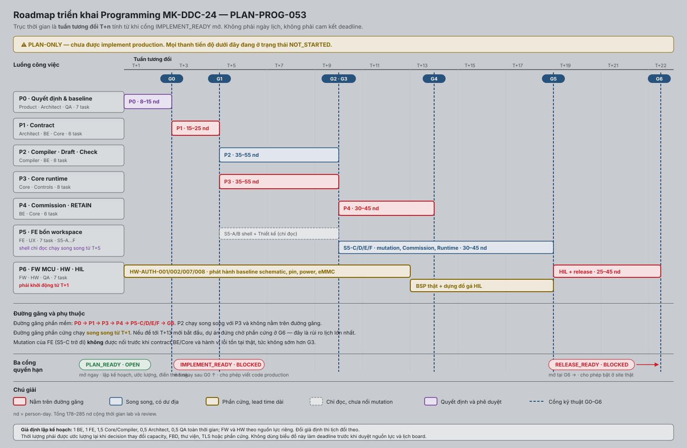

# Plan 53 — Kế hoạch triển khai Programming MK-DDC-24

| Thuộc tính | Giá trị |
|---|---|
| ID tài liệu | `PLAN-PROG-053` |
| Loại | Software Project Management Plan (SPMP) |
| Phiên bản | 0.41 |
| Trạng thái | **APPROVED FOR IMPLEMENTATION — `PLAN_READY PASS`; mọi `IMPLEMENT_READY[*] PASS` theo `AUTH-PROG-2026-08-11-03`.** Team được viết và merge code production ngay; `RELEASE_READY` được đánh giá riêng sau implementation |
| Ngày phát hành | 2026-08-13 |
| Chủ quản | Dev Lead + System Architect |
| Người review | Product, FE/BE/Core/FW/HW/Security/QA/Ops Leads |
| Người phê duyệt | Product Owner + System Architect + Verification Lead |
| Khung trình bày | ISO/IEC/IEEE 16326 — nội dung kế hoạch quản lý dự án phần mềm; ánh xạ điều khoản ở §11 |
| Design set nguồn | [`PROG-DOCSET-001`](../02_design/PROGRAMMING_DESIGN_INDEX.md); candidate v2.24 ghim bằng 22 SHA-256 tại [`PROG-P0-CANDIDATE-MANIFEST-2026-08-10`](../07_records/reviews/PROGRAMMING_P0_CANDIDATE_MANIFEST_2026-08-10.md) v3.33 — kiểm bằng `python3 scripts/candidate_pin_check.py`; authority phê duyệt nền tiếp tục hiệu lực |
| Quy tắc tài liệu | [`DOC-GOV-001`](../00_governance/DOC_GOVERNANCE.md) |

> ## ✅ APPROVED FOR IMPLEMENTATION — được viết và merge code production
>
> `AUTH-PROG-2026-08-11-03` của Product Owner/CTO + System Architect Phạm Đình
> Chương phê duyệt toàn bộ Programming Rev A **không kèm điều kiện approval bổ
> sung**. Team được tạo nhánh, viết/merge code production, đổi contract và bật
> feature flag ở lab theo task card hiện hành.
>
> `PLAN_READY = PASS`; mọi `IMPLEMENT_READY[*] = PASS`. Consumer/discipline/
> Verification signature, CI/CD, target và HIL không còn là entry condition cho
> implementation. Các review còn thiếu là hậu kiểm; test/evidence được tạo trong
> task theo DoD.
>
> Không điền giả chữ ký hoặc Test Result: các ô đó ghi `WAIVED FOR
> IMPLEMENTATION`/`MISSING` đúng thực tế. `RELEASE_READY` là cổng evidence riêng
> và không cản team implement.

## Mục lục

| § | Nội dung | Điều khoản ISO 16326 |
|---|---|---|
| 0 | Đọc nhanh | — |
| 1 | Tổng quan dự án: mục tiêu, sản phẩm bàn giao, giả định, ràng buộc | 7.2 |
| 2 | Tài liệu tham chiếu | 7.3 |
| 3 | Thuật ngữ và từ viết tắt | 7.4 |
| 4 | Bối cảnh dự án: quy trình, cổng, phụ thuộc, tổ chức | 7.5 |
| 5 | Kế hoạch công việc: WBS, roadmap, biểu đồ, lịch, tiến độ, nguồn lực | 7.6.2 |
| 6 | Kế hoạch kiểm soát: DoR/DoD, gate, lịch, báo cáo, cấu hình, vấn đề | 7.6.3, 7.8 |
| 7 | Quản lý rủi ro | 7.6.4 |
| 8 | Kế hoạch đóng dự án | 7.6.5 |
| 9 | Trạng thái hiện tại và execution tracker | 7.7 |
| 10 | Điều kiện vào và baseline tài liệu | 7.6.1 |
| 11 | Ánh xạ ISO/IEC/IEEE 16326 | — |
| 12 | Lịch sử sửa đổi và phê duyệt | 7.1 |
| 13 | Phụ lục — tự kiểm cổng M3 | — |

## 0. Đọc nhanh

| Câu hỏi | Trả lời |
|---|---|
| 1. File này dùng để quyết định hoặc triển khai việc gì? | Chốt **thứ tự làm và điều kiện qua cửa**: bảy pha `P0..P6`, phụ thuộc giữa chúng, ai chịu trách nhiệm gì, và bằng chứng nào mở được mỗi gate `G0..G6`. |
| 2. Ai phải đọc file này? | Dev Lead và Architect (chủ quản); Product và QA duyệt; mọi team đọc pha của mình. Đọc **sau** khi đã đọc hồ sơ thiết kế upstream của slice mình. |
| 3. Hệ thống hiện tại đang có gì? | `G0/P0 PASS`; `G1/P1 GO — 6/6 DONE`; P2 **8/8 DONE về source/DoD**. `TASK-PROG-200..207` đã hoàn tất compiler/artifact ST/FBD, Project/Draft/Revision/Check, change manifest, bundle source-only + SQLite v4 và assurance hostile-input/resource/audit trên host. Hai record `VS-001/019` vẫn `BLOCKED`, 0/32 PASS; flag `OFF`, operation/Core Commission chưa có. |
| 4. Thiết kế mới thay đổi điều gì? | Xác lập nguyên tắc: **không mở gate bằng lời văn**. Mỗi pha có điều kiện vào và ra cụ thể; §6.1 định nghĩa Definition of Ready và Definition of Done cho từng task; §6.2 định nghĩa bằng chứng gate và điều kiện quay lui. |
| 5. Team phải sửa module/contract nào? | §5.7 ánh xạ quyền sở hữu source và sản phẩm bàn giao theo pha; §5.8 có mẫu thẻ task và cách bàn giao theo lát cắt dọc. |
| 6. Điều gì còn bị chặn? | **P3 ĐÃ ĐÓNG (8/8).** `TASK-PROG-400` đã DONE tại `a523a04`; next `TASK-PROG-401` hold-last program_value + transition policy. `RELEASE_READY` vẫn chờ 32/32 PASS, target/HIL và residual acceptance — 10k-cycle WCET thật trên Forlinx vẫn BLOCKED, cần phần cứng vật lý. |
| 7. Test hoặc bằng chứng nào chứng minh hoàn tất? | §5.2 chỉ rõ gate sở hữu từng scenario; §6.2 gắn bằng chứng bắt buộc. Hiện có 2/32 record `BLOCKED`, 0/32 PASS — đủ ghi nhận execution G1 nhưng không đủ release. |

Quan hệ với Plan 54: file này quản **việc code**; [Plan 54](54_PROGRAMMING_DOCUMENTATION_ROADMAP.md)
quản **việc tài liệu**. Hoàn tất bộ hồ sơ chỉ mở quyền *bắt đầu* implementation
có kiểm soát — nó không chứng minh sản phẩm đã chạy, đạt HIL hay sẵn sàng release.

## 1. Tổng quan dự án

### 1.1 Mục tiêu và Definition of Done

Triển khai vertical slice hoàn chỉnh ST+structured FBD → Check → Commission →
Program Runtime → Point/priority/safe output → Online Monitor/Restore trên đúng
Rev A profile, có evidence FE/BE/Core/MCU/HW và không làm suy giảm control hiện hữu.

Done chỉ khi G0–G6 đạt; mọi requirement Must có trace/evidence; graph/program
cutover, IOP 200 ms, output continuity, RETAIN, power/restart, RBAC/audit và
operations rollback được kiểm chứng trên target/HIL. Host component hoặc UI mock
không đủ để đóng plan.

### 1.2 Nguyên tắc triển khai

1. Contract và decision trước code phụ thuộc.
2. Mỗi slice gồm docs + contract + implementation + positive/negative/fault test
   + traceability + changelog.
3. Commission mutation giữ feature flag `off` tới khi Core/HIL gate đạt.
4. Không thêm daemon/core process mới nếu chưa có ADR.
5. Không dual-run graph và Program trên output thật.
6. Không đổi IOP/SHM/artifact/persistence contract mà thiếu producer/consumer,
   migration/deploy order/rollback/test cùng thay đổi.

### 1.3 Sản phẩm bàn giao

| Nhóm | Sản phẩm bàn giao | Nghiệm thu tại |
|---|---|---|
| Contract | OpenAPI `/api/v1/programming`; giao thức UDS BE↔Core có version; catalog mã lỗi `PRG-ERR-*`; client TypeScript sinh tự động | `G1` |
| Backend | `apps/web-api/internal/programming/`: store SQLite + migration, compiler worker, operation coordinator, RBAC, audit | `G2`, `G3` |
| Core runtime | Loader artifact bounded; base control step; scheduler một Task; process image; arbitration mức 5; RETAIN | `G3`, `G4` |
| Frontend | `apps/web-ui/src/features/programming/`: bốn workspace `PGM-01..04`, tám journey `UJ-PROG-01..08` | `G5` |
| FW MCU và HW | BSP thật; baseline schematic/BOM/pin có kiểm soát; đồ gá HIL | `G6` |
| Bằng chứng | 32 Test Result `VS-PROG-001..032` tại [`PROG-TR-REPO-001`](../07_records/test-results/programming/README.md) | `G1..G6` |
| Vận hành | Diễn tập backup, Commission, Restore, thay thiết bị, rollback theo `OPS-PROG-001` | `G6` |

### 1.4 Giả định lập kế hoạch

| Giả định | Nếu sai thì sao |
|---|---|
| Nguồn lực toàn thời gian: 1 BE, 1 FE, 1,5 Core/Compiler, 0,5 Architect, 0,5 QA; FW và HW theo nguồn lực riêng | Lịch §5.4 giãn theo tỷ lệ; phải ước lượng lại |
| Decision được ký **theo lát cắt**, không dồn về cuối | Team dừng đúng tại lát cắt thiếu chữ ký |
| Phần cứng khởi động **song song từ tuần đầu** | `G6` thành điểm nghẽn; cả dự án chờ phần cứng |
| Không thêm process hay daemon ngoài ba tiến trình hiện có | Cần ADR mới và ước lượng lại kiến trúc |
| Modbus RTU contract `Active` được dùng lại nguyên trạng | Phạm vi `G1` tăng đáng kể |

### 1.5 Ràng buộc

| Ràng buộc | Nguồn |
|---|---|
| Không dual-run graph và Program trên output thật | `SYS-REQ-PROG-105`; `RSK-PROG-001` |
| `max_iop_poll_gap < 200 ms`, mục tiêu `≤ 100 ms` | `NFR-REQ-PROG-108`; `RSK-PROG-003` |
| Mutation Programming mặc định **tắt** tới khi TLS production sẵn sàng | `DDD-SEC-PROG-001` §2 |
| Rev A: một controller, một Task, ba chu kỳ `1/5/30 s`, ba loại Point | `PROD-PROG-001` §3 |
| Không tạo tiến trình thứ tư | ADR-005, ADR-021 |

### 1.6 Tiến hóa của kế hoạch

Cập nhật tại **mỗi lần chuyển cổng** và mỗi khi một decision đổi capacity, FBD,
thư viện, TLS hoặc phần cứng. Ước lượng phải tính lại khi giả định §1.4 đổi.
Lịch sử ở §12; kiểm soát thay đổi ở §6.7.

## 2. Tài liệu tham chiếu

| ID | Tài liệu | Vai trò |
|---|---|---|
| `PROD-PROG-001` | [Product Spec Programming Rev A](../01_product/DDC24_PROGRAMMING_PRODUCT_SPEC.md) | Phạm vi sản phẩm; tám user journey (Amendment A1) |
| `SRS-PROG-001` | [Requirements Specification](../02_requirements/PROGRAMMING_REQUIREMENTS_SPEC.md) | 60 requirement và tiêu chí chấp nhận |
| `PROG-OD-001` | [Open Decisions](../00_governance/PROGRAMMING_OPEN_DECISIONS.md) | 17 quyết định chặn theo lát cắt |
| `ARCH-PROG-001` | [Architecture](../03_architecture/PROGRAMMING_ARCHITECTURE.md) | Ranh giới tiến trình và quyền sở hữu |
| `IFSPEC-PROG-001` | [Interface Specification](../02_design/interfaces/PROGRAMMING_INTERFACE_SPEC.md) | Hợp đồng REST/WS/IPC và mã lỗi |
| `DM-PROG-001` | [Data Model](../02_design/software/PROGRAMMING_DATA_MODEL.md) | Schema và migration |
| `UX-WEB-PROG-001` | [UI/UX Design](../04_uiux/PROGRAMMING_UI_UX_DESIGN.md) | Bốn workspace, tám journey |
| `VVP-PROG-001` | [Verification Plan](../05_verification/PROGRAMMING_VERIFICATION_PLAN.md) | 32 kịch bản và thẩm quyền ký |
| `OPS-PROG-001` | [Operations Runbook](../06_operations/PROGRAMMING_OPERATIONS_RUNBOOK.md) | Thủ tục vận hành và diễn tập |
| `RSK-PROG-001` | [Risk Register](../07_records/PROGRAMMING_RISK_REGISTER.md) | 16 rủi ro và điều kiện chấp nhận residual |
| `TRACE-PROG-001` | [Traceability Matrix](../07_records/PROGRAMMING_TRACEABILITY_MATRIX.md) | Trace requirement → journey → test → evidence |
| `PLAN-PROG-DOC-054` | [Documentation Roadmap](54_PROGRAMMING_DOCUMENTATION_ROADMAP.md) | Mức trưởng thành hồ sơ; **không** quản việc code |
| `PROG-P0-GATE-2026-08-10` | [Gói review cổng P0](../07_records/reviews/PROGRAMMING_P0_GATE_REVIEW_PACKAGE_2026-08-10.md) | Evidence, decision và sign-off package cho `PROG-000..006` |
| `PROG-P0-CANDIDATE-MANIFEST-2026-08-10` | [Manifest candidate P0](../07_records/reviews/PROGRAMMING_P0_CANDIDATE_MANIFEST_2026-08-10.md) | Commit/tree/SHA-256/Git blob bất biến của revision cần review |
| `PROG-P0-ENV-2026-08-10` | [Rà soát môi trường P0](../07_records/reviews/PROGRAMMING_P0_ENVIRONMENT_READINESS_2026-08-10.md) | Branch/build/toolchain/CI/target/HIL/evidence readiness |
| `PROG-TR-REPO-001` | [Kho Test Result Programming](../07_records/test-results/programming/README.md) | Cấu trúc record bất biến; hiện 2/32 record `BLOCKED`, 0/32 PASS |
| `DOC-GOV-001` | [Quy tắc kiểm soát tài liệu](../00_governance/DOC_GOVERNANCE.md) | `DD-01..DD-13`, `M0..M5`, ba cổng quyền hạn |
| ISO/IEC/IEEE 16326 | Life cycle processes — Project management | Khung trình bày; ánh xạ §11 |
| ISO/IEC/IEEE 12207 | Software life cycle processes | Mô hình quy trình và cổng |
| ISO/IEC 25010 | Quality models | Ngưỡng đo cho NFR |

Việc dùng các họ chuẩn trên là **ISO-aligned** về cấu trúc và bằng chứng. Đây
**không** phải tuyên bố chứng nhận hay compliance.

## 3. Thuật ngữ và từ viết tắt

| Thuật ngữ | Nghĩa trong kế hoạch này |
|---|---|
| **Draft** | Bản đang sửa, ghi đè được |
| **Revision** | Bản đã niêm phong, bất biến |
| **Check** | Biên dịch và kiểm tra; **không** đụng chương trình đang chạy |
| **Commission** | Đưa một Revision vào vận hành |
| **Active** | Revision đang điều khiển thiết bị thật |
| **LKG** | Last-Known-Good — Revision tốt gần nhất để quay lui |
| **Gate `G0..G6`** | Mốc kỹ thuật; qua được khi đủ bằng chứng ở §6.2 |
| **Cổng quyền hạn** | `PLAN_READY` / `IMPLEMENT_READY` / `RELEASE_READY` — quyền cấp cho team, §4.2 |
| **Lát cắt dọc** | Đơn vị bàn giao tạo outcome đầu-cuối quan sát được, §5.8 |
| **nd** | person-day, ngày-người |
| **T+n** | Tuần tương đối thứ n kể từ khi **khởi động formal authority review P0-A** trên candidate đã pin. Không phải ngày lịch; gate trễ thì mốc downstream trượt tương ứng |
| `UJ-PROG-nn` | User journey — tám mục |
| `VS-PROG-nnn` | Kịch bản kiểm chứng — 32 mục |
| `OD-PROG-nnn` | Open decision — 17 mục |
| `RSK-PROG-nnn` | Rủi ro — 16 mục |

## 4. Bối cảnh dự án

### 4.1 Chuỗi phụ thuộc

```text
P0-A Baseline review/sign-off → PLAN_READY
  ├─ P0-B Decision đúng lát cắt → IMPLEMENT_READY[lát cắt]
  │    └─ P1 Contract
  │         ├─ P2 Compiler/BE Check ─┐
  │         └─ P3 Core foundation ──┴→ P4 Commission/RETAIN
  │                                    → P5 FE bốn workspace → P6 Release
  └─ HW/FW authority + fixture lane chạy song song → P6 HIL
```

FE shell/read-only có thể đi song song sau P1; không nối mutation giả trước API.
FW MCU/HW chuẩn bị fixture/test point từ P0, nhưng HIL kết luận sau P3/P4.
`P0-A` là điều kiện chung để dùng plan làm baseline. `P0-B` là decision subset
của từng task/lát cắt; một decision HW/HIL chưa đến hạn không được chặn một task
contract không tiêu thụ nó. Ma trận chính xác nằm ở §4.3 và dependency từng task
ở §5.1.

### 4.2 Ba cổng quyền hạn: `PLAN_READY`, `IMPLEMENT_READY`, `RELEASE_READY`

Trước đây `G0` gộp “được lập kế hoạch” với “được viết code”, nên chặn quá rộng:
team không thể ước lượng gì khi chưa có chữ ký, dù việc ước lượng không đụng tới
sản phẩm. Tách làm ba cổng.

| Cổng | Cho phép làm gì | Điều kiện đóng | Trạng thái 2026-08-10 |
|---|---|---|---|
| `PLAN_READY` | Xác nhận plan đã được review và có thể dùng làm đầu vào chính thức cho lát cắt implementation | Điều kiện thông thường hoặc chỉ thị cấp điều hành theo `DOC-GOV-001` §4.1 | **PASS — `AUTH-PROG-2026-08-11-03`**; không cần approval bổ sung |
| `IMPLEMENT_READY[<lát cắt>]` | Tạo nhánh feature và viết/merge code production; đổi contract; feature flag ở lab | `PLAN_READY PASS`; với chỉ thị cấp điều hành, decision/review còn lại thực hiện trong task và không chặn start/continue | **PASS cho mọi lát cắt — `AUTH-PROG-2026-08-11-03`** |
| `RELEASE_READY` | Bật ở site thật, tuyên bố hoàn tất | Toàn bộ 32 `VS-PROG-*` có Test Result được review; residual risk được chấp nhận; `OD-PROG-008` phần HIL đã đóng; GO của Product + Release + QA | **BLOCKED** |

Ba cổng này **không** thay `G0..G6`. `G0..G6` là các mốc kỹ thuật theo §5.2;
ba cổng ở trên là **quyền hạn** được cấp cho team tại mỗi thời điểm.
Team triển khai theo dependency kỹ thuật và DoD của task; không còn dependency
approval nào trước khi bắt đầu hoặc tiếp tục code.

### 4.3 `P0-B` — decision cần cho từng lát cắt

Toàn bộ 17 decision đã `DECIDED` bởi `AUTH-PROG-2026-08-11-03`. Bảng dưới giữ
ánh xạ để dev biết decision nào chi phối lát cắt; nó không còn là điều kiện ký.

| Lát cắt sắp implement | Decision baseline | Ghi chú |
|---|---|---|
| Contract, kiểu dữ liệu, FBD, Point | `OD-PROG-001..007` | Nặng nhất là `OD-PROG-002` (bề rộng kiểu số) vì nó khóa encoding IR và Point mapping |
| Runtime, RETAIN, timing, cutover | `OD-PROG-009..014` | `OD-PROG-012` khóa công thức base-step/watchdog |
| UI bốn workspace | `OD-PROG-016` | Chưa ký thì FE không khóa được route và cây component |
| Phạm vi thư viện mẫu BMS | `OD-PROG-017` | Nếu hoãn sang Roadmap thì Rev A chỉ có Core Library và User FB cục bộ |
| Modbus RTU phần HIL | `OD-PROG-008` | Contract đã `Active`; **phần HIL cần đóng trước `RELEASE_READY`**, không chặn lập kế hoạch |
| Phê duyệt baseline tổng thể | `OD-PROG-015` | Dùng để đóng `PLAN_READY` cho toàn bộ bộ hồ sơ |

### 4.4 Tổ chức và RACI

| Workstream | Product | Architect | FE | BE | Core/FWSOM | FW MCU | HW | QA/Ops |
|---|---|---|---|---|---|---|---|---|
| Scope/requirements | A | R | C | C | C | C | C | C |
| Data/OpenAPI | C | A | R | R | C | I | I | C |
| IR/artifact/runtime | C | A | I | C | R | I | I | C |
| UX/FE | C | C | R/A | C | C | I | I | C |
| Commission/recovery | C | A | C | R | R | C | C | C |
| MCU/HW/HIL | I | C | I | I | C | R | R | A |
| Release | A | C | C | C | C | C | C | R |

`R` thực hiện, `A` chịu trách nhiệm cuối, `C` tham vấn, `I` được thông báo.

## 5. Kế hoạch công việc

### 5.1 Cấu trúc phân rã công việc theo pha

#### P0 — Khóa yêu cầu và thiết kế (G0)

| Task | Owner | Estimate | Kết quả/exit | Trạng thái 2026-08-11 |
|---|---|---:|---|---|
| `PROG-000` | Product | 1,5–2,5 nd | ký Product amendment/scope/claim; quyết định capacity/type/FBD/Task/library | `DONE` — phê duyệt toàn bộ theo `AUTH-PROG-2026-08-11-03` |
| `PROG-001` | Architect | 1,5–2,5 nd | đóng base-step/watchdog, graph cutover, overrun/safe-state, process allocation | `DONE` — `ADR-026..031` đã `Accepted` |
| `PROG-002` | Controls | 1–2 nd | khóa priority mức 5, PID anti-windup, hold-last/transition/initial policy | `DONE` — quyết định kỹ thuật đã `DECIDED`; review discipline được miễn ở entry implementation |
| `PROG-003` | Product+Security | 1–2 nd | khóa RBAC, audit, bundle/integrity/signature scope | `DONE` — scope/RBAC/integrity đã `DECIDED`; bằng chứng TLS được thu trong task/release |
| `PROG-004` | Runtime+Ops | 1–2 nd | khóa RETAIN, Revision/LKG retention, monitor/trace limits | `DONE` — `OD-PROG-009/010/011/014` đã `DECIDED` |
| `PROG-005` | HW+FW | 1–2 nd | xác nhận schematic/BSP/test point/HIL setup và 200 ms boundary | `DONE` cho entry implementation — BSP/fixture/HIL là deliverable/evidence của P6, không chặn P1 |
| `PROG-006` | QA | 1–2 nd | review SRS/design/trace/risk/V&V, sign G0 | `DONE` cho entry implementation — `9/9` finding đóng; chữ ký còn thiếu ghi `WAIVED FOR IMPLEMENTATION` |

Exit được tách để không tạo blocker nguyên khối:

- `P0-A/PLAN_READY`: **PASS** theo `AUTH-PROG-2026-08-11-03`.
- `P0-B/IMPLEMENT_READY[<lát cắt>]`: **PASS cho mọi lát cắt**; toàn bộ
  `OD-PROG-001..017` đã `DECIDED` và task card P1 đã được chấp nhận làm đầu vào.

Team bắt đầu P1 ngay. Các dependency kỹ thuật trong task card vẫn điều phối thứ
tự tích hợp, nhưng không phải approval condition và không đóng lại quyền viết code.

**Kết quả triển khai P0 ngày 2026-08-10.** Phần chuẩn bị kỹ thuật của cả 7 task
đã được gom và review trong
[`PROG-P0-GATE-2026-08-10`](../07_records/reviews/PROGRAMMING_P0_GATE_REVIEW_PACKAGE_2026-08-10.md):
7/7 có evidence, decision authority, blocker và điều kiện mở. Chỉ thị
`AUTH-PROG-2026-08-11-03` phê duyệt toàn bộ và miễn các chữ ký còn thiếu khỏi
entry implementation; **7/7 đạt DoD của P0 cho mục đích mở P1**. Điều kiện kiểm soát cấu hình “ghim
candidate” đã PASS tại
[`PROG-P0-CANDIDATE-MANIFEST-2026-08-10`](../07_records/reviews/PROGRAMMING_P0_CANDIDATE_MANIFEST_2026-08-10.md)
v3.1: candidate v2.8 được định danh bằng **22 SHA-256 ở §2**, kiểm bằng
`python3 scripts/candidate_pin_check.py` (`22/22` PASS). Candidate v2.5 và
`e3e9fb2` đã **`SUPERSEDED`** — không được dùng làm revision để ký mới.
Vòng consumer review kỹ thuật đã hoàn tất tại
[`PROG-P0-CONSUMER-REVIEW-2026-08-10`](../07_records/reviews/PROGRAMMING_P0_CONSUMER_REVIEW_2026-08-10.md):
`9/9` finding `F-CR-01..09` đã đóng. Việc này **không** nâng hồ sơ nào lên `M4`;
`0/22 M4` vẫn được ghi đúng thực tế, nhưng đã được `WAIVED FOR IMPLEMENTATION`
và không còn chặn P1.
Môi trường được đo tại
[`PROG-P0-ENV-2026-08-10`](../07_records/reviews/PROGRAMMING_P0_ENVIRONMENT_READINESS_2026-08-10.md):
host branch/build/toolchain và kho evidence `0/32` đã sẵn. GitHub CI, target SSH
và HIL chưa sẵn là dữ kiện môi trường/release, **không phải blocker implementation**.
Tổng estimate P0 là **8–15 nd**, khớp §5.6; pha P0 kết thúc ngày 2026-08-11 bằng
chỉ thị điều hành, không hồi đoán actual từ số dòng tài liệu.

#### P1 — Contract foundation (G1-A)

| Task | Owner | Dependency | Deliverable/test |
|---|---|---|---|
| `PROG-100` | BE+FE | `PLAN_READY`; `OD-PROG-001/003/007` | OpenAPI `/programming`, generated TS, contract tests |
| `PROG-101` | BE+Core | `PLAN_READY`; `OD-PROG-001/009/010/014` | versioned UDS/schema operation/status/stage/activate/restore |
| `PROG-102` | Core | `PLAN_READY`; `OD-PROG-002..006/012/013` | Rev A compiler/artifact/runtime profile và loader error map |
| `PROG-103` | BE+Core | 100–102 | `PRG-ERR-*` authority + component detail mapping |
| `PROG-104` | BE | `PLAN_READY`; `OD-PROG-003/009/010/014` | DB schema/migration/backup/immutable invariants |
| `PROG-105` | All | 100–104 | compatibility/deploy-order/rollback review + trace update |

Exit: machine-readable contract, positive/negative round-trip và version reject
PASS; chưa mở Commission.

#### P2 — Compiler, Project/Revision và Check (G1-B/G2)

| Task | Owner | Dependency | Deliverable/test |
|---|---|---|---|
| `PROG-200` | Core/compiler | P1 | **DONE 2026-08-11** — ST subset/limits/sáu type/source map; parser + loader mỗi bộ fuzz 10 triệu input |
| `PROG-201` | Core+FE | P1 | **DONE 2026-08-11 tại `52dfb57`** — schema/golden/manifest FBD, canonical validator/fuzzer và FE keyboard reducer/component |
| `PROG-202` | Compiler | 200–201 | **DONE 2026-08-11 tại `4819901`** — FBD→`StProgram` typed→IR/runtime chung; 20 cặp equivalence + fail-closed/fuzz |
| `PROG-203` | Compiler | 202 | **DONE 2026-08-11 tại `2c2bfb4`** — SHA-256 + deterministic artifact/build manifest/profile/source map ST/FBD; mutation/CLI/fail-closed |
| `PROG-204` | BE | P1 | **DONE 2026-08-11 tại `66848a1`** — Project/Draft/Revision store, ETag/idempotency |
| `PROG-205` | BE | 202–204 | **DONE 2026-08-11 tại `e8c289e`** — sandbox compiler worker + Check aggregate/diagnostics + Artifact registry |
| `PROG-206` | BE | 204 | **DONE 2026-08-11 tại `95b9388`** — deterministic change manifest + ZIP source-only/hash/allowlist + import Project/Draft atomic |
| `PROG-207` | Security/QA | 205–206 | timeout/OOM/fuzz/traversal/zip bomb/audit secret tests |

Exit: `VS-001/003/005/006/007/017/019/021/023/024` applicable PASS; active
runtime chưa đổi khi Check.

#### P3 — Core deterministic runtime (G3)

| Task | Owner | Dependency | Deliverable/test |
|---|---|---|---|
| `PROG-300` | Core | P1/P2 | **DONE 2026-08-11 tại `4f7e0ac`** — bounded prepare/preallocation ngoài scan, safe-boundary handle/LKG swap, no-parser/compiler symbol gate |
| `PROG-301` | Core | P1 + `P0-B/runtime` | **DONE 2026-08-11 tại `a831a0d`** — base step API tách Task period; profile Rev A 1/1/1, budget `<20%`, capability/schema |
| `PROG-302` | Core | 300–301 | **DONE 2026-08-13 tại `f080056`** — process image preflight-toàn-batch cho input (`REQUIRE_GOOD`) và output (`stage→preflight→commit`, atomic mức Task); `StPointKind::EXT` + ba category LOCAL/VP/MB_RTU theo `OD-PROG-007`; `PointWriter::can_write` bắt buộc EXT nằm trong `ext_count`/`writable` |
| `PROG-303` | Core/Controls | 302 | **DONE 2026-08-13 tại `85aa4d2`** — `StFbType::PID` back-calculation anti-windup + freeze-on-override, read-back actual selected qua Point Table AO/DO (không kênh riêng), TRACKING output |
| `PROG-304` | Core | 301 | **DONE 2026-08-13 tại `4d744ac`** — sửa `exec_ns` đo luôn-bằng-0, fault ĐÚNG Task khi 3 overrun liên tiếp, không plant-wide safe (supersede PROGRAM_TASK_SCHEDULER_SPEC §6.1 cũ) |
| `PROG-305` | Core | 301–304 | **DONE 2026-08-13 tại `c6ab2bd`** — `StBoundedRuntimeTrace` ring buffer tĩnh, `program_status.monitorInputs` (quality/source/freshness), action `program_trace`, capability monitor/trace mới |
| `PROG-306` | Core/Ops | 301 | **DONE 2026-08-13 tại `f35234c`** — `CutoverMode` GRAPH_ONLY/PROGRAM_ONLY khoá dual-producer, `bootstrap/main.cpp --programming-mode` dựng `StScheduler` REV_A thật lần đầu; UDS transport control API còn mở (gap phát hiện, ghi trong Control Semantics §10) |
| `PROG-307` | QA | 300–306 | **DONE (host) 2026-08-13 tại `29907a5`** — soak 10.000 chu kỳ allocation-free/bounded qua ScanLoop PROGRAM_ONLY thật, symbol-scan `mkddc-core` xác nhận; **10k-cycle WCET target Forlinx vẫn BLOCKED — cần phần cứng vật lý** |

Exit: `VS-009/010/012/013/016/017/018/027` PASS trên mức được yêu cầu; feature
vẫn không production-enable nếu P4/P6 chưa đạt.

#### P4 — Atomic lifecycle, RETAIN và recovery (G4)

| Task | Owner | Dependency | Deliverable/test |
|---|---|---|---|
| `PROG-400` | Core | P3 | **DONE (host) 2026-08-13 tại `a523a04`** — `StJournal` append/checksum 5 phase + boot-recovery đúng bảng §7; phạm vi hẹp hơn field schema đầy đủ §15 (ghi rõ, cần TASK-PROG-403 bổ sung field BE); **chưa wire vào scheduler/bootstrap — cần 403** |
| `PROG-401` | Controls+Core | 303/400 | hold-last program_value + transition policy |
| `PROG-402` | Core | P3 | RETAIN stable identity/version/CRC/atomic/cold-init |
| `PROG-403` | BE | P1/P2/P3 | Commission/Restore coordinator + durable operation/reconcile |
| `PROG-404` | BE+Core | 306/403 | first graph→Program cutover + rollback |
| `PROG-405` | QA | 400–404 | fault at every step, BE/Core/power restart, corrupt artifact/retain |

Exit: `VS-004/011/014/015/024/029/030` software/target portions PASS; Commission
vẫn feature-gated tới HIL electrical.

#### P5 — FE/UX (G2/G4)

| Task | Owner | Dependency | Deliverable/test |
|---|---|---|---|
| `PROG-500` | FE | P1 | feature routes/shell/context/RBAC/i18n/state model |
| `PROG-501` | FE | P2 | Project tree, ST editor, Problems/Check |
| `PROG-502` | FE | P2 | structured FBD editor keyboard/a11y |
| `PROG-503` | FE | P1/P2 | Point mapping + one Task/Core Library |
| `PROG-504` | FE | P4 | readiness/change/override/Commission/Unknown reconcile |
| `PROG-505` | FE | P3/P4 | Runtime/Watch/Trace/Versions/Restore/Replacement |
| `PROG-506` | FE+QA | 500–505 | Vitest/lint/build/Playwright/Chrome desktop+mobile/Console+Network |

Exit: `VS-002/008/017..022/025..028` PASS; không fake producer hoặc optimistic Active.

#### P6 — FW MCU, HW, HIL và release (G5/G6)

| Task | Owner | Dependency | Deliverable/test |
|---|---|---|---|
| `PROG-600` | FW MCU | `P0-A` + `P0-B/HW` | production BSP/UART DMA/IDLE/safe-timeout/diagnostics |
| `PROG-601` | HW | `P0-A` + `P0-B/HW` | schematic/BOM/test-point review + HIL fixture |
| `PROG-602` | Core+FW+HW | P3/P4/600/601 | poll gap, AO/DO hold-last, PID/priority, 199/200/201 ms |
| `PROG-603` | QA/Ops | P4/P5/600–602 | restart/brownout/power loss/upgrade/backup/restore/replacement |
| `PROG-604` | Security | all | RBAC/import/integrity/audit/secret/provenance review |
| `PROG-605` | QA | all | full regression + trace/risk/residual/release report |
| `PROG-606` | Product/Release | 605 | GO/NO-GO ký; staged rollout + monitored rollback |

Exit: toàn bộ `VS-PROG-001..032` PASS, 16/16 risk có residual acceptance,
release provenance và operations rehearsal đạt.

### 5.2 Roadmap thực thi `G0..G6`

`0/32` Test Result là trạng thái **đúng** trước implementation. Bảng dưới đây
chỉ rõ gate nào **tạo ra** từng Test Result, để không ai phải chờ evidence mới
được lập kế hoạch.

| Gate | Phạm vi | Kết quả bắt buộc | Test Result được tạo |
|---|---|---|---|
| `G0` Baseline | Đóng finding tài liệu, consumer review, ghim revision/hash, ký decision theo lát cắt | `PLAN_READY`; không còn authority mâu thuẫn | — (gate tài liệu) |
| `G1` Contract | Data model, OpenAPI, IPC BE↔Core, artifact/profile, catalog mã lỗi | Contract machine-readable, client sinh tự động, contract compatibility test | `VS-001`, `VS-019` phần contract |
| `G2` Nền tảng song song | FW-SOM loader/runtime; BE store/check; FE shell chỉ đọc | Mỗi nhánh dùng **cùng** contract version; feature flag mặc định OFF | `VS-003`, `VS-012`, `VS-023` |
| `G3` Project/Draft/Check | Project → Draft → ST/FBD → Check → diagnostic | Active **không đổi**; conflict/restart/fuzz/resource test PASS | `VS-005`, `VS-006`, `VS-007`, `VS-008`, `VS-017`, `VS-019`, `VS-024` |
| `G4` Runtime/Commission | Scheduler, Point, arbitration, `impactRef`, Commission, đọc ngược | Không optimistic success; fail-closed; restart và đối chiếu đúng | `VS-004`, `VS-009`, `VS-010`, `VS-011`, `VS-013`, `VS-014`, `VS-016`, `VS-018`, `VS-020`, `VS-022` |
| `G5` Restore/RETAIN/UI | Restore, LKG, RETAIN, bốn workspace, E2E desktop/mobile | Fault/recovery và tám journey có bằng chứng | `VS-002`, `VS-015`, `VS-021`, `VS-025`, `VS-026`, `VS-027`, `VS-028`, `VS-029`, `VS-031`, `VS-032` |
| `G6` Target/HIL/Release | MCU/HW, poll gap, watchdog, power fault, backup/rollback/security | 32/32 có Test Result; residual risk được chấp nhận; GO/NO-GO | `VS-030` và xác nhận lại toàn bộ trên target |

Đếm để kiểm: 32 kịch bản được phân bổ hết vào `G1..G6`, không kịch bản nào mồ côi.

**Song song được phép.** BE persistence và FE shell chỉ đọc có thể chạy song song
ngay sau `G1`. Nhưng **mutation của FE chỉ được nối sau khi contract BE/Core và
hành vi lỗi đã thật sự tồn tại** — nối vào mock rồi đổi sau là cách chắc chắn
sinh ra hành vi lỗi khác nhau giữa ba team.

### 5.3 Biểu đồ roadmap



Trục ngang là **tuần tương đối `T+n`** tính từ khi khởi động formal authority
review `P0-A` trên candidate đã pin, **không phải ngày lịch**. Thời lượng suy ra
từ ước lượng ở §5.6 và giả định nguồn lực ở §1.4. Gate review/decision trễ bao
nhiêu thì toàn bộ mốc downstream phụ thuộc trượt bấy nhiêu.

Ba điều biểu đồ nói mà bảng không nói được:

1. **Đường găng phần mềm** là `P0-A → P1 → join(P2, P3) → P4 → P5-C/D/E/F →
   G6`. `P2` và `P3` chạy song song nhưng **cùng phải đạt** trước P4; với lịch
   hiện tại hai nhánh kết thúc cùng tuần nên cả hai đều không có float. Sau khi
   có actual duration, nhánh kết thúc muộn hơn trở thành nhánh găng thực tế.
2. **Phần cứng phải chạy song song từ `T+1`.** Việc phát hành baseline
   `HW-AUTH-001/002/007/008` và dựng đồ gá HIL có lead time dài. Nếu đợi phần
   mềm chạm `G6` mới bắt đầu, cả dự án đứng chờ.
3. **FE có hai giai đoạn tách biệt.** Shell chỉ đọc chạy song song từ `T+5`;
   mutation (`S5-C` trở đi) **không** được nối trước `G3`, khi contract BE/Core
   và hành vi lỗi đã tồn tại thật.

### 5.4 Lịch và mốc

Mốc dùng tuần tương đối. Cột “Điều kiện vào” là thứ **phải có trước**, không
phải mong muốn.

| Mốc | Tuần | Kết thúc pha | Điều kiện vào | Sản phẩm chứng minh mốc |
|---|---|---|---|---|
| `M-G0` | `T+2` | P0-A | Candidate pin; consumer review kỹ thuật `9/9`; 17/17 decision `DECIDED`; 6/6 ADR `Accepted`; chữ ký còn thiếu `WAIVED FOR IMPLEMENTATION` | **ĐẠT 2026-08-11** — `PLAN_READY PASS`; mọi `IMPLEMENT_READY[*] PASS` |
| `M-G1` | `T+4` | P1 | `OD-PROG-001..007/009/010/012/013/014` ký theo task tiêu thụ | OpenAPI + IPC + profile/artifact + catalog lỗi + DB migration + client sinh tự động |
| `M-G2` | `T+9` | P2 | `M-G1`; `OD-PROG-005/006` ký | Compiler, store, Check; FE shell chỉ đọc |
| `M-G3` | `T+9` | P3 | `M-G1`; `OD-PROG-004/012` ký | Core base step, scheduler, process image trên target |
| `M-G4` | `T+13` | P4 | `M-G2` và `M-G3`; `OD-PROG-009/010/013` ký | Commission atomic, đọc ngược, RETAIN |
| `M-G5` | `T+18` | P5 | `M-G4`; `OD-PROG-011/016` ký | Bốn workspace, tám journey, E2E desktop và mobile |
| `M-G6` | `T+22` | P6 | `M-G5`; `HW-AUTH-*` phát hành; đồ gá HIL sẵn sàng; `OD-PROG-008` HIL đóng | 32/32 Test Result; residual risk được chấp nhận; `RELEASE_READY` |

Hai mốc phần cứng chạy song song, **không** phụ thuộc phần mềm:

| Mốc | Tuần | Nội dung | Chặn mốc nào |
|---|---|---|---|
| `M-HW-A` | `T+1 → T+12` | HW Lead phát hành baseline có kiểm soát `HW-AUTH-001/002/007/008` | Chặn `M-G6` |
| `M-HW-B` | `T+13 → T+18` | Hoàn thiện BSP thật và dựng đồ gá HIL | Chặn `M-G6` |

### 5.5 Bảng tiến độ

Bảng này là **nơi duy nhất** ghi tiến độ thực. Cập nhật tại mỗi lần review hai
tuần (§6.4). Không ghi phần trăm theo cảm tính: `% hoàn tất` chỉ được tính bằng
`số task đã đạt DoD ÷ tổng task của pha`.

| Pha | Task | Đã đạt DoD | % hoàn tất | Trạng thái | Bắt đầu | Kết thúc | Test Result đã có | Ghi chú chặn |
|---|---:|---:|---:|---|---|---|---:|---|
| P0 | 7 | 7 | 100% | `DONE` | 2026-08-10 | 2026-08-11 | — | `AUTH-PROG-2026-08-11-03`; 17/17 decision `DECIDED`; 6/6 ADR `Accepted`; chữ ký còn thiếu được miễn cho implementation |
| P1 | 6 | 6 | 100% | `DONE` | 2026-08-11 | 2026-08-11 | 2/2 record `BLOCKED`, 0 PASS | `TASK-PROG-100..105 DONE`; G1 GO cho downstream implementation |
| P2 | 8 | 8 | 100% | `DONE` | 2026-08-11 | 2026-08-11 | 0/3 | `TASK-PROG-200..207 DONE` về source/DoD; Test Result độc lập vẫn 0 PASS |
| P3 | 8 | 8 | 100% | `DONE` (source/host DoD) | 2026-08-11 | 2026-08-13 | 0/7 | `TASK-PROG-300..307 DONE` về source/host DoD; target evidence (10k-cycle WCET Forlinx) còn `BLOCKED` — cần phần cứng vật lý |
| P4 | 6 | 1 | 16,7% | `IN_PROGRESS` | 2026-08-13 | — | 0/10 | `TASK-PROG-400 DONE` về source/host DoD (component độc lập, chưa wire); next `TASK-PROG-401` |
| P5 | 7 | 0 | 0% | `NOT_STARTED` | — | — | 0/10 | Chờ `M-G4`; shell chỉ đọc mở sớm từ `T+5` |
| P6 | 7 | 0 | 0% | `NOT_STARTED` | — | — | 0/1 | Chờ `HW-AUTH-*` và đồ gá HIL |
| **Tổng** | **49** | **30** | **61,2%** | **IMPLEMENTATION IN PROGRESS** | 2026-08-10 | — | **2/32 record, 0 PASS** | P3 8/8 ĐÃ ĐÓNG; P4 1/6; tiếp theo `TASK-PROG-401`; release evidence chưa đạt |

Cột “Test Result đã có” cộng lại là `33`, không phải `32`: `VS-PROG-019` được
tính hai lần vì phần contract của nó thuộc `G1` còn phần đầy đủ thuộc `G3`. Số
kịch bản **duy nhất** vẫn là `32`.

Trạng thái hợp lệ, không dùng nhãn khác: `BLOCKED`, `NOT_STARTED`, `IN_PROGRESS`,
`IN_REVIEW`, `DONE`, `DESCOPED`. Một task chỉ chuyển `DONE` khi đạt DoD ở §6.1 và
có người chấp nhận ký.

Tiến độ theo cổng quyền hạn:

| Cổng | Trạng thái | Ngày mở | Điều kiện còn thiếu |
|---|---|---|---|
| `PLAN_READY` | **PASS** | 2026-08-11 | Không còn; mở bởi `AUTH-PROG-2026-08-11-03` |
| `IMPLEMENT_READY[contract]` | **PASS** | 2026-08-11 | Không còn; task card P1 đã sẵn và mọi decision đã `DECIDED` |
| `RELEASE_READY` | **BLOCKED** | — | 32/32 Test Result; residual risk chấp nhận; `OD-PROG-008` phần HIL |

### 5.6 Ước lượng, nguồn lực và ngân sách công

Estimate là dải `person-day` để bố trí nguồn lực sau approval, không phải cam kết
lịch; QA/HIL có thể kéo dài theo fixture. Mỗi phase chỉ `NOT_STARTED`, vì chưa có
commit/Test Result Target đủ điều kiện.

| Phase | Task | Estimate | Dependency cứng | Status / exit evidence |
|---|---:|---:|---|---|
| P0 | 000–006 | 8–15 | DOC-G4 | DONE cho entry implementation theo `AUTH-PROG-2026-08-11-03` |
| P1 | 100–105 | 15–25 | P0-A + P0-B theo từng task | DONE 6/6; G1 GO tại `PROG-G1-CONTRACT-REVIEW-2026-08-11` |
| P2 | 200–207 | 35–55 | P1 | DONE 8/8 về source/DoD; G2 evidence độc lập vẫn BLOCKED |
| P3 | 300–307 | 35–55 | P1–P2 + P0-B runtime | IN_PROGRESS 2/8; Task 300/301 host source/DoD DONE, process image/target timing/no-forbidden-call evidence còn mở |
| P4 | 400–405 | 30–45 | P3 + BE P2 | NOT_STARTED; lifecycle/power/fault/read-back Test Results |
| P5 | 500–506 | 30–45 | P1/P2/P4 per task | NOT_STARTED; Vitest/build/E2E/browser/a11y evidence |
| P6 | 600–606 | 25–45 + lab | all | NOT_STARTED; target/HIL/ops/security/release record |
| **Tổng** | 49 task | **178–285 person-day + lab/review** | sequential gates, parallel lanes có kiểm soát | G0..G6 đều RED |

Estimate phải re-estimate khi decisions thay đổi capacity/FBD/library/TLS/HW.
Không dùng tổng này làm deadline trước resource/calendar/board availability review.

#### 5.6.1 Phân bổ nguồn lực theo vai trò

| Vai trò | Mức phân bổ giả định | Pha tham gia | Là nút thắt ở đâu |
|---|---|---|---|
| Backend | 1,0 FTE | P1, P2, P4 | `P4` cùng lúc với Core |
| Core / Compiler | 1,5 FTE | P1, P2, P3, P4 | **Nút thắt chính** — có mặt trên toàn đường găng |
| Frontend | 1,0 FTE | P5 (shell từ `T+5`) | `P5` sau `M-G4` |
| Architect | 0,5 FTE | P0, P1, review mọi gate | `P1` và các điểm chuyển cổng |
| QA / Verification | 0,5 FTE tăng dần | mọi pha, cao nhất P6 | `G6` |
| FW MCU | theo nguồn lực riêng | P6 | `M-HW-B` |
| HW | theo nguồn lực riêng | P6 | `M-HW-A` — lead time dài nhất |
| Product / UX | theo nhu cầu | P0, P5 | Ký decision đúng lát cắt |

Nếu chỉ có **một** người Core thay vì 1,5, đường găng dài thêm khoảng bốn tuần
vì `P3` và `P4` không chồng lấn được. Đây là biến số nhạy nhất của lịch.

### 5.7 Quyền sở hữu source và bản đồ bàn giao

| Slice | File/module chính | Owner | Contract/test cùng commit |
|---|---|---|---|
| Data/API | `apps/web-api/internal/programming`, `contracts/openapi/openapi.yaml` | BE | migration + OpenAPI/Go/TS contract |
| Compiler | `apps/core/application/st`, BE compiler adapter, `contracts/programming` | Compiler+BE | golden/property/fuzz/resource |
| Artifact/loader | `application/st`, `application/programming`, `contracts/ipc` | Core | loader negative/mixed-version/symbol |
| Control/lifecycle | bootstrap, ScanLoop, PriorityResolver, programming coordinator | Core+Controls | timing/fault/power/owner/read-back |
| FE | `apps/web-ui/src/features/programming`, App routes/nav/i18n | FE+UX | Vitest/Playwright/browser/OpenAPI |
| MCU | `firmware/stm32` app/IOP/BSP/`.ioc` | FW MCU | host/cross-build/target/HIL |
| HW | controlled schematic/PCB/BOM/fixture/results | HW | pre-approved limits/raw instrument evidence |
| Package/Ops | `platform/packaging`, systemd, runbook/release manifest | Ops | upgrade/backup/restore/rollback/rehearsal |

Không sửa monolith/legacy path nếu bounded module đã được design. Mọi shared file
(`App.tsx`, bootstrap, ScanLoop, resolver, OpenAPI, packaging) có một integrator
được Dev Lead chỉ định để tránh parallel overwrite.

### 5.8 Lát cắt dọc và thẻ task

Mỗi `TASK-PROG-nnn` trong §5.1 phải có card triển khai **đã điền thật**, không
để trống trường nào. `PLAN_READY` đã PASS nên các thẻ là đầu vào implementation.

```text
1.  Task ID / pha / owner / reviewer / integrator của file dùng chung:
2.  Requirement, mục thiết kế, risk và decision liên quan:
3.  Contract / schema / version / hash đầu vào, và gate upstream:
4.  File, package, class, function cụ thể phải tạo hoặc sửa:
5.  Dependency cứng, và việc được phép chạy song song:
6.  Estimate, nguồn lực, milestone, trạng thái:
7.  Thuật toán, state, lỗi, restart, compatibility phải hiện thực:
8.  Unit / contract / integration / target / HIL test:
9.  Evidence ID và vị trí lưu:
10. Feature flag, thứ tự deploy, rollback:
11. DoR; DoD; người có quyền chấp nhận:
```

#### 5.8.1 Bộ thẻ P1 đã điền — `READY TO IMPLEMENT`

Bộ sáu thẻ dưới đây là đầu vào lập kế hoạch cho `G1` và đã đủ 11 trường bắt
buộc. `TASK-PROG-100..104` đã đạt DoD kỹ thuật; task 105 giữ trạng thái ghi
trong từng thẻ. Tất cả được phép thực thi theo dependency do
`IMPLEMENT_READY[contract] = PASS`.
`EV-PROG-G1-nnn` là ID bằng chứng hỗ trợ nằm trong `raw/` của review G1, không
phải Test Result và không được dùng đổi `VS-PROG-*` sang PASS. Chỉ
`TR-PROG-VS-<nnn>-<YYYYMMDD>-<SEQ>` tại `PROG-TR-REPO-001` mới là Test Result.

##### `TASK-PROG-100` — OpenAPI và client sinh tự động

```text
1.  TASK-PROG-100 / pha P1 / owner BE Lead + FE Lead / reviewer Security Lead
    + Verification Lead
    / integrator file dùng chung: Architect (sở hữu contracts/openapi/openapi.yaml)
2.  Requirement: SWR-REQ-PROG-BE-110, SWR-REQ-PROG-FE-110, NFR-REQ-PROG-106.
    Thiết kế: IFSPEC-PROG-001 §2 envelope, §3 resource, §6 Commission,
    §6.1 impact ba nhánh, §6.1.1 quy tắc acknowledgement, §11 REST matrix.
    Risk: RSK-PROG-014 (error namespace lệch), RSK-PROG-016 (mất bước an toàn).
    Decision: OD-PROG-001 (role), OD-PROG-003 (giới hạn), OD-PROG-007
    (Point contract) đều đã `DECIDED`.
3.  Đầu vào: IFSPEC-PROG-001 v0.5 ghim theo commit hash của baseline docs;
    DM-PROG-001 v0.4. Gate upstream: PLAN_READY PASS; ba decision đã `DECIDED`;
    task card được chấp nhận bởi `AUTH-PROG-2026-08-11-03`.
4.  Tạo: contracts/openapi/openapi.yaml nhóm /api/v1/programming;
    apps/web-api/internal/programming/transport/http/{router,models,errors}.go;
    apps/web-api/internal/programming/domain/errors.go.
    Sinh: TS client vào apps/web-ui/src/features/programming/api/generated/.
    Entry point: RegisterProgrammingRoutes, WriteProgrammingError,
    ValidateImpactAcknowledgements; sửa apps/web-api/internal/app/http.go để
    mount router nhưng chưa bật flag.
5.  Dependency cứng: không có — đây là lát cắt đầu tiên sau G0.
    Song song được: PROG-101/102/104; decision riêng đã `DECIDED`.
    FE chỉ được dùng generated client; mutation **không** được nối ở lát này.
6.  Estimate 8 ngày-người: OpenAPI 3, handler skeleton 2, sinh mã 1,
    contract test 2. Nguồn lực: 1 BE + 0,5 FE + 0,5 Architect.
    Milestone: G1. Trạng thái: DONE ngày 2026-08-11. Source commit:
    `9917e3b` (OpenAPI + Go), `81080f8` (TypeScript generator/client),
    `efbed2d` (golden payload và field parity).
7.  Hiện thực contract: envelope lỗi có code/messageKey/correlationId;
    ETag/baseRevision/idempotency-key; impact NONE/PRESENT/UNAVAILABLE;
    acknowledgement đúng tập khóa PRESENT; impactRef bị stale trả mã ổn định.
    Handler skeleton không giữ state và không gọi Commission. Schema có major;
    field/enum không biết xử lý theo quy tắc §10, unknown major bị reject.
8.  Unit: bảng ánh xạ mã lỗi, validator acknowledgement (thiếu/thừa/rỗng).
    Contract: OpenAPI ↔ Go model ↔ TS type khớp cùng golden payload; lint toàn
    schema. Âm: thiếu field bắt buộc, enum lạ, base cũ, payload >1 MiB,
    impact UNAVAILABLE và acknowledgement thừa/thiếu đều fail closed.
    Target/HIL: không áp dụng ở lát này.
9.  Evidence G1: EV-PROG-G1-100 trong raw/ của review G1; phần contract
    đủ điều kiện mới được đưa vào TR-PROG-VS-019-<YYYYMMDD>-<SEQ> tại
    PROG-TR-REPO-001. VS-024 chỉ tạo Test Result ở G3, không ghi sớm tại P1.
10. Feature flag PROGRAMMING_REV_A mặc định OFF; route mount nhưng trả 404 khi
    flag OFF. Thứ tự deploy: schema + BE tương thích trước, FE generated client
    cùng release sau đó; chưa có mutation. Rollback gỡ mount router; không có
    migration dữ liệu trong task này.
11. DoR: ba decision `DECIDED`; IFSPEC và DM ghim hash; generator pin
    version; IMPLEMENT_READY[contract] PASS. DoD: lint/schema/golden/negative
    contract PASS; Go + TS sinh ra build được; flag OFF; Trace chỉ đổi trục I
    khi source merge và T/P chỉ đổi khi có Test Result hợp lệ; CHANGELOG cập nhật.
    Người chấp nhận: Architect (contract) theo `AUTH-PROG-2026-08-11-03`;
    Verification review được miễn làm entry implementation nhưng Test Result
    vẫn không được tạo/nâng sớm. Bằng chứng kỹ thuật:
    `PROGRAMMING_G1_IMPLEMENTATION_REVIEW_2026-08-11.md` §2.
```

##### `TASK-PROG-101` — giao thức UDS BE↔Core có phiên bản

```text
1.  TASK-PROG-101 / pha P1 / owner BE Lead + Core Lead / reviewer Security Lead
    + Verification Lead / integrator: Core Lead cho contracts/ipc và CMake.
2.  Requirement: SYS-REQ-PROG-103/104, SWR-REQ-PROG-BE-106/110,
    NFR-REQ-PROG-105. Thiết kế: IFSPEC-PROG-001 §8, §10, §12–§15;
    ARCH-PROG-001 ranh giới BE/Core. Risk: RSK-PROG-007/008/014.
    Decision: OD-PROG-001/009/010/014 đã `DECIDED`.
3.  Đầu vào: IFSPEC-PROG-001 v0.5 + DDD-LIFE-PROG-001 ghim hash;
    Unix domain socket, frame <=64 KiB, queue 32, major/minor trong envelope.
    Gate: PLAN_READY và IMPLEMENT_READY[contract] PASS.
4.  Tạo contracts/ipc/programming_v1/{schema.json,README.md,golden/};
    apps/core/application/programming/program_ipc_server.{hpp,cpp};
    apps/web-api/internal/programming/coreipc/{client.go,codec.go,errors.go};
    entry point ProgramIpcServer::HandleFrame, EncodeFrame/DecodeFrame và
    Client.Call/Client.Reconcile; test C++/Go tương ứng; cập nhật
    apps/core/CMakeLists.txt để build test.
5.  Dependency cứng: không phụ thuộc PROG-100; phụ thuộc bốn decision ở mục 2.
    Chạy song song PROG-100/102/104; PROG-103 chờ PROG-100..102 hoàn tất.
6.  Estimate 10 ngày-người: schema/golden 3, C++ codec/server 3, Go client 2,
    cross-language/fault test 2. Nguồn lực: 1 Core + 0,5 BE + 0,25 Security.
    Milestone G1. Trạng thái **DONE ngày 2026-08-11**; source `51fe515`
    (contract/Core) + `e9707b4` (Go client); review/evidence tại
    `PROG-G1-IMPLEMENTATION-REVIEW-2026-08-11` / `EV-PROG-G1-101`.
7.  Hiện thực operation/status/stage/activate/restore/read-back envelope có
    requestId, operationId, deadline, schemaVersion, correlationId, result,
    active/LKG revision, keepsRunning và component detail. Peer credential được
    kiểm; frame/queue/deadline bounded; retry chỉ query/reconcile operation,
    không replay mutation. Disconnect/restart giữ Core control đang chạy.
8.  Unit codec hai ngôn ngữ; golden round-trip Go↔C++; âm với frame thiếu/cắt,
    quá 64 KiB, enum/field bắt buộc sai, unknown major, queue full, deadline.
    Integration: duplicate requestId, reconnect, BE restart, Core unavailable.
9.  Evidence G1 dự kiến: EV-PROG-G1-101 gồm schema hash, golden corpus và log
    cross-language trong raw/ của review G1. Đây là đầu vào cho VS-004/024/026
    ở gate sau; không tạo Test Result của các VS này tại P1.
10. Flag PROGRAMMING_REV_A OFF. Deploy Core hỗ trợ protocol mới trước, rồi BE;
    chỉ chấp nhận mixed minor đã test. Rollback BE trước Core; cấm hạ Core qua
    active artifact/operation major mới và không xóa state operation.
11. DoR: decision đã `DECIDED`; Security review được thực hiện trong task;
    fixture cross-language sẵn.
    DoD: schema hash + golden corpus bất biến; C++/Go round-trip và toàn bộ ca
    âm PASS; no-mutation skeleton; deploy/rollback matrix review; Trace/CHANGELOG
    cập nhật. Chấp nhận: Architect + Core Lead + Verification Lead.
```

##### `TASK-PROG-102` — profile Rev A và hợp đồng artifact/loader

```text
1.  TASK-PROG-102 / pha P1 / owner Compiler Lead + Core Lead / reviewer
    Controls, Safety, Security, Verification / integrator: Core Lead.
2.  Requirement: SYS-REQ-PROG-101/102/105, SWR-REQ-PROG-CORE-101,
    NFR-REQ-PROG-101/103. Thiết kế: DDD-LANG-PROG-001; IFSPEC-ART-PROG-001;
    DDD-CTRL-PROG-001. Risk: RSK-PROG-002/003/005/006/013.
    Decision: OD-PROG-002..006/012/013 đã `DECIDED`.
3.  Đầu vào: DDD-LANG v0.3, IFSPEC-ART v0.3 và control profile ghim hash;
    magic MKDDCIR1, major/minor, target/profile/library/layout/hash bounded.
    Gate: PLAN_READY + IMPLEMENT_READY[contract] PASS.
4.  Tạo contracts/programming/rev_a_profile_v1.schema.json và
    contracts/programming/artifact_v1.schema.json; cập nhật
    apps/core/application/st/st_{limits,ir,artifact,loader,diagnostic}.{hpp,cpp};
    entry point ValidateRevAProfile, EncodeArtifactDeterministic,
    VerifyArtifact và LoadArtifact; thêm golden/negative corpus và test vào
    apps/core/tests/.
5.  Không phụ thuộc PROG-100/101/104; phụ thuộc toàn bộ decision mục 2.
    Chạy song song các task đó; PROG-103 chờ schema/error detail của task này.
6.  Estimate 12 ngày-người: profile 3, artifact schema/layout 3, loader error
    surface 2, golden/boundary/fuzz 4. Nguồn lực 1 Compiler + 1 Core bán thời
    gian + Controls/Security review. Milestone G1. Trạng thái **DONE ngày
    2026-08-11**; source `95585e7`; review/evidence tại
    `PROG-G1-IMPLEMENTATION-REVIEW-2026-08-11` / `EV-PROG-G1-102`.
7.  Khóa type/width/conversion; ST/FBD/library/Task/Point allowlist; giới hạn
    -1/limit/+1; canonical serialization và deterministic hash. Loader kiểm
    magic/version/offset/count/CRC/hash/profile/target trước stage; unknown major,
    corrupt/truncated/overflow bị từ chối mà Active/LKG/output không đổi.
8.  Unit/boundary/golden deterministic; fuzz loader; corrupt offset/count/hash,
    oversize, wrong target, unknown major; 100 lần build cùng input cho cùng
    hash. Mapping ST↔FBD đã khóa ở profile; byte-equivalence hai producer đã
    chạy tại `TASK-PROG-202` sau FBD producer Task 201, với source `4819901` và
    evidence `EV-PROG-G2-202`. Target/HIL chưa đóng ở P1/P2.
9.  Evidence G1: EV-PROG-G1-102 gồm schema/hash/golden/boundary/fuzz log
    trong raw/ của review G1. Nó là đầu vào cho VS-003/005/006/023 ở G2/G3;
    không ghi Test Result sớm hoặc kế thừa PASS từ host test nền tảng.
10. Flag OFF. Deploy loader đọc được minor mới trước khi compiler phát artifact
    mới; rollback compiler emit về minor tương thích, giữ artifact/LKG cũ.
    Không stage/activate trong task này.
11. DoR: bảy decision ký; profile/layout review; corpus và fuzzer chạy được.
    DoD: hai schema machine-readable có hash; generated constants khớp C++;
    golden/boundary/fuzz âm PASS; deterministic; không đổi Active; compatibility
    matrix, Trace và CHANGELOG cập nhật. Chấp nhận: Runtime Architect + Safety
    Reviewer + Verification Lead.
```

##### `TASK-PROG-103` — catalog lỗi thống nhất FE/BE/Core

```text
1.  TASK-PROG-103 / pha P1 / owner BE Lead + Core Lead / reviewer FE Lead,
    Security Lead, Verification Lead / integrator: Architect cho catalog chung.
2.  Requirement: SYS-REQ-PROG-103/105, SWR-REQ-PROG-BE-110,
    SWR-REQ-PROG-FE-110. Thiết kế: IFSPEC-PROG-001 §9 và §14;
    IFSPEC-ART-PROG-001 error behavior. Risk: RSK-PROG-006/014/016.
    Decision: kế thừa decision đã khóa qua PROG-100..102.
3.  Đầu vào: OpenAPI, UDS schema và loader error surface đã đạt DoD ở
    PROG-100..102, ghim hash trong task. Gate: cùng IMPLEMENT_READY[contract].
4.  Tạo contracts/programming/error_catalog_v1.json và generator;
    sinh apps/web-api/internal/programming/domain/errors_generated.go,
    apps/core/application/programming/program_error_generated.hpp và
    apps/web-ui/src/features/programming/api/generated/errors.ts; generator tạo
    MapComponentError, IsRetryable và public messageKey map từ một catalog.
5.  Dependency cứng: PROG-100, PROG-101 và PROG-102. PROG-104 chạy song song;
    PROG-105 chờ catalog này và toàn bộ task còn lại.
6.  Estimate 6 ngày-người: catalog/mapping 2, generator ba ngôn ngữ 2,
    completeness/negative test 2. Nguồn lực 0,5 BE + 0,5 Core + 0,25 FE.
    Milestone G1. Trạng thái DONE tại source commit `4a1e9f5`.
7.  Mỗi PRG-ERR-* có owner component, HTTP/status class, retryable,
    keepsRunning, messageKey và detail allowlist; mã public không phụ thuộc text.
    Internal detail ánh xạ đúng một mã public; detail lạ fail safe, không lộ
    source/secret/path nội bộ; Commission error không được báo optimistic success.
8.  Static uniqueness/completeness; generator reproducible; compile Go/C++/TS;
    mọi lỗi từ OpenAPI/UDS/loader map được; âm với code/detail lạ, missing
    messageKey, HTTP mismatch, sensitive arg và unknown major.
9.  Evidence G1 dự kiến: EV-PROG-G1-103 trong raw/ của review G1, chứa báo cáo
    completeness và hash catalog; phần phù hợp vào TR-PROG-VS-019-<...>.
    VS-023/026 chỉ tạo Test Result ở gate sở hữu tương ứng.
10. Catalog/generator/consumers merge cùng commit logic; flag OFF. Deploy chỉ
    khi producer và consumer chấp nhận cùng major; rollback cả generated set,
    không giữ trạng thái mixed-version chưa test.
11. DoR: PROG-100..102 DONE và hash ghim. DoD: mọi mã §9 duy nhất và đầy đủ;
    ba ngôn ngữ build; mapping âm PASS; catalog hash trong manifest; Trace/
    CHANGELOG cập nhật. Chấp nhận: Architect + Security + Verification Lead.
```

##### `TASK-PROG-104` — schema SQLite, migration và backup

```text
1.  TASK-PROG-104 / pha P1 / owner BE Lead / reviewer Architect, Operations,
    Security, Verification / integrator: BE Lead cho migration sequence.
2.  Requirement: SWR-REQ-PROG-BE-101/102/106, SYS-REQ-PROG-102/106.
    Thiết kế: DM-PROG-001; DDD-BE-PROG-001 §persistence; OPS-PROG-001.
    Risk: RSK-PROG-007/008/009/011. Decision: OD-PROG-003/009/010/014.
3.  Đầu vào: DM-PROG-001 v0.4 và IFSPEC-PROG-001 v0.5 ghim hash; SQLite
    WAL, foreign_keys=ON, synchronous=FULL, schema_migrations có checksum.
    Gate: PLAN_READY + IMPLEMENT_READY[contract] PASS.
4.  Tạo apps/web-api/internal/programming/store/{store.go,schema.go,migrate.go,
    backup.go}; migrations/0001_programming_v1.sql và test fixtures;
    entry point OpenProgrammingStore, Migrate, Backup, CreateRevision,
    BeginOperation và CommitAudit; cấu hình path/permission trong package
    Programming, không sửa DB active cũ.
5.  Không phụ thuộc PROG-100..103 về code nhưng phải dùng cùng ID/version từ
    DM/IFSPEC. Chạy song song; PROG-105 chờ migration và recovery review.
6.  Estimate 10 ngày-người: schema/migration 3, store/invariant 3, backup/recover
    2, fault/concurrency test 2. Nguồn lực 1 BE + Ops/QA review. Milestone G1.
    Trạng thái DONE tại source commit `312f357`.
7.  Project/Draft mutable có ETag; Revision/Artifact immutable; operation và
    audit durable; foreign key/unique/trigger bảo vệ invariant; single writer,
    transaction atomic. Backup + quick_check trước migration; checksum lệch,
    disk full, corrupt hoặc migration dở phải fail closed và giữ bản phục hồi.
8.  Fresh DB/migrate/restart/round-trip; two-client writer; immutable/FK/unique;
    duplicate idempotency; backup/restore/quick_check; fault disk-full/corrupt/
    kill từng bước. Không chạy migration trên target trước khi Ops duyệt.
9.  Evidence G1 dự kiến: EV-PROG-G1-104 và TR-PROG-VS-001-<YYYYMMDD>-<SEQ>
    theo đúng scope contract. VS-024 chỉ tạo Test Result ở G3; recovery/power
    phần target chỉ đóng khi đúng fixture, không suy từ SQLite host test.
10. Flag OFF. Deploy backup → migration → BE tương thích → API; rollback binary
    chỉ khi schema backward-compatible, luôn giữ DB/backup/audit. Không auto
    downgrade hoặc xóa Revision/Artifact/operation.
11. DoR: bốn decision ký; migration/backup path được Ops duyệt; fixture riêng.
    DoD: schema/checksum bất biến; fresh/restart/concurrency/fault/backup PASS;
    invariant immutable được chứng minh; no active data touched; Trace/Risk/
    CHANGELOG cập nhật. Chấp nhận: BE Lead + Architect + Operations + Verification.
```

##### `TASK-PROG-105` — review tương thích, deploy order và rollback G1

```text
1.  TASK-PROG-105 / pha P1 / owner Architect + Dev Lead / reviewer toàn bộ lead,
    Operations, Security, Verification / integrator: Document Control.
2.  Requirement: SYS-REQ-PROG-102/103/104/105 và NFR-REQ-PROG-105.
    Thiết kế: IFSPEC §10/15, DM compatibility/migration, Artifact compatibility,
    OPS-PROG-001. Risk: RSK-PROG-006/007/008/009/014/015.
    Decision: toàn bộ decision được tiêu thụ bởi PROG-100..104.
3.  Đầu vào: deliverable + hash + Test Result hợp lệ của PROG-100..104;
    candidate code/contract cùng commit hoặc compatibility matrix đã duyệt.
    Gate upstream: năm task đạt DoD; G1 vẫn chưa PASS trước review này.
4.  Tạo docs/07_records/reviews/PROGRAMMING_G1_CONTRACT_REVIEW_<YYYYMMDD>.md;
    tạo manifest hash OpenAPI/IPC/profile/artifact/error/schema; cập nhật
    PROGRAMMING_TRACEABILITY_MATRIX.md, PROGRAMMING_RISK_REGISTER.md,
    PROGRAMMING_VERIFICATION_PLAN.md, Plan 53 và CHANGELOG. Không có function
    production ở task review; entry point là checklist GO/NO-GO của record.
5.  Dependency cứng: PROG-100..104. Không chạy song song phần kết luận; có thể
    chuẩn bị checklist từ đầu. Không cho P2/P3 tiêu thụ contract trước GO G1.
6.  Estimate 5 ngày-người: matrix/deploy/rollback 2, rerun cross-contract 2,
    review/trace 1. Nguồn lực Architect 0,5 + các lead/QA. Milestone G1.
    Trạng thái DONE ngày 2026-08-11; source `7f0c532`, `30a068b`;
    evidence `EV-PROG-G1-105`.
7.  Chứng minh OpenAPI/Go/TS, UDS/C++/Go, profile/artifact/loader, catalog lỗi và
    DB migration dùng cùng version/hash; unknown major fail closed; partial
    deploy không mutation; restart/reconnect không replay; Active/LKG giữ nguyên.
8.  Rerun positive/negative cross-language; mixed minor/unknown major;
    deploy từng thứ tự lỗi; rollback dry-run trên host; verify schema backup,
    generated diff sạch và no-Commission. Target/HIL vẫn NOT RUN nếu chưa có.
9.  Evidence G1 gồm EV-PROG-G1-100..105 và đúng hai Test Result sở hữu bởi G1:
    VS-PROG-001, VS-PROG-019 phần contract. Hai record hiện có verdict
    `BLOCKED` vì workflow G2 chưa implement; các VS còn lại giữ NOT RUN và không
    tự biến host contract test thành PASS.
10. Thứ tự chuẩn: backup/schema → Core dual-compatible → BE → FE read-only;
    flag OFF. Rollback ngược FE → BE → Core, bảo toàn DB/artifact/LKG; stop ngay
    khi mismatch/unknown major được chấp nhận hoặc mutation xảy ra.
11. DoR: PROG-100..104 DONE, không finding P0/P1 mở, raw evidence/hash sẵn.
    DoD: review record đủ consumer sign-off; compatibility/deploy/rollback PASS;
    trace/risk/VVP đồng bộ; G1 authority ký. Chấp nhận implementation: Product +
    System Architect theo `AUTH-PROG-2026-08-11-03`; Verification giữ
    `WAIVED FOR IMPLEMENTATION` và độc lập cho Test Result PASS/release.
```

**Đã thực thi P1.** `TASK-PROG-100..105` có source/evidence thật; G1 GO cho P2/P3.
Hai Test Result G1 đang `BLOCKED`, không phải PASS; cờ Programming tiếp tục OFF.

Vertical slice **không** bàn giao bằng “FW-SOM xong”, “BE xong” hay “FE xong”.
Mỗi mốc phải tạo một outcome đầu-cuối **quan sát được** — Project/Draft, Check,
Commission, Runtime hoặc Restore — và outcome đó phải ánh xạ về journey người
dùng ở [Product Spec §9](../01_product/DDC24_PROGRAMMING_PRODUCT_SPEC.md):

| Slice | Journey phủ | Outcome đầu-cuối | Bằng chứng tối thiểu |
|---|---|---|---|
| S1 Project/Draft | `UJ-PROG-01`, `UJ-PROG-02` | hai client save/conflict/restart không mất dữ liệu | DB/API/TS contract + FE state |
| S2 ST/FBD Check | `UJ-PROG-02`, `UJ-PROG-03`, `UJ-PROG-04`, `UJ-PROG-05` | canonical Revision → deterministic diagnostic/artifact; Active không đổi | golden/fuzz/resource + UI Problems |
| S3 Stage/Commission | `UJ-PROG-06` | operation durable → Core safe swap/read-back; timeout reconcile; acknowledgement khớp impact `PRESENT` | restart/fault/target trace + contract âm |
| S4 Control runtime | `UJ-PROG-07` | one Task/process image/priority/PID/quality bounded | 10k-cycle/WCET/arbitration/IOP |
| S5 Restore/RETAIN | `UJ-PROG-08` | power/restart/corrupt/migrate giữ đúng active/LKG | journal/record/power fault evidence |
| S6 Replacement/Ops | `UJ-PROG-08` | source-only import → rebuild/remap/Commission/rollback | security + rehearsal + HIL record |

### 5.9 Lát cắt dọc FE theo bốn workspace và tám journey

Sau Amendment A1, pha `P5 — FE/UX` được chia theo **workspace**, không theo
trang. Mỗi lát cắt dọc phải chạy được end-to-end trước khi mở lát tiếp theo.

| Lát cắt | Workspace | Journey | Điều kiện vào | Xong khi |
|---|---|---|---|---|
| `S5-A` | `PGM-01` Tổng quan | `UJ-PROG-01` | `GET /capabilities`, `GET /projects`, `GET /runtime` đã có trên target | Nhận biết Active/Draft/Core `≤5 s`; 0 giá trị bịa; `VS-032` phần route gốc đạt |
| `S5-B` | `PGM-02` Thiết kế | `UJ-PROG-02/03/04` | `PATCH /draft` và `GET /point-catalog` đã có | Ba tab dùng chung một Draft; đổi tab không mất nội dung đang gõ; FBD hoàn tất bằng bàn phím; lọc Point theo loại/hướng/khả năng ghi |
| `S5-C` | `PGM-03` Kiểm tra & Vận hành | `UJ-PROG-05/06` | Check API và `POST /operations/commission` đã có; impact trả đủ ba nhánh `NONE/PRESENT/UNAVAILABLE` | Ô xác nhận khớp ảnh hưởng thật; `UNAVAILABLE` chặn được Commission; re-auth + đọc ngược + quay lui còn nguyên |
| `S5-D` | `PGM-04` Runtime & Bảo trì | `UJ-PROG-07/08` | `GET /runtime/monitor`, `GET /overrides`, `POST /operations/restore` đã có | Tách program/actual/owner/priority/TTL; vùng thao tác nguy hiểm tách riêng; người xem không thấy dãy nút vô hiệu hóa |
| `S5-E` | Xuyên suốt | ba kịch bản `SC-*` | `S5-A..D` xong | `SC-CORE-DEGRADED`, `SC-OP-FAILED`, `SC-RETAIN-RESET` đúng ở mọi workspace |
| `S5-F` | Nghiệm thu khả dụng | tất cả | `S5-A..E` xong, có fixture `AHU-01` trên controller lab | `VS-PROG-031` đạt sáu ngưỡng `UX-A-01..06` với `≥5` kỹ thuật viên BMS |

Thứ tự bắt buộc là `A → B → C → D → E → F`. Lý do: `PGM-03` phụ thuộc Draft hợp
lệ do `PGM-02` tạo ra, và bài khả dụng chỉ có nghĩa khi cả tám journey đã chạy
được. Riêng `S5-F` **không được** rút gọn thành demo nội bộ — nó cần người dùng
thật chưa từng dùng sản phẩm.

Hai lát cắt này bị chặn ngoài `G0`: `S5-C` cần `IFSPEC-PROG-001` §6.1 được ký,
và toàn bộ `P5` cần `OD-PROG-016` được phê duyệt. Nếu `OD-PROG-016` bị từ chối,
`P5` quay lại năm lát cắt theo IA sáu trang và `S5-B` tách làm ba.

## 6. Kế hoạch kiểm soát

### 6.1 Definition of Ready và Definition of Done

Task `READY` khi upstream gate PASS, requirement/design section/contract version
pin, owner/reviewer/estimate/target fixture rõ, negative/fault cases và rollback
defined. Task `DONE` chỉ khi:

1. deliverable source/contract/docs/changelog đã review và merge;
2. unit/static/contract/integration phù hợp PASS bằng command mới;
3. Trace cập nhật `I/T/P` đúng evidence, Risk impact xử lý;
4. no P0/P1 finding mở; compatibility/migration/partial deploy/rollback tested;
5. feature flag/capability default an toàn và không overclaim target/HIL.

Không lấy “code compile”, file tồn tại, test cache hoặc screenshot mock làm Done.

### 6.2 Bằng chứng gate và điều kiện quay lui

| Gate | Evidence tối thiểu | Rollback/stop trigger |
|---|---|---|
| G0 | 22 docs Approved, decisions closed, risk/trace/VVP signed | contract/semantics/HW authority còn OPEN |
| G1 | schema hashes, generated clients, migration/compat negative tests | breaking mismatch/unknown major accepted |
| G2 | Project→Check/bundle/RBAC/audit + FE editing flow | lost Draft, privilege bypass, compiler affects RT |
| G3 | target 10k cycles, WCET/jitter/IOP, no allocation/blocking | overrun/safe entry/graph dual owner |
| G4 | fault each lifecycle/power state, one active/LKG/read-back | double activation/partial output/ambiguous recovery |
| G5 | calibrated HIL 199/200/201, AO/DO/UI/power/reset | output outside envelope or evidence uncorrelated |
| G6 | upgrade/backup/restore/replacement/rollback/security/provenance | restore rehearsal fail, critical residual unaccepted |

Rollback design: disable mutation/capability first; Restore compatible LKG/graph;
verify physical output; rollback package only with controlled snapshot; preserve
DB/Revision/artifact/RETAIN/audit. Không downgrade Core qua active artifact/RETAIN
major mới.

### 6.3 Kiểm soát lịch và nguồn lực

| Ngưỡng cảnh báo | Hành động bắt buộc |
|---|---|
| Một task trên đường găng trễ `> 3` ngày làm việc | Dev Lead báo Architect trong lần review gần nhất; ghi vào §5.5 |
| Một pha trễ `> 1` tuần so với §5.4 | Ước lượng lại cả pha; cập nhật §5.5 và §5.6; báo Product |
| Đường găng trễ `> 2` tuần cộng dồn | Đưa ra quyết định phạm vi: giảm scope, thêm người, hoặc dời mốc. **Không** rút bớt bước an toàn hay bước kiểm chứng |
| Nguồn lực thực tế thấp hơn giả định §1.4 | Tính lại lịch **trước khi** hứa ngày mới |

Không dùng làm thêm giờ để bù trễ mà giữ nguyên ngày cam kết. Không rút test hay
review khỏi DoD để kịp mốc — đó là cách biến trễ lịch thành nợ chất lượng.

### 6.4 Báo cáo và chỉ số

| Nhịp | Nội dung | Ai nhận |
|---|---|---|
| Hai tuần một lần | Cập nhật §5.5; task trễ; rủi ro mới; sai lệch với decision baseline | Dev Lead → Product, Architect, QA |
| Tại mỗi cổng | Bằng chứng gate theo §6.2; quyết định `GO` hay `NO-GO` | Product Owner, Architect, Verification Lead |
| Khi có finding P0/P1 | Báo trong `≤ 1` ngày làm việc kèm ảnh hưởng lịch | Dev Lead → Product |

| Chỉ số theo dõi | Cách đo | Ngưỡng cần chú ý |
|---|---|---|
| Tiến độ task | task đạt DoD ÷ tổng task của pha | lệch `> 15%` so với §5.4 |
| Bằng chứng | Test Result đã có ÷ Test Result mà gate yêu cầu | `< 100%` khi xin qua cổng |
| Decision chưa được duyệt | số decision còn `OPEN` | `0`; tăng lên là baseline drift phải xử lý trong task, không tự đóng quyền code |
| Finding mở | số finding P0/P1 chưa đóng | `> 0` khi xin qua cổng |
| Trễ đường găng | tuần lệch cộng dồn trên đường găng | `> 2` tuần |

Chỉ số dùng để **phát hiện sớm**, không dùng để đánh giá cá nhân.

### 6.5 Quản lý cấu hình

| Đối tượng | Nơi kiểm soát | Quy tắc |
|---|---|---|
| 22 hồ sơ thiết kế | Git; baseline gốc `05c1c48`; candidate hiện hành là 22 SHA-256 trong manifest v2.7 | Thẻ task mới dùng candidate trong manifest; mọi candidate đã `SUPERSEDED` chỉ dùng so sánh/rollback; xem Plan 54 §10.2 |
| Contract machine-readable | `contracts/openapi/openapi.yaml` | Có version; unknown major bị reject |
| Mã nguồn | Nhánh feature theo lát cắt; PR có reviewer bắt buộc | §6.7 |
| Artifact và Test Result | [`PROG-TR-REPO-001`](../07_records/test-results/programming/README.md): `<TR-ID>/` kèm `SHA256SUMS` | Bất biến; chạy lại thì tạo ID mới |
| Feature flag | `PROGRAMMING_REV_A`, mặc định **tắt** | Bật theo bốn giai đoạn ở `UX-WEB-PROG-001` §28 |

Đổi hồ sơ thiết kế thì phải cập nhật hash baseline **trong cùng commit** và chạy
`python3 scripts/docs_iso_harness.py --expect`.

### 6.6 Xử lý vấn đề

| Mức | Định nghĩa | Thời hạn phản hồi | Ai xử lý |
|---|---|---|---|
| `P0` | Chặn contract, an toàn, hoặc chặn nhiều team | `≤ 1` ngày làm việc | Dev Lead + Architect |
| `P1` | Chặn một team implement hoặc test đúng | `≤ 3` ngày làm việc | Owner của lát cắt |
| `P2` | Hoàn thiện assurance và bàn giao | Trước cổng kế tiếp | Owner của lát cắt |

Mọi finding ghi vào record review trong `docs/07_records/reviews/`, có ID,
severity, file/mục, acceptance để đóng và owner. **Không đóng finding bằng cách
xóa nó.** Finding phát sinh trong implementation hoặc HIL phải thêm vào
`RSK-PROG-001` nếu ảnh hưởng an toàn hoặc timing.

### 6.7 Kiểm soát thay đổi commit và PR

Tách commit theo contract/data → compiler → Core → BE → FE → FW MCU/HW test →
docs/evidence. Mỗi contract change phải cập nhật producer/consumer/test/docs/
trace/changelog cùng session. PR body tiếng Việt ghi requirement/scenario,
commands/results, target/HIL gap và rollback.

## 7. Quản lý rủi ro

Sổ rủi ro đầy đủ là [`RSK-PROG-001`](../07_records/PROGRAMMING_RISK_REGISTER.md)
— 16 rủi ro, 11 mức `Critical`. Mục này chỉ liệt kê rủi ro **ảnh hưởng trực tiếp
tới lịch của kế hoạch này**.

| Risk | Ảnh hưởng lên lịch | Dấu hiệu sớm | Hành động giảm nhẹ |
|---|---|---|---|
| `RSK-PROG-013` skeleton bị nhầm là HIL-ready | `G6` trượt vô thời hạn nếu `HW-AUTH-*` chưa phát hành | Đến `T+8` mà chưa có baseline schematic | Khởi động `M-HW-A` **từ `T+1`**, theo dõi hằng tuần |
| `RSK-PROG-002` watchdog restart do Task 30 s | `P3` phải làm lại nếu công thức base-step sai | Benchmark target trượt ngưỡng ở `P3` | Ký `OD-PROG-012` **trước** `M-G1`; đo sớm trong `P3` |
| `RSK-PROG-003` IOP gap `≥ 200 ms` khi Commission | `P4` và `G6` phải làm lại | Đo poll gap lần đầu vượt `150 ms` | Thiết kế swap không chặn từ đầu `P3`, không để tới `P4` |
| `RSK-PROG-005` compiler tranh CPU với RT | `P2` và `P3` xung đột tài nguyên trên target | Overrun xuất hiện khi chạy Check đồng thời | Cách ly tiến trình và hạn ngạch ngay trong `P2` |
| `RSK-PROG-016` đơn giản hóa làm mất bước an toàn | Phải làm lại `P5` và một phần `P4` | Review thấy ô xác nhận không khớp impact | Contract ba nhánh `IFSPEC` §6.1.1; test âm bắt buộc trong `P4` |
| **Baseline decision bị thay đổi** | Rework contract/source/test của lát cắt chịu ảnh hưởng | Decision mới supersede lựa chọn đã `DECIDED` | Impact analysis + cập nhật downstream trong cùng task |
| **`OD-PROG-002` ký muộn** | Phải build lại artifact và kiểm lại toàn bộ binding | Ký sau khi `P2` hoặc `P3` đã chạy | Ký **trước `M-G1`**; chi phí lúc đó bằng `0` |

Rủi ro mới phát sinh trong implementation phải vào `RSK-PROG-001`, không chỉ ghi
trong biên bản họp. Residual risk **không** giảm bằng kế hoạch — chỉ giảm khi có
Test Result hợp lệ và người có thẩm quyền chấp nhận.

## 8. Kế hoạch đóng dự án

Kế hoạch này chỉ được đóng khi đủ **tất cả** điều kiện sau:

| Điều kiện | Bằng chứng | Ai xác nhận |
|---|---|---|
| 49/49 task đạt DoD hoặc được `DESCOPED` có phê duyệt | §5.5 | Dev Lead |
| `G0..G6` đều `PASS` | §6.2 | Architect + Verification Lead |
| 32/32 `VS-PROG-*` có Test Result được review | `VVP-PROG-001` §10 | Verification Lead |
| 60/60 requirement có trace tới evidence | `TRACE-PROG-001` §6 | Document Control |
| 16 risk có residual được chấp nhận hoặc waiver có thời hạn | `RSK-PROG-001` §6 | Product + Architect + QA |
| 17 decision `CLOSED` | `PROG-OD-001` | Product Owner |
| Diễn tập vận hành và rollback đã chạy | `OPS-PROG-001` §16 | Ops/Release |
| `RELEASE_READY` mở và có `GO` | §4.2 | Product + Release + QA |

Bàn giao khi đóng: mã nguồn đã merge; contract machine-readable đã phát hành;
32 Test Result bất biến; tài liệu vận hành và bản ghi bàn giao ca; danh sách
finding còn mở kèm owner; và bài học rút ra ghi vào record review.

**Không** đóng kế hoạch bằng cách hạ tiêu chí. Nếu một điều kiện không đạt, hoặc
sửa cho đạt, hoặc `DESCOPED` có phê duyệt ghi rõ ai chấp nhận rủi ro gì.

## 9. Trạng thái hiện tại và execution tracker

### 9.1 Trạng thái ban đầu

| Gate | Trạng thái 2026-08-09 | Lý do |
|---|---|---|
| G0 | RED | design/sign-off/OD còn mở |
| G1 | RED | contract chưa machine-readable/approved; FBD chưa production |
| G2 | RED | FE/BE Programming chưa implement |
| G3 | RED | ST scheduler chưa bootstrap production; graph vẫn owner |
| G4 | RED | Commission/Restore/RETAIN end-to-end chưa có |
| G5 | RED | BSP/HW/HIL vật lý chưa đủ |
| G6 | RED | chưa có release/operations evidence |

Không task nào được ghi `DONE` chỉ vì component host tồn tại; trạng thái phải
trỏ tới commit + test/evidence hiện tại.

### 9.2 Execution tracker và kiểm soát thay đổi

| Gate | Owner | Status | Start/finish | Current blocker/evidence |
|---|---|---|---|---|
| `PLAN_READY` | Product+Architect+QA+Document Control | **PASS** | 2026-08-11 | `AUTH-PROG-2026-08-11-03`; Product Owner/CTO + System Architect phê duyệt toàn bộ; chữ ký QA/consumer/discipline/Document Control được ghi `WAIVED FOR IMPLEMENTATION` |
| `IMPLEMENT_READY[<lát cắt>]` | Product + Architect | **PASS cho mọi lát cắt** | 2026-08-11 | Không còn approval blocker; 17/17 decision `DECIDED`; task card P1 sẵn sàng |
| `RELEASE_READY` | Product + Release + QA | **BLOCKED** | — | 32/32 Test Result + residual acceptance + `OD-PROG-008` HIL |
| G0/P0 | Product+Architect+QA | PASS | 2026-08-10 / 2026-08-11 | Candidate v2.8; consumer review kỹ thuật xong; 6 ADR `Accepted`; quyền implement mở bởi `AUTH-PROG-2026-08-11-03` |
| G1/P1 | Architect+BE+Core | **GO — DONE 6/6** | 2026-08-11 | Join 6/6 contract, deploy/rollback dry-run PASS; 2 record BLOCKED, 0 PASS; không phải release GO |
| G2/P2+P5 partial | BE+FE+Compiler | **SOURCE/DOD DONE — P2 8/8; EVIDENCE BLOCKED** | 2026-08-11 / 2026-08-11 | `TASK-PROG-200..207` DONE; Task 207 tại `3e5281d` có hostile corpus 25 lớp, audit-secret 23 alias, compiler timeout/OOM/output/source bounds và Go fuzz; `VS-001/019` vẫn BLOCKED, 0/32 PASS |
| G3/P3 | Core+Controls+QA | **SOURCE/HOST DOD DONE — TASK-PROG-300..307 DONE (8/8); NEXT P4/TASK-PROG-400** | `4f7e0ac`, `a831a0d`, `f080056`, `85aa4d2`, `4d744ac`, `c6ab2bd`, `f35234c`, `29907a5`, `EV-PROG-G3-300/301` | Toàn bộ P3 host gates PASS (969/969 CTest); symbol-scan xác nhận không parser/compiler symbol trong `mkddc-core`; 10k-cycle WCET thật trên Forlinx vẫn `BLOCKED` — cần phần cứng, không phải thiếu source |
| G4/P4+P5 | BE+Core+FE | **IN_PROGRESS — TASK-PROG-400 DONE (host); NEXT TASK-PROG-401** | `a523a04` | `StJournal` safe-boundary 5 phase host gate PASS, chưa wire vào scheduler/bootstrap (403); hold-last/RETAIN wiring/BE coordinator/live cutover/fault-injection còn theo 401–405 |
| G5/P6 HIL | FW+HW+QA | NOT_STARTED | — | BSP/fixture + G3/G4 |
| G6/release | Product+Release+QA | NOT_STARTED | — | VS 32/32 + residual acceptance |

Mỗi session thực thi cập nhật task/gate, actual estimate, commit/PR, commands/
results, evidence ID, Risk/Trace/CHANGELOG. Contract/requirement/safety change tạo
impact analysis; hạ status downstream, invalidate test khi cần và xin approval
trước tiếp tục. Roadmap 54 theo dõi hồ sơ; Plan 53 theo dõi code/test/release,
không dùng hai bảng thay nhau.

## 10. Điều kiện vào và baseline tài liệu

| Entry | Authority | Trạng thái 2026-08-11 |
|---|---|---|
| 21 hồ sơ upstream + Plan 53 đạt M5 | `PLAN-PROG-DOC-054` | **WAIVED FOR IMPLEMENTATION** theo `AUTH-PROG-2026-08-11-03`; maturity thực tế vẫn được theo dõi |
| 17 Open Decision được xử lý theo dependency và downstream sync | `PROG-OD-001` | **PASS: 17 DECIDED, 0 OPEN, 0 CLOSED** |
| Product/SRS/Architecture/contract baseline pin version/hash | Document Control | **PASS:** candidate v2.8 định danh bằng 22/22 SHA-256; Document Control signature được miễn cho implementation |
| TLS/RBAC/security enablement plan approved | `DDD-SEC-PROG-001` | **PASS cho entry implementation**; triển khai và evidence theo task/security DoD |
| HW/BSP/schematic/test limits/fixture approved | MCU/HW design | **PASS cho entry implementation**; BSP/fixture/HIL là deliverable P6 |
| Branch/PR/change-control workflow ready | Dev Lead | **PASS kỹ thuật:** PR #114 đã đi đủ branch→commit→push→PR→merge; remote branch đã xóa |
| Host build/toolchain ready | Dev/QA | **PASS kỹ thuật:** CTest 860/860; Go vet + 11 package test; FE 53 file/469 test + lint/build; tool version tại `PROG-P0-ENV-2026-08-10` §2 |
| Evidence repository ready | Verification + Document Control | **ACTIVE:** `PROG-TR-REPO-001` có 2 record `BLOCKED`, checksum PASS; 0/32 PASS |
| GitHub CI/security runner ready | GitHub Organization Admin | **DEFERRED — không phải entry implementation:** trạng thái `steps=[]` được xử lý ngoài P1 |
| Target SOM lab ready | Ops/Lab admin | **DEFERRED — không phải entry implementation:** SSH chưa xác thực; cần trước target evidence, không trước khi viết code |
| HIL fixture/instrument ready | HW + Safety + QA | **DEFERRED — không phải entry implementation:** cần cho P6/release evidence, không chặn P1–P5 |

Các giá trị từng mang nhãn `TARGET-PENDING` đã được chốt bởi
`AUTH-PROG-2026-08-11-03`. Team được tạo OpenAPI/schema/artifact/RETAIN production
theo baseline v2.8; feature flag và rollback vẫn tuân DoD của từng task.

## 11. Ánh xạ ISO/IEC/IEEE 16326

Bảng đối chiếu để reviewer kiểm nhanh rằng kế hoạch có đủ nội dung mà chuẩn yêu
cầu. Đây là **ánh xạ cấu trúc**, không phải tuyên bố chứng nhận.

| Điều khoản ISO/IEC/IEEE 16326 | Nội dung chuẩn yêu cầu | Mục trong kế hoạch này |
|---|---|---|
| 7.1 Thông tin nhận dạng tài liệu | ID, phiên bản, trạng thái, chủ quản, phê duyệt | Bảng đầu file; §12 |
| 7.2 Tổng quan dự án | Mục đích, phạm vi, mục tiêu, sản phẩm bàn giao, giả định, ràng buộc, tóm tắt lịch | §1.1–§1.6 |
| 7.3 Tài liệu tham chiếu | Danh mục tài liệu ràng buộc | §2 |
| 7.4 Định nghĩa | Thuật ngữ và từ viết tắt | §3 |
| 7.5 Bối cảnh dự án | Mô hình quy trình, tổ chức, vai trò, giao diện | §4.1–§4.4 |
| 7.6.1 Kế hoạch khởi động | Ước lượng, nhân sự, thu xếp nguồn lực, điều kiện vào | §5.6, §5.6.1, §10 |
| 7.6.2 Kế hoạch công việc | WBS, lịch, phân bổ nguồn lực, ngân sách công | §5.1–§5.7 |
| 7.6.3 Kế hoạch kiểm soát | Kiểm soát yêu cầu, lịch, chất lượng; báo cáo; chỉ số | §6.1–§6.4 |
| 7.6.4 Quản lý rủi ro | Nhận diện, phân tích, giảm nhẹ, theo dõi | §7 và `RSK-PROG-001` |
| 7.6.5 Kế hoạch đóng | Điều kiện đóng, bàn giao, bài học | §8 |
| 7.7 Đánh giá và kiểm soát dự án | Review, audit, cổng | §6.2, §9.2 |
| 7.8 Quy trình hỗ trợ | Quản lý cấu hình, V&V, tài liệu, đảm bảo chất lượng, xử lý vấn đề | §6.5, §6.6, §6.7; `VVP-PROG-001`; `DOC-GOV-001` |

Ba điểm kế hoạch này làm **chặt hơn** mức tối thiểu của chuẩn, vì sản phẩm điều
khiển thiết bị thật:

1. Tách **cổng quyền hạn** khỏi **cổng kỹ thuật** (§4.2); chỉ thị điều hành đã mở
   quyền viết code, còn các cổng kỹ thuật đo tiến độ/evidence thực.
2. Mỗi gate ghi rõ **Test Result nào được tạo ra** (§5.2), nên `0/32` không bị
   hiểu nhầm là thiếu sót của kế hoạch.
3. Quy tắc trung thực bắt buộc ở `DOC-GOV-001` §6: không suy ra implementation
   từ sự tồn tại của tài liệu, không tự ký thay thẩm quyền, không giảm residual
   risk bằng văn bản.

## 12. Lịch sử sửa đổi và phê duyệt

| Phiên bản | Ngày | Nội dung |
|---|---|---|
| 0.1 | 2026-08-09 | P0–P6, task 000–606, RACI và gate baseline |
| 0.2 | 2026-08-09 | Thêm entry/DoR/DoD, estimate, source ownership, gate evidence/rollback/tracker M3 |
| 0.3 | 2026-08-09 | Bổ sung task-card schema và sáu vertical-slice outcome/evidence handoff; chuyển Detailed Draft chờ planning review |
| 0.4 | 2026-08-09 | Thêm mục Đọc nhanh và phụ lục tự kiểm cổng M3 loại Implementation Plan; G0 giữ RED |
| 0.5 | 2026-08-09 | Amendment A1: thêm §5.9 chia pha P5 thành sáu lát cắt dọc `S5-A..F` theo bốn workspace và tám journey, kèm điều kiện vào/xong và hai điểm bị chặn ngoài G0 |
| 0.6 | 2026-08-09 | Đóng review chặn phê duyệt: banner `PLAN-ONLY`; §4.2 tách ba cổng `PLAN_READY`/`IMPLEMENT_READY`/`RELEASE_READY`; §3.2 decision theo từng lát cắt; §3.3 roadmap `G0..G6` phân bổ đủ 32 Test Result; sửa dependency chain `P5` sang bốn workspace/tám journey; cập nhật 17 decision |
| 0.7 | 2026-08-10 | Tái cấu trúc theo ISO/IEC/IEEE 16326: thêm mục lục, tài liệu tham chiếu, thuật ngữ, sản phẩm bàn giao, giả định và ràng buộc, kế hoạch đóng dự án, quản lý cấu hình, xử lý vấn đề, kiểm soát lịch, báo cáo và chỉ số, ánh xạ điều khoản chuẩn. Thêm **biểu đồ roadmap** render được (§5.3), **bảng lịch và mốc** (§5.4), **bảng tiến độ** (§5.5) và phân bổ nguồn lực theo vai trò (§5.6.1) |
| 0.8 | 2026-08-10 | Duyệt lại Plan và triển khai phần chuẩn bị P0: sửa 42→49 task, 30→32 scenario, 15→17 decision; đổi `PLAN_READY OPEN` thành `BLOCKED`; tách `P0-A` baseline khỏi `P0-B` decision theo lát cắt để bỏ dependency/contract vòng tròn; sửa gốc thời gian Gantt và join P2/P3; thêm trạng thái từng `PROG-000..006` và gói review/sign-off `PROG-P0-GATE-2026-08-10`. Không giả chữ ký; P0 giữ 0/7 DoD |
| 0.9 | 2026-08-10 | Ghim candidate P0 `e3e9fb2` bằng manifest commit/tree/SHA-256/Git blob; đóng riêng blocker kiểm soát cấu hình nhưng giữ P0 0/7 DoD, `PLAN_READY` và mọi cổng quyền hạn BLOCKED vì consumer review/conflict/sign-off còn thiếu |
| 0.10 | 2026-08-10 | Rà readiness P0: xác nhận branch/build/toolchain host PASS; tạo kho Test Result chuẩn nhưng giữ 0/32; tách blocker CI billing, target SSH auth và HIL authority/fixture có owner/impact/gate/unlock; giữ P0 0/7 DoD và mọi cổng quyền hạn BLOCKED |
| 0.11 | 2026-08-10 | Hoàn thiện 6/6 thẻ task P1 theo đủ 11 trường; sửa thẻ OpenAPI gắn nhầm `PROG-101` thành `PROG-100`, dependency `PROG-103` thành `100–102`, điều kiện decision `M-G1` và quy tắc evidence chỉ tạo hai Test Result thuộc G1. Đây là chuẩn bị `PLAN-ONLY`; P1 giữ 0/6 DoD và mọi gate giữ nguyên |
| 0.12 | 2026-08-10 | Ghi nhận vòng consumer review kỹ thuật `PROG-P0-CONSUMER-REVIEW-2026-08-10` (9 finding `F-CR-01..09` mở và đóng trong cùng phiên) và sáu ADR `ADR-026..031` đóng phần kỹ thuật của `ARCH-CONF-PROG-001..006`; cập nhật §5.5 và §9.2 theo blocker thật. Vì 7/22 hồ sơ đã đổi, điều kiện ghim candidate chuyển `HẾT HIỆU LỰC` và phải phát hành manifest mới. P0 giữ 0/7 DoD, `0/22 M4`, mọi cổng quyền hạn giữ `BLOCKED` |
| 0.13 | 2026-08-10 | Ghim lại candidate P0 bằng **22 SHA-256** (manifest v2.1) thay vì theo commit — ghim theo commit luôn bị chính commit đồng bộ tracker làm lệch vì file này nằm trong mẫu số 22. Sửa số đếm hồ sơ đổi từ 7 thành **9/22**. Điều kiện kiểm soát cấu hình trở lại `PASS`, kiểm bằng `scripts/candidate_pin_check.py`; P0 giữ `0/7` DoD, `0/22 M4` và mọi cổng quyền hạn `BLOCKED` |
| 0.14 | 2026-08-10 | Đóng finding tự kiểm `F-CR-10`: sáu phát biểu trạng thái trong chính hồ sơ này còn nói `PLAN_READY` chờ *consumer review*, và §5.1 vẫn dẫn `e3e9fb2` như candidate hiện hành. Tách rõ **“vòng consumer review kỹ thuật đã hoàn tất”** (`9/9` finding đóng) khỏi **“consumer authority đã ký”** (`0/22 M4`); mọi chỗ dẫn candidate đổi sang định danh 22 SHA-256 và ghi `e3e9fb2` là `SUPERSEDED`. Không gate nào đổi |
| 0.15 | 2026-08-10 | Ghi `AUTH-PROG-2026-08-10-01`: Product Owner/CTO + System Architect Phạm Đình Chương `ACCEPT`, xác nhận staging, Architect `ACCEPT` 6/6 ADR; Open Decisions thành `3 DECIDED`, `14 OPEN`. Ghim candidate v2.5; giữ `PLAN_READY` và `IMPLEMENT_READY[*]` BLOCKED vì Verification/consumer/discipline/QA và evidence còn thiếu |
| 0.16 | 2026-08-10 | Rà lại trước P1 và đóng sai lệch chỉ báo cấu hình: §6.5/§10 còn gọi `e3e9fb2` là candidate hiện hành dù đã `SUPERSEDED`; đồng bộ mọi trạng thái sang candidate v2.7 định danh bằng 22 SHA-256. Không đổi requirement/contract/thiết kế; Product/Architect cần xác nhận delta trên revision mới, mọi gate và P1 giữ `BLOCKED` |
| 0.17 | 2026-08-11 | Ghi chỉ thị `AUTH-PROG-2026-08-11-03` của Product Owner/CTO + System Architect: phê duyệt toàn bộ không kèm điều kiện approval bổ sung; chuyển `PLAN_READY` và mọi `IMPLEMENT_READY[*]` sang `PASS`; 17/17 decision `DECIDED`; 6/6 ADR `Accepted`; chữ ký consumer/discipline/Verification/Document Control còn thiếu ghi `WAIVED FOR IMPLEMENTATION`; CI/target/HIL không còn là entry blocker. P0 `7/7 DONE`, P1 được bắt đầu ngay; `RELEASE_READY` tiếp tục dựa trên Test Result thực |
| 0.18 | 2026-08-11 | Hoàn tất `TASK-PROG-100`: OpenAPI v1.15.0 có 25 operation, router/error/impact validator Go, feature flag mặc định OFF, client TypeScript sinh tự động, golden payload và contract drift check. P1 thành `IN_PROGRESS 1/6`; host regression C++ 860/860, Go vet/test, FE 54 file/473 test + lint/build PASS; Test Result vẫn 0/32 và RELEASE_READY không đổi |
| 0.19 | 2026-08-11 | Hoàn tất `TASK-PROG-101`: protocol IPC v1 canonical CBOR có schema/golden SHA-256, codec/server skeleton C++, UDS client Go kiểm peer/deadline/bounds/correlation và reconcile không replay mutation. P1 thành `IN_PROGRESS 2/6`; CTest 867/867, Go vet/test + targeted race, FE 54 file/473 test + lint/build PASS; Test Result vẫn 0/32, flag OFF và RELEASE_READY không đổi |
| 0.20 | 2026-08-11 | Hoàn tất `TASK-PROG-102`: profile/artifact schema machine-readable, generated constants và validator compiler/loader dùng chung; `StIntegrityMode=HASH_ONLY`, deterministic encode, verify/load no-mutation, golden/negative/boundary và fuzz host PASS. Regression Release Modbus+BACnet+HMI CTest 875/875, Go vet/test, FE 54 file/473 test + lint/build PASS. P1 thành `IN_PROGRESS 3/6`; nâng riêng `CORE-101 I=Y`, giữ Test Result 0/32, flag OFF và RELEASE_READY không đổi |
| 0.21 | 2026-08-11 | Hoàn tất `TASK-PROG-103`: catalog 19 public/77 detail, schema/manifest/generator C++/Go/TypeScript, OpenAPI v1.16 và fail-safe unknown/HTTP mismatch/public args. Regression CTest 877/877, Go vet/test, FE 55 file/479 test + lint/build PASS. P1 thành `IN_PROGRESS 4/6`; không nâng thêm requirement end-to-end, Test Result giữ 0/32, flag OFF và RELEASE_READY không đổi |
| 0.22 | 2026-08-11 | Hoàn tất `TASK-PROG-104` tại `312f357`: SQLite v1, migration checksum/fail-closed, ETag/immutable/idempotency, audit hash-chain và online backup/restore; fault/concurrency/race + regression toàn repo PASS. P1 thành `IN_PROGRESS 5/6`; giữ tổng I=Y 2/60, Test Result 0/32, flag OFF và RELEASE_READY BLOCKED |
| 0.23 | 2026-08-11 | Hoàn tất `TASK-PROG-105` tại `7f0c532`/`30a068b`: manifest join sáu contract, unknown major/hash/minor fail-closed, dry-run chặn 5/5 thứ tự deploy sai và rollback chuẩn bảo toàn dữ liệu/0 Commission. P1 6/6 DONE, G1 GO cho P2/P3. Tạo hai record VS-001/019 verdict BLOCKED; giữ 0/32 PASS, flag OFF và RELEASE_READY BLOCKED |
| 0.24 | 2026-08-11 | Hoàn tất `TASK-PROG-200` tại `8d58efa` + `a638470`: ST subset hostile-input guard, sáu type target/conversion/range, IR/source map strict, golden mới và parser/loader mỗi bộ fuzz 10 triệu input. CTest 898/898, Go vet/test, FE 55 file/479 test + lint/build PASS. P2 1/8, tổng 14/49, next TASK-PROG-201; giữ 0/32 PASS, flag OFF và RELEASE_READY BLOCKED |
| 0.25 | 2026-08-11 | Hoàn tất `TASK-PROG-201` tại `52dfb57`: schema/golden/manifest FBD, C++ canonical validator/fuzzer và FE model/reducer/component keyboard-first. Contract mutation 10/10, Core FBD 8/8, FE FBD 15/15, ASan fuzz 50.000 input; regression CTest 906/906, Go vet/test, FE 58 file/494 test + lint/build PASS. P2 2/8, tổng 15/49, next TASK-PROG-202; giữ 0/32 PASS, flag OFF và RELEASE_READY BLOCKED |
| 0.26 | 2026-08-11 | Hoàn tất `TASK-PROG-202` tại `4819901`: lowerer FBD→typed IR/runtime chung, 20 cặp equivalence, trace TON và fail-closed; contract mutation 10/10, targeted 17/17, ASan fuzz 100.000 input; regression CTest 915/915, Go vet/test, FE 58 file/494 test + lint/typecheck/build PASS. P2 3/8, tổng 16/49, next TASK-PROG-203; giữ 0/32 PASS, flag OFF và RELEASE_READY BLOCKED |
| 0.27 | 2026-08-11 | Hoàn tất `TASK-PROG-203` tại `2c2bfb4`: SHA-256 canonical, build manifest/source map ST/FBD, UUID/unit provenance, CLI thật và verifier fail-closed; targeted 35/35, mutation 7/7, regression CTest 927/927, Go/FE PASS. P2 4/8, tổng 17/49, next TASK-PROG-204; giữ 0/32 PASS, flag OFF và RELEASE_READY BLOCKED |
| 0.28 | 2026-08-11 | Hoàn tất `TASK-PROG-204` tại `66848a1`: nối lifecycle SQLite v2 và sáu API Project/Draft/Revision, ETag/CAS, cursor HMAC, receipt idempotency 24 giờ/restart, immutable Revision, OpenAPI v1.17/catalog 20/77; Go/race, G1/contract và regression CTest 927/927, FE 494/494 PASS. P2 5/8, tổng 18/49, next TASK-PROG-205; giữ 0/32 PASS, flag OFF và RELEASE_READY BLOCKED |
| 0.29 | 2026-08-11 | Hoàn tất `TASK-PROG-205` tại `e8c289e`: nối lifecycle SQLite v3 và hai API Check, receipt 24 giờ, lease/retry, compiler sandbox/timeout/process-group kill, terminal diagnostic và Artifact content-address/read-back; OpenAPI v1.18/catalog 20/80; Go/race, CTest 929/929, FE 494/494 PASS. P2 6/8, tổng 19/49, next TASK-PROG-206; giữ 0/32 PASS, flag OFF và RELEASE_READY BLOCKED |
| 0.30 | 2026-08-11 | Hoàn tất `TASK-PROG-206` tại `95b9388`: change manifest/impactRef deterministic, ZIP source-only/hash/allowlist, import Project/Draft atomic, receipt/audit SQLite v4 và OpenAPI v1.19/G1 7/7; Go/race, CTest 929/929, FE 494/494 PASS. P2 7/8, tổng 20/49, next TASK-PROG-207; giữ 0/32 PASS, flag OFF và RELEASE_READY BLOCKED |
| 0.31 | 2026-08-11 | Hoàn tất `TASK-PROG-207` tại `3e5281d`: hostile bundle corpus 25 lớp và snapshot 8 bảng zero-mutation, 23 alias audit-secret bị từ chối, compiler timeout/OOM/output/source bounds và Go fuzz 2.156 lượt không crash; Go/race, CTest 929/929, FE 494/494, G1 7/7 PASS. P2 8/8 về source/DoD, tổng 21/49; tiếp theo TASK-PROG-300; giữ 0/32 PASS, flag OFF và RELEASE_READY BLOCKED |
| 0.32 | 2026-08-11 | Hoàn tất `TASK-PROG-300` tại `4f7e0ac`: loader/runtime prepare/preallocate ngoài scan, safe-boundary handle/LKG swap không cấp phát, retired cleanup ngoài RT, `IR-E-015` và post-link no-parser/compiler gate; targeted 84/84, CTest 933/933, Go, FE 494/494, G1 7/7 PASS. P3 1/8, tổng 22/49; next TASK-PROG-301; giữ 0/32 PASS, flag OFF và RELEASE_READY BLOCKED |
| 0.33 | 2026-08-11 | Hoàn tất `TASK-PROG-301` tại `a831a0d`: profile Rev A 1 Task/1 Program/1-5-30 s, budget `<20%`, `on_base_step()`/sequence/missed release, capability/schema và watchdog ADR-028; targeted 74/74, CTest 936/936, Go, FE 494/494, G1 7/7 PASS. P3 2/8, tổng 23/49; next TASK-PROG-302; giữ 0/32 PASS, flag OFF và RELEASE_READY BLOCKED |
| 0.34 | 2026-08-13 | Hoàn tất `TASK-PROG-302` tại `f080056`: process image preflight-toàn-batch input `REQUIRE_GOOD`/output stage→preflight→commit atomic mức Task, `StPointKind::EXT` + ba category LOCAL/VP/MB_RTU theo OD-PROG-007, `PointWriter::can_write` bắt buộc EXT trong `ext_count`/`writable`; sửa kèm bug `st_load_all_inputs` bỏ sót nạp input trước tick đầu và time-bomb TTL idempotency Go (`84b3776`); targeted 68/68, CTest 949/949, Go vet/test, FE 494/494 PASS. P3 3/8, tổng 24/49; next TASK-PROG-303; giữ 0/32 PASS, flag OFF và RELEASE_READY BLOCKED |
| 0.35 | 2026-08-13 | Hoàn tất `TASK-PROG-303` tại `85aa4d2`: `StFbType::PID` back-calculation anti-windup + freeze-on-override, read-back actual selected qua Point Table AO/DO tái dùng process image (không kênh riêng), TRACKING output; targeted 13/13, CTest 960/960 PASS; không đổi Go/FE. P3 4/8, tổng 25/49; next TASK-PROG-304; giữ 0/32 PASS, flag OFF và RELEASE_READY BLOCKED |
| 0.36 | 2026-08-13 | Hoàn tất `TASK-PROG-304` tại `4d744ac`: sửa `exec_ns` đo luôn-bằng-0 (đồng hồ WCET riêng khác `now_ns` tick), fault ĐÚNG Task khi 3 overrun liên tiếp không plant-wide safe; targeted 4/4, CTest 962/962 PASS; không đổi Go/FE. P3 5/8, tổng 26/49; next TASK-PROG-305; giữ 0/32 PASS, flag OFF và RELEASE_READY BLOCKED |
| 0.37 | 2026-08-13 | Hoàn tất `TASK-PROG-305` tại `c6ab2bd`: `StBoundedRuntimeTrace` ring buffer cấp phát tĩnh log fault/overrun/rollback/activation, `program_status.monitorInputs` quality/source/freshness, action `program_trace`, capability monitor/trace; targeted 4/4, CTest 966/966 PASS; không đổi Go/FE. P3 6/8, tổng 27/49; next TASK-PROG-306; giữ 0/32 PASS, flag OFF và RELEASE_READY BLOCKED |
| 0.38 | 2026-08-13 | Hoàn tất `TASK-PROG-306` tại `f35234c`: `CutoverMode` GRAPH_ONLY/PROGRAM_ONLY khoá dual-producer trong scan_loop.cpp, `bootstrap/main.cpp --programming-mode` dựng `StScheduler` REV_A thật lần đầu tiên (không còn `st_sched=nullptr` mọi ghi chú trước); phát hiện gap UDS transport control API, ghi trong Control Semantics §10; targeted 2/2, CTest 968/968 PASS; không đổi Go/FE. P3 7/8, tổng 28/49; next TASK-PROG-307 (đóng P3); giữ 0/32 PASS, flag OFF và RELEASE_READY BLOCKED |
| 0.39 | 2026-08-13 | Hoàn tất `TASK-PROG-307` tại `29907a5`: soak 10.000 chu kỳ (`ScanLoop::step()` PROGRAM_ONLY thật) không tăng cấp phát/trace không vượt capacity; xác nhận lại symbol-scan `mkddc-core` không parser/compiler symbol. **P3 ĐÓNG 8/8 source/host DoD**; target 10k-cycle WCET Forlinx vẫn BLOCKED (cần phần cứng vật lý, không phải thiếu source — nhất quán với 300-306). CTest 969/969 PASS; không đổi Go/FE. Tổng 29/49; next TASK-PROG-400 (P4); giữ 0/32 PASS, flag OFF và RELEASE_READY BLOCKED |
| 0.40 | 2026-08-13 | Hoàn tất `TASK-PROG-400` tại `a523a04`: `StJournal` append/checksum 5 phase Core-side + boot-recovery đúng DDD-LIFE-PROG-001 §7, phạm vi hẹp hơn field schema §15 (ghi rõ). Component độc lập, CHƯA wire vào scheduler/bootstrap (cần 403 + UDS transport). targeted 8/8, CTest 977/977 PASS; không đổi Go/FE. P4 1/6, tổng 30/49; next TASK-PROG-401; giữ 0/32 PASS, flag OFF và RELEASE_READY BLOCKED |
| 0.41 | 2026-08-13 | `npm run build` gate cho TASK-PROG-400 phát hiện khoảng hở catalog lỗi: `ST-RT-009/010` (thêm ở TASK-PROG-303/304, `st_diagnostic.hpp`) chưa map — sửa cùng phiên theo nguyên tắc "làm hết việc": catalog v1.2.0→v1.3.0 (20 public/82 detail) map vào `PRG-ERR-COM-001` hiện hữu, Go/C++/TS generated + manifest + IFSPEC v1.4 đồng bộ. Không đổi task/tiến độ P4; RELEASE_READY BLOCKED |

| Vai trò | Trạng thái | Bằng chứng |
|---|---|---|
| Dev Lead + tất cả discipline leads | **APPROVED FOR IMPLEMENTATION** | `AUTH-PROG-2026-08-11-03`; review discipline là hậu kiểm |
| Product + System Architect + Verification | **ACCEPT ALL / WAIVED FOR IMPLEMENTATION** | Phạm Đình Chương `ACCEPT ALL`; Verification signature không còn là entry condition |

## 13. Phụ lục — Tự kiểm cổng M3 (loại: Implementation Plan)

| Cổng | Kết quả | Bằng chứng trong file / lý do |
|---|---|---|
| Lịch và tiến độ | PASS | §5.3 biểu đồ roadmap render được; §5.4 bảng lịch và mốc; §5.5 bảng tiến độ có trạng thái hợp lệ và cách tính `% hoàn tất` |
| Trình bày theo chuẩn | PASS | §11 ánh xạ đủ 12 điều khoản ISO/IEC/IEEE 16326; có mục lục, tài liệu tham chiếu, thuật ngữ, kế hoạch đóng |
| Điều kiện vào và ra | PASS | §10 entry criteria; §5.1 từng pha `P0..P6` có exit; §5.2 và §6.2 định nghĩa bằng chứng gate |
| Phụ thuộc | PASS | §4.1 chuỗi phụ thuộc; §5.8 bàn giao theo lát cắt dọc; §5.3 đường găng trên biểu đồ |
| Owner và RACI | PASS | §4.4 RACI; §5.7 quyền sở hữu source theo pha |
| Sản phẩm bàn giao | PASS | §1.3 danh mục bàn giao; §5.1 WBS; §5.6 estimate; §5.7 deliverable map; §5.8 thẻ task; §5.9 sáu lát cắt dọc của P5 |
| Test và bằng chứng | PASS | §5.2 gắn từng gate với `VS-PROG-*`; §6.2 định nghĩa bằng chứng bắt buộc |
| Change control | PASS | §6.5–§6.7 quản lý cấu hình, issue và commit/PR; §9.2 tracker thực thi |
| Deploy và rollback | PASS | §6.2 điều kiện kích hoạt quay lui theo từng gate |
| Không mở gate bằng lời văn | PASS | §6.1 Definition of Ready/Done cụ thể cho task; §1.2 nguyên tắc triển khai |
| Cổng quyền hạn implementation | **PASS** | §4.2, §5.5 và §9.2 đồng nhất: `PLAN_READY PASS`; mọi `IMPLEMENT_READY[*] PASS`; không còn approval blocker |

Kế hoạch đã được **phê duyệt để triển khai có kiểm soát**, không phải quyền cutover production. P1 đã hoàn tất; P2 đạt
`8/8` sau `TASK-PROG-200..207`; P3 đạt `2/8` sau `TASK-PROG-300/301`; team tiếp tục
`TASK-PROG-302` và cập nhật tracker
sau mỗi commit/PR.
