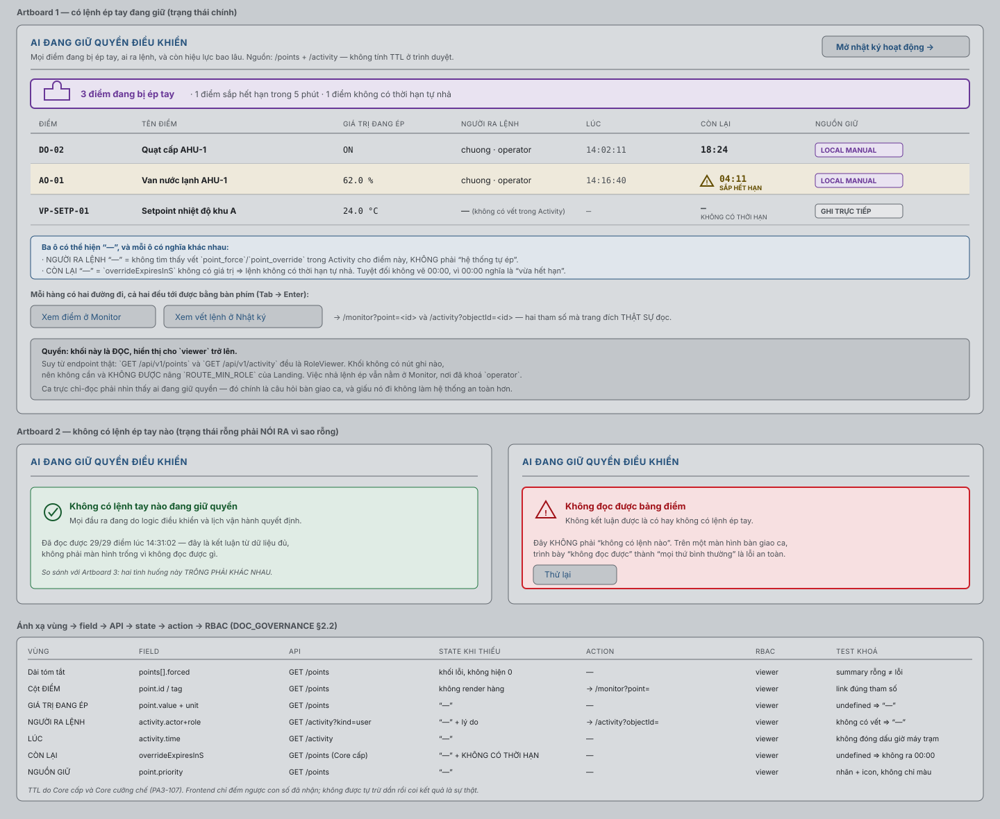
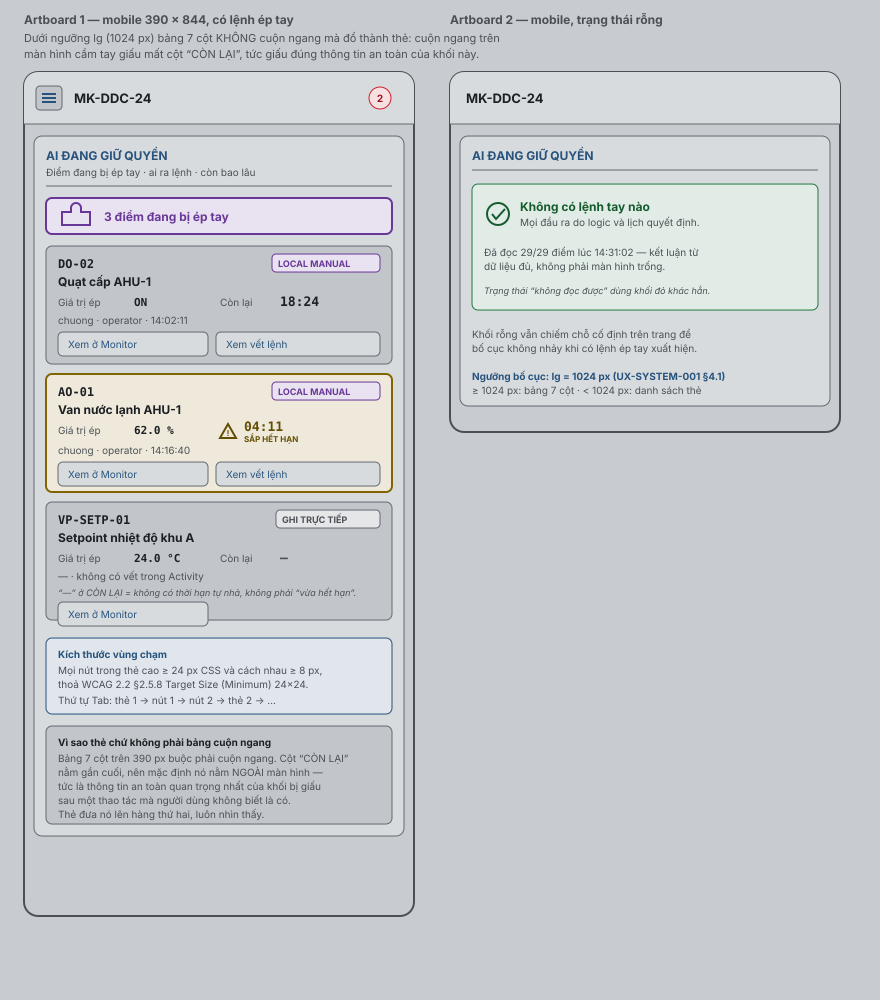
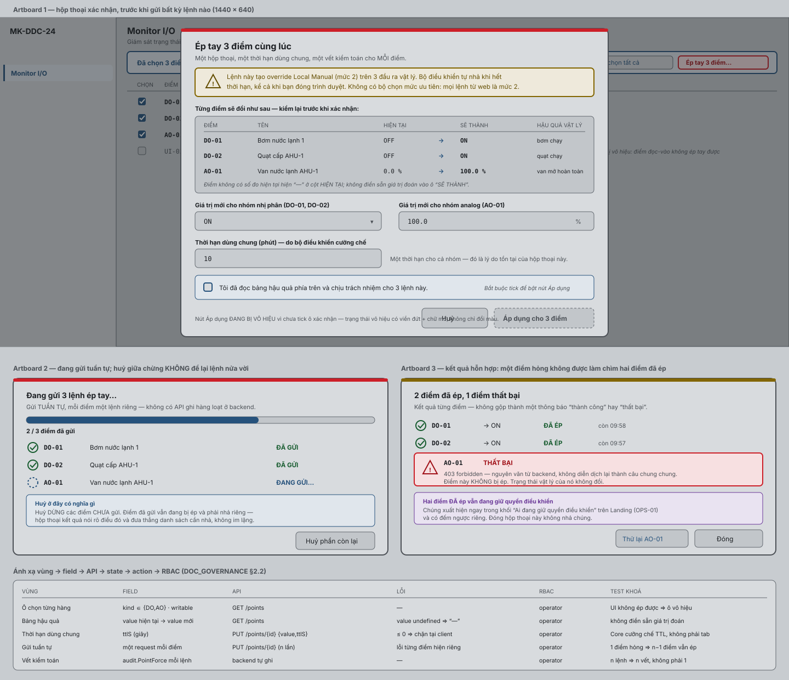
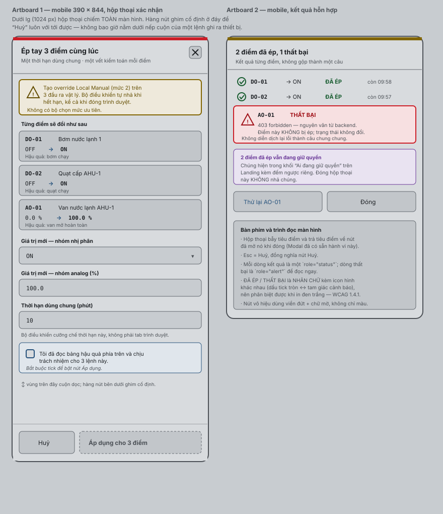
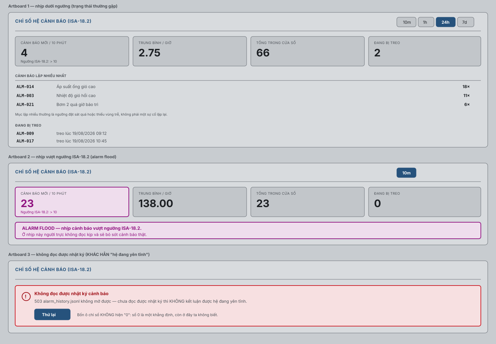
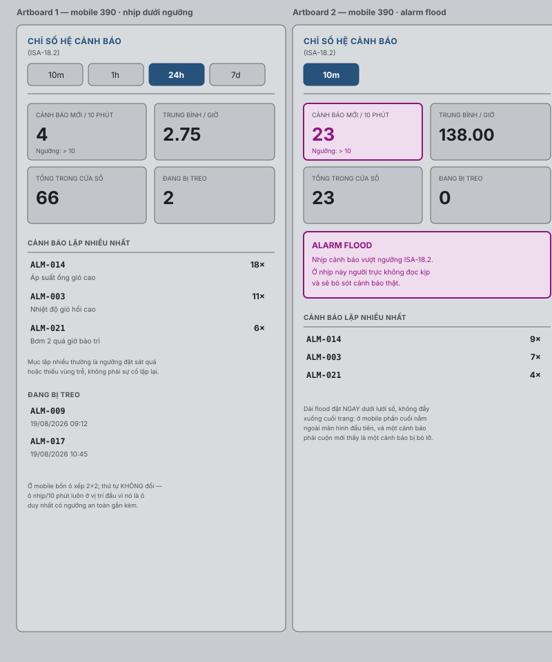

# Thiết kế UI/UX — An toàn vận hành trên Web (quyền điều khiển và ép tay hàng loạt)

| Thuộc tính | Giá trị |
|---|---|
| ID | `KX-DDC24-UX-WEB-OPERATIONS-001` |
| Phiên bản | 1.1 |
| Trạng thái | **Active** — đủ tư cách làm đầu vào implementation |
| Ngày | 2026-08-19 |
| Chủ quản | UX Lead (ô chữ ký: `WAIVED FOR IMPLEMENTATION`) |
| Nguồn | `AUTH-WEBUX-2026-08-18-02`, `AUTH-WEBUX-2026-08-19-01`, `ADR-034`, `ADR-036`, `ADR-037`, `ADR-044` trong [DECISIONS.md](../00_governance/DECISIONS.md) |
| Phạm vi | Ba màn hình mới của [Plan 57](../03_implementation/57_WEB_UIUX_UC_UPGRADE_PLAN.md): khối "Ai đang giữ quyền điều khiển" (`T57-1.2`), hộp thoại ép tay hàng loạt (`T57-1.4`), và bảng chỉ số hệ cảnh báo ISA-18.2 (`T57-3.3`) |
| Hồ sơ chuẩn kế thừa | [Design system `KX-DDC24-UX-SYSTEM-001`](KX-DDC24-UX-SYSTEM-001_VI.md) — token, breakpoint, `StatusBadge`, `DataTable` |

> [!IMPORTANT]
> Hồ sơ này tồn tại để mở cổng Detailed Design cho hai màn hình mới theo
> [`DOC_GOVERNANCE`](../00_governance/DOC_GOVERNANCE.md) §2.2, vốn quy định
> **wireframe chữ hoặc ASCII không đủ**. Nó **không** tạo authority thứ hai chồng
> lên design system: token, breakpoint và spec component vẫn thuộc
> `KX-DDC24-UX-SYSTEM-001`; hồ sơ này chỉ sở hữu **hai màn hình** nêu trong phạm vi.

## 0. Đọc nhanh

| Câu hỏi | Trả lời |
|---|---|
| 1. File này dùng để làm gì? | Đặc tả trực quan + hợp đồng dữ liệu cho ba màn hình an toàn vận hành mới, đủ để một dev không tham gia thiết kế biết chính xác phải render gì và khi thiếu dữ liệu thì hiện gì |
| 2. Ai phải đọc? | Người implement Wave 1/Wave 3, người review, và bất kỳ ai sau này đổi hợp đồng `/points`, `/activity` hoặc `/alarms/metrics` |
| 3. Vì sao ba màn hình này cần asset render được? | Cả ba chứa **quyết định an toàn**: một cái trả lời câu hỏi bàn giao ca "còn lệnh tay nào chưa nhả không", một cái phát lệnh ghi ra nhiều cơ cấu chấp hành cùng lúc, một cái nói người trực có đang ở phía sai của ngưỡng alarm flood hay không |
| 4. Dữ liệu trong asset là thật hay minh hoạ? | **Minh hoạ.** Mọi tên điểm, giá trị và mốc thời gian trong SVG là dựng để đặc tả bố cục, **không** phải bằng chứng runtime |
| 5. Còn bị chặn gì? | Không. `IMPLEMENT_READY[Wave 1]` `PASS` theo `AUTH-WEBUX-2026-08-18-02`; `IMPLEMENT_READY[Wave 3]` `PASS` theo `AUTH-WEBUX-2026-08-19-01` |

## 1. OPS-01 — Khối "Ai đang giữ quyền điều khiển"

### 1.1 Vì sao khối này tồn tại

Hôm nay `points.forced` chỉ là **một con số** trong khối TỔNG HỢP ĐIỂM của
Landing. Câu hỏi bắt buộc khi bàn giao ca là *"còn lệnh tay nào chưa nhả không,
của ai, còn hiệu lực bao lâu"* — và để trả lời nó, người trực phải vào Monitor,
lọc `state=forced`, rồi bấm từng điểm để đọc `overrideExpiresInS` trong khung chi
tiết. Ba thao tác cho một câu hỏi hỏi mỗi ngày hai lần.

### 1.2 Đặc tả trực quan

**Desktop 1440 — ba trạng thái (có lệnh, rỗng, không đọc được):**



**Mobile 390 × 844 — bảng đổ thành thẻ:**



### 1.3 Cây component

```text
DashboardPage
└── OverrideOwnershipPanel            (mới — khối thứ 4.5, đặt NGAY DƯỚI Attention)
    ├── Panel                         (dùng lại)
    ├── OverrideSummaryBar            (mới — nội tuyến: đếm + số sắp hết hạn)
    ├── StateBlock state="empty"      (dùng lại — nhánh không có lệnh nào)
    ├── StateBlock state="error"      (dùng lại — nhánh không đọc được)
    └── OverrideOwnerRow ×N           (mới)
        ├── ForcedBadge               (dùng lại — StateAtoms)
        ├── OverrideRemaining         (mới — đếm ngược + dấu hiệu phi-màu)
        └── Link ×2                   (→ /monitor?point= và /activity?objectId=)
```

Vị trí trên trang: **giữa `AttentionPanel` và `MyWorkspace`**. Thứ tự ưu tiên của
Landing (UX-DES §4.1) xếp *"mất liên lạc/suy giảm"* trên *"ghim của người dùng"*;
một lệnh tay đang giữ đầu ra là thông tin cùng hạng an toàn với hai mục đó, và
cao hơn hẳn không gian cá nhân.

### 1.4 Bảng ánh xạ vùng → field → API → state → action → RBAC → copy → error → test

| Vùng | Field | API (thật) | State khi thiếu | Action | RBAC | Copy khi rỗng | Test khoá |
|---|---|---|---|---|---|---|---|
| Dải tóm tắt | `points[].forced` | `GET /api/v1/points` | khối lỗi; **không** hiện `0` | — | viewer | — | tóm tắt rỗng ≠ lỗi đọc |
| Cột ĐIỂM | `point.id` / `point.tag` | `GET /api/v1/points` | không render hàng | → `/monitor?point=<id>` | viewer | — | link mang đúng tham số trang đích đọc |
| GIÁ TRỊ ĐANG ÉP | `point.value`, `point.unit` | `GET /api/v1/points` | `—` | — | viewer | — | `value === undefined` ⇒ `—`, không ra `0` |
| NGƯỜI RA LỆNH | `activity.actor`, `activity.role` | `GET /api/v1/activity?kind=user` | `—` + lý do | → `/activity?objectId=<id>` | viewer | "không có vết trong Activity" | không có vết ⇒ `—`, **không** ghi "hệ thống" |
| LÚC | `activity.time` | `GET /api/v1/activity` | `—` | — | viewer | — | không đóng dấu giờ máy trạm |
| CÒN LẠI | `point.overrideExpiresInS` | `GET /api/v1/points` (Core cấp) | `—` + "KHÔNG CÓ THỜI HẠN" | — | viewer | — | `undefined` ⇒ **không** ra `00:00` |
| NGUỒN GIỮ | `point.priority` | `GET /api/v1/points` | `—` | — | viewer | — | nhãn chữ + icon, không chỉ màu |

### 1.5 Ba ô cùng hiện `—` nhưng ba nghĩa khác nhau

Đây là chỗ dễ làm sai nhất của cả khối, nên viết thành luật:

| Ô | `—` nghĩa là | **Không** được hiểu thành |
|---|---|---|
| NGƯỜI RA LỆNH | không tìm thấy vết `point_force`/`point_override`/`point_metadata` trong Activity cho điểm này | "hệ thống tự ép" |
| LÚC | không có mốc thời gian thật từ producer | thời điểm hiện tại |
| CÒN LẠI | `overrideExpiresInS` không có giá trị ⇒ lệnh **không có thời hạn tự nhả** | "vừa hết hạn" (`00:00`) |

### 1.6 Quyền — suy từ endpoint backend thật

Khối là **đọc thuần**, hiển thị từ `viewer` trở lên. Cả `GET /api/v1/points` và
`GET /api/v1/activity` đều đăng ký `RoleViewer` trong
`apps/web-api/internal/app/http.go`. Khối **không** có nút ghi nào, nên
`ROUTE_MIN_ROLE` của Landing giữ nguyên và **không được** nâng. Việc nhả lệnh ép
vẫn nằm ở Monitor, nơi đã khoá `operator`.

Ca trực chỉ-đọc phải nhìn thấy ai đang giữ quyền: đó chính là câu hỏi bàn giao
ca, và giấu nó đi không làm hệ thống an toàn hơn.

### 1.7 Trạng thái rỗng phải khác trạng thái không đọc được

| Tình huống | Trình bày | Vì sao phải khác |
|---|---|---|
| Đọc được bảng điểm, không điểm nào `forced` | Khối **xanh** + "Không có lệnh tay nào đang giữ quyền" + nói rõ đã đọc bao nhiêu điểm và lúc nào | Đây là một kết luận có căn cứ |
| Không đọc được bảng điểm | Khối **đỏ** + "Không đọc được bảng điểm" + "Không kết luận được là có hay không có lệnh ép tay" + nút Thử lại | Trình bày "không đọc được" thành "mọi thứ bình thường" trên màn hình bàn giao ca là lỗi an toàn — cùng họ với `FE-DATA-01` |

## 2. OPS-02 — Hộp thoại ép tay hàng loạt

### 2.1 Vì sao hộp thoại này tồn tại

Chạy thử một AHU cần ép 3–5 điểm liên tiếp. Hôm nay phải mở 5 hộp thoại, mỗi cái
nhập lại thời hạn — vừa chậm, vừa dễ để sót một điểm chưa nhả, và năm thời hạn
lệch nhau nghĩa là năm thời điểm tự nhả khác nhau giữa lúc đang chạy thử.

### 2.2 Đặc tả trực quan

**Desktop 1440 — xác nhận, đang gửi, kết quả hỗn hợp:**



**Mobile 390 × 844 — toàn màn hình, hàng nút ghim đáy:**



### 2.3 Cây component

```text
MonitorPage
├── BulkSelectionBar                  (mới — chỉ hiện khi đã chọn ≥ 1 điểm)
├── DigitalRow / AnalogRow            (sửa — thêm ô chọn ở đầu hàng)
└── BulkOverrideDialog                (mới)
    ├── Modal                         (dùng lại — đã có bẫy tiêu điểm + trả tiêu điểm)
    ├── BulkConsequenceTable          (mới — hiện tại → sẽ thành, cho TỪNG điểm)
    ├── ô nhập nhóm nhị phân / nhóm analog / thời hạn dùng chung
    ├── ô xác nhận bắt buộc           (mới — gate bật nút Áp dụng)
    └── BulkOverrideProgress          (mới — đang gửi + kết quả từng điểm)
```

### 2.4 Bảng ánh xạ

| Vùng | Field | API (thật) | Lỗi | RBAC | Test khoá |
|---|---|---|---|---|---|
| Ô chọn từng hàng | `kind ∈ {DO, AO}`, `writable` | `GET /api/v1/points` | — | operator | điểm không ép được ⇒ ô chọn **vô hiệu** |
| Bảng hậu quả | `value` hiện tại → `value` mới | `GET /api/v1/points` | `value === undefined` ⇒ `—` | operator | **không** điền sẵn giá trị đoán |
| Thời hạn dùng chung | `ttlS` (giây) | `PUT /api/v1/points/{id}` body `{value, ttlS}` | `≤ 0` ⇒ chặn tại client | operator | Core cưỡng chế TTL, không phải tab trình duyệt |
| Gửi tuần tự | một request **mỗi** điểm | `PUT /api/v1/points/{id}` × n | lỗi từng điểm hiện riêng | operator | 1 điểm hỏng ⇒ n−1 điểm còn lại **vẫn** được ép |
| Vết kiểm toán | `audit.PointForce` mỗi lệnh | backend tự ghi | — | operator | n lệnh ⇒ **n** vết, không phải 1 |

### 2.5 Bốn luật an toàn của hộp thoại

1. **Không có API ghi hàng loạt ở backend.** `PUT /api/v1/points/{id}` là một
   điểm một request. Hộp thoại gửi **tuần tự** và báo kết quả **từng điểm**.
   Giả vờ đây là một giao dịch nguyên tử là nói dối về thứ không thể nguyên tử.
2. **Huỷ giữa chừng không để lại lệnh nửa vời — theo nghĩa đúng của nó.** Huỷ
   dừng các điểm **chưa** gửi. Điểm **đã** gửi vẫn đang bị ép, và hộp thoại kết
   quả phải nói thẳng điều đó kèm danh sách cần nhả. "Không để lại lệnh nửa vời"
   không thể có nghĩa "tự động rollback", vì rollback cũng là một lệnh ghi ra
   cơ cấu chấp hành và có thể hỏng y như lệnh gốc.
3. **Một điểm hỏng không được làm chìm các điểm đã ép.** Kết quả hỗn hợp hiện
   đủ ba phần: đã ép (kèm đếm ngược), thất bại (kèm **nguyên văn** lỗi backend),
   và nhắc rằng các điểm đã ép vẫn đang giữ quyền.
4. **Ô xác nhận bắt buộc.** Nút Áp dụng bị vô hiệu tới khi người dùng tick ô
   "Tôi đã đọc bảng hậu quả". Đây là ma sát **cố ý**: hộp thoại này gộp 3–5 lệnh
   nguy hiểm thành một cú bấm, nên phải trả lại một nhịp dừng.

### 2.6 Tiếp cận

| Tiêu chí WCAG 2.2 | Cách đạt |
|---|---|
| §2.1.1 Keyboard | Mọi ô chọn, ô nhập và nút là phần tử tương tác chuẩn (`<input>`, `<button>`); không có `<span onClick>` |
| §4.1.2 Name, Role, Value | Ô chọn mỗi hàng có `aria-label` mang tag + tên điểm; nút mở hộp thoại nói rõ số điểm |
| §1.4.1 Use of Color | `ĐÃ ÉP` ↔ `THẤT BẠI` phân biệt bằng **nhãn chữ + icon khác hình** (tick tròn ↔ tam giác), không chỉ xanh/đỏ. Nút vô hiệu dùng viền đứt + chữ mờ |
| §2.4.3 Focus Order | `Modal` đã bẫy tiêu điểm và trả tiêu điểm về nút đã mở nó |
| §4.1.3 Status Messages | Mỗi dòng kết quả là `role="status"`; dòng thất bại là `role="alert"` |
| §2.5.8 Target Size | Trên mobile mọi nút cao ≥ 24 px CSS, cách nhau ≥ 8 px |

## 3. OPS-03 — Bảng chỉ số hệ cảnh báo (ISA-18.2 §16)

### 3.1 Vì sao khối này tồn tại

Danh sách cảnh báo trả lời "đang có cảnh báo gì". Nó **không** trả lời câu hỏi mà
ISA-18.2 §16 cho là quan trọng hơn: *"hệ cảnh báo này có còn dùng được không"*.

Một hệ phát 23 cảnh báo trong 10 phút trông **hệt như** một hệ phát 4 cảnh báo
trên danh sách — vẫn là những dòng đỏ xếp theo thời gian. Khác biệt duy nhất nằm
ở nhịp, và nhịp thì không có ở đâu trên giao diện hiện tại. ISA-18.2 đặt ngưỡng
**> 10 cảnh báo / 10 phút** vì đó là điểm người vận hành không đọc kịp nữa và
bắt đầu bỏ qua cả cảnh báo thật — tức là điểm mà hệ cảnh báo ngừng bảo vệ ai.

"Cảnh báo lặp nhiều nhất" là **danh sách việc cần làm để hạ nhịp**, không phải
bảng xếp hạng sự cố: mỗi mục ở đó thường là một ngưỡng đặt sát quá hoặc một vùng
trễ thiếu.

### 3.2 Đặc tả trực quan

**Desktop 1440 — ba trạng thái (nhịp thường, alarm flood, không đọc được nhật ký):**



**Mobile 390 × 844 — lưới 2×2, dải flood ngay dưới lưới số:**



### 3.3 Cây component

```text
AlarmsPage
└── AlarmMetricsPanel                 (mới — đặt TRÊN danh sách cảnh báo)
    ├── Panel                         (dùng lại — action là bộ chọn cửa sổ)
    ├── Button ×4                      (dùng lại — 10m · 1h · 24h · 7d, mặc định 24h)
    ├── StateBlock state="loading"    (dùng lại)
    ├── StateBlock state="error"      (dùng lại — nhánh 503 không đọc được nhật ký)
    ├── Metric ×4                      (mới — nhịp/10 phút · TB/giờ · tổng · treo)
    ├── FloodAlert                     (mới — `role="alert"`, chỉ khi `flooding`)
    ├── TopRepeatingList               (mới)
    └── ShelvedList                    (mới — chỉ render khi danh sách khác rỗng)
```

Vị trí trên trang: **trên** danh sách cảnh báo. Một hệ đang flood phải nói ra
điều đó **trước** khi người trực bắt đầu đọc từng dòng — đọc trước rồi mới biết
mình đang đọc trong cơn lũ là quá muộn.

Tự làm mới mỗi **30 giây** (`refreshMs: 30_000`). Nhịp cảnh báo là đại lượng đổi
theo thời gian thực; một con số đứng yên từ lúc mở trang là con số sai.

### 3.4 Bảng ánh xạ vùng → field → API → state → action → RBAC → copy → error → test

| Vùng | Field | API (thật) | State khi thiếu | Action | RBAC | Copy khi rỗng | Test khoá |
|---|---|---|---|---|---|---|---|
| Bộ chọn cửa sổ | `window` | `GET /api/v1/alarms/metrics?window=` | mặc định `24h` | đổi cửa sổ ⇒ gọi lại | viewer | — | đổi cửa sổ phải gọi lại API, không lọc phía trình duyệt |
| Ô nhịp/10 phút | `rate10m`, `flooding` | như trên | `0` **tại đúng ô đó** khi backend thiếu trường | — | viewer | — | `flooding` ⇒ ô đổi tông `--c-critical` |
| Ô TB/giờ | `ratePerHour` | như trên | `0` | — | viewer | — | `undefined.toFixed()` không được hạ cả trang |
| Ô tổng | `totalRaised` | như trên | `0` | — | viewer | — | — |
| Ô đang treo | `shelved.length` | như trên | `0` | — | viewer | — | — |
| Dải ALARM FLOOD | `flooding` | như trên | không render | — | viewer | — | `role="alert"`; chỉ hiện khi `flooding === true` |
| Lặp nhiều nhất | `topRepeating[]` | như trên | danh sách rỗng | — | viewer | "Không có cảnh báo nào trong cửa sổ này." | rỗng ≠ lỗi |
| Đang bị treo | `shelved[]` | như trên | không render mục | — | viewer | — | mục biến mất hoàn toàn khi rỗng |

### 3.5 Ba luật của khối

| Luật | Vì sao |
|---|---|
| **Không đọc được nhật ký ⇒ khối lỗi, KHÔNG phải bốn số 0.** Backend trả `503` cho tình huống đó (`ADR-044` điều 3) và giao diện phải giữ nguyên sự phân biệt | Hiện `0` cho một hệ không đọc được nhật ký là khẳng định một điều mình không biết — và điều được khẳng định nhầm ở đây đúng là "hệ đang yên tĩnh" |
| **Thiếu một trường ⇒ hiện `0` ở đúng ô đó, không đánh sập trang.** `normalizeMetrics` chuẩn hoá phòng thủ trước khi render | Trang Cảnh báo là trang người trực cần nhất đúng lúc hệ đang có vấn đề; một `undefined.toFixed()` sẽ hạ nó đúng lúc đó |
| **Dải flood nói HẬU QUẢ, không chỉ nói ngưỡng.** Câu chữ là "người trực không đọc kịp và sẽ bỏ sót cảnh báo thật", không phải "rate10m = 23 > 10" | Một con số vượt ngưỡng không tự nói ra phải làm gì; câu hậu quả thì có |

### 3.6 Quyền và nguồn lưu trữ

Khối là **đọc thuần**, `RoleViewer` — cùng mức với danh sách cảnh báo
(`apps/web-api/internal/app/http.go`). Không có nút ghi nào.

Nguồn số đo là `alarm_history.jsonl` với **xoay vòng + retention 90 ngày**
(`ADR-036`), không phải historian. Đây là điều kiện tiên quyết của chính `ADR-036`:
một nhật ký không xoay vòng sẽ tự làm hỏng phép đo nhịp khi file lớn dần.

### 3.7 Trạng thái rỗng phải khác trạng thái không đọc được

| Tình huống | Trình bày | Vì sao phải khác |
|---|---|---|
| Đọc được nhật ký, cửa sổ không có cảnh báo nào | Bốn ô hiện số thật (`0`), danh sách lặp hiện "Không có cảnh báo nào trong cửa sổ này." | Đây là một kết luận có căn cứ: hệ **đang** yên tĩnh |
| Không đọc được nhật ký | Khối **đỏ** + "Không đọc được nhật ký cảnh báo" + nguyên văn lý do + nút Thử lại; **không** vẽ ô số nào | Không biết ≠ yên tĩnh. Đây là cùng một lớp lỗi với `FE-DATA-01` và với `T57-3.9` phía Modbus |

## 4. Token và breakpoint — kế thừa, không định nghĩa lại

Ba màn hình dùng **nguyên** bảng token của
[`KX-DDC24-UX-SYSTEM-001`](KX-DDC24-UX-SYSTEM-001_VI.md) §2 và ngưỡng bố cục
`lg = 1024 px` của §4.1. Màu dùng trong asset:

| Vai trò | Token | Giá trị LIGHT |
|---|---|---|
| Nền trang | `--c-bg` | `#C8CCD0` |
| Nền panel | `--c-surface` | `#D8DBDE` |
| Nền phụ / hàng | `--c-surface-2` | `#C2C6CA` |
| Chữ chính | `--c-text` | `#1C1F23` |
| Chữ phụ | `--c-text-dim` | `#4A4F55` |
| Nhấn / liên kết | `--c-accent` | `#26527C` |
| Ép tay | `--c-force` / `--c-force-bg` | `#693797` / `#E9E3F1` |
| Cảnh báo (sắp hết hạn) | `--c-warn-fg` / `--c-warn-bg` | `#634D00` / `#EEE9DB` |
| Lỗi | `--c-fault-fg` / `--c-fault-bg` | `#A01017` / `#F7E0E1` |
| Bình thường | `--c-good-fg` / `--c-good-bg` | `#165B2E` / `#E0ECE5` |
| Alarm flood | `--c-critical` / `--c-critical-bg` | `#901380` / `#EFDDED` |

Không token mới nào được thêm. Nếu một trong ba màn hình cần màu chưa có, phải
bổ sung vào design system trước — không đặt màu tại chỗ.

## 5. Revision History

| Phiên bản | Ngày | Thay đổi |
|---|---|---|
| 1.0 | 2026-08-18 | Phát hành đầu — đặc tả trực quan (4 asset SVG: desktop + mobile cho cả hai màn hình) và hợp đồng dữ liệu cho `T57-1.2` và `T57-1.4`, mở cổng Detailed Design theo `DOC_GOVERNANCE` §2.2. Chữ ký UX Lead: `WAIVED FOR IMPLEMENTATION` theo `AUTH-WEBUX-2026-08-18-02` |
| 1.1 | 2026-08-19 | Thêm `OPS-03` — bảng chỉ số hệ cảnh báo ISA-18.2 (`T57-3.3`, `ADR-036`/`ADR-044`) kèm 2 asset SVG desktop + mobile, mở cổng Detailed Design cho màn hình thứ ba. Ghi ba luật của khối, trong đó luật quan trọng nhất là **không đọc được nhật ký ⇒ khối lỗi, không phải bốn số 0** |
