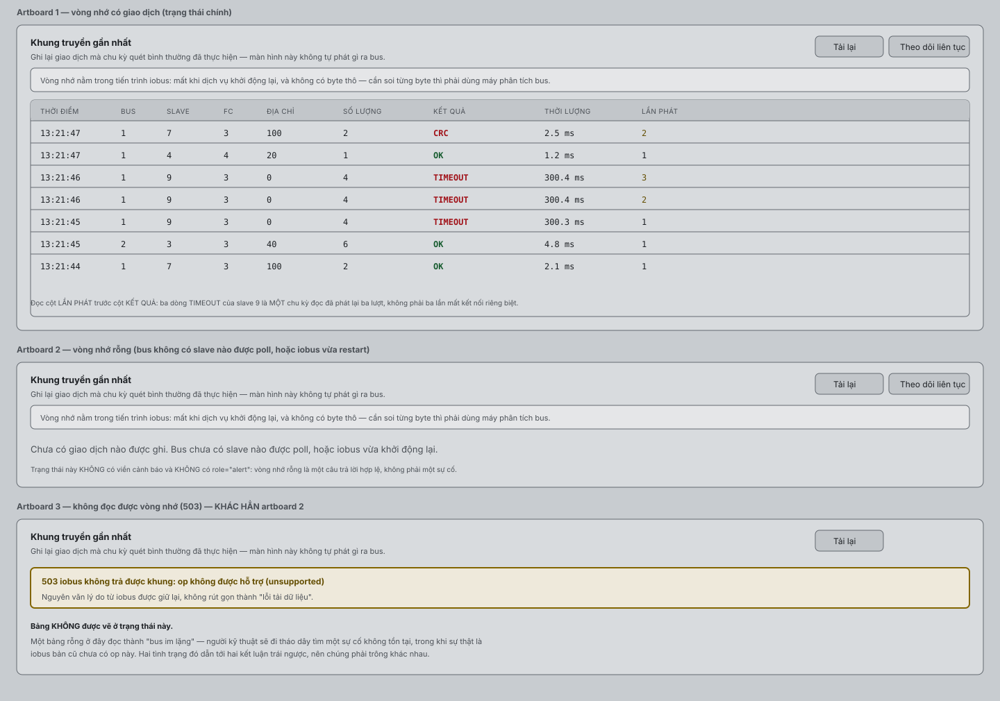
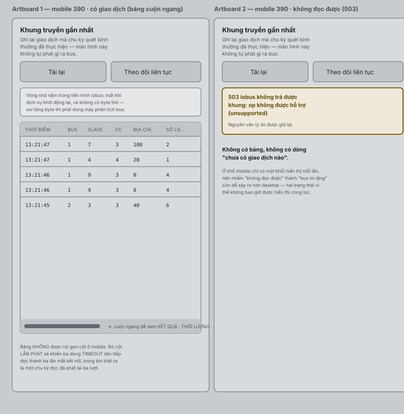

# Modbus RTU — UI/UX Design (Web) DDC-24 Rev A

**ID:** UX-WEB-MBRTU-001
**Phiên bản:** 0.3
**Trạng thái:** Active (Phê duyệt 2026-08-05 theo Tờ trình `DDC24-MBRTU-REQ-APPROVE-2026-08-05`)
**Ngày:** 2026-08-05
**Chủ quản đề xuất:** UX Lead + Product Owner
**Quyết định đã ký áp dụng:** Đ-01, Đ-04, Đ-05, Đ-06
**Đối chiếu source tại:** `feat/modbus-rtu-track-a` / `eade4e5`
**Trace ngược:** [PROD-MBRTU-001](../01_product/MODBUS_RTU_PRODUCT_REQUIREMENTS.md) `UC-MBRTU-001..018`
**Trace xuôi:** [DDD-FE-MBRTU-001](../02_design/software/MODBUS_RTU_FE_DESIGN.md),
[ICD-API-MBRTU-001](../02_design/interfaces/MODBUS_RTU_API_SPEC.md)

> Wireframe dưới đây là **layout intent** dạng ASCII, không phải asset thiết kế
> pixel-perfect. Token màu/spacing lấy từ `apps/web-ui/src/shared/theme/tokens.ts`;
> tài liệu này không định nghĩa token mới.

## 1. Nguyên tắc chung cho cả năm page

| Nguyên tắc | Diễn giải bắt buộc |
|---|---|
| Authority-first | Mọi số liệu hiển thị phải đến từ API. Không có số liệu ⇒ hiện `—` hoặc `unknown`, **không** hiện `0` và **không** hiện `Online`. |
| Không suy diễn quality | FE không tính `quality` từ `online`/`consecutive_errors`. Quality và reason đến từ authority. |
| Candidate rõ ràng | Sửa cấu hình là sửa **candidate**. Người dùng phải thấy "có thay đổi chưa apply" và nút Apply/Discard tách bạch. |
| Xác nhận khi nguy hiểm | Mọi hành động ghi register, xoá và apply đều có hộp thoại nêu đích danh đối tượng. |
| Hiển thị đơn vị và convention | Address luôn kèm nhãn `zero-based`; nếu hiện `4xxxx` phải ghi rõ là reference. |
| Trạng thái đầy đủ | Mỗi vùng dữ liệu phải có bốn state: loading, empty, error, offline. |
| Không khoá bàn phím | Mọi control có label liên kết, focus ring rõ, thao tác được bằng bàn phím. |

### 1.1 Điều hướng

```text
Engineering
└── Modbus RTU
    ├── Overview        /eng/modbus-rtu                (mặc định)
    ├── Devices         /eng/modbus-rtu/devices
    ├── Points          /eng/modbus-rtu/points
    ├── Mapping         /eng/modbus-rtu/mapping
    └── Diagnostics     /eng/modbus-rtu/diagnostics
```

Thiết kế này tách năm route với min-role `viewer` cho Overview/Devices/Points/
Diagnostics; mutation vẫn do server chặn.

**`G-UX-01` đã ĐÓNG (D-07, commit `dfef8ab`).** Route `/eng/modbus-rtu` nay ở mức
`viewer`, và trang disable từng control mutation kèm lý do quyền
("Chỉ vai trò Admin được thay đổi cấu hình Modbus RTU") thay vì chặn cả trang.
`OD-MBRTU-009` cũng đã đóng bằng Đ-04 (ba vai trò). Phần **còn lại** của gap là việc
tách một trang thành **năm** route — thuộc Track B `MBR-B301`.

> Nguyên tắc đằng sau: chặn cả trang ở `admin` làm Viewer không giám sát được, vi
> phạm `PR-MBRTU-001`/`PR-MBRTU-007`. Nhưng cũng không được để control bật rồi mới
> báo 403 — FE disable là để **không mời người dùng vào thao tác chắc chắn bị từ
> chối**; server vẫn là nơi quyết định cuối.

### 1.2 Banner trạng thái cấu hình (dùng lại ở cả năm page)

```text
┌──────────────────────────────────────────────────────────────────────────┐
│ ● Active rev 42 · checksum 9f3a…c1  |  ⚠ Candidate rev 43 có 3 thay đổi │
│   [Xem khác biệt]  [Apply cấu hình]  [Huỷ candidate]                     │
└──────────────────────────────────────────────────────────────────────────┘
```

- Không có candidate ⇒ banner rút gọn còn dòng `Active rev N`.
- Đang apply ⇒ banner chuyển spinner + text `Đang áp dụng… chờ iobus xác nhận`.
- Apply lỗi ⇒ banner đỏ, giữ nguyên `Active rev N`, hiện mã lỗi và nút `Thử lại`.

---

## 2. Page A — Modbus RTU Overview

**Mục tiêu:** trả lời trong 5 giây: hệ Modbus RTU có khoẻ không, hỏng ở đâu.

**User role:** Viewer trở lên (chỉ đọc).

**Workflow:** vào trang → đọc 4 KPI → nhìn thẻ bus → nếu có bất thường thì bấm
vào thẻ bus hoặc dòng sự kiện để nhảy sang Devices/Diagnostics đã lọc sẵn.

### 2.1 Layout

**Trang Overview hiển thị 02 thẻ bus RS485 vật lý.** Danh sách thẻ được render động từ `GET /modbus/buses` với 2 cổng: `RS485-1` (`/dev/rs485-1` → `ttyS5`) và `RS485-2` (`/dev/rs485-2` → `ttyS1`).

```text
┌ Modbus RTU · Tổng quan ─────────────────────────────── [Làm mới] [Tự động ⟳ 5s] ┐
│ [Banner trạng thái cấu hình]                                                    │
├─────────────────────────────────────────────────────────────────────────────────┤
│ ┌ Tổng Device ─┐ ┌ Online ──┐ ┌ Offline ─┐ ┌ Fault/Config ┐                     │
│ │      12      │ │    9     │ │    2     │ │      1       │                     │
│ └──────────────┘ └──────────┘ └──────────┘ └──────────────┘                     │
├─────────────────────────────────────────────────────────────────────────────────┤
│ ┌ RS485-1 (Main Port) ──────────────┐ ┌ RS485-2 (Expansion Port) ─────────┐     │
│ │ ● OPEN  9600 8N1 (/dev/rs485-1)   │ │ ● OPEN  9600 8N1 (/dev/rs485-2)   │     │
│ │ Device 8 (7 online)               │ │ Device 4 (2 online)               │     │
│ │ Poll latency  p50 24 ms           │ │ Poll latency  p50 18 ms           │     │
│ │               p95 61 ms           │ │               p95 45 ms           │     │
│ │ Timeout 12 · CRC 0                │ │ Timeout 2 · CRC 1                 │     │
│ │ Bus utilization  38 % (ước tính)   │ │ Bus utilization  15 % (ước tính)   │     │
│ │ [Xem thiết bị]                    │ │ [Xem thiết bị]                    │     │
│ └───────────────────────────────────┘ └───────────────────────────────────┘     │
├─────────────────────────────────────────────────────────────────────────────────┤
│ Sự kiện giao tiếp gần đây                                    [Xem tất cả →]     │
│ 10:41:02  RS485-1  MTR-01   OFFLINE → ONLINE                                    │
│ 10:38:55  RS485-2  VFD-01   TIMEOUT (3 liên tiếp)                               │
│ 10:31:10  RS485-1  —        PORT_DOWN: không mở được cổng                       │
└─────────────────────────────────────────────────────────────────────────────────┘
```

### 2.2 Component và field

| Component | Field | Nguồn | Định dạng |
|---|---|---|---|
| KPI card ×4 | tổng/online/offline/fault | `GET /modbus/overview` | số nguyên; `—` nếu thiếu |
| Bus card ×N (Rev A: N=1) | `bus_id`, `open_state`, serial, số device, latency p50/p95, timeout, CRC, utilization | `GET /modbus/buses` + `GET /modbus/overview` | latency ms 0 chữ số thập phân; utilization % có nhãn `(ước tính)` |
| Event feed | thời gian, bus, device, sự kiện | `GET /modbus/events?limit=10` | thời gian local, tooltip UTC |

> **Thời gian luôn là giờ địa phương của trình duyệt, và nhãn phải nói đúng điều đó.**
> Cùng lớp lỗi với `TrendsPage` (`b67580c`): nhãn hứa giờ địa phương nhưng phần tính
> toán dùng UTC, làm người dùng UTC+7 đọc lệch 7 tiếng.

`Bus utilization` **luôn** kèm chữ `(ước tính)` vì là giá trị tính toán từ baud và
kích thước frame, không phải đo trên dây.

### 2.3 State

| State | Thể hiện |
|---|---|
| Loading | skeleton cho 4 KPI + 2 bus card; không hiện `0` |
| Empty | "Chưa cấu hình Modbus RTU Device nào." + nút `Thêm thiết bị` (Admin) |
| Error | banner đỏ + mã lỗi + `Thử lại`; giữ dữ liệu cũ kèm nhãn `dữ liệu lúc HH:mm` |
| Offline (mất telemetry) | mọi số đo → `—`, bus card viền xám, dòng `iobus chưa publish telemetry` |

### 2.4 Acceptance criteria

- AC-A1: khi API trả 503, không ô số nào hiển thị `0`; tất cả là `—`.
- AC-A2: khi một bus `unavailable`, thẻ bus đó không hiện latency/CRC giả.
- AC-A3: tổng `online + offline + fault + disabled` = tổng Device.
- AC-A4: bấm KPI `Offline` mở Devices với filter `connection_status=OFFLINE`.
- AC-A5: auto-refresh mặc định 5 s, tắt được, và dừng khi tab ẩn.

---

## 3. Page B — Modbus Device Manager

**Mục tiêu:** quản lý vòng đời Device và tham số bus/serial.

**User role (Đ-04, ba vai trò):** xem = Viewer; **thêm/sửa/xoá/enable/apply/import/
export = Admin**; test connection = Operator.

**Workflow:** xem danh sách → `Thêm`/`Sửa` mở drawer form →
`Lưu vào candidate` → banner báo có thay đổi → `Test kết nối` (tuỳ chọn) →
`Apply cấu hình` → chờ ACK → danh sách cập nhật `connection_status`.

### 3.1 Layout

```text
┌ Modbus RTU · Thiết bị ──────────────────── [+ Thêm thiết bị] [Import] [Export] ┐
│ [Banner trạng thái cấu hình]                                                   │
│ Bus: RS485-1 (cổng duy nhất)       Lọc: [trạng thái ▾] [tìm tên/slave…]        │
├────────────────────────────────────────────────────────────────────────────────┤
│ □ │ Tên          │ Bus     │ Slave │ Serial   │ Poll/TO/Phát lại│ Trạng thái │ ⋯│
│ □ │ MTR-01       │ RS485-1 │   1   │ 19200 8N1│ 1000/300/2      │ ● ONLINE   │ ⋯│
│ □ │ VFD-03       │ RS485-1 │   3   │ 19200 8N1│ 1000/300/2      │ ◐ DEGRADED │ ⋯│
│ □ │ PM-07        │ RS485-1 │   7   │ 19200 8N1│ 2000/500/1      │ ○ OFFLINE  │ ⋯│
│ □ │ TEST-09      │ RS485-1 │   9   │ 19200 8N1│ 1000/300/2      │ ⊘ DISABLED │ ⋯│
│ □ │ BAD-11       │ RS485-1 │  11   │ —        │ —               │ ▲ CONFIG   │ ⋯│
├────────────────────────────────────────────────────────────────────────────────┤
│ Đã chọn 2  [Enable] [Disable] [Xoá]                        1–5 / 12   ◀ 1 2 ▶ │
└────────────────────────────────────────────────────────────────────────────────┘

Drawer "Sửa thiết bị MTR-01"
┌──────────────────────────────────────────────────────────┐
│ Device ID  MTR-01            (không đổi được)             │
│ Tên hiển thị   [Đồng hồ điện tầng 1        ]              │
│ Bus            RS485-1  (cổng duy nhất trên phần cứng này)│
│ Slave ID       [1    ]  1..247, unique trong bus          │
│ ── Tham số serial (thuộc bus, áp dụng cho mọi thiết bị) ──│
│ Baud [19200 ▾] Data bit [8] (cố định) Parity [N ▾]        │
│ Stop bit [1 ▾]                                            │
│ ⓘ Đổi tham số serial ảnh hưởng toàn bộ thiết bị trên      │
│   RS485-1 (8 thiết bị).                                   │
│ ── Chu kỳ ────────────────────────────────────────────────│
│ Poll interval [1000] ms   Timeout [300] ms                │
│ Số lần phát lại [2]  (0–3, mỗi giao dịch lỗi)             │
│ Chuyển OFFLINE sau [2] lượt poll lỗi liên tiếp            │
│ Stale sau [3000] ms       Offline sau [6000] ms           │
│ [x] Enabled     [x] Readback sau khi ghi                  │
│                                                           │
│ [Test kết nối]        [Huỷ]  [Lưu vào candidate]          │
└──────────────────────────────────────────────────────────┘
```

> **Nhãn "Retry" cũ bị cấm dùng lại.** Trước Đ-05, UI gọi trường này là "Retry"
> trong khi runtime dùng nó làm ngưỡng OFFLINE và **không phát lại lần nào**. Nhãn
> mới phải nói đúng việc: "Số lần phát lại" và "Chuyển OFFLINE sau N lượt poll lỗi"
> là **hai trường khác nhau**. Cột bảng cũng đổi `Poll/TO/Retry` → `Poll/TO/Phát lại`.
>
> **As-Built ◐:** FE đã đổi nhãn và tooltip cho `retry` (0–3, "Số lần phát lại một
> giao dịch Modbus bị lỗi… 0 = không phát lại") nhưng **chưa có** ô nhập
> `offline_after_errors` — trường này hiện không cấu hình được end-to-end
> (`F-BE-19`). Gap `G-UX-11`.

### 3.2 Field và validation (client-side, phản chiếu server)

| Field | Ràng buộc UI | Thông báo lỗi |
|---|---|---|
| `display_name` | 1..64, trim | "Tên thiết bị không được để trống." |
| `bus_id` | render từ `GET /modbus/buses`; **một lựa chọn ⇒ hiển thị read-only**; bus `unavailable` bị disable kèm tooltip | "Cổng này chưa có capability trên phần cứng này." |
| `rs485_port` | **chỉ chọn từ danh sách capability**, không nhập tự do | "Cổng phải nằm trong danh sách cổng có thật." — đóng D-14, cấm mặc định `/dev/ttyS3` |
| `slave_id` | số nguyên 1..247; kiểm trùng trong cùng bus ngay khi nhập | "Slave ID 3 đã được VFD-03 dùng trên RS485-1." |
| `baud/parity/stop` | select; đổi giá trị hiện cảnh báo phạm vi bus | "Thay đổi này áp dụng cho 8 thiết bị trên RS485-1." |
| `data_bits` | luôn `8`, disabled | tooltip "Modbus RTU cố định 8 data bit." |
| `poll_interval_ms` | 100..60000 | "Poll interval phải trong 100–60000 ms." |
| `timeout_ms` | 20..5000 và `< poll_interval_ms` | "Timeout phải nhỏ hơn poll interval." |
| `retry_count` | 0..3; nhãn **"Số lần phát lại"**, `0` hợp lệ | "Số lần phát lại phải trong 0–3. Đặt 0 nghĩa là không phát lại, báo lỗi ngay." |
| `offline_after_errors` | 1..10; nhãn **"Chuyển OFFLINE sau N lượt poll lỗi"** | "Phải trong 1–10 lượt." |
| `coil_write_batch_max` | ô bật **"Ghi nhiều coil một lần (FC15)"**, mặc định TẮT; bật thì hiện ô số "Tối đa coil mỗi lệnh" 2–16 (mặc định 8, `required`, `min=2`). Lời giải thích nằm ngay dưới ô: chỉ bật khi datasheet có FC15 (0x0F), thiết bị không hỗ trợ sẽ từ chối mọi lệnh ghi đã gom; điểm bật xác nhận sau khi ghi vẫn được ghi riêng từng coil. Bảng thiết bị hiện `FC15×N` khi bật (U-07) | BE: "phải trong 0..16 (0 hoặc 1 = tắt gom FC15)" (`OUT_OF_RANGE`) |
| `stale_after_ms` | `≥ poll + timeout` | "Stale phải ≥ poll + timeout (1300 ms)." |
| `offline_after_ms` | `> stale_after_ms` | "Offline phải lớn hơn stale." |

Validation client là **trợ giúp**, không phải authority: server luôn validate lại và
FE phải hiển thị được lỗi server theo `path` trả về.

### 3.3 Trạng thái Device hiển thị

| Trạng thái | Ký hiệu | Màu | Tooltip |
|---|---|---|---|
| `ONLINE` | ● | success | "Lần đọc thành công gần nhất: HH:mm:ss" |
| `DEGRADED` | ◐ | warning | "Dữ liệu cũ hơn ngưỡng stale." |
| `OFFLINE` | ○ | danger | "Không đọc được từ HH:mm:ss. Đang thử lại mỗi 5 s." |
| `DISABLED` | ⊘ | neutral | "Thiết bị bị tắt, không chiếm băng thông bus." |
| `CONFIG_ERROR` | ▲ | danger | lý do cụ thể, ví dụ "Không tìm thấy profile" |
| `INITIALIZING` | ◌ | info | "Đang chờ lần đọc thành công đầu tiên." |

### 3.4 Test kết nối (UC-MBRTU-008)

```text
┌ Test kết nối · MTR-01 ────────────────────────────┐
│ Bus RS485-1 · Slave 1 · 19200 8N1                 │
│ Phép thử: đọc 1 register tại địa chỉ [0    ]      │
│ ⓘ Thao tác này chỉ ĐỌC, không thay đổi cấu hình.  │
│                          [Huỷ]  [Chạy test]       │
├───────────────────────────────────────────────────┤
│ Kết quả: ✔ Phản hồi sau 21 ms                     │
│ Raw 0x04D2 (1234) · CRC OK · retry 0              │
└───────────────────────────────────────────────────┘
```

Kết quả thất bại phải nói rõ **loại** lỗi: `TIMEOUT` ("thiết bị không trả lời — kiểm
tra dây, slave ID, baud"), `CRC_ERROR` ("khung lỗi — kiểm tra nhiễu/termination"),
`DEVICE_EXCEPTION 02` ("thiết bị từ chối địa chỉ register"), `PORT_UNAVAILABLE`.

### 3.5 API được gọi

`GET /modbus/config`, `GET /modbus/devices`, `POST/PUT/DELETE /modbus/devices*`,
`POST /modbus/devices/{id}/enabled`, `POST /modbus/devices/{id}/test-connection`,
`POST /modbus/config/apply`, `POST /modbus/config/rollback`.

### 3.6 Acceptance criteria

- AC-B1: Viewer thấy danh sách nhưng mọi nút mutation bị disable kèm lý do quyền.
- AC-B2: nhập slave ID trùng ⇒ lỗi inline trước khi gọi API.
- AC-B3: `Lưu vào candidate` **không** làm iobus restart; chỉ `Apply` mới làm.
- AC-B4: Apply thất bại ⇒ danh sách vẫn hiển thị cấu hình `Active rev N` cũ.
- AC-B5: xoá Device còn Point ⇒ hộp thoại liệt kê Point và chặn, không xoá ngầm.
- AC-B6: `Test kết nối` không tạo revision mới và không xuất hiện trong candidate diff.

---

## 4. Page C — Modbus Point Manager

**Mục tiêu:** khai báo register map và quan sát giá trị thật của từng Point.

**User role (Đ-04):** xem = Viewer; CRUD/import/export = **Admin**; read test = Operator; write test = Admin.

**Workflow:** chọn Device (dropdown/tab) → xem bảng Point → `Thêm Point` hoặc `Sửa`
→ `Lưu vào candidate` → `Apply` → quan sát cột Value/Quality/Timestamp cập nhật.

### 4.1 Layout

```text
┌ Modbus RTU · Điểm ──── Thiết bị: [MTR-01 ▾] ─ [+ Thêm Point] [Import CSV] [Export ▾] ┐
│ [Banner trạng thái cấu hình]                                                          │
│ Lọc: [register type ▾] [quality ▾] [tìm tag/tên…]                                     │
├───────────────────────────────────────────────────────────────────────────────────────┤
│ Tag / Point ID │ Register        │ Kiểu        │ Scale·Offset │ Value    │ Quality │ ⋯│
│ MTR1.kWh       │ holding @0x0064 │ float32     │ ×0.1 +0      │ 1 234,5  │ ● GOOD  │ ⋯│
│ MB-7F2A1C09    │ (4-00101 ref)   │ big/high_low│ kWh          │ 10:41:02 │         │  │
│────────────────┼─────────────────┼─────────────┼──────────────┼──────────┼─────────┼──│
│ MTR1.Run       │ coil @0x0000    │ bool        │ —            │ TRUE     │ ◐ STALE │ ⋯│
│ MB-8A31D5B2    │ (0-00001 ref)   │ R/W         │              │ 10:38:55 │ TIMEOUT │  │
│────────────────┼─────────────────┼─────────────┼──────────────┼──────────┼─────────┼──│
│ MTR1.Alarm     │ holding @0x0010 │ bool bit 3  │ —            │ —        │ ▲ CONFIG│ ⋯│
│ MB-11C0FE44    │                 │             │              │ —        │ overlap │  │
├───────────────────────────────────────────────────────────────────────────────────────┤
│                                                       1–3 / 24    ◀ 1 2 3 ▶          │
└───────────────────────────────────────────────────────────────────────────────────────┘
```

Mỗi hàng chiếm hai dòng: dòng trên là dữ liệu chính, dòng dưới là ID/reference/
timestamp/reason. Cách này giữ được đủ 12 thuộc tính mà không cần cuộn ngang.

### 4.2 Form Point

```text
┌ Sửa Point · MTR1.kWh ─────────────────────────────────────────┐
│ Point ID   MB-7F2A1C09              (không đổi được)          │
│ Thiết bị   [MTR-01 ▾]                                         │
│ Tag name   [MTR1.kWh          ]  unique toàn hệ thống         │
│ Tên hiển thị [Điện năng tổng   ]                              │
│ ── Register ──────────────────────────────────────────────────│
│ Loại   [Holding Register ▾]                                   │
│ Địa chỉ [100   ] zero-based   ⓘ tham chiếu hiển thị: 4-00101  │
│ Bit index [—   ] chỉ dùng cho bool trích từ word              │
│ Kiểu dữ liệu [float32 ▾]                                      │
│ Byte order [Big ▾]   Word order [High→Low ▾]                  │
│ Quyền  ( ) Read   (•) Read/Write                              │
│ ── Kỹ thuật ──────────────────────────────────────────────────│
│ Scale [0.1  ]  Offset [0    ]  Đơn vị [kWh   ]                │
│ Min [0      ]  Max [999999]  (tuỳ chọn, dùng cho ghi + range) │
│ Poll riêng [—     ] ms (bỏ trống = theo thiết bị 1000 ms)     │
│ Default [0   ]  Safe [—    ]                                  │
│ [x] Enabled                                                   │
│ ── Xem trước ─────────────────────────────────────────────────│
│ Chiếm 2 register: 100–101. Không chồng lấn Point khác. ✔      │
│ raw 12345 → engineering 1 234,5 kWh                           │
│                                                               │
│ [Đọc thử]  [Ghi thử]        [Huỷ]  [Lưu vào candidate]        │
└───────────────────────────────────────────────────────────────┘
```

Khối **Xem trước** là bắt buộc: nó hiển thị dải register bị chiếm, kết quả kiểm tra
overlap và một phép quy đổi mẫu. Đây là cách rẻ nhất để chặn lỗi register map trước
khi ra hiện trường.

### 4.3 Đọc thử / Ghi thử

```text
Đọc thử (Operator+)              Ghi thử (Admin) — hai bước
┌────────────────────────┐       ┌ Bước 1 ─────────────────────────────┐
│ Kết quả: raw 12345     │       │ Giá trị hiện tại  1 234,5 kWh       │
│ engineering 1 234,5 kWh│       │ Giá trị mới      [1300     ] kWh    │
│ 21 ms · CRC OK         │       │ Giới hạn 0 … 999999                 │
└────────────────────────┘       │                  [Huỷ] [Tiếp tục]   │
                                 ├ Bước 2 — xác nhận ──────────────────┤
                                 │ ⚠ Ghi vào thiết bị thật             │
                                 │ MTR-01 · RS485-1 · slave 1          │
                                 │ Holding 100 (4-00101), float32      │
                                 │ 1 234,5 → 1 300,0 kWh               │
                                 │ Hành động được ghi audit.           │
                                 │            [Huỷ] [Xác nhận ghi]     │
                                 └─────────────────────────────────────┘
```

Nút `Ghi thử` bị **disable** khi: Point `read`, quality không phải `GOOD`, Device
không `ONLINE`, hoặc có candidate chưa apply. Mỗi lý do hiện thành tooltip riêng —
không dùng một câu chung.

### 4.4 Import/Export

- `Import CSV`: chọn file → **preview** bảng thay đổi (thêm N, sửa M, lỗi K) →
  chỉ khi `K=0` mới bật nút `Nạp vào candidate`. Lỗi hiển thị theo dòng và cột.
- `Export ▾`: `CSV (điểm)` hoặc `JSON (toàn bộ cấu hình)`; tên file
  `modbus-rtu-points-rev<N>-<YYYYMMDD>.csv`.
- Import không bao giờ apply trực tiếp; luôn qua candidate.

### 4.5 State

| State | Thể hiện |
|---|---|
| Loading | skeleton 5 hàng |
| Empty (chưa có device) | "Hãy tạo Modbus RTU Device trước." + link sang Devices |
| Empty (device chưa có point) | "Thiết bị này chưa có Point." + nút `Thêm Point` |
| Error | banner + giữ bảng cũ có nhãn thời điểm |
| Offline runtime | cột Value/Quality/Timestamp → `—`, badge `Không có telemetry` |

### 4.6 Acceptance criteria

- AC-C1: cột Value chỉ hiện số khi `quality ∈ {GOOD, STALE, OFFLINE}`; `BAD`/`CONFIG_ERROR` hiện `—`.
- AC-C2: `STALE`/`OFFLINE` hiện giá trị cuối kèm timestamp cũ và nhãn rõ ràng, không đổi màu như GOOD.
- AC-C3: đổi `data_type` sang 32-bit tự cập nhật khối Xem trước thành 2 register và chạy lại kiểm tra overlap.
- AC-C4: register overlap không lưu được vào candidate.
- AC-C5: `Ghi thử` yêu cầu đúng hai bước xác nhận và hiện giá trị cũ → mới.
- AC-C6: import file có 1 dòng lỗi ⇒ không dòng nào được nạp.
- AC-C7: đổi `tag_name` không đổi `point_id` hiển thị.

---

## 5. Page D — Point Mapping

**Mục tiêu:** xác nhận Modbus RTU Point đã vào Point Database DDC-24 đúng và không xung đột.

**User role (Đ-04):** xem = Viewer; sửa mapping = **Admin**.

**Workflow:** vào trang → xem trạng thái mapping của mọi Point → sửa tag/DDC Point ID
ở các dòng cảnh báo → `Kiểm tra lại` → `Lưu vào candidate` → `Apply`.

### 5.1 Layout

```text
┌ Modbus RTU · Ánh xạ Point ────────────────── [Kiểm tra lại] [Lưu vào candidate] ┐
│ Tổng 24 Point · ✔ Hợp lệ 21 · ⚠ Cảnh báo 1 · ✖ Lỗi 2                            │
│ Lọc: (•) Tất cả ( ) Chỉ lỗi ( ) Chỉ cảnh báo                                     │
├──────────────────────────────────────────────────────────────────────────────────┤
│ Modbus Point        │ Kiểu    │ → DDC Point ID │ Tag name      │ Trạng thái      │
│ MTR-01 / holding100 │ float32 │ MB-7F2A1C09    │ MTR1.kWh      │ ✔ Đã ánh xạ     │
│ MTR-01 / coil0      │ bool    │ MB-8A31D5B2    │ MTR1.Run      │ ✔ Đã ánh xạ     │
│ VFD-03 / holding20  │ int16   │ MB-3C77A180    │ AHU1.Speed    │ ✖ Tag trùng     │
│                     │         │                │               │   với UI-05     │
│ PM-07 / input40     │ uint32  │ MB-91B2E0C4    │ PM7.Total     │ ✖ Kiểu không    │
│                     │         │                │               │   tương thích   │
│ PM-07 / holding9    │ float32 │ MB-55D0AA31    │ PM7.Temp      │ ⚠ Chưa enabled  │
└──────────────────────────────────────────────────────────────────────────────────┘
```

### 5.2 Luật kiểm tra hiển thị

| Kiểm tra | Kết quả | Hành vi UI |
|---|---|---|
| Tag unique toàn namespace (Local I/O + Virtual + Modbus RTU) | ✖ nếu trùng | chỉ rõ Point đang giữ tag và đường dẫn cấu hình của nó |
| `data_type` ↔ Point Database type | ✖ nếu không biểu diễn được | nêu cặp kiểu và lý do (ví dụ `uint32` không vào được slot `float` hiện tại) |
| Point ID ổn định | ✖ nếu payload cố đổi | "Point ID không được thay đổi." |
| Point `enabled=false` | ⚠ | "Point tồn tại nhưng không được poll." |
| Device `enabled=false` | ⚠ | "Thiết bị đang tắt." |
| Vượt capacity 64 Point | ✖ | "Vượt giới hạn 64 Modbus RTU Point." |

**Nút `Lưu vào candidate` bị disable khi còn bất kỳ dòng ✖.** Đây là yêu cầu tường
minh của `PR-MBRTU-010`: không cho lưu mapping không hợp lệ.

### 5.3 Acceptance criteria

- AC-D1: còn ✖ ⇒ không lưu được, và nút disable có tooltip nêu số lỗi.
- AC-D2: mỗi ✖ chỉ đích danh đối tượng xung đột, không dùng thông báo chung chung.
- AC-D3: sửa tag xong bấm `Kiểm tra lại` cập nhật trạng thái mà không mất chỉnh sửa khác.
- AC-D4: mapping hợp lệ nhưng Point disabled hiện ⚠, không hiện ✔.

---

## 6. Page E — Diagnostics

**Mục tiêu:** khoanh vùng nguyên nhân lỗi giao tiếp bằng số liệu, không bằng phỏng đoán.

**User role:** Viewer trở lên (chỉ đọc). Nút `Reset counter` (nếu mở) là Admin — hiện chưa thiết kế, xem `OD-MBRTU-008`.

### 6.1 Layout

```text
┌ Modbus RTU · Chẩn đoán ────────────── [Làm mới] [Tự động ⟳ 5s] [Xuất CSV] ┐
│ Bus: RS485-1 (cổng duy nhất ở Rev A — bộ lọc hiện khi có ≥2 bus)           │
├────────────────────────────────────────────────────────────────────────────┤
│ ┌ RS485-1 ────────────────────────────────────────────────────────────────┐│
│ │ open · 19200 8N1 · tx 128 430 · rx 128 002 · CRC 0 · timeout 12         ││
│ │ scheduler overrun 3 · utilization 38 % (ước tính) · reconnect 0         ││
│ │ boot id 4f2c… · counters từ 2026-08-04 06:12:03                         ││
│ └─────────────────────────────────────────────────────────────────────────┘│
├────────────────────────────────────────────────────────────────────────────┤
│ Thiết bị │ Req   │ OK    │ Lỗi │ Timeout │ CRC │ Exc │ Liên tiếp │ Poll ms │
│ MTR-01   │ 42 100│ 42 088│  12 │      12 │   0 │   0 │        0  │ 21 / 63 │
│ VFD-03   │ 42 100│ 41 900│ 200 │     180 │  18 │   2 │        3  │ 24 / 310│
│ PM-07    │  8 400│      0│8 400│    8 400│   0 │   0 │      412  │ — / —   │
│                                                     (Poll ms = last / max) │
├────────────────────────────────────────────────────────────────────────────┤
│ Chi tiết VFD-03                                                            │
│ Lần thành công gần nhất  10:38:55 (2 phút trước)                           │
│ Reconnect                4 lần · lần cuối 10:39:10                         │
│ Exception code           02 ILLEGAL_DATA_ADDRESS ×2                        │
│ Point lỗi                AHU1.Speed (DECODE_ERROR ×2)                      │
└────────────────────────────────────────────────────────────────────────────┘
```

### 6.2 Field bắt buộc

Request count, success/failure count, timeout, CRC error, exception code (kèm tên),
last successful communication, poll duration (last/max), reconnect count,
consecutive errors, scheduler overrun, bus utilization ước tính, `producer_boot_id`
và mốc bắt đầu đếm.

`producer_boot_id` + mốc bắt đầu là bắt buộc: nếu không có, người đọc không biết
counter đã bị reset do restart hay không, và mọi so sánh đều sai.

### 6.3 State

| State | Thể hiện |
|---|---|
| Loading | skeleton bảng |
| Empty | "Chưa có thiết bị nào được cấu hình." |
| Error | banner + `Thử lại` |
| Offline | toàn bộ số → `unknown`, banner `iobus chưa publish telemetry Modbus RTU`; **không** hiển thị 0 |

### 6.4 Acceptance criteria

- AC-E1: telemetry vắng ⇒ mọi ô là `unknown`, không phải `0`.
- AC-E2: counter luôn kèm `boot id` và thời điểm bắt đầu đếm.
- AC-E3: exception code hiện cả số và tên chuẩn.
- AC-E4: `Poll ms` phân biệt rõ last và max, không gộp một số.
- AC-E5: `Xuất CSV` chứa đúng số liệu đang hiển thị và mốc thời gian.

### 6.5 Khối "Khung truyền gần nhất" (`MBR-FRM-01`) — `T57-3.9`

Nguồn: [`ADR-046`](../00_governance/DECISIONS.md) **bản sửa 2026-08-19**. Đây là
màn hình duy nhất trong hồ sơ này có **asset render được**, vì `DOC_GOVERNANCE`
§2.2 đòi hỏi điều đó cho màn hình mới chạm tới quyết định an toàn.

#### 6.5.1 Vì sao khối này tồn tại — và vì sao nó KHÔNG có byte thô

Bảng đếm ở §6.1 nói **có bao nhiêu** lỗi. Nó không nói lỗi xảy ra **ở đâu** và
**lúc nào**. Ba câu hỏi hiện trường mà người kỹ thuật đứng trước tủ phải trả lời
trước khi quyết định có tháo dây ra đo hay không:

| Câu hỏi | Đọc ở đâu trong khối |
|---|---|
| Khung có ra dây không? | có bản ghi; cột `LẦN PHÁT` > 1 nghĩa là đã phát lại |
| Slave có trả lời không? | cột `KẾT QUẢ` |
| CRC có đúng không? | `KẾT QUẢ` = `CRC` |

`ADR-046` bản ban hành hứa "byte thô hiện dạng hex". **Không làm được**:
libmodbus không lộ bộ đệm wire, muốn có byte thô phải thay lớp transport của
chính thư viện đang điều khiển bus RS-485 thật. ADR đã được sửa (điều đó
`SUPERSEDED`) và Rev A ghi **bản ghi giao dịch**. Giao diện phải **nói ra** điều
này, không để người dùng chờ một thứ màn hình không có.

#### 6.5.2 Đặc tả trực quan

**Desktop 1440 — ba trạng thái (có giao dịch, vòng nhớ rỗng, không đọc được):**



**Mobile 390 × 844 — bảng cuộn ngang, không rút gọn cột:**



#### 6.5.3 Cây component

```text
ModbusDiagnosticsPage
└── FrameMonitor                      (mới — đặt DƯỚI bảng đếm theo thiết bị)
    ├── Button ×2                     (Tải lại · Theo dõi liên tục)
    ├── LimitsNote                    (nội tuyến — hai giới hạn, luôn hiện khi có dữ liệu)
    ├── ErrorAlert                    (`role="alert"` — giữ nguyên văn lý do từ iobus)
    ├── EmptyNote                     (nội tuyến — KHÔNG có viền cảnh báo)
    └── FrameTable                    (mới — overflow-x-auto, min-width 840 từ khi có cột Giá trị ghi)
```

Theo dõi liên tục poll **2 giây**, và **mặc định TẮT**. Một panel chẩn đoán tự
poll ngầm sẽ giữ tải lên iobus ngay cả khi không ai nhìn màn hình.

#### 6.5.4 Bảng ánh xạ vùng → field → API → state → action → RBAC → copy → error → test

| Vùng | Field | API (thật) | State khi thiếu | Action | RBAC | Copy khi rỗng | Test khoá |
|---|---|---|---|---|---|---|---|
| THỜI ĐIỂM | `frames[].at` | `GET /api/v1/modbus/frames?bus=&limit=` | hàng không render | — | viewer | — | `at` là **đồng hồ tường** (epoch ms), không phải uptime |
| BUS · SLAVE · FC | `bus`, `slave`, `fc` | như trên | — | — | viewer | — | — |
| ĐỊA CHỈ · SỐ LƯỢNG | `addr`, `count` | như trên | — | — | viewer | — | address là `zero-based` như §1 |
| KẾT QUẢ | `ok`, `reason` | như trên | — | — | viewer | — | `crc` ≠ `timeout` ≠ `error`; **không** gộp thành "lỗi" |
| THỜI LƯỢNG | `elapsedUs` | như trên | — | — | viewer | — | hiện theo ms, một chữ số thập phân |
| LẦN PHÁT | `attempt` | như trên | — | — | viewer | — | `> 1` tô `--c-warn-fg` |
| GIÁ TRỊ GHI | `values` (chỉ khung ghi) | như trên | `—` | — | viewer | — | U-18: coil hiện từng bit cách nhau dấu cách (bit đầu là `addr`), thanh ghi hiện word thập phân; khung đọc hiện `—` |
| Dải giới hạn | `volatile`, `rawBytes` | như trên | — | — | viewer | — | luôn hiện khi có dữ liệu |

#### 6.5.5 Ba luật của khối

| Luật | Vì sao |
|---|---|
| **Lỗi đọc KHÔNG bao giờ hiện thành bảng rỗng.** `503` (iobus `unsupported`, socket chết) ⇒ khối cảnh báo giữ nguyên văn lý do, và bảng **không** được vẽ | Bảng rỗng đọc thành "bus im lặng"; người kỹ thuật sẽ đi tháo dây tìm một sự cố không tồn tại. Hai tình trạng đó dẫn tới hai kết luận trái ngược nên phải trông khác nhau |
| **Hai giới hạn in thẳng lên màn hình**: vòng nhớ mất khi iobus restart, và Rev A không có byte thô | Giấu giới hạn trong tài liệu nghĩa là người đọc màn hình — đúng người sẽ kết luận sai — không bao giờ thấy nó |
| **Không rút gọn cột ở mobile.** Bảng cuộn ngang thay vì bỏ cột | Bỏ cột `LẦN PHÁT` sẽ khiến ba dòng `TIMEOUT` liên tiếp đọc thành ba lần mất kết nối, trong khi thật ra là **một** chu kỳ đọc đã phát lại ba lượt |

#### 6.5.6 Ranh giới với `T57-3.8` (quét bus)

Khối này **CHỈ ĐỌC**: nó chỉ chụp lại giao dịch mà chu kỳ poll bình thường đã
thực hiện, và **không một byte nào được phát thêm vì mục đích quan sát**
(`ADR-046` điều 1). Đó chính là ranh giới tách nó khỏi chức năng quét thiết bị
(`T57-3.8`) — quét là **ghi ra RS-485 thật**, nên task đó giữ
`IMPLEMENT_READY BLOCKED` và đã chuyển sang Rev B.

#### 6.5.7 Acceptance criteria

- AC-E6: iobus trả `unsupported` ⇒ `503` và khối cảnh báo, **không** phải mảng rỗng.
- AC-E7: vòng nhớ rỗng ⇒ câu chữ riêng, **không** có viền cảnh báo, **không** có `role="alert"`.
- AC-E8: `crc`, `timeout`, `error` hiện nguyên phân loại, không gộp.
- AC-E9: cột thời điểm dùng đồng hồ tường; một giá trị uptime sẽ hiện ra giờ năm 1970 và phải bị test chặn.
- AC-E10: theo dõi liên tục mặc định TẮT.

---

## 7. Ma trận quyền theo hành động

**Ba vai trò theo Đ-04** — vai trò `Engineer` của bản 0.1 đã bị bỏ, quyền của nó
gộp vào `Admin`:

| Hành động | Viewer | Operator | Admin |
|---|:--:|:--:|:--:|
| Xem Overview/Devices/Points/Mapping/Diagnostics | ✔ | ✔ | ✔ |
| Test kết nối | ✖ | ✔ | ✔ |
| Đọc thử register | ✖ | ✔ | ✔ |
| Thêm/sửa/xoá Device, Point | ✖ | ✖ | ✔ |
| Enable/Disable | ✖ | ✖ | ✔ |
| Import/Export | ✖ | ✖ | ✔ |
| Apply/Rollback cấu hình | ✖ | ✖ | ✔ |
| Ghi thử register | ✖ | ✖ | ✔ |

UI **disable** (không ẩn) control ngoài quyền và luôn kèm lý do; server vẫn là nơi
quyết định cuối. FE không được nới lỏng hơn server (ADR-021).

> Chọn **disable kèm lý do** thay vì **ẩn**: người vận hành cần biết chức năng tồn
> tại và mình thiếu quyền gì, thay vì tưởng sản phẩm không có chức năng đó.
> **As-Built ✅** — `ModbusRtuPage.tsx` disable mọi nút mutation với
> `title="Chỉ vai trò Admin được thay đổi cấu hình Modbus RTU."` và hiện banner
> "Chế độ chỉ xem" cho Viewer/Operator.
>
> ⚠️ **Lưu ý sai lệch với Đ-04:** As-Built dùng một cờ duy nhất
> `canEdit = roleAtLeast(session?.role, 'admin')`, nên **Operator hiện bị đối xử như
> Viewer**. Đúng theo Đ-04 thì Operator phải làm được test kết nối và đọc thử —
> nhưng hai chức năng đó **chưa tồn tại** (`G-UX-05`), nên hiện chưa có hành vi sai,
> chỉ là quyền Operator chưa có gì để thực thi. Khi làm `MBR-B307` phải thêm cờ
> `canCommission` riêng, không tái dùng `canEdit`.

## 8. Accessibility và responsive

- Mọi input có `<label>` liên kết hoặc `aria-label` mô tả đủ nghĩa (không phải chỉ "Baud").
- Trạng thái không chỉ dùng màu: luôn kèm ký hiệu (●◐○⊘▲) và text.
- Bảng có `<caption>` và scope header; hàng hai dòng dùng `aria-describedby`.
- Hộp thoại ghi/xoá là modal có focus trap, `Esc` huỷ, nút nguy hiểm không phải nút mặc định.
- Breakpoint < 768 px: bảng chuyển card list, giữ đủ Tag/Register/Value/Quality.
- Số liệu dùng định dạng locale theo ngôn ngữ đang chọn (VI dùng dấu phẩy thập phân).

## 9. Gap so với FE hiện tại

**Đối chiếu lại tại `eade4e5` (2026-08-05), sau Track A nhóm A5.**

### 9.1 Gap còn lại

| ID | Thiết kế | FE As-Built tại `eade4e5` | Mức |
|---|---|---|---|
| G-UX-01 | 5 page riêng | ◐ **đóng phần quyền**: route nay `viewer`, control mutation disable kèm lý do (D-07 ✅). Còn lại: vẫn là **1 page** thay vì 5 route | **P1** (hạ từ P0) |
| G-UX-02 | Candidate/Apply tách bạch | mỗi CRUD tự apply + restart iobus (D-09) | P0 |
| G-UX-03 | Overview + bus card | không có | P1 |
| G-UX-04 | Mapping page với chặn lưu khi lỗi | không có | P1 |
| G-UX-05 | Test connection / read test / write test | không có | P0 — **bắt buộc theo Đ-06** |
| G-UX-06 | Import/Export CSV/JSON | không có | P1 — **bắt buộc theo Đ-06** |
| G-UX-07 | Loading/empty/error/offline riêng cho từng vùng | chỉ một dòng `status` chung; bảng diagnostics có empty state riêng | P1 |
| G-UX-10 | Address kèm nhãn zero-based | hiện `@{address}` không có convention | P2 |
| **G-UX-11** | Ô nhập `offline_after_errors` trong drawer Device | **không có** — trường không cấu hình được end-to-end | **P1 mới** — cặp với `F-BE-19` |
| **G-UX-12** | Cổng RS485 chọn từ capability manifest | ◐ đã bỏ mặc định `/dev/ttyS3` (D-14 ✅) nhưng vẫn là **ô text tự do** | **P1 mới** |
| **G-UX-13** | Operator có quyền riêng cho commissioning | FE chỉ có `canEdit` (admin); Operator bị đối xử như Viewer | **P2 mới** — chưa gây sai vì `G-UX-05` chưa làm |

### 9.2 Đã đóng bằng Track A

| ID | Thiết kế | Bằng chứng FE | Defect |
|---|---|---|---|
| G-UX-08 | Quality/trạng thái đến từ authority, không suy diễn | `deviceLinkLabel()` chỉ mô tả **tình trạng liên lạc** từ đúng field diagnostics; phân biệt "Chưa liên lạc lần nào" (`total_polls === 0`) với "Mất liên lạc"; quality Point lấy từ `runtimeQuality`, thiếu ⇒ `—` chứ không `BAD` | D-07 (`dfef8ab`) |
| G-UX-09 | Xác nhận trước khi xoá | dialog `role="dialog" aria-modal`, nêu đích danh đối tượng, cảnh báo số Point còn lại, và nói rõ "thao tác này áp dụng cấu hình mới vào iobus ngay lập tức" | D-08 (`dfef8ab`) |
| — | Không mặc định cổng serial không tồn tại | `emptyDevice.rs485_port = ''` kèm comment giải thích board Foxlinx chỉ có `ttyS2`/`ttyS5` | D-14 (`dfef8ab`) |

> **Vì sao G-UX-08 quan trọng hơn vẻ ngoài của nó.** Biểu thức cũ
> `row.online ? 'GOOD' : row.consecutive_errors ? 'OFFLINE' : 'STALE'` sai hai lần:
> thiết bị online nhưng Point lỗi decode vẫn hiện GOOD; và thiết bị **chưa từng
> được poll** hiện STALE — tức "dữ liệu cũ", trong khi sự thật là "chưa có dữ liệu
> nào". Một trang chẩn đoán nói sai về chính nó thì tệ hơn một trang không có.

## Revision history

| Phiên bản | Ngày | Trạng thái | Thay đổi |
|---|---|---|---|
| 0.1 | 2026-08-04 | In Review | Tạo UI/UX spec 5 page, wireframe, validation, state, quyền và gap FE |
| 0.2 | 2026-08-05 | In Review | Đồng bộ Đ-01/Đ-04/Đ-05/Đ-06 và đối chiếu lại với `eade4e5`. **Thay thế:** (a) §1.1 `G-UX-01` phần quyền đã đóng; (b) §2 Overview render thẻ bus từ `GET /modbus/buses`, Rev A một thẻ, bỏ wireframe hai bus; (c) §3 Device Manager bỏ tab/radio chọn RS485-1/RS485-2, đổi nhãn `Retry` → "Số lần phát lại" và thêm trường "Chuyển OFFLINE sau N lượt" (Đ-05); (d) §3.2 thêm ràng buộc `rs485_port` chọn từ capability, `retry_count` cho phép 0; (e) §6.1 bỏ bộ lọc hai bus; (f) §7 ma trận quyền bốn vai trò → **ba** vai trò (Đ-04) kèm cảnh báo Operator hiện bị gộp vào Viewer ở FE; (g) §9 tách 9.1/9.2: đóng G-UX-08/G-UX-09, hạ G-UX-01 xuống P1, thêm G-UX-11/12/13 |
| 0.3 | 2026-08-19 | Active | Thêm §6.5 `MBR-FRM-01` — khối "Khung truyền gần nhất" trên Page E (`T57-3.9`, `ADR-046` **bản sửa 2026-08-19**) kèm **2 asset SVG** desktop + mobile, mở cổng Detailed Design theo `DOC_GOVERNANCE` §2.2. Ghi rõ Rev A **không có byte thô** (libmodbus không lộ bộ đệm wire) và ranh giới CHỈ-ĐỌC tách khối này khỏi `T57-3.8` (quét bus, hoãn Rev B). Thêm AC-E6…AC-E10 |
| 0.3 (+U-07/U-18) | 2026-09-27 | Active | §3 thêm ô bật "Ghi nhiều coil một lần (FC15)" (`coil_write_batch_max`); §6.5.4 thêm cột "Giá trị ghi" (`values`) của Frame Monitor. Không đổi hành vi đã duyệt |
