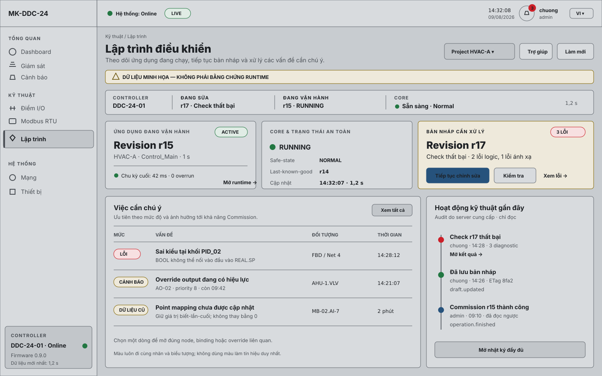
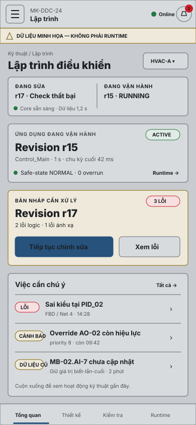
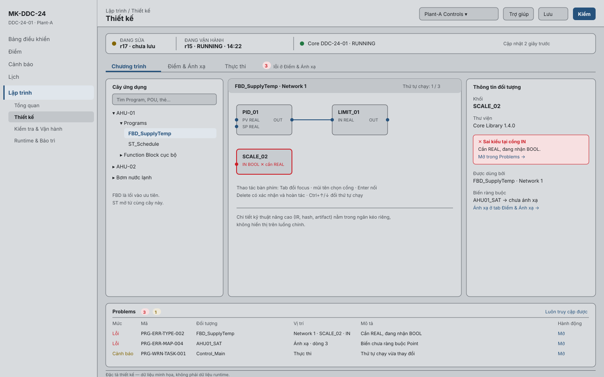
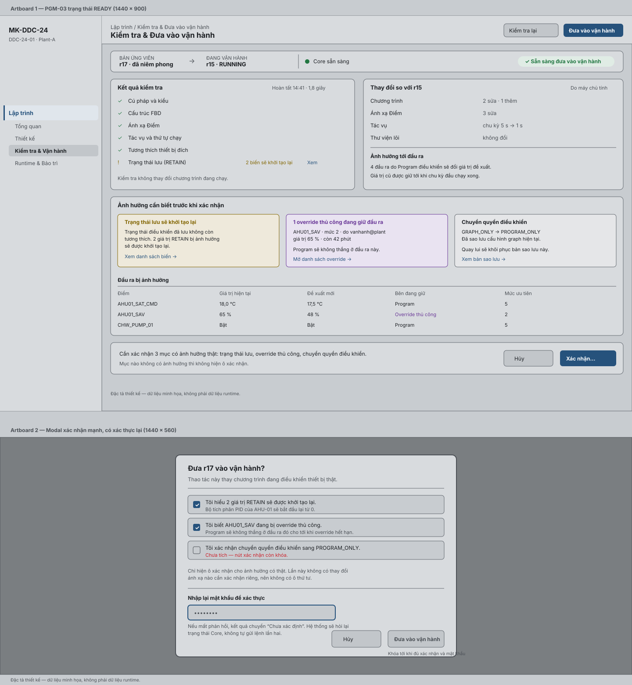
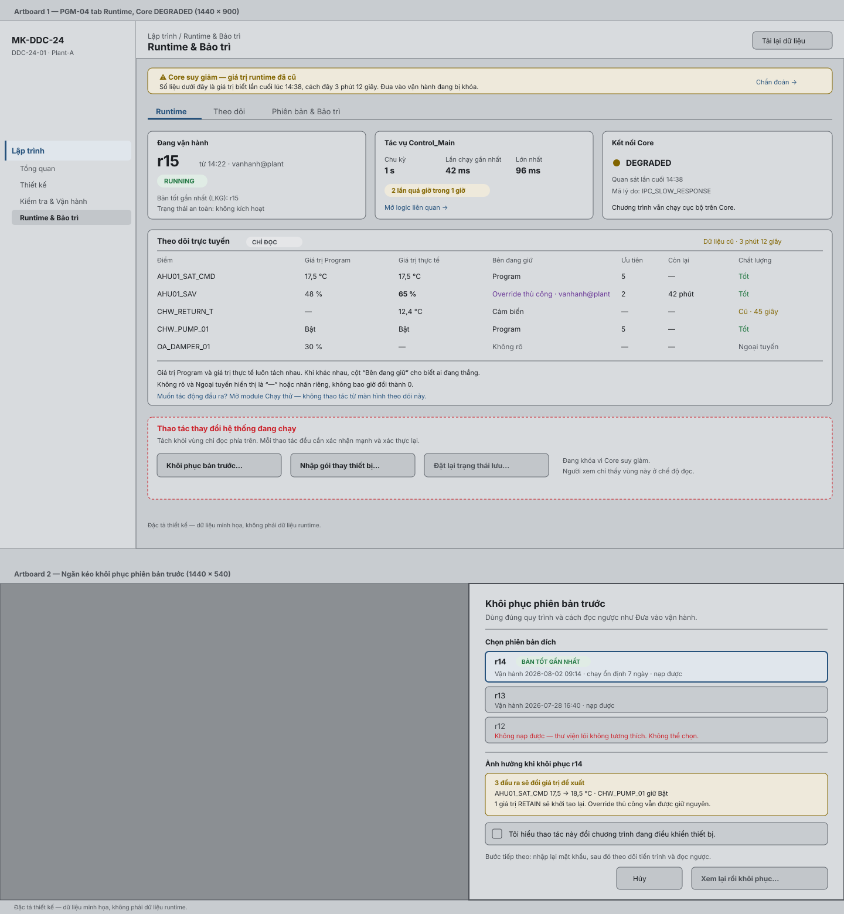
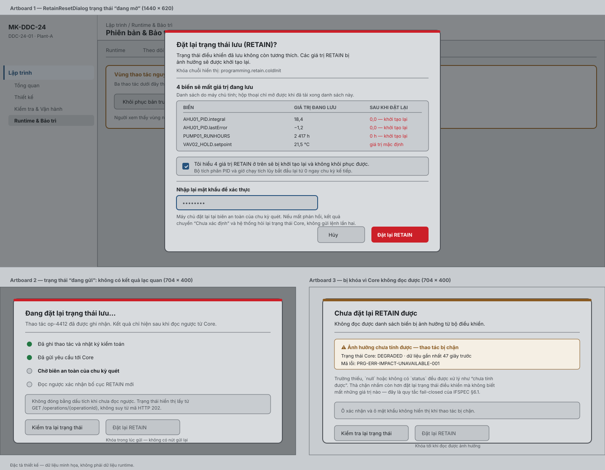

# Thiết kế UI/UX Programming MK-DDC-24

| Thuộc tính | Giá trị |
|---|---|
| ID tài liệu | `UX-WEB-PROG-001` |
| Phiên bản | 0.7 |
| Trạng thái | **M3 — Review Ready** — IA bốn workspace + tám journey; 7 asset trực quan gồm cả `RetainResetDialog`; chờ `OD-PROG-016` và usability/a11y review |
| Ngày | 2026-08-09 |
| Chủ quản | UX Lead + Frontend Lead |
| Người review | Product Owner, Backend Lead, Verification Lead, Accessibility Reviewer |
| Người phê duyệt | Product Owner + UX Lead |
| Nguồn | `DDC24-PRG-UX-DESIGN-001` v2.2; `SRS-PROG-001` |
| Phạm vi | Web desktop/tablet Rev A; mobile overview/runtime và sửa nhẹ; HMI native và mobile authoring đầy đủ ngoài phạm vi |

## 0. Đọc nhanh

| Câu hỏi | Trả lời |
|---|---|
| 1. File này dùng để quyết định hoặc triển khai việc gì? | Chốt **người dùng thấy gì và bấm gì**: bốn workspace, tám user journey, 17 use case ở lớp kịch bản, cây component, chữ hiển thị VI/EN, trạng thái rỗng/lỗi/cũ, phím tắt và khả năng tiếp cận. Cả bốn workspace có bản thiết kế trực quan render được trong §16; PGM-01 có riêng desktop/mobile. FE dựng giao diện từ đây và Product duyệt trực tiếp bố cục bằng các asset đó. |
| 2. Ai phải đọc file này? | UX và FE (chủ quản); Product Owner duyệt; BE đọc §24 để biết FE sẽ gọi API nào; QA dựng ca E2E/a11y từ §14 và §17; Accessibility reviewer đọc §13 và §27. |
| 3. Hệ thống hiện tại đang có gì? | Route `/eng/programming` **có tồn tại** trong `apps/web-ui/src/app/App.tsx` nhưng đang bị feature flag `LEGACY_GRAPH_DEMO_ENABLED` chặn. Trang hiện tại là `features/dashboard/ProgrammingPage.tsx` — chỉ là demo graph cũ, **không** đáp ứng IA sáu trang. Có sẵn `UnavailableFeaturePage.tsx`, `NavRail` (đã có key `programming`), `AuthProvider`/`roles.ts` và `shared/i18n.tsx`. Chưa có API Programming nào. |
| 4. Thiết kế mới thay đổi điều gì? | Dựng feature mới tại `apps/web-ui/src/features/programming/` với **bốn workspace** `PGM-01..04`; ba trang cũ gộp thành ba tab của workspace Thiết kế, và Check về chung chỗ với Commission. Nguyên tắc chi phối toàn bộ: **luôn tách “đang sửa” khỏi “đang vận hành”**, và **không bao giờ báo thành công lạc quan** — chỉ đọc ngược từ Core mới được đổi ô Active. |
| 5. Team phải sửa module/contract nào? | §15 và §23. FE tạo feature mới, **không** mở rộng `features/dashboard/ProgrammingPage.tsx`; mở rộng i18n key `programming.*`; dùng lại identity/role hiện có nhưng server vẫn là bên quyết quyền. §28 quy định route cũ chỉ được xóa sau khi có redirect và release note. |
| 6. Điều gì còn bị chặn? | `OD-PROG-016` chưa ký nên IA bốn workspace vẫn là đề xuất; route/API Programming chưa implement (§14); vai trò, hạn mức và một phần chữ hiển thị chờ `OD-PROG-001/003/011`; bằng chứng trình duyệt chỉ tạo được sau khi có slice FE. **Không dùng ảnh chụp mock để nâng M4/M5.** |
| 7. Test hoặc bằng chứng nào chứng minh hoàn tất? | §14 sáu bài `UX-T-001..006`, trong đó `UX-T-006` là **usability test có người dùng thật** với bảy tiêu chí định lượng (§14.1); cộng `VS-PROG-002/025/026/028/031`. Tất cả **chưa chạy**. |

Quy ước ID dùng trong file. Lớp điều hướng là **user journey** `UJ-PROG-01`…
`UJ-PROG-08`. Lớp kịch bản là `UC-PROG-01`…`UC-PROG-17`, giữ nguyên đặc tả chi
tiết ở §17 và có trạng thái `MERGED`/`SCENARIO`/`ROADMAP` ở §6.1 — **không** ID
nào bị xóa hay đổi nghĩa. Ba kịch bản xuyên suốt là `SC-CORE-DEGRADED`,
`SC-OP-FAILED`, `SC-RETAIN-RESET`. Yêu cầu UX canonical là `UX-REQ-001`…`UX-REQ-024`.

## 1. Mục tiêu UX

Controls engineer làm việc theo BACS:

```text
Thiết kế → Kỹ thuật → Kiểm tra → Đưa vào vận hành → Chạy → Bảo trì
```

Compiler/IR/artifact/ABI nằm trong chi tiết kỹ thuật nâng cao. UI luôn tách
`Đang sửa` và `Đang vận hành`, không bịa dữ liệu và không biến diagnostic kỹ
thuật thành alarm vận hành.

## 2. Persona và quyền

| Persona | Nhu cầu | Role server |
|---|---|---|
| BMS Operator | xem active/runtime/fault/Point | viewer/operator |
| Commissioning Engineer | mapping, Check, impact, Commission | admin cho mutation |
| Controls Engineer | ST/FBD/Task/library | admin cho mutation |
| Service Technician | monitor/trace/restore/replacement | read; admin cho restore/import |

Persona không cấp quyền. `viewer/operator/admin` từ server là authority.

## 3. Information architecture — bốn workspace

> Thay đổi so với bản 0.5: rút sáu trang xuống **bốn workspace**. Đề xuất nằm ở
> [Product Spec §8–§9](../01_product/DDC24_PROGRAMMING_PRODUCT_SPEC.md), phê
> duyệt theo dõi tại [`OD-PROG-016`](../00_governance/PROGRAMMING_OPEN_DECISIONS.md).
> Ba trang cũ PGM-02, PGM-03 và PGM-04 trở thành **ba tab trong một workspace
> Thiết kế**; Check chuyển từ chỗ rải rác về chung workspace với Commission.

| ID | Workspace | Câu hỏi chính | Journey | Tab bên trong |
|---|---|---|---|---|
| `PGM-01` | Tổng quan | Cái gì đang chạy, tôi đang sửa bản nào, có gì cần chú ý? | `UJ-PROG-01` | — |
| `PGM-02` | Thiết kế | Tôi xây logic, nối Điểm và đặt nhịp chạy ở đâu? | `UJ-PROG-02`, `UJ-PROG-03`, `UJ-PROG-04` | `Chương trình` · `Điểm & Ánh xạ` · `Thực thi` |
| `PGM-03` | Kiểm tra & Đưa vào vận hành | Thay đổi đã đúng chưa, và có đủ an toàn để áp dụng chưa? | `UJ-PROG-05`, `UJ-PROG-06` | — |
| `PGM-04` | Runtime & Bảo trì | Bản đang chạy có đúng không, và phục hồi thế nào? | `UJ-PROG-07`, `UJ-PROG-08` | `Runtime` · `Theo dõi` · `Phiên bản & Bảo trì` |

Vì sao gộp như vậy, chứ không phải cách khác:

- **Ba tab của PGM-02 là một công việc, không phải ba.** Thiết kế một AHU nghĩa
  là vẽ logic, nối Điểm, rồi đặt chu kỳ. Ở IA cũ đó là ba trang, và người dùng
  phải tự nhớ mình đang dở việc ở đâu. Gộp vào một workspace giữ nguyên bối cảnh
  Draft và cho phép `Problems` hiện diện liên tục.
- **Check và Commission thuộc về nhau.** Ở IA cũ, `Kiểm tra` xuất hiện ở ba
  trang khác nhau nên không có “một nơi để bấm”. Giờ Check là bước đầu của
  `PGM-03`, và kết quả Check chính là điều kiện mở nút Đưa vào vận hành.
- **Thao tác nguy hiểm tách khỏi thao tác chỉ đọc.** `PGM-04` để Runtime và
  Theo dõi ở chế độ chỉ đọc, còn Khôi phục, Nhập gói và Đặt lại trạng thái lưu
  nằm trong một vùng riêng có viền cảnh báo.

Project selector, History/Audit và ngăn kéo chi tiết kỹ thuật nâng cao là tiện
ích dùng chung, không phải workspace.

### 3.1 Progressive disclosure

Thông tin kỹ thuật **không** nằm trên luồng chính. Bảng dưới đây là quy tắc
bắt buộc, không phải khuyến nghị.

| Nội dung | Nơi được phép xuất hiện |
|---|---|
| IR, ABI, hash artifact, kích thước artifact | Ngăn kéo “Chi tiết kỹ thuật nâng cao” trong `PGM-03`; **không** trên `PGM-01` |
| WCET, base step, watchdog, hạn ngạch compiler | Ngăn kéo chỉ đọc trong tab `Thực thi` của `PGM-02` |
| Mã lỗi `PRG-ERR-*` | Bảng `Problems` và chi tiết lỗi; không dùng làm tiêu đề thông báo cho người dùng |
| CPU, RAM, phần trăm “sức khỏe” | **Không nơi nào.** Đây là số dễ bịa và không giúp quyết định gì |

### 3.2 Tám user journey và ánh xạ workspace

| Journey | Kết quả người dùng | Workspace | Primary action ở trạng thái bình thường |
|---|---|---|---|
| `UJ-PROG-01` Xem trạng thái ứng dụng | Biết cái gì đang chạy, bản nào đang sửa, vấn đề cần chú ý | `PGM-01` | `Tiếp tục chỉnh sửa` hoặc `Mở runtime` |
| `UJ-PROG-02` Tạo hoặc sửa chương trình | Sửa metadata, ST hoặc FBD trong một workspace | `PGM-02` tab Chương trình | `Lưu` |
| `UJ-PROG-03` Ánh xạ Variable–Point | Binding hợp lệ với Point thật | `PGM-02` tab Điểm & Ánh xạ | `Lưu` |
| `UJ-PROG-04` Cấu hình thực thi | Chu kỳ Task và thứ tự Program | `PGM-02` tab Thực thi | `Lưu` |
| `UJ-PROG-05` Kiểm tra và sửa lỗi | Kết quả Check, focus đúng lỗi, sửa lại | `PGM-03` | `Kiểm tra` |
| `UJ-PROG-06` Đưa vào vận hành | Review impact, xác nhận, Commission, đọc ngược | `PGM-03` | `Đưa vào vận hành` |
| `UJ-PROG-07` Theo dõi và chẩn đoán | Runtime, program/actual value, owner, overrun, trace | `PGM-04` tab Runtime và Theo dõi | không có — vùng chỉ đọc |
| `UJ-PROG-08` Bảo trì và phục hồi | Restore, nhập gói thay thiết bị, xác nhận sau phục hồi | `PGM-04` tab Phiên bản & Bảo trì | `Khôi phục bản trước…` |

Ba tình huống xuyên suốt **không** phải journey riêng nhưng bắt buộc có mặt ở
mọi workspace liên quan: `SC-CORE-DEGRADED`, `SC-OP-FAILED` và `SC-RETAIN-RESET`
— đặc tả tại §6.2.

## 4. Persistent context

Mọi page Programming hiển thị:

```text
Plant-A Controls
ĐANG SỬA: r17 • Chưa lưu / Check lỗi
ĐANG VẬN HÀNH: r15 • 14:22
Core: DDC-24-01 • RUNNING | DEGRADED | UNREACHABLE
```

Không dùng “Controller Offline” trong Web one-box: nếu cả controller mất thì UI
không tải; nếu Web còn nhưng Core mất thì dùng `UNREACHABLE`.

## 5. Acceptance của bốn workspace

### PGM-01 Tổng quan — `UJ-PROG-01`

Trong `≤ 5 giây` phải thấy Core, bản đang vận hành, safe-state, việc cần chú ý,
trạng thái Draft/Check và hành động tiếp theo. **Không** đặt CPU, RAM, hash,
compiler, phần trăm sức khỏe hay nút Đưa vào vận hành lên đây. Bố cục khóa bằng
hai asset desktop/mobile tại §16.1.

Primary action đúng một cái, đổi theo trạng thái: chưa có Draft → `Tạo bản nháp`
(chỉ admin); có Draft đang sửa → `Tiếp tục chỉnh sửa`; Check lỗi → `Xem lỗi`;
Check đạt → `Mở Kiểm tra & Đưa vào vận hành`.

### PGM-02 Thiết kế — `UJ-PROG-02`, `UJ-PROG-03`, `UJ-PROG-04`

Một workspace, ba tab, **một** context bar và **một** khay `Problems` dùng chung.
Chuyển tab không mất nội dung đang gõ và không đổi ETag. Số lỗi hiện ngay trên
nhãn tab để người dùng biết lỗi nằm ở tab nào.

| Tab | Nội dung bắt buộc |
|---|---|
| `Chương trình` | Cây ứng dụng, editor ST và FBD có kiểu, Inspector. FBD là lối vào ưu tiên: mở Program mới mặc định ở FBD, ST mở từ cùng cây. Pin có kiểu, thứ tự chạy hiện rõ, thêm/nối/xóa/đổi thứ tự làm được **hoàn toàn bằng bàn phím**. Canvas tự do là Rev B |
| `Điểm & Ánh xạ` | Bảng Variable ↔ Point kèm category, identity, type, unit, direction, writable, quality, timestamp. Bộ lọc theo **loại, hướng và khả năng ghi** — không bắt người dùng tự dò. RTU chọn device rồi point. Binding sai đánh dấu đúng ô trong đúng dòng và chặn Commission. `OFFLINE/STALE/UNKNOWN` **không** thành `0` |
| `Thực thi` | Đúng một Task `Control_Main`, chu kỳ chỉ `1/5/30 s`, danh sách Program có thứ tự. Ngăn kéo nâng cao **chỉ đọc** cho base step, ngân sách, watchdog, chính sách overrun. Core Library gồm logic/toán/so sánh/timer/counter/tín hiệu/PID; User FB chỉ tồn tại trong Project |

Primary action là `Lưu`; `Kiểm tra` là action phụ dẫn sang `PGM-03`.

### PGM-03 Kiểm tra & Đưa vào vận hành — `UJ-PROG-05`, `UJ-PROG-06`

Một trang, hai giai đoạn nối tiếp. Giai đoạn Kiểm tra hiện kết quả theo từng
lớp, thời gian chạy và điều hướng tới đúng lỗi. Giai đoạn Đưa vào vận hành chỉ
mở khi Check đạt.

Bắt buộc hiển thị: bản ứng viên và bản đang vận hành cạnh nhau; thay đổi có cấu
trúc do **máy chủ** tính; ảnh hưởng tới đầu ra; ảnh hưởng RETAIN; chuyển quyền
điều khiển; và **mọi override thủ công còn hiệu lực** kèm actor, giá trị, mức ưu
tiên và thời gian còn lại.

**Xác nhận theo rủi ro thực tế.** Đây là thay đổi có chủ đích so với bản 0.5:
thay vì bốn ô đánh dấu cố định, chỉ hiện ô xác nhận cho ảnh hưởng **có thật**
trong lần Commission này.

| Ảnh hưởng | Khi nào hiện ô xác nhận |
|---|---|
| Trạng thái lưu (RETAIN) khởi tạo lại | chỉ khi impact có tập biến bị reset |
| Override thủ công đang giữ đầu ra | chỉ khi `GET /overrides` trả về ít nhất một override còn hiệu lực |
| Chuyển quyền điều khiển graph → program | chỉ khi cutover thực sự đổi trạng thái |
| Thay đổi ánh xạ Điểm ảnh hưởng đầu ra vật lý | chỉ khi manifest có binding output thay đổi |

**Không được giảm safety để bớt click.** Ba điều giữ nguyên tuyệt đối: vẫn phải
xác thực lại trước khi gửi; vẫn phải đọc ngược từ authority mới được báo thành
công; và vẫn phải có đường quay lui. Nếu không có ảnh hưởng nào cần xác nhận thì
vẫn còn xác thực lại — số ô xác nhận có thể bằng 0, số bước an toàn thì không.

Copy khi thất bại:

> Đưa vào vận hành thất bại. Phiên bản đang vận hành không đổi và tiếp tục chạy.

Chỉ được dùng câu thứ hai khi authority trả `keepsRunningRevision=true`.

### PGM-04 Runtime & Bảo trì — `UJ-PROG-07`, `UJ-PROG-08`

Ba tab: `Runtime`, `Theo dõi`, `Phiên bản & Bảo trì`. Hiện bản đang vận hành,
LKG, safe-state, một Task với thời gian chạy gần nhất/lớn nhất/số lần quá giờ/
lỗi, Online Watch, trace có giới hạn, lịch sử phiên bản và audit. Đầu ra luôn
tách `Giá trị Program`, `Giá trị thực tế`, `Bên đang giữ`, `Ưu tiên` và `Còn lại`.

Online Watch **chỉ đọc**. Muốn tác động đầu ra thì mở module Chạy thử.

**Vùng thao tác nguy hiểm tách riêng.** Khôi phục bản trước, Nhập gói thay thiết
bị và Đặt lại trạng thái lưu nằm trong một khối có viền cảnh báo, đặt dưới vùng
chỉ đọc, không trộn lẫn với bảng theo dõi. Người xem thấy khối này ở chế độ đọc,
không thấy một dãy nút bị vô hiệu hóa.

## 6. Lớp user journey và migration của 17 use case

### 6.1 Ma trận migration — không xóa dấu vết

`UC-PROG-01..17` **không bị xóa**. Chúng chuyển từ lớp điều hướng xuống lớp
kịch bản, và mỗi mục nhận đúng một trạng thái. Đặc tả chín trục của từng
`UC-PROG-*` vẫn giữ nguyên ở §17 và vẫn là nơi FE/QA đọc chi tiết hành vi.

| UC cũ | Tên | Trạng thái | Thuộc về | Ghi chú migration |
|---|---|---|---|---|
| `UC-PROG-01` | Xem ứng dụng đang vận hành | `MERGED` | `UJ-PROG-01` | Trở thành luồng chính của Tổng quan |
| `UC-PROG-02` | Gắn/sửa functional tag/view | `MERGED` | `UJ-PROG-02` | Nằm trong tab Chương trình |
| `UC-PROG-03` | Lập trình ST | `MERGED` | `UJ-PROG-02` | ST mở từ cùng cây với FBD |
| `UC-PROG-04` | Lập trình FBD / User FB cục bộ | `MERGED` | `UJ-PROG-02` | FBD là lối vào ưu tiên |
| `UC-PROG-05` | Ánh xạ Variable tới Point | `MERGED` | `UJ-PROG-03` | Tab Điểm & Ánh xạ |
| `UC-PROG-06` | Kiểm tra thay đổi | `MERGED` | `UJ-PROG-05` | Chuyển khỏi ba trang cũ về `PGM-03` |
| `UC-PROG-07` | Cấu hình Task Rev A duy nhất | `MERGED` | `UJ-PROG-04` | Tab Thực thi |
| `UC-PROG-08` | Đưa thay đổi vào vận hành | `MERGED` | `UJ-PROG-06` | Giai đoạn hai của `PGM-03` |
| `UC-PROG-09` | Check/Commission lỗi nhưng bản đang chạy tiếp tục | `SCENARIO` | `SC-OP-FAILED`, áp cho `UJ-PROG-05` và `UJ-PROG-06` | Kịch bản lỗi bắt buộc, giữ nguyên yêu cầu và test |
| `UC-PROG-10` | Core suy giảm hoặc không kết nối được | `SCENARIO` | `SC-CORE-DEGRADED`, áp cho **mọi** journey | Kịch bản toàn cục |
| `UC-PROG-11` | Khôi phục phiên bản trước | `MERGED` | `UJ-PROG-08` | Tab Phiên bản & Bảo trì |
| `UC-PROG-12` | Theo dõi và chẩn đoán Task quá giờ | `MERGED` | `UJ-PROG-07` | Tab Runtime và Theo dõi |
| `UC-PROG-13` | Trạng thái RETAIN không tương thích | `SCENARIO` | `SC-RETAIN-RESET`, áp cho `UJ-PROG-06` | Điều kiện hiện ô xác nhận RETAIN |
| `UC-PROG-14` | BACS Control Library nâng cao | `ROADMAP` | ngoài Rev A | Gắn với `OD-PROG-017` |
| `UC-PROG-15` | Xuất hồ sơ chức năng/as-built đầy đủ | `ROADMAP` | ngoài Rev A | Rev A chỉ giữ metadata revision tối thiểu |
| `UC-PROG-16` | Lỗi runtime hoặc trạng thái an toàn | `MERGED` | `UJ-PROG-07` | Hiển thị trong tab Runtime |
| `UC-PROG-17` | Thay controller và recommission | `MERGED` | `UJ-PROG-08` | Nhập gói nằm trong vùng thao tác nguy hiểm |

Đếm để kiểm: 12 `MERGED`, 3 `SCENARIO`, 2 `ROADMAP` — tổng 17, không mục nào bị
bỏ rơi. Trace hai chiều tại
[`TRACE-PROG-001`](../07_records/PROGRAMMING_TRACEABILITY_MATRIX.md) §10.

### 6.2 Ba kịch bản xuyên suốt

| ID | Kịch bản | Áp cho journey | Hành vi bắt buộc |
|---|---|---|---|
| `SC-CORE-DEGRADED` | Core `DEGRADED` hoặc `UNREACHABLE` trong khi Web còn sống | tất cả | Banner cố định; giá trị runtime mang nhãn cũ kèm tuổi dữ liệu; khóa Đưa vào vận hành và Khôi phục; **không** dựng banner giả khi cả controller mất; **không** đổi giá trị không rõ thành `0` |
| `SC-OP-FAILED` | Check hoặc Commission thất bại | `UJ-PROG-05`, `UJ-PROG-06`, `UJ-PROG-08` | Hiện bản đang vận hành liên tục và rõ ràng; chỉ ghi “tiếp tục chạy” khi có `keepsRunningRevision=true`; 0 thay đổi lên Active |
| `SC-RETAIN-RESET` | RETAIN không tương thích khi Commission hoặc Restore | `UJ-PROG-06`, `UJ-PROG-08` | Nêu hậu quả bằng ngôn ngữ điều khiển, liệt kê biến bị ảnh hưởng, bắt buộc xác nhận; schema `unknown` chặn hoàn toàn |

### 6.3 Ưu tiên release

`Release Critical`: `UJ-PROG-01` đến `UJ-PROG-08` cùng ba kịch bản xuyên suốt.
`Competitive`: functional tag/view (`UC-PROG-02` trong `UJ-PROG-02`).
`Roadmap`, ngoài Rev A: `UC-PROG-14`, `UC-PROG-15`.

## 7. Data/attention state

| Nhóm | State |
|---|---|
| Core | `RUNNING/DEGRADED/UNREACHABLE` |
| Runtime | `EMPTY/STARTING/RUNNING/DEGRADED/FAULTED/SAFE_STATE` |
| Engineering | `DRAFT/CHECKING/READY/COMMISSIONING/COMMISSIONED/FAILED/UNKNOWN` |
| Freshness/Point | `LIVE/STALE/UNAVAILABLE`; quality `GOOD/UNCERTAIN/BAD/STALE/OFFLINE/UNKNOWN` |

Critical operational (safe-state/runtime fault) > engineering blocking (Check/
mapping/Commission reject) > warning (offline Point/overrun/retain/draft) > info.
State luôn có text/icon, không chỉ màu.

## 8. Copy và notification

Primary keys bắt buộc: nav 6 trang, editing/running/ready/stale, core 3 state,
Check/Commission/Restore/Open Commissioning/Cancel, no active/no draft/not ready/
core unreachable/unknown result/fail/conflict/integrity reject. VI là mặc định,
EN có cùng semantics; ID kỹ thuật không dịch.

- Toast: save/check completion không cần attention lâu.
- Persistent: core degraded/unreachable, safe-state, active runtime fault.
- Page state: Commission/Restore progress/result.
- Problems drawer: nhiều diagnostic; không spam toast.

## 9. Accessibility và responsive

- Keyboard navigation, visible focus, skip link, tree/table/editor labels,
  icon+text+color, không hover-only.
- FBD flow hoàn tất chỉ bằng bàn phím.
- >=1440 full workspace; 1024–1439 collapsible panel; <1024 read/light edit,
  authoring FBD khuyến nghị desktop.
- HMI LVGL/DRM không có Programming authoring/Check/Commission/trace/replacement.

## 10. Definition of Done UX

- `SWR-REQ-PROG-FE-101..112` và UC release-critical có test/evidence.
- Vitest, lint, build, Playwright đạt; browser thật có UI/Console/Network và
  desktop/mobile khi layout đổi.
- Không fake producer/default, không optimistic Active, không duplicate Alarm.
- API/source/docs cùng release commit; Product/UX/Verification sign-off hoàn tất.

## 11. Wireflow và route contract

```text
/eng/programming                                    PGM-01 Tổng quan
  ├─ /projects/:projectId/design?tab=programs       PGM-02 tab Chương trình  (mặc định)
  ├─ /projects/:projectId/design?tab=mapping        PGM-02 tab Điểm & Ánh xạ
  ├─ /projects/:projectId/design?tab=execution      PGM-02 tab Thực thi
  ├─ /projects/:projectId/commission                PGM-03 Kiểm tra & Đưa vào vận hành
  └─ /runtime?tab=runtime|watch|service             PGM-04 Runtime & Bảo trì
```

Tab nằm ở query parameter chứ không phải segment đường dẫn, vì tab là **trạng
thái trong một workspace**, không phải trang riêng. Nhờ vậy đánh dấu trang được
đúng tab mà vẫn giữ một route cho `PGM-02`.

### 11.1 Migration route và bookmark

Route cũ **không được xóa ngay**. Mỗi route cũ chuyển hướng vĩnh viễn sang vị trí
mới, giữ nguyên `projectId` và mọi query khác.

| Route cũ | Chuyển hướng tới | Ghi chú |
|---|---|---|
| `/projects/:projectId/programs` | `/projects/:projectId/design?tab=programs` | giữ tham số chọn Program nếu có |
| `/projects/:projectId/mapping` | `/projects/:projectId/design?tab=mapping` | giữ bộ lọc trong query |
| `/projects/:projectId/task` | `/projects/:projectId/design?tab=execution` | — |
| `/projects/:projectId/commission` | không đổi | phạm vi mở rộng thêm Check |
| `/runtime` | `/runtime?tab=runtime` | tab mặc định |

Ba điều kiện để được **gỡ** chuyển hướng: route mới đã có test E2E đạt; đã qua
ít nhất một chu kỳ phát hành có ghi chú release; và không còn truy cập vào route
cũ trong nhật ký của chu kỳ đó. Trước khi đủ ba điều kiện, gỡ chuyển hướng là
làm hỏng dấu trang của người dùng.

Vì các route Programming **chưa từng phát hành cho người dùng** (đang bị chặn
bởi cờ `LEGACY_GRAPH_DEMO_ENABLED`, xem §15), rủi ro migration thực tế bằng 0 ở
Rev A. Bảng trên tồn tại để lần đổi IA **sau** này có sẵn quy tắc.

Mỗi route giữ persistent context `controller`, Project, Draft/Revision đang xem,
Active Revision và connection freshness. Rời trang khi Draft dirty mở dialog ba
lựa chọn `Ở lại`, `Bỏ thay đổi cục bộ`, `Lưu Draft`; không có nút đóng mơ hồ.

| Flow | Bước/guard | Kết quả hiển thị |
|---|---|---|
| Tạo/sửa | chọn Project → edit → Save Draft | ETag mới; Active panel không đổi |
| Check | seal Revision → readiness → Check | progress theo layer; diagnostic focus đúng object |
| Commission | Check PASS → impact → acknowledgement cho các nhóm `PRESENT` (có thể `0` ô) → re-auth **luôn bắt buộc** → submit kèm `impactRef` | operation timeline; chỉ `SUCCEEDED` **và** đọc ngược khớp mới đổi Active |
| Timeout | request mất response | banner `Chưa xác định`; khóa replay; query operation |
| Restore | chọn Revision/LKG → impact/retain/cutover → confirm | dùng cùng timeline/read-back Commission |
| Import | chọn bundle → quarantine report → mapping review | tạo Draft mới; không auto-active |

## 12. Ma trận field/action/state/copy

| Khu vực | Field/action | Disabled/validation | Copy bắt buộc |
|---|---|---|---|
| Header | Controller/Project/Revision selector | disable mutation khi capability/TLS/role thiếu | `Đang sửa r17; đang chạy r15` |
| Editor | language/source/FBD node | limit/type/schema từ capability | lỗi có line/node; không toast chung |
| Mapping | Point/type/unit/direction/quality policy | identity/type/unit/writable authoritative | `Không dùng 0 thay dữ liệu Unknown` |
| Task | period `1/5/30 s`, order | chỉ enum; decision pending hiển thị blocked | `Task dài không làm chậm I/O` |
| Readiness | layer result + evidence | Commission disable nếu ERROR/PENDING | `Check không thay chương trình đang chạy` |
| Impact | outputs/overrides/RETAIN/cutover | từng acknowledgement unchecked | nêu cụ thể active cũ và rollback |
| Runtime | active/LKG/task/owner/quality | stale khi quá freshness | `Dữ liệu cũ`, không dùng badge xanh |
| Restore/reset | target/impact/confirmation | re-auth/token expired | hành động không thể undo ở runtime phải rõ |

Trạng thái chuẩn: `loading`, `empty`, `permission`, `offline`, `stale`, `error`,
`partial`, `unknown`, `ready`, `running`. Skeleton chỉ dùng initial loading; dữ
liệu cũ giữ nguyên kèm stale banner, không xóa thành empty.

## 13. FBD, keyboard và accessibility acceptance

- FBD structured: danh sách Network/Block/Wire có cùng thao tác với canvas;
  `Tab/Shift+Tab` đi focus, arrow chọn port, `Enter` nối, `Delete` có confirm/
  undo, screen reader announce source→destination/type/error.
- Code editor có accessible textarea/fallback, line/column, Problems list liên kết
  bằng `aria-describedby`; color syntax không là tín hiệu duy nhất.
- Modal trap focus, `Esc` chỉ đóng action reversible; Commission đang submit
  không đóng mất trạng thái. Focus trả đúng nút mở.
- Contrast/focus/target size theo design-system baseline; zoom 200% không mất
  action. 1024 px dùng panel collapse; <1024 không Commission nếu impact table
  không đọc đủ, nhưng monitor vẫn usable.
- Announcement live region cho Check/operation state, rate-limit để không đọc từng
  sample monitor; animation tôn trọng reduced motion.

## 14. API/source/test mapping và blocker

| UX surface | API authority | FE target | Acceptance |
|---|---|---|---|
| Context/overview | capabilities/projects/runtime | `features/programming/layout` | active/draft không nhập nhằng |
| Editors/mapping/task | Draft mutation + point catalog | `editor`, `mapping`, `task` | ETag conflict giữ local buffer |
| Check/problems | checks/revisions | `check`, `problems` | diagnostic focus ST/FBD/binding |
| Commission/Restore | operations | `commission`, `runtime` | unknown reconcile, no optimistic active |
| Monitor/trace | runtime/events/traces | `monitor` | gap refetch, stale after freshness |

| Test | Phạm vi | Tiêu chí PASS |
|---|---|---|
| `UX-T-001` | 1440×900, đi hết tám journey | không tràn hoặc che action; context bền vững đúng ở mọi workspace |
| `UX-T-002` | 1024×768 và 390×844 | responsive và chế độ chỉ đọc đúng; không mất nội dung quan trọng theo chiều ngang |
| `UX-T-003` | chỉ bàn phím: FBD, ánh xạ, Commission | hoàn tất luồng; thứ tự focus, trả focus và thông báo trực tiếp đúng |
| `UX-T-004` | ma trận lỗi `403/409/422/503/504` và mất đoạn sự kiện | chữ hiển thị, hành động và cách phục hồi đúng hợp đồng |
| `UX-T-005` | trình đọc màn hình, tương phản, zoom 200% | đạt acceptance WCAG của dự án; lưu bằng chứng |
| `UX-T-006` | **usability test có người dùng thật** — xem §14.1 | đạt bảy tiêu chí định lượng ở §14.1 |

### 14.1 `UX-T-006` — usability test có người dùng thật

Đây là bài duy nhất trong nhóm cho phép kết luận về khả năng sử dụng. **Bảng
điểm heuristic ở Product Spec §8.3 không thay thế bài này.**

| Thuộc tính | Quy định |
|---|---|
| Người tham gia | Tối thiểu 5 kỹ thuật viên BMS đã quen HVAC nhưng **chưa từng dùng MK-DDC-24**; ghi lại số năm kinh nghiệm, hệ BMS từng dùng và mức quen thuộc với IEC 61131-3 |
| Fixture | Project mẫu có sẵn `AHU-01` với hai Program, Point catalog thật trên controller lab; ghi commit, image và cấu hình |
| Người điều phối | Không phải người thiết kế màn hình đang được kiểm |
| Ghi nhận | Thời gian mỗi nhiệm vụ, hoàn thành hay không, lỗi nghiêm trọng, và câu trả lời cho hai câu hỏi kiểm tra mental model |

| Mã | Tiêu chí định lượng | Ngưỡng đạt |
|---|---|---|
| `UX-A-01` | Nhận biết đúng bản đang vận hành, bản đang sửa, trạng thái Core và vấn đề chính trên `PGM-01` | `≤ 5 giây`, đạt ở `≥ 4/5` người |
| `UX-A-02` | Từ fixture: tạo một FBD đơn giản, ánh xạ hai Point, chạy Kiểm tra và tới được màn hình sẵn sàng Đưa vào vận hành | `≤ 15 phút` |
| `UX-A-03` | Tỷ lệ hoàn thành tám journey chính | `≥ 90%` |
| `UX-A-04` | Lỗi nghiêm trọng trong Kiểm tra, Đưa vào vận hành hoặc Khôi phục | `0` |
| `UX-A-05` | Trả lời đúng “bản nào đang sửa” và “bản nào đang chạy” khi được hỏi bất ngờ giữa phiên | `100%` số lần hỏi |
| `UX-A-06` | Sau khi Kiểm tra thất bại, người dùng **không** hiểu nhầm rằng bản đang chạy đã đổi; sau khi Commission timeout, người dùng **không** bấm gửi lại | `0` trường hợp hiểu nhầm, `0` lần gửi lại |
| `UX-A-07` | Ở lần Commission **không có ô xác nhận nào** (cả bốn nhóm impact là `NONE`), người dùng vẫn thực hiện xác thực lại và vẫn chờ đọc ngược trước khi coi là xong | `0` người bỏ qua xác thực lại, `0` người kết luận thành công trước khi có đọc ngược |

Bằng chứng bắt buộc cho mỗi phiên: hồ sơ người tham gia đã ẩn danh, fixture và
commit, bản ghi thời gian từng nhiệm vụ, kết quả từng tiêu chí và ghi chú của
người điều phối. **Không được ghi PASS khi chưa chạy.** Hiện trạng: `NOT RUN`.

Blocker: route/API Programming chưa implement; role/capacity/copy cuối còn
`PROG-OD-001`; browser evidence chỉ tạo sau FE slice. Không dùng mock screenshot
để nâng M4/M5.

## 15. As-Built, khoảng trống và quyền sở hữu source

| Thành phần hiện có | Bằng chứng source | Kết luận dùng lại |
|---|---|---|
| Route `/eng/programming` | `apps/web-ui/src/app/App.tsx` | Route có thật nhưng đang bị feature flag chặn; không được coi là sản phẩm Programming Rev A |
| Trang Programming cũ | `apps/web-ui/src/features/dashboard/ProgrammingPage.tsx` | Chỉ là graph demo/validator cũ; không đáp ứng IA sáu trang, lifecycle Draft/Revision hay Commission |
| Trang fallback | `apps/web-ui/src/features/dashboard/UnavailableFeaturePage.tsx` | Là trạng thái As-Built đúng khi feature chưa sẵn sàng; giữ tới khi gate FE-PROG đạt |
| Navigation | `apps/web-ui/src/shared/components/NavRail.tsx` | Đã có key `programming`, nhưng visibility phụ thuộc `LEGACY_GRAPH_DEMO_ENABLED` |
| Role và session | `apps/web-ui/src/features/auth/AuthProvider.tsx`, `roles.ts` | Dùng lại identity/role hiện có; server vẫn là authority cho từng action |
| i18n | `apps/web-ui/src/shared/i18n.tsx` | Mở rộng key `programming.*`; không hard-code copy trong component |

Target code thuộc `apps/web-ui/src/features/programming/`; không mở rộng
`features/dashboard/ProgrammingPage.tsx`. Route cũ chỉ được xóa/redirect sau khi
route mới đạt test, migration bookmark và release note. Không có source producer
REST/WS Programming hiện hành, vì vậy mọi mock phải nằm trong test fixture và
không được import vào production bundle.

Asset thiết kế được quản lý tại `docs/04_uiux/assets/programming/`. Đây là
**đặc tả trực quan**, không phải ảnh chụp sản phẩm và không phải bằng chứng
runtime/browser. Dữ liệu ví dụ trong asset luôn mang banner “Dữ liệu minh họa”.

## 16. Bản đặc tả trực quan theo bốn workspace

Mỗi workspace có asset SVG render được, nhúng ngay dưới đây. Wireframe chữ chỉ
là lớp mô tả cấu trúc bổ sung, **không** thay thế asset. Màu lấy từ token thật
trong `apps/web-ui/src/shared/theme/tokens.ts`, không tạo bảng màu riêng.

| Workspace | Asset | Kích thước | Nội dung |
|---|---|---|---|
| `PGM-01` | `PGM-01_LANDING_PAGE_DESKTOP.svg` | 1440 × 900 | Tổng quan desktop |
| `PGM-01` | `PGM-01_LANDING_PAGE_MOBILE.svg` | 390 × 844 | Tổng quan mobile |
| `PGM-02` | `PGM-02_DESIGN_WORKSPACE_DESKTOP.svg` | 1440 × 900 | Workspace Thiết kế, tab Chương trình, có lỗi kiểu ở FBD |
| `PGM-03` | `PGM-03_CHECK_COMMISSION_DESKTOP.svg` | 1440 × 1560 | Artboard 1 trạng thái READY; artboard 2 **modal xác nhận mạnh** có xác thực lại |
| `PGM-04` | `PGM-04_RUNTIME_SERVICE_DESKTOP.svg` | 1440 × 1560 | Artboard 1 tab Runtime khi Core `DEGRADED`; artboard 2 **ngăn kéo khôi phục** |
| `PGM-04` | `PGM-04_RETAIN_RESET_DIALOG.svg` | 1440 × 1120 | Ba artboard `RetainResetDialog`: **đang mở** có xác nhận mạnh + xác thực lại, **đang gửi** không kết quả lạc quan, **bị khóa** khi impact `UNAVAILABLE` |

Asset `PGM-02_TO_06_SCREEN_SET_DESKTOP.svg` mô tả IA sáu trang cũ. Nó được
**giữ lại chứ không xóa** vì [`OD-PROG-016`](../00_governance/PROGRAMMING_OPEN_DECISIONS.md)
chưa được ký: nếu Product Owner từ chối amendment, IA sáu trang là phương án
quay lui. Trạng thái của nó là `SUPERSEDED-PENDING-DECISION`, không được dùng làm
đặc tả để implement.

**Dữ liệu trong mọi asset là minh họa.** Tên revision, thời gian, giá trị Point,
override và mã lỗi chỉ để kiểm tra thứ bậc thông tin, độ dài chữ và trạng thái.
Chúng **không** phải bằng chứng runtime và implementation không được đóng cứng.

### 16.1 PGM-01 — Tổng quan

#### 16.1.1 Bản thiết kế desktop 1440 × 900



#### 16.1.2 Bản thiết kế mobile 390 × 844



Hai hình trên là **đặc tả thiết kế**, không phải screenshot runtime. Tên revision,
thời gian, diagnostic, override và Point trong hình chỉ là dữ liệu minh họa để
kiểm tra hierarchy, độ dài copy và trạng thái; implementation không được đóng
cứng các giá trị đó.

#### 16.1.3 Cấu trúc nhìn thấy và thứ tự đọc

```text
┌ Breadcrumb / Lập trình                         [Project ▾] [Help] ┐
├ Controller | ĐANG SỬA r17/Check lỗi | ĐANG CHẠY r15/RUNNING ┤
├ [Ứng dụng đang chạy] [Core + Safe-state] [Draft cần xử lý]   ┤
├ Việc cần chú ý: severity | đối tượng | thời gian | action     ┤
└ Hoạt động kỹ thuật gần đây: actor | action | result | trace   ┘
```

Thứ tự đọc/bàn phím desktop: `skip-link → Project → Trợ giúp → Làm mới → Context
→ Active → Core → Draft → Attention → Activity`. Mobile: `Mở điều hướng → Project
→ Context → Active → Draft/action → Attention → Activity`; bottom navigation
đứng sau nội dung chính trong DOM và không lặp action mutation.

#### 16.1.4 Ánh xạ vùng giao diện tới contract

| Vùng/component | Dữ liệu và nguồn | State bắt buộc | Action/route | RBAC | Copy/hiển thị lỗi |
|---|---|---|---|---|---|
| `ProgrammingHeader` + `ProjectSelector` | controller từ AppShell; `GET /projects`; project từ URL | loading, no-project, selected, permission | đổi project; mở Help; refetch các query đọc | mọi role đọc | tên project bị cắt có `title`; no-project dùng `programming.empty.noProject`; refetch lỗi không xóa context cũ |
| `ProgrammingContextBar` | `GET /capabilities`, `GET /runtime`, WS `programming.runtime.v1`; Draft/check từ Project | loading, dirty, checking, failed, ready, running, degraded, unreachable, stale | mở đúng Draft hoặc Active; không mutation | mọi role | luôn có hai nhãn **Đang sửa/Đang vận hành**; thiếu giá trị dùng `—`; Core mất dùng `programming.error.coreUnreachable` |
| `RunningApplicationPanel` | `runtime.activeRevision`, Task, cycle metric, safe-state, freshness | loading, no-active, running, stale, fault | `Mở runtime` → `/eng/programming/runtime` | mọi role | không active dùng `programming.empty.noActive`; metric thiếu là `—`, không bịa `0` |
| `CoreSafeStatePanel` | Core connection, safe-state, LKG, observedAt từ `GET /runtime` | running, degraded, unreachable, unknown, stale | mở fault detail khi có reason code | mọi role | trạng thái có chấm + icon + nhãn; stale giữ last-known và tuổi dữ liệu |
| `DraftAttentionPanel` | Draft hiện hành, sealed Revision gần nhất, Check summary | no-draft, dirty, checking, failed, ready, conflict | `Tiếp tục chỉnh sửa` → `PGM-02`; `Xem lỗi` → Problems của `PGM-02`; `Kiểm tra` → `PGM-03`, chỉ khi Draft đã lưu | mọi role thấy; Save/Check cần admin | `409` giữ local buffer; `403` giải thích thiếu quyền; Check fail không làm Active đổi |
| `ProgrammingAttentionList` | Check diagnostic + `GET /overrides` + runtime freshness; FE chỉ tổng hợp, không tự tạo sự thật | loading, empty, partial, error, stale | row deep-link đúng node/binding/override; `Xem tất cả` | mọi role theo quyền API | thứ tự error → warning → stale → info; màu luôn đi với nhãn; partial nêu nguồn nào thiếu |
| `RecentEngineeringTimeline` | `GET /audit`, server redaction | loading, empty, page-error, permission | mở audit record; phân trang | viewer nếu API cho phép | `403`: ẩn dữ liệu nhạy cảm và hiện lý do; không biến audit thiếu thành “chưa có hoạt động” |

#### 16.1.5 Ma trận biến thể render bắt buộc

| Biến thể | Context/summary | Action còn bật | Điều kiện nghiệm thu trực quan |
|---|---|---|---|
| `LOADING_INITIAL` | skeleton giữ đúng kích thước card; `role=status` | Help; không mutation | không layout shift lớn; không dùng số giả trong skeleton |
| `RUNNING_NO_DRAFT` | Active + Core thật; card Draft đổi thành “đã là bản mới nhất” | Mở runtime; Tạo Draft nếu admin | viewer không thấy nút tạo bị khóa; no-draft không bị vẽ như lỗi |
| `NO_ACTIVE` | Active card dùng empty copy; Core vẫn hiện độc lập | mở Thiết kế; Commission chỉ ở `PGM-03` sau Check PASS | không hiện `r0`, `0 ms` hoặc badge xanh giả |
| `CHECK_FAILED` | giữ Active rõ; Draft có số lỗi và next action | Tiếp tục chỉnh sửa, Xem lỗi | không có action Commission trên landing; focus tới diagnostic thật |
| `CORE_DEGRADED` | banner vàng cố định; metric runtime có tuổi dữ liệu | cho sửa/lưu Draft nếu server còn authority; khóa Commission | không ghi “Offline”; không đổi stale thành 0 |
| `CORE_UNREACHABLE` | last-known + nhãn cũ; safe-state `—` nếu không có authority | refetch/troubleshoot; khóa action phụ thuộc Core | đạt `UX-REQ-012/013/019`; screen reader nghe trạng thái thay đổi |
| `PARTIAL_OR_AUDIT_403` | summary vẫn dùng được; Timeline thành permission state | các action không phụ thuộc audit vẫn hoạt động | không biến toàn trang thành error; nêu rõ vùng và lý do bị thiếu |
| `PROJECT_LOAD_ERROR` | giữ project/context hợp lệ gần nhất nếu có | Thử lại; đổi project | focus vào page error, có correlation ID; không xóa Draft local |

#### 16.1.6 Responsive và kích thước khóa

- Desktop `≥1024`: dùng AppShell hiện hành gồm NavRail `232 px`, TopBar `64 px`,
  page padding `20 px`; ba summary card cùng hàng; Attention chiếm khoảng 2/3 và
  Activity 1/3. Khi NavRail thu gọn `68 px`, vùng chính giãn nhưng thứ tự không đổi.
- Mobile `<1024`: NavRail đổi thành `NavDrawer`; page padding `16 px`; context
  chia hai cột trong cùng card; summary, Draft và Attention xếp một cột. Activity
  nằm sau Attention trong luồng cuộn. Không cho Commission nếu impact table không
  thể đọc đầy đủ; mobile authoring ST/FBD đầy đủ ngoài phạm vi Rev A.
- Mục tiêu chạm tối thiểu `40 × 40 px` theo component hiện hành; khoảng cách giữa
  hai action ngang tối thiểu `8 px`; zoom 200% không che context hoặc primary
  action. Focus dùng rule §27, không dựa vào đổi màu nền.

### 16.2 PGM-02 — Thiết kế



```text
┌ Context: ĐANG SỬA r17 · ĐANG VẬN HÀNH r15 · Core     [Lưu] [Kiểm tra] ┐
├ Tab: Chương trình | Điểm & Ánh xạ | Thực thi        (3) lỗi ở tab nào ┤
├ Cây 280 px ┬ Editor FBD/ST co giãn ┬ Inspector 308 px                 ┤
└ Problems (luôn truy cập được): mức | mã | đối tượng | vị trí | hành động ┘
```

| Vùng | Dữ liệu và nguồn | State bắt buộc | Action | RBAC | Copy và lỗi |
|---|---|---|---|---|---|
| Thanh tab | số lỗi theo tab, từ `GET /checks/{checkId}` và validate cục bộ | idle, có lỗi, đang kiểm | đổi tab, không mất nội dung đang gõ | mọi role đọc | huy hiệu số lỗi có cả chữ, không chỉ màu |
| `ApplicationTree` | cây Revision đang sửa | loading, empty, có lỗi ở node | chọn, thêm, đổi tên | sửa cần admin | node lỗi có huy hiệu; cây rỗng có hướng dẫn tạo |
| `StructuredFbdEditor` | `fbdGraph`, thư viện, diagnostics | loading, đang sửa, có lỗi, chỉ đọc | thêm/nối/xóa/đổi thứ tự **bằng bàn phím** | admin | sai kiểu báo tại node và cổng, không toast chung |
| `SourceEditor` | `source`, diagnostics | như trên | sửa, nhảy tới lỗi | admin | lỗi **không** làm mất nội dung |
| `Inspector` | đối tượng đang chọn | trống, có lỗi | mở tham chiếu, mở tab Ánh xạ | mọi role đọc | biến chưa ràng buộc có liên kết sang tab Điểm & Ánh xạ |
| `ProblemsDrawer` | tổng hợp diagnostics | loading, empty, có lỗi | nhảy tới nguồn | mọi role | nhiều lỗi không spam toast |

### 16.3 PGM-03 — Kiểm tra & Đưa vào vận hành



```text
┌ Ứng viên r17 → Đang vận hành r15 · Core sẵn sàng   [Kiểm tra lại] [Đưa vào VH] ┐
├ Kết quả kiểm tra theo lớp ┬ Thay đổi so với bản đang chạy (máy chủ tính)       ┤
├ Ảnh hưởng: RETAIN | override đang giữ | chuyển quyền điều khiển                ┤
├ Bảng đầu ra bị ảnh hưởng: hiện tại | đề xuất | bên đang giữ | ưu tiên          ┤
└ Chỉ hiện ô xác nhận cho ảnh hưởng có thật        [Hủy] [Xác nhận…]             ┘
```

| Vùng | Dữ liệu và nguồn | State bắt buộc | Action | RBAC | Copy và lỗi |
|---|---|---|---|---|---|
| `CommissionReadiness` | `GET /checks/{checkId}` | chưa chạy, đang chạy, đạt, lỗi, `UNKNOWN` | mở từng lỗi | mọi role đọc; Kiểm tra cần admin | có lớp `ERROR` hoặc `PENDING` thì khóa nút Đưa vào vận hành |
| `ChangeSummary` | `GET /revisions/{from}/changes/{to}` | loading, empty, error | mở khác biệt | mọi role | do máy chủ tính, **không** tin diff từ FE |
| `ImpactPanel` | impact + `GET /overrides` | loading, không có ảnh hưởng, có ảnh hưởng, error | mở chi tiết | mọi role | thiếu dữ liệu impact thì chặn Commission |
| `AcknowledgementChecklist` | impact có thật | 0 đến 4 mục | tích chọn | admin | thiếu mục nào thì cuộn và focus đúng mục đó |
| `CommissionDialog` | ứng viên, bản đang vận hành | đang mở, đang gửi | xác thực lại, gửi | admin | đang gửi **không** đóng bằng `Esc` |
| `CommissionProgress` | `GET /operations/{operationId}` | queued, đang chạy, thành công, thất bại, `UNKNOWN` | tra lại trạng thái | mọi role | `504` chuyển `UNKNOWN`, khóa gửi lại |

Modal ở artboard 2 minh họa đúng nguyên tắc: hai ảnh hưởng có thật đã tích, ảnh
hưởng thứ ba chưa tích nên nút còn khóa, và ô xác thực lại luôn có mặt.

### 16.4 PGM-04 — Runtime & Bảo trì



```text
┌ Banner Core suy giảm (khi có)                            [Tải lại dữ liệu] ┐
├ Tab: Runtime | Theo dõi | Phiên bản & Bảo trì                              ┤
├ Đang vận hành/LKG ┬ Tác vụ: gần nhất/lớn nhất/quá giờ ┬ Kết nối Core        ┤
├ Theo dõi trực tuyến (CHỈ ĐỌC): Program | Thực tế | Bên giữ | Ưu tiên | Còn lại ┤
└ ╌╌ Vùng thao tác thay đổi hệ thống đang chạy: Khôi phục | Nhập gói | Đặt lại ╌╌┘
```

| Vùng | Dữ liệu và nguồn | State bắt buộc | Action | RBAC | Copy và lỗi |
|---|---|---|---|---|---|
| Banner Core | `GET /runtime`, WS | ẩn, degraded, unreachable | chẩn đoán | mọi role | nêu tuổi dữ liệu; **không** dùng chữ “Offline” |
| `RuntimeSummary` | `GET /runtime` | loading, chưa có active, running, stale, fault | mở chi tiết fault | mọi role | thiếu số liệu là `—`, không phải `0` |
| `TaskRuntimeTable` | metric Task | loading, bình thường, quá giờ, fault | mở logic liên quan | mọi role | quá giờ dùng nhãn cảnh báo có chữ |
| `OnlineWatch` | `GET /runtime/monitor` | loading, empty, live, stale | thêm/bớt tín hiệu | mọi role | **chỉ đọc**; `Không rõ` và `Ngoại tuyến` giữ nhãn riêng |
| Vùng nguy hiểm | khả năng thao tác từ capability | sẵn sàng, khóa vì Core, khóa vì quyền | Khôi phục, Nhập gói, Đặt lại RETAIN | admin | người xem thấy ở chế độ đọc, không thấy dãy nút vô hiệu hóa |
| `RestoreDialog` | danh sách Revision + LKG + impact | đang chọn, đang gửi | xác nhận, xác thực lại | admin | bản không nạp được bị đánh dấu và không chọn được |

#### 16.4.1 `RetainResetDialog` — đặt lại trạng thái lưu

Đặt lại RETAIN là thao tác **không hoàn tác được** và làm đổi trạng thái điều
khiển đang chạy, nên theo [`DOC-GOV-001`](../00_governance/DOC_GOVERNANCE.md) §2.2
nó phải có bản đặc tả trực quan riêng, không được gộp vào wireframe chữ của vùng
nguy hiểm.



Ba artboard tương ứng ba trạng thái bắt buộc:

| Artboard | Trạng thái | Điều bắt buộc phải thấy được |
|---|---|---|
| 1 | đang mở | Danh sách **đầy đủ** biến bị ảnh hưởng kèm giá trị trước/sau; một ô xác nhận mạnh; ô xác thực lại luôn có mặt; nút chính dùng màu cảnh báo |
| 2 | đang gửi | Timeline từng bước tới `đọc ngược`; nút gửi bị khóa; **không** có dấu tích thành công trước read-back; không có nút gửi lại |
| 3 | bị khóa | `PRG-ERR-IMPACT-UNAVAILABLE-001` khi chưa tính được ảnh hưởng; ô xác nhận và ô mật khẩu **không** hiển thị; nêu tuổi dữ liệu Core |

Ba quy tắc không được thương lượng khi implement:

1. **Không mở hộp thoại khi chưa có danh sách biến.** Người dùng phải thấy mất
   những giá trị nào trước khi được phép tích xác nhận (`UC-PROG-13`).
2. **Fail-closed.** Nhóm impact `UNAVAILABLE`, thiếu field hoặc `null` đều rơi
   vào artboard 3; tuyệt đối không coi là “không có ảnh hưởng”.
3. **Không có kết quả lạc quan.** Trạng thái cuối lấy từ
   `GET /operations/{operationId}` sau đọc ngược, không suy từ `202`.

### 16.5 Biến thể trạng thái bắt buộc cho mỗi workspace

Tám biến thể áp cho `PGM-01` đã đặc tả ở §16.1.5. Ba workspace còn lại áp bảng sau.

| Biến thể | `PGM-02` Thiết kế | `PGM-03` Kiểm tra & Vận hành | `PGM-04` Runtime & Bảo trì |
|---|---|---|---|
| `LOADING_INITIAL` | khung xương giữ đúng kích thước ba vùng | khung xương phần kết quả kiểm tra | khung xương ba thẻ tóm tắt |
| `EMPTY` | chưa có Program: hướng dẫn tạo | chưa chạy Check: chỉ có nút Kiểm tra | chưa có active: dùng `programming.empty.noActive` |
| `PERMISSION` | người xem thấy nội dung, không thấy nút Lưu | người xem không thấy nút Đưa vào vận hành | vùng nguy hiểm ở chế độ đọc |
| `STALE` | không áp dụng — Draft là dữ liệu cục bộ | số liệu Core mang nhãn tuổi dữ liệu | nhãn `Dữ liệu cũ` + tuổi, giữ giá trị cuối |
| `CORE_UNREACHABLE` | vẫn sửa và lưu Draft được nếu máy chủ còn thẩm quyền | khóa Đưa vào vận hành, vẫn xem được Check cũ | khóa toàn bộ vùng nguy hiểm |
| `FAILED` | lỗi hiện trong Problems, không mất nội dung | `SC-OP-FAILED`: bản đang chạy hiển thị liên tục | Restore thất bại dùng cùng cách đối chiếu |
| `UNKNOWN` | không áp dụng | banner `Chưa xác định` + nút tra lại, khóa gửi lại | như `PGM-03` |
| `PARTIAL` | một tab lỗi tải, hai tab kia vẫn dùng được | thiếu `GET /overrides` thì chặn Commission và nêu lý do | thiếu audit thì chỉ vùng audit thành trạng thái quyền |

## 17. Đặc tả use case mức triển khai

Mỗi use case có đủ chín trục: actor, trigger, precondition, luồng chính theo
bước, nhánh thay thế/lỗi, postcondition, data/API, audit và acceptance. Cột
“Audit” ghi bản ghi mà server **phải** tạo — nếu không có bản ghi thì use case
chưa hoàn tất, kể cả khi màn hình hiển thị đúng. Đường dẫn API chính xác ở §24.

### UC-PROG-01 — Xem ứng dụng đang vận hành

| Trục | Nội dung |
|---|---|
| Actor / Trigger | all (`viewer/operator/admin`) / mở `PGM-01` hoặc `PGM-04` |
| Precondition | Session hợp lệ; đã chọn controller |
| Luồng chính | 1. Tải capability, Active Revision, runtime state, safe-state. 2. Hiện đồng thời “đang sửa” và “đang vận hành”. 3. Gắn nhãn freshness cho mọi giá trị runtime. |
| Nhánh thay thế / lỗi | Core `UNREACHABLE`: giữ giá trị biết-lần-cuối kèm tuổi dữ liệu, **không** hiển thị `0`. Chưa có Revision nào active: dùng `programming.empty.noActive`. |
| Postcondition | Không có mutation nào; Active Revision không đổi |
| Data/API | `GET /capabilities`, `GET /runtime` (§24 dòng 1) |
| Audit | Không bắt buộc — đây là thao tác đọc; truy cập vẫn nằm trong access log nền tảng |
| Acceptance | `VS-PROG-001`, `VS-PROG-026`: trong 5 giây thấy Core, Revision active, safe-state và việc cần chú ý; 0 giá trị bịa |

### UC-PROG-02 — Gắn/sửa functional tag/view

| Trục | Nội dung |
|---|---|
| Actor / Trigger | admin / sửa metadata trên PGM-02 |
| Precondition | Có Draft đang mở và ETag hiện hành |
| Luồng chính | 1. Chọn Program/group đã có. 2. Nhập name/description/category. 3. Tham chiếu Program/FB/Function và Point. 4. Lưu Draft. |
| Nhánh thay thế / lỗi | `409`: giữ nguyên nội dung đang gõ, mở luồng tải lại/hợp nhất. `403`: báo thiếu quyền, **không** thử lại. |
| Postcondition | Draft mới có ETag mới; **không** tạo entity hay vòng đời độc lập |
| Data/API | `PATCH /projects/{projectId}/draft` (§24 dòng 2) |
| Audit | `draft.updated` với actor, projectId, draftId, ETag trước/sau, thời gian |
| Acceptance | `VS-PROG-008`, `VS-PROG-024`: metadata không tạo authority mới; hai client sửa cùng lúc sinh `409` và không mất nội dung |

### UC-PROG-03 — Lập trình ST

| Trục | Nội dung |
|---|---|
| Actor / Trigger | admin / mở Program ST trên PGM-02 |
| Precondition | Draft ở trạng thái sửa được |
| Luồng chính | 1. Mở Program. 2. Sửa trong ST editor. 3. Lưu Draft. 4. Bấm Kiểm tra. 5. Diagnostic hiện trong Problems, gắn đúng dòng/cột. 6. Sửa lỗi và lặp lại. |
| Nhánh thay thế / lỗi | Lỗi cú pháp/kiểu: **không mất source**, Active không đổi. Mất kết nối khi lưu: giữ bộ đệm cục bộ, cho lưu lại. |
| Postcondition | Draft đã lưu; Revision đang chạy không đổi |
| Data/API | `PATCH /projects/{projectId}/draft`, `POST /projects/{projectId}/draft/revisions`, `POST /revisions/{revisionId}/checks` (§24 dòng 2, 4) |
| Audit | `draft.updated`; `check.requested` với revisionId và actor |
| Acceptance | `VS-PROG-005`, `VS-PROG-006`: diagnostic trỏ đúng khoảng nguồn; tải lại trang phục hồi Draft từ BE |

### UC-PROG-04 — Lập trình FBD / User Function Block cục bộ

| Trục | Nội dung |
|---|---|
| Actor / Trigger | admin / thêm hoặc sửa FBD trên `PGM-02` tab Chương trình |
| Precondition | Schema FBD và phiên bản thư viện hợp lệ |
| Luồng chính | 1. Thêm network FBD. 2. Thêm typed block bằng palette, cây hoặc bàn phím. 3. Nối typed pin. 4. Cấu hình tham số. 5. Đặt thứ tự thực thi. 6. Tạo/dùng FB tái sử dụng **trong Project**. 7. Lưu và Kiểm tra. |
| Nhánh thay thế / lỗi | Sai kiểu pin, vòng lặp, dây treo: báo **tại đúng node/cạnh**, không phải toast chung. Yêu cầu FB global/native: từ chối. |
| Postcondition | Draft có FBD canonical; đổ về cùng IR với ST |
| Data/API | `PATCH /projects/{projectId}/draft`, `POST /projects/{projectId}/draft/revisions`, `POST /revisions/{revisionId}/checks` (§24 dòng 2, 4) |
| Audit | `draft.updated` kèm loại đối tượng `fbd` |
| Acceptance | `VS-PROG-005`, `VS-PROG-006`, `VS-PROG-028`: hoàn tất **toàn bộ** luồng chỉ bằng bàn phím; ST và FBD tương đương cho cùng IR |

### UC-PROG-05 — Ánh xạ Variable tới Point

| Trục | Nội dung |
|---|---|
| Actor / Trigger | admin / mở `PGM-02` tab Điểm & Ánh xạ |
| Precondition | Point catalog tải được và còn tươi |
| Luồng chính | 1. Chọn Function/Variable. 2. Chọn category `LOCAL`, `VP` hoặc `MB-RTU`; với RTU chọn device rồi point. 3. Bind. 4. Hệ thống kiểm type và direction. 5. Hiện quality và nguồn. |
| Nhánh thay thế / lỗi | Sai type/direction/writable, hoặc Point biến mất: đánh dấu **đúng ô trong đúng dòng**, chặn Commission. `OFFLINE/STALE/UNKNOWN` **không** thành `0`. |
| Postcondition | Binding canonical hợp lệ trong Draft |
| Data/API | `GET /point-catalog`, `PATCH /projects/{projectId}/draft` (§24 dòng 3, 2) |
| Audit | `draft.updated` kèm danh sách binding thay đổi |
| Acceptance | `VS-PROG-017`, `VS-PROG-018`: binding sai trả `422` có tên field; sáu mức quality đi xuyên suốt không bị chuẩn hóa |

### UC-PROG-06 — Kiểm tra thay đổi

| Trục | Nội dung |
|---|---|
| Actor / Trigger | admin / bấm Kiểm tra trên `PGM-03` (từ `PGM-02` có lối tắt dẫn sang) |
| Precondition | Draft đã lưu |
| Luồng chính | 1. Niêm phong Draft thành Revision bất biến. 2. Chạy đủ các lớp kiểm. 3. Hiện tiến trình theo lớp. 4. Tổng hợp kết quả `READY` hoặc `FAILED`. 5. Điều hướng tới từng lỗi. |
| Nhánh thay thế / lỗi | Timeout: chuyển `UNKNOWN`, cho tra lại trạng thái, **không tự chạy lại**. Một lớp `ERROR`: không sinh artifact. |
| Postcondition | **Chương trình đang chạy không đổi** — kể cả khi Check thất bại |
| Data/API | `POST /projects/{projectId}/draft/revisions`, `POST /revisions/{revisionId}/checks`, `GET /checks/{checkId}` (§24 dòng 4) |
| Audit | `revision.sealed`; `check.completed` với kết quả từng lớp và hash |
| Acceptance | `VS-PROG-006`, `VS-PROG-019`: hash Active trước và sau Check **giống hệt nhau** |

### UC-PROG-07 — Cấu hình Task Rev A duy nhất

| Trục | Nội dung |
|---|---|
| Actor / Trigger | admin / mở `PGM-02` tab Thực thi |
| Precondition | Project có đúng một Task |
| Luồng chính | 1. Mở Task `Control_Main`. 2. Chọn chu kỳ `1 s`, `5 s` hoặc `30 s`. 3. Sắp thứ tự Program. 4. Xem drawer nâng cao (chỉ đọc). 5. Kiểm tra. |
| Nhánh thay thế / lỗi | Giá trị ngoài enum hoặc thêm Task thứ hai: **cả UI lẫn server đều từ chối** (`422`). |
| Postcondition | Draft có TaskConfig hợp lệ, thứ tự Program xác định |
| Data/API | `PATCH /projects/{projectId}/draft` (§24 dòng 2) |
| Audit | `draft.updated` kèm chu kỳ cũ/mới |
| Acceptance | `VS-PROG-009`: không tạo được Task thứ hai qua UI hay qua request trực tiếp |

### UC-PROG-08 — Đưa thay đổi vào vận hành

| Trục | Nội dung |
|---|---|
| Actor / Trigger | admin / bấm Đưa vào vận hành trên `PGM-03` |
| Precondition | Candidate `READY`; có quyền admin; Core sẵn sàng |
| Luồng chính | 1. Xem readiness theo lớp. 2. Xem thay đổi có cấu trúc, ánh xạ output, ảnh hưởng RETAIN, cutover và **mọi override thủ công còn hiệu lực** kèm actor/value/priority/TTL. 3. Tích **đúng những ô xác nhận được sinh ra** — mỗi nhóm impact có `status = PRESENT` sinh một ô; nhóm `NONE` không sinh ô; số ô có thể bằng `0` (xem [`IFSPEC` §6.1.1](../02_design/interfaces/PROGRAMMING_INTERFACE_SPEC.md)). 4. Xác thực lại — **luôn bắt buộc**, không phụ thuộc số ô. 5. Gửi lệnh kèm `impactRef`. 6. Theo dõi timeline. 7. Runtime kiểm toàn vẹn, giữ giá trị cũ ở mức 5. 8. Áp dụng atomic; chỉ commit sau chu kỳ đầu thành công. 9. Đọc ngược xác nhận Revision active — **luôn bắt buộc**. |
| Nhánh thay thế / lỗi | Nhóm impact `UNAVAILABLE`, thiếu field hoặc `null`: **chặn Commission** (`PRG-ERR-IMPACT-UNAVAILABLE-001`), không cho gửi. Impact đã đổi kể từ lúc đọc: `409 PRG-ERR-IMPACT-STALE-001`, tải lại và xác nhận lại. Thiếu/thừa acknowledgement: `422 PRG-ERR-ACK-MISSING-001`/`PRG-ERR-ACK-UNEXPECTED-001`. `403`/`409`/`422` khác: từ chối, không đổi Active. `503`/`504`: chuyển `UNKNOWN`, giữ Active cũ hiển thị liên tục, mở luồng đối chiếu. |
| Postcondition | Active Revision mới **hoặc** Active cũ nguyên vẹn — không có trạng thái nửa vời |
| Data/API | `POST /operations/commission`, `GET /operations/{operationId}` (§24 dòng 5) |
| Audit | `operation.started` và `operation.finished` với operationId, actor, revision nguồn/đích, hash artifact, kết quả, correlation |
| Acceptance | `VS-PROG-011`, `VS-PROG-015`, `VS-PROG-019`, `VS-PROG-029`, `VS-PROG-031`: 0 kích hoạt đôi; thành công **không** suy ra từ `HTTP 202`; tập acknowledgement khớp đúng tập nhóm `PRESENT`; `UNAVAILABLE` chặn được cả qua UI lẫn qua request trực tiếp |

### UC-PROG-09 — Check/Commission lỗi nhưng logic đang chạy tiếp tục

| Trục | Nội dung |
|---|---|
| Actor / Trigger | all quan sát / operation kết thúc `FAILED` |
| Precondition | Có một Revision đang active |
| Luồng chính | 1. Hiện candidate `THẤT BẠI`. 2. Hiện đồng thời Revision đang vận hành và trạng thái `RUNNING`. 3. Cho mở chi tiết lỗi. |
| Nhánh thay thế / lỗi | Chỉ được viết câu “Phiên bản đang chạy không đổi” khi response có `keepsRunningRevision=true`; nếu không, chỉ báo thất bại. |
| Postcondition | Không có mutation nào lên Active |
| Data/API | `GET /operations/{operationId}`, `GET /runtime` (§24 dòng 5, 1) |
| Audit | `operation.finished` với kết quả `FAILED` và lý do |
| Acceptance | `VS-PROG-011`, `VS-PROG-019`: Active hiển thị liên tục suốt quá trình thất bại |

### UC-PROG-10 — Core suy giảm hoặc không kết nối được

| Trục | Nội dung |
|---|---|
| Actor / Trigger | all / mất kết nối tới Core trong khi Web vẫn sống |
| Precondition | `mkddc-web` còn phục vụ được |
| Luồng chính | 1. Đặt `core.connection` thành `DEGRADED` hoặc `UNREACHABLE`. 2. Hiện banner cố định. 3. Đánh dấu giá trị runtime là `STALE`/`UNAVAILABLE`. 4. Khóa Commission. 5. Khi kết nối lại thì tải lại dữ liệu. |
| Nhánh thay thế / lỗi | Nếu **cả controller** mất thì UI không tải được — **không** dựng banner giả; trình duyệt tự báo lỗi mạng. Quyền lưu Draft đọc từ authority, không tự suy từ cache. |
| Postcondition | Không mutation nào được gửi khi đang khóa |
| Data/API | `GET /capabilities`, `GET /runtime`, WS `programming.runtime.v1` (§24 dòng 1, 8) |
| Audit | Không bắt buộc; BE ghi sự kiện mất IPC theo log nền tảng |
| Acceptance | `VS-PROG-026`, `VS-PROG-030`: phân biệt được ba trạng thái Core; 0 giá trị `0` giả |

### UC-PROG-11 — Khôi phục phiên bản trước

| Trục | Nội dung |
|---|---|
| Actor / Trigger | admin / mở tab Phiên bản & Bảo trì trên `PGM-04` |
| Precondition | Có Revision trước hoặc LKG nạp được |
| Luồng chính | 1. Mở danh sách phiên bản trước. 2. Chọn bản tốt đã biết. 3. Xem impact, RETAIN và cutover. 4. Tích xác nhận và xác thực lại. 5. Gửi lệnh khôi phục. 6. Theo dõi timeline. 7. Đọc ngược xác nhận runtime. |
| Nhánh thay thế / lỗi | Lỗi hoặc timeout dùng **đúng** cơ chế đối chiếu như Commission; tuyệt đối không báo thành công lạc quan. |
| Postcondition | Active là Revision được chọn, hoặc giữ nguyên Active cũ |
| Data/API | `POST /operations/restore`, `GET /operations/{operationId}` (§24 dòng 5) |
| Audit | `operation.started`/`operation.finished` kind `RESTORE`, ghi rõ Revision đích |
| Acceptance | `VS-PROG-011`: khôi phục là giao dịch atomic, có đọc ngược và có audit |

### UC-PROG-12 — Theo dõi và chẩn đoán Task quá thời gian

| Trục | Nội dung |
|---|---|
| Actor / Trigger | all đọc, admin sửa / mục “cần chú ý” báo overrun |
| Precondition | Runtime đang phát metric |
| Luồng chính | 1. Mở Task từ mục cần chú ý. 2. Xem chu kỳ, giá trị lớn nhất, số lần overrun. 3. Với output, xem `program_value`, `actual_value`, `overridden_by`, `effective_priority`. 4. Mở logic/Point/trace liên quan. 5. Admin tạo Draft sửa. 6. Kiểm tra rồi Đưa vào vận hành. |
| Nhánh thay thế / lỗi | Mất một đoạn sự kiện: tải lại thay vì nội suy. **Không** suy diễn rằng cả trạm đã vào safe-state chỉ vì một Task overrun. |
| Postcondition | Chỉ đọc, trừ khi admin chủ động tạo Draft |
| Data/API | `GET /runtime/monitor`, `POST /runtime/traces`, `GET /runtime/traces/{traceId}`, `GET /overrides` (§24 dòng 6) |
| Audit | Không bắt buộc cho đọc; Draft sửa tạo `draft.updated` |
| Acceptance | `VS-PROG-013`, `VS-PROG-014`, `VS-PROG-027`: UI khớp đúng authority của resolver |

### UC-PROG-13 — Trạng thái RETAIN không tương thích

| Trục | Nội dung |
|---|---|
| Actor / Trigger | admin / readiness báo RETAIN sẽ bị khởi tạo lại |
| Precondition | Đang ở bước impact của Commission |
| Luồng chính | 1. Hiện hậu quả theo ngôn ngữ điều khiển, không phải thuật ngữ schema: “Trạng thái điều khiển đã lưu không còn tương thích. Các giá trị RETAIN bị ảnh hưởng sẽ được khởi tạo lại.” 2. Liệt kê biến bị ảnh hưởng. 3. Yêu cầu tích xác nhận cold-init. |
| Nhánh thay thế / lỗi | Thiếu xác nhận: chặn gửi lệnh. Schema `unknown`: chặn Commission hoàn toàn. |
| Postcondition | Chỉ đi tiếp khi người dùng đã xác nhận hiểu hậu quả |
| Data/API | `GET /revisions/{from}/changes/{to}`, `GET /checks/{checkId}`, `GET /overrides` (§24 dòng 4, 6) |
| Audit | Xác nhận cold-init được lưu trong `operation.started` |
| Acceptance | `VS-PROG-015`, `VS-PROG-029`: không Commission được nếu chưa xác nhận |

### UC-PROG-14 — BACS Control Library nâng cao (roadmap)

| Trục | Nội dung |
|---|---|
| Actor / Trigger | controls engineer / ngoài phạm vi Rev A |
| Precondition | Không áp dụng Rev A |
| Luồng chính | Không có route hay action nào ở Rev A |
| Nhánh thay thế / lỗi | **Không** hiện nút bị vô hiệu hóa để hứa hẹn năng lực chưa có |
| Postcondition | Không áp dụng |
| Data/API | Không áp dụng Rev A |
| Audit | Không áp dụng |
| Acceptance | `VS-PROG-003`: build Rev A **không** chứa đường vào thư viện nâng cao |

### UC-PROG-15 — Xuất hồ sơ chức năng/as-built đầy đủ (roadmap)

| Trục | Nội dung |
|---|---|
| Actor / Trigger | admin / ngoài DoD Rev A |
| Precondition | Không áp dụng Rev A |
| Luồng chính | Rev A chỉ giữ metadata revision tối thiểu: functional tag, binding, tham chiếu Task/Program, phiên bản đã commission, controller, thời gian, người thực hiện |
| Nhánh thay thế / lỗi | **Không** gắn nhãn “As-built complete” cho dữ liệu tối thiểu này |
| Postcondition | Không áp dụng |
| Data/API | Không áp dụng Rev A |
| Audit | Không áp dụng |
| Acceptance | `VS-PROG-025`: không có chữ nào hứa hồ sơ as-built đầy đủ |

### UC-PROG-16 — Lỗi runtime hoặc trạng thái an toàn

| Trục | Nội dung |
|---|---|
| Actor / Trigger | all / authority báo fault hoặc safe-state |
| Precondition | Runtime phát được lý do và phạm vi |
| Luồng chính | 1. Hiện safe-state hoặc runtime fault là **sự thật từ authority**. 2. Hiện mã và lý do. 3. Liên kết tới Task/Point bị ảnh hưởng. 4. Mở luồng bảo trì. |
| Nhánh thay thế / lỗi | Chỉ deep-link tới Alarm khi **thực sự có** bản ghi alarm; diagnostic kỹ thuật **không** được đẩy vào alarm store. |
| Postcondition | Chỉ đọc |
| Data/API | `GET /runtime`, WS `programming.runtime.v1` (§24 dòng 1, 8) |
| Audit | Không bắt buộc; alarm store giữ bản ghi riêng nếu có |
| Acceptance | `VS-PROG-013`, `VS-PROG-027`: lỗi cú pháp và lỗi mapping **không** xuất hiện như process alarm |

### UC-PROG-17 — Thay controller và recommission

| Trục | Nội dung |
|---|---|
| Actor / Trigger | admin / thay thiết bị |
| Precondition | Có bundle source-only xuất từ controller cũ |
| Luồng chính | 1. Xuất bundle gồm Revision, source, mapping, Task, phiên bản Core Library và hash toàn vẹn — **không** chứa artifact/IR/native/cache. 2. Nhập lên controller thay thế. 3. Hệ thống cách ly và kiểm gói. 4. Tạo Draft mới và build lại bằng toolchain trên target. 5. Ánh xạ lại Point khác identity. 6. Kiểm tra. 7. Xác nhận override và cutover. 8. Đưa vào vận hành và đọc ngược. |
| Nhánh thay thế / lỗi | Từ chối bundle chứa artifact/IR/native, bundle hỏng, hoặc sai target. **Không bao giờ tự động kích hoạt.** |
| Postcondition | Tạo Draft mới; Active không đổi cho tới khi Commission thành công |
| Data/API | `POST /bundles/export`, `POST /bundles/import`, rồi luồng Check và Commission (§24 dòng 7) |
| Audit | `bundle.imported` với hash, kết quả kiểm, danh sách bị từ chối; sau đó là audit của Check và Commission |
| Acceptance | `VS-PROG-021`, `VS-PROG-023`: corpus gói độc hại bị từ chối; import chỉ tạo Draft |

## 18. State machine giao diện và quy tắc chuyển

```text
DRAFT --Save--> SAVED --Check--> CHECKING --PASS--> READY
  ^                 |                |--FAIL--------> FAILED
  |                 |                `--timeout-----> UNKNOWN --reconcile--┐
  `------edit--------'                                                     |
READY --Commission--> COMMISSIONING --SUCCEEDED/read-back--> COMMISSIONED  |
  |                         |--FAILED-----------------------> FAILED        |
  `-------------------------`--timeout----------------------> UNKNOWN ------'
```

| Từ → đến | Guard authority | UI trong lúc chuyển | Không được làm |
|---|---|---|---|
| DRAFT → SAVED | server trả ETag mới | đánh dấu clean theo đúng ETag | clear local buffer trước response |
| SAVED → CHECKING | revision sealed | khóa mutation trên revision đó; cho clone Draft | sửa trực tiếp revision sealed |
| CHECKING → READY | mọi layer PASS | hiện thời gian/toolchain/target | suy ra PASS từ không có lỗi FE |
| READY → COMMISSIONING | role, readiness, re-auth, idempotency | timeline có cancel chỉ khi server cho phép | đổi Active panel |
| COMMISSIONING → COMMISSIONED | operation `SUCCEEDED` + runtime read-back khớp | cập nhật Active rồi refetch all dependent query | thành công chỉ từ HTTP 202 |
| bất kỳ → UNKNOWN | mất response/gap | giữ last-known, chỉ cho reconcile | retry mutation tự động |

## 19. Field contract, validation và error presentation

| Field/nhóm | Kiểu/nguồn | Validation client | Authority server | Cách hiển thị lỗi |
|---|---|---|---|---|
| `projectId/revisionId` | UUID/opaque ID | required, không parse business meaning | existence + scope + role | page error, giữ context hợp lệ gần nhất |
| `baseRevision/etag` | opaque string | luôn gửi mutation | concurrency | banner 409 + compare/reload; giữ local edit |
| ST source | UTF-8 bounded text | kích thước từ capability | lexer/parser/type/security quota | Problems line/column/code; không toast hàng loạt |
| FBD node/edge | canonical JSON | schema/type preview | compiler canonical validation | focus node/pin/edge tương ứng |
| Point binding | identity/category/type/dir | lọc picker, không tự coerce | Point catalog + mapping rules | lỗi inline đúng row; summary link |
| Task period | enum `1/5/30 s` | select only | target capability | inline; không tự round |
| acknowledgement | 4 boolean + revision hash | bắt buộc từng mục | candidate/impact token | scroll/focus mục thiếu |
| operation ID | opaque | lưu qua reload | idempotency/status authority | UNKNOWN panel + nút kiểm tra lại |
| online value | typed value + quality + timestamp | format theo type/unit | runtime/process image | giữ value cũ + age/quality; unknown là `—` |

Error ưu tiên theo `field → object → page → persistent system`. HTTP `403` là
thiếu quyền, `409` là xung đột, `422` là validation/semantic, `503` là Core chưa
sẵn sàng và `504` là kết quả chưa xác định. Không gom năm loại này thành “Lỗi
mạng”.

## 20. Visual, responsive, copy và tích hợp

| Nội dung | Quy tắc triển khai |
|---|---|
| Grid | 8 px; AppShell hiện hành dùng page padding 20 px (`p-5`) desktop, target Programming dùng 16 px mobile; vùng editor tự co |
| Typography | dùng token AppShell hiện hành; mono chỉ source, ID, hash và diagnostic code |
| Severity | critical/error/warning/info dùng token hệ thống + icon + nhãn; không thêm màu raw |
| Motion | progress operation có reduced-motion; không animate online sample liên tục |
| 1440+ | ba panel editor; persistent context không wrap mất active revision |
| 1024–1439 | Tree/Inspector collapse độc lập; Problems vẫn truy cập bằng keyboard |
| <1024 | overview/runtime/read-only/light edit; Commission bị chặn nếu impact table không đọc đủ |
| Monitor/Trend | mở canonical Point bằng ID; back link giữ Project/Revision context |
| Alarm | chỉ deep-link alarm record có thật; diagnostic kỹ thuật không vào alarm store |
| Scheduler/VP | chỉ reference canonical entity; không nhúng editor và không tạo VP ngầm |

Copy tối thiểu phải có i18n key `programming.nav.*`, `state.*`, `core.*`,
`action.*`, `empty.*`, `error.*`. Tiếng Việt mặc định; English giữ cùng ý nghĩa.
ID, error code, Point identity, source symbol và hash không dịch.

## 21. Trace UX và cổng bàn giao

| Nhóm requirement UX | UC/trang | Design kiểm soát | Scenario/evidence bắt buộc |
|---|---|---|---|
| `UX-REQ-001..003` workflow/IA/context | 01–03; PGM-01/02 | §3–4, §16–18 | `VS-PROG-001/002/004/026` + usability record |
| `UX-REQ-004..008` ST/FBD/mapping/task/check | 03–07; PGM-02..04 | §12–13, §17–19 | `VS-PROG-005/006/009/017/019/028` |
| `UX-REQ-009..015` Commission/runtime/restore | UC 08–13,16; `PGM-03`/`PGM-04` | §16–19 | `VS-PROG-010/011/013..015/018/020/026/027/029/030` |
| `UX-REQ-016..020` RBAC/i18n/a11y/truth/recovery | mọi trang | §8–9, §18–20 | `VS-PROG-022/024/025/026/028` + browser Console/Network |
| `UX-REQ-021..024` replacement/alarm/User FB/responsive | 04,16,17 | §13, §17, §20 | `VS-PROG-003/007/013/021/023/028` |

### 21.1 Catalog 24 UX requirement quy phạm

| ID | Yêu cầu bắt buộc | Thiết kế/UC | Verification |
|---|---|---|---|
| `UX-REQ-001` | Mental model chính là `Kiểm tra → Đưa vào vận hành → Đang vận hành` | UC-03/06/08; §17 | `VS-PROG-002/025` |
| `UX-REQ-002` | IA có bốn workspace `PGM-01..04`; `PGM-02` tách ba tab thiết kế và `PGM-04` tách ba tab runtime/service | §3, §5, §16 | `VS-PROG-002/032` + usability `VS-PROG-031` |
| `UX-REQ-003` | Context hiển thị đồng thời controller/project/Draft/dirty/readiness/Active | UC-01/02; §4/18 | `VS-PROG-001/004/026` |
| `UX-REQ-004` | ST keyboard-first, source range/symbol/type; lỗi không mất Draft | UC-03/06; §13/17/19 | `VS-PROG-005/006` |
| `UX-REQ-005` | FBD structured typed, đủ add/connect/delete/order bằng keyboard | UC-04; §13/17 | `VS-PROG-005/006/028` |
| `UX-REQ-006` | Mapping dùng canonical identity/type/direction/writable và lỗi đúng field | UC-05; §17/19 | `VS-PROG-017` |
| `UX-REQ-007` | Rev A đúng một Task, chỉ `1/5/30 s`, không Add Task/priority | UC-07/12; §16/17 | `VS-PROG-009` |
| `UX-REQ-008` | Check aggregate đủ layer, source navigation, không đổi Active | UC-06/09; §17/18 | `VS-PROG-006/019` |
| `UX-REQ-009` | Commission có impact/ack/progress/read-back; timeout UNKNOWN | UC-08/09/13; §16–19 | `VS-PROG-011/015/019/029` |
| `UX-REQ-010` | Readiness liệt kê override authoritative gồm actor/value/priority/TTL | UC-08; §16/17 | `VS-PROG-020` |
| `UX-REQ-011` | Tách `program_value` và `actual_value`, hiển thị owner/priority/TTL | UC-08/12; §16/17 | `VS-PROG-010/014` |
| `UX-REQ-012` | Core chỉ `RUNNING/DEGRADED/UNREACHABLE`; UI không tự quyết Draft authority | UC-10; §7/18 | `VS-PROG-026/030` |
| `UX-REQ-013` | Missing/Unknown/Stale/Unavailable và Point OFFLINE giữ nghĩa riêng, không fake zero | UC-05/10/12; §7/19 | `VS-PROG-018/026` |
| `UX-REQ-014` | Runtime hiện một Task, duration/overrun/trace/fault; không tự plant safe | UC-12/16; §16/17 | `VS-PROG-013/027` |
| `UX-REQ-015` | Restore có review/strong confirm/progress/read-back/audit | UC-11; §17/18 | `VS-PROG-011` |
| `UX-REQ-016` | Permission theo server role; deny có lý do, runtime truth vẫn đọc theo quyền | mọi mutation; §2/19 | `VS-PROG-022` |
| `UX-REQ-017` | Mọi visible copy qua i18n VI/EN, VI mặc định | mọi trang; §8/20 | `VS-PROG-025` |
| `UX-REQ-018` | State/action có text/icon, focus/semantics rõ, không critical hover-only | mọi trang; §9/13/20 | `VS-PROG-028` |
| `UX-REQ-019` | Không fake metric/health/runtime; thiếu producer hiện `—` + freshness | UC-01/10/12; §7/19 | `VS-PROG-018/026` |
| `UX-REQ-020` | 409/timeout/reconnect có recovery; không overwrite/replay/mất Draft | UC-06/09; §17–19 | `VS-PROG-011/024` |
| `UX-REQ-021` | Replacement source-only, reject binary/corrupt/wrong-target, Draft + rebuild | UC-17; §17 | `VS-PROG-021/023` |
| `UX-REQ-022` | Diagnostic kỹ thuật tách Alarm; chỉ link alarm record có thật | UC-06/12/16; §17/20 | `VS-PROG-013` |
| `UX-REQ-023` | User FB chỉ trong Project; không global catalogue/binary/independent upgrade | UC-04/14; §17 | `VS-PROG-003/007` |
| `UX-REQ-024` | Desktop + read/light-edit mobile; HMI không có author/Check/Commission/trace | §9/16.1/20; asset desktop/mobile | `VS-PROG-028` |

Hồ sơ này **đã đạt `M3`**: 24/24 UX requirement có link hợp lệ tới UC, mục thiết
kế và `VS-PROG-*`; route, payload và mã lỗi thống nhất với Interface Spec (§24);
mọi `BLOCKED` có owner, ảnh hưởng, gate và điều kiện mở khóa. Điều kiện lên `M4`:
FE, BE, Product và QA review từng UC `Release Critical`, cộng UX duyệt wireframe
và cây component. Điều kiện lên `M5`: thêm bằng chứng trên trình duyệt thật,
bản ghi accessibility/usability, và chữ ký đủ sáu vai trò ở §29.

## 22. Cây component theo bốn workspace

Component đặt tại `apps/web-ui/src/features/programming/`. Thành phần dùng chung
lấy từ `apps/web-ui/src/shared/components/` (`AppShell`, `Panel`, `DataTable`,
`Button`, `Modal`, `Tabs`, `Toast`, `StatusBadge`, `StateBlock`, `RequireRole`,
`RouteErrorBoundary`) — **không** tạo bản sao riêng cho Programming.

```text
ProgrammingLayout                      bọc cả 4 workspace; render trong AppShell
├── ProgrammingHeader                  breadcrumb/title/project/help/refetch
│   └── ProjectSelector
├── ProgrammingContextBar              persistent: controller/draft/active/core
│   └── RunningVsEditingBadge
└── <Outlet/>
    ├── PGM-01 OverviewPage                    UJ-PROG-01
    │   ├── RunningApplicationPanel
    │   ├── CoreSafeStatePanel
    │   ├── DraftAttentionPanel
    │   ├── ProgrammingAttentionList
    │   └── RecentEngineeringTimeline
    ├── PGM-02 DesignWorkspacePage             UJ-PROG-02/03/04
    │   ├── DesignTabs                         Chương trình | Điểm & Ánh xạ | Thực thi
    │   │   └── TabErrorBadge                  số lỗi theo tab
    │   ├── tab Chương trình
    │   │   ├── ApplicationTree                280 px
    │   │   ├── EditorSurface
    │   │   │   ├── StructuredFbdEditor        lối vào ưu tiên
    │   │   │   └── SourceEditor               ST
    │   │   └── Inspector                      308 px
    │   ├── tab Điểm & Ánh xạ
    │   │   ├── MappingFilterBar               lọc theo loại/hướng/khả năng ghi
    │   │   ├── MappingWorkspace
    │   │   │   ├── PointPicker
    │   │   │   └── PointQualityBadge
    │   │   └── BindingInspector
    │   ├── tab Thực thi
    │   │   ├── TaskEditor                     chu kỳ 1/5/30 s
    │   │   ├── ProgramOrderList
    │   │   ├── ControlLibrary
    │   │   │   └── BlockReferencePanel
    │   │   └── AdvancedTaskDrawer             chỉ đọc
    │   └── ProblemsDrawer                     dùng chung cho cả ba tab
    ├── PGM-03 CheckCommissionPage             UJ-PROG-05/06
    │   ├── CommissionReadiness                giai đoạn Kiểm tra
    │   ├── ChangeSummary
    │   ├── ImpactPanel
    │   │   ├── RetainImpactNotice
    │   │   ├── ActiveOverrideTable
    │   │   ├── CutoverNotice
    │   │   └── AffectedOutputTable
    │   ├── AcknowledgementChecklist           chỉ mục có ảnh hưởng thật
    │   ├── CommissionDialog                   xác nhận mạnh + xác thực lại
    │   ├── CommissionProgress
    │   └── AdvancedArtifactDetails            ngăn kéo: IR/hash/artifact
    └── PGM-04 RuntimeServicePage              UJ-PROG-07/08
        ├── CoreDegradedBanner
        ├── RuntimeTabs                        Runtime | Theo dõi | Phiên bản & Bảo trì
        ├── tab Runtime
        │   ├── RuntimeSummary
        │   ├── TaskRuntimeTable
        │   └── CoreConnectionPanel
        ├── tab Theo dõi
        │   ├── OnlineWatch                    chỉ đọc
        │   └── TracePanel
        ├── tab Phiên bản & Bảo trì
        │   ├── PreviousVersionsDrawer
        │   └── AuditTimeline
        └── DangerZone                         tách khỏi vùng chỉ đọc
            ├── RestoreDialog
            ├── BundleImportPanel
            └── RetainResetDialog
```

Bốn component mới so với bản 0.5, sinh ra từ việc gộp IA: `DesignTabs`,
`TabErrorBadge`, `RuntimeTabs` và `DangerZone`. Ba component mới của `PGM-03`
(`CutoverNotice`, `AffectedOutputTable`, `RetainResetDialog`) tách nội dung
trước đây bị dồn vào một khối impact duy nhất.

## 23. Đặc tả component

Mỗi component có mục đích, dữ liệu vào, trạng thái nội bộ, hành động, quyền và
hành vi lỗi. Cột “Quyền” ghi điều kiện **hiển thị/bật**; server vẫn là bên quyết
định cuối, FE chỉ tránh mời gọi thao tác chắc chắn bị từ chối.

| Component | Mục đích | Props/data | State | Action | Quyền | Lỗi |
|---|---|---|---|---|---|---|
| `ProgrammingLayout` | Bọc route, giữ context, bắt lỗi | `projectId`, `capabilities` | route hiện tại | điều hướng | mọi role | `RouteErrorBoundary` hiện lỗi trang, giữ context hợp lệ gần nhất |
| `ProgrammingHeader` | Giữ breadcrumb, tiêu đề, Project và utility action | `projects`, `selectedProject`, `isRefetching` | selector mở/đóng | đổi Project, Help, làm mới query đọc | mọi role | lỗi refetch giữ context hợp lệ gần nhất và hiện page-level recovery |
| `ProgrammingContextBar` | Hiện đồng thời đang sửa và đang vận hành | `draft`, `activeRevision`, `coreConnection` | không | mở selector | mọi role | Core `UNREACHABLE`: badge stale, không ẩn dữ liệu cũ |
| `ProjectSelector` | Đổi Project | `projects[]` | mở/đóng | chọn Project | mọi role đọc | rỗng: `programming.empty.noProject` |
| `RunningVsEditingBadge` | Không cho nhầm hai khái niệm | `editingRevision`, `activeRevision`, `dirty`, `checkStatus` | không | không | mọi role | thiếu dữ liệu hiện `—`, **không** hiện `0` |
| `RunningApplicationPanel` | Trả lời “cái gì đang chạy” | `runtime.activeRevision`, `commissionedAt`, `actor` | không | mở `PGM-04` | mọi role | chưa có active: `programming.empty.noActive` |
| `CoreSafeStatePanel` | Hiện Core và safe-state | `coreConnection`, `safeState`, `reason` | không | mở chi tiết fault | mọi role | thiếu producer: `—` + nhãn freshness |
| `DraftAttentionPanel` | Cho biết bước tiếp theo | `draft`, `checkStatus` | không | mở `PGM-02` hoặc `PGM-03` | mọi role thấy; hành động cần `admin` | không có Draft: `programming.info.runningUpToDate` |
| `ProgrammingAttentionList` | Gom việc cần chú ý theo mức | `attentionItems[]` | sắp xếp | mở đối tượng | mọi role | rỗng là trạng thái hợp lệ, không phải lỗi |
| `RecentEngineeringTimeline` | Ai đã làm gì | `auditEntries[]` | phân trang | mở bản ghi | mọi role | `403`: ẩn mục, nêu lý do thiếu quyền |
| `ApplicationTree` | Điều hướng Program/POU/tag | `revisionTree` | node mở, node chọn | chọn, đổi tên, thêm | xem: mọi role; sửa: `admin` | node lỗi có badge; cây rỗng có hướng dẫn tạo |
| `SourceEditor` | Soạn ST | `source`, `diagnostics[]`, `readOnly` | nội dung đang gõ, con trỏ | sửa, lưu, nhảy tới lỗi | sửa cần `admin` | lỗi **không** làm mất nội dung; có textarea thay thế cho screen reader |
| `StructuredFbdEditor` | Soạn FBD bằng bàn phím | `fbdGraph`, `library`, `diagnostics[]` | node/pin đang chọn | thêm, nối, xóa, đổi thứ tự | sửa cần `admin` | sai kiểu/vòng lặp/dây treo báo tại node hoặc cạnh |
| `Inspector` | Xem chi tiết đối tượng đang chọn | `selection`, `symbolInfo` | tab | mở tham chiếu | mọi role | không chọn gì: trạng thái rỗng, không phải lỗi |
| `ProblemsDrawer` | Gom mọi diagnostic | `diagnostics[]` | lọc theo mức | nhảy tới nguồn | mọi role | nhiều lỗi **không** spam toast; liên kết `aria-describedby` |
| `MappingFilterBar` | Thu hẹp danh sách binding | `filters` | giá trị lọc | lọc, tìm | mọi role | không kết quả: trạng thái rỗng có gợi ý bỏ lọc |
| `MappingWorkspace` | Bảng Variable ↔ Point | `bindings[]`, `pointCatalog` | dòng đang sửa | bind, gỡ bind | sửa cần `admin` | binding sai đánh dấu **đúng ô**, chặn Commission |
| `PointPicker` | Chọn Point theo category | `category`, `devices[]`, `points[]` | từ khóa tìm | chọn Point | `admin` | catalog cũ: banner stale, cho tải lại |
| `PointQualityBadge` | Hiện quality và độ tươi | `quality`, `timestamp` | không | không | mọi role | sáu mức quality có nhãn riêng; `UNKNOWN` là `—` |
| `BindingInspector` | Chi tiết identity/unit/writable | `binding` | không | mở Point gốc | mọi role | Point biến mất: nêu rõ, không tự xóa binding |
| `TaskEditor` | Cấu hình Task duy nhất | `taskConfig`, `allowedPeriods` | chu kỳ đang chọn | đổi chu kỳ | `admin` | ngoài enum bị chặn ở UI và `422` ở server |
| `ProgramOrderList` | Sắp thứ tự chạy | `programOrder[]` | mục đang chọn | kéo thả, di chuyển bằng bàn phím | `admin` | thứ tự trùng hoặc thiếu bị chặn khi Kiểm tra |
| `ControlLibrary` | Duyệt block lõi | `library`, `version` | danh mục, từ khóa | chèn block | `admin` | phiên bản thư viện lệch: cảnh báo, chặn Commission |
| `BlockReferencePanel` | Giải thích block | `blockId` | không | không | mọi role | không có tài liệu: `—` |
| `AdvancedTaskDrawer` | Xem ngân sách, base step, watchdog | `runtimeProfile` | mở/đóng | không | mọi role | **chỉ đọc**; thiếu producer hiện `—` |
| `CommissionReadiness` | Đủ điều kiện chưa | `checkResult.layers[]` | không | mở lỗi từng lớp | mọi role | có `ERROR` hoặc `PENDING`: khóa nút Đưa vào vận hành |
| `ChangeSummary` | Đổi những gì | `changeManifest` | nhóm mở | mở khác biệt | mọi role | BE tính; **không** tin diff do FE gửi |
| `ImpactPanel` | Hậu quả khi áp dụng | `impact` | nhóm mở | không | mọi role | thiếu dữ liệu impact: chặn Commission |
| `RetainImpactNotice` | Cảnh báo mất trạng thái lưu | `retainImpact` | không | không | mọi role | schema `unknown`: chặn Commission |
| `ActiveOverrideTable` | Liệt kê override đang giữ output | `overrides[]` | sắp xếp | mở Point | mọi role | lấy từ authority, **không** đoán là rỗng |
| `AcknowledgementChecklist` | Buộc đọc trước khi làm | 4 boolean + hash revision | trạng thái tích | tích chọn | `admin` | thiếu mục nào thì cuộn và focus vào đúng mục đó |
| `CommissionDialog` | Xác nhận mạnh và xác thực lại | `candidate`, `expectedActive` | đang gửi | gửi, hủy | `admin` | đang gửi **không** đóng được bằng `Esc` |
| `CommissionProgress` | Timeline và kết quả thật | `operation` | polling | tra lại trạng thái | mọi role | `504` chuyển `UNKNOWN`, khóa gửi lại |
| `RuntimeSummary` | Active, LKG, safe-state | `runtime` | không | không | mọi role | stale quá ngưỡng: nhãn `Dữ liệu cũ`, **không** badge xanh |
| `TaskRuntimeTable` | Chu kỳ, max, overrun, fault | `taskMetrics` | sắp xếp | mở logic liên quan | mọi role | thiếu metric: `—` |
| `OnlineWatch` | Theo dõi giá trị 1 Hz | `samples[]`, `freshness` | danh sách theo dõi | thêm, bớt tín hiệu | mọi role | **chỉ đọc**; kích output mở module Chạy thử |
| `TracePanel` | Bản ghi có giới hạn | `traceSession` | đang chạy | bắt đầu, dừng | `admin` | đầy hoặc mất đoạn: hiện bộ đếm rơi và lý do dừng |
| `PreviousVersionsDrawer` | Danh sách bản trước và LKG | `revisions[]` | mục chọn | mở review khôi phục | mọi role xem; `admin` khôi phục | bản không nạp được bị đánh dấu, không cho chọn |
| `RestoreDialog` | Khôi phục an toàn | `targetRevision`, `impact` | đang gửi | xác nhận | `admin` | dùng đúng cơ chế đối chiếu như Commission |
| `BundleImportPanel` | Nhập gói thay controller | `importResult` | đang tải lên | chọn tệp, nhập | `admin` | gói độc hại hoặc sai target bị từ chối kèm lý do |
| `AuditTimeline` | Dấu vết thao tác | `auditEntries[]` | phân trang, lọc | mở chi tiết | mọi role | đã che dữ liệu nhạy cảm; không hiện secret |
| `DesignTabs` | Chuyển giữa ba tab của workspace Thiết kế | `activeTab` từ query, số lỗi mỗi tab | tab đang chọn | đổi tab | mọi role | đổi tab **không** mất nội dung đang gõ và không đổi ETag |
| `TabErrorBadge` | Cho biết lỗi nằm ở tab nào | số lỗi và mức cao nhất theo tab | ẩn, cảnh báo, lỗi | nhảy tới tab đó | mọi role | có cả số và chữ, không chỉ màu |
| `CutoverNotice` | Cảnh báo chuyển quyền điều khiển | trạng thái cutover, ID bản sao lưu graph | không đổi, sẽ đổi, thiếu bản sao lưu | mở bản sao lưu | mọi role | thiếu bản sao lưu thì chặn Commission |
| `AffectedOutputTable` | Đầu ra nào đổi và ai đang giữ | impact + `GET /overrides` | loading, empty, có dữ liệu, error | mở Point | mọi role | cột “Bên đang giữ” lấy từ authority, không suy đoán |
| `RuntimeTabs` | Chuyển giữa Runtime, Theo dõi, Phiên bản & Bảo trì | `activeTab` từ query | tab đang chọn | đổi tab | mọi role | giữ vị trí cuộn của từng tab |
| `DangerZone` | Gom thao tác thay đổi hệ thống đang chạy | khả năng thao tác từ capability | sẵn sàng, khóa vì Core, khóa vì quyền | mở ba hộp thoại con | admin | người xem thấy ở chế độ đọc kèm lý do, **không** thấy dãy nút vô hiệu hóa |
| `RetainResetDialog` | Đặt lại trạng thái lưu | biến bị ảnh hưởng | đang mở, đang gửi | xác nhận mạnh + xác thực lại | admin | liệt kê biến trước khi cho gửi |

## 24. Hợp đồng API chính xác theo workspace

Đường dẫn dưới đây là **trích dẫn**, authority là
[`IFSPEC-PROG-001`](../02_design/interfaces/PROGRAMMING_INTERFACE_SPEC.md) §3, §5,
§6, §7 và §9. Prefix đầy đủ là `/api/v1/programming`. Nếu hai file lệch nhau, sửa
file này theo Interface Spec.

| # | Workspace / surface | Method + path | Capability/role | Error phải xử lý | FE target |
|---:|---|---|---|---|---|
| 1 | Dùng chung — context và tổng quan (`PGM-01`) | `GET /capabilities`, `GET /projects`, `GET /runtime` | viewer | `503` Core chưa sẵn sàng → banner stale | `features/programming/layout`, `overview` |
| 2 | `PGM-01` — việc cần chú ý và hoạt động | `GET /overrides`, `GET /audit` | viewer | `403` → ẩn mục kèm lý do, không biến cả trang thành lỗi | `overview` |
| 3 | `PGM-02` tab Chương trình và Thực thi — sửa Draft | `PATCH /projects/{projectId}/draft` (bắt buộc `If-Match`, `X-Idempotency-Key`) | admin | `403`, `409` xung đột, `413` quá giới hạn, `422` sai ngữ nghĩa | `design/editor`, `design/task` |
| 4 | `PGM-02` tab Điểm & Ánh xạ — danh mục Point | `GET /point-catalog`, `PATCH /projects/{projectId}/draft` | viewer đọc, admin sửa | `503` → giữ danh mục cũ kèm nhãn stale | `design/mapping` |
| 5 | `PGM-03` giai đoạn Kiểm tra | `POST /projects/{projectId}/draft/revisions`, `POST /revisions/{revisionId}/checks`, `GET /checks/{checkId}` | admin tạo, viewer đọc | `409`, `422`, `429` compiler bận, `504` → `UNKNOWN` | `commission/check`, `problems` |
| 6 | `PGM-03` giai đoạn Đưa vào vận hành | `GET /revisions/{from}/changes/{to}`, `GET /overrides`, `POST /operations/commission`, `GET /operations/{operationId}` | admin tạo, viewer đọc | `403`, `409` đang có operation khác, `422`, `503`, `504` → `UNKNOWN_RECONCILING` | `commission` |
| 7 | `PGM-04` tab Runtime và Theo dõi | `GET /runtime`, `GET /runtime/monitor`, `POST /runtime/traces`, `GET /runtime/traces/{traceId}`, `DELETE /runtime/traces/{traceId}` | viewer đọc, admin tạo/dừng trace | mất đoạn sự kiện → tải lại; quá ngưỡng freshness → stale | `runtime/monitor` |
| 8 | `PGM-04` vùng thao tác nguy hiểm | `POST /operations/restore`, `POST /bundles/export`, `POST /bundles/import`, `POST /retain/reset` | admin | `403`, `413`, `422` gói không hợp lệ, `504` → `UNKNOWN` | `runtime/service` |
| 9 | `PGM-04` tab Phiên bản & Bảo trì | `GET /operations`, `GET /audit` | viewer | `403` → ẩn mục kèm lý do | `runtime/service` |
| 10 | Sự kiện thời gian thực | WS topic `programming.runtime.v1`, `programming.check.v1` | viewer | mất kết nối → tải lại thay vì nội suy | `layout`, `monitor`, `commission` |

Việc gộp IA **không** thêm hay bớt endpoint nào so với bản 0.5. Nó chỉ đổi
**trang nào gọi cái gì**: `GET /overrides` giờ được gọi ở cả `PGM-01` (đếm việc
cần chú ý), `PGM-03` (quyết định có hiện ô xác nhận override hay không) và
`PGM-04` (hiển thị bên đang giữ đầu ra).

Ba quy tắc FE **không** được vi phạm: quyết định luồng dựa trên `code`, không
dựa trên `message`; `HTTP 202` không phải thành công; timeout **không** tự gửi
lại mutation.

## 25. State machine đầy đủ gồm Restore và Reconcile

`Reconcile` là trạng thái tường minh, không phải hành vi ngầm: khi mất phản hồi,
UI vào `UNKNOWN`, và mọi đường ra khỏi `UNKNOWN` đều đi qua `RECONCILING` — tức
là hỏi lại authority, không đoán và không gửi lại lệnh.

```text
        ┌────────── edit ──────────┐
        ▼                          │
     DRAFT ── Save ──▶ SAVED ── Check ──▶ CHECKING ──PASS──▶ READY
                                     │                        │
                                     ├─FAIL────────▶ FAILED ──┘ (sửa tiếp)
                                     └─timeout─────▶ UNKNOWN
                                                       │
 READY ── Commission ──▶ COMMISSIONING ──SUCCEEDED──▶ COMMISSIONED
   │                          ├─FAILED───────────────▶ FAILED
   │                          └─timeout──────────────▶ UNKNOWN
   │                                                     │
 LKG/bản trước ── Restore ──▶ RESTORING ──SUCCEEDED──▶ RESTORED
                              ├─FAILED───────────────▶ FAILED
                              └─timeout──────────────▶ UNKNOWN
                                                         │
                                    UNKNOWN ──query──▶ RECONCILING
                                                         ├─▶ COMMISSIONED | RESTORED
                                                         ├─▶ FAILED
                                                         └─▶ UNKNOWN (thử lại sau)
```

| Từ → đến | Guard (authority) | UI trong lúc chuyển | Postcondition | Không được làm |
|---|---|---|---|---|
| `DRAFT → SAVED` | server trả ETag mới | đánh dấu sạch theo đúng ETag đó | Draft khớp server | xóa bộ đệm cục bộ trước khi có phản hồi |
| `SAVED → CHECKING` | Revision đã niêm phong | khóa sửa trên revision đó, cho tạo Draft mới | Revision bất biến | sửa trực tiếp revision đã niêm phong |
| `CHECKING → READY` | mọi lớp `PASS` | hiện thời gian, toolchain, target | candidate hợp lệ | suy ra `PASS` vì FE không thấy lỗi |
| `READY → COMMISSIONING` | role, readiness, xác thực lại, idempotency key | timeline; chỉ cho hủy khi server cho phép | operation đã tạo | đổi ô Active |
| `COMMISSIONING → COMMISSIONED` | operation `SUCCEEDED` **và** đọc ngược khớp | cập nhật Active rồi tải lại mọi query phụ thuộc | Active = revision mới | kết luận thành công từ `HTTP 202` |
| `→ RESTORING` | role, đã chọn bản trước/LKG, đủ xác nhận, xác thực lại | dùng **cùng** timeline với Commission | operation `RESTORE` đã tạo | dùng luồng rút gọn riêng cho Restore |
| `RESTORING → RESTORED` | operation `SUCCEEDED` + đọc ngược khớp | cập nhật Active | Active = revision đích | báo thành công lạc quan |
| `bất kỳ → UNKNOWN` | mất phản hồi hoặc `504` | giữ giá trị biết-lần-cuối, khóa gửi lại | không mất operationId | tự động gửi lại mutation |
| `UNKNOWN → RECONCILING` | người dùng bấm tra lại, hoặc tự động tra **trạng thái** | hiện đang tra cứu | trạng thái thật được xác lập | gửi lại `POST` thay vì `GET` trạng thái |
| `RECONCILING → *` | authority trả kết quả cuối | cập nhật đúng kết quả nhận được | UI khớp authority | giữ `UNKNOWN` khi authority đã trả lời rõ |

## 26. Copy VI/EN quy phạm

Tiếng Việt là mặc định; tiếng Anh giữ **cùng ngữ nghĩa**, không dịch thoáng. ID
kỹ thuật, mã lỗi, Point identity, tên symbol và hash **không dịch**. Mọi chuỗi
hiển thị phải đi qua i18n key; wireframe trong tài liệu chỉ mô tả ngữ nghĩa,
không cho phép viết cứng tiếng Anh vào component.

| i18n key | VI (mặc định) | EN |
|---|---|---|
| `programming.nav.overview` | Tổng quan | Overview |
| `programming.nav.programs` | Chương trình | Programs |
| `programming.nav.pointsMapping` | Điểm & Ánh xạ | Points & Mapping |
| `programming.nav.tasksLibrary` | Tác vụ & Thư viện lõi | Tasks & Core Library |
| `programming.nav.commission` | Đưa vào vận hành | Commission |
| `programming.nav.runtimeService` | Runtime & Bảo trì | Runtime & Service |
| `programming.overview.title` | Lập trình điều khiển | Control programming |
| `programming.overview.subtitle` | Theo dõi ứng dụng đang chạy, tiếp tục bản nháp và xử lý các vấn đề cần chú ý. | Monitor the running application, continue draft work, and resolve items requiring attention. |
| `programming.overview.runningApplication` | Ứng dụng đang vận hành | Running application |
| `programming.overview.coreSafeState` | Core & trạng thái an toàn | Core & safe state |
| `programming.overview.draftNeedsAction` | Bản nháp cần xử lý | Draft needs attention |
| `programming.overview.attention` | Việc cần chú ý | Attention required |
| `programming.overview.recentActivity` | Hoạt động kỹ thuật gần đây | Recent engineering activity |
| `programming.state.editing` | Đang sửa | Editing |
| `programming.state.running` | Đang vận hành | Running |
| `programming.state.ready` | Sẵn sàng đưa vào vận hành | Ready to commission |
| `programming.state.checking` | Đang kiểm tra | Checking |
| `programming.state.stale` | Dữ liệu đã cũ | Stale |
| `programming.state.unknown` | Chưa xác định | Unknown |
| `programming.core.running` | Core đang chạy | Core running |
| `programming.core.degraded` | Core suy giảm | Core degraded |
| `programming.core.unreachable` | Không kết nối được Core | Core unreachable |
| `programming.action.save` | Lưu | Save |
| `programming.action.check` | Kiểm tra | Check |
| `programming.action.commission` | Đưa vào vận hành | Commission changes |
| `programming.action.restore` | Khôi phục bản trước | Restore previous |
| `programming.action.openCommissioning` | Mở Chạy thử | Open Commissioning |
| `programming.action.retryStatus` | Kiểm tra lại trạng thái | Re-check status |
| `programming.action.cancel` | Hủy | Cancel |
| `programming.action.continueEditing` | Tiếp tục chỉnh sửa | Continue editing |
| `programming.action.viewProblems` | Xem lỗi | View problems |
| `programming.action.openRuntime` | Mở runtime | Open runtime |
| `programming.action.viewAll` | Xem tất cả | View all |
| `programming.empty.noActive` | Chưa có ứng dụng điều khiển nào được đưa vào vận hành. | No control application has been commissioned. |
| `programming.empty.noProject` | Chưa có Project nào trên controller này. | No project exists on this controller. |
| `programming.empty.noDraft` | Không có bản nháp nào đang mở. | No draft is open. |
| `programming.info.runningUpToDate` | Phiên bản đang vận hành đã là bản mới nhất. | The running version is up to date. |
| `programming.error.notReady` | Thay đổi chưa sẵn sàng để đưa vào vận hành. | Changes are not ready to commission. |
| `programming.error.coreUnreachable` | Không kết nối được Core — giá trị runtime đã cũ. | Core unreachable — runtime values are stale. |
| `programming.commission.unknown` | Chưa xác định kết quả. Đang kiểm tra trạng thái Core… | Result unknown. Checking Core state… |
| `programming.commission.failed` | Đưa vào vận hành thất bại. Phiên bản đang chạy không đổi. | Commission failed. The running version is unchanged. |
| `programming.arbitration.heldBy` | Giá trị thực tế {actual}; đang bị {source} giữ. | Actual {actual}; held by {source}. |
| `programming.override.remaining` | Override thủ công còn {duration}. | Manual override remaining {duration}. |
| `programming.permission.admin` | Cần quyền Quản trị viên. | Requires Admin permission. |
| `programming.conflict.revision` | Bản nháp đã thay đổi ở phiên khác; hãy tải lại hoặc hợp nhất. | The draft changed in another session; reload or merge. |
| `programming.integrity.rejected` | Gói thay đổi hỏng hoặc không toàn vẹn. | The change package is corrupt or failed integrity verification. |
| `programming.retain.coldInit` | Trạng thái điều khiển đã lưu không còn tương thích. Các giá trị RETAIN bị ảnh hưởng sẽ được khởi tạo lại. | Stored control state is no longer compatible. Affected RETAIN values will be re-initialised. |

Giá trị không xác định hiển thị là `—`. **Cấm** dùng giá trị giả như `0 ms`,
`0 errors` hay `100% healthy` để lấp chỗ trống.

Thuật ngữ bắt buộc: dùng “Đưa vào vận hành”, không dùng “Deploy”/“Activate” làm
nhãn chính; dùng “Kiểm tra”, không dùng “Compile”/“Build” làm nhãn chính. Từ kỹ
thuật (IR, artifact, hash, ABI) chỉ xuất hiện trong drawer chi tiết nâng cao.

## 27. Design token, lưới, breakpoint và focus

Nguồn token là `apps/web-ui/src/shared/theme/tokens.ts` — **không** tạo bảng màu
riêng cho Programming và **không** viết mã màu thẳng vào component. Token tồn
tại ở cả hai theme `light` và `dark`; thiếu một token ở theme nào là lỗi biên dịch.

| Mục đích trong Programming | Token | Ghi chú |
|---|---|---|
| Nền trang, nền panel, nền panel cấp 2 | `--c-bg`, `--c-surface`, `--c-surface-2` | ba nền dùng cho kiểm tương phản chữ |
| Viền, đường kẻ mạnh | `--c-border`, `--c-line-strong` | đường phân vùng editor và bảng |
| Chữ chính, chữ phụ | `--c-text`, `--c-text-dim` | `--c-text-dim` cho nhãn và metadata |
| Hành động chính, liên kết, thông tin | `--c-accent`, `--c-accent-2`, `--c-info` | nút Kiểm tra và Đưa vào vận hành |
| Chữ trên nền đặc của nút chính | `--c-on-accent` | **không** gán cứng `text-white` |
| Trạng thái tốt / cảnh báo / lỗi | `--c-good`, `--c-warn`, `--c-fault` + `*-fg` + `*-bg` | badge readiness, quality Point, kết quả Check |
| Nghiêm trọng, đang bị giữ, đang tắt | `--c-critical`, `--c-force`, `--c-off` + `*-bg` | safe-state, override thủ công, Point offline |
| Chữ trên nền đếm lỗi | `--c-on-fault` | badge số lượng Problems |
| Chấm chỉ báo | `--c-indicator-ok`, `--c-indicator-off` | trạng thái Core |

Hai luật màu đã được kiểm tự động ở `contrast.test.ts` và áp cho cả Programming:
token làm **chữ** phải đạt ≥ 4.5:1 với cả ba nền và với nền badge cùng màu; token
làm **đồ họa** (viền, icon, chấm) phải đạt ≥ 3:1.

| Thuộc tính | Giá trị |
|---|---|
| Lưới cơ sở | 8 px |
| Padding trang | 20 px từ 1024 px trở lên theo `AppShell` `p-5`; 16 px dưới 1024 px cho Programming target |
| Cột cố định | `ApplicationTree` 280 px; `Inspector` 320 px; vùng editor co giãn |
| Breakpoint | `≥1440` ba panel đầy đủ; `1024–1439` Tree và Inspector thu gọn độc lập; `<1024` chỉ đọc và sửa nhẹ |
| Chữ đơn cách | class `.mono` — chỉ dùng cho source, ID, hash và mã diagnostic |
| Dữ liệu cũ | class `.stale` (`opacity: 0.62`, `saturate(0.85)`) kèm **nhãn chữ**, không chỉ đổi màu |
| Đổ bóng panel | class `.panel-shadow` |
| Focus | `outline: 2px solid var(--c-accent); outline-offset: 2px` từ `shared/styles.css`; **không** tắt outline, **không** thay bằng chỉ đổi màu nền |
| Chuyển động | tôn trọng `prefers-reduced-motion`; không animate mẫu dữ liệu online |

Biến thể component dùng lại `StatusBadge` (tốt/cảnh báo/lỗi/nghiêm trọng/giữ/
tắt), `Button` (chính/phụ/nguy hiểm), `Panel` và `DataTable`. Programming
**không** thêm biến thể mới nếu chưa qua review UX.

## 28. Rollout, migration route, lệch phiên bản và rollback FE

**Feature flag.** Toàn bộ Programming Rev A nằm sau cờ `PROGRAMMING_REV_A`, mặc
định **tắt**. Cờ chỉ được bật khi ba điều kiện cùng đúng: API Programming đã có
trên target, TLS đã bật (xem [Security Design](../02_design/software/PROGRAMMING_SECURITY_DESIGN.md)
§2), và bộ `UX-T-001..006` đã PASS. Bật cờ **không** tự bật quyền mutation —
mutation vẫn phụ thuộc RBAC phía server.

| Giai đoạn | Phạm vi | Điều kiện vào | Điều kiện lùi |
|---|---|---|---|
| R-0 nội bộ | máy dev, dữ liệu giả trong test fixture | build có cờ | bất kỳ lỗi chặn nào |
| R-1 lab | một controller lab, có API thật | API và TLS sẵn sàng | sai lệch giữa UI và authority |
| R-2 thí điểm | một site, chỉ `viewer` | `UX-T-001..004` PASS | có finding P0/P1 |
| R-3 đầy đủ | mở `admin` mutation | `UX-T-005` và `UX-T-006` PASS, 17 decision đã đóng | bất kỳ điều kiện R-2 nào không còn đúng |

**Migration route và bookmark.** Route cũ `/eng/programming` hiện trỏ tới trang
demo graph. Khi cờ bật, `/eng/programming` trở thành PGM-01 và năm route con
được thêm. Route cũ **chỉ được xóa hoặc chuyển hướng** sau khi route mới có test
đạt, có redirect giữ bookmark, và có release note. Trong lúc cờ còn tắt, route
tiếp tục hiển thị `UnavailableFeaturePage` — đó là trạng thái As-Built đúng.

**Lệch phiên bản FE và BE.** FE đọc `GET /capabilities` khi khởi động và so
`apiVersion` với phiên bản mình được sinh mã. Nếu BE **cũ hơn**: ẩn surface chưa
có, hiện lý do cụ thể, **không** đoán và **không** tự gọi endpoint không tồn
tại. Nếu BE **mới hơn**: giữ nguyên hành vi hiện tại, hiện gợi ý tải lại; trường
lạ trong response bị bỏ qua chứ không làm hỏng màn hình.

**Rollback riêng FE.** Vì FE là tài sản tĩnh, có thể lùi độc lập với BE. Ba quy
tắc: (a) lùi FE **không bao giờ** ảnh hưởng Revision đang chạy — FE không nằm
trên đường điều khiển; (b) `operationId` đang dở phải sống sót qua lần lùi, nên
nó được lưu bền chứ không chỉ nằm trong bộ nhớ trang; (c) sau khi lùi, mọi
`UNKNOWN` phải đi lại đường `RECONCILING` ở §25, không tự kết luận.

## 29. Lịch sử và phê duyệt

| Phiên bản | Ngày | Nội dung |
|---|---|---|
| 0.1 | 2026-08-09 | IA, page/use-case/state/accessibility baseline |
| 0.2 | 2026-08-09 | Bổ sung wireflow, field/action/copy/state, API/source/test và blocker M3 |
| 0.3 | 2026-08-09 | Tái kiểm toán: bổ sung As-Built/source owner, sáu wireframe, 17 UC đủ pre/post/nhánh lỗi, state transition, field/error contract, visual/responsive/integration và trace 24 UX requirement; hạ về Detailed Draft chờ peer review |
| 0.4 | 2026-08-09 | Đóng finding `F-PROG-004..011`: ID use case canonical `UC-PROG-01..17` đủ chín trục gồm audit và acceptance; cây component và đặc tả 40 component; hợp đồng API chính xác theo surface; state machine thêm `RESTORING` và `RECONCILING`; bảng copy VI/EN 36 key; token/lưới/breakpoint/focus theo `tokens.ts` thật; rollout/migration/rollback FE; bảng ký tách sáu vai trò |
| 0.5 | 2026-08-09 | Bổ sung đặc tả trực quan render được cho đủ PGM-01..06: PGM-01 desktop 1440×900 + mobile 390×844, screen-set desktop PGM-02..06 có modal Commission và drawer Restore; khóa thứ tự đọc, ánh xạ vùng→API/state/action/RBAC/copy, tám biến thể trạng thái, responsive theo AppShell thật; bổ sung 11 key copy và `ProgrammingHeader` |
| 0.6 | 2026-08-09 | Đơn giản hóa theo Amendment A1: IA rút còn **bốn workspace** (§3), tám user journey và ma trận migration 17 use case với trạng thái `MERGED/SCENARIO/ROADMAP` (§6); acceptance bốn workspace (§5); route mới kèm bảng chuyển hướng bookmark (§11.1); ba asset SVG mới cho PGM-02/03/04 gồm modal Commission và ngăn kéo Restore (§16); xác nhận **theo rủi ro thực tế** thay danh sách bốn ô cố định; vùng thao tác nguy hiểm tách khỏi vùng chỉ đọc; cây component và hợp đồng API theo workspace (§22, §24) |
| 0.7 | 2026-08-10 | Đóng finding consumer review `F-CR-04`: bổ sung asset `PGM-04_RETAIN_RESET_DIALOG.svg` ba artboard cho `RetainResetDialog` — thao tác không hoàn tác được duy nhất còn thiếu bản đặc tả trực quan theo `DOC-GOV-001` §2.2; thêm §16.4.1 với ba quy tắc implement (không mở khi chưa có danh sách biến, fail-closed, không kết quả lạc quan) |

| Vai trò | Phạm vi ký | Trạng thái | Bằng chứng cần có |
|---|---|---|---|
| UX Lead | IA, asset trực quan + wireframe §16, cây component §22–§23, token §27 | PENDING | biên bản review UX |
| FE Lead | khả thi kỹ thuật §22–§25, rollout §28 | PENDING | xác nhận không còn finding P0/P1 phía FE |
| BE Lead | hợp đồng API §24 khớp Interface Spec | PENDING | contract review chung với `IFSPEC-PROG-001` |
| Product Owner | 17 UC §17, ưu tiên release, copy §26 | PENDING | duyệt phạm vi và thuật ngữ |
| Verification Lead (QA) | `UX-T-001..006` §14, trace §21 | PENDING | test specification đủ và trace không đứt |
| Accessibility Reviewer | §13 và §27: bàn phím, focus, tương phản, zoom 200% | PENDING | bản ghi kiểm accessibility trên trình duyệt thật |

## 30. Tự kiểm `DD-01..DD-13`

| Mã | Kết quả | Mục trong file / lý do |
|---|---|---|
| `DD-01` Metadata | PASS | Bảng đầu file; lịch sử và bảng ký sáu vai trò §29 |
| `DD-02` Mục tiêu/actor/phạm vi | PASS | §0, §1 mục tiêu, §2 persona và quyền, §3.2 tám journey, §6.1 migration 17 UC, §6.3 ưu tiên release |
| `DD-03` As-Built | PASS | §15 dẫn đúng `App.tsx`, `ProgrammingPage.tsx`, `UnavailableFeaturePage.tsx`, `NavRail.tsx`, `AuthProvider.tsx`, `i18n.tsx` và cờ `LEGACY_GRAPH_DEMO_ENABLED` |
| `DD-04` Target ownership | PASS | §15 quyền sở hữu source; §22 cây component; §23 quyền theo component |
| `DD-05` Data từng field | PASS | §19 hợp đồng field, validation phía client, authority phía server và cách hiển thị lỗi |
| `DD-06` Interface | PASS | §24 method + path + capability + error cho chín surface, trỏ đúng Interface Spec |
| `DD-07` State/algorithm | PASS | §25 state machine đủ Draft/Check/Commission/Restore/Unknown/Reconcile với guard, action, postcondition |
| `DD-08` UX flow | PASS | §11 wireflow và §11.1 migration route; §16 có SVG render được cho **đủ bốn workspace** `PGM-01..04`: `PGM-01` desktop và mobile, `PGM-02` workspace Thiết kế, `PGM-03` kèm modal xác nhận, `PGM-04` kèm ngăn kéo khôi phục; §16.4.1 `RetainResetDialog` ba artboard (đang mở / đang gửi / bị khóa) — đủ **mọi** hộp thoại không hoàn tác được theo `DOC-GOV-001` §2.2; §16.5 biến thể trạng thái; §17 mười bảy UC ở lớp kịch bản; §26 copy VI/EN; §13 và §27 accessibility. Asset `PGM-02_TO_06_SCREEN_SET_DESKTOP.svg` **không** được tính vào cổng này — nó là tham chiếu rollback của IA sáu trang, trạng thái `SUPERSEDED-PENDING-DECISION` |
| `DD-09` Error/safety | PASS | §19 thứ tự ưu tiên lỗi và ý nghĩa `403/409/422/503/504`; §7 phân cấp chú ý; quy tắc tách diagnostic khỏi Alarm |
| `DD-10` Repository mapping | PASS | §15 và §24 cột “FE target”; §27 trỏ `tokens.ts` và `styles.css` thật |
| `DD-11` Verification | PASS | §14 `UX-T-001..005`; §21 trace 24 `UX-REQ-*` tới UC, mục thiết kế và `VS-PROG-*` |
| `DD-12` Compatibility/rollout/rollback | PASS | §28 feature flag bốn giai đoạn, migration bookmark, lệch phiên bản FE/BE, rollback riêng FE |
| `DD-13` Trace/risk/decision/sign-off | **BLOCKED** | Trace và risk đủ (§21, `RSK-PROG-007/010/012`), nhưng chưa có chữ ký. Owner: sáu vai trò ở §29. Ảnh hưởng: IA bốn workspace chưa được phê duyệt nên FE chưa khóa được route/component; không được bật cờ `PROGRAMMING_REV_A` ở R-3; chưa có bằng chứng usability. Gate: `DOC-G3`. Điều kiện mở: ký **`OD-PROG-016`** (IA và journey), đóng `OD-PROG-001` (vai trò), `OD-PROG-003` (hạn mức), `OD-PROG-006` (ngữ nghĩa FBD), `OD-PROG-011` (monitor/trace); có API Programming trên target; chạy `UX-T-001..006` trên trình duyệt thật |

Bằng chứng trình duyệt, usability và runtime vẫn `NOT IMPLEMENTED/NOT TESTED`.
Ảnh chụp mock **không** được dùng để nâng M4 hay M5.
