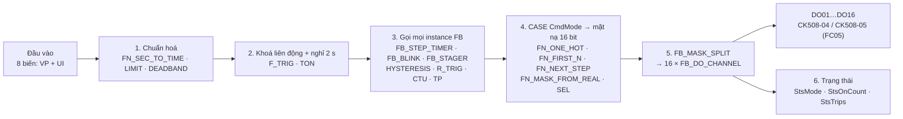

# Đề xuất chương trình ST điều khiển 16 DO qua Modbus — `PRG_DO16_MODBUS`

| Thuộc tính | Giá trị |
|---|---|
| ID tài liệu | `GUIDE-PROG-ST-DO16-001` |
| Phiên bản | 1.11 |
| Ngày | 2026-09-27 (cập nhật 2026-09-28) |
| Trạng thái | **Đã triển khai trên bo lab Foxlinx (2026-09-27).** Lúc nghiệm thu, Revision Active là `a0f107fa…` và Program `RUNNING` ở chế độ **AUTO**; từ 2026-09-28 Active trên bo là `0c29f4f1…` do người dùng tự Commission (Program chu kỳ **10 ms**, chế độ AUTO). Mã biên dịch PASS, mô phỏng 16 kịch bản trên host; Check/Commission trên bo PASS; nghiệm thu T1–T12 PASS ở lớp lệnh FC05 và readback coil; **kiểm từng chu kỳ trên bo: 2 120 chu kỳ cho 8 chế độ (mỗi chế độ ≥ 127 chu kỳ ổn định) và 1 665 chu kỳ cho AUTO (đủ 8 chế độ con), 0 vi phạm thiết kế**. **Chưa** đo điện tại tiếp điểm relay |
| Đối tượng đọc | Kỹ sư lập trình DDC tự nhập chương trình trên Web UI Programming |
| Phạm vi | 1 `PROGRAM` + 5 `FUNCTION` + 5 `FUNCTION_BLOCK`; 16 DO relay trên CK508-04 và CK508-05 (RS-485 `rs485-1`) |
| Nền đối chiếu | `main@0f5d46f3` (host); trên bo lúc nghiệm thu: RC `f86150e3` + web của PR #795 (`86aa4ede`), từ 2026-09-28 03:30Z là `main@e3072983`, từ 09:45Z là `main@4c49e78b` + Core `1602b2fd` (tool ST profile `a4396636…`, có token PID); compiler `fwsom-st-1.2.0`; profile `revA-1t-1-5-30` bản 2.2 (`1cb61fec…`); thư viện hệ thống `rev-a.4` |
| Lớp bằng chứng | **HOST** (biên dịch + mô phỏng runtime) và **TARGET** (Check/Commission, lệnh FC05, readback coil). Không phải HIL: chưa đo điện tại tiếp điểm. Hồ sơ trên bo: [`EV-PROG-DO16-MB-20260927`](../07_records/test-evidence/programming/2026-09-27-do16-modbus-target-deploy.md) |

## 0. Đọc nhanh

- Một Program ST điều khiển 16 relay Modbus với **8 kiểu chạy** và chế độ **AUTO** tự chạy lần lượt cả 8, chọn bằng một Virtual Point multistate: OFF, MANUAL, STAGGER, CHASE, BLINK, STAGING, TEST, PULSE, AUTO.
- Logic tách thành **10 khối người dùng** (5 FUNCTION, 5 FUNCTION_BLOCK) và dùng **17 mục của thư viện hệ thống**: 6 khối `TON`, `TP`, `R_TRIG`, `F_TRIG`, `CTU`, `HYSTERESIS` và 11 hàm `LIMIT`, `SEL`, `MIN`, `MAX`, `SCALE`, `DEADBAND`, `REAL_TO_TIME`, `REAL_TO_UINT`, `REAL_TO_INT`, `INT_TO_REAL`, `DINT_TO_REAL`.
- An toàn: mất tín hiệu cho phép (`InPermit`) thì tắt ngay; khoá từng kênh để bảo trì; đổi chế độ thì tắt hết và nghỉ 2 s; relay tải thật có thời gian đóng/nghỉ tối thiểu 10 s; các phép trong mã có thể gây lỗi runtime (tràn số, ép kiểu, cận đảo) đều được chặn trước.
- Mọi đoạn mã ở §4 là **bản đang chạy trên bo** (§9), **trừ** `FB_MASK_SPLIT` (§4.6) và khối `VAR CONSTANT` của Program: từ phiên bản 1.7 hai chỗ này dùng toán tử bit trên `UINT` và `VAR CONSTANT` (Issue #800), nên cần tool ST có #800. Bo đang chạy bản trước (`MOD 2` / `/ 2` và số trần); mô phỏng 3 001 chu kỳ cho hai bản kết quả **giống hệt từng byte** (§9.1). Quá trình kiểm đã tìm và sửa 9 lỗi của mã đề xuất (7 trên host, 2 trên bo) và 1 lỗi của sản phẩm (Check từ chối VP `integer`/`multistate`, PR #795).
- Từ phiên bản 1.8, thư viện hệ thống `rev-a.6` (Issue #801) có sẵn `RELAY_GUARD`, `STAGER`, `PULSE_GEN`, `WORD_TO_BITS`. **§4.12** là bản Program dùng các khối này thay cho `FB_DO_CHANNEL`, `FB_STAGER`, `FB_STEP_TIMER`, `FB_BLINK`, `FB_MASK_SPLIT`: chỉ còn 5 FUNCTION người dùng, số lệnh IR giảm 1 525 → 792. Mô phỏng sai khác 3 001 chu kỳ (§9.8): mọi chế độ giống hệt trừ STAGING, nơi bậc đổi đúng `STAGE_DELAY` thay vì chậm thêm 2 chu kỳ. Bo đang chạy bản khối tự viết; bản §4.12 cần firmware có `rev-a.6`.
- Làm theo §5 → §6 → §7. Chu kỳ Program: **100 ms**.

## 1. Kiểu chạy

`CmdMode` chọn kiểu chạy. `CmdStepSec` là tham số thời gian **của kiểu đang chạy** và được kẹp theo cột "Dải".

| `CmdMode` | Tên | Hành vi | `CmdStepSec` nghĩa là | Dải | Đóng/nghỉ tối thiểu |
|---|---|---|---|---|---|
| 0 | OFF | Tắt cả 16 kênh | — | — | — |
| 1 | MANUAL | Kênh *i* đóng khi bit *(i−1)* của `CmdManualMask` bằng 1. DO01 = 1, DO02 = 2, DO03 = 4 … DO16 = 32768. Ví dụ `5` = DO01 + DO03, `255` = DO01…DO08, `65535` = tất cả | — | mask 0…65535 | 0 |
| 2 | STAGGER | Đóng lần lượt DO01 → DO16, mỗi kênh cách nhau `CmdStepSec`, rồi giữ đủ 16 kênh. Chỉ sang kênh kế khi kênh trước **đã thật sự đóng** | khoảng cách giữa hai kênh | 0,5…60 s | 10 s / 10 s |
| 3 | CHASE | Một kênh đóng, chạy vòng DO01 → DO16 → DO01; `CmdReverse = TRUE` thì chạy ngược. Số vòng hoàn tất cộng vào `TotalCycles` (RETAIN) | thời gian mỗi bước | 0,5…60 s | 0 |
| 4 | BLINK | Nhóm kênh lẻ và nhóm kênh chẵn đảo pha nhau | nửa chu kỳ nháy | **1**…60 s | 0 |
| 5 | STAGING | Số kênh đóng = làm tròn(`CmdDemandPct` × 16 / 100). Bật khi nhu cầu > 10 %, tắt hẳn khi < 5 % (`HYSTERESIS`); bỏ qua dao động < 2 % (`DEADBAND`). Thêm/bớt **từng bậc một**, và chỉ đổi bậc khi các relay đã theo kịp lệnh: đóng lần lượt DO01 → DO16, nhả theo thứ tự **đóng sau – nhả trước**, không bao giờ có "lỗ". Khi giảm, relay mới đóng phải đủ 10 s mới nhả, nên giảm chậm hơn tăng | khoảng cách tối thiểu giữa hai lần đổi bậc | 0,5…60 s | 10 s / 10 s |
| 6 | TEST | Mỗi lần **bấm** `CmdTestStart` (sườn FALSE → TRUE): đóng từng kênh một lượt DO01 … DO16 rồi tự dừng | thời gian mỗi kênh | 0,5…60 s | 0 |
| 7 | PULSE | Mỗi lần **bấm** `CmdTestStart`: đóng cả 16 kênh đúng `CmdStepSec` giây. Giữ nút không kéo dài xung; nút để sẵn TRUE khi chuyển sang chế độ này **không** kích | độ dài xung | 1…600 s | 0 |
| 10 | AUTO | Tự chạy lần lượt mọi chế độ rồi lặp lại, vòng ≈ 137 s (bảng dưới). Tham số do chương trình tự sinh: `CmdManualMask`, `CmdStepSec`, `CmdDemandPct`, `CmdTestStart` bị bỏ qua; `CmdReverse`, `CmdLockMask`, `InPermit` vẫn có hiệu lực. `StsMode` cho biết chế độ con đang chạy | — | — | theo chế độ con |

Vòng AUTO:

| Bước | Chế độ con | Thời lượng | Tham số tự sinh |
|---|---|---|---|
| 0 | OFF | 12 s | nghỉ, để relay đủ 10 s trước chế độ tải |
| 1 | STAGGER | 22 s | 1 s/kênh |
| 2 | CHASE | 12 s | 0,5 s/bước |
| 3 | BLINK | 10 s | 1 s |
| 4 | MANUAL | 8 s | `0x0F0F`, sau 4 s đổi sang `0xF0F0` |
| 5 | TEST | 12 s | tự bấm khi bước ổn định, 0,5 s/kênh |
| 6 | PULSE | 8 s | tự bấm, xung 3 s |
| 7 | OFF | 12 s | nghỉ |
| 8 | STAGING | 40 s | nhu cầu 55 % trong 20 s, rồi 20 % |

Mỗi lần sang bước mới vẫn tắt hết và nghỉ ≈ 2,1 s như khi đổi chế độ bằng tay. Mất `InPermit`, rời AUTO, hoặc Program khởi động lại thì AUTO luôn bắt đầu lại từ bước 0.

Hành vi chung cho mọi kiểu:

- **Đổi chế độ**: tắt hết **ngay** (kể cả relay đang trong thời gian đóng tối thiểu, và kể cả khi chuyển **vào** chế độ 2/5), nghỉ ≈ 2,1 s (`StsMode = 8`, đo được 21–22 chu kỳ 100 ms), bộ đếm bước về đầu, rồi mới chạy chế độ mới.
- **`InPermit = FALSE`**: tắt cả 16 kênh ở chu kỳ kế tiếp, bỏ qua thời gian đóng tối thiểu; `StsMode = 9`; `StsTrips` tăng 1 (giữ qua mất điện). Có lại `InPermit` thì nghỉ 2 s rồi chạy lại từ đầu.
- **`CmdLockMask`**: bit bằng 1 thì khoá kênh tương ứng (tắt ngay, bỏ qua thời gian đóng tối thiểu); các kênh khác chạy bình thường. Dùng khi bảo trì từng tải.
- **`CmdMode` ngoài 0…7 và khác 10**: coi như OFF.
- **Thời gian đóng tối thiểu** chỉ áp khi đang chạy ổn định ở chế độ tải thật 2 hoặc 5. **Thời gian nghỉ tối thiểu** áp ngay khi đã chọn chế độ 2/5, kể cả trong 2 s nghỉ đổi chế độ, nên relay vừa nhả phải nghỉ đủ 10 s mới được đóng lại.
- **Sau khi Program khởi động** (Enable, Commission, mất điện): ở chế độ 2 và 5, mỗi kênh phải nghỉ đủ 10 s mới được đóng lần đầu, để relay không đóng dồn.

## 2. Ràng buộc nền tảng phải biết trước khi viết

Mỗi dòng dưới đây đã đối chiếu mã nguồn ở `main@0f5d46f3`. Dòng 4 và 8 là hai lỗi compiler bắt được khi biên dịch bản nháp đầu của chính đề xuất này.

| # | Ràng buộc | Nguồn | Thiết kế xử lý thế nào |
|---|---|---|---|
| 1 | Không có `FOR`/`WHILE`/`REPEAT`/`EXIT`/`RETURN` | `contracts/programming/st_language_profile_v1.json` (ADR-054) | 16 kênh viết tường minh; FUNCTION gán kết quả qua tên hàm |
| 2 | Chưa có `ARRAY`, `STRUCT`, `VAR_IN_OUT`. Từ Issue #800: `AND`/`OR`/`XOR`/`NOT` trên `UINT` là phép theo bit, có `SHL`/`SHR` (số bước ≥ 16 cho 0); số có dấu không nhận toán tử bit | như trên (`plannedAdditions`, `deliberateExclusions`) | 16 kênh gói trong một số `UINT` 16 bit; `FB_MASK_SPLIT` tách bit bằng `Mask AND 2^k` |
| 3 | Từ Issue #800: khai báo có giá trị khởi tạo (`x : INT := 5;`, trừ `VAR_INPUT`) và `VAR CONSTANT` (bắt buộc `:=`, chỉ literal/hằng khai trước/toán tử). Tool ST cũ hơn #800 vẫn báo `ST-SYN-001` | ngữ pháp `var_decl` | Tham số vẫn lấy từ Virtual Point và luôn được kẹp giới hạn; mặt nạ cố định đặt tên bằng `VAR CONSTANT` (`MASK_ODD` …) |
| 4 | Tên không phân biệt hoa thường và không được trùng từ khoá: `tOn` chính là `TON` | `st_parser.cpp` | Đặt tên `TmrOn`, `TmrOff`, `TimeOn`, `TimeOff` |
| 5 | Mỗi instance FB chỉ được gọi **một lần mỗi chu kỳ** (`ST-SEM-010`) | `apps/core/application/st/samples/err_fb_called_twice.st` | Mục 3 của Program gọi mọi instance vô điều kiện; `CASE` chỉ đọc output |
| 6 | FUNCTION phải thuần: không instance FB, không `VAR_OUTPUT`, không `VAR RETAIN`, không Published Signal (`ST-POU-002`). Gọi FUNCTION theo **vị trí** đối số (thứ tự `VAR_INPUT`), gọi FB theo **tên** cổng | `st_pou_registry.cpp` | 5 FUNCTION chỉ tính toán, trạng thái nằm trong FB |
| 7 | FB/FUNCTION người dùng được **inline** vào Program: dùng chung trần 4096 lệnh IR, 512 slot ghi được, 64 instance FB chuẩn (tính cả `TON` nằm trong FB người dùng) | `st_compile.cpp`, `st_profile_generated.hpp` | Đo thật ở §9.1: bản trên bo 1 576 lệnh, 467 slot ghi, 43 instance; bản 1.7 với compiler có #799/#800: 1 525 lệnh, 431 slot ghi |
| 8 | Nhãn `CASE` dạng dải: từ compiler có U-11 (PR #803) dải rộng như `16..32767:` **hợp lệ** (trần đếm theo số nhãn). Tool ST trên bo lab đã lên bản có U-11 từ 2026-09-28 (`main@e3072983`); bo chạy bản cũ hơn thì vẫn từ chối (`CASE label set is too large`) | `st_parser.cpp`; `DDD-LANG-PROG-001` §4.3 | Nhánh "từ 16 trở lên" viết bằng `IF`: chạy được ở cả hai bản, nên giữ nguyên |
| 9 | Lỗi runtime làm Program **FAULTED** và phải reset tay: tràn số nguyên (không quấn vòng), chia 0, ép kiểu ngoài miền, `TIME` âm, `LIMIT` có cận đảo, `HYSTERESIS` có `LOW ≥ HIGH`, số thực không hữu hạn | `st_exec.cpp`, `st_scheduler.cpp` | Chặn trần bộ đếm, kẹp trước khi đổi kiểu, sắp lại cận trong `FN_SEC_TO_TIME` |
| 10 | `PID` **dùng được** từ 2026-09-28: Controls/Safety đã duyệt (Issue #802, [`EV-PROG-PID-APPROVAL-20260928`](../07_records/test-evidence/programming/2026-09-28-pid-approval-evidence.md)), profile mang token cho thư viện `rev-a.6`, Check nhận `PID` trên ST và FBD. Ngưỡng phát hiện override là 1 % dải `OUT_MIN..OUT_MAX`; nối `ACTUAL` vào chính điểm AO mà `OUT` ghi tới để `TRACKING` báo đúng khi có nguồn ưu tiên cao hơn. Gains/lọc là quyết định hiện trường. Bo lab cần chạy bản có token mới Check được | `product_profile_v2.json`, `st_profile_generated.hpp` | Dùng `PID` cho vòng liên tục (AO); chương trình 16 DO không cần vì chỉ có đầu ra số |
| 11 | Chu kỳ Program chỉ nhận {10, 50, 100, 500, 1000, 5000, 10000, 50000} ms (ADR-061) | `kAllowedPeriodMs` | Chọn 100 ms |
| 12 | Mỗi biến `VAR_INPUT`/`VAR_OUTPUT` cần **đúng một** ánh xạ; mỗi đầu ra chỉ một Program được ghi (`ST-OWN-001`, `PRG-ERR-OUTPUT-OWNER-001`) | `samples/io_map.example.json`, `st_diagnostic.hpp` | §5.2 gỡ người ghi khác; không dùng VP trạng thái thì chuyển biến `Sts*` sang `VAR` |
| 13 | Virtual Point tới chương trình theo **slot**: `boolean` → `BV` → `BOOL`; `integer`/`float` → `AV` → **`REAL`**; `multistate` → `MSV` → `UINT`. VP chủ sở hữu `WEB` chỉ đọc được; Program muốn ghi thì VP phải có chủ sở hữu `PROGRAM` | `programming_pointcatalog.go`; `point_binding_facts.go` (PR #795) | `CmdManualMask` là `REAL`, đổi sang `UINT` bằng `FN_MASK_FROM_REAL`. Web RC `f86150e3` trở về trước suy kiểu từ `signalType` và **từ chối** VP `integer`/`multistate` (`PIO-SRC-001`); cần web có PR #795 (xem §10) |
| 14 | `REAL_TO_TIME` nhận **giây**; `REAL_TO_INT` làm tròn nửa ra xa 0; `CTU` bão hoà ở 32767 (không lỗi); `TP` bỏ qua sườn lên giữa xung | `st_exec.cpp` | `FN_SEC_TO_TIME`, `TestStep` |
| 15 | `SCALE(IN, IN_MIN, IN_MAX, OUT_MIN, OUT_MAX)`; `DEADBAND(IN, DB, REF)` trả `REF` khi \|IN − REF\| ≤ DB, ngược lại trả `IN` | `st_compile.cpp` | `FB_STAGER`; bộ lọc giữ giá trị `DemandUsed` |
| 16 | Mặc định mỗi DO Modbus là **một lệnh FC05 riêng**. Từ PR #804 (U-07) có tuỳ chọn **theo thiết bị** "Ghi nhiều coil một lần (FC15)" (`coil_write_batch_max`, **mặc định tắt**): bật thì các coil **liền kề** đổi cùng lúc lên dây thành một FC15; coil không liền kề và điểm bật xác nhận sau khi ghi vẫn đi riêng. Lệnh mới đè lệnh cũ chưa gửi của cùng coil | `apps/iobus/adapters/modbus_rtu/{bus_worker.cpp,coil_write_batch.cpp}` | §8: nhịp tối thiểu 0,5 s, BLINK tối thiểu 1 s (giữ nguyên, vì mặc định vẫn là FC05) |
| 17 | Disable Program thì iobus ghi **"Giá trị an toàn"** của từng điểm (F06, đo ≤ 1,2 s). Điểm chưa khai giá trị này thì **giữ giá trị cuối** kèm WARN | `docs/07_records/test-evidence/programming/2026-09-25-fbd-st-modbus-do-audit.md` F06 | §5.1 bắt buộc khai cho cả 16 DO |
| 18 | VP chủ sở hữu `PROGRAM` vẫn phải để `writable = true` ("cho phép ghi"), nếu không Check báo "khai chỉ đọc (writable=false) nhưng chương trình đang GHI vào nó" | `point_binding_facts.go` | §5.3 |

## 3. Kiến trúc



Ý tưởng chính: mọi kiểu chạy chỉ làm **một việc** là sinh ra một mặt nạ 16 bit `Mask`. Sau đó cùng một đường chung tách mặt nạ thành 16 lệnh và đưa qua khối bảo vệ relay. Thêm kiểu chạy mới chỉ cần thêm một nhánh `CASE`.

### 3.1 Khối người dùng

| Khối | Loại | Dùng thư viện hệ thống | Việc làm |
|---|---|---|---|
| `FN_ONE_HOT` | FUNCTION → `UINT` | — | Mặt nạ chỉ bật bit của kênh `Idx` (1…16) |
| `FN_FIRST_N` | FUNCTION → `UINT` | — | Mặt nạ bật N kênh đầu (0…16) |
| `FN_NEXT_STEP` | FUNCTION → `INT` | `LIMIT` | Bước kế tiếp xuôi/ngược, tự quay vòng |
| `FN_SEC_TO_TIME` | FUNCTION → `TIME` | `MIN`, `MAX`, `LIMIT`, `REAL_TO_TIME` | Giây (REAL) → `TIME`, kẹp dải, chống cận đảo và số âm |
| `FN_MASK_FROM_REAL` | FUNCTION → `UINT` | `LIMIT`, `REAL_TO_UINT` | REAL từ VP → mặt nạ `UINT` an toàn |
| `FB_MASK_SPLIT` | FUNCTION_BLOCK | toán tử `AND` trên `UINT` (Issue #800) | Mặt nạ 16 bit → 16 cờ `B01…B16` |
| `FB_DO_CHANNEL` | FUNCTION_BLOCK | 2 × `TON` | Bảo vệ một relay: đóng/nghỉ tối thiểu, cưỡng bức tắt, đếm số lần đóng |
| `FB_STEP_TIMER` | FUNCTION_BLOCK | `TON` | Nhịp bước không trôi |
| `FB_BLINK` | FUNCTION_BLOCK | `TON` | Xung vuông không trôi |
| `FB_STAGER` | FUNCTION_BLOCK | 2 × `TON`, `SCALE`, `LIMIT`, `REAL_TO_INT`, `INT_TO_REAL` | Bậc tải từng bước |

### 3.2 Instance trong Program

| Instance | Kiểu | Số lượng | Vai trò |
|---|---|---|---|
| `Ch01`…`Ch16` | `FB_DO_CHANNEL` | 16 | Một khối bảo vệ cho mỗi relay |
| `Req`, `LockBits` | `FB_MASK_SPLIT` | 2 | Tách mặt nạ yêu cầu và mặt nạ khoá |
| `StepClk` | `FB_STEP_TIMER` | 1 | Nhịp chung cho STAGGER, CHASE, TEST |
| `Blinker` | `FB_BLINK` | 1 | BLINK |
| `Stager` | `FB_STAGER` | 1 | STAGING |
| `DemandOn` | `HYSTERESIS` | 1 | Cho phép STAGING theo ngưỡng 10 % / 5 % |
| `ModeDwell` | `TON` | 1 | Nghỉ 2 s khi đổi chế độ hoặc mất `InPermit` |
| `PulseAll` | `TP` | 1 | Xung PULSE |
| `TestTrig` | `R_TRIG` | 1 | Sườn lên của nút `CmdTestStart` |
| `PermitLost` | `F_TRIG` | 1 | Sườn xuống của `InPermit`, đếm số lần ngắt |
| `TestStep` | `CTU` | 1 | Đếm kênh trong chế độ TEST, `Q` báo hết lượt |

### 3.3 Thứ tự một chu kỳ (100 ms)

1. **Chuẩn hoá đầu vào**: kẹp chế độ, đổi giây sang `TIME`, lọc nhu cầu.
2. **Khoá liên động và nghỉ khi đổi chế độ**: `Settled = FALSE` thì bước về 0 và mặt nạ bị ép về 0.
3. **Gọi mọi instance FB đúng một lần**, kể cả khi chế độ hiện tại không dùng nó. Nhờ vậy timer luôn nhất quán và không phạm `ST-SEM-010`.
4. **`CASE CmdMode`** chỉ đọc output của các FB ở bước 3 và tạo `Mask`.
5. **`FB_MASK_SPLIT` → 16 × `FB_DO_CHANNEL` → `DO01…DO16`**; tính `AnyWaiting` cho chu kỳ sau.
6. **Trạng thái** cho HMI.

## 4. Mã nguồn

Dán **nguyên văn** từng khối. Tên POU phải trùng tên trong mã (`FUNCTION FN_ONE_HOT` thì tên POU là `FN_ONE_HOT`), nếu không Check báo `ST-POU-001`.

### 4.1 `FN_ONE_HOT` — FUNCTION

```pascal
(* Trả mặt nạ chỉ có MỘT bit bật tại vị trí Idx (1..16). Ngoài dải trả 0. *)
FUNCTION FN_ONE_HOT : UINT
VAR_INPUT
    Idx : INT;
END_VAR
    CASE Idx OF
        1:  FN_ONE_HOT := 1;
        2:  FN_ONE_HOT := 2;
        3:  FN_ONE_HOT := 4;
        4:  FN_ONE_HOT := 8;
        5:  FN_ONE_HOT := 16;
        6:  FN_ONE_HOT := 32;
        7:  FN_ONE_HOT := 64;
        8:  FN_ONE_HOT := 128;
        9:  FN_ONE_HOT := 256;
        10: FN_ONE_HOT := 512;
        11: FN_ONE_HOT := 1024;
        12: FN_ONE_HOT := 2048;
        13: FN_ONE_HOT := 4096;
        14: FN_ONE_HOT := 8192;
        15: FN_ONE_HOT := 16384;
        16: FN_ONE_HOT := 32768;
    ELSE
        FN_ONE_HOT := 0;
    END_CASE;
END_FUNCTION
```

### 4.2 `FN_FIRST_N` — FUNCTION

```pascal
(* Trả mặt nạ có N bit thấp nhất bật (kênh 1..N). N <= 0 trả 0, N >= 16 trả 65535.
   Nhãn CASE được bung thành tập giá trị (trần 4096), nên dải lớn như
   16..32767 bị Check từ chối: nhánh N >= 16 phải viết bằng IF. *)
FUNCTION FN_FIRST_N : UINT
VAR_INPUT
    N : INT;
END_VAR
    IF N >= 16 THEN
        FN_FIRST_N := 65535;
    ELSE
        CASE N OF
            1:  FN_FIRST_N := 1;
            2:  FN_FIRST_N := 3;
            3:  FN_FIRST_N := 7;
            4:  FN_FIRST_N := 15;
            5:  FN_FIRST_N := 31;
            6:  FN_FIRST_N := 63;
            7:  FN_FIRST_N := 127;
            8:  FN_FIRST_N := 255;
            9:  FN_FIRST_N := 511;
            10: FN_FIRST_N := 1023;
            11: FN_FIRST_N := 2047;
            12: FN_FIRST_N := 4095;
            13: FN_FIRST_N := 8191;
            14: FN_FIRST_N := 16383;
            15: FN_FIRST_N := 32767;
        ELSE
            FN_FIRST_N := 0;
        END_CASE;
    END_IF;
END_FUNCTION
```

### 4.3 `FN_NEXT_STEP` — FUNCTION

```pascal
(* Bước kế tiếp trong vòng 1..Count, xuôi hoặc ngược, tự quay vòng.
   Count bị kẹp 1..16 nên không bao giờ chia/lệch dải. *)
FUNCTION FN_NEXT_STEP : INT
VAR_INPUT
    Step    : INT;
    Count   : INT;
    Reverse : BOOL;
END_VAR
VAR
    N : INT;
END_VAR
    N := LIMIT(1, Count, 16);
    IF Reverse THEN
        IF Step <= 1 THEN
            FN_NEXT_STEP := N;
        ELSE
            FN_NEXT_STEP := Step - 1;
        END_IF;
    ELSE
        IF Step >= N THEN
            FN_NEXT_STEP := 1;
        ELSE
            FN_NEXT_STEP := Step + 1;
        END_IF;
    END_IF;
END_FUNCTION
```

### 4.4 `FN_SEC_TO_TIME` — FUNCTION

```pascal
(* Đổi số giây (REAL, thường lấy từ Virtual Point) sang TIME, kẹp trong
   [MinSec, MaxSec]. Tự sắp lại cận và chặn số âm, vì LIMIT với cận đảo
   (ST-RT-006) hoặc TIME âm (ST-RT-005) làm Program FAULTED. *)
FUNCTION FN_SEC_TO_TIME : TIME
VAR_INPUT
    Sec    : REAL;
    MinSec : REAL;
    MaxSec : REAL;
END_VAR
VAR
    Lo : REAL;
    Hi : REAL;
END_VAR
    Lo := MAX(0.0, MIN(MinSec, MaxSec));
    Hi := MAX(Lo, MAX(MinSec, MaxSec));
    FN_SEC_TO_TIME := REAL_TO_TIME(LIMIT(Lo, Sec, Hi));
END_FUNCTION
```

### 4.5 `FN_MASK_FROM_REAL` — FUNCTION

```pascal
(* Virtual Point kiểu integer nằm trên slot AV nên tới chương trình dưới dạng
   REAL. Kẹp 0..65535 trước khi đổi để REAL_TO_UINT không tràn (ST-RT-003). *)
FUNCTION FN_MASK_FROM_REAL : UINT
VAR_INPUT
    Value : REAL;
END_VAR
    FN_MASK_FROM_REAL := REAL_TO_UINT(LIMIT(0.0, Value, 65535.0));
END_FUNCTION
```

### 4.6 `FB_MASK_SPLIT` — FUNCTION_BLOCK

```pascal
(* Tách mặt nạ 16 bit thành 16 cờ BOOL bằng AND theo bit trên UINT (Issue #800).
   Bản trước (không có toán tử bit) phải dùng MOD 2 rồi chia 2 lặp lại, 32 lệnh
   và một biến tạm M. *)
FUNCTION_BLOCK FB_MASK_SPLIT
VAR_INPUT
    Mask : UINT;
END_VAR
VAR_OUTPUT
    B01 : BOOL;
    B02 : BOOL;
    B03 : BOOL;
    B04 : BOOL;
    B05 : BOOL;
    B06 : BOOL;
    B07 : BOOL;
    B08 : BOOL;
    B09 : BOOL;
    B10 : BOOL;
    B11 : BOOL;
    B12 : BOOL;
    B13 : BOOL;
    B14 : BOOL;
    B15 : BOOL;
    B16 : BOOL;
END_VAR
    B01 := (Mask AND 1) <> 0;
    B02 := (Mask AND 2) <> 0;
    B03 := (Mask AND 4) <> 0;
    B04 := (Mask AND 8) <> 0;
    B05 := (Mask AND 16) <> 0;
    B06 := (Mask AND 32) <> 0;
    B07 := (Mask AND 64) <> 0;
    B08 := (Mask AND 128) <> 0;
    B09 := (Mask AND 256) <> 0;
    B10 := (Mask AND 512) <> 0;
    B11 := (Mask AND 1024) <> 0;
    B12 := (Mask AND 2048) <> 0;
    B13 := (Mask AND 4096) <> 0;
    B14 := (Mask AND 8192) <> 0;
    B15 := (Mask AND 16384) <> 0;
    B16 := (Mask AND 32768) <> 0;
END_FUNCTION_BLOCK
```

### 4.7 `FB_DO_CHANNEL` — FUNCTION_BLOCK

```pascal
(* Bảo vệ một relay: thời gian ĐÓNG tối thiểu, thời gian NGHỈ tối thiểu, cưỡng
   bức tắt ngay khi mất Enable, đếm số lần đóng.
   - Cmd    : yêu cầu bật từ bộ chọn chế độ.
   - Enable : FALSE = tắt ngay, bỏ qua MinOn (khoá liên động / khoá kênh).
   - Sau khi Program khởi động, kênh phải nghỉ đủ MinOff mới được đóng lần đầu
     (chống đóng dồn relay sau mất điện hoặc sau Commission). *)
FUNCTION_BLOCK FB_DO_CHANNEL
VAR_INPUT
    Cmd    : BOOL;
    Enable : BOOL;
    MinOn  : TIME;
    MinOff : TIME;
END_VAR
VAR_OUTPUT
    Q       : BOOL;
    Waiting : BOOL;
    Starts  : DINT;
END_VAR
VAR
    TmrOn  : TON;
    TmrOff : TON;
END_VAR
    TmrOn(IN := Q, PT := MinOn);
    TmrOff(IN := NOT Q, PT := MinOff);

    IF NOT Enable THEN
        Q := FALSE;
    ELSIF Cmd AND NOT Q AND TmrOff.Q THEN
        Q := TRUE;
        (* Tràn số nguyên làm Program FAULTED (ST-RT-001), nên chặn trần. *)
        IF Starts < 2147483647 THEN
            Starts := Starts + 1;
        END_IF;
    ELSIF NOT Cmd AND Q AND TmrOn.Q THEN
        Q := FALSE;
    END_IF;

    Waiting := Enable AND (Cmd XOR Q);
END_FUNCTION_BLOCK
```

### 4.8 `FB_STEP_TIMER` — FUNCTION_BLOCK

```pascal
(* Bộ nhịp không trôi: Pulse = TRUE đúng MỘT chu kỳ Program mỗi khi đồng hồ
   đi qua mốc NextAt; mốc cộng dồn đúng StepTime nên sai số không tích luỹ.
   (TON tự nạp lại kiểu IN := NOT Q làm mỗi bước dài thêm 2 chu kỳ Program.)
   Đồng hồ nạp lại mỗi 12 h: lúc đó nhịp lệch một lần, tối đa 2 chu kỳ. *)
FUNCTION_BLOCK FB_STEP_TIMER
VAR_INPUT
    Run      : BOOL;
    StepTime : TIME;
END_VAR
VAR_OUTPUT
    Pulse : BOOL;
END_VAR
VAR
    Clock   : TON;
    Restart : BOOL;
    NextAt  : TIME;
END_VAR
    Clock(IN := Run AND NOT Restart, PT := T#12h);
    Restart := Clock.Q;
    Pulse := FALSE;
    IF NOT Run OR Restart THEN
        NextAt := StepTime;
    ELSIF Clock.ET >= NextAt THEN
        Pulse := TRUE;
        NextAt := NextAt + StepTime;
    END_IF;
END_FUNCTION_BLOCK
```

### 4.9 `FB_BLINK` — FUNCTION_BLOCK

```pascal
(* Bộ tạo xung vuông không trôi: Q bật TimeOn rồi tắt TimeOff, lặp lại khi
   Run = TRUE; Run = FALSE thì Q về FALSE ngay. Một TON chạy tự do làm đồng
   hồ, mốc đảo trạng thái cộng dồn nên chu kỳ không dài thêm theo scan. *)
FUNCTION_BLOCK FB_BLINK
VAR_INPUT
    Run     : BOOL;
    TimeOn  : TIME;
    TimeOff : TIME;
END_VAR
VAR_OUTPUT
    Q : BOOL;
END_VAR
VAR
    Clock   : TON;
    Restart : BOOL;
    NextAt  : TIME;
END_VAR
    Clock(IN := Run AND NOT Restart, PT := T#12h);
    Restart := Clock.Q;
    IF NOT Run THEN
        Q := FALSE;
        NextAt := T#0s;
    ELSIF Restart THEN
        NextAt := T#0s;
    ELSIF Clock.ET >= NextAt THEN
        Q := NOT Q;
        IF Q THEN
            NextAt := NextAt + TimeOn;
        ELSE
            NextAt := NextAt + TimeOff;
        END_IF;
    END_IF;
END_FUNCTION_BLOCK
```

### 4.10 `FB_STAGER` — FUNCTION_BLOCK

```pascal
(* Bậc tải theo nhu cầu: đổi DemandPct 0..100 % thành số bậc mục tiêu
   0..MaxStages, rồi thêm/bớt TỪNG bậc một, mỗi lần cách nhau ít nhất
   StageDelay. Run = FALSE thì về 0 bậc ngay. Hold = TRUE (còn kênh chưa theo
   kịp lệnh vì đang chờ hết thời gian nghỉ/đóng tối thiểu) thì KHÔNG đổi bậc,
   cả tăng lẫn giảm: bậc chỉ đổi khi đầu ra thật đã theo kịp. Nhờ vậy relay
   đóng lần lượt, nhả theo thứ tự đóng sau - nhả trước (không có "lỗ"), và hai
   lần đổi bậc thật luôn cách nhau ít nhất StageDelay. *)
FUNCTION_BLOCK FB_STAGER
VAR_INPUT
    Run        : BOOL;
    DemandPct  : REAL;
    MaxStages  : INT;
    StageDelay : TIME;
    Hold       : BOOL;
END_VAR
VAR_OUTPUT
    Stages : INT;
    Target : INT;
END_VAR
VAR
    tUp     : TON;
    tDown   : TON;
    N       : INT;
    Stepped : BOOL;
END_VAR
    N := LIMIT(1, MaxStages, 16);
    Target := REAL_TO_INT(SCALE(LIMIT(0.0, DemandPct, 100.0), 0.0, 100.0, 0.0, INT_TO_REAL(N)));
    Target := LIMIT(0, Target, N);
    IF NOT Run THEN
        Target := 0;
    END_IF;

    (* Stepped hạ IN một chu kỳ để TON nạp lại sau mỗi lần đổi bậc; thiếu nó
       thì tUp.Q giữ TRUE và bậc tăng liên tục mỗi chu kỳ. *)
    tUp(IN := Run AND NOT Hold AND (Target > Stages) AND NOT Stepped, PT := StageDelay);
    tDown(IN := (Target < Stages) AND NOT Hold AND NOT Stepped, PT := StageDelay);
    Stepped := FALSE;

    IF NOT Run THEN
        Stages := 0;
    ELSIF tUp.Q THEN
        Stages := Stages + 1;
        Stepped := TRUE;
    ELSIF tDown.Q THEN
        Stages := Stages - 1;
        Stepped := TRUE;
    END_IF;
    Stages := LIMIT(0, Stages, N);
END_FUNCTION_BLOCK
```

### 4.11 `PRG_DO16_MODBUS` — PROGRAM (chu kỳ 100 ms)

```pascal
(* PRG_DO16_MODBUS - điều khiển 16 DO Modbus (CK508-04 DO1..8, CK508-05 DO1..8).
   Chu kỳ Program: 100 ms. Chế độ chọn bằng CmdMode:
     0 OFF        tắt hết
     1 MANUAL     theo mặt nạ bit CmdManualMask (bit0 = DO01 ... bit15 = DO16)
     2 STAGGER    bật lần lượt từng kênh mỗi CmdStepSec tới đủ 16 kênh rồi giữ
     3 CHASE      chạy đuổi một kênh, CmdReverse = chạy ngược
     4 BLINK      nhấp nháy đảo pha kênh lẻ/chẵn, nửa chu kỳ = CmdStepSec (>= 1 s)
     5 STAGING    bậc tải theo CmdDemandPct (bật khi > 10 %, tắt khi < 5 %)
     6 TEST       sườn lên CmdTestStart: thử từng kênh một lượt 1..16 rồi dừng
     7 PULSE      sườn lên CmdTestStart: bật cả 16 kênh đúng CmdStepSec giây
    10 AUTO       tự chạy lần lượt mọi chế độ, lặp lại (~136 s/vòng):
                  OFF 12 s -> STAGGER 22 s -> CHASE 12 s -> BLINK 10 s ->
                  MANUAL 8 s -> TEST 12 s -> PULSE 8 s -> OFF 12 s -> STAGING 40 s.
                  Tham số do chương trình tự sinh; CmdReverse, CmdLockMask và
                  InPermit vẫn có hiệu lực. StsMode cho biết chế độ đang chạy.
   InPermit = FALSE hoặc kênh bị khoá trong CmdLockMask thì tắt ngay. *)
PROGRAM PRG_DO16_MODBUS
VAR_INPUT
    CmdMode       : UINT;   (* VP multistate, 0..7 hoặc 10 = AUTO *)
    CmdManualMask : REAL;   (* VP integer 0..65535 (slot AV nên là REAL) *)
    CmdLockMask   : REAL;   (* VP integer 0..65535, bit = 1 là khoá kênh *)
    CmdStepSec    : REAL;   (* VP float, giây *)
    CmdDemandPct  : REAL;   (* VP float hoặc UI analog, 0..100 % *)
    CmdTestStart  : BOOL;   (* VP boolean, bấm TRUE rồi trả FALSE *)
    CmdReverse    : BOOL;   (* VP boolean *)
    InPermit      : BOOL;   (* UI tiếp điểm khô hoặc VP boolean: TRUE = cho phép chạy *)
END_VAR
VAR_OUTPUT
    DO01 : BOOL;
    DO02 : BOOL;
    DO03 : BOOL;
    DO04 : BOOL;
    DO05 : BOOL;
    DO06 : BOOL;
    DO07 : BOOL;
    DO08 : BOOL;
    DO09 : BOOL;
    DO10 : BOOL;
    DO11 : BOOL;
    DO12 : BOOL;
    DO13 : BOOL;
    DO14 : BOOL;
    DO15 : BOOL;
    DO16 : BOOL;
    StsMode    : UINT;   (* 0..7 = chế độ đang chạy, 8 = đang chờ chuyển, 9 = khoá liên động *)
    StsOnCount : REAL;   (* số kênh đang đóng *)
    StsTrips   : REAL;   (* số lần mất InPermit, giữ qua mất điện *)
END_VAR
VAR
    Ch01 : FB_DO_CHANNEL;
    Ch02 : FB_DO_CHANNEL;
    Ch03 : FB_DO_CHANNEL;
    Ch04 : FB_DO_CHANNEL;
    Ch05 : FB_DO_CHANNEL;
    Ch06 : FB_DO_CHANNEL;
    Ch07 : FB_DO_CHANNEL;
    Ch08 : FB_DO_CHANNEL;
    Ch09 : FB_DO_CHANNEL;
    Ch10 : FB_DO_CHANNEL;
    Ch11 : FB_DO_CHANNEL;
    Ch12 : FB_DO_CHANNEL;
    Ch13 : FB_DO_CHANNEL;
    Ch14 : FB_DO_CHANNEL;
    Ch15 : FB_DO_CHANNEL;
    Ch16 : FB_DO_CHANNEL;
    Req        : FB_MASK_SPLIT;
    LockBits   : FB_MASK_SPLIT;
    StepClk    : FB_STEP_TIMER;
    Blinker    : FB_BLINK;
    Stager     : FB_STAGER;
    DemandOn   : HYSTERESIS;
    ModeDwell  : TON;
    PulseAll   : TP;
    TestTrig   : R_TRIG;
    PermitLost : F_TRIG;
    TestStep   : CTU;
    Mode       : UINT;
    PrevMode   : UINT;
    Changed    : BOOL;
    Settled    : BOOL;
    LoadMode   : BOOL;
    TestRunning : BOOL;
    Step       : INT;
    Mask       : UINT;
    StepTime   : TIME;
    BlinkTime  : TIME;
    PulseTime  : TIME;
    TMinOn     : TIME;
    TMinOff    : TIME;
    DemandUsed : REAL;
    OnCount    : INT;
    AnyWaiting : BOOL;   (* chu kỳ trước còn kênh chờ hết MinOn/MinOff *)
    AutoTmr    : TON;    (* thời lượng bước AUTO hiện tại *)
    AutoOn     : BOOL;
    AutoNext   : BOOL;
    AutoIdx    : INT;    (* bước AUTO 0..8 *)
    AutoDur    : TIME;
    SegMode    : UINT;   (* chế độ của bước AUTO hiện tại *)
END_VAR
VAR RETAIN
    TripCount   : DINT;
    TotalCycles : DINT;
END_VAR
VAR CONSTANT
    MASK_ODD          : UINT := 21845;              (* 0x5555: DO01, DO03, ..., DO15 *)
    MASK_EVEN         : UINT := NOT MASK_ODD;       (* 0xAAAA: DO02, DO04, ..., DO16 *)
    MASK_LOW_NIBBLES  : UINT := 3855;               (* 0x0F0F *)
    MASK_HIGH_NIBBLES : UINT := NOT MASK_LOW_NIBBLES; (* 0xF0F0 *)
END_VAR

    (* ===== 1. Chuẩn hoá đầu vào ===== *)
    Mode := CmdMode;
    AutoOn := Mode = 10;
    IF Mode > 7 THEN
        Mode := 0;                                   (* giá trị lạ => OFF *)
    END_IF;

    (* ===== 1b. AUTO: tự chạy lần lượt mọi chế độ =====
       AutoTmr dùng AutoDur của bước hiện tại (tính ở chu kỳ trước). Mất
       InPermit hoặc rời AUTO thì về bước 0 (OFF nghỉ 12 s), để relay luôn nghỉ
       đủ trước khi vào chế độ tải. Chu kỳ đầu sau khi Program khởi động có
       AutoDur = T#0s: phải chặn, nếu không bước OFF bị bỏ qua. *)
    AutoTmr(IN := AutoOn AND InPermit AND NOT AutoNext AND (AutoDur > T#0s), PT := AutoDur);
    AutoNext := AutoTmr.Q;
    IF NOT AutoOn OR NOT InPermit THEN
        AutoIdx := 0;
    ELSIF AutoNext THEN
        AutoIdx := FN_NEXT_STEP(AutoIdx + 1, 9, FALSE) - 1;   (* 0..8 quay vòng *)
    END_IF;
    CASE AutoIdx OF
        1:  SegMode := 2; AutoDur := T#22s;
        2:  SegMode := 3; AutoDur := T#12s;
        3:  SegMode := 4; AutoDur := T#10s;
        4:  SegMode := 1; AutoDur := T#8s;
        5:  SegMode := 6; AutoDur := T#12s;
        6:  SegMode := 7; AutoDur := T#8s;
        7:  SegMode := 0; AutoDur := T#12s;
        8:  SegMode := 5; AutoDur := T#40s;
    ELSE
        SegMode := 0; AutoDur := T#12s;
    END_CASE;

    IF AutoOn THEN
        Mode := SegMode;
        StepTime  := SEL((Mode = 3) OR (Mode = 6), T#1s, T#500ms);
        BlinkTime := T#1s;
        PulseTime := T#3s;
        (* STAGING tự chạy: 55 % trong 20 s đầu rồi 20 %, cho thấy cả tăng lẫn giảm bậc. *)
        DemandUsed := SEL(Mode = 5, 0.0, SEL(AutoTmr.ET < T#20s, 20.0, 55.0));
    ELSE
        StepTime  := FN_SEC_TO_TIME(CmdStepSec, 0.5, 60.0);
        BlinkTime := FN_SEC_TO_TIME(CmdStepSec, 1.0, 60.0);
        PulseTime := FN_SEC_TO_TIME(CmdStepSec, 1.0, 600.0);
        (* Giữ giá trị cũ khi nhu cầu dao động dưới 2 %. *)
        DemandUsed := DEADBAND(LIMIT(0.0, CmdDemandPct, 100.0), 2.0, DemandUsed);
    END_IF;

    (* ===== 2. Khoá liên động và khoảng nghỉ khi chuyển chế độ ===== *)
    PermitLost(CLK := InPermit);
    IF PermitLost.Q AND (TripCount < 2147483647) THEN
        TripCount := TripCount + 1;
    END_IF;
    Changed := Mode <> PrevMode;
    PrevMode := Mode;
    (* Đổi chế độ hoặc mất InPermit: tắt hết, chờ 2 s ổn định rồi mới chạy. *)
    ModeDwell(IN := InPermit AND NOT Changed, PT := T#2s);
    Settled := ModeDwell.Q;
    IF NOT Settled THEN
        Step := 0;
        TestRunning := FALSE;
    END_IF;

    (* ===== 3. Gọi MỌI instance FB đúng một lần mỗi chu kỳ ===== *)
    StepClk(Run := Settled AND (((Mode = 2) AND (Step < 16) AND NOT AnyWaiting) OR (Mode = 3) OR ((Mode = 6) AND TestRunning)),
            StepTime := StepTime);
    Blinker(Run := Settled AND (Mode = 4), TimeOn := BlinkTime, TimeOff := BlinkTime);
    DemandOn(IN := DemandUsed, HIGH := 10.0, LOW := 5.0);
    Stager(Run := Settled AND (Mode = 5) AND DemandOn.Q, DemandPct := DemandUsed,
           MaxStages := 16, StageDelay := StepTime, Hold := AnyWaiting);
    (* AUTO tự "bấm nút" khi bước TEST/PULSE vừa ổn định. *)
    TestTrig(CLK := SEL(AutoOn, CmdTestStart, Settled AND ((Mode = 6) OR (Mode = 7))));
    TestStep(CU := StepClk.Pulse AND TestRunning, RESET := TestTrig.Q OR NOT Settled, PV := 16);
    (* Kích bằng SƯỜN của nút (TestTrig.Q), không bằng mức: nút để quên ở TRUE
       rồi chuyển sang chế độ 7 thì không được tự đóng 16 relay. *)
    PulseAll(IN := Settled AND (Mode = 7) AND TestTrig.Q, PT := PulseTime);

    (* ===== 4. Tạo mặt nạ yêu cầu theo chế độ ===== *)
    Mask := 0;
    LoadMode := FALSE;
    CASE Mode OF
        1:  IF AutoOn THEN
                Mask := SEL(AutoTmr.ET < T#4s, MASK_HIGH_NIBBLES, MASK_LOW_NIBBLES);   (* 0x0F0F rồi 0xF0F0 *)
            ELSE
                Mask := FN_MASK_FROM_REAL(CmdManualMask);
            END_IF;
        2:  LoadMode := TRUE;
            IF Step = 0 THEN
                Step := 1;
            ELSIF StepClk.Pulse AND (Step < 16) AND NOT AnyWaiting THEN
                Step := Step + 1;
            END_IF;
            Mask := FN_FIRST_N(Step);
        3:  IF Step = 0 THEN
                Step := SEL(CmdReverse, 1, 16);
            ELSIF StepClk.Pulse THEN
                Step := FN_NEXT_STEP(Step, 16, CmdReverse);
                IF (Step = SEL(CmdReverse, 1, 16)) AND (TotalCycles < 2147483647) THEN
                    TotalCycles := TotalCycles + 1;
                END_IF;
            END_IF;
            Mask := FN_ONE_HOT(Step);
        4:  Mask := SEL(Blinker.Q, MASK_EVEN, MASK_ODD);
        5:  LoadMode := TRUE;
            Mask := FN_FIRST_N(Stager.Stages);
        6:  IF TestTrig.Q AND Settled THEN
                TestRunning := TRUE;
            END_IF;
            IF TestStep.Q THEN
                TestRunning := FALSE;
            END_IF;
            IF TestRunning THEN
                Mask := FN_ONE_HOT(TestStep.CV + 1);
            END_IF;
        7:  IF PulseAll.Q THEN
                Mask := 65535;
            END_IF;
    ELSE
        Mask := 0;
    END_CASE;
    IF NOT Settled THEN
        Mask := 0;
    END_IF;

    (* Tải thật (chế độ 2, 5) có thời gian đóng/nghỉ tối thiểu 10 s.
       Thời gian đóng tối thiểu chỉ áp khi chế độ tải đã ổn định: trong 2 s nghỉ
       đổi chế độ, relay còn đóng từ chế độ cũ phải nhả ngay, không bị giữ thêm
       10 s theo luật của chế độ mới. Thời gian nghỉ tối thiểu vẫn luôn áp. *)
    TMinOn  := SEL(LoadMode AND Settled, T#0s, T#10s);
    TMinOff := SEL(LoadMode, T#0s, T#10s);

    (* ===== 5. 16 kênh ra qua khối bảo vệ relay ===== *)
    Req(Mask := Mask);
    LockBits(Mask := FN_MASK_FROM_REAL(CmdLockMask));
    Ch01(Cmd := Req.B01, Enable := InPermit AND NOT LockBits.B01, MinOn := TMinOn, MinOff := TMinOff);
    Ch02(Cmd := Req.B02, Enable := InPermit AND NOT LockBits.B02, MinOn := TMinOn, MinOff := TMinOff);
    Ch03(Cmd := Req.B03, Enable := InPermit AND NOT LockBits.B03, MinOn := TMinOn, MinOff := TMinOff);
    Ch04(Cmd := Req.B04, Enable := InPermit AND NOT LockBits.B04, MinOn := TMinOn, MinOff := TMinOff);
    Ch05(Cmd := Req.B05, Enable := InPermit AND NOT LockBits.B05, MinOn := TMinOn, MinOff := TMinOff);
    Ch06(Cmd := Req.B06, Enable := InPermit AND NOT LockBits.B06, MinOn := TMinOn, MinOff := TMinOff);
    Ch07(Cmd := Req.B07, Enable := InPermit AND NOT LockBits.B07, MinOn := TMinOn, MinOff := TMinOff);
    Ch08(Cmd := Req.B08, Enable := InPermit AND NOT LockBits.B08, MinOn := TMinOn, MinOff := TMinOff);
    Ch09(Cmd := Req.B09, Enable := InPermit AND NOT LockBits.B09, MinOn := TMinOn, MinOff := TMinOff);
    Ch10(Cmd := Req.B10, Enable := InPermit AND NOT LockBits.B10, MinOn := TMinOn, MinOff := TMinOff);
    Ch11(Cmd := Req.B11, Enable := InPermit AND NOT LockBits.B11, MinOn := TMinOn, MinOff := TMinOff);
    Ch12(Cmd := Req.B12, Enable := InPermit AND NOT LockBits.B12, MinOn := TMinOn, MinOff := TMinOff);
    Ch13(Cmd := Req.B13, Enable := InPermit AND NOT LockBits.B13, MinOn := TMinOn, MinOff := TMinOff);
    Ch14(Cmd := Req.B14, Enable := InPermit AND NOT LockBits.B14, MinOn := TMinOn, MinOff := TMinOff);
    Ch15(Cmd := Req.B15, Enable := InPermit AND NOT LockBits.B15, MinOn := TMinOn, MinOff := TMinOff);
    Ch16(Cmd := Req.B16, Enable := InPermit AND NOT LockBits.B16, MinOn := TMinOn, MinOff := TMinOff);
    DO01 := Ch01.Q;
    DO02 := Ch02.Q;
    DO03 := Ch03.Q;
    DO04 := Ch04.Q;
    DO05 := Ch05.Q;
    DO06 := Ch06.Q;
    DO07 := Ch07.Q;
    DO08 := Ch08.Q;
    DO09 := Ch09.Q;
    DO10 := Ch10.Q;
    DO11 := Ch11.Q;
    DO12 := Ch12.Q;
    DO13 := Ch13.Q;
    DO14 := Ch14.Q;
    DO15 := Ch15.Q;
    DO16 := Ch16.Q;

    AnyWaiting := Ch01.Waiting OR Ch02.Waiting OR Ch03.Waiting OR Ch04.Waiting
                  OR Ch05.Waiting OR Ch06.Waiting OR Ch07.Waiting OR Ch08.Waiting
                  OR Ch09.Waiting OR Ch10.Waiting OR Ch11.Waiting OR Ch12.Waiting
                  OR Ch13.Waiting OR Ch14.Waiting OR Ch15.Waiting OR Ch16.Waiting;

    (* ===== 6. Trạng thái cho HMI ===== *)
    OnCount := 0;
    IF DO01 THEN OnCount := OnCount + 1; END_IF;
    IF DO02 THEN OnCount := OnCount + 1; END_IF;
    IF DO03 THEN OnCount := OnCount + 1; END_IF;
    IF DO04 THEN OnCount := OnCount + 1; END_IF;
    IF DO05 THEN OnCount := OnCount + 1; END_IF;
    IF DO06 THEN OnCount := OnCount + 1; END_IF;
    IF DO07 THEN OnCount := OnCount + 1; END_IF;
    IF DO08 THEN OnCount := OnCount + 1; END_IF;
    IF DO09 THEN OnCount := OnCount + 1; END_IF;
    IF DO10 THEN OnCount := OnCount + 1; END_IF;
    IF DO11 THEN OnCount := OnCount + 1; END_IF;
    IF DO12 THEN OnCount := OnCount + 1; END_IF;
    IF DO13 THEN OnCount := OnCount + 1; END_IF;
    IF DO14 THEN OnCount := OnCount + 1; END_IF;
    IF DO15 THEN OnCount := OnCount + 1; END_IF;
    IF DO16 THEN OnCount := OnCount + 1; END_IF;
    StsOnCount := INT_TO_REAL(OnCount);
    StsTrips := DINT_TO_REAL(TripCount);
    IF NOT InPermit THEN
        StsMode := 9;
    ELSIF NOT Settled THEN
        StsMode := 8;
    ELSE
        StsMode := Mode;
    END_IF;
END_PROGRAM
```

### 4.12 Bản dùng khối SYSTEM (`rev-a.6`, Issue #801)

Thư viện hệ thống `rev-a.6` có sẵn đúng các khối mà §4.6–§4.10 phải tự viết
([`SW-SYSTEM-DDC-BLOCKS-MK-DDC-24-VI`](../02_design/software/SYSTEM_DDC_BLOCKS_SPEC_MK-DDC-24_VI.md)).
Với firmware có `rev-a.6`, **bỏ hẳn** 5 FUNCTION_BLOCK người dùng và chỉ giữ 5
FUNCTION §4.1–§4.5; Program §4.11 đổi đúng các chỗ sau, phần còn lại giữ nguyên:

| Chỗ trong §4.11 | Khối tự viết | Khối SYSTEM |
|---|---|---|
| `Ch01`…`Ch16` | `FB_DO_CHANNEL` | `RELAY_GUARD` — cùng luật: `ENABLE = FALSE` tắt ngay, cold start nghỉ đủ `MIN_OFF`, `STARTS` bão hoà |
| `Req`, `LockBits` | `FB_MASK_SPLIT` (`B01`…`B16`) | `WORD_TO_BITS` (`B00`…`B15` — **chỉ số lệch 1**: `Ch01` dùng `B00`) |
| `StepClk` | `FB_STEP_TIMER` (`Pulse`) | `PULSE_GEN` với `T_ON := T#0s`, `T_OFF := StepTime`, dùng `TICK` |
| `Blinker` | `FB_BLINK` | `PULSE_GEN` với `T_ON = T_OFF = BlinkTime`, dùng `Q` |
| `Stager` | `FB_STAGER` + `FN_FIRST_N(Stager.Stages)` | `STAGER`, dùng thẳng `Stager.MASK` |

```pascal
VAR
    Ch01 : RELAY_GUARD;     (* ... tương tự tới Ch16 *)
    Req        : WORD_TO_BITS;
    LockBits   : WORD_TO_BITS;
    StepClk    : PULSE_GEN;   (* chỉ dùng TICK: T_ON = 0, T_OFF = StepTime *)
    Blinker    : PULSE_GEN;
    Stager     : STAGER;
    (* ... các biến khác giữ nguyên như §4.11 *)
END_VAR

    (* ===== 3. Gọi MỌI instance FB đúng một lần mỗi chu kỳ ===== *)
    StepClk(RUN := Settled AND (((Mode = 2) AND (Step < 16) AND NOT AnyWaiting) OR (Mode = 3) OR ((Mode = 6) AND TestRunning)),
            T_ON := T#0s, T_OFF := StepTime);
    Blinker(RUN := Settled AND (Mode = 4), T_ON := BlinkTime, T_OFF := BlinkTime);
    DemandOn(IN := DemandUsed, HIGH := 10.0, LOW := 5.0);
    Stager(RUN := Settled AND (Mode = 5) AND DemandOn.Q, DEMAND := DemandUsed,
           MAX_STAGES := 16, STAGE_DELAY := StepTime, HOLD := AnyWaiting);
    (* ... StepClk.Pulse đổi thành StepClk.TICK ở TestStep và nhánh 2, 3 *)

    (* nhánh 5 của CASE *)
        5:  LoadMode := TRUE;
            Mask := Stager.MASK;

    (* ===== 5. Tách mặt nạ, bảo vệ relay ===== *)
    Req(IN := Mask);
    LockBits(IN := FN_MASK_FROM_REAL(CmdLockMask));
    Ch01(CMD := Req.B00, ENABLE := InPermit AND NOT LockBits.B00, MIN_ON := TMinOn, MIN_OFF := TMinOff);
    (* ... Ch02 dùng B01, …, Ch16 dùng B15 *)
    DO01 := Ch01.Q;
    AnyWaiting := Ch01.WAITING OR Ch02.WAITING (* ... *) OR Ch16.WAITING;
```

Tên cổng khối SYSTEM viết **HOA** đúng như registry (`CMD`, `ENABLE`, `MIN_ON`,
`MIN_OFF`, `Q`, `WAITING`, `STARTS`, …). Mức dùng tài nguyên đo bằng
`mkddc-st-compile --check-only`:

| Chỉ số | Khối tự viết (§4.6–§4.11) | Khối SYSTEM (§4.12) |
|---|---:|---:|
| Lệnh IR | 1 525 | 792 |
| Instance FB | 43 | 28 |
| Slot / slot ghi được | 517 / 431 | 372 / 287 |
| Hằng | 86 | 85 |
| Artifact `.mkir` | 55 784 byte | 25 048 byte |

Khác biệt hành vi duy nhất (§9.8): `STAGER` đổi bậc đúng mỗi `STAGE_DELAY` theo
đồng hồ Core, còn `FB_STAGER` hạ `IN` của `TON` một chu kỳ sau mỗi lần đổi nên
mỗi bậc chậm thêm 2 chu kỳ Program (1 s thành 1,2 s ở chu kỳ 100 ms).

## 5. Chuẩn bị trên bo trước khi nhập mã

### 5.1 Kiểm 16 điểm Modbus

Trang **Modbus RTU**:

1. Bus `rs485-1` đang chạy; hai thiết bị CK508-04 (địa chỉ 4) và CK508-05 (địa chỉ 5) **online**, bộ đếm timeout/CRC không tăng.
2. Có đủ 16 điểm coil `CK50804-DO1…DO8` và `CK50805-DO1…DO8`, quyền **Read/Write**.
3. Mở từng điểm, đặt **"Giá trị an toàn" = 0**, rồi áp dụng cấu hình. Thiếu bước này thì khi Disable Program, DO nào chưa khai sẽ **giữ nguyên trạng thái cuối** (ràng buộc 17).
4. Nếu bo dùng module khác (ví dụ CK509-06/07), giữ nguyên chương trình và chỉ đổi hai cột "Thiết bị" và "Điểm" ở §6.3 (ví dụ `bus-1-slave-6`, `CK50906-DO1`).

### 5.2 Gỡ người ghi khác trên 16 DO

Mỗi đầu ra chỉ một Program được ghi. Trước khi thêm Program mới, xem tab ánh xạ của các Program đang có trong Project. Nếu Program nào đang ghi vào một trong 16 điểm trên, hãy gỡ ánh xạ đó hoặc gỡ Program ấy khỏi bản nháp. Nếu không, Kiểm tra sẽ báo `PRG-ERR-OUTPUT-OWNER-001` (`ST-OWN-001`). Audit 2026-09-25 ghi nhận trên bo lab từng có Program FBD ghi `CK50804-DO1`.

Ghi lại trước khi làm: Revision đang Active, trạng thái 16 DO, và danh sách override. Đó là mốc để khôi phục ở §7.3.

### 5.3 Tạo Virtual Point

Trang **Virtual Points → Tạo VP**. Sau khi lưu, cột **Slot Core** phải có giá trị (`AV-…`, `BV-…` hoặc `MSV-…`). VP chưa có slot thì không ánh xạ được.

| VP | `signalType` | Giá trị / state | Giá trị khởi tạo | Sau khi khởi động lại | Chủ sở hữu | Nối vào biến |
|---|---|---|---|---|---|---|
| `DO16_MODE` | multistate | 0 OFF, 1 MANUAL, 2 STAGGER, 3 CHASE, 4 BLINK, 5 STAGING, 6 TEST, 7 PULSE, 10 AUTO | 0 | Về giá trị khởi tạo *(khuyến nghị: sau mất điện luôn về OFF)* | `WEB` | `CmdMode` |
| `DO16_MANUAL_MASK` | integer | 0…65535 | 0 | Giữ giá trị cuối | `WEB` | `CmdManualMask` |
| `DO16_LOCK_MASK` | integer | 0…65535 | 0 | Giữ giá trị cuối *(khoá bảo trì phải còn sau mất điện)* | `WEB` | `CmdLockMask` |
| `DO16_STEP_S` | float | giây | 1.0 | Giữ giá trị cuối | `WEB` | `CmdStepSec` |
| `DO16_DEMAND_PCT` | float | 0…100 % | 0 | Về giá trị khởi tạo | `WEB` | `CmdDemandPct` |
| `DO16_TEST_START` | boolean | nút bấm | FALSE | Về giá trị khởi tạo | `WEB` | `CmdTestStart` |
| `DO16_REVERSE` | boolean | — | FALSE | Giữ giá trị cuối | `WEB` | `CmdReverse` |
| `DO16_PERMIT` | boolean | TRUE = cho phép | TRUE | Giữ giá trị cuối | `WEB` | `InPermit` *(chỉ khi không có tiếp điểm thật)* |
| `DO16_STS_MODE` | multistate | 0…7 như trên, 8 CHỜ, 9 KHOÁ LIÊN ĐỘNG | 0 | — | **`PROGRAM`** | `StsMode` |
| `DO16_STS_ON` | float | số kênh đang đóng | 0 | — | **`PROGRAM`** | `StsOnCount` |
| `DO16_STS_TRIPS` | float | số lần mất `InPermit` | 0 | — | **`PROGRAM`** | `StsTrips` |

Ghi chú:

- `InPermit` nên nối vào một ngõ **UI cục bộ cấu hình tiếp điểm khô** (mạch dừng khẩn / liên động thật). `DO16_PERMIT` chỉ dùng khi thử trên bàn không có tiếp điểm.
- Chủ sở hữu `PROGRAM` ("chương trình ST ghi slot này mỗi chu kỳ") chỉ chọn được khi VP đã có Slot Core. Khi đổi sang `PROGRAM`, **giữ `writable = true`** (ràng buộc 18).
- VP `integer` (`DO16_MANUAL_MASK`, `DO16_LOCK_MASK`) và `multistate` (`DO16_MODE`, `DO16_STS_MODE`) cần web có PR #795. Trên web cũ hơn, đổi chúng sang `float`, khai `CmdMode` và `StsMode` kiểu `REAL`, và thay dòng `Mode := CmdMode;` bằng `Mode := REAL_TO_UINT(LIMIT(0.0, CmdMode, 7.0));`. Không cần ba VP trạng thái thì **chuyển `StsMode`, `StsOnCount`, `StsTrips` từ `VAR_OUTPUT` sang `VAR`**; nếu để lại mà không ánh xạ thì Check báo thiếu binding.
- Nếu dùng tín hiệu nhu cầu thật (ví dụ UI analog 0–10 V đã quy đổi ra %), nối `CmdDemandPct` vào UI đó thay cho `DO16_DEMAND_PCT`.

## 6. Nhập trên Web UI

### 6.1 Tạo 10 khối trong Cây POU

Ở trang Programming, **Cây POU → Tạo POU mới**, lần lượt cho từng khối ở §4.1–§4.10:

- **Tên POU**: đúng tên trong mã, ví dụ `FN_ONE_HOT`.
- **Loại**: `FUNCTION` hoặc `FUNCTION_BLOCK` như tiêu đề mục.
- **Ngôn ngữ**: `ST`.
- Dán mã rồi **Lưu**.

Nên tạo 5 FUNCTION trước, rồi 5 FUNCTION_BLOCK, sau cùng là Program: khi đó trình soạn thảo không báo "chưa có khối" giữa chừng.

Vì sao dùng Cây POU mà không dùng Thư viện: khi Check, backend liên kết **mọi POU không phải PROGRAM của Revision** vào từng Program mà không cần khai phụ thuộc (`apps/web-api/internal/programming/application/checks.go`). Đưa khối vào Thư viện PROJECT là tuỳ chọn ở §6.7.

### 6.2 Tạo Program

**Tạo POU mới**: tên `PRG_DO16_MODBUS`, loại `PROGRAM`, ngôn ngữ `ST`. Dán mã §4.11, **Lưu**. Trong phần thực thi của Program, chọn **Chu kỳ = 100 ms**. Program thiếu chu kỳ thì Check báo `ST-POU-005`.

### 6.3 Ánh xạ 27 biến (Ánh xạ Biến ↔ Điểm)

| Biến | Hướng | Kiểu | Nguồn | Thiết bị | Điểm | Chính sách chất lượng |
|---|---|---|---|---|---|---|
| `DO01`…`DO08` | Ghi | BOOL | `MB_RTU` | `bus-1-slave-4` (CK508-04) | `CK50804-DO1`…`CK50804-DO8` | — |
| `DO09`…`DO16` | Ghi | BOOL | `MB_RTU` | `bus-1-slave-5` (CK508-05) | `CK50805-DO1`…`CK50805-DO8` | — |
| `CmdMode` | Đọc | UINT | `VP` | — | `DO16_MODE` | `REQUIRE_GOOD` |
| `CmdManualMask` | Đọc | REAL | `VP` | — | `DO16_MANUAL_MASK` | `REQUIRE_GOOD` |
| `CmdLockMask` | Đọc | REAL | `VP` | — | `DO16_LOCK_MASK` | `REQUIRE_GOOD` |
| `CmdStepSec` | Đọc | REAL | `VP` | — | `DO16_STEP_S` | `REQUIRE_GOOD` |
| `CmdDemandPct` | Đọc | REAL | `VP` hoặc `LOCAL` | — | `DO16_DEMAND_PCT` hoặc `UI-xx` | `REQUIRE_GOOD` |
| `CmdTestStart` | Đọc | BOOL | `VP` | — | `DO16_TEST_START` | `REQUIRE_GOOD` |
| `CmdReverse` | Đọc | BOOL | `VP` | — | `DO16_REVERSE` | `REQUIRE_GOOD` |
| `InPermit` | Đọc | BOOL | `LOCAL` hoặc `VP` | — | `UI-xx` (tiếp điểm khô) hoặc `DO16_PERMIT` | `REQUIRE_GOOD` |
| `StsMode` | Ghi | UINT | `VP` | — | `DO16_STS_MODE` | — |
| `StsOnCount` | Ghi | REAL | `VP` | — | `DO16_STS_ON` | — |
| `StsTrips` | Ghi | REAL | `VP` | — | `DO16_STS_TRIPS` | — |

- Thiết bị Modbus dùng định danh chuẩn `bus-<bus>-slave-<địa chỉ>`, không dùng tên hiển thị `CK508-04`.
- Với nguồn `VP`, ánh xạ lưu **mã slot Core** của VP (`AV-…`, `BV-…`, `MSV-…`), không lưu tên VP. Chọn VP theo tên trong danh mục, rồi đối chiếu mã slot với cột **Slot Core** ở trang Virtual Points. Kiểu phải khớp: `MSV` ↔ `UINT`, `AV` ↔ `REAL`, `BV` ↔ `BOOL`.
- Chọn điểm từ danh mục để đơn vị coil là `bool`; gõ tay đơn vị khác sẽ sinh cảnh báo `PGM-MAP-UNIT-001`.
- Bấm **Lưu ánh xạ**.

### 6.4 Lưu và Kiểm tra

1. **Lưu** bản nháp.
2. Bấm **Kiểm tra**: hệ thống niêm phong bản nháp thành Revision bất biến rồi biên dịch. Kiểm tra và Commission luôn chạy trên Revision, không chạy trên bản nháp đang sửa.
3. Kỳ vọng **PASSED, 0 lỗi**. Nếu có lỗi, xem §10.

### 6.5 Đưa vào vận hành

Trang **Kiểm tra & Đưa vào vận hành → Đưa vào vận hành**. Đọc bảng ảnh hưởng: thay đổi ánh xạ đầu ra, danh sách Program, ý định chạy. Đánh dấu đủ các ô xác nhận, nhập mật khẩu, gửi lệnh, chờ `SUCCEEDED`.

### 6.6 Bật Program

Program mới luôn ở **DISABLED** sau khi Commission. Vào **Runtime & Bảo trì**, bật `PRG_DO16_MODBUS`. Kiểm: trạng thái `RUNNING`, nguồn `CORE_LIVE`, `overrunCount = 0`, `missedReleaseCount = 0`.

Lúc này `DO16_MODE = 0` nên chưa relay nào đóng. `DO16_STS_MODE` hiện 8 trong 2 s đầu, sau đó về 0.

### 6.7 Tuỳ chọn: đưa 10 khối vào Thư viện điều khiển (PROJECT)

Để dùng lại khối cho Project khác và có quản lý phiên bản: **Thư viện điều khiển → Tạo khối PROJECT**, khai tên, loại, ngôn ngữ ST, cổng vào/ra, dán mã, **Chạy kiểm tra trên máy chủ**, rồi **Lưu vào bản nháp thư viện**. Bản thư viện được ghim khi Niêm phong Revision.

Điều kiện đã kiểm bằng compiler (§9.4): Program gọi khối **lấy từ thư viện** thì phải **khai phụ thuộc** tới khối đó. Thiếu khai báo thì Check báo `ST-LIB-001 … does not declare it in requiresLibrary`. Tài liệu này **chưa kiểm** thao tác nào trên UI ghi phụ thuộc cho POU ST. Nếu gặp `ST-LIB-001`, hãy dùng lại cách ở §6.1 (khối trong Cây POU), vì cách đó không cần khai phụ thuộc. Khi dùng thư viện thì xoá POU cùng tên trong Cây POU để tránh trùng tên.

### 6.8 Triển khai bằng API (cách đã dùng trên bo)

Cùng các bước trên, gọi REST với `X-Idempotency-Key` duy nhất cho mỗi lệnh ghi:

1. `POST /api/v1/virtual-points` cho 11 VP. Đổi chủ sở hữu bằng `PUT /api/v1/virtual-points/{id}` kèm `If-Match` = ETag của `GET /api/v1/virtual-points`.
2. `PATCH /api/v1/programming/projects/{projectId}/draft` với `If-Match` = ETag Project. `baseRevisionId` phải là **base** của Draft (`baseRevisionId` của Project), không phải ID Draft, nếu không sẽ nhận `409 PRG-ERR-CONFLICT-001`. Các op: `upsertObject` (11 POU), `upsertProgram` `{programId, objectId, periodMs: 100}`, `upsertVariable` (27 biến, `class` INPUT/OUTPUT), `upsertBinding` (27 binding, `point` lấy đúng từ `GET /api/v1/programming/point-catalog`).
3. `POST …/draft/revisions` → `POST /api/v1/programming/revisions/{id}/checks` → poll tới `PASSED`.
4. `GET /api/v1/programming/revisions/{activeId|none}/changes/{newId}`, xác nhận **mọi** nhóm `PRESENT` của `impact`. Lần đầu có 7 nhóm: `cutover`, `outputMappingChanges`, `virtualPointChanges`, `modbusMappingChanges`, `writableOutputsAffected`, `controlLibrary`, `programSet`. Thiếu nhóm nào thì nhận `422 PRG-ERR-ACK-MISSING-001`. Sau đó `POST /api/v1/programming/operations/commission` với `expectedActiveRevisionId` đọc **ngay trước** khi gửi.
5. `PUT …/programs/{programId}/runtime-intent` `{desiredEnabled: true}`. Ý định chạy được giữ qua các lần Commission sau.

Đổi giá trị VP khi vận hành: `PUT /api/v1/points/VPn` `{"value": …}`.

## 7. Nghiệm thu trên bo

### 7.1 Bảng thử từng chế độ

Chỉnh VP trên trang Virtual Points. Quan sát giá trị lệnh trong Monitor/Trace của Program, lệnh FC05 trong Frame Monitor của trang Modbus RTU, và relay thật. Cột "Kỳ vọng" lấy từ mô phỏng ở §9.3. Trên bo, relay đóng trễ thêm độ trễ Modbus (§8).

| # | Thao tác | Kỳ vọng |
|---|---|---|
| T1 | `DO16_STEP_S = 1`, `DO16_MODE = 3` | Tắt hết 2 s, sau đó một relay chạy DO01 → DO16, mỗi bước 1,0 s, rồi quay lại DO01 |
| T2 | `DO16_REVERSE = TRUE` | Chạy ngược DO16 → DO01 |
| T3 | `DO16_MODE = 2` | Relay còn đóng từ chế độ trước nhả ngay. Nghỉ 2 s. DO01 đóng khi nó đã nhả đủ 10 s, sau đó mỗi 1 s thêm **đúng một** relay, đủ 16 relay thì giữ |
| T4 | `DO16_STEP_S = 0.3`, `DO16_MODE = 4` | Lẻ/chẵn đảo pha mỗi **1,0 s** (0,3 bị kẹp lên 1 s) |
| T5 | `DO16_STEP_S = 2`, `DO16_DEMAND_PCT = 55`, `DO16_MODE = 5` | Relay của chế độ trước nhả ngay. Bậc 1 đóng khi DO01 đã nghỉ đủ 10 s, rồi lên dần tới **9 relay**, mỗi ≈ 2,2 s thêm một |
| T6 | `DO16_DEMAND_PCT = 20` rồi `= 4` | Giảm dần về 3 relay theo thứ tự đóng sau – nhả trước, mỗi lần cách ≈ 1,2–1,3 s; relay đóng chưa đủ 10 s thì chờ. Xuống 4 % thì tắt hết |
| T7 | `DO16_STEP_S = 0.5`, `DO16_MODE = 6`, bấm `DO16_TEST_START` TRUE rồi FALSE | Từng relay DO01 … DO16, mỗi relay 0,5 s, rồi tự tắt |
| T8 | `DO16_STEP_S = 3`, `DO16_MODE = 7`, bấm `DO16_TEST_START` | Cả 16 relay đóng đúng 3 s. Giữ nút không kéo dài xung |
| T9 | `DO16_MANUAL_MASK = 5`, `DO16_MODE = 1` | DO01 và DO03 đóng |
| T10 | Thêm `DO16_LOCK_MASK = 1` | DO01 nhả ngay, DO03 giữ |
| T11 | Đang CHASE, ngắt `InPermit` | Tắt hết ở chu kỳ kế tiếp, `STS_MODE = 9`, `STS_TRIPS` tăng 1. Đóng lại `InPermit`: `STS_MODE = 8` trong 2 s rồi chạy lại từ DO01 |
| T12 | Disable Program trong Runtime & Bảo trì | 16 DO về "Giá trị an toàn" (0) |
| T13 | `DO16_MODE = 10` | `DO16_STS_MODE` lần lượt OFF → STAGGER → CHASE → BLINK → MANUAL → TEST → PULSE → OFF → STAGING, rồi lặp lại, vòng ≈ 137 s |

### 7.2 Số đo cần ghi

- Theo chu kỳ Program: `lastExecNs`, `maxExecNs`, `overrunCount`, `missedReleaseCount`. Kỳ vọng `overrunCount = 0` và `missedReleaseCount = 0`.
- Theo bus: số FC05 (hoặc FC15 nếu đã bật) mỗi phút, % bận của bus, bộ đếm timeout/CRC. Cột "Giá trị ghi" của Frame Monitor (PR #804, U-18) cho thấy ngay giá trị từng lệnh đã phát.
- Độ trễ từ lúc Program đổi lệnh tới lúc có FC05, và từ FC05 tới lúc đọc lại được coil.
- Relay thật: chỉ ghi PASS khi **đo được tiếp điểm**. Nhìn LED không thay cho phép đo điện.

### 7.3 Hoàn tác

1. Disable `PRG_DO16_MODBUS`: 16 DO về "Giá trị an toàn".
2. **Khôi phục** Revision đã ghi ở §5.2, rồi kiểm lại Program cũ `RUNNING`.
3. Đọc lại 16 DO và danh sách override, so với mốc ở §5.2.

## 8. Tải bus Modbus và giới hạn thời gian

Số liệu nền lấy từ audit 2026-09-25 trên bo lab: 9600 8N1, một giao dịch FC05 mất **≈ 29 ms**; nền poll của 4 slave chiếm ≈ 15,9 % bus.

Bảng dưới là **mặc định** (FC05 từng coil). Nếu bật "Ghi nhiều coil một lần (FC15)" cho CK508-04 và CK508-05 (Modbus RTU → Thiết bị → Sửa, PR #804), mỗi module chỉ cần **một** FC15 cho các coil liền kề đổi cùng lúc. Đo trên bo 2026-09-27 với chương trình này ở AUTO ([`EV-MB-FC15-20260927`](../07_records/test-evidence/modbus/2026-09-27-fc15-coil-batch-target.md)): đợt BLINK 16 DO từ 16 FC05 / 458,8 ms xuống **2 FC15 / 61,1 ms**, chiếm dây trong giây có đổi từ 63,1 % xuống **22,2 %** (riêng lệnh ghi 46,1 % → 6,1 %), 0 lỗi. Chỉ bật khi datasheet thiết bị có FC15 (0x0F); CK-508 đã được xác nhận trên bo.

| Chế độ | Số giao dịch ghi mỗi lần đổi (mặc định FC05) | Tải thêm ở 9600 baud |
|---|---|---|
| CHASE, 1 s/bước | 2 (nhả kênh cũ, đóng kênh mới) | ≈ 6 % |
| CHASE / TEST, 0,5 s/bước | 2 | ≈ 12 % |
| STAGGER / STAGING, 1 bậc | 1 | ≈ 3 % mỗi giây có đổi bậc |
| BLINK, 1 s | 16 | ≈ 46 % (cộng nền ≈ 62 %) |
| BLINK, 0,5 s (**bị chặn**) | 16 | ≈ 93 % (cộng nền > 100 %: bus không theo kịp) |
| PULSE, hoặc MANUAL đổi cả 16 kênh | 16, một lần | ≈ 0,46 s để phát hết 16 lệnh |
| BLINK 1 s, **đã bật FC15** cho hai CK-508 | 2 FC15 × 8 | ≈ 6 % (cộng nền ≈ 22 %, đo trên bo) |

Hệ quả:

- **Không thể** đổi relay theo chu kỳ 100 ms của Program. Chu kỳ 100 ms chỉ giúp nút bấm và bộ nhịp phản ứng nhanh; relay đi theo tốc độ bus. Vì vậy `FN_SEC_TO_TIME` chặn bước tối thiểu 0,5 s, và BLINK tối thiểu 1 s.
- Khi 16 kênh đổi cùng lúc, relay CK508-05 đóng sau relay CK508-04 tới ≈ 0,46 s. Đây là giới hạn của FC05 tuần tự, không phải lỗi chương trình. Bật FC15 cho hai module thì lệch này còn một giao dịch (đo được 30 ms).
- Coil không liền kề vẫn đi FC05 từng coil kể cả khi bật FC15: ví dụ rời BLINK thì nhả DO01/03/05/07 (coil 0, 2, 4, 6) là 4 lệnh riêng mỗi module, vì gom qua khoảng trống sẽ ghi đè coil mà chương trình không ra lệnh.
- Bản 1.4 **không** nới BLINK tối thiểu 1 s hay bước tối thiểu 0,5 s: mặc định iobus vẫn là FC05, và cùng một chương trình phải chạy được ở cả hai cấu hình.
- Nếu Program đổi lệnh nhanh hơn bus, iobus chỉ phát **giá trị mới nhất** của mỗi coil; trạng thái trung gian bị bỏ.
- Audit đo độ trễ từ lúc Program chạy tới FC05 điển hình ≈ 377 ms, và đọc lại coil qua API trung vị ≈ 0,7 s, tối đa ≈ 2 s. Hãy đo lại ở §7.2 vì các con số này có thể đã khác sau các bản sửa sau audit.
- Tăng baud lên 19 200 thì mỗi FC05 còn ≈ 17 ms (ước lượng trong audit, cần datasheet CK-508 xác nhận).

## 9. Bằng chứng kiểm chứng

### 9.1 Biên dịch

Build lại `mkddc-st-compile` từ `build/fw` (không có gì thay đổi, target đã mới nhất), rồi biên dịch Program cùng `--pou-manifest` liệt kê 10 khối (origin `PROJECT`) và ký bằng khoá thử nghiệm sinh tạm.

| Hạng mục | Kết quả | Trần | Còn dư |
|---|---|---|---|
| Kết quả | `ok = true`, **0 diagnostic** (không lỗi, không cảnh báo); liên kết đủ 10 khối | — | — |
| Lệnh IR | 1 576 | 4 096 | 62 % |
| Slot ghi được | 467 | 512 | **45 slot (8,8 %)** |
| Slot tổng (gồm hằng) | 553 | 1 024 | 46 % |
| Hằng | 86 | 512 | 83 % |
| Instance FB chuẩn (sau inline) | 43 | 64 | 21 |
| Nguồn Program | 13 359 byte | 65 536 | 80 % |
| Artifact (host, chỉ Program này) | 60 456 byte, đã ký | 1 048 576 | 94 % |
| Artifact trên bo (gói cả Project, Revision `a0f107fa`) | 62 305 byte, sha256 `82755a37…` | 1 048 576 | 94 % |

Slot ghi được là tài nguyên eo hẹp nhất (AUTO tốn thêm 14 slot): mỗi `FB_DO_CHANNEL` tốn 15 slot. Thêm kênh vào chính Program này sẽ nhanh chóng vượt 512. Xem §11.

**Bản 1.7 (2026-09-28, host).** Cùng Program nhưng `FB_MASK_SPLIT` dùng `AND` theo bit và mặt nạ đặt tên bằng `VAR CONSTANT` (Issue #800), biên dịch bằng compiler có #799 (khung FUNCTION dùng chung) và #800: **1 525 lệnh, 431 slot ghi, 517 slot, 86 hằng, 43 instance**. Chạy `mkddc-st-sim` 300 s ảo (3 001 chu kỳ, 163 lần đổi DO; AUTO → khoá kênh → đảo chiều → STAGING → MANUAL → mất `InPermit`) cho CSV **giống hệt từng byte** bản đang chạy trên bo biên dịch bằng compiler cũ.

### 9.2 Lỗi tìm thấy và đã sửa trong lúc kiểm

| # | Phát hiện bởi | Triệu chứng | Nguyên nhân | Đã sửa |
|---|---|---|---|---|
| 1 | Compiler | `ST-SYN-001 CASE label set is too large` | Nhãn `16..32767` bị bung thành 32 752 giá trị | `FN_FIRST_N` xử lý N ≥ 16 bằng `IF`. Lỗi compiler này đã sửa ở U-11 (PR #803): dải rộng nay hợp lệ; tool ST trên bo lab có bản sửa từ 2026-09-28; bo chạy tool cũ hơn thì vẫn từ chối. Mã mẫu giữ `IF` để chạy được ở cả hai bản |
| 2 | Compiler | `'tOn' is a keyword and cannot be a variable name` | Tên không phân biệt hoa thường: `tOn` = `TON`, `TOn` = `TON` | Đổi thành `TmrOn`/`TmrOff`/`TimeOn`/`TimeOff` |
| 3 | Mô phỏng | CHASE 1 s/bước thực tế 1,2 s; TEST 0,5 s thực tế 0,7 s | `TON` tự nạp lại kiểu `IN := NOT Q` cần 2 chu kỳ để khởi động lại | `FB_STEP_TIMER`/`FB_BLINK` dùng đồng hồ chạy tự do với mốc cộng dồn: đúng 1,0 s và 0,5 s |
| 4 | Mô phỏng | STAGGER đóng **7 relay cùng lúc** tại t = 10 s | Bước vẫn tăng trong lúc kênh chờ hết thời gian nghỉ tối thiểu, rồi các kênh đóng dồn | Chỉ tăng bước khi `AnyWaiting = FALSE`; bộ nhịp dừng khi còn kênh chờ |
| 5 | Mô phỏng | STAGING đóng 3 bậc cùng lúc | Cùng nguyên nhân với lỗi 4 | Thêm cổng `Hold` vào `FB_STAGER` |
| 6 | Rà mã | Nút `CmdTestStart` để sẵn TRUE rồi chuyển sang PULSE thì sau 2 s cả 16 relay tự đóng | `TP` được kích bằng mức của nút cộng với `Settled` | Kích bằng sườn `TestTrig.Q`; kịch bản S12 chứng minh |
| 7 | **Nghiệm thu trên bo** | Chuyển CHASE → STAGGER: DO15 còn đóng bị giữ thêm ~10 s và STAGGER đứng chờ; chuyển BLINK → STAGING: 8 relay bị giữ ~10 s | `TMinOn` tính theo chế độ **mới**, nên relay còn lại từ chế độ cũ bị ép đủ thời gian đóng tối thiểu 10 s, và `AnyWaiting` chặn bước | `TMinOn := SEL(LoadMode AND Settled, …)`. Kịch bản S13/S14 tái hiện được lỗi trên bản cũ và xanh trên bản mới; nghiệm thu lại trên bo PASS |
| 8 | **Kiểm từng chu kỳ trên bo** | STAGING khi giảm bậc: đầu ra có "lỗ" (vd `0x01DF`: DO06 nhả trước DO07–DO09) trong 33 chu kỳ, và hai relay nhả cách nhau chỉ 3–9 chu kỳ, trái với "cách nhau ≥ `CmdStepSec`" | `Hold` của `FB_STAGER` chỉ chặn chiều tăng. Chiều giảm vẫn trừ bậc đều đặn, trong khi relay còn bị giữ bởi thời gian đóng tối thiểu, nên relay nhả theo thứ tự hết giờ giữ và dồn lại | `Hold` chặn cả chiều giảm (`tDown(IN := … AND NOT Hold …)`). S15 tái hiện được "lỗ" trên bản 1.1 và sạch trên bản 1.2; trên bo, 352 chu kỳ giảm bậc cho 0 vi phạm |
| 9 | Mô phỏng (trước khi lên bo) | AUTO bật sẵn khi Program khởi động (sau Commission, Enable, mất điện): bỏ qua bước OFF nghỉ 12 s, vào thẳng STAGGER | Ở chu kỳ đầu tiên `AutoDur` còn là `T#0s`, nên `AutoTmr` báo hết giờ ngay | Chỉ chạy `AutoTmr` khi `AutoDur > T#0s`. S16 kiểm lại: khởi động → nghỉ → OFF 10 s → STAGGER |

Lỗi của **sản phẩm**, phát hiện khi triển khai: Check (`PIO-SRC-001`) đòi REAL ↔ `float` và UINT ↔ `integer`, trong khi slot Core là `AV` ⇒ REAL và `MSV` ⇒ UINT. Vì vậy VP `integer` và `multistate` không ánh xạ được vào biến nào. Đã sửa ở PR #795: Check suy kiểu từ slot Core; test mới đỏ 10/12 trên mã cũ và xanh trên mã mới; web bản sửa đã cài lên bo lab.

### 9.3 Mô phỏng runtime

Harness C++ (không commit) liên kết `libst_compiler_lib.a` và `libcore_runtime.a` của `build/fw`, biên dịch bộ POU bằng `compile_st_pou_bundle`, nạp vào `StProgramRuntime`, rồi chạy `execute()` mỗi 100 ms thời gian ảo. Không có bus Modbus: đây là **giá trị lệnh** Program ghi ra, chưa phải relay.

| Kịch bản | Kết quả đo (thời điểm tính từ lúc Program chạy) |
|---|---|
| S1 CHASE xuôi, 1 s | Đổi chế độ lúc 1,0 s. DO01 đóng lúc 3,2 s (sau 2 s nghỉ); mỗi bước **đúng 1,0 s**; sau DO16 (18,2 s) quay lại DO01 (19,2 s) |
| S2 CHASE ngược | Bắt đầu ở DO16 lúc 2,1 s, lùi 1,0 s/bước |
| S3 STAGGER 1 s | DO01 đóng lúc 10,0 s (chờ nghỉ tối thiểu 10 s tính từ lúc khởi động), sau đó **mỗi 1,0 s đúng một kênh**, đủ 16 kênh lúc 25,1 s |
| S4 BLINK, nhập 0,3 s | Kẹp lên 1 s; lẻ/chẵn đảo pha mỗi **1,0 s** |
| S5 STAGING | 55 % → 9 bậc (bậc 1 lúc 10,0 s, sau đó mỗi ≈ 2,2 s thêm một bậc); 20 % → giảm từng bậc về 3; 4 % → `HYSTERESIS` tắt, về 0 bậc lúc 60,1 s |
| S6 TEST 0,5 s | Kênh 1 lúc 3,1 s (giữ 0,6 s vì bộ nhịp khởi động ở chu kỳ sau), 15 kênh còn lại mỗi kênh đúng 0,5 s, tự tắt lúc 11,2 s |
| S7 PULSE 3 s, giữ nút 10 s | 16 kênh đóng từ 3,1 s đến 6,1 s, không kéo dài |
| S8 MANUAL | Mask 5 → DO01 + DO03; khoá DO01 → chỉ DO03; mask 70 000 → kẹp 65 535 → 15 kênh (DO01 vẫn bị khoá) |
| S9 mất `InPermit` lúc 5,0 s | Tắt hết lúc 5,1 s, `StsMode = 9`, `StsTrips = 1`; có lại lúc 7,0 s → `StsMode = 8` → chạy lại từ DO01 lúc 9,1 s |
| S10 `CmdMode = 12` | Coi như OFF, `StsMode = 0`, không kênh nào đóng dù mask manual = 65 535 |
| S11 đổi 3 → 1 lúc 4,0 s | Tắt hết lúc 4,1 s, nghỉ 2 s, chế độ mới lúc 6,2 s |
| S12 nút để sẵn TRUE rồi chuyển sang PULSE | Không đóng relay nào tới 8 s; nhả rồi bấm lại lúc 9,0 s → xung 1 s (9,1–10,1 s) |
| S13 CHASE đang đóng → STAGGER | DO11 nhả ngay khi đổi chế độ (12,6 s); DO01 đóng lúc 14,7 s; sau đó mỗi 1,0 s một kênh. Bản cũ: DO11 bị giữ tới 22,2 s |
| S14 BLINK đang đóng → STAGING 55 % | 8 relay nhả ngay (3,6 s); bậc 1 đóng sau 10 s nghỉ (13,7 s), lên tới 9 bậc. Bản cũ: 8 relay bị giữ tới 12,2 s |
| S15 STAGING 55 % → 20 % ngay sau khi đủ 9 bậc | Bản 1.2: nhả DO09 → DO04 theo thứ tự đóng sau – nhả trước, cách 1,1–1,2 s, không có lỗ. Bản 1.1: có lỗ `11111.11`, relay nhả cách 0,5–0,7 s |
| S16 AUTO 336 s | 2 vòng AUTO trọn vẹn, mất `InPermit` giữa chừng (khởi động lại từ OFF), rời AUTO (về OFF): bộ chấm từng chu kỳ 3 361 chu kỳ, 0 vi phạm. S1–S15 cho đầu ra giống hệt bản 1.2 |
| **Tổng** | **0 lỗi runtime** trên 16 kịch bản |

### 9.4 Luật phụ thuộc thư viện

Biên dịch lại cùng mã, nhưng khai 10 khối là khối **thư viện** PROJECT kèm library lock:

- Không khai `requiresLibrary`: `ST-LIB-001 POU 'PRG_DO16_MODBUS' uses library entry 'FN_SEC_TO_TIME' but does not declare it in requiresLibrary`.
- Khai đủ 10 mục: `ok = true`.

### 9.5 Kết quả trên bo lab Foxlinx (2026-09-27)

Chi tiết: [`EV-PROG-DO16-MB-20260927`](../07_records/test-evidence/programming/2026-09-27-do16-modbus-target-deploy.md). Thời gian lấy từ frame FC05 trong Frame Monitor; trạng thái lấy từ readback coil (FC01, poll mỗi 1 s).

| Hạng mục | Kết quả |
|---|---|
| Check / Commission | PASSED, 0 diagnostic (1,1 s) / SUCCEEDED (0,45 s); Program tự `RUNNING` lại sau Commission |
| Program trên Cortex-A53 | chu kỳ 100 ms; thời gian chạy 43–47 µs, tối đa 56,6 µs; `missedRelease = 0`; `faultCount = 0`; HEALTHY |
| Task base 10 ms | `overrunCount = 0`, `missedBaseStep = 0`, jitter tối đa 49 µs |
| Bus `rs485-1` 9600 | 342 FC05 trong 204 s nghiệm thu, 100 % ACK; mỗi giao dịch 28,0–29,8 ms (trung vị 28,7); 0 timeout, 0 CRC, 0 lệnh ghi hỏng hay bị bỏ |
| T1 CHASE 1 s | 22 bước, khoảng cách 0,9 / 1,0 / 1,1 s (min / trung vị / max); tối đa 1 relay đóng tại mọi mẫu |
| T3 STAGGER | relay còn lại nhả ≤ 0,9 s; DO01 đóng sau 10 s nghỉ; 16 kênh cách nhau 1,0–1,1 s |
| T4 BLINK | mỗi 1,0–1,1 s một đợt 16 FC05, đợt kéo dài 0,43 s |
| T5/T6 STAGING | 55 % → 9 bậc; 20 % → giảm từng bậc về 3 (theo thời gian đóng tối thiểu); 4 % → tắt hết ≤ 0,66 s |
| T7 TEST 0,5 s | 16 kênh lần lượt, mỗi kênh 0,45–0,53 s (kênh đầu 0,70 s), rồi tự tắt |
| T8 PULSE 3 s | 16 kênh đóng ≈ 3 s; giữ nút không kéo dài |
| T9/T10 MANUAL + khoá | DO01 + DO03; khoá DO01 → nhả ≤ 1,3 s |
| T11 mất `InPermit` | tắt hết, `StsMode = 9`, `StsTrips` tăng 1 (RETAIN giữ qua Commission); có lại → nghỉ 2 s → chạy lại từ DO01 |
| T12 Disable | 16 FC05 về giá trị an toàn phát xong trong 0,43 s; readback 16 DO = 0 sau ≤ 0,92 s |
| Lệnh đổi chế độ → FC05 đầu tiên | 2,0 s (đúng khoảng nghỉ) |

### 9.6 Kiểm theo từng chu kỳ trên bo (Trace Core 100 ms)

Chi tiết: [`EV-PROG-DO16-MB-20260927`](../07_records/test-evidence/programming/2026-09-27-do16-modbus-target-deploy.md), mục "Kiểm theo từng chu kỳ".

- **Cách đo:** mỗi chế độ một phiên Trace của Core, lấy mẫu 100 ms bằng đúng chu kỳ Program, ghi đủ 27 biến vào/ra (trần 10 000 ô, tức ≤ 37 s mỗi phiên). Mỗi chu kỳ được chấm theo đặc tả §1: bất biến chung, luật riêng từng chế độ, nhịp thời gian (dung sai ±1 chu kỳ tại mốc timer) và khoảng nghỉ.
- **Lưu ý khi đọc Trace:** Core chốt đầu vào mỗi base step 10 ms, còn Program chạy mỗi 100 ms, nên trong một mẫu đầu vào có thể mới hơn đầu ra tối đa 90 ms. Bộ chấm cho phép đầu ra khớp đầu vào của mẫu trước, với điều kiện chu kỳ kế phải khớp ngay. Trên 2 120 chu kỳ, trường hợp này xảy ra 3 lần. Ngoài ra, cột `actualValue` của Trace là giá trị lệnh trong bảng điểm của Core, không phải coil đọc lại. **Từ Issue #798** (firmware sau 2026-09-28) cả hai điều này đã sửa: mẫu Core chỉ lấy tại lần chạy Program nên cặp vào/ra luôn cùng một lần chạy, và Trace có cột `readbackValue` + `readbackAgeMs` (coil đọc về bằng FC01) tách khỏi lệnh `commandedValue`; bộ chấm không cần nới luật nữa. **Bo lab chạy bản này từ 2026-09-28** (Core `1602b2fd`, còn lại `main@4c49e78b`): Trace 100 ms trên bo cho 0 vi phạm với bộ chấm không nới luật, đọc lại DO trễ sau lệnh tới một chu kỳ poll FC01 (~1 s, trung vị 500 ms), `readbackAgeMs` tăng rồi reset theo poll ([`EV-PROG-TRACE-798-TARGET`](../07_records/test-evidence/programming/2026-09-28-trace-release-readback-target.md)). Sau mỗi lần restart Core, Program có đầu vào VP bị `FAULTED ST-RT-008` và phải Disable → Enable (Issue #827).

| Chế độ | Chu kỳ ổn định | Kết quả theo từng chu kỳ |
|---|---|---|
| OFF | 131 | 16 DO = 0 ở mọi chu kỳ |
| MANUAL | 178 | DO = mask AND NOT khoá ở mọi chu kỳ, qua 4 tổ hợp mask/khoá |
| CHASE 0,5 s | 265 | đúng 1 kênh; luôn sang kênh kề (xuôi/ngược, quay vòng); giữ 5 chu kỳ (40 lần), 4 hoặc 6 (9 lần, lệch ±1 tại mốc timer), trung bình 4,93; mất cho phép → tắt, `StsTrips` +1, chạy lại từ DO01 |
| BLINK 1 s | 137 | chỉ 2 mẫu lẻ/chẵn, mở đầu bằng lẻ; mỗi pha 9–11 chu kỳ, trung bình 10 |
| STAGGER 1 s | 208 | luôn là N kênh đầu; N tăng 1 → 16, mỗi bước 9–11 chu kỳ |
| STAGING | 308 + 352 | luôn là N bậc đầu, không lỗ; 55 % → 9 bậc (mỗi bậc 12–13 chu kỳ); 20 % → giảm 9 → 3, mỗi lần cách 12–13 chu kỳ, relay 9 giữ đủ 10 s; 4 % → tắt |
| TEST 0,5 s | 146 | chỉ chạy sau sườn bấm; DO01 → DO16 đúng thứ tự, mỗi kênh 4–6 chu kỳ, rồi tự tắt |
| PULSE 3 s | 127 | đúng 1 xung 30 chu kỳ dù giữ nút 51 chu kỳ |
| AUTO (bản 1.3) | 1 665 | đúng thứ tự 9 bước; mỗi chế độ con xuất hiện trọn vẹn và đúng thời lượng (OFF 123, STAGGER 222, CHASE 122, BLINK 102, MANUAL 82, TEST 122, PULSE 82, STAGING 402 chu kỳ) và đúng luật riêng của nó; STAGING tự lên 9 rồi về 3 bậc |
| Chung | 3 785 | nhịp 99,91–100,09 ms, sequence liên tục, 0 mẫu rơi; `StsOnCount` = số kênh đóng; kênh khoá luôn 0; khoảng nghỉ đổi chế độ 21–22 chu kỳ; Program `missedRelease` 0, `faultCount` 0; task 0 overrun |

### 9.7 Chưa chạy (NOT RUN)

- Relay vật lý: chưa có phép đo điện tại tiếp điểm. Kết quả trên bo là lệnh FC05 được ACK và giá trị coil đọc lại.
- Hành vi DO Modbus khi Program **FAULTED**: theo mã nguồn, đầu ra được giữ giá trị cuối tới hết TTL giữ (sàn 60 s, ADR-051), sau đó mới về "Giá trị an toàn". Chưa đo trên bo.

### 9.8 Mô phỏng sai khác bản khối SYSTEM (phiên bản 1.8)

Cùng kịch bản 300 s của §9.1 (AUTO trọn vòng, khoá kênh, đảo chiều, STAGING
77 % với bước 1,5 s, MANUAL), chạy bằng `mkddc-st-sim` trên bản dựng có
`rev-a.6`: bản §4.11 (khối tự viết) và bản §4.12 (khối SYSTEM), 3 001 chu kỳ
100 ms mỗi bản.

| Hạng mục | Kết quả |
|---|---|
| Bản §4.11 dựng lại trên `rev-a.6` | Giống hệt từng byte CSV của lần chạy bản 1.7 — khối tự viết không bị `rev-a.6` làm đổi hành vi |
| Chu kỳ khác nhau giữa hai bản | 239 / 3 001, **chỉ** trong hai đoạn STAGING (AUTO 100–126 s và STAGING tay 208–226 s); OFF, MANUAL, STAGGER, CHASE, BLINK, TEST, PULSE giống hệt |
| Nhịp đổi bậc STAGING trong AUTO (`StepTime` 1 s) | Tự viết: 1,2 s/bậc (100,6 → 110,2 s đủ 9 bậc). SYSTEM: **1,0 s/bậc** (100,6 → 108,6 s) |
| Nhịp đổi bậc STAGING tay (`CmdStepSec` 1,5 s) | Tự viết: 1,7 s/bậc. SYSTEM: **1,5 s/bậc** |
| Relay đóng cùng một chu kỳ ở STAGING | Tối đa 1 ở cả hai bản |
| Giảm bậc | Cả hai nhả bậc cao nhất trước; relay thật nhả khi hết `MIN_ON` 10 s của chính nó (`HOLD := AnyWaiting` giữ bậc tới lúc đó) |
| Lỗi runtime | 0 ở cả hai bản |

Bốn lỗi hiện trường liệt kê ở §1 của đặc tả khối SYSTEM (nhịp `TON` tự nạp
lại trôi 1,0 → 1,2 s, đóng dồn relay, STAGING nhả có "lỗ", relay bị giữ 10 s khi
đổi chế độ) được tái hiện bằng mã kiểu cũ và kiểm khối SYSTEM không mắc trong
`apps/core/application/st/tests/test_st_system_blocks.cpp` (T-801-5).

## 10. Lỗi thường gặp

| Mã / hiện tượng | Nguyên nhân | Cách xử lý |
|---|---|---|
| `ST-SYN-001 … is a keyword` | Tên biến trùng từ khoá, kể cả khác hoa thường (`tOn`, `Tp`, `Ctu`) | Đổi tên |
| `ST-SYN-001 CASE label set is too large` | Tool ST cũ hơn U-11 (PR #803), như bản RC trên bo lab, bung dải nhãn `CASE` thành từng giá trị | Tách nhánh lớn ra `IF`, hoặc deploy tool ST từ `main` có U-11 (dải rộng như `16..32767:` hợp lệ). Trần mới đếm theo số nhãn: vượt thì báo `CASE has too many labels` |
| `ST-SYN-001 expected ';' after variable declaration` | Tool ST cũ hơn Issue #800 gặp giá trị khởi tạo (`x : INT := 5;`) | Deploy tool ST có #800, hoặc bỏ `:= …` và gán trong thân |
| `ST-SYN-001 … requires ':= <constant expression>'` / `VAR_INPUT … cannot have an initial value` | Hằng thiếu giá trị, hoặc `VAR_INPUT` có giá trị khởi tạo | Thêm `:=` cho hằng; bỏ giá trị khởi tạo ở `VAR_INPUT` (giá trị đến từ binding) |
| `ST-SEM-010` | Gọi một instance FB hai lần trong một chu kỳ | Mỗi instance gọi đúng một lần, ngoài `IF`/`CASE` |
| `ST-SEM-013 'X' is not an output of …` | Đọc cổng không tồn tại của FB (ví dụ `Ch01.QX`) | Sửa tên cổng |
| `ST-POU-001` | Tên POU khác tên trong mã, hoặc sai số đối số khi gọi FUNCTION | Đặt trùng tên; gọi FUNCTION đủ đối số theo thứ tự `VAR_INPUT` |
| `ST-POU-002` | FUNCTION có instance FB, `VAR_OUTPUT` hoặc `VAR RETAIN` | Chuyển logic có trạng thái sang FUNCTION_BLOCK |
| `ST-POU-004 … writable slots, limit is 512` | Program sau inline vượt 512 slot | Bỏ bớt biến/instance, hoặc tách thành 2 Program (§11) |
| `ST-POU-005` | Program chưa chọn chu kỳ | Chọn 100 ms |
| `ST-LIB-001` | Gọi khối không có trong Cây POU, hoặc gọi khối thư viện mà chưa khai phụ thuộc | Tạo khối trong Cây POU (§6.1) hoặc khai phụ thuộc (§6.7) |
| `ST-IOMAP-006` / `ST-IOMAP-001` | Biến vào/ra chưa được ánh xạ (006), hoặc ánh xạ trỏ tới biến không còn trong mã (001) | Ánh xạ đủ 27 biến, hoặc chuyển biến không dùng sang `VAR` |
| `PRG-ERR-OUTPUT-OWNER-001` (`ST-OWN-001`) | Program khác đang ghi cùng DO | §5.2 |
| `PGM-MAP-UNIT-001` (cảnh báo) | Đơn vị điểm coil khác `bool` | Chọn lại điểm từ danh mục |
| Program `FAULTED` với `ST-RT-001…008` | Lỗi runtime (tràn, chia 0, ép kiểu, TIME âm…) | Xem dòng lỗi, sửa mã, rồi reset fault. Mã ở §4 đã chặn các trường hợp này |
| Commission xong nhưng relay không đóng | Program vẫn DISABLED, hoặc `DO16_MODE = 0`, hoặc `InPermit = FALSE` (`STS_MODE = 9`) | Bật Program ở Runtime & Bảo trì; kiểm VP |
| Relay đóng chậm hoặc bỏ nhịp khi BLINK | Bus 9600 baud không theo kịp | Tăng `DO16_STEP_S`, hoặc tăng baud |
| `PIO-SRC-001 … khai kiểu tín hiệu "integer" … cần "float"` hoặc `"multistate" … cần "integer"` | Web chưa có PR #795 | Cài web có PR #795, hoặc dùng cách thay thế ở §5.3 |
| `PIO-SRC-001 … khai chỉ đọc (writable=false) nhưng chương trình đang GHI` | VP trạng thái chủ sở hữu `PROGRAM` bị tắt "cho phép ghi" | Bật lại `writable` (ràng buộc 18) |
| `409 PRG-ERR-CONFLICT-001` khi PATCH Draft qua API | `baseRevisionId` gửi ID Draft thay vì base của Draft | Dùng `baseRevisionId` của Project (§6.8) |
| `422 PRG-ERR-ACK-MISSING-001` khi Commission qua API | Thiếu xác nhận một nhóm `PRESENT` của impact | Xác nhận đủ mọi nhóm `PRESENT` (§6.8) |

## 11. Mở rộng

- **Nhiều hơn 16 DO**: không thêm kênh vào Program này, vì còn 59 slot và mỗi kênh tốn 15. Hãy tạo Program thứ hai dùng lại 10 khối, ánh xạ vào 16 DO khác (ví dụ CK509-06/07). Mỗi DO chỉ thuộc một Program; profile cho phép tối đa 16 Program bật cùng lúc.
- **Đổi thời gian đóng/nghỉ tối thiểu**: sửa `T#10s` ở hai dòng `TMinOn`/`TMinOff`, hoặc thêm một VP float và dùng `FN_SEC_TO_TIME`.
- **Thêm kiểu chạy**: thêm nhánh `CASE` mới và nâng ngưỡng `IF Mode > 7`. Nhánh mới chỉ được đọc output của FB đã gọi ở mục 3, không gọi FB trong `CASE`.
- **Xem bộ đếm**: `TotalCycles` (RETAIN) và `ChNN.Starts` xem được trong Monitor/Watch của Program. Muốn đưa lên HMI thì thêm `VAR_OUTPUT` kiểu REAL và một VP chủ sở hữu `PROGRAM`, nhưng mỗi biến mới tốn thêm slot.

## Lịch sử sửa đổi

| Phiên bản | Ngày | Nội dung |
|---|---|---|
| 1.0 | 2026-09-27 | Đề xuất ban đầu; biên dịch và mô phỏng 12 kịch bản trên host |
| 1.1 | 2026-09-27 | Triển khai lên bo lab Foxlinx và nghiệm thu T1–T12; sửa lỗi giữ relay khi đổi sang chế độ tải (lỗi 7); ghi lỗi sản phẩm VP `integer`/`multistate` (PR #795); thêm §6.8, §9.5, ràng buộc 18 |
| 1.2 | 2026-09-27 | Kiểm từng chu kỳ trên bo (2 120 chu kỳ); sửa STAGING giảm bậc có "lỗ" và nhả dồn (lỗi 8, `FB_STAGER`); thêm S15, §9.6; khoảng nghỉ đổi chế độ ghi đúng ≈ 2,1 s |
| 1.3 | 2026-09-27 | Thêm chế độ AUTO (`CmdMode = 10`) tự chạy lần lượt mọi chế độ; sửa lỗi bỏ qua bước OFF khi khởi động (lỗi 9); thêm S16, T13; kiểm AUTO trên bo 1 665 chu kỳ |
| 1.4 | 2026-09-28 | Ràng buộc 16 và §8: tuỳ chọn FC15 theo thiết bị (PR #804, U-07), mặc định tắt, kèm số đo trên bo (`EV-MB-FC15-20260927`); §7.2 nhắc cột "Giá trị ghi" (U-18). Ràng buộc 8, §9.2 và §10: dải `CASE` rộng hợp lệ từ compiler có U-11 (PR #803), tool ST RC trên bo vẫn từ chối tới khi deploy lại. Mã chương trình không đổi |
| 1.5 | 2026-09-28 | Bo lab lên `main@e3072983`: tool ST có U-11 (dải `CASE` rộng hợp lệ) và FC15 bật cho CK508-04/05 chạy trên bản phát hành từ `main`; cập nhật nền đối chiếu, ràng buộc 8 và dòng Trạng thái (Active hiện là `0c29f4f1…`) |
| 1.6 | 2026-09-28 | Ràng buộc 10: `PID` là trạng thái chờ quyết định (Issue #802), trỏ tới phiếu `REC-PID-DECISION-REQUEST-20260928`. Mã chương trình không đổi |
| 1.7 | 2026-09-28 | Issue #800: `FB_MASK_SPLIT` viết lại bằng `AND` theo bit trên `UINT`; mặt nạ `MASK_ODD`/`MASK_EVEN`/`MASK_LOW_NIBBLES`/`MASK_HIGH_NIBBLES` bằng `VAR CONSTANT`; ràng buộc 2, 3, 7 và §10 theo ngôn ngữ mới; §9.1 số đo bản 1.7 và mô phỏng 3 001 chu kỳ giống hệt bản trên bo. Bo vẫn chạy bản trước |
| 1.8 | 2026-09-28 | Issue #801: thêm §4.12 — Program dùng khối SYSTEM `RELAY_GUARD`/`STAGER`/`PULSE_GEN`/`WORD_TO_BITS` (`rev-a.6`) thay 5 FUNCTION_BLOCK tự viết, lệnh IR 1 525 → 792; §9.8 mô phỏng sai khác 3 001 chu kỳ: chỉ STAGING khác (bậc đúng `STAGE_DELAY`). Bo vẫn chạy bản khối tự viết |
| 1.11 | 2026-09-28 | Bo lab lên `main@4c49e78b` + Core `1602b2fd` (Issue #798 kiểm trên bo PASS): cập nhật nền đối chiếu, dòng Trạng thái và §9.6 (Trace không còn lệch pha, cột đọc lại là coil poll FC01); ghi lỗi Program FAULTED sau restart Core (#827). Mã chương trình không đổi |
| 1.10 | 2026-09-28 | Ràng buộc 10: `PID` đã được Controls/Safety duyệt (Issue #802) và dùng được; cách nối `ACTUAL`. Mã chương trình không đổi |
| 1.9 | 2026-09-28 | Lưu ý đọc Trace (§9.6): Issue #798 lấy mẫu tại lần chạy Program và tách `readbackValue` khỏi lệnh; bo vẫn chạy bản trước. Mã chương trình không đổi |
