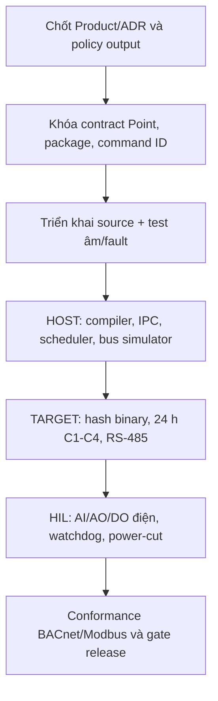

# Finding và đề xuất kiến trúc DDC-24

| Thuộc tính | Giá trị |
|---|---|
| ID | `REC-DDC-ARCH-GAP-20260926` |
| Trạng thái | Record finding/đề xuất; **chưa phải ADR hoặc Detailed Design được phê duyệt** |
| Ngày, mốc source | 2026-09-26; rà lại 2026-09-27 trên HEAD `0f5d46f35ab48d9fb9b70fdb4fb0a2022d53da3a` (cây làm việc có WIP) |
| Đối chiếu khi hợp nhất | 2026-09-27, lúc đưa record vào `main@12af1082`: nhãn nháp F19/F20 lúc rà trùng số với finding khác của `EV-PROG-FBD-ST-MB-20260925`, nên record dùng mã của hồ sơ đó: `DDC-ARCH-08` = **F20** (+ **F22** cho phần EXT), `DDC-ARCH-09` = **F21**. Trên `main` cả ba **đã sửa trong mã** (PR #779/#778), F20 PASS target 2026-09-27; còn đo target/HIL/physical. Ngưỡng `VS-PROG-009` được chủ sở hữu chốt lại ở `VVP-PROG-001` v2.4 (≥ 10 chu kỳ mỗi lớp) và soak lần 3 đạt ngưỡng đó; soak độ bền 24 h trên image sạch vẫn chưa có. Cột "Trạng thái tại lượt rà" giữ nguyên nhận định tại mốc source. |
| Chủ quản | Project Engineering; owner quyết định từng finding ghi bên dưới |
| Người rà | Codex, vai trò rà soát kiến trúc |
| Kết luận | 7 finding ban đầu; bổ sung F20/F21/F22 và cổng image tin cậy; chưa đủ gate release |
| Căn cứ | [Báo cáo tổng hợp](DDC24_ARCHITECTURE_SOLUTION_COMPARATIVE_REVIEW_2026-09-26.md), source và [audit target 25–26/09](../test-evidence/programming/2026-09-25-fbd-st-modbus-do-audit.md) |
| Phương pháp | So Product/Requirement/ADR → contract → producer/consumer source → test/target record; chỉ khẳng định trạng thái trong phạm vi đã đọc. Không chạm runtime/board trong phiên này. |

## 1. Kết luận review

**FAIL đối với cổng release; PASS có điều kiện đối với hướng kiến trúc.** Ba process, ownership của Core và vòng Check→Commission là nền tốt. Các finding dưới đây là sai lệch hoặc khoảng trống có chứng cứ; không lấy finding cũ đã sửa làm lỗi mới. [Verification](../../05_verification/VERIFICATION.md) vẫn ghi Programming/hardware `NO-GO` và đòi target/HIL phù hợp.

| ID | Mức | Nhóm | Trạng thái tại lượt rà | Chứng cứ ngắn |
|---|---|---|---|---|
| `DDC-ARCH-01` | P1 | Hồ sơ/contract | **ĐÃ RE-PIN BẢN RÀ; CHỜ KÝ** | Product/SRS/VVP và note interface/software đã rà theo ADR-061; Detailed Design cũ và chữ ký authority còn phải đối chiếu. |
| `DDC-ARCH-02` | P1 | BACnet/Point | **MỞ: target chưa thành As-Built** | 88 object cố định; chỉ AI/BI được cập nhật từ runtime. |
| `DDC-ARCH-03` | P1 | Modbus/output | **MỞ: policy chưa phủ đủ chuyển gói** | F06 có safe_value khi Disable instance đã publish; audit ghi chưa phủ Program bị bỏ khỏi package khi Commission/Restore. |
| `DDC-ARCH-04` | P1 | Real-time/evidence | **MỞ: gate thời lượng và HIL** | Soak 24 h đầu FAIL C4 (đỉnh 129,63 µs); lượt 3 PASS khoảng 11 phút rồi dừng; điện DO chưa đo. |
| `DDC-ARCH-05` | P2 | Commission | **MỞ: khoảng hở 70 ms** | F13 giảm 1,38 s → 70 ms; muốn 0 cần quyết định IPC/package mới. |
| `DDC-ARCH-06` | P1 | Modbus/write result | **CẦN ĐỐI CHIẾU END-TO-END** | Audit Modbus `MBA-GAP-01` ghi sink kết quả ghi chưa nối về người vận hành; `MBA-FW-08` đã có `ext_cmd_seq`, không lặp lại finding đó. |
| `DDC-ARCH-07` | P2 | Tính trung thực hồ sơ | **MỞ: ma trận audit trộn thời điểm** | Ma trận cuối audit còn nhãn Trace FAIL, Disable giữ giá trị, Restore FAIL của lượt 1 cạnh kết luận C1–C4 lượt 3 PASS. |
| `DDC-ARCH-08` | P0 | F20/F22: output khi thay package | **SOURCE CONFIRMED; HIL NOT RUN** | `programming_runtime_coordinator.cpp` rút candidate registry sau swap nhưng không gọi `st_withdraw_instance_outputs` cho Program cũ; resolver mức 5/EXT có thể giữ lệnh cũ. |
| `DDC-ARCH-09` | P0 | F21: SafeState owner | **SOURCE CONFIRMED; HIL NOT RUN** | `scan_loop.cpp` gọi `safe->apply` không truyền `graph_is_active_producer`; graph backup có thể làm sai T6/T7 trong `PROGRAM_ONLY`. |
| `DDC-ARCH-10` | P0 | Tin cậy target | **BLOCKED** | Bo Foxlinx đã bị root qua SSH; chưa cài lại image tin cậy/đóng WAN; kết quả target hiện tại không đủ làm chứng cứ release. |

Mức ưu tiên là đánh giá rà soát, **không phải severity đã được Product Owner phê duyệt**. Cần xác nhận owner/issue theo `WF-CLEAN-001` trước khi đổi baseline hoặc triển khai code ngoài phiên review.

## 2. Lỗi nghiêm trọng (Critical DDC)

### DDC-ARCH-03 — Nhả lệnh Modbus khi thay package chưa có policy đầy đủ

- **Điều đã chứng minh:** F06 sửa đường `Program Disable` với `dirty=0` + `ext_cmd_seq` mới; Iobus ghi `safe_value` nếu cấu hình, còn thiếu thì cảnh báo và giữ giá trị cuối (`apps/core/application/st/st_process_image.hpp`, `apps/iobus/adapters/modbus_rtu/modbus_master.cpp:293–365`, test `test_modbus_audit_20260925.cpp`). Audit target ghi DO2/DO4 về 0 trong ≤ 1,2 s khi Disable.
- **Khoảng trống đã ghi rõ trong audit:** Program bị loại khỏi package khi Commission/Restore chưa thuộc sửa F06. Source review ngày 27/09 xác nhận đường rút AO/DO/EXT thiếu sau swap (F20/F22); fixture tạm còn thấy DO-01 giữ giá trị sau 65 s. Chưa có phép đo đầu cực vật lý.
- **Đề xuất:** định nghĩa cùng một thao tác `withdraw(owner, reason, generation)` cho `DISABLE`, `FAULT`, `TTL_EXPIRE`, `REPLACE_PACKAGE`, `RESTORE`; policy của từng Point phải khai `safe_value`/`hold_last` có chủ đích, không để vắng cấu hình thành quyết định ngầm. Sau stage, Core phát danh sách owner cũ mất quyền tại safe boundary; Iobus chỉ nhận generation mới và trả write result. Trạng thái `UNKNOWN` không được tự phát lại lệnh cũ.
- **Kiểm chứng để đóng:** fixture có 2 package A/B cùng một DO Modbus. A bật DO=1; B bỏ Program; Commission/Restore/rollback, rút owner và readback coil đều đúng policy, không ghi sai Point dù slot đổi. Tiêm bus offline/reconnect/restart Iobus và xác nhận không replay lệnh đã rút; đo thời gian từ safe boundary tới FC05/readback **riêng**, không gọi đó là 10 ms local I/O. Physical relay phải đo riêng trước HIL PASS.
- **Owner đề xuất:** Runtime/Core + Iobus + Product Owner chốt policy; gate: `IMPLEMENT_READY` cho thay contract và `RELEASE_READY` cho HIL output.

### DDC-ARCH-04 — 10 ms mới đạt cửa sổ ngắn

- **Điều đã chứng minh:** sau F11–F16, 600 s có 0/60.006 lần >100 µs. Soak 24 giờ đầu sau đó **FAIL C4**, 2 lần vượt và đỉnh 129,63 µs; F17 đổi cpufreq governor. Lượt 3 ngày 27/09 đạt C1–C4 trong khoảng 11 phút, dừng tay lúc 04:15:45Z, không đủ 24 giờ. MCU target là Fake MCU; mức điện tiếp điểm NOT RUN.
- **Đề xuất:** giữ trạng thái “đạt 600 s trên cấu hình target đã đo”, chưa đưa nhãn chu kỳ 10 ms bảo đảm vào datasheet. Cổng 24 h cần cùng hash binary, unit/kernel/affinity/governor, 0 restart Core, `jitterViolationCount=0`, `missedBaseStepCount=0`, `missedReleaseCount=0`, `overrunCount=0`. Cần stress hợp lý (Web, BACnet, Modbus, restart service phụ) và lưu raw log/metrics. Nếu đỏ, dùng nhánh điều tra PREEMPT_RT/isolcpus theo ADR-061, đo lại từ đầu.
- **Đo vòng kín:** thêm fixture AI→Program→AO/DO cục bộ, logic analyzer/scope đo timestamp input/output và thử watchdog/power-cut; bus Modbus đo như một cổng riêng. Theo [nghiên cứu điều khiển có jitter](https://web.stanford.edu/~boyd/papers/perf_bnd_jitter.html), cùng nhịp lấy mẫu nhưng jitter/latency khác có thể cho đáp ứng khác; đây là lý do phải đo sensor→actuator chứ không chỉ thời gian chạy bytecode.
- **Owner đề xuất:** Runtime/Platform + V&V + HW; gate: claim NFR 10 ms và `RELEASE_READY`.

### F20/F21/F22 và image tin cậy — quyết định chặn RC bổ sung ngày 27/09

**F20/F22 (`DDC-ARCH-08`):** `st_withdraw_instance_outputs` có đường nhả AO/DO
qua `PriorityResolver` và EXT qua `PointWriter`, nhưng được gọi từ
`st_withdraw_stale_outputs` khi Program còn nằm trong scheduler. Sau package
swap, `programming_runtime_coordinator.cpp` chỉ `withdraw_instance` khỏi
candidate registry rồi `clear`; Program cũ không còn ở scheduler để vòng TTL
quét. Fixture trong scratchpad `soak3/doc_findings.md` thấy DO-01 vẫn bằng 1
sau 65 s; đây là **test tạm trên bo/host bị giới hạn tin cậy**, source path là
chứng cứ chính. Sửa ở boundary bằng thao tác nhả owner cũ trước khi hủy topology,
bao gồm AO/DO/EXT và generation; xác định chính sách `safe_value` thiếu bằng
quyết định Product/Safety. Test thay package, Restore, rollback, priority cao
hơn, bus offline/reconnect và physical read-back trước khi đóng.

**F21 (`DDC-ARCH-09`):** `ScanLoop` gọi `d_.safe->apply(last_io_, *d_.table,
&out)` tại `apps/core/application/runtime/scan_loop.cpp:289`; mặc định của
`graph_is_active_producer` là true. Với graph vẫn load để dự phòng và cutover
`PROGRAM_ONLY`, T7 không còn biểu diễn đúng “không có controller” và T6 có thể
nhìn input của graph không active. Truyền trạng thái owner thực tại call site,
test GRAPH_ONLY/PROGRAM_ONLY/no-controller/fault/restart cùng physical output.

**`DDC-ARCH-10`:** [biên bản sự cố SSH](../security/2026-09-26-foxlinx-ssh-intrusion.md)
ghi root bị chiếm. Đã chặn IoC nhưng chưa chứng minh image sạch. Cần reimage
từ nguồn tin cậy, xoay credential/đóng WAN, hash và boot provenance rồi mới
chạy lại các phép thử release trên đúng SKU. Kế hoạch/owner/gate nằm ở
[Release Handover §8](../../03_implementation/15_RELEASE_HANDOVER_CHECKLIST.md).

## 3. Lỗi Protocol / Point

### DDC-ARCH-02 — BACnet công bố object trước khi có nguồn Point tin cậy

- **Source hiện tại:** `apps/iobus/adapters/bacnet/bacnet_server.cpp:214–224` tạo AI×16, BI×8, AO×4, BO×4, AV×32, BV×16, MSV×8 = **88** object; `sync_stack_inputs()` tại dòng 228–258 chỉ nạp AI/BI = **24**. Vậy 64 object khác **không được hàm này cập nhật từ SHM**. [ARCH-BACNET-001](../../03_architecture/BACNET_ARCHITECTURE_DESIGN_MK-DDC-24_VI.md) đã ghi Export Registry/identity/capability gate là **Target chưa có trong mã**; kết luận này đã được kiểm lại tại source mốc rà.
- **Tác động:** BMS có thể đọc một object hiện diện nhưng giá trị/quality không đại diện Point thật. `objectInstance=i+1` cũng không giữ danh tính Point nếu cách bố trí thay đổi. Không được coi số 88 là số Point thực đã expose đúng.
- **Đề xuất:** hiện thực một Export Registry dựng từ Canonical Point có stable ID, capability, type, units, runtime source, quality, commandability và write priority. Chỉ đăng ký object có nguồn hợp lệ; mọi API liệt kê và adapter đọc **cùng registry**. Giữ ID bền qua rename/reboot, từ chối collision; publish commandable chỉ khi callback write + result tồn tại. Đây là hướng đã mô tả trong design, cần triển khai và V&V, không tạo design song song.
- **Kiểm chứng để đóng:** hai board profile khác nhau, reboot/rename/reorder Point, lost source/stale quality, WriteProperty/priority/relinquish, COV/subscribe và packet capture; kết quả registry = object thật = endpoint list. BTL/conformance chỉ claim sau bài test đúng profile theo [ASHRAE 135](https://data.ashrae.org/bacnet/).
- **Owner đề xuất:** BACnet/Iobus + Point Model; gate: BACnet/IP product claim và `RELEASE_READY`.

### DDC-ARCH-06 — Kết quả ghi Modbus phải về tới người ra lệnh

- **Bằng chứng:** [audit Modbus 25/09 §1–2](MODBUS_AUDIT_2026-09-25_FINDINGS_GAP_SOLUTIONS.md) gọi `MBA-GAP-01`: đường ghi hiện có ACK/frame monitor ở tầng bus nhưng chưa có kết quả hữu danh từ thiết bị tới UI/Program; `write-test` có thể báo trước khi thiết bị xác nhận. Audit Programming đo 234/234 ACK ở phiên cụ thể, không chứng minh mọi write API có lifecycle đầu–cuối.
- **Đề xuất:** command phải có `request_id`, `pointStableId`, generation/config revision, deadline và trạng thái `QUEUED → SENT → ACKED/EXCEPTION/TIMEOUT/DROPPED/UNKNOWN`, readback tách ACK. UI chỉ gọi thành công ở tầng mà nó thực sự biết; Program có chính sách lỗi/fallback rõ. Chỉ một owner phát lệnh sau phân xử Core. Lấy phương án tiến hóa tại chỗ của [REC-MBA-GAP-001](MODBUS_AUDIT_2026-09-25_FINDINGS_GAP_SOLUTIONS.md) làm candidate, không thêm daemon nếu chưa chứng minh cần.
- **Kiểm chứng để đóng:** phát hai giá trị khác nhau và cùng giá trị; đổi cấu hình slot; slave trả exception, timeout, ACK nhưng readback không đổi, restart Iobus giữa giao dịch; API/WS/audit và journal phải có cùng `request_id` và trạng thái cuối hoặc `UNKNOWN`.
- **Owner đề xuất:** Modbus/Iobus + Web API + Product Owner; gate: trust của lệnh vận hành và `RELEASE_READY`.

## 4. Lỗi Runtime / Commission

### DDC-ARCH-05 — Khoảng safe-state khi Commission/Restore

- **Bằng chứng:** [audit target F13](../test-evidence/programming/2026-09-25-fbd-st-modbus-do-audit.md) đo 1,38 s trước sửa, 70 ms sau `RuntimeIntentService.Nudge()`; source có `SetActivatedHook` khi operation SUCCEEDED. 70 ms là số đo ở một kịch bản target, **không phải upper bound**.
- **Đề xuất:** Product/Safety chốt khi thay package được phép có khoảng safe-state hay phải bàn giao output liên tục. Nếu không được phép, đưa enable intent vào phase ACTIVATE có generation và read-back đồng bộ tại Core safe boundary; lỗi/timeout phải rollback đúng package hoặc ở safe-state có audit, không coi commit Web thành runtime RUNNING.
- **Kiểm chứng để đóng:** 100+ lần Commission/Restore dưới tải, đo maximum/p99 nhưng xét **maximum** theo giới hạn đã duyệt; thử mất Web/IPC/nguồn từng phase; xác nhận không có cả hai package cùng sở hữu output, không phát lệnh ngoài generation mới.
- **Owner đề xuất:** Product Owner + Safety/Runtime Architect; gate: quyết định điều khiển liên tục và `IMPLEMENT_READY` cho đổi IPC.

## 5. Lỗi tài liệu / thẩm quyền

### DDC-ARCH-01 — Chu kỳ và số Task trong hồ sơ đã lệch contract

- **Bằng chứng trực tiếp:** `contracts/programming/product_profile_v2.json` v2.2 có `maxTasks=8`, `allowedPeriodMs=[10,50,100,500,1000,5000,10000,50000]`. [ADR-061](../../adr/ADR-061-programming-chu-ky-10ms-bo-chu-ky-moi.md) ghi gói cũ 30.000 ms chỉ được nạp lại. Product/Requirements/SRS/VVP và ghi chú Interface/Software đã được đồng bộ **trong bản rà 27/09**, manifest khớp 17/17; điều này chưa thay chữ ký owner hoặc tự cập nhật mọi Detailed Design/UI/help/datasheet.
- **Đề xuất:** Product Owner + System Architect ký bản rà đúng phạm vi ADR-061, so tiếp Detailed Design/Trace/UI/help/datasheet. “Tạo mới” dùng tám chu kỳ, “đọc gói legacy 30.000 ms” là ngoại lệ migration; `maxTasks=8` không đồng nghĩa runtime production đã đo tám Task dưới tải. Manifest pin là kiểm tính nhất quán revision, không phải chữ ký.
- **Kiểm chứng để đóng:** `candidate_pin_check.py`, `docs_iso_harness.py --expect`, schema/profile generator `--check`; test API/Check từ chối 5/7/30.000 ms khi tạo mới nhưng loader nhận gói 30.000 ms cũ; rà mọi bản UI/help/datasheet dùng chữ “cycle”.
- **Owner đề xuất:** Product Owner + Document Control + System Architect; gate: claim NFR và baseline tài liệu.

### DDC-ARCH-07 — Ma trận cuối audit trộn kết quả lượt 1 với lượt 3

- **Bằng chứng:** mục “Ma trận kiểm chứng” trong [audit 25/09](../test-evidence/programming/2026-09-25-fbd-st-modbus-do-audit.md) vẫn ghi Trace FAIL, Disable “output EXT giữ giá trị cuối”, Restore FAIL và Service logs không thấy warning của lượt đầu; cùng bảng ghi C1–C4 PASS 600 s sau sửa. Phần đầu hồ sơ lại ghi F04/F05/F06/F08 đã sửa và deploy. Một người đọc mỗi bảng cuối có thể hiểu sai trạng thái hiện hành.
- **Đã sửa trong phiên review:** ma trận được gắn nhãn snapshot lượt 1, thêm hướng dẫn đọc phần lượt 3 mới nhất; không sửa lại phép đo lịch sử. Không nâng PASS cho Trace/Restore nếu chưa trích chính xác phép đo cuối ở từng row.
- **Owner:** Document Control; gate: độ tin cậy hồ sơ audit.

## 6. HMI, alarm, historian và phần cứng

Không phát hiện defect mới đủ chứng cứ trong các phần này từ lượt đọc source giới hạn. `SYSTEM.md` quy định HMI presentation nằm ngoài đường điều khiển; `PHYSICAL_IO_HIL_REPORT.md` ghi MCU/điện I/O chưa qua HIL; `VERIFICATION.md` giữ `NO-GO`. Muốn mở finding mới cho alarm/historian hoặc UI cần một trace cụ thể producer→consumer→test/target, không lấy sự có mặt của module làm PASS hoặc FAIL. Vì chỉ đổi record Markdown, **không chạy Chrome DevTools**; không có claim review màn hình hay Console/Network mới.

## 7. Kế hoạch quyết định và phép thử so sánh công bằng

Benchmark so với Desigo/Metasys/Niagara chỉ có nghĩa khi cùng kịch bản AHU hoặc VAV, số Point, chu kỳ, poll bus, tải Web, fault injection, thước đo max latency/jitter, recovery, thao tác commission, dữ liệu trend/alarm và chi phí vòng đời. Thu raw trace và cấu hình từng hệ; không chấm điểm từ brochure. Lời hứa tối thiểu của DDC-24 trước so sánh thương mại là **đường điều khiển đúng, kết quả ghi quan sát được, object BACnet có nguồn, và HIL thật**.

## 8. Test bắt buộc và trạng thái bằng chứng

| Test / gate | Đã có gì | Cần để đóng finding |
|---|---|---|
| C1–C4 target | PASS cửa sổ 600 s sau F11–F16 theo audit | Kết quả soak 24 h đầy đủ, 0 vi phạm; mọi restart phải bắt đầu lại. |
| Modbus FC05 | Audit 234/234 ACK, 29 ms/giao dịch lượt đầu | Command-result hữu danh, exception/timeout/reconnect/readback, chuyển package. |
| Physical I/O | NOT RUN | Scope/logic analyzer đo local output và watchdog/power-cut với MCU thật. |
| BACnet conformance | Source adapter + thiết kế Target | Registry, object identity/quality/write semantics; profile conformance/BTL nếu định công bố. |
| HOST build/test phiên này | **NOT RUN** (chỉ sửa record/index/changelog) | Không dùng số đo lịch sử làm số đo phiên review. |
| FE browser phiên này | **NOT RUN** (không sửa hoặc review giao diện đang chạy) | Khi thay FE/runtime UI, dùng Chrome DevTools theo `AGENTS.md`. |

## 9. Đã sửa trong phiên / Việc cần làm tiếp

**Đã sửa trong phạm vi hồ sơ:** bổ sung hai record dễ đọc, liên kết nguồn và ma trận finding, đánh dấu snapshot lịch sử của ma trận audit để tránh diễn giải sai; cập nhật chỉ mục và changelog. Không sửa code hoặc claim deploy.

**Đường đóng theo owner/gate:** `DDC-ARCH-01` chờ chữ ký và impact review; `02/03/05/06/08/09` cần decision/design và source/test theo [Release Handover §8](../../03_implementation/15_RELEASE_HANDOVER_CHECKLIST.md). `04/10` cần image sạch, soak 24 giờ trên đúng SKU và dụng cụ/MCU thật cho HIL. Mọi Issue/PR clean-code theo [WF-CLEAN-001](../../00_governance/CLEAN_CODE_WORKFLOW.md); record này không là lệnh tự merge.
