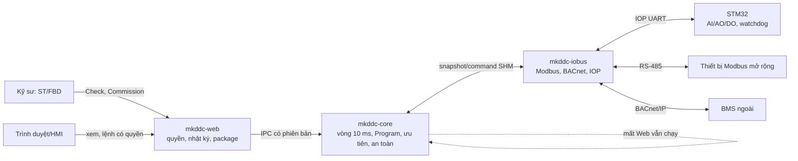
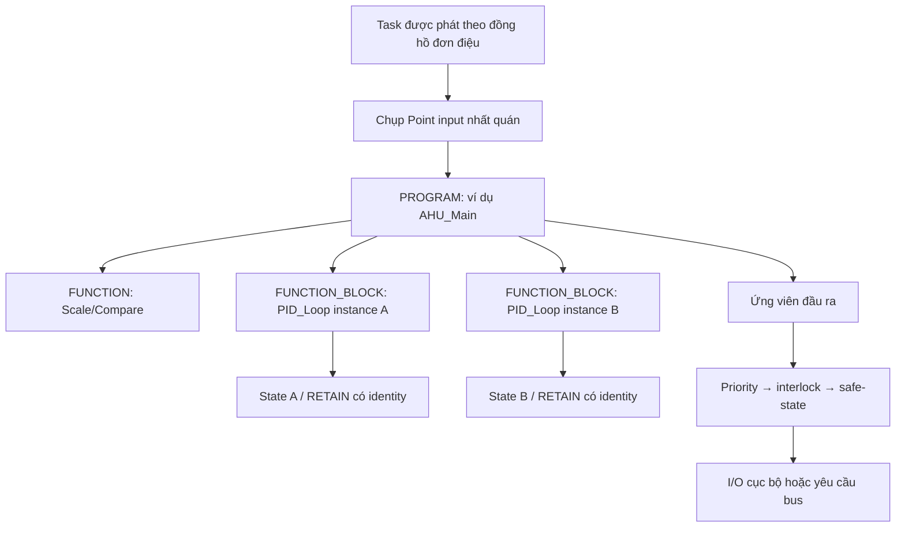
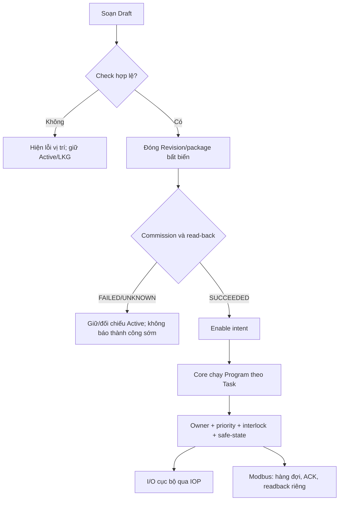

# Rà soát kiến trúc, lời giải và vị thế DDC-24

| Thuộc tính | Giá trị |
|---|---|
| ID | `REC-DDC-ARCH-COMP-20260926` |
| Trạng thái | Record rà soát, không phải Product/Design authority hoặc bằng chứng chứng nhận |
| Ngày, mốc source | 2026-09-26; cập nhật đề xuất sản phẩm 2026-09-27; source đối chiếu HEAD `0f5d46f35ab48d9fb9b70fdb4fb0a2022d53da3a` |
| Đối chiếu khi hợp nhất | 2026-09-27, lúc đưa record vào `main@12af1082`: nhãn nháp F19/F20 lúc rà trùng số với finding khác của `EV-PROG-FBD-ST-MB-20260925`, nên record dùng mã của hồ sơ đó: `DDC-ARCH-08` = **F20** (+ **F22** cho phần EXT), `DDC-ARCH-09` = **F21**. Trên `main` cả ba **đã sửa trong mã** (PR #779/#778), F20 PASS target 2026-09-27; còn đo target/HIL/physical. Ngưỡng `VS-PROG-009` được chủ sở hữu chốt lại ở `VVP-PROG-001` v2.4 (≥ 10 chu kỳ mỗi lớp) và soak lần 3 đạt ngưỡng đó; soak độ bền 24 h trên image sạch vẫn chưa có. Cột "Trạng thái tại lượt rà" giữ nguyên nhận định tại mốc source. |
| Chủ quản | Project Engineering |
| Người rà | Codex, vai trò rà soát kiến trúc |
| Kết luận | Hướng kiến trúc phù hợp DDC HVAC biên; release `NO-GO`, xem finding riêng |
| Phạm vi | Kiến trúc DDC, logic Programming, Point/I/O, BACnet, Modbus, vận hành, an toàn; so sánh giải pháp và sản phẩm công khai |
| Giới hạn | Đọc source/hồ sơ và tài liệu hãng; không đo board, tiếp điểm, mạng công trình hoặc sản phẩm đối thủ trong phiên này. Cây làm việc có sửa đổi runtime/packaging chưa commit, nên mọi kết luận source gắn với snapshot đã đọc. |

> Báo cáo finding và đề xuất riêng: [REC-DDC-ARCH-GAP-20260926](DDC24_ARCHITECTURE_GAP_FINDINGS_PROPOSAL_2026-09-26.md). Hồ sơ này giải thích kiến trúc và so sánh. Số đo target trích từ [audit 25–26/09](../test-evidence/programming/2026-09-25-fbd-st-modbus-do-audit.md), không phải phép đo mới.

## 1. Kết luận dễ hiểu

DDC-24 có hướng kiến trúc hợp lý cho bộ điều khiển HVAC/BMS biên: **điều khiển ở Core, giao tiếp hiện trường ở Iobus, cấu hình/giám sát ở Web**, còn MCU chịu trách nhiệm I/O và hành vi khi mất liên lạc. Việc mất giao diện không được làm dừng vòng điều khiển. Program ST/FBD đi qua Check, package, Commission, rồi mới chạy; đầu ra cục bộ đi qua phân xử ưu tiên, interlock và safe-state ([kiến trúc hệ thống](../../03_architecture/SYSTEM.md), [kiến trúc Programming](../../03_architecture/PROGRAMMING_ARCHITECTURE.md)). Đây là nền tảng có thể phát triển, song **chưa đủ căn cứ để tuyên bố ngang chức năng sản phẩm thương mại hoặc `RELEASE_READY`**: còn sai lệch hồ sơ chu kỳ, object BACnet chưa bám Point, giới hạn đường ghi Modbus mở rộng và bằng chứng HIL/soak chưa đóng.

### Hệ thống vận hành như thế nào?

Ba tốc độ **khác nhau** phải được báo riêng: nhịp logic Core, thời gian giao dịch bus, và thời gian thiết bị đổi điện thật. Audit target ghi FC05 ở 9.600 baud khoảng 29 ms/giao dịch và readback API trung vị 712 ms trong lượt đầu; đó không phải chứng cứ DO vật lý đạt 10 ms. C1–C4 đạt cửa sổ 600 s sau F11–F16, nhưng soak 24 giờ đầu **FAIL C4** (đỉnh 129,63 µs). Sau F17, lượt 3 đạt khoảng 11 phút rồi dừng; chưa có phép đo điện. Bo lab cũng chưa cài lại image sạch sau sự cố SSH root ([audit](../test-evidence/programming/2026-09-25-fbd-st-modbus-do-audit.md), [sự cố](../security/2026-09-26-foxlinx-ssh-intrusion.md)).

## 2. Đọc hình OB/FC/FB/DB theo đúng phạm vi

Hình người dùng gửi mô tả **STEP 7/TIA Portal của Siemens**, không phải sơ đồ chuẩn chung của mọi DDC. Tài liệu [Siemens về OB/FC/FB/DB](https://docs.tia.siemens.cloud/r/simatic_s7_1200_g2_manual_collection_enus_20/plc-concepts-configuration-and-programming/program-structure/structure-of-a-step-7-user-program) nói OB tổ chức thực thi, FC/FB chứa logic, FB dùng instance DB để giữ trạng thái. [IEC 61131-3:2025](https://webstore.iec.ch/en/publication/68533) quy định ngôn ngữ và POU; [PLCopen](https://www.plcopen.org/standards/logic/iec-61131-3/how-to-recognize-iec-61131-3-programming-system/) liệt kê POU là Program, Function và Function Block. Do đó **OB và DB là cách tổ chức của Siemens**, không phải hai POU bắt buộc của IEC. DDC-24 đã quyết định subset ST+FBD trong [ADR-020](../../adr/ADR-020-mekong-owned-iec-aligned-program-runtime.md); LD/SFC chưa ở phạm vi Rev A.

| Trong hình Siemens | Tương ứng có ích khi giải thích DDC-24 | Giới hạn phép so |
|---|---|---|
| OB chu kỳ/khởi động | Base step, Task/Program và lifecycle Core | DDC-24 không có OB1/OB100 hoặc interrupt OB tương thích Siemens. |
| FC | POU `FUNCTION` thuần, không giữ trạng thái giữa lần gọi | Không nên gọi thư viện DDC-24 là FC Siemens. |
| FB + instance DB | `FUNCTION_BLOCK` và state riêng của từng instance trong Program | State/RETAIN của DDC-24 dùng layout/identity package, không phải file DB Siemens. |
| Global DB | Published Signal, Point snapshot hoặc dữ liệu cấu hình theo **quyền sở hữu riêng** | Không được thay bằng vùng nhớ toàn cục ghi tự do; Program không share mutable state. |

Hai instance FB cùng dùng **một định nghĩa**, nhưng giữ **hai trạng thái**. Đây là lý do PID của hai AHU không được dùng chung biến tích phân. `FUNCTION` thuần thích hợp cho phép đổi đơn vị; `PROGRAM` mới là đối tượng có chu kỳ, binding và trạng thái chạy. Đường này được thiết kế trong [ARCH-PROG-001](../../03_architecture/PROGRAMMING_ARCHITECTURE.md); mức đã triển khai phải xác nhận theo code/test từng tính năng.

## 3. Rà theo từng ranh giới kiến trúc

| Ranh giới | Điểm mạnh xác nhận từ source/hồ sơ | Điểm chưa chứng minh hoặc gap | Quyền kết luận |
|---|---|---|---|
| Process và an toàn cục bộ | `SYSTEM.md` tách Core/Iobus/Web, HMI tùy chọn; `apps/core/application/runtime/scan_loop.cpp` gọi resolver/safe-state trước publish | Failover vật lý khi Web/Core/MCU chết chưa có HIL đầy đủ | Thiết kế + source; không phải HIL |
| ST/FBD → runtime | `apps/core/application/st/st_scheduler.cpp` xét due với dung sai; profile v2.2 có 8 chu kỳ 10…50.000 ms, cấu hình tối đa 8 Task nhưng runtime production hiện dùng một main Task | Product/SRS/VVP đang được đồng bộ; design/interface cũ còn drift; chưa có 24 h C1–C4 đạt trên image sạch | Source + audit target ngắn |
| Commission/Restore | Operation, intent và read-back có đường riêng; F13 giảm khoảng safe-state 1,38 s xuống 70 ms trên target | 70 ms vẫn là khoảng hở; F06 chưa bao phủ Program bị bỏ khỏi package khi Commission/Restore | Audit target; thiết kế cần chốt |
| Point và Modbus RTU | Stable identity/slot gate ở `apps/web-api/internal/programming/application/modbus_slots.go`; SHM `ext_cmd_seq` chặn phát lại lệnh cũ | Bus nối tiếp không chạy cùng nhịp 10 ms; kết quả write đầu–cuối và thay đổi package cần chứng minh thêm | Source + audit; không suy ra relay điện |
| BACnet/IP | Adapter tồn tại và công bố object | `register_objects()` vẫn tạo 88 object cố định; `sync_stack_inputs()` chỉ nạp AI/BI. Export Registry/identity bền vững là **Target** trong `ARCH-BACNET-001` | Source hiện tại; chưa phải BTL |
| Bảo mật/vận hành | API RBAC/audit, package hash/profile, operation/idempotency có thiết kế và test | Chưa có đánh giá độc lập IEC 62443 hoặc BTL; hồ sơ release vẫn NO-GO | Design/source, không phải chứng nhận |

**Lưu đồ đọc trạng thái một lệnh điều khiển:**

## 4. So sánh các phương án giải pháp

| Phương án | Lợi ích | Chi phí/rủi ro | Nhận định cho DDC-24 |
|---|---|---|---|
| **A. Tiếp tục 3 process, một Core làm chủ output** | Tái dùng SHM/IPC, một nơi phân xử, Web mất không dừng local control | Cần kiểm chứng giới hạn RT, command-result Modbus và provenance package | **Khuyến nghị** giữ nền; đóng gap theo finding thay vì thêm service điều khiển. |
| B. Chuyển mọi logic sang PLC Siemens/TIA style | Công cụ và block model quen thuộc với kỹ sư PLC | Phụ thuộc hệ Siemens; thay đổi lớn về compiler, memory, target, I/O và vận hành | Dùng hình để dạy cấu trúc POU, không sao chép OB/DB làm contract. |
| C. Gateway/BMS làm nơi chạy toàn bộ logic | Dễ tích hợp nhiều giao thức và dashboard | Mất gateway/mạng có thể ảnh hưởng điều khiển nếu không có field controller độc lập | Chỉ phù hợp supervisory logic; giữ logic an toàn ở Core/MCU. |
| D. Thêm fieldbus service độc lập | Có thể cách ly bus theo process và mở rộng nhiều adapter | IPC, deploy, read-back và failure mode tăng; không tự giải quyết danh tính/write result | Chỉ cân nhắc sau khi phương án A đo không đạt capacity/fault isolation; xem [audit Modbus](MODBUS_AUDIT_2026-09-25_FINDINGS_GAP_SOLUTIONS.md). |

Nhận định trên là **suy luận kiến trúc** từ topology, source và bằng chứng hiện có, không phải benchmark A/B đã thực hiện.

## 5. Bảng đối chiếu sản phẩm cùng thị trường

Các dòng dưới chỉ ghi **điều hãng công bố**, không suy diễn latency, giá, chứng nhận hay tính năng không được nguồn xác nhận. DDC-24 đang ở giai đoạn kiểm chứng nên cột của nó phân biệt rõ nguồn.

| Tiêu chí | DDC-24 hiện ghi nhận | Siemens Desigo PXC / ABT Site | Johnson Controls Metasys FEC / CCT | Tridium Niagara / JACE |
|---|---|---|---|---|
| Vai trò | Controller biên tích hợp local I/O, ST/FBD subset, BACnet/IP, Modbus RTU; release NO-GO | Controller tòa nhà; Siemens công bố BACnet/SC và công cụ engineering/commissioning ABT Site ([Siemens PXC](https://www.siemens.com/en-us/products/desigo/pxc/), [ABT](https://press.siemens.com/global/en/pressrelease/siemens-new-desigo-controllers-transform-buildings-high-performing-assets)) | Field controller BACnet; CCT dùng cấu hình, mô phỏng, commission và chuyển application ([JCI FEC](https://www.johnsoncontrols.com/building-automation-and-controls/building-automation-systems-bas/metasys-fecs), [CCT](https://docs.johnsoncontrols.com/bas/r/Metasys/en-US/Metasys-System-Configuration-Guide/10.1/Metasys-system/Controller-Configuration-Tool-CCT)) | Nền tảng tích hợp/điều khiển trên JACE, hỗ trợ giám sát, điều khiển, lịch và phân tích ([Tridium JACE](https://www.tridium.com/content/tridium/language-masters/en/Products/niagara/jace.html)) |
| Cấu trúc lập trình | PROGRAM/FUNCTION/FB; package/Task riêng; không dùng OB/DB Siemens | PXC dùng ABT Site và các block/function cấu hình sẵn theo công bố của Siemens | CCT cung cấp Logic Interface và chức năng mô phỏng/commission theo JCI | Niagara Workbench/framework; hướng tích hợp đa hệ theo Tridium ([Tridium](https://www.tridium.com/)) |
| Khả năng tương tác | BACnet adapter có, Export Registry chưa hiện thực; Modbus RTU có target evidence | Siemens công bố BACnet/SC; mức BTL/model cần đối chiếu đúng SKU | JCI công bố BACnet MS/TP cho FEC nêu ở nguồn | Tridium công bố nền tảng kết nối nhiều hệ; protocol cụ thể phụ thuộc module/license/thiết bị |
| Bằng chứng so sánh được | Source + cửa sổ target 600 s; physical HIL/24 h chưa đóng | Chỉ tài liệu hãng trong lượt rà này | Chỉ tài liệu hãng trong lượt rà này | Chỉ tài liệu hãng trong lượt rà này |

**Không chấm điểm “ai tốt hơn”**: chưa có cùng fixture, cùng số Point, bus load, lỗi tiêm, điện I/O và chi phí vòng đời. Bộ benchmark công bằng được nêu trong [báo cáo finding](DDC24_ARCHITECTURE_GAP_FINDINGS_PROPOSAL_2026-09-26.md).

## 6. Cơ sở khoa học và tiêu chuẩn cần xét

| Nguồn | Áp dụng có điều kiện vào DDC-24 | Cách chứng minh, không suy từ tên chuẩn |
|---|---|---|
| [IEC 61131-3:2025](https://webstore.iec.ch/en/publication/68533) | Ngôn ngữ ST/FBD, semantics POU; DDC-24 công bố **subset aligned** theo ADR-020 | Ma trận cú pháp/ngữ nghĩa subset, test âm/dương và tương thích artifact; không ghi “full IEC compliant”. |
| [ASHRAE 135-2024 BACnet](https://www.ashrae.org/technical-resources/technical-faqs), [ISO 16484-5:2022](https://www.iso.org/standard/84964.html) | Khi xuất Point cho BMS BACnet | Registry, identity, property/quality/priority, conformance test và BTL nếu mục tiêu thương mại yêu cầu. |
| [Modbus Organization, Application Protocol V1.1b3](https://www.modbus.org/modbus-specifications) | Khi đọc/ghi thiết bị RTU | Codec, exception, timeout, CRC/serial line, write result và readback theo từng thiết bị. |
| [IEC 62443-4-1](https://webstore.iec.ch/en/publication/33615), [IEC 62443-4-2](https://webstore.iec.ch/en/publication/77193) | Hướng dẫn vòng đời phát triển an toàn và yêu cầu thành phần cho sản phẩm OT | Threat model, RBAC, cập nhật ký số, logging, thử lạm dụng; chưa có chứng nhận. |
| [ASHRAE Guideline 36](https://handbook.ashrae.org/Handbooks/A23/IP/A23_Ch40/a23_ch40_ip.aspx) | Mẫu sequence HVAC khi sản phẩm tuyên bố áp dụng AHU/VAV tương ứng | Test chức năng theo từng sequence; guideline, không tự động bắt buộc cho mọi SKU. |
| [IEC 61508-2](https://webstore.iec.ch/en/publication/5516) | **Chỉ** khi DDC-24 được đặt vào safety function có phân tích rủi ro/SIL | Hiện không có claim safety PLC/SIL; cần lifecycle và đánh giá riêng nếu đổi phạm vi. |

Về mặt điều khiển lấy mẫu, độ trễ đánh thức và trễ tác động có thể làm giảm chất lượng hoặc ổn định vòng kín; [nghiên cứu Stanford về controller với timing jitter](https://web.stanford.edu/~boyd/papers/perf_bnd_jitter.html) đưa phương pháp đánh giá giới hạn hiệu năng theo jitter. **Suy luận áp dụng:** C1–C4 chỉ đánh giá năng lực thời gian của Core; phải đo thêm trễ sensor→output, bus và đáp ứng quá độ của một plant/fixture HVAC cụ thể trước khi nói về chất lượng PID hoặc tiết kiệm năng lượng. Không lấy 600 s đạt C4 làm chứng minh ổn định mọi tải trong 24 h.

## 7. Kết luận giao tiếp với người ra quyết định

- **Giữ hướng kiến trúc 3 process và output authority ở Core.** Hình TIA giúp giải thích Program/Function/FB, nhưng không đổi hợp đồng DDC-24 thành OB/DB.
- **Ưu tiên đóng tính đúng của dữ liệu và hành động:** đồng bộ chu kỳ trong hồ sơ, BACnet object có nguồn thật, Modbus write result và safe behavior khi chuyển package.
- **Gắn mỗi lời hứa với đúng phép đo:** host, Foxlinx + Fake MCU, RS-485, điện I/O vật lý, 24 h và chứng nhận là các tầng độc lập. `RELEASE_READY` hiện vẫn `NO-GO` theo [Verification](../../05_verification/VERIFICATION.md).

## 8. Phương pháp và nguồn đối chiếu

Đã đọc: `AGENTS.md`, `docs/README.md`, `DOC-CTRL-001`, `ARCH-SYS-001`, `ARCH-PROG-001`, `ARCH-BACNET-001`, profile v2.2, scheduler/scan loop/BACnet server/Modbus bridge, audit target 25–26/09 và các review Modbus/Programming. Tra cứu nguồn **IEC/ISO/ASHRAE/Modbus và trang chính thức của Siemens/JCI/Tridium** ngày 2026-09-26. Chưa chạy build/test/browser vì phiên này chỉ tạo record tài liệu; những con số kiểm thử nêu trong bài là số đo lịch sử có liên kết, không được ghi thành số đo mới.

## 9. Đề xuất tính năng để Product Owner review — 2026-09-27

### 9.1 Cách chọn cuộc cạnh tranh

**Đề xuất định vị:** bán một DDC **dễ đưa vào vận hành, điều khiển tại chỗ khi
mất mạng, và giải thích được vì sao đầu ra có giá trị hiện tại**. Đây là định
hướng sản phẩm để review, chưa phải lời hứa đã kiểm chứng. Không cố sao chép
toàn bộ Niagara hoặc biến DDC-24 thành BMS trung tâm. Bốn nhóm việc đã có trong
[kế hoạch đóng release](../../03_implementation/15_RELEASE_HANDOVER_CHECKLIST.md#8-kế-hoạch-chốt-rc-và-release--2026-09-27)
(F20/F21/F22, bo/image tin cậy, BACnet/Modbus đúng, HIL/rollback) là **điều kiện
nền**, không được đếm như tính năng mới để quảng cáo.

Tài liệu hãng cho thấy các điểm khách hàng đã quen kỳ vọng: Siemens PXC kết
hợp công cụ engineering/commissioning, I/O mở rộng và BACnet/SC
([PXC](https://www.siemens.com/en-us/products/desigo/pxc/)); Johnson Controls
CCT có mẫu AHU/VAV/plant, simulation và commissioning trên thiết bị
([CCT](https://docs.johnsoncontrols.com/bas/r/Metasys/en-US/Metasys-System-Configuration-Guide/15.0/Metasys-system/Tools/Controller-Configuration-Tool-CCT?contentId=9DvLEe3w_43mQkn94oVAPw));
Schneider dùng ứng dụng di động để kiểm tra I/O, cân chỉnh VAV và xuất báo cáo
([Commission](https://sqa.ecostruxure-building-help.se.com/bms/topics/show.castle?id=13861&locale=en-US&productversion=7.0));
Niagara/JACE nhấn mạnh kết nối thiết bị, lịch sử, lịch, cảnh báo và quản lý
([JACE](https://www.tridium.com/content/tridium/language-masters/en/Products/niagara/jace.html),
[Niagara](https://www.tridium.com/us/en/Products/niagara)); Honeywell đưa bảo
mật và vận hành I/O tại chỗ vào thông điệp Optimizer
([Optimizer](https://buildings.honeywell.com/us/en/brands/our-brands/bms/what-we-do/controllers/optimizer-suite/advanced-controller)).
Đây là **điều các hãng công bố**, chưa phải benchmark độc lập hay so sánh giá.

### 9.2 Danh sách để ra quyết định

`S/V/L` dưới đây là **ước lượng tương đối để sắp thứ tự nghiên cứu**, chưa phải
ngày công hoặc cam kết lịch. Các ngưỡng đo là **đề xuất pilot**, phải có phép
đo hiện trạng cùng fixture trước khi ký. `P1` nghĩa là nghiên cứu cho bản sau
RC hiện tại, không tự mở rộng RC đang NO-GO.

| ID/ưu tiên | Kỹ thuật viên hoặc chủ tòa nhà sẽ nhận được gì? | Mức hiện có ở DDC-24 và phần nên bổ sung | Công sức/rủi ro | Phép thử và câu hỏi cần Product review |
|---|---|---|---|---|
| `CP-01` **P1** — Hướng dẫn nghiệm thu tại hiện trường | Mở bằng điện thoại/laptop trong LAN, làm từng bước: nhận diện bo → kiểm dây từng AI/AO/DO → thử lệnh có xác nhận → lưu ảnh/số đo → xuất biên bản. Không cần Internet/BMS trung tâm để làm việc tại tủ. | Web, Point và một số thao tác commissioning đã có; cần một luồng thống nhất có danh tính Point, quyền, giới hạn thời gian override, read-back và báo cáo ký được. Không cấp phép ghi tắt từ trình duyệt. | V; rủi ro thao tác ngõ ra vật lý. | Pilot cùng một tủ AHU: so thời gian và số bước với quy trình hiện tại, mục tiêu thử nghiệm giảm ≥30% thời gian; 0 lần nhầm Point/giữ override sau timeout. Ký phạm vi I/O test nào cho kỹ thuật viên? |
| `CP-02` **P1** — Mẫu điều khiển HVAC | Chọn mẫu AHU/VAV/FCU/bơm; nhập Point, giới hạn và chế độ; hệ thống dựng logic, checklist và test mô phỏng, rồi kỹ sư vẫn có thể xem/sửa ST/FBD. | Đã có Control Library, ST/FBD và Simulation trong Product Target; chưa có bộ mẫu ứng dụng được nghiệm thu như một sản phẩm. Bắt đầu bằng **một** AHU và **một** VAV, không sao chép logic hãng. | L; trách nhiệm điều khiển/safety cao. | Hai kỹ sư mới dựng cùng fixture; đo thời gian, số lỗi ánh xạ và test fault. Mọi mẫu phải có sequence, tham số, giới hạn, phiên bản, rollback và test vật lý; cân nhắc [ASHRAE Guideline 36-2024](https://www.ashrae.org/technical-resources/standards-and-guidelines/titles-purposes-and-scopes) như nguồn sequence/test, không tự nhận tuân thủ. Chọn AHU hay VAV làm pilot đầu? |
| `CP-03` **P1** — Nhật ký vận hành tại chỗ đáng tin | Khi mạng/BMS mất, DDC vẫn ghi trend, alarm và lịch điều khiển; lúc nối lại, người dùng thấy khoảng dữ liệu thiếu, nguyên nhân alarm và ai đã ACK/đổi lịch. | Product baseline đã nêu alarm/trend/schedule; cần đo retention, lưu bền vững, đồng hồ, mất điện và quyền. BACnet Schedule/Alarm/Trend Log theo ADR-057 để V1.1, không quảng bá như object Rev A đã có. | V/L; lưu trữ và endurance. | Thử 24 giờ mất mạng, power-cut, đồng hồ đổi; 0 mẫu bị bịa thành GOOD, có dấu khoảng trống, khôi phục lịch/ACK đúng. Product chốt dung lượng lưu tại bo và thời gian giữ dữ liệu. |
| `CP-04` **P1** — Giải thích “vì sao relay đang bật?” | Ở từng Point, xem lệnh của Program nào, priority nào thắng, interlock/safe-state nào áp, lệnh Modbus đã thực sự ghi hay còn chờ; xuất gói chẩn đoán cho đội hỗ trợ. | Core có resolver/metrics, FE có Monitor/Trace; F20/F22 và write result là gap. Cần một timeline thống nhất từ ý định → lệnh thắng → ghi → giá trị đọc lại, ghi rõ `UNKNOWN` khi thiếu. | V; phải giới hạn log/RAM và giấu dữ liệu nhạy cảm. | Tiêm 10 lỗi điển hình (mất sensor, bus timeout, override, swap package); người bảo trì xác định nguyên nhân trong ≤5 phút ở ≥8/10 ca pilot; không có “đã bật” khi chỉ mới accepted. |
| `CP-05` **P2** — Sao lưu và thay bo ít gián đoạn | Cắm bo thay thế, nạp backup đã ký, so khớp loại I/O và bản phần mềm, chạy preflight rồi kích hoạt có thể rollback; cập nhật phần mềm bằng hai image A/B khi phần cứng hỗ trợ. | Backup/Restore/LKG đã có thiết kế, nhưng full binary+DB rollback và thay controller còn gate release. OTA A/B nằm ngoài Rev A hiện tại: chỉ nghiên cứu sau khi nền khôi phục đạt HIL. | L; bootloader, lưu trữ và recovery path. | Diễn tập ≥10 lần mất điện ở các bước và thay bo; 0 lần active sai package/I/O. Product chốt nhu cầu thay nóng tại site hay bảo trì theo cửa sổ dừng. |
| `CP-06` **P2** — BACnet/SC cho công trình yêu cầu IT/OT cao | Kết nối BACnet có xác thực/chứng chỉ và mã hóa mà không mất ngữ nghĩa Point/priority. | BACnet/IP Rev A là baseline; BACnet/SC là capability mới, không thể thay thế việc sửa Export Registry và test BACnet/IP trên bo. | L; vòng đời chứng chỉ, hub, tương tác BMS. | Interop với ít nhất hai hệ BACnet/SC độc lập, thử hết hạn/thu hồi chứng chỉ, hub mất, reconnect và local control liên tục. Chỉ đưa vào SKU/phiên bản nếu có dự án cần. [BACnet International](https://bacnetinternational.org/bacnetsc/) mô tả SC là tầng truyền có mã hóa, không thay BACnet/IP. |
| `CP-07` **P2** — Dữ liệu mở có ngữ nghĩa | Xuất danh mục Site→Thiết bị→Point với đơn vị, loại sensor/command, quality và ID ổn định để BMS/analytics khác tích hợp nhanh. | Đã có Canonical Point và BACnet Target; bổ sung tagging/export **chỉ đọc** trước, không mở một đường ghi mới. | V; đồng bộ ID và phiên bản schema. | Một tích hợp viên chưa biết repo ánh xạ 100 Point từ một AHU sang hệ ngoài, đo thời gian và lỗi mapping; 0 Point “có tên nhưng không có nguồn”. [Project Haystack](https://project-haystack.org/doc/docHaystack/Points) là từ vựng tham khảo cho site/equipment/point, quality và priority. |
| `CP-08` **P3** — Phát hiện vận hành bất thường và năng lượng | Báo sensor lệch, van mở mà nhiệt độ không đổi, quạt chạy ngoài lịch, tiêu thụ bất thường; chỉ đưa khuyến nghị, không tự điều khiển plant ở bản đầu. | Alarm/trend chưa đủ evidence release; cần dữ liệu sạch và mẫu HVAC trước khi làm FDD/energy. | L; dễ báo giả, cần dữ liệu mùa/tải. | Pilot hai site, kỹ sư xác nhận từng cảnh báo; đo precision/recall và thời gian phát hiện theo nhãn sự cố thật trước khi chọn ngưỡng thương mại. Không hứa mức tiết kiệm năng lượng nếu chưa đo A/B. |
| `CP-09` **P3** — Quản lý nhiều bo và I/O mở rộng | Một màn hình kiểm phiên bản/backup/cảnh báo của nhiều DDC; chọn module I/O theo nhu cầu thay vì thay cả controller. | Product baseline một SKU I/O và local-first; cloud/fleet và hardware mở rộng là scope mới, cần khảo sát số bo/site, BOM, nguồn, EMC và failure boundary. | L/rất lớn; phần cứng, vận hành và bảo mật. | Phỏng vấn ≥3 dự án thật về số I/O và số bo, xác định SKU/giá mục tiêu trước khi mở thiết kế. Fleet phải là tùy chọn; mất server không dừng local control. |

### 9.3 Khuyến nghị trình duyệt

1. **Duyệt nghiên cứu `CP-01..04` trước:** đây là bốn luồng hiện trường dễ chỉ
   ra lợi ích và tận dụng nền đã có. Trước khi làm, đóng F20/F21/F22, đường dữ liệu
   BACnet/Modbus và release gate hiện hành; Product chọn một AHU/VAV pilot,
   người dùng thử và số đo baseline. Không thêm chúng vào RC hiện tại.
2. **Cho phép khảo sát kiến trúc `CP-05..07`, chưa cam kết phiên bản:** chốt
   nhu cầu khách hàng, phần cứng/chứng chỉ/retention và TCO trước khi viết
   Detailed Design. `CP-06` chỉ có ý nghĩa nếu BACnet/IP nền đã đúng.
3. **Giữ `CP-08..09` ở mức khám phá thị trường:** cần site, dữ liệu vận hành và
   đơn hàng/SKU thực để tránh đầu tư trước khi có nhu cầu.

**Phiếu quyết định cần Product Owner ghi cho từng ID:** `DUYỆT DISCOVERY` /
`HOÃN` / `BÁC`, phân khúc khách hàng, buyer, SKU/phiên bản dự kiến, pilot và
giới hạn chi phí. Chỉ sau quyết định đó mới cập nhật Product Requirement → SRS
→ Detailed Design → VVP/Trace/Risk. Bảng này là **đề xuất để review**, không
phải scope đã phê duyệt, không thay `RELEASE_READY=NO-GO`.
