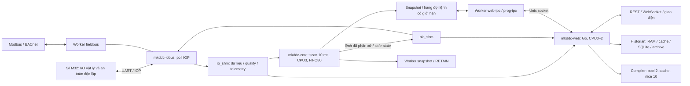

# DDC-24 — Hiện trạng và dư địa cải thiện hiệu năng FW SOM / Backend

**ID:** REC-DDC-FW-BE-PERF-20260929

**Phiên bản:** 1.0

**Trạng thái:** In Review — record rà soát source và phương án cải thiện

**Ngày:** 2026-09-29

**Phạm vi:** Core C++, IOBus C++, backend Go, IPC/SHM, Historian, compiler, cấu hình chạy và đóng gói SOM

**Mốc mã nguồn:** `origin/main@895444beba0760f18cf1bdc252e707e319a3c751`

**Người rà:** Codex, vai rà soát kỹ thuật

**Chủ quản đề xuất:** Tech Lead; phối hợp FW-SOM, BE, BSP và QA

**Kết luận:** Còn dư địa cải thiện đáng kể ở BE và tính ổn định thời gian của FW. Giữ kiến trúc phân tách hiện tại; ưu tiên giảm công việc lặp, cấp phát và chờ I/O. Chưa có số đo mới trên SOM chứng minh mức tăng hiệu năng.

## 1. Kết quả chính

**Có đường để tăng hiệu năng. Chưa có bằng chứng cần thay SOM hoặc viết lại kiến trúc.** Ba việc nên ưu tiên:

1. **Đo lại trên SOM những tối ưu đã merge của Plan 63.** Nhiều finding 28/09 đã được xử lý trong source. Số đo HOST tốt không chứng minh bo hiện tại đã chạy đúng artifact hoặc đạt cùng mức cải thiện.
2. **Giảm chi phí truy vấn Historian.** Benchmark mới ở mốc review: 8 điểm × 24 giờ, `resolution=auto`, mất **1,121–1,152 s/lượt**, tổng cấp phát **268,79 MB ≈256,34 MiB/lượt**, khoảng **1,893 triệu lần cấp phát/lượt**. Đây là bằng chứng HOST rõ nhất cho một hướng cải thiện BE bổ sung.
3. **Dùng chung công việc đọc dữ liệu BE.** Mỗi WebSocket có ticker 200 ms riêng; mỗi nhịp vẫn đọc toàn bộ points rồi mới lọc subscription và dựng fingerprint JSON. Metadata cấu hình cũng được đọc/parse lại. Chi phí có khả năng tăng gần theo số kết nối, cần đo tải 1/4/8 client trước khi sửa.

FW có nền tốt: luồng quét 10 ms, điều khiển và an toàn ở Core, UART ở IOBus, worker nền rời CPU quét, snapshot cố định và trao đổi không khoá. Khoảng trống quan trọng còn lại là **reload cấu hình trên luồng RT, chính sách chạy bù của IOBus, budget chỉ được thi hành ở cấp Task và tính đúng của seqlock trên aarch64**.

**#821 là điều kiện về tính đúng cần review trước khi nghiệm thu dữ liệu SHM hoặc chọn tối ưu giảm copy.** CPU/latency tốt không bù được một snapshot không nhất quán; record này không xác nhận finding đã được đóng trên target.

Record này bổ sung review source toàn FW/BE và benchmark Historian cho [Plan 63](../../03_implementation/63_FORLINX_PERFORMANCE_REMEDIATION_PLAN.md), không tạo một kế hoạch triển khai cạnh tranh. Các task có sẵn tiếp tục dùng ID/cổng của Plan 63. Phương án mới ở §7 là đề xuất, chưa phải Detailed Design hoặc quyền thay đổi runtime.

## 2. Baseline, phạm vi và mức bằng chứng

Checkout người dùng là `main@e1b2ac51`, chậm hơn `origin/main` 10 commit và có tài liệu UI/CHANGELOG đang sửa. Review dùng worktree riêng `/tmp/ddc-fw-be-review-20260929` tại SHA đầy đủ ở metadata; không đổi source trong checkout người dùng. Delta tới main mới có bản sửa Check output binding; FW C++ giữa hai mốc không đổi. Link source trong record ghim SHA để không trỏ nhầm checkout cũ.

| Mức | Có gì trong phiên này | Không được suy diễn |
|---|---|---|
| SOURCE | Đọc code, contract, systemd, packaging và đối chiếu task/Issue/PR | Source hiện có không đồng nghĩa artifact đang chạy trên SOM |
| HOST mới | Go test/vet bốn package; 24 test C++ primitive/timing; benchmark Historian và pprof | Không phải throughput, WCET, jitter hay RAM peak của aarch64 |
| TARGET lịch sử 28/09 | Đọc lại JSON và record đã lưu | Không phải số đo sau PR #813/#835 hoặc số hiện tại |
| TARGET mới, HIL, soak | NOT RUN | Chưa có chứng minh hiệu quả triển khai hay release |

Phạm vi là đánh giá mã và tạo báo cáo; phiên này không deploy, restart, sửa Program/config trên bo, thay ngữ nghĩa điều khiển hoặc sửa source sản phẩm. FE chỉ được nhắc ở ranh giới tải BE và những tối ưu đã có trong Plan 63; không review giao diện, không thay FE, không mở lane Chrome. Hồ sơ UI riêng của người dùng giữ nguyên.

GitHub đã đọc lại: [#809](https://github.com/Mekong-HCM/MK-DDC-24/issues/809) **CLOSED**; [PR #813](https://github.com/Mekong-HCM/MK-DDC-24/pull/813) và [PR #835](https://github.com/Mekong-HCM/MK-DDC-24/pull/835) **MERGED**. Body PR #835 và tracker Plan 63 vẫn ghi task chờ G-D1/G-D2/G-D3, đo bo và closeout. Vì vậy trạng thái CLOSED của Issue không đủ để kết luận Plan 63 đã nghiệm thu hiệu năng đầu–cuối. Phiên review này không sửa trạng thái GitHub.

## 3. Kiến trúc hiện thực



Sơ đồ mô tả ownership và luồng dữ liệu trong source; không phải ảnh chụp deployment. BACnet/Modbus được bật theo build/config; HMI là consumer tuỳ chọn của SHM, ngoài đường điều khiển cốt lõi. Core vẫn phải điều khiển được khi Web/HMI dừng.

| Thành phần | Hiện trạng source | Ý nghĩa hiệu năng / giới hạn |
|---|---|---|
| Core scan | Thứ tự: đọc I/O → lệnh IPC → lịch → Graph hoặc Program → alarm → EXT → resolve/safe-state → output → snapshot/BACnet. Đo thời gian từng phase [S01] | Một luồng quyết định output; giữ thứ tự và cùng snapshot là điều kiện an toàn |
| Nhịp Core | `BaseStepPacer`, đồng hồ monotonic tuyệt đối, bỏ tick quá hạn, retry EINTR [S02] | Không chạy dồn để bù; wake jitter khác thời gian tính logic |
| Task Programming | Task mặc định 10 ms; budget **1.999 µs**, ngưỡng ba overrun liên tiếp [S03], [S04] | Đây là budget thực thi Task, không phải toàn bộ scan 10 ms; tổng scan còn I/O/IPC/lịch/alarm/publish |
| Runtime ST/FBD | Prepare/preallocate ngoài scan, activate handle; execute có shadow slot/FB để rollback; IR thực thi trong runtime [S05] | Đã tránh cấp phát ở đường chuẩn; copy trạng thái và dispatch instruction còn là hướng tối ưu nếu profile chứng minh |
| Snapshot/IPC | Triple buffer và SPSC; JSON/socket/AUDIT ở worker, snapshot cố định được dựng mỗi scan [S06] | Consumer chậm không nên chặn scan; không tăng tần số snapshot hoặc payload tuỳ tiện |
| Persistence Core | `StateSnapshotWorker` ghi disk; scan bàn giao state, RETAIN có đường worker riêng [S07] | Đã tách phần ghi định kỳ; fallback khi tạo worker hỏng vẫn ghi đồng bộ |
| IOBus/IOP | Vòng poll đồng bộ, sleep tuyệt đối cộng mốc cũ; reconfigure/reconnect trong loop [S08] | Khi quá hạn có thể chạy bù; đổi nhịp phải giữ watchdog và thứ tự output |
| Fieldbus | Worker theo bus, SCHED_OTHER; wake theo sự kiện, poll group/register, retry/backoff, FC15 batch [S09] | Nhiều bus có thể độc lập; nhiều slave cùng dây vẫn chia sẻ thời gian truyền |
| SHM của BE | Mmap giữ kết nối segment, mutex mỗi segment, copy toàn segment vào slice mới; seqlock deadline 1 ms [S10] | Deadline xử lý writer bận; mutex và allocation vẫn tăng theo caller |
| BE REST/WS | Đọc SHM, decode, overlay VP/metadata/override; WS đọc 5 lần/s mỗi connection [S11], [S12] | Subscription giảm payload sau khi đọc, chưa giảm toàn bộ công việc phía producer |
| BE/IPC | Coalesce `ReadPointSnapshot` khi caller đồng thời; gate tối đa 3 web IPC one-shot [S13] | Đã chống dồn kết nối; không phải cache snapshot dùng chung cho toàn REST/WS |
| Historian | RAM tail, cache trình bày, SQLite WAL/FULL và archive có checksum; query ghép tier [S14], [S15] | Có giới hạn dữ liệu nhưng chưa có bằng chứng tải lớn đạt latency/heap mục tiêu |
| Check/compiler | Cache LRU 64 mục/8 MiB; khoá có toolchain/ký/profile; pool 2, nice 10, gộp kết quả theo thứ tự [S16] | Đã có cache và compile song song có giới hạn; không đề xuất lại như chưa triển khai |
| Platform | Core CPU3/FIFO80; Web/IOBus CPU0–2; cpuidle QoS, governor, housekeeping và IRQ policy [S17] | Unit là cấu hình dự kiến. Drop-in, kernel, governor, IRQ và từng TID thật vẫn phải read-back |

Deadline 1 ms của reader SHM giới hạn phần retry seqlock, **không** giới hạn toàn request: caller còn có thể chờ mutex, attach/kiểm segment, decode, metadata và IPC. Tương tự, Program có chu kỳ riêng dài hơn 10 ms chỉ dispatch khi đến hạn; điều đó không làm nhịp nền scan chậm theo.

## 4. Những tối ưu đã có — còn thiếu gì để nghiệm thu

Các số trước/sau ở bảng này **dẫn từ hồ sơ HOST 28/09**, không phải phép đo mới của phiên review. Nguồn: [evidence remediation](../test-evidence/fw-som/forlinx-perf-remediation-20260928/README.md) và tracker §7 Plan 63.

| Task | Có trong source hiện tại | Bằng chứng đã lưu | Việc còn lại |
|---|---|---|---|
| T63-003/004/005 | Epoch/window telemetry, timing IOBus và histogram Core | HOST test đã lưu | Đo cửa sổ sạch trên bo, đối chiếu đúng epoch và artifact |
| T63-101/102 | Web/HMI retry SHM theo deadline; Core vẫn 5 lần thử | Writer giữ lẻ 50/200 µs đã kiểm HOST | Đo `seqlock_fail` Core trước quyết định retry; xử lý #821 riêng |
| T63-103 | Collector OS 1 s, có unknown/stale | p95 status/overview khoảng 103 ms → 1,1 ms trong fixture | Endpoint thật còn IPC, file/config; không đảm bảo p95 target chỉ nhờ collector |
| T63-104/109 | Static gzip sẵn, chart lazy | Cold login 1.295.308 → 351.462 → 248.218 B HOST | Kiểm đúng dist/server trên bo; không phải khả năng chạy logic nhanh hơn |
| T63-108 | Poll FE dùng chung, dừng khi tab ẩn, ETag | 1 tab Dashboard có WS: GET/s −63,1% HOST | Kiểm số tab/client thật và freshness; tối ưu FE chưa thay cơ chế producer WS của BE |
| T63-203 | Snapshot worker và carry state trong bộ nhớ khi reload | Bàn giao scan p50 10–16 µs HOST | Xác nhận worker thật, fault/fallback; reload parse vẫn còn #824 |
| T63-304 | Compiler cache, pool 2, manifest nén | 32 Program lần đầu 2.108 → 1.099 ms; lặp 24 ms HOST | Đo Check/jitter trên bo; fixture cực đại còn #815 |
| T63-002/110 | Artifact manifest và probe eMMC | Selftest HOST đã lưu | Read-back artifact và ghi eMMC 24 h trên bo |

T63-201 (IOBus), T63-303 (budget Program), T63-105/106/107 (log/audit) chưa có thay đổi hành vi tương ứng trong source đã rà. T63-204 có điều kiện theo số đo jitter sạch. Không dùng nhãn merge để nâng các ô này thành DONE.

## 5. Số đo mới trong phiên này

### 5.1 Historian: có bằng chứng chi phí lớn trên HOST

Chạy benchmark có sẵn [S18], không viết benchmark mới hoặc thay workload:

```bash
go test ./internal/app -run '^$' \
  -bench '^BenchmarkHistorianQueryEightSeries24hAuto$' \
  -benchmem -benchtime=3x -count=3
```

Môi trường: Go 1.26.4, linux/amd64, Intel Xeon E5-2680 v4 @2,40 GHz; process được phép dùng 28 CPU logic. Fixture dựng SQLite/archive trong thư mục tạm, warmup trước `ResetTimer`; mỗi lượt benchmark đo ba query. Các test Go dài đã kết thúc trước lượt không profile; không khoá tải toàn host hoặc tần số CPU. Vì vậy kết quả là baseline HOST thăm dò, không phải p95 hay A/B trên máy chuyên dụng.

| Lượt | ns/op | Giây/lượt | B/op | allocs/op |
|---|---:|---:|---:|---:|
| 1 | 1.152.200.625 | 1,152 | 268.790.498 | 1.893.483 |
| 2 | 1.143.238.023 | 1,143 | 268.795.394 | 1.893.494 |
| 3 | 1.120.815.180 | 1,121 | 268.792.293 | 1.893.489 |

Kết quả đầu ra của fixture: **8 series, mỗi series 2.880 mẫu, resolution 30 s**. `B/op` là tổng byte cấp phát Go trong một query, không phải RSS/heap live, không phải kích thước JSON và không đủ để kết luận OOM. Query 24 h có thể đọc cả tier hot và archive chồng lấn để dedupe; không quy số này thành “RAM mỗi user”. [Log không profile](../test-evidence/fw-som/fw-be-source-review-20260929/historian-benchmark-unprofiled.log).

Có thêm lượt `-cpuprofile/-memprofile`, log riêng. Heap `alloc_space` chỉ ra nhiều allocation ở `buildHistorianQueryResult`, `foldHistorianTierBaseRows`, `ReadTier`, đọc hot/archive; source xác nhận việc tạo map trung gian, khoá string và dựng kết quả nhiều lần theo candidate resolution [S14], [S15], [S19]. **Profile toàn lệnh còn chứa setup/warmup fixture**: dùng để chọn vùng điều tra, không gán tỷ lệ CPU/allocation trong profile thành tỷ lệ thuần của query hay kết luận căn nguyên trên SOM. Không diễn giải `Mutex.Lock` trong CPU top là bằng chứng lock contention; cần block/mutex profile riêng. [Go Diagnostics](https://go.dev/doc/diagnostics) hướng dẫn tách các loại profile và đo overhead.

### 5.2 Bằng chứng target cũ chỉ dùng định hướng

[JSON audit 28/09](../test-evidence/fw-som/forlinx-performance-20260928/audit-summary.json) ghi Core ≈2,25%, IOBus ≈5,53%, Web ≈24,77% **của một CPU** trong cửa sổ baseline. Core có vi phạm wake jitter >100 µs, max được ghi 124,14 µs; thêm năm vi phạm trong lúc thu journal không đủ để quy nguyên nhân. Record lưu 206 `/points` 503 và provenance từng artifact chưa đồng nhất. Đây là dữ liệu lịch sử trước những tối ưu mới, không mô tả bo hiện tại.

CPU trung bình thấp không chứng minh đáp ứng deadline; tail latency, chờ IPC, I/O và burst allocation có thể gây chậm khi CPU còn rảnh. Ngược lại, số đo Historian trên Xeon không cho phép ngoại suy thời gian truy vấn SOM bằng một hệ số tự đặt.

## 6. Findings và giới hạn còn tồn tại

Mức P0/P1/P2 dưới đây là thứ tự xử lý cho review hiệu năng, không thay ma trận release. “Xác nhận source” nghĩa là đường code tồn tại; ảnh hưởng target được ghi riêng.

| Mã / ưu tiên | Trigger và bằng chứng cụ thể | Hiện trạng / tác động | Phương án và truy xuất |
|---|---|---|---|
| **FBP-01 / P1** — query Historian cấp phát lớn | Fixture 8 series/24 h/auto; benchmark §5.1. `Query` đọc tier rồi dựng result cho từng resolution; fold/map/sort lặp [S14], [S19] | **Tái hiện HOST** 1,12–1,15 s, ≈256 MiB allocation/lượt; target chưa đo | Chọn candidate bằng đếm bucket; fold/dedupe một lần; typed key và merge có thứ tự; hạn mức request nặng. Mục mới, chưa thuộc task Plan 63 |
| **FBP-02 / P1** — producer WS lặp theo client | `handleMonitorWS` ticker riêng 200 ms; `sendMonitorSnapshot` gọi `ReadPoints` trước filter; fingerprint JSON rồi encode message [S12] | **Xác nhận source**. N connection tạo khoảng 5N lần gọi đọc/s trước REST; tải thực tế và phần nào chiếm nhiều CPU chưa đo | Sampler/snapshot dùng chung rồi fan-out, queue có giới hạn và ngắt client chậm. Mở rộng T63-108; phương án B sampler của Plan 63 vẫn cần quyết định riêng |
| **FBP-03 / P2** — metadata đọc/parse lại | `ReadPoints` → `overlayVirtualPoints`/`overlayPointMetadata`; `readConfig` → `ReadJSON` → `os.ReadFile` + JSON [S11], [S20] | **Xác nhận source**. Dù file ở page cache, decode/map vẫn lặp; chưa định lượng | Snapshot metadata immutable theo revision/digest, invalidate khi commit/reload/external file update; không cache value/quality runtime như config |
| **FBP-04 / P1** — endpoint ghép nhiều thời gian chờ | `buildOverview` gọi status, points, alarms, Modbus lần lượt [S21]; `/system/status` hỏi iobus với timeout 300 ms [S22]. Override refresh có vòng query các point stale [S23] | **Xác nhận source**. Collector OS đã sửa một nguồn chờ 100 ms, nhưng IPC có thể vẫn chi phối p95; source không chứng minh đang vi phạm SLO target | Đo từng span; coalesce nguồn đọc, tổng deadline và cache telemetry có age/unknown. Không mở song song mọi IPC vượt gate 3 |
| **FBP-05 / P1**, #824 — reload trên scan | SIGHUP → `reload_fn_` trong `run` → `reload_configs` đọc file/parse dựng graph/alarm/schedule [S02], [S24] | **Xác nhận source**; có thể lỡ base step khi config lớn/eMMC chậm. Snapshot worker chưa giải quyết phần này | Prepare config ngoài RT → commit tại boundary → reclaim ngoài RT; giữ carry state và luật rollback. Theo [#824](https://github.com/Mekong-HCM/MK-DDC-24/issues/824) |
| **FBP-06 / P1**, T63-201/#816 — IOBus chạy bù và mặc định lệch | `sleep_until` cộng một period, không bỏ mốc quá hạn [S08]. Packaging 10 ms/timeout 10 ms; contract 2 ms/3 ms [S25] | **Xác nhận source**; source có hai bộ tham số khác nhau. Không biết config hiện chạy trên bo; catchup chưa được sửa | Đo `work/wake/io_resp_gap/late_events/catchup`; reconcile config trước A/B chính sách bỏ tick. G-D1 và [#816](https://github.com/Mekong-HCM/MK-DDC-24/issues/816) |
| **FBP-07 / P1**, T63-303/#815 — budget Program chưa thi hành | BE chia `(2000−1)/programCount`; package slice chỉ có id/IR/period; scheduler đo Program nhưng fault theo budget Task [S03], [S04], [S26] | **Xác nhận source**. Một Program nặng có thể làm Task overrun, kéo các Program khác. Max fixture còn bị trần response Check, không phải chứng minh admission hiệu quả | Giải #815 để đo fixture; quyết định [ADR-063](../../adr/ADR-063-programming-ngan-sach-tung-program.md), G-D2; nối budget và quy lỗi theo thiết kế được duyệt. Không tự đổi policy fault |
| **FBP-08 / P2**, T63-105/106/107 — log/audit còn chi phí | Middleware ghi mọi request; `respond_alarm_list` vẫn audit mỗi lần đọc [S27], [S28] | **Xác nhận source**. T63-108 giảm số request nhưng không đổi log policy; eMMC write attribution chưa có 24 h | Gộp GET thành metric cửa sổ, giữ mutation/auth/security 100%; xoay vòng dữ liệu theo retention được duyệt. G-D3; không tắt toàn bộ log |
| **FBP-09 / P2** — SQLite đọc/ghi dùng một connection | Historian và Programming store dùng `SetMaxOpenConns(1)`, WAL, `synchronous(FULL)` [S29] | **Xác nhận source**, **chưa chứng minh nghẽn**. Query dài có thể cạnh tranh với writer; không gọi WAL là đã song song trong connection pool này | Đo `DB.Stats` wait + transaction/checkpoint; thử writer riêng/reader pool nhỏ nếu cần, preserve transaction/snapshot. Không giảm durability để lấy benchmark đẹp |
| **FBP-10 / P0 về tính đúng**, #821 — memory ordering SHM | `KX_WRITE_BEGIN/END` release increment; Core reader copy rồi load seq, không có fence riêng trước lần cuối [S30] | Finding **OPEN**, chưa tái hiện torn snapshot trên bo trong phiên này. Retry deadline không thay thế memory ordering đúng | Review mọi producer/consumer và compiler aarch64; stress/litmus và disassembly; theo [#821](https://github.com/Mekong-HCM/MK-DDC-24/issues/821). Không claim HOST x86 đã đóng |

Phân tích #821 liên quan tính toàn vẹn dữ liệu hơn là tốc độ. Bất kỳ hướng giảm copy/chuyển buffer đều phải giải thích memory ordering trước khi được chọn. [Linux seqlock](https://docs.kernel.org/locking/seqlock.html) là tham khảo về ordering/retry; API kernel không phải bản thiết kế thay trực tiếp cho mmap userspace C++/Go.

## 7. Phương án cải thiện và thứ tự đề xuất

Ước lượng là **người-ngày Engineering**, gồm implementation và kiểm HOST, chưa gồm thời gian chờ cổng/lab hoặc soak; không phải cam kết. Mức giảm dưới đây là **mục tiêu pilot đề xuất**, chưa đạt hoặc được phê duyệt.

| Ưu tiên / phương án | Lợi ích mong đợi | Effort / rủi ro | Pilot và điều kiện nhận |
|---|---|---|---|
| **A — Nghiệm thu tối ưu đã merge** | Xác định đúng vấn đề còn tồn tại, tránh sửa trùng | 2–3 NĐ; rủi ro thấp nếu dùng probe đọc-chỉ | Hai cửa sổ 30 phút trên cùng artifact/config; provenance 0 lệch; đủ Core/IOBus/API/SHM/freshness. Theo W0/W4 Plan 63 |
| **B — Historian, FBP-01** | Giảm CPU/GC, tăng tốc xem lịch sử; bảo vệ API nhẹ khi nhiều truy vấn | 3–5 NĐ; rủi ro vừa do dedupe/quality/gap/auto-resolution | Cùng fixture: median time/op −50%, B/op −70%; giữ output tương đương, đúng 48 h hot/archive, generation và partial/gap. Sau đó đo 1/2/4 query trên target |
| **C — Snapshot BE dùng chung, FBP-02/03** | Một lần sample/decode/metadata cho nhiều client | 3–5 NĐ; rủi ro vừa về stale, RBAC và client chậm | 1/4/8 WS: số lần sample không tăng theo N; CPU Web giảm ≥30% ở 8 client so baseline; p95 tuổi dữ liệu ≤500 ms cho luồng monitor 200 ms; queue/RSS có trần |
| **D — Endpoint deadline và nguồn đọc, FBP-04** | Hạ p95/p99 khi iobus/Core chậm | 2–3 NĐ; rủi ro vừa về dữ liệu thiếu và timing | Fault iobus/Core → từng phần unknown/stale/degraded rõ; không chờ quá tổng deadline đã thiết kế. Status <20 ms, overview <50 ms là mục tiêu Plan 63 trong điều kiện healthy, phải xét lại phần hỏi iobus 300 ms |
| **E — Reload prepare/commit, #824** | Loại I/O/parse ra khỏi scan | 3–5 NĐ; rủi ro cao về state/migration | Config nhỏ/lớn/sai, eMMC chậm, reload lặp; commit phase có trần, không lost state/partial unsafe swap; missed step tăng 0 quanh reload healthy |
| **F — IOBus và log, task Plan 63** | Giảm burst catchup, nhiễu/ghi log | Theo estimate Plan 63; nhịp IOP rủi ro cao, log rủi ro audit | Chờ G-D1/G-D3; IOP response gap/timeout/CRC không xấu hơn; watchdog/safe-state giữ chuẩn |
| **G — Admission/budget Program** | Hệ dễ dự đoán hơn khi nhiều Program; tăng capacity an toàn | Theo T63-301/302/303; rủi ro cao vì policy điều khiển | G-D2; package cực đại/mixed periods; ghi task/Program WCET và fault ownership. Không tăng budget hoặc nhận thêm Program khi chưa đo |
| **H — Tối ưu cấp thấp có profile** | Thêm dư địa sau B–G | 2–5 NĐ/pilot; rủi ro từ vừa tới cao | PGO/LTO hoặc runtime IR copy/dispatch; cùng binary/config/hardware đo p99/WCET, integrity và rollback; chỉ chọn khi hotspot đã xác nhận |

### 7.1 Cách làm B để không đổi kết quả lịch sử

Hiện `auto` thử candidate và dựng toàn bộ kết quả rồi mới kiểm `maxPoints` [S14]. Trong fixture dày 24 h, 15 s tạo 5.760 bucket/series vượt 5.000; 30 s mới có 2.880 bucket và được nhận. Đây là ví dụ một kết quả lớn bị dựng rồi bỏ.

Đề xuất: fold/dedupe base rows một lần; dùng khoá struct `{pointId,generation,bucket}` thay chuỗi định dạng cho mỗi row; đếm bucket hợp lệ của từng candidate mà chưa materialize payload; chỉ dựng series hoàn chỉnh cho candidate đầu tiên đạt cùng rule. Không chỉ tính `duration/resolution` để chọn vì dữ liệu thưa/gap có thể làm một resolution nhỏ vẫn hợp lệ. Giữ precedence hot/archive, generation, worst quality, min/max/sum/count, half-open range và gap. Đọc/aggregate theo dải và cache archive immutable có checksum chỉ xét sau khi bước này đo được lợi ích.

HTTP query vẫn cần tổng giới hạn memory/concurrency và cancellation xuyên suốt CPU loop. Source hiện có `maxRows/maxBlocks/maxPoints`, nhưng output limit không tự giới hạn mọi buffer trung gian hoặc số request đồng thời [S15], [S31]. Dùng admission riêng cho query nặng; client quá tải nhận lỗi rõ, API điều khiển/auth và writer Historian không bị chiếm hết tài nguyên. Đây là yêu cầu thiết kế mới, chưa chỉ định mã lỗi hay con số quota production.

### 7.2 Cách làm C để không che dữ liệu stale

Sampler thuộc BE, chạy SCHED_OTHER, snapshot immutable kèm timestamp/generation/producer epoch và lỗi nguồn; mỗi WS vẫn kiểm phiên/quyền, lọc subscription và giữ deadline gửi riêng. Client chậm dùng bounded latest-value queue hoặc bị ngắt theo policy; không chặn sampler/Core. REST và WS có thể chung sample, nhưng lệnh ghi/read-back phải dùng đường authoritative của Core, không trả cached mutation result.

Metadata cache tách khỏi live value/quality. Phải invalidate khi đổi config/revision, deploy atomic file hoặc external update; dữ liệu chưa đọc được không biến thành GOOD/zero. Core restart/SHM reattach phải đổi epoch và thông báo unknown đến khi có mẫu mới. Pilot phải kiểm reconnect, logout, offline và nhiều quyền truy cập, không chỉ CPU.

### 7.3 Những hướng chưa nên ưu tiên

- **Bật PARALLEL cho Program:** source có nhánh và worker, nhưng main production không chứng minh đang dùng. Có barrier/yield và chi phí đồng bộ; số target 04/09 là lịch sử trên bo trước cài sạch, không dùng để chọn hôm nay. Đo lại tail/WCET trước quyết định.
- **JIT/native code:** tăng complexity loader/signing/compatibility; chỉ cân nhắc sau profile target cho thấy interpreter là bottleneck thực sự và các hướng nhỏ không đủ.
- **Nâng clock, giảm idle hoặc chỉnh RT priority thêm:** source đã có governor/QoS/housekeeping. Kiểm hiệu lực, nhiệt và IRQ trước; nâng priority không loại bỏ blocking file I/O.
- **Đổi PREEMPT_RT:** có thể cải thiện tính dự đoán của lịch CPU, cần BSP/driver/IRQ validation; không làm query/JSON/compile tự nhẹ đi. [Linux PREEMPT_RT](https://docs.kernel.org/core-api/real-time/theory.html) mô tả cơ chế khác kernel thường.
- **Đổi `synchronous=FULL` xuống thấp:** thay cửa sổ mất dữ liệu khi mất điện. [SQLite WAL](https://www.sqlite.org/wal.html) và [synchronous](https://www.sqlite.org/pragma.html#pragma_synchronous) là căn cứ phải xét durability; không phải tối ưu mặc định.
- **PGO hoặc LTO trước đo:** có thể giảm chi phí CPU, nhưng không giải quyết deadline I/O, đọc config lặp hay cấp phát theo thuật toán. [Go PGO](https://go.dev/doc/pgo) cần profile đại diện; profile HOST fixture của record này không đại diện workload SOM để phát hành.

## 8. Giao thức đánh giá hiệu quả trên SOM

Thực hiện qua W0/W4 Plan 63; đây là phương pháp đề xuất, phiên review chưa chạy. Mỗi A/B chỉ đổi một nhóm phương án trên cùng workload.

| Bước | Dữ liệu / thao tác cần có | Điều kiện so sánh hợp lệ |
|---|---|---|
| 1. Khoá hiện trạng | SHA source, hash `/proc/<MainPID>/exe`, artifact manifest, FE dist, toolchain, kernel, drop-in, TID affinity/scheduler, config IOP/bus, Active Program, nhiệt/governor | Không dùng manifest tổng cũ thay hash artifact; ghi mọi khác biệt |
| 2. Tải chuẩn | Idle; 1 dashboard/monitor; 4/8 client; history 8 điểm/24 h và dài hơn; Check cold/warm; mixed Program periods | Tách compile/history khỏi cửa sổ RT thuần rồi đo tải hỗn hợp; fixture tái hiện được |
| 3. Đo từng miền | Wake histogram, missed ticks, scan phase p50/p95/p99/max, Task và Program execution; IOP gap/work/timeout; API p50/p95/p99/error; WS age; Go allocation/RSS/GC; DB waits; eMMC bytes | Counter có epoch và delta; p95 của minute-max không gọi là p95 từng scan |
| 4. A/B | Hai lượt 30 phút mỗi baseline/candidate; cold/warm cache tách riêng; benchmark ≥5 lượt; thống kê cùng cách | Không quét journal trong cửa sổ; thu log sau. Chỉ chạy một profiler mỗi lần và đo overhead |
| 5. Fault và rollback | Writer SHM giữ lẻ; Core/IOBus unavailable; client chậm; config sai; disk chậm; restart và khôi phục artifact | Không dùng dữ liệu cũ như GOOD; giữ watchdog/priority/safe-state. Bất kỳ thử tác động I/O thật theo lane lab/HIL riêng |
| 6. Kết luận | Bảng trước/sau đúng metric, same-workload, hash, lỗi, giới hạn đo và các cổng tương ứng | Chỉ nhận khi cải thiện đủ mục tiêu và RT/error/freshness không xấu hơn; HIL/soak không được suy từ HOST |

Không thể trả lời “tăng tối đa bao nhiêu %” từ source hiện tại. Cần workload và envelope đã đo. Có thể trả lời **đường nào còn tiềm năng**: B/C có dư địa giảm công việc BE; E/F tăng ổn định deadline; G tăng capacity an toàn; H phụ thuộc hotspot còn lại.

## 9. Kiểm chứng và tài liệu bàn giao

| Kiểm | Kết quả mới | Giới hạn |
|---|---|---|
| `go test ./internal/app ./internal/programming/compiler ./internal/programming/application ./internal/modbusrtu -count=1` | PASS bốn package: 54,058 s / 4,563 s / 79,048 s / 0,079 s | Có **4 test compiler thật SKIP** vì worktree review chưa build compiler production; ghi log probe riêng |
| `go vet` cùng bốn package | PASS, exit 0 | Không phải full module/race/target |
| C++ `test_poll_loop_timing` dựng từ source cùng `allocation_probe` | PASS **14/14** | Đồng hồ giả; xác minh measurement/catchup logic, không đo scheduler target |
| C++ `test_rt_exchange` dựng từ source cùng `allocation_probe` | PASS **10/10** | Primitive SPSC/triple buffer/thread policy trên HOST; không phải full CMake/CTest hoặc aarch64 SHM ordering |
| Benchmark Historian có sẵn | PASS 3 lượt × 3 query không profile; thêm lượt profile riêng | Chi phí engine trong fixture; không phải HTTP end-to-end |
| C++ full build/CTest, compiler thật, full Go/race, FE/browser, TARGET/HIL/soak | NOT RUN | Review không đổi runtime/source; kiểm scoped nêu trên phục vụ xác nhận hiện trạng |
| Link source, link tài liệu, JSON/hash evidence, docs harness, khoảng trắng | Kết quả lưu trong [HOST_EVIDENCE](../test-evidence/fw-som/fw-be-source-review-20260929/HOST_EVIDENCE.md) | Cổng tài liệu không nâng gate sản phẩm |

Artifact gồm record này, evidence HOST, dòng đăng ký ở chỉ mục reviews và entry CHANGELOG. Source sản phẩm, Plan 63, các decision và authority pin không bị sửa. Các đề xuất mới cần chuyển thành Detailed Design/Issue được duyệt trước implementation; findings có Issue tiếp tục truy xuất Issue hiện có.

## 10. Quyết định đề xuất cho Product Owner / Tech Lead

**Chọn một đợt ưu tiên: đo nghiệm thu Plan 63 trên SOM, sau đó pilot Historian B trước mở rộng snapshot BE C.** Lý do: A tránh đánh giá trên artifact không rõ; B có baseline HOST tái hiện ngay và không cần đổi ngữ nghĩa I/O; C xử lý tải nhiều client sau khi có số đo thực.

Owner đề xuất: QA/FW-SOM cho A; BE + QA dữ liệu cho B/C/D; FW-SOM + Architect cho E/F; Product + Architect cho G; BSP/Tech Lead cho H. G-D1/G-D2/G-D3/G-D4 giữ quyền và điều kiện hiện tại của Plan 63. Record này không phê duyệt cổng, không định nghĩa lại SLO hoặc nâng `RELEASE_READY`.

## 11. Revision history

| Phiên bản | Ngày | Nội dung |
|---|---|---|
| 1.0 | 2026-09-29 | Rà source FW/BE tại `895444be`, reconcile Plan 63/PR/Issue, benchmark Historian mới, mười finding và tám phương án có metric/effort/risk/pilot |

## 12. Nguồn source ghim theo commit

Các nhãn S01…S31 dẫn hàm hoặc khối code của baseline ở metadata; [source-manifest.json](../test-evidence/fw-som/fw-be-source-review-20260929/source-manifest.json) lưu file, dòng, SHA-256 để kiểm lại. Các liên kết tham chiếu được khai báo dưới đây cùng artifact evidence.

| Nhãn | Source / hàm chính |
|---|---|
| S01 | [apps/core/application/runtime/scan_loop.cpp:205](https://github.com/Mekong-HCM/MK-DDC-24/blob/895444beba0760f18cf1bdc252e707e319a3c751/apps/core/application/runtime/scan_loop.cpp#L205) — `void ScanLoop::step()` |
| S02 | [apps/core/application/runtime/scan_loop.cpp:549](https://github.com/Mekong-HCM/MK-DDC-24/blob/895444beba0760f18cf1bdc252e707e319a3c751/apps/core/application/runtime/scan_loop.cpp#L549) — `void ScanLoop::run(` |
| S03 | [apps/core/bootstrap/main.cpp:704](https://github.com/Mekong-HCM/MK-DDC-24/blob/895444beba0760f18cf1bdc252e707e319a3c751/apps/core/bootstrap/main.cpp#L704) — `StTaskConfig runtime_task;` |
| S04 | [apps/core/application/st/st_scheduler.cpp:1117](https://github.com/Mekong-HCM/MK-DDC-24/blob/895444beba0760f18cf1bdc252e707e319a3c751/apps/core/application/st/st_scheduler.cpp#L1117) — `void StScheduler::run_task(` |
| S05 | [apps/core/application/st/st_runtime.cpp:78](https://github.com/Mekong-HCM/MK-DDC-24/blob/895444beba0760f18cf1bdc252e707e319a3c751/apps/core/application/st/st_runtime.cpp#L78) — `StExecResult StProgramRuntime::execute(`; [apps/core/application/st/st_cyclic_runtime.cpp:7](https://github.com/Mekong-HCM/MK-DDC-24/blob/895444beba0760f18cf1bdc252e707e319a3c751/apps/core/application/st/st_cyclic_runtime.cpp#L7) |
| S06 | [apps/core/adapters/ipc/web_ipc.cpp:1008](https://github.com/Mekong-HCM/MK-DDC-24/blob/895444beba0760f18cf1bdc252e707e319a3c751/apps/core/adapters/ipc/web_ipc.cpp#L1008) — `void WebIpc::rt_publish_snapshot(` |
| S07 | [apps/core/adapters/persistence/state_snapshot_worker.cpp:47](https://github.com/Mekong-HCM/MK-DDC-24/blob/895444beba0760f18cf1bdc252e707e319a3c751/apps/core/adapters/persistence/state_snapshot_worker.cpp#L47) — `void StateSnapshotWorker::publish_from(` |
| S08 | [apps/iobus/bootstrap/main.cpp:87](https://github.com/Mekong-HCM/MK-DDC-24/blob/895444beba0760f18cf1bdc252e707e319a3c751/apps/iobus/bootstrap/main.cpp#L87) — `void sleep_until(` |
| S09 | [apps/iobus/adapters/modbus_rtu/bus_worker.cpp:1450](https://github.com/Mekong-HCM/MK-DDC-24/blob/895444beba0760f18cf1bdc252e707e319a3c751/apps/iobus/adapters/modbus_rtu/bus_worker.cpp#L1450) — `void BusWorker::run_loop(` |
| S10 | [apps/web-api/internal/app/shm_reader.go:259](https://github.com/Mekong-HCM/MK-DDC-24/blob/895444beba0760f18cf1bdc252e707e319a3c751/apps/web-api/internal/app/shm_reader.go#L259) — `func (s *shmSegment) read(` |
| S11 | [apps/web-api/internal/app/points.go:55](https://github.com/Mekong-HCM/MK-DDC-24/blob/895444beba0760f18cf1bdc252e707e319a3c751/apps/web-api/internal/app/points.go#L55) — `func (a *App) ReadPoints(`; [apps/web-api/internal/app/points.go:164](https://github.com/Mekong-HCM/MK-DDC-24/blob/895444beba0760f18cf1bdc252e707e319a3c751/apps/web-api/internal/app/points.go#L164) |
| S12 | [apps/web-api/internal/app/ws.go:87](https://github.com/Mekong-HCM/MK-DDC-24/blob/895444beba0760f18cf1bdc252e707e319a3c751/apps/web-api/internal/app/ws.go#L87) — `func (a *App) handleMonitorWS(`; [apps/web-api/internal/app/ws.go:420](https://github.com/Mekong-HCM/MK-DDC-24/blob/895444beba0760f18cf1bdc252e707e319a3c751/apps/web-api/internal/app/ws.go#L420); [apps/web-api/internal/app/ws.go:464](https://github.com/Mekong-HCM/MK-DDC-24/blob/895444beba0760f18cf1bdc252e707e319a3c751/apps/web-api/internal/app/ws.go#L464) |
| S13 | [apps/web-api/internal/app/core_client.go:403](https://github.com/Mekong-HCM/MK-DDC-24/blob/895444beba0760f18cf1bdc252e707e319a3c751/apps/web-api/internal/app/core_client.go#L403) — `func (c *CoreClient) ReadPointSnapshot(`; [apps/web-api/internal/app/core_client.go:76](https://github.com/Mekong-HCM/MK-DDC-24/blob/895444beba0760f18cf1bdc252e707e319a3c751/apps/web-api/internal/app/core_client.go#L76) |
| S14 | [apps/web-api/internal/historian/query.go:135](https://github.com/Mekong-HCM/MK-DDC-24/blob/895444beba0760f18cf1bdc252e707e319a3c751/apps/web-api/internal/historian/query.go#L135) — `func (e *HistorianQueryEngine) Query(` |
| S15 | [apps/web-api/internal/app/historian_query_store.go:487](https://github.com/Mekong-HCM/MK-DDC-24/blob/895444beba0760f18cf1bdc252e707e319a3c751/apps/web-api/internal/app/historian_query_store.go#L487) — `func (b *HistorianQueryStoreBackend) ReadTier(`; [apps/web-api/internal/app/historian_query_store.go:352](https://github.com/Mekong-HCM/MK-DDC-24/blob/895444beba0760f18cf1bdc252e707e319a3c751/apps/web-api/internal/app/historian_query_store.go#L352); [apps/web-api/internal/app/historian_query_store.go:405](https://github.com/Mekong-HCM/MK-DDC-24/blob/895444beba0760f18cf1bdc252e707e319a3c751/apps/web-api/internal/app/historian_query_store.go#L405) |
| S16 | [apps/web-api/internal/programming/compiler/runner.go:748](https://github.com/Mekong-HCM/MK-DDC-24/blob/895444beba0760f18cf1bdc252e707e319a3c751/apps/web-api/internal/programming/compiler/runner.go#L748) — `func (r ProcessRunner) Compile(` |
| S17 | [platform/systemd/mkddc-core.service:68](https://github.com/Mekong-HCM/MK-DDC-24/blob/895444beba0760f18cf1bdc252e707e319a3c751/platform/systemd/mkddc-core.service#L68) — `CPUSchedulingPolicy=fifo`; [platform/systemd/mkddc-web-pi.service:8](https://github.com/Mekong-HCM/MK-DDC-24/blob/895444beba0760f18cf1bdc252e707e319a3c751/platform/systemd/mkddc-web-pi.service#L8); [platform/systemd/mkddc-iobus.service:10](https://github.com/Mekong-HCM/MK-DDC-24/blob/895444beba0760f18cf1bdc252e707e319a3c751/platform/systemd/mkddc-iobus.service#L10) |
| S18 | [apps/web-api/internal/app/historian_query_boundary_benchmark_test.go:92](https://github.com/Mekong-HCM/MK-DDC-24/blob/895444beba0760f18cf1bdc252e707e319a3c751/apps/web-api/internal/app/historian_query_boundary_benchmark_test.go#L92) — `func BenchmarkHistorianQueryEightSeries24hAuto(` |
| S19 | [apps/web-api/internal/historian/query.go:295](https://github.com/Mekong-HCM/MK-DDC-24/blob/895444beba0760f18cf1bdc252e707e319a3c751/apps/web-api/internal/historian/query.go#L295) — `func buildHistorianQueryResult(` |
| S20 | [apps/web-api/internal/app/configapi.go:442](https://github.com/Mekong-HCM/MK-DDC-24/blob/895444beba0760f18cf1bdc252e707e319a3c751/apps/web-api/internal/app/configapi.go#L442) — `func readConfig[`; [apps/web-api/internal/config/store.go:75](https://github.com/Mekong-HCM/MK-DDC-24/blob/895444beba0760f18cf1bdc252e707e319a3c751/apps/web-api/internal/config/store.go#L75) |
| S21 | [apps/web-api/internal/app/overview.go:249](https://github.com/Mekong-HCM/MK-DDC-24/blob/895444beba0760f18cf1bdc252e707e319a3c751/apps/web-api/internal/app/overview.go#L249) — `func (a *App) buildOverview(` |
| S22 | [apps/web-api/internal/app/system.go:88](https://github.com/Mekong-HCM/MK-DDC-24/blob/895444beba0760f18cf1bdc252e707e319a3c751/apps/web-api/internal/app/system.go#L88) — `func (a *App) iopCountersFromIobus(` |
| S23 | [apps/web-api/internal/app/override.go:109](https://github.com/Mekong-HCM/MK-DDC-24/blob/895444beba0760f18cf1bdc252e707e319a3c751/apps/web-api/internal/app/override.go#L109) — `func (r *OverrideRegistry) Refresh(` |
| S24 | [apps/core/adapters/ipc/config_reload.cpp:11](https://github.com/Mekong-HCM/MK-DDC-24/blob/895444beba0760f18cf1bdc252e707e319a3c751/apps/core/adapters/ipc/config_reload.cpp#L11) — `bool reload_configs(`; [apps/core/bootstrap/main.cpp:887](https://github.com/Mekong-HCM/MK-DDC-24/blob/895444beba0760f18cf1bdc252e707e319a3c751/apps/core/bootstrap/main.cpp#L887) |
| S25 | [platform/packaging/io_config.conf:5](https://github.com/Mekong-HCM/MK-DDC-24/blob/895444beba0760f18cf1bdc252e707e319a3c751/platform/packaging/io_config.conf#L5) — `"poll_period_ms": 10`; [contracts/iop/iop_protocol.h:48](https://github.com/Mekong-HCM/MK-DDC-24/blob/895444beba0760f18cf1bdc252e707e319a3c751/contracts/iop/iop_protocol.h#L48) |
| S26 | [apps/web-api/internal/programming/application/checks_topology.go:96](https://github.com/Mekong-HCM/MK-DDC-24/blob/895444beba0760f18cf1bdc252e707e319a3c751/apps/web-api/internal/programming/application/checks_topology.go#L96) — `func programBudgetUs(`; [apps/core/application/programming/programming_runtime_coordinator.hpp:156](https://github.com/Mekong-HCM/MK-DDC-24/blob/895444beba0760f18cf1bdc252e707e319a3c751/apps/core/application/programming/programming_runtime_coordinator.hpp#L156) |
| S27 | [apps/web-api/internal/app/http.go:85](https://github.com/Mekong-HCM/MK-DDC-24/blob/895444beba0760f18cf1bdc252e707e319a3c751/apps/web-api/internal/app/http.go#L85) — `func loggingMiddleware(` |
| S28 | [apps/core/adapters/ipc/web_ipc.cpp:469](https://github.com/Mekong-HCM/MK-DDC-24/blob/895444beba0760f18cf1bdc252e707e319a3c751/apps/core/adapters/ipc/web_ipc.cpp#L469) — `void WebIpc::respond_alarm_list(` |
| S29 | [apps/web-api/internal/app/historian_store.go:32](https://github.com/Mekong-HCM/MK-DDC-24/blob/895444beba0760f18cf1bdc252e707e319a3c751/apps/web-api/internal/app/historian_store.go#L32) — `func OpenHistorianStore(`; [apps/web-api/internal/programming/store/store.go:77](https://github.com/Mekong-HCM/MK-DDC-24/blob/895444beba0760f18cf1bdc252e707e319a3c751/apps/web-api/internal/programming/store/store.go#L77) |
| S30 | [contracts/shm/mkddc_shm.h:389](https://github.com/Mekong-HCM/MK-DDC-24/blob/895444beba0760f18cf1bdc252e707e319a3c751/contracts/shm/mkddc_shm.h#L389) — `#define KX_WRITE_BEGIN`; [apps/core/adapters/ipc/iobus_reader.cpp:59](https://github.com/Mekong-HCM/MK-DDC-24/blob/895444beba0760f18cf1bdc252e707e319a3c751/apps/core/adapters/ipc/iobus_reader.cpp#L59) |
| S31 | [apps/web-api/internal/app/historian_query_http.go:82](https://github.com/Mekong-HCM/MK-DDC-24/blob/895444beba0760f18cf1bdc252e707e319a3c751/apps/web-api/internal/app/historian_query_http.go#L82) — `func serveHistorianHistory(`; [apps/web-api/internal/app/main.go:486](https://github.com/Mekong-HCM/MK-DDC-24/blob/895444beba0760f18cf1bdc252e707e319a3c751/apps/web-api/internal/app/main.go#L486) |

[S01]: https://github.com/Mekong-HCM/MK-DDC-24/blob/895444beba0760f18cf1bdc252e707e319a3c751/apps/core/application/runtime/scan_loop.cpp#L205
[S02]: https://github.com/Mekong-HCM/MK-DDC-24/blob/895444beba0760f18cf1bdc252e707e319a3c751/apps/core/application/runtime/scan_loop.cpp#L549
[S03]: https://github.com/Mekong-HCM/MK-DDC-24/blob/895444beba0760f18cf1bdc252e707e319a3c751/apps/core/bootstrap/main.cpp#L704
[S04]: https://github.com/Mekong-HCM/MK-DDC-24/blob/895444beba0760f18cf1bdc252e707e319a3c751/apps/core/application/st/st_scheduler.cpp#L1117
[S05]: https://github.com/Mekong-HCM/MK-DDC-24/blob/895444beba0760f18cf1bdc252e707e319a3c751/apps/core/application/st/st_runtime.cpp#L78
[S06]: https://github.com/Mekong-HCM/MK-DDC-24/blob/895444beba0760f18cf1bdc252e707e319a3c751/apps/core/adapters/ipc/web_ipc.cpp#L1008
[S07]: https://github.com/Mekong-HCM/MK-DDC-24/blob/895444beba0760f18cf1bdc252e707e319a3c751/apps/core/adapters/persistence/state_snapshot_worker.cpp#L47
[S08]: https://github.com/Mekong-HCM/MK-DDC-24/blob/895444beba0760f18cf1bdc252e707e319a3c751/apps/iobus/bootstrap/main.cpp#L87
[S09]: https://github.com/Mekong-HCM/MK-DDC-24/blob/895444beba0760f18cf1bdc252e707e319a3c751/apps/iobus/adapters/modbus_rtu/bus_worker.cpp#L1450
[S10]: https://github.com/Mekong-HCM/MK-DDC-24/blob/895444beba0760f18cf1bdc252e707e319a3c751/apps/web-api/internal/app/shm_reader.go#L259
[S11]: https://github.com/Mekong-HCM/MK-DDC-24/blob/895444beba0760f18cf1bdc252e707e319a3c751/apps/web-api/internal/app/points.go#L55
[S12]: https://github.com/Mekong-HCM/MK-DDC-24/blob/895444beba0760f18cf1bdc252e707e319a3c751/apps/web-api/internal/app/ws.go#L87
[S13]: https://github.com/Mekong-HCM/MK-DDC-24/blob/895444beba0760f18cf1bdc252e707e319a3c751/apps/web-api/internal/app/core_client.go#L403
[S14]: https://github.com/Mekong-HCM/MK-DDC-24/blob/895444beba0760f18cf1bdc252e707e319a3c751/apps/web-api/internal/historian/query.go#L135
[S15]: https://github.com/Mekong-HCM/MK-DDC-24/blob/895444beba0760f18cf1bdc252e707e319a3c751/apps/web-api/internal/app/historian_query_store.go#L487
[S16]: https://github.com/Mekong-HCM/MK-DDC-24/blob/895444beba0760f18cf1bdc252e707e319a3c751/apps/web-api/internal/programming/compiler/runner.go#L748
[S17]: https://github.com/Mekong-HCM/MK-DDC-24/blob/895444beba0760f18cf1bdc252e707e319a3c751/platform/systemd/mkddc-core.service#L68
[S18]: https://github.com/Mekong-HCM/MK-DDC-24/blob/895444beba0760f18cf1bdc252e707e319a3c751/apps/web-api/internal/app/historian_query_boundary_benchmark_test.go#L92
[S19]: https://github.com/Mekong-HCM/MK-DDC-24/blob/895444beba0760f18cf1bdc252e707e319a3c751/apps/web-api/internal/historian/query.go#L295
[S20]: https://github.com/Mekong-HCM/MK-DDC-24/blob/895444beba0760f18cf1bdc252e707e319a3c751/apps/web-api/internal/app/configapi.go#L442
[S21]: https://github.com/Mekong-HCM/MK-DDC-24/blob/895444beba0760f18cf1bdc252e707e319a3c751/apps/web-api/internal/app/overview.go#L249
[S22]: https://github.com/Mekong-HCM/MK-DDC-24/blob/895444beba0760f18cf1bdc252e707e319a3c751/apps/web-api/internal/app/system.go#L88
[S23]: https://github.com/Mekong-HCM/MK-DDC-24/blob/895444beba0760f18cf1bdc252e707e319a3c751/apps/web-api/internal/app/override.go#L109
[S24]: https://github.com/Mekong-HCM/MK-DDC-24/blob/895444beba0760f18cf1bdc252e707e319a3c751/apps/core/adapters/ipc/config_reload.cpp#L11
[S25]: https://github.com/Mekong-HCM/MK-DDC-24/blob/895444beba0760f18cf1bdc252e707e319a3c751/platform/packaging/io_config.conf#L5
[S26]: https://github.com/Mekong-HCM/MK-DDC-24/blob/895444beba0760f18cf1bdc252e707e319a3c751/apps/web-api/internal/programming/application/checks_topology.go#L96
[S27]: https://github.com/Mekong-HCM/MK-DDC-24/blob/895444beba0760f18cf1bdc252e707e319a3c751/apps/web-api/internal/app/http.go#L85
[S28]: https://github.com/Mekong-HCM/MK-DDC-24/blob/895444beba0760f18cf1bdc252e707e319a3c751/apps/core/adapters/ipc/web_ipc.cpp#L469
[S29]: https://github.com/Mekong-HCM/MK-DDC-24/blob/895444beba0760f18cf1bdc252e707e319a3c751/apps/web-api/internal/app/historian_store.go#L32
[S30]: https://github.com/Mekong-HCM/MK-DDC-24/blob/895444beba0760f18cf1bdc252e707e319a3c751/contracts/shm/mkddc_shm.h#L389
[S31]: https://github.com/Mekong-HCM/MK-DDC-24/blob/895444beba0760f18cf1bdc252e707e319a3c751/apps/web-api/internal/app/historian_query_http.go#L82
