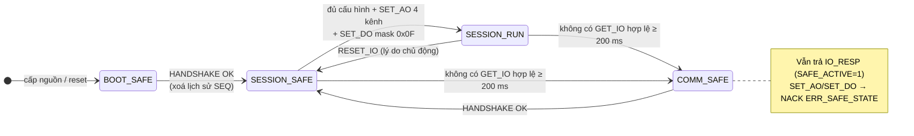
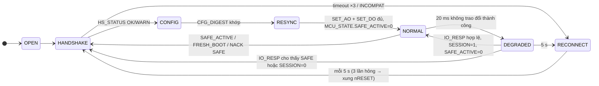
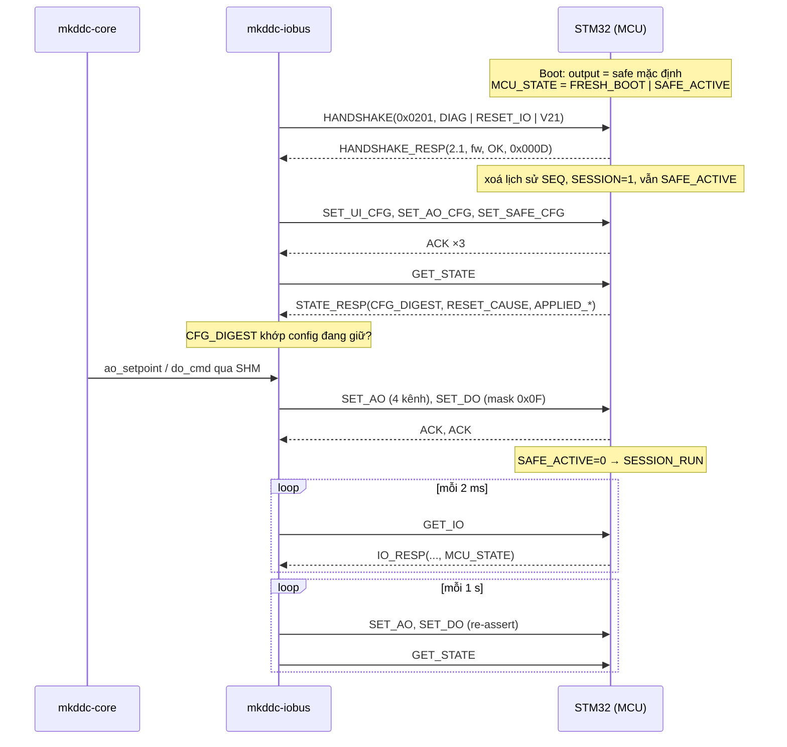

# Rà soát thiết kế FW SOM ↔ FW MCU và phương án ghép nối hai lớp

| Thuộc tính | Giá trị |
|---|---|
| ID | `REC-DDC-FWSOM-MCU-PAIR-20260930` |
| Phiên bản | 1.2 |
| Trạng thái | Record rà soát lịch sử + đề xuất; **không phải hợp đồng giao tiếp hiện hành**. Chủ dự án đã chốt PA-B/IOP V3.0 duy nhất theo ADR-064; ICD và FW-REQ vẫn Draft về chi tiết, chờ ký |
| Ngày, mốc | 2026-09-30; tài liệu đọc tại HEAD `e34d0a2f` (nhánh `fix/schedule-ao-binary-and-intellisense`) |
| Phạm vi | Tài liệu thiết kế **FW MCU** (STM32G0B1) và **FW SOM** ở phần giáp MCU (`mkddc-iobus`, cùng phần `mkddc-core` liên quan đến output/safe-state). Hợp đồng [`contracts/iop/iop_protocol.h`](../../../contracts/iop/iop_protocol.h) được đọc như một tài liệu contract |
| Ngoài phạm vi | **Không review mã nguồn** (theo yêu cầu của chủ sở hữu). Không chạy test, không chạm bo. Mọi câu "As-Built" dưới đây là điều **tài liệu tự khai**, chưa đối chiếu với mã |
| Phương pháp | Đọc 41 tài liệu (§1). Đối chiếu chéo requirement ↔ architecture ↔ detailed design ↔ implementation guide ↔ test plan ↔ hardware. Mỗi mâu thuẫn đều dẫn `file:dòng` |
| Người rà | Claude (Opus 5.5), vai rà soát thiết kế hệ thống nhúng |
| Kết luận | Thiết kế cặp **CHƯA SẴN SÀNG TÍCH HỢP**: byte contract IOP v2.0 nhất quán nhưng hợp đồng hành vi mâu thuẫn. 17 finding (5 P0, 7 P1, 5 P2). Khuyến nghị phương án B: IOP v2.1 tương thích ngược, một ICD hành vi, lộ trình P0–P3 |

> **Cập nhật 1.2 (2026-09-30):** chủ dự án chốt [ADR-064](../../adr/ADR-064-iop-v3-hai-bien-the.md): **PA-B/IOP V3.0 duy nhất** cho cả 16/4/4 và 16/8/8, không giữ V2.x làm fallback. [ICD V3.0](../../01_specs/SWFW_INTERFACE_SPEC_MK-DDC-24_VI.md), [FW-REQ v3.1](../../01_specs/FW_REQUIREMENTS_MK-DDC-24_VI.md) và header nháp là bản để hai team review chi tiết. Các khuyến nghị v2.1, số đếm quyết định và tên phiên bản trong §0–§6 bên dưới là **snapshot trước quyết định này**; không dùng làm hướng dẫn triển khai. Source SOM V2.0 chưa đổi, P1/P2/P3 chưa chạy.

> **Cập nhật 1.1 (2026-09-30), theo quyết định của chủ sở hữu:** firmware MCU do **một team riêng** thực hiện. Dự án không tạo và không áp đặt thiết kế bên trong firmware; chỉ giao **tài liệu yêu cầu** và **tài liệu tích hợp**. Hệ quả lịch sử đối với record này:
>
> 1. Phương án B đã được viết thành hai hồ sơ chủ quản (sửa tại chỗ, giữ ID, theo `DOC-GOV-001` §6.6 không tạo hồ sơ trùng thẩm quyền):
>    - [ICD SOM ↔ MCU `IOP-SPEC-MK-DDC-24-VI` v2.0](../../01_specs/SWFW_INTERFACE_SPEC_MK-DDC-24_VI.md): chính là "ICD hành vi" ở §4, không tạo file `ICD-IOP-PAIR-001` riêng;
>    - [Yêu cầu FW MCU `FW-REQ-MK-DDC-24-VI` v3.0](../../01_specs/FW_REQUIREMENTS_MK-DDC-24_VI.md): yêu cầu hộp đen.
>
>    Cả hai đang Draft, chờ ký. Khi chi tiết ở §4.3 dưới đây khác ICD thì **ICD thắng**.
> 2. ICD làm rõ so với §4.3:
>    - thương lượng tính năng bằng minor nhỏ hơn, bỏ bit `IOP_CAP_V21`;
>    - `SET_UI_CFG` dài 16 byte, bỏ byte debounce (debounce dry-contact làm ở SOM);
>    - thêm NACK `0x08 ERR_NO_SESSION`, `0x09 ERR_BAD_VALUE`;
>    - thêm `BOARD_CAP` bit 5 `DO_FB` để chạy được cả khi relay có hoặc không có mạch feedback (PAIR-12);
>    - `UI_OV` là "sát bão hòa ADC";
>    - `T_turn` ≤ 1 ms, output cập nhật trước ACK;
>    - đổi AO mode khi đang chạy thì về `SESSION_SAFE`;
>    - bỏ giới hạn tần suất relay trên MCU (SOM đã có `RELAY_GUARD`);
>    - ghi nhận thêm: 3 đường điều khiển cần kênh cách ly riêng vì ADUM1201 chỉ có 2 kênh (ICD O-7).
> 3. **Rút D6** (mô hình thực thi MCU): đó là quyết định của team MCU. PAIR-07 và PAIR-13 chuyển thành gợi ý cho team MCU; phần có ảnh hưởng ra ngoài đã thành yêu cầu thời gian (`FW-IOP-003`, `FW-AO-001`, `FW-DO-001`) và yêu cầu không lọc thêm (`FW-IO-002`).
> 4. Các dòng ở §4.5 đòi viết lại FW_ARCH_SPEC, FW_DDD, `FW_MOD_*`, guide 04 được thay bằng **nhãn "tham khảo, không ràng buộc team MCU"** trên các file đó. IOP_PROTOCOL.md và phần hợp đồng của guide 05 được gắn SUPERSEDED.

## 0. Đọc nhanh

| Câu hỏi | Trả lời |
|---|---|
| Tình trạng chung? | Hợp đồng **byte** (IOP v2.0 trong header) đã đóng băng và nhất quán. Hợp đồng **hành vi** thì chưa có một nguồn duy nhất: khi nào vào safe, ai được ép safe, thoát safe bằng cách nào, ACK nghĩa là gì, cấu hình kênh đi đường nào. Các câu này đang được trả lời khác nhau ở ít nhất 8 tài liệu. |
| FW MCU đang ở mức nào? | Mới ở mức spec. Có đủ requirement, architecture, module, pinout, nhưng đa số vẫn `In Review` từ tháng 06/2026. Đang tồn tại **hai mô hình thực thi khác nhau**. BSP bị hoãn theo quyết định ngày 2026-08-20, HIL `RED`. Nếu chưa chốt các mâu thuẫn P0/P1 thì **chưa đủ để viết BSP thật**. |
| FW SOM đang ở mức nào? | Phía iobus/core chín hơn: đã chạy trên bo Forlinx, nhưng với **fake MCU**. Tài liệu mô tả IOP master vẫn còn hằng số IOP v1. Phần cứng phía SOM cho liên kết MCU (UART, nRESET, BOOT0, FAULT_OUT) mới chỉ định nghĩa cho Radxa CM3, chưa có cho Forlinx RV1126B. `ttyS2` đang dùng chung với Bluetooth. |
| Hai lớp đã từng chạy chung thật chưa? | **Chưa.** Đối tác duy nhất của iobus là `fake_mcu` qua PTY ([PHYSICAL_IO_HIL_REPORT](PHYSICAL_IO_HIL_REPORT.md): 12/12 kịch bản HIL `OPEN`). |
| Khuyến nghị | **Phương án B** (§4): giữ IOP v2 và nâng lên **v2.1 tương thích ngược** (dùng byte reserved sẵn có cộng lệnh mới có capability gate). Viết **một ICD hành vi cặp** làm authority. Tích hợp theo 4 chặng P0 → P3; chặng **P2 dùng NUCLEO-G0B1RE nối UART thật với Forlinx** để đóng phần liên kết trước khi có carrier board. |
| Cần anh/chị quyết định | 9 quyết định D1–D9 (§5). D1–D4 chặn việc sửa tài liệu; D7–D8 chặn chặng P2. |

## 1. Nguồn đã rà

**FW MCU:** [FIRMWARE.md](../../04_design/FIRMWARE.md) ·
[FW_REQUIREMENTS](../../01_specs/FW_REQUIREMENTS_MK-DDC-24_VI.md) ·
[FW_ARCH_SPEC](../../01_specs/FW_ARCH_SPEC_MK-DDC-24_VI.md) ·
[FW_DDD](../../02_design/firmware/FW_DDD_MK-DDC-24_VI.md) ·
[FW_MOD_IOP_COMM](../../02_design/firmware/FW_MOD_IOP_COMM_MK-DDC-24_VI.md) ·
[FW_MOD_AO_DO](../../02_design/firmware/FW_MOD_AO_DO_MK-DDC-24_VI.md) ·
[FW_MOD_IO_SAMPLE](../../02_design/firmware/FW_MOD_IO_SAMPLE_MK-DDC-24_VI.md) ·
[FW_MOD_DIAG_WDG](../../02_design/firmware/FW_MOD_DIAG_WDG_MK-DDC-24_VI.md) ·
[FW_PINOUT_MASTER](../../02_design/firmware/FW_PINOUT_MASTER_MK-DDC-24_VI.md) ·
[PROGRAMMING_FW_MCU_DESIGN](../../02_design/firmware/PROGRAMMING_FW_MCU_DESIGN.md) ·
[MCU_STM32G0_SPEC](../../04_design/hardware/05_mcu_io/MCU_STM32G0_SPEC.md) ·
[FW-ADC-SAMPLING](../../04_design/hardware/05_mcu_io/FW-ADC-SAMPLING.md) ·
[04_FW_MCU guide](../../03_implementation/04_FW_MCU_IMPLEMENTATION_GUIDE.md).

**Giao diện hai lớp:** [`iop_protocol.h`](../../../contracts/iop/iop_protocol.h) ·
[IOP_PROTOCOL](../../04_design/hardware/05_mcu_io/IOP_PROTOCOL.md) ·
[ADR-010](../../adr/ADR-010-iop-v2-poll-capability-map.md) ·
[SWFW_INTERFACE_SPEC v1 (superseded)](../../01_specs/SWFW_INTERFACE_SPEC_MK-DDC-24_VI.md) ·
[05_IOP_UART guide](../../03_implementation/05_IOP_UART_IMPLEMENTATION_GUIDE.md) ·
[INTERFACES.md](../../04_design/INTERFACES.md).

**FW SOM:** [SYSTEM.md](../../03_architecture/SYSTEM.md) ·
[SOFTWARE.md](../../04_design/SOFTWARE.md) ·
[06_MKDDC_IOBUS guide](../../03_implementation/06_MKDDC_IOBUS_IMPLEMENTATION_GUIDE.md) ·
[SW_IODRIVER_DESIGN (legacy)](../../02_design/software/SW_IODRIVER_DESIGN_MK-DDC-24_VI.md) ·
[SW_REQUIREMENTS](../../01_specs/SW_REQUIREMENTS_MK-DDC-24_VI.md) ·
[SW_RUNTIME_EXECUTION_MODEL](../../02_design/software/SW_RUNTIME_EXECUTION_MODEL_MK-DDC-24_VI.md) ·
[PROGRAMMING_FW_SOM_DESIGN](../../02_design/software/PROGRAMMING_FW_SOM_DESIGN.md) ·
[ADR-012](../../adr/ADR-012-ao-channel-config-model.md) ·
[ADR-041](../../adr/ADR-041-ui-raw-live-data-shm.md) ·
[ADR-061](../../adr/ADR-061-programming-chu-ky-10ms-bo-chu-ky-moi.md).

**Phần cứng, kiểm chứng, quyết định:** [FOXLINX_SOM_DDC24_SPEC](../../08_hardware/foxlinx-som-ddc24/FOXLINX_SOM_DDC24_SPEC.md) ·
[FOXLINX_UART_RS485_GUIDE](../../08_hardware/foxlinx-som-ddc24/FOXLINX_UART_RS485_GUIDE.md) ·
[IO_UI_CIRCUIT](../../04_design/hardware/03_io_subsystem/IO_UI_CIRCUIT.md) ·
[REQUIREMENTS.md](../../02_requirements/REQUIREMENTS.md) ·
[12_INTEGRATION_TEST_PLAN](../../03_implementation/12_INTEGRATION_TEST_PLAN.md) ·
[10_END_TO_END_DATA_FLOW](../../03_implementation/10_END_TO_END_DATA_FLOW.md) ·
[21_VIRTUAL_COM_DECISION](../../03_implementation/21_VIRTUAL_COM_DECISION.md) ·
[27 runbook no-MCU](../../03_implementation/27_SOM_BOARD_DEPLOY_NO_MCU_RUNBOOK.md) ·
[OPEN_ISSUES](../../01_specs/OPEN_ISSUES_MK-DDC-24_VI.md) ·
[DECISIONS.md](../../00_governance/DECISIONS.md) ·
[PHYSICAL_IO_HIL_REPORT](PHYSICAL_IO_HIL_REPORT.md) ·
[Review HW/FW/SOM/HMI 2026-07-22](KX-DDC24-HW-FW-SOM-HMI-REVIEW-2026-07-22.md).

## 2. Tình trạng thiết kế hiện tại

### 2.1 Bảng độ chín theo chủ đề

Mỗi ô đánh giá **thiết kế trên giấy**, không phải mã.
Ký hiệu: **Đạt** = một đáp án, không mâu thuẫn · **Một phần** = có đáp án nhưng thiếu chi tiết hoặc lỗi thời · **Thiếu** = không tài liệu nào trả lời · **Mâu thuẫn** = có từ hai đáp án trở lên.

| Chủ đề thiết kế | FW MCU | FW SOM | Giao diện cặp | Finding |
|---|---|---|---|---|
| Wire contract (frame, CRC, lệnh, payload, FAULT bit, capability) | Đạt | Đạt | **Đạt** (header v2.0) | — |
| Hằng số thời gian | Một phần | Mâu thuẫn (guide 05/06 còn v1) | Mâu thuẫn | PAIR-03, PAIR-08 |
| Output khi mất liên lạc | Mâu thuẫn | Mâu thuẫn (RESET_IO ở 20 ms) | **Mâu thuẫn** | PAIR-01, PAIR-03 |
| Quan sát trạng thái của đối tác | — | Thiếu | **Thiếu** | PAIR-02 |
| Khôi phục sau MCU reset / safe | Một phần (thoát bằng HANDSHAKE) | Thiếu (chỉ gửi khi đổi) | **Thiếu** | PAIR-02, PAIR-09 |
| Cấu hình kênh (UI mode, AO mode, debounce, safe value) | Mâu thuẫn | Một phần | **Thiếu đường truyền** | PAIR-04, PAIR-14 |
| Hàm truyền raw → kỹ thuật và hiệu chuẩn | N/A (chỉ gửi raw) | Mâu thuẫn | Mâu thuẫn | PAIR-06 |
| Mô hình thực thi và ngân sách thời gian | Mâu thuẫn | Đạt (core 10 ms, iobus 2 ms) | Thiếu ngân sách đầu–cuối | PAIR-07, PAIR-16 |
| Phần cứng liên kết (UART, GPIO điều khiển) | Đạt (phía MCU) | Thiếu (Forlinx) | Thiếu | PAIR-05, PAIR-12 |
| Kiểm chứng | host + cross-build (theo tài liệu) | fake MCU trên bo | **0/12 HIL** | — |
| Cập nhật firmware và ma trận tương thích cặp | Mâu thuẫn (MUST ↔ Rev B) | Mâu thuẫn | Thiếu | PAIR-15 |

### 2.2 FW MCU: đã chắc và còn trống

**Đã chắc** (ổn định qua nhiều tài liệu, không mâu thuẫn):

- Vai trò: MCU là SPI master duy nhất của 2× ADS131M08, sở hữu actuation và safe timeout độc lập (`IOP-Q-R007`, SYSTEM.md).
- Chọn STM32G0B1RBT6 và lý do tài nguyên: 3 SPI, 2 DMA (`IOP-Q-R006`).
- Tách ba tốc độ: lấy mẫu 1 ms, poll 2 ms, ứng dụng 10–100 ms ([FW-ADC-SAMPLING §1](../../04_design/hardware/05_mcu_io/FW-ADC-SAMPLING.md)). Đây là tài liệu rõ nhất về thời gian.
- Ranh giới với Programming: MCU không biết ST/FBD/Project/Revision ([PROGRAMMING_FW_MCU_DESIGN §1](../../02_design/firmware/PROGRAMMING_FW_MCU_DESIGN.md)).
- Pin chính: USART1 PA9/PA10, SPI1→DAC8554, SPI3→2× ADS131M08 với CS/DRDY riêng, mode latch PB12–PB15, DO drive PC0–PC3.

**Còn trống:**

- Chính sách output khi mất liên lạc (PAIR-01).
- Mô hình thực thi: FreeRTOS 6 task hay superloop + ISR (PAIR-07).
- Nguồn cấu hình UI mode, debounce, safe value (PAIR-04).
- Chân DO feedback (PAIR-12).
- Cách báo trạng thái MCU cho SOM (PAIR-02).
- BSP, `.ioc`, startup, linker: **hoãn** theo quyết định của Product Owner/CTO ngày 2026-08-20 ([DECISIONS.md:1418](../../00_governance/DECISIONS.md)).
- HIL: 0/12.

[PROGRAMMING_FW_MCU_DESIGN](../../02_design/firmware/PROGRAMMING_FW_MCU_DESIGN.md) (M3, 2026-08-09) là tài liệu MCU hiện đại và chặt nhất: có state machine `BOOT→SAFE→SESSION`, duplicate SEQ, ACK sau read-back, mốc 199/200/201 ms. Nhưng nó giả định mô hình main-loop, khác [FW_ARCH_SPEC](../../01_specs/FW_ARCH_SPEC_MK-DDC-24_VI.md), và cần các field mà contract chưa có (§7, §11 của chính nó). Đây là **cơ sở tốt nhất** để viết lại phần hành vi.

### 2.3 FW SOM (phần giáp MCU): đã chắc và còn trống

**Đã chắc:**

- iobus là owner duy nhất của UART; một thread sở hữu UART; SHM seqlock; core là writer duy nhất của `ao_setpoint`/`do_cmd`; iobus không quyết định logic ([06 §1, §5, §6](../../03_implementation/06_MKDDC_IOBUS_IMPLEMENTATION_GUIDE.md)).
- Poll 2 ms, retry 3, reconnect 5 s, handshake 1 s khớp header ([INTERFACES.md](../../04_design/INTERFACES.md), `IF-REQ-001`).
- Môi trường không có board: fake MCU qua PTY, chạy trên Forlinx dưới systemd ([21](../../03_implementation/21_VIRTUAL_COM_DECISION.md), [27 §7b](../../03_implementation/27_SOM_BOARD_DEPLOY_NO_MCU_RUNBOOK.md)). Đây là nền tốt cho chặng P1 ở §4.4.

**Còn trống:**

- Tài liệu IOP master còn lẫn v1 (PAIR-08).
- iobus gửi RESET_IO ở ngưỡng 20 ms (PAIR-03).
- Không khôi phục output sau khi MCU reset hoặc vào safe (PAIR-02).
- Không xử lý trường hợp core chết (PAIR-10).
- Hàm truyền (PAIR-06).
- Phần cứng phía SOM trên Forlinx (PAIR-05).

### 2.4 Cùng một câu hỏi, nhiều đáp án

| Câu hỏi hành vi | Đáp án 1 | Đáp án 2 |
|---|---|---|
| Output khi mất liên lạc | Safe sau 200 ms: header, `SAFE-REQ-001`, `FW-WDG-005`, `FW-REQ-MCU-002` | Hold-last tới khi có RESET_IO: `FW-AO-005`, FW_ARCH §7, FW_DDD §4.3, FW_MOD_AO_DO, guide 04 §4 |
| Cái gì nuôi watchdog 200 ms của MCU | Chỉ `GET_IO` hợp lệ: header, `SAFE-REQ-001`, `FW-WDG-005` | Mọi traffic hợp lệ của master: `FW-REQ-MCU-002`, PROGRAMMING_FW_MCU §5 |
| Thoát safe | Bằng HANDSHAKE: FW_ARCH §7, `TC-2-08`, PROGRAMMING_FW_MCU §3 | "Chờ IO_RESP báo hết safe": guide 05 §15 #10, nhưng **IO_RESP không có field nào như vậy** |
| Ngưỡng lỗi liên kết phía SOM | 20 ms: header, guide 05 §8, `IF-REQ-001` | 100 ms: guide 05 §6.9/§13, 10 Flow 8, SWFW v1 |
| Độ trễ GET_IO → IO_RESP | Timeout 3 ms: header | ≤ 5 ms: `FW-IOP-003`; timeout 10 ms: guide 05 §14 |
| Version SOM gửi khi HANDSHAKE | `0x0200`: IOP_PROTOCOL §5 | `0x0101`: guide 05 §9 |
| Lọc tín hiệu UI | MA-8 bắt buộc trên MCU: `FW-IO-002` | Lọc ở Linux: FW-ADC-SAMPLING §5 |
| Safe value | Cố định raw 0 trên MCU: header `IOP_AO_SAFE_*_RAW` | Cấu hình từng kênh phía SOM: ADR-012, SWFW §6.3, `SW-IDE-012` |
| Raw → V/mA | `V = raw/FS × 10`: guide 06 §3.6 | `V_adc = raw/FS × 2,44` rồi nhân hệ số chia: SW_IODRIVER §4, IO_UI_CIRCUIT |

### 2.5 Kết luận tình trạng

- **Thiết kế cặp: CHƯA SẴN SÀNG TÍCH HỢP.** Nguyên nhân là hợp đồng hành vi chưa thống nhất, không phải vì thiếu byte layout.
- Không finding nào đòi đổi transport, đổi MCU hay đổi baud. Kiến trúc nền (poll master/slave, MCU tự bảo vệ, header dùng chung) đúng hướng và nên giữ.
- Phần lớn việc khắc phục là **sửa tài liệu và một lần nâng minor contract**. Chỉ PAIR-05, PAIR-06, PAIR-12 cần kỹ sư phần cứng xác nhận.

## 3. Finding

Mức độ: **P0** = chặn tích hợp hoặc ảnh hưởng an toàn · **P1** = gây lỗi tích hợp hoặc sai số đo · **P2** = lỗi thời, thiếu nhất quán.

| ID | Mức | Chủ đề | Tác động ngắn | Xử lý |
|---|---|---|---|---|
| PAIR-01 | P0 | Output khi mất liên lạc có hai đáp án | BSP đúng tài liệu này thì sai tài liệu kia; T-FW-034 và T-FW-054 không thể cùng PASS | D1, §4.3 R1–R3 |
| PAIR-02 | P0 | SOM không thấy MCU đang safe hoặc vừa reset; output không được khôi phục | Relay ngoài hiện trường mở trong khi Web/BACnet báo đóng; có kịch bản kẹt vĩnh viễn | §4.3 R4–R5, R10; v2.1 `MCU_STATE` |
| PAIR-03 | P0 | SOM tự ép safe ở 20 ms (sớm hơn MCU 10 lần); thang thời gian lệch | Nghẽn 20 ms phía SOM làm toàn trạm về safe | D4, §4.3 R6–R7, §4.3.2 |
| PAIR-04 | P0 | Không có đường cấu hình UI mode, debounce, safe value từ SOM xuống MCU | Safe value người dùng đặt chỉ có hiệu lực khi SOM còn sống | D3, v2.1 `SET_UI_CFG`/`SET_SAFE_CFG` |
| PAIR-05 | P0 | Phần cứng phía SOM cho liên kết MCU chưa xác định trên SOM thực tế | Chưa thể nối cặp thật trên bo lab | D7 |
| PAIR-06 | P1 | Hàm truyền raw → kỹ thuật có ba phiên bản; nghi sai VREF | Số đo sai khoảng 2 lần mà test giao thức vẫn PASS | D9 |
| PAIR-07 | P1 | Hai mô hình thực thi MCU; NVIC viết cho Cortex-M3/M4 | BSP không viết đúng được cả hai | gợi ý cho team MCU (D6 đã rút) |
| PAIR-08 | P1 | Tài liệu "Active" còn hằng số IOP v1 | Làm theo guide 05 §9 thì không bắt tay được với MCU v2 | §4.5 |
| PAIR-09 | P1 | Ngữ nghĩa phiên chưa chốt: ACK, retry/duplicate, SEQ sau restart, ERR_BUSY | Double-actuation hoặc bỏ lệnh sau khi SOM restart | §4.3 R8–R9 |
| PAIR-10 | P1 | Core chết nhưng iobus vẫn poll, nên MCU không bao giờ timeout | Output giữ giá trị cuối vô thời hạn | D5, §4.3 R11 |
| PAIR-11 | P1 | IO_RESP không mang trạng thái từng kênh hay nguyên nhân lỗi ADC | Acceptance của FW-ADC-SAMPLING không biểu diễn được | v2.1 `ADC_STAT` bit 3–5 |
| PAIR-12 | P1 | Chân phần cứng không khớp chức năng (DO feedback, AO mode) | `DO_FB_MASK`/`RELAY_STUCK` không có tín hiệu nguồn | D9 |
| PAIR-13 | P2 | Lọc và giảm tốc lấy mẫu mâu thuẫn | Tự kích ADC fault khi quá nhiệt | §4.3.6 |
| PAIR-14 | P2 | AO mode lúc boot trước khi SOM cấu hình | Thiết bị 4–20 mA thấy 0 mA (đứt loop) suốt thời gian SOM khởi động | D3 |
| PAIR-15 | P2 | OTA MCU: MUST trong requirement, Rev B trong quyết định; thiếu ma trận tương thích cặp | Requirement không thể PASS trong Rev A | §4.5 |
| PAIR-16 | P2 | Thiếu ngân sách độ trễ đầu–cuối cho chu kỳ 10 ms | Không có cơ sở để ghi "cycle 10 ms" ở mức I/O | §4.3.7 |
| PAIR-17 | P2 | Tài liệu lỗi thời, link hỏng, chi tiết sai | Người đọc lấy nhầm nguồn | §4.5 |

### PAIR-01 · P0 · Output khi mất liên lạc có hai đáp án

**Chứng cứ.**

- Hold-last:
  - [FW_REQUIREMENTS:79](../../01_specs/FW_REQUIREMENTS_MK-DDC-24_VI.md) `FW-AO-005` "PHẢI hold last AO value nếu mất kết nối IOP (không tự về 0 trừ khi nhận RESET_IO)".
  - [FW_ARCH_SPEC:251](../../01_specs/FW_ARCH_SPEC_MK-DDC-24_VI.md): trạng thái `IOP_FAULT` = Hold last.
  - [FW_DDD:64](../../02_design/firmware/FW_DDD_MK-DDC-24_VI.md) và [FW_MOD_AO_DO:21](../../02_design/firmware/FW_MOD_AO_DO_MK-DDC-24_VI.md).
- Safe sau 200 ms:
  - [FW_REQUIREMENTS:110](../../01_specs/FW_REQUIREMENTS_MK-DDC-24_VI.md) `FW-WDG-005`.
  - [REQUIREMENTS:150](../../02_requirements/REQUIREMENTS.md) `SAFE-REQ-001` và [:161](../../02_requirements/REQUIREMENTS.md) `FW-REQ-MCU-002`.
  - Header `IOP_SAFE_TIMEOUT_MS`.
- Guide 04 tự mâu thuẫn trong **cùng một file**: [dòng 171](../../03_implementation/04_FW_MCU_IMPLEMENTATION_GUIDE.md) hold-last, [dòng 255](../../03_implementation/04_FW_MCU_IMPLEMENTATION_GUIDE.md) về safe sau 200 ms.

**Vì sao quan trọng.** Đây là quyết định an toàn quan trọng nhất của lớp MCU. Người viết BSP buộc phải chọn một tài liệu để vi phạm. Test `T-FW-034` (hold-last) và `T-FW-054` (safe 200 ms) không thể cùng PASS.

**Xử lý đề xuất (D1).** 200 ms safe là authority. "Hold-last" chỉ đúng **trong cửa sổ < 200 ms**: frame lỗi, lỡ vài poll. Sửa `FW-AO-005` thành "giữ lệnh hợp lệ cuối cùng cho tới khi hết `IOP_SAFE_TIMEOUT_MS`". Bỏ trạng thái `IOP_FAULT` hold-last khỏi FSM của MCU: MCU là slave, không có khái niệm retry.

### PAIR-02 · P0 · SOM không thấy MCU đang safe hoặc vừa reset; output không được khôi phục

**Chứng cứ.**

- Header: `IO_RESP[73]` và `DIAG_RESP[18..19]` đều là *reserved*. Không có field nào báo "đang safe", nguyên nhân reset hay số lần vào safe. `WDG_RESET` chỉ bật khi reset do watchdog, không bật khi POR, brownout hay reset qua nRESET.
- [PROGRAMMING_FW_MCU_DESIGN:67](../../02_design/firmware/PROGRAMMING_FW_MCU_DESIGN.md) và [§7 (dòng 97)](../../02_design/firmware/PROGRAMMING_FW_MCU_DESIGN.md) đòi Core/BE đọc được fault và safe counter để Commission không PASS sai. Contract hiện không cho đọc.
- [06:236, 693, 732](../../03_implementation/06_MKDDC_IOBUS_IMPLEMENTATION_GUIDE.md): output "chỉ gửi khi CHANGED".
- [12_INTEGRATION_TEST_PLAN TC-E2E-06](../../03_implementation/12_INTEGRATION_TEST_PLAN.md) kỳ vọng "IO trở lại normal" sau khi reset MCU, nhưng không tài liệu nào quy định SOM gửi lại output.

**Kịch bản hỏng A: mất output âm thầm.** MCU brownout rồi khởi động lại, AO/DO về safe. iobus thấy timeout, reconnect, HANDSHAKE lại. Nhưng core không đổi lệnh nên `output_command` **không gửi lại** SET_*. Kết quả: relay ngoài hiện trường mở trong khi SHM, Web, BACnet vẫn hiển thị "đóng". Với DO còn có `DO_FB_MASK` để phát hiện (nếu có chân feedback, xem PAIR-12). Với AO thì không có read-back nào.

**Kịch bản hỏng B: kẹt vĩnh viễn.** Thread poll của iobus bị nghẽn khoảng 250 ms (eMMC, CPU, Commission).

1. MCU hết 200 ms nên vào safe.
2. iobus chạy lại, gửi GET_IO và nhận IO_RESP ngay. Vì không có request nào timeout nên iobus **vẫn ở NORMAL**.
3. iobus gửi SET_DO, MCU trả NACK `ERR_SAFE_STATE` (guide 05:235).
4. Theo [guide 05:435](../../03_implementation/05_IOP_UART_IMPLEMENTATION_GUIDE.md), iobus "ngừng SET_*; chờ IO_RESP báo hết safe".
5. IO_RESP không có field đó. MCU chờ HANDSHAKE (FW_ARCH §7, `TC-2-08`), iobus chờ tín hiệu không bao giờ tới. Output kẹt ở safe cho tới khi restart dịch vụ.

**Xử lý.** v2.1 dùng `IO_RESP[73]` làm `MCU_STATE` và thêm lệnh `GET_STATE`. Bổ sung luật RESYNC và re-assert (§4.3 R4, R5, R10). iobus tự đo khoảng cách giữa hai lần trao đổi thành công, không chỉ dựa vào timeout của từng request (R6).

### PAIR-03 · P0 · SOM tự ép safe ở 20 ms; thang thời gian lệch nhau

**Chứng cứ.**

- Header `IOP_FAULT_TIMEOUT_MS = 20`.
- Guide 05 §8 gắn hành động "gửi RESET_IO, vào FAULT"; §13 FAULT gửi `RESET_IO(0x05)`.
- Cùng ngưỡng đó ghi thành ">100ms" ở [guide 05:220](../../03_implementation/05_IOP_UART_IMPLEMENTATION_GUIDE.md) và [10_END_TO_END:125](../../03_implementation/10_END_TO_END_DATA_FLOW.md).
- `SW-IOP-013` ([SW_REQUIREMENTS:65](../../01_specs/SW_REQUIREMENTS_MK-DDC-24_VI.md)): COMMUNICATION_FAILURE sau 5 s.
- [ADR-061:48](../../adr/ADR-061-programming-chu-ky-10ms-bo-chu-ky-moi.md): stale input sau 250 ms, T3 sau 500 ms.
- [PROGRAMMING_FW_MCU_DESIGN:67](../../02_design/firmware/PROGRAMMING_FW_MCU_DESIGN.md): gap < 200 ms, mục tiêu ≤ 100 ms khi swap.

**Vì sao quan trọng.**

- Khi liên kết đứt thật, RESET_IO không tới được MCU, nên vô ích.
- Khi liên kết còn sống mà SOM chỉ nghẽn khoảng 20 ms (flush log, GC, Commission), RESET_IO **tới được** và đưa toàn bộ AO/DO về safe.

Tức là SOM tự gây ra đúng loại sự cố `RSK-PROG-003` mà PROGRAMMING_FW_MCU muốn chặn, với ngưỡng nhạy hơn MCU 10 lần. Ngoài ra, năm mốc 20 ms / 100 ms / 200 ms / 250 ms / 5 s không có chủ sở hữu và hành động rõ ràng.

**Xử lý (D4).** Mốc 20 ms chỉ để **phát hiện**: input chuyển UNCERTAIN, ngừng SET_*, **không RESET_IO**. MCU 200 ms là authority duy nhất cho mất liên lạc. Thang thời gian mới ở §4.3.2.

### PAIR-04 · P0 · Không có đường cấu hình UI mode, debounce, safe value

**Chứng cứ.**

- `FW-IO-010` ([FW_REQUIREMENTS:43](../../01_specs/FW_REQUIREMENTS_MK-DDC-24_VI.md)): MUST nhận mode UI1–UI16 "từ SOM".
- `FW-IO-021` (:64): debounce "qua SOM command".
- [FW-ADC-SAMPLING:28](../../04_design/hardware/05_mcu_io/FW-ADC-SAMPLING.md) lại cho MCU tự nạp `ui_config[16]` từ NVM riêng.
- Header chỉ có `SET_AO_CFG`.
- Safe value từng kênh cấu hình phía SOM: [ADR-012 §5](../../adr/ADR-012-ao-channel-config-model.md), [SWFW:475](../../01_specs/SWFW_INTERFACE_SPEC_MK-DDC-24_VI.md), `SW-IDE-012` (SW_REQUIREMENTS:315). Trong khi đó header cố định `IOP_AO_SAFE_*_RAW = 0`, còn PROGRAMMING_FW_MCU §5 cấm hard-code.

**Vì sao quan trọng.**

1. Chuỗi mode latch 48 bit không có nguồn cấu hình được thống nhất. Nếu MCU giữ NVM riêng thì có hai nguồn sự thật song song với `io_config.conf`.
2. Safe value người dùng đặt trên Web chỉ có hiệu lực khi SOM còn sống. Đúng lúc cần nhất (SOM chết), MCU lại dùng 0 V / 4 mA / Open.
3. ADR-012 dùng `Relinquish_Default` của BACnet làm safe value, trộn ngữ nghĩa ưu tiên BACnet với safe phần cứng. Hai khái niệm này có thể cần giá trị khác nhau.

**Xử lý (D3).** Lệnh `SET_UI_CFG` và `SET_SAFE_CFG` trong v2.1, kèm `CFG_DIGEST` để SOM kiểm MCU đang áp đúng cấu hình (§4.3.3). Tách safe value khỏi `Relinquish_Default`.

### PAIR-05 · P0 · Phần cứng phía SOM cho liên kết MCU chưa xác định trên SOM thực tế

**Chứng cứ.**

- [FOXLINX_UART_RS485_GUIDE:16–17](../../08_hardware/foxlinx-som-ddc24/FOXLINX_UART_RS485_GUIDE.md): `/dev/ttyS2` vừa là IOP 921600, vừa là transport Bluetooth HCI (`rtk_hciattach -n -s 115200 /dev/ttyS2`).
- [FW_PINOUT_MASTER:74, 76](../../02_design/firmware/FW_PINOUT_MASTER_MK-DDC-24_VI.md) và [MCU_STM32G0_SPEC:135](../../04_design/hardware/05_mcu_io/MCU_STM32G0_SPEC.md): nRESET, FAULT_OUT, BOOT0 nối "CM3 GPIO0_A4/A6", tức Radxa CM3. Finding `F-04` (SoM thực tế là RV1126B) vẫn mở ([FOXLINX_SOM_DDC24_SPEC §4](../../08_hardware/foxlinx-som-ddc24/FOXLINX_SOM_DDC24_SPEC.md)).
- Sơ đồ khối §2 của cùng file vẽ MCU, ADC, DAC, relay nằm trên carrier OK1126B-S. OK1126B-S là bo dev của hãng, không có các khối này. Sơ đồ đang trộn bo lab với sản phẩm đích.

**Vì sao quan trọng.** Không thể nối cặp thật trên bo lab khi chưa chốt UART và GPIO. BT chạy trên cùng ttyS2 sẽ phá frame IOP. Cũng chưa rõ ttyS2 có ra chân header hay chỉ nối nội bộ vào module RTL8821CS.

**Xử lý (D7).**

### PAIR-06 · P1 · Hàm truyền raw → kỹ thuật có ba phiên bản; nghi sai VREF

**Chứng cứ.**

- [06:184–185](../../03_implementation/06_MKDDC_IOBUS_IMPLEMENTATION_GUIDE.md): `V = raw/FS × 10`, `mA = 4 + raw/FS × 16`.
- [SW_IODRIVER:59–61](../../02_design/software/SW_IODRIVER_DESIGN_MK-DDC-24_VI.md): `V_adc = raw/FS × 2,44`, sau đó `× 9,2645` (chia 100k/12,1k) hoặc `/49,9 Ω`.
- [IO_UI_CIRCUIT:206](../../04_design/hardware/03_io_subsystem/IO_UI_CIRCUIT.md): "VREF 2,44 V".

**Nhận định kỹ thuật (cần HW xác nhận, chưa đo).** Theo datasheet TI, ADS131M08 dùng **tham chiếu nội 1,2 V** (FSR ±1,2 V ở gain 1) và không có chân tham chiếu ngoài. Con số 2,442 V là tham chiếu của họ ADS131A0x. Thiết kế mạch cũng khớp với FSR 1,2 V:

- 10 V qua cầu chia 100k/12,1k cho 1,079 V.
- 20 mA qua shunt 49,9 Ω cho 0,998 V.

Cả hai đều nằm vừa dưới 1,2 V; với 2,44 V thì chỉ dùng chưa tới một nửa dải. Nếu đúng như vậy, công thức 2,44 cho số đo **lệch khoảng 2 lần**. Công thức của guide 06 còn sai cả với 4–20 mA: qua shunt thì raw 0 là 0 mA, không phải 4 mA.

**Vì sao quan trọng.** MCU chỉ gửi raw. Mọi test giao thức và cross-test đều PASS trong khi giá trị hiển thị sai. Lỗi này chỉ lộ ra ở HIL.

**Xử lý (D9).** Một bảng hàm truyền duy nhất theo board revision, do HW sở hữu. iobus chỉ tiêu thụ bảng này. Guide 06 §3.6 và SW_IODRIVER §4 trỏ về bảng đó.

### PAIR-07 · P1 · Hai mô hình thực thi MCU; NVIC viết cho Cortex-M3/M4

**Chứng cứ.**

- [FW_ARCH_SPEC §2](../../01_specs/FW_ARCH_SPEC_MK-DDC-24_VI.md), FW_DDD, guide 04, MCU_SPEC §5 dùng FreeRTOS 6 task. [PROGRAMMING_FW_MCU_DESIGN §9, §15](../../02_design/firmware/PROGRAMMING_FW_MCU_DESIGN.md) dùng main-loop + ISR ("main-loop state", "parser main loop").
- Task AO/DO chạy mỗi 10 ms, trong khi `FW-AO-001`/`FW-DO-001` đòi ≤ 5 ms.
- `iop_comm_task (10ms)` ở [FW_ARCH:271](../../01_specs/FW_ARCH_SPEC_MK-DDC-24_VI.md) trái với "event-driven" ở §2.1 cùng file.
- [FW_ARCH:100–103](../../01_specs/FW_ARCH_SPEC_MK-DDC-24_VI.md) ghi WWDG "Non-maskable", `configMAX_SYSCALL_INTERRUPT_PRIORITY = 5`, "không dùng mức ưu tiên < 5".
  - Cortex-M0+ của STM32G0 chỉ có **4 mức ưu tiên NVIC** (2 bit), không có mức 5–7.
  - Port FreeRTOS cho M0 không dùng BASEPRI; critical section tắt ngắt toàn cục.
  - WWDG trên G0 là ngắt thường, không phải NMI.
- [FW_ARCH:212](../../01_specs/FW_ARCH_SPEC_MK-DDC-24_VI.md) ghi "24 bytes per conversion". Khung ADS131M08 gồm status + 8 kênh là 27 byte, lên 30 byte nếu kèm word CRC (word 24 bit), và phải nhân 2 chip.

**Xử lý.** ~~D6~~ đã rút ngày 2026-09-30: mô hình thực thi là quyết định của team MCU. Các quan sát ở trên (4 mức NVIC trên M0+, khung ADS131M08) chuyển cho team MCU làm gợi ý. Phần có ảnh hưởng ra ngoài là yêu cầu thời gian `FW-IOP-003`, `FW-AO-001`, `FW-DO-001`.

### PAIR-08 · P1 · Tài liệu "Active" còn hằng số IOP v1

| Tài liệu | Chỗ lỗi thời | Đúng theo header v2 |
|---|---|---|
| [guide 05:258](../../03_implementation/05_IOP_UART_IMPLEMENTATION_GUIDE.md) §9 | `SOM_IOP_VERSION=0x0101`: major 1 ≠ 2 nên MCU v2 trả **INCOMPAT**, không bao giờ bắt tay được | `0x0200` |
| guide 05:402, 411, 418 (§13, §14) | response timeout 10 ms, fault 100 ms, "82 B/chu kỳ 10 ms" | 3 ms, 20 ms, chu kỳ 2 ms |
| [guide 06:345](../../03_implementation/06_MKDDC_IOBUS_IMPLEMENTATION_GUIDE.md) | magic `0x4B584401` | `0x4B584404` (INTERFACES.md) |
| guide 06:357, 310, 161, 171, 179, 435, 668, 688 | `ui_value[8]`, `poll_period_ms: 10`, `len≠34`, `iop_s24()`, log `mcu_iop=1.1`, checklist "10ms, fault 100ms" | 16 UI, 2 ms, 74 byte, `iop_be32s()` |
| [FW_REQUIREMENTS:141](../../01_specs/FW_REQUIREMENTS_MK-DDC-24_VI.md) `FW-IOP-008` | `fault_flags` "byte", bit7 = WATCHDOG_RESET | uint16; bit5 = WDG_RESET, bit7 = VDD |
| FW_REQUIREMENTS:136 `FW-IOP-003` | ≤ 5 ms | nằm trong timeout 3 ms |
| `FW-IOP-001`, FW_DDD, guide 04, test plan 12 | trỏ về SWFW v1 (đã superseded) làm nguồn | header + IOP_PROTOCOL |
| [SW_REQUIREMENTS](../../01_specs/SW_REQUIREMENTS_MK-DDC-24_VI.md) `SW-IOP-001/005` | `IOP-SPEC` v1, SHM `kinexus_io_shm` | header, `/dev/shm/mkddc_io_shm` |

### PAIR-09 · P1 · Ngữ nghĩa phiên chưa chốt

- **ACK nghĩa là gì?** [FW_MOD_IOP_COMM:79](../../02_design/firmware/FW_MOD_IOP_COMM_MK-DDC-24_VI.md) ghi `xQueueOverwrite` rồi ACK ngay, tức ACK = đã nhận. [PROGRAMMING_FW_MCU:154](../../02_design/firmware/PROGRAMMING_FW_MCU_DESIGN.md) ghi "ACK chỉ sau success … read-back", tức ACK = đã áp.
- **Retry có giữ SEQ không?** [Guide 05:320](../../03_implementation/05_IOP_UART_IMPLEMENTATION_GUIDE.md) ghi "tự lo SEQ++, timeout, retry≤3" nhưng không nói rõ. Duplicate detection của MCU ([PROGRAMMING_FW_MCU:142, 156](../../02_design/firmware/PROGRAMMING_FW_MCU_DESIGN.md)) chỉ có tác dụng khi retry giữ SEQ.
- **SEQ sau khi SOM restart.** SWFW §3.3 cho SOM đặt SEQ = 0 sau reset. Chưa tài liệu nào nói "HANDSHAKE xoá lịch sử SEQ trên MCU". Vì vậy frame đầu tiên sau khi SOM restart có thể trùng SEQ cuối MCU còn nhớ và bị coi là bản lặp: MCU gửi lại phản hồi cũ, lệnh mới không được thực thi.
- **Cái gì nuôi watchdog** và **thoát safe thế nào:** xem bảng §2.4.
- **`ERR_BUSY`** được khai báo nhưng không tài liệu nào nói khi nào MCU "bận".

### PAIR-10 · P1 · Core chết nhưng iobus vẫn poll

**Chứng cứ.** [06:362](../../03_implementation/06_MKDDC_IOBUS_IMPLEMENTATION_GUIDE.md): iobus "dùng giá trị cuối, không stale-check (core chết → core tự lo safe trước khi chết…)". [SYSTEM.md:94](../../03_architecture/SYSTEM.md): "Mất core heartbeat … đưa output về policy an toàn". `IOP_RESET_REASON_CORE_WDG` đang là "Rev A reserved, chưa dùng". `SW-PLC-013` (overrun → safe toàn trạm) trái với ADR-029 (overrun là fault của Task).

**Vì sao quan trọng.** Watchdog 200 ms của MCU chỉ bảo vệ khi **iobus** chết. Khi core treo hoặc crash, iobus vẫn poll đều nên MCU luôn thấy liên kết khỏe. Output giữ giá trị cuối tới khi systemd phát hiện và khởi động lại core. Nếu core treo mà không thoát, không tài liệu nào mô tả chốt chặn.

**Xử lý (D5, §4.3 R11).**

### PAIR-11 · P1 · IO_RESP không mang trạng thái từng kênh hay nguyên nhân lỗi ADC

**Chứng cứ.**

- FW-ADC-SAMPLING §6/§9 đòi overrange/open/short **từng kênh** và "DRDY timeout vs ADC timeout distinguishable".
- [MCU_STM32G0_SPEC:161, 197–207](../../04_design/hardware/05_mcu_io/MCU_STM32G0_SPEC.md) đòi `channel_status_bitmap`, `timestamp_us`, `version` trong frame. Đây là di sản của bản nháp mô hình push đã bị ADR-010 loại.
- Contract chỉ có `ADC1/2_STAT` (3 bit) và `UI_OV` gộp cho cả 16 kênh.

**Xử lý.** Dùng thêm bit 3–5 còn trống trong `ADC_STAT` (§4.3.3). Open/short theo mode do SOM suy từ raw, vì SOM biết mode và ngưỡng. Xoá §6 "Minimum UI ADC frame fields" của MCU_SPEC.

### PAIR-12 · P1 · Chân phần cứng không khớp chức năng

**Chứng cứ.**

- `FW-DO-002/003` ([FW_REQUIREMENTS:94](../../01_specs/FW_REQUIREMENTS_MK-DDC-24_VI.md)) cần GPIO đọc relay feedback. Nhưng FW_PINOUT_MASTER §2.3 và MCU_SPEC §3.5 chỉ có `DO1..4_DRV` (PC0–PC3), **không có chân feedback nào**.
- FW_PINOUT_MASTER có `AO1..4_MODE` (PD1–PD4, [dòng 64](../../02_design/firmware/FW_PINOUT_MASTER_MK-DDC-24_VI.md)), còn MCU_SPEC §3 không có. Cả hai file đều tự nhận là "nguồn chuẩn duy nhất cho chân MCU".

**Vì sao quan trọng.** `DO_FB_MASK` và `RELAY_STUCK` trong contract không có tín hiệu nguồn. Nếu "feedback" chỉ là đọc lại chân drive thì không phát hiện được relay dính.

**Xử lý (D9).** Hoặc thêm mạch feedback (tiếp điểm phụ hoặc đo dòng cuộn), hoặc định nghĩa lại `DO_FB_MASK` = trạng thái drive và hạ `RELAY_STUCK` xuống "không hỗ trợ ở Rev A". Hợp nhất pinout về một file.

### PAIR-13 · P2 · Lọc và giảm tốc lấy mẫu

- `FW-IO-002` (MA-8 MUST trên MCU) trái với [FW-ADC-SAMPLING:82](../../04_design/hardware/05_mcu_io/FW-ADC-SAMPLING.md) (lọc ở Linux).
- `FW-DIAG-002` giảm lấy mẫu xuống 100 ms khi quá nhiệt, đúng bằng ngưỡng `FW-IO-006` (100 ms không có mẫu thì bật ADC fault). Hậu quả là quá nhiệt tự kéo theo ADC fault; poll 2 ms cũng trở nên vô nghĩa.

### PAIR-14 · P2 · AO mode lúc boot

`FW-AO-008` cho boot ở 0–10 V trước khi nhận `SET_AO_CFG`. SWFW v1 (:240) lại ghi "lưu mode vào config flash". Kênh nối thiết bị 4–20 mA vì thế thấy khoảng 0 mA (bị hiểu là đứt loop, xem `IOP-Q-004`) suốt thời gian Linux và iobus khởi động, cỡ vài chục giây. [SYSTEM.md](../../03_architecture/SYSTEM.md) còn ghi "đổi AO mode cần restart phối hợp". Gộp vào D3.

### PAIR-15 · P2 · OTA MCU và ma trận tương thích cặp

`FW-OTA-001..005` (MUST) và `SW-OTA-004` (MUST, [SW_REQUIREMENTS:226](../../01_specs/SW_REQUIREMENTS_MK-DDC-24_VI.md)) trái với quyết định OTA chuyển sang Rev B ([DECISIONS.md](../../00_governance/DECISIONS.md), 2026-08-20) và với FIRMWARE.md ("deferred"). Chưa tài liệu nào có **ma trận tương thích cặp** (phiên bản iobus × MCU FW × IOP). PROGRAMMING_FW_MCU §14 nói "restore known compatible Core/MCU pair" nhưng không định nghĩa "compatible".

### PAIR-16 · P2 · Thiếu ngân sách độ trễ đầu–cuối

ADR-061 chốt base step 10 ms cho Core, nhưng không tài liệu nào cộng dồn chuỗi đầy đủ: ADC → MCU → poll → iobus → core → iobus → MCU → DAC/relay. Riêng MA-8 ở 1 kSPS đã thêm khoảng 3,5 ms trễ nhóm. Task AO/DO 10 ms (FW_ARCH) còn thêm tới 10 ms. Ước lượng sơ bộ ở §4.3.7.

### PAIR-17 · P2 · Tài liệu lỗi thời, link hỏng, chi tiết sai

- [SW_RUNTIME_EXECUTION_MODEL:40](../../02_design/software/SW_RUNTIME_EXECUTION_MODEL_MK-DDC-24_VI.md) ghi scan 1000 ms, §11 trỏ SWFW v1. [PROGRAMMING_FW_SOM_DESIGN:257](../../02_design/software/PROGRAMMING_FW_SOM_DESIGN.md) ghi base step 1 s theo ADR-027. Cả hai lỗi thời so với ADR-061.
- [MCU_STM32G0_SPEC:33–34](../../04_design/hardware/05_mcu_io/MCU_STM32G0_SPEC.md) ghi "main.c chỉ có boot prints", trong khi FIRMWARE.md (2026-08-03) ghi đã có runtime.
- [SWFW:9](../../01_specs/SWFW_INTERFACE_SPEC_MK-DDC-24_VI.md) trỏ `hardware-design/05_mcu_io/IOP_PROTOCOL.md`, path không tồn tại (đúng là `docs/04_design/hardware/05_mcu_io/`). FW_DDD, FW_MOD_*, FW_REQUIREMENTS còn ghi `shared/iop_protocol.h`.
- [ADR-010:73](../../adr/ADR-010-iop-v2-poll-capability-map.md) ghi RELAY_STUCK "sticky clear by GET_DIAG", header ghi "không sticky". Bảng "Files phải cập nhật" của ADR-010 dùng path `services/` đã xoá. PHYSICAL_IO_HIL_REPORT dùng path `fw/` cũ.
- FW_ARCH §8 còn "Read DI GPIO states" (base SKU không có DI). Pinout §4 ghi SPI3_RX "24 byte". `FW-AO-006` "validate uint16 ∈ [0, 65535]" luôn đúng nên không kiểm được gì.
- [12_INTEGRATION_TEST_PLAN](../../03_implementation/12_INTEGRATION_TEST_PLAN.md) `TC-E2E-05` đòi Web báo alarm "≤ 20 ms", không đo được qua REST/WS.

## 4. Phương án ghép nối hai lớp

### 4.1 Nguyên tắc

1. **Hai lớp độc lập về an toàn.** MCU là authority **duy nhất** cho safe khi mất liên lạc. SOM không ép safe vì lỗi liên lạc ngắn; SOM chỉ ép safe khi có lý do chủ động (operator, OTA, core chết).
2. **Byte và hành vi cùng một version.** Header giữ byte và hằng số. Một ICD hành vi (`ICD-IOP-PAIR-001`) giữ state machine, luật phiên, thang thời gian. Đổi một trong hai thì bump `IOP_VER_*`.
3. **SOM phải nhìn thấy MCU.** Trạng thái phiên, safe, reset, digest cấu hình, output đang áp.
4. **Lệnh ghi là trạng thái tuyệt đối (idempotent).** SET_AO và SET_DO mang giá trị đích, không mang "toggle". Nhờ đó retry và re-assert định kỳ luôn an toàn.
5. **SOM là chủ cấu hình.** MCU chỉ giữ bản sao có digest.

### 4.2 Ba phương án

| | A — Chỉ sửa tài liệu, giữ wire v2.0 | **B — IOP v2.1 tương thích ngược (khuyến nghị)** | C — IOP v3 viết lại |
|---|---|---|---|
| Nội dung | Chốt hành vi bằng văn bản; không thêm field hay lệnh | Như A, cộng: `IO_RESP[73]` thành `MCU_STATE`; thêm bit `ADC_STAT`; 3 lệnh mới (`SET_UI_CFG`, `SET_SAFE_CFG`, `GET_STATE`) có capability gate | Frame mới: timestamp, trạng thái từng kênh, lệnh gộp AO+DO có transaction ID, có thể đổi sang push |
| Đóng được finding | 01, 03, 07, 08, 09 (một phần), 10, 13, 15, 16, 17 | Toàn bộ, trừ phần HW của 05/06/12 | Toàn bộ, trừ phần HW |
| Không đóng được | **02** (không có field báo safe), **04** (không có đường cấu hình), 11 | — | — |
| Tương thích | Giữ nguyên | MCU v2.1 ↔ SOM v2.0: SOM bỏ qua byte reserved, không gửi lệnh mới. SOM v2.1 ↔ MCU v2.0: capability gate tắt tính năng mới và ghi log degraded | Breaking: phải nâng đồng loạt, bỏ v2 |
| Công | Thấp: chỉ tài liệu | Trung bình: tài liệu, header, parser iobus, runtime MCU, vector test | Cao: làm lại cả hai phía, test, fake MCU |
| Rủi ro | Giữ nguyên hai P0 an toàn | Bề mặt test tăng (3 lệnh), được kiểm soát bằng capability gate | Chưa có phần cứng để kiểm, dễ thiết kế thừa |

**Khuyến nghị: B.** A để lại hai P0 an toàn (PAIR-02, PAIR-04). C tốn công mà không giải quyết thêm finding nào, lại làm trước khi có phần cứng để đo. B dùng đúng cơ chế mà v2.0 đã chừa sẵn: byte reserved, `HS_STATUS WARN` cho lệch minor, bit `SOM_CAPABILITIES`.

### 4.3 Chi tiết phương án B

#### 4.3.1 State machine của cặp

Trạng thái phía MCU. Mọi trạng thái `*_SAFE` đều giữ output ở safe value; chỉ `SESSION_RUN` áp lệnh của SOM.

Trạng thái phía iobus. `DEGRADED` thay cho `FAULT→SAFE_STATE` của guide 05 §13: **không gửi RESET_IO**.

#### 4.3.2 Thang thời gian

Mỗi mốc có **đúng một chủ sở hữu** và **một hành động**. Mốc sau phải lớn hơn mốc trước ít nhất hai lần jitter đo được ở P2.

| Mốc | Giá trị | Chủ | Hành động | Nguồn / thay đổi |
|---|---:|---|---|---|
| Poll `GET_IO` | 2 ms | iobus | — | header, giữ nguyên |
| Response timeout, retry | 3 ms, ≤ 3 lần | iobus | retry giữ nguyên SEQ | header, giữ nguyên |
| Link degraded | 20 ms | iobus | input → UNCERTAIN; ngừng SET_*; **không RESET_IO** | **đổi** guide 05 §8/§13 |
| MCU comm safe | 200 ms | MCU | output → safe value; `SESSION=0` | header, giữ nguyên |
| Core stale input | 250 ms | core | quality theo ADR-061 | ADR-061, giữ nguyên |
| Core chết | 500 ms (= T3 của ADR-061) | iobus | `RESET_IO(CORE_WDG)` + alarm | **mới** (D5) |
| Re-assert output | 1 s | iobus | gửi lại toàn bộ SET_AO + SET_DO | **mới** |
| Đọc `GET_STATE` | 1 s (chung khe với `GET_DIAG`) | iobus | so `APPLIED_*` với lệnh core | **mới** |
| Reconnect / COMMUNICATION_FAILURE | 5 s | iobus | HANDSHAKE lại; reliability tất cả UI | header, `SW-IOP-013` |
| MCU sẵn sàng sau POR | ≤ 500 ms | MCU | trả IO_RESP | `FW-BOOT-001` |
| IWDG | 1 s | MCU | reset MCU | `FW-WDG-001` |

#### 4.3.3 Thay đổi wire trong v2.1

Mọi thay đổi đều **cộng thêm**. Độ dài các lệnh cũ giữ nguyên. `IOP_VER_MINOR = 1`.

**a) `IO_RESP[73]` → `MCU_STATE`** (trước đây reserved, luôn 0; SOM v2.0 bỏ qua byte này):

| Bit | Tên | Ý nghĩa |
|---|---|---|
| 0 | `SESSION` | đã HANDSHAKE OK và chưa rơi vào `COMM_SAFE` |
| 1 | `SAFE_ACTIVE` | output đang ở safe value |
| 2 | `CFG_VALID` | đã nhận đủ UI/AO/SAFE cfg trong phiên này |
| 3 | `FRESH_BOOT` | MCU vừa khởi động; xoá khi SOM đọc `STATE_RESP` |
| 4 | `OUTPUT_MISMATCH` | lệnh đã nhận ≠ trạng thái đang áp (HAL lỗi, rate-limit relay) |
| 5–7 | reserved | 0 |

**b) `ADC_STAT` thêm bit** (hiện chỉ dùng bit 0–2):

| Bit | Tên | Ý nghĩa |
|---|---|---|
| 3 | `DRDY_TIMEOUT` | không thấy DRDY trong cửa sổ |
| 4 | `SPI_TIMEOUT` | giao dịch SPI/DMA không xong |
| 5 | `SETTLING` | vừa đổi mode latch, chưa xong settle/discard |

**c) Lệnh mới.** Chỉ gửi khi MCU trả minor ≥ 1 **và** SOM bật `IOP_CAP_V21` (bit 2 của `SOM_CAPABILITIES`).

| CMD | Tên | LEN | Payload | Phản hồi |
|---|---|---:|---|---|
| `0x14` | `SET_UI_CFG` | 17 | `[0..15]` mode UI1..UI16 (0 = disabled, 1 = 0–10 V, 2 = 4–20 mA, 3 = NTC, 4 = dry-contact; giá trị khác bị NACK) · `[16]` debounce ms (5..100) | ACK sau khi latch xong; kênh đổi mode bật `SETTLING` |
| `0x15` | `SET_SAFE_CFG` | 9 | `[0..7]` safe raw AO1..AO4 (uint16 BE) · `[8]` safe mask DO | ACK |
| `0x22` | `GET_STATE` | 0 | — | `STATE_RESP` |
| `0x23` | `STATE_RESP` | 24 | `[0]` MCU_STATE · `[1]` LAST_SAFE_REASON (0 none, 1 comm timeout, 2 RESET_IO, 3 VDD, 4 self-test, 5 boot) · `[2]` RESET_CAUSE (POR/BOR/IWDG/WWDG/NRST/SW) · `[3]` reserved · `[4..5]` SAFE_ENTRY_CNT · `[6..7]` LAST_VALID_RX_AGE_MS · `[8..9]` MAX_RX_GAP_MS (từ lần đọc trước) · `[10..13]` CFG_DIGEST (CRC-32 của cấu hình đang áp) · `[14..21]` APPLIED_AO_RAW[4] · `[22]` APPLIED_DO_MASK · `[23]` APPLIED_AO_MODE | — |

**d) Mã lỗi mới.** `ERR_HW_FAULT = 0x07`: HAL ghi DAC hoặc GPIO thất bại. Không ACK một phần.

`LAST_VALID_RX_AGE_MS` và `MAX_RX_GAP_MS` chính là hai field mà [PROGRAMMING_FW_MCU §7](../../02_design/firmware/PROGRAMMING_FW_MCU_DESIGN.md) yêu cầu để đóng HIL 199/200/201 ms. Đưa chúng vào contract thay vì "đọc offset tự phát" là đúng theo chính tài liệu đó.

#### 4.3.4 Luật phiên (ICD hành vi)

| # | Luật | Đóng finding |
|---|---|---|
| R1 | Chỉ `GET_IO` hợp lệ (CRC, LEN đúng, trong phiên) mới nuôi watchdog 200 ms của MCU. Frame lỗi và frame ngoài phiên không nuôi. Sửa `FW-REQ-MCU-002` cho khớp `SAFE-REQ-001`. | 01, 09 |
| R2 | Trong cửa sổ < 200 ms, MCU giữ lệnh hợp lệ cuối cùng. | 01 |
| R3 | Hết 200 ms: output về safe value (`SET_SAFE_CFG` hoặc mặc định raw 0 / open), `SESSION=0`. MCU **không** tự thoát khi GET_IO quay lại. MCU vẫn trả IO_RESP (với `SAFE_ACTIVE=1`) để SOM đọc được input. SET_AO/SET_DO bị NACK `ERR_SAFE_STATE`. | 01, 02 |
| R4 | Chỉ HANDSHAKE OK mới thoát `COMM_SAFE`. HANDSHAKE **xoá lịch sử SEQ** và đặt `SESSION=1`, nhưng output **vẫn ở safe** cho tới khi SOM gửi đủ cấu hình và lệnh output đầy đủ (SET_AO 4 kênh + SET_DO mask `0x0F`). Mục đích: không nhảy về giá trị cũ mà core có thể không còn muốn. | 02, 09 |
| R5 | **RESYNC.** Khi thấy `SAFE_ACTIVE`, `FRESH_BOOT`, `SESSION=0` hoặc NACK `ERR_SAFE_STATE` lúc đang NORMAL, iobus chạy lần lượt: HANDSHAKE → `SET_UI_CFG` / `SET_AO_CFG` / `SET_SAFE_CFG` → `GET_STATE` (so `CFG_DIGEST`) → SET_AO + SET_DO đầy đủ từ SHM core → NORMAL. Đồng thời phát alarm `MCU_SAFE_ENTERED` kèm `LAST_SAFE_REASON` và `RESET_CAUSE`. | 02 |
| R6 | iobus tính "link degraded" theo **khoảng cách giữa hai lần trao đổi thành công** (tự đo), không chỉ theo timeout của từng request. Như vậy thread poll bị nghẽn cũng được phát hiện. | 02, 03 |
| R7 | `RESET_IO` chỉ dùng cho lý do chủ động: `NORMAL` (khởi động), `CORE_WDG`, `OPERATOR`, `OTA`. `IOP_FAULT (0x05)` giữ lại để tương thích nhưng **không dùng** nữa. | 03 |
| R8 | Retry giữ nguyên SEQ. MCU gặp SEQ trùng frame liền trước **trong cùng phiên** thì gửi lại phản hồi đã cache, không thực thi lại. Vì mọi lệnh ghi là trạng thái tuyệt đối, kể cả thực thi lại cũng không đổi kết quả; cache chỉ là lớp bảo vệ thứ hai. | 09 |
| R9 | ACK nghĩa là lệnh hợp lệ **và đã ghi xuống HAL thành công** (DAC đã ghi, chân drive đã đặt). Read-back vật lý (relay feedback) được báo bất đồng bộ qua `DO_FB_MASK` / `RELAY_STUCK` / `OUTPUT_MISMATCH`. HAL lỗi thì trả NACK `ERR_HW_FAULT`. `ERR_BUSY` không dùng trong Rev A: superloop luôn xử lý xong một frame trước khi nhận frame kế. | 09 |
| R10 | iobus gửi lại toàn bộ output mỗi 1 s dù không đổi, và gửi ngay khi `APPLIED_*` khác lệnh của core. Bỏ luật "chỉ gửi khi CHANGED" ở guide 06. | 02 |
| R11 | iobus theo dõi heartbeat của core (seq/ts trong PLC SHM). Core im lặng quá 500 ms thì gửi `RESET_IO(CORE_WDG)` và phát alarm. Khi core quay lại thì chạy RESYNC theo R5. | 10 |
| R12 | iobus sở hữu ba đường nRESET, BOOT0, FAULT_OUT. HANDSHAKE hỏng 3 lần liên tiếp thì phát xung nRESET rồi thử lại. FAULT_OUT (ngắt GPIO) thì phát alarm ngay và đọc `GET_STATE`. BOOT0 chỉ dùng cho OTA (Rev B). | 05 |

#### 4.3.5 Chuỗi khởi động và khôi phục

Khôi phục sau khi MCU reset, SOM restart hay safe do mất liên lạc đều đi **cùng một đường**: phát hiện qua `MCU_STATE`, NACK hoặc timeout, rồi RESYNC. Không có nhánh xử lý riêng cho từng loại lỗi. Đây là lợi ích chính của phương án B.

#### 4.3.6 Cấu hình kênh và dữ liệu đo

- **Chủ sở hữu.** SOM giữ `io_config.conf` và cấu hình safe. MCU nhận qua `SET_*_CFG` và trả `CFG_DIGEST` để SOM đối chiếu.
- **Lưu trên MCU (D3, khuyến nghị b).** MCU lưu vào flash bản sao **AO mode + safe value** (nhỏ, hiếm đổi) và áp ngay khi boot. Làm vậy đóng PAIR-14 và giữ safe value người dùng đặt ngay cả khi SOM chưa lên. **UI mode luôn khởi động ở disabled** cho tới khi SOM gửi `SET_UI_CFG`, vì chọn sai mode lúc có điện áp ngoài có thể gây hại cho mạch đầu vào. Digest khác nhau thì SOM thắng.
- **Safe value tách khỏi `Relinquish_Default`.** ADR-012 cần sửa: `Relinquish_Default` là ngữ nghĩa ưu tiên BACnet; safe value là hành vi phần cứng khi mất liên lạc.
- **Lọc.** MCU **không** chạy MA-8. MCU lấy trung bình các mẫu 1 kSPS **kể từ lần GET_IO trước** (boxcar khớp chu kỳ poll, chống aliasing, trễ khoảng 1 ms). Lọc nặng hơn làm ở SOM theo từng kênh. Bỏ "giảm lấy mẫu xuống 100 ms" khi quá nhiệt.
- **Hàm truyền.** Một bảng duy nhất theo board revision (D9). iobus áp bảng này và hiệu chuẩn hai điểm. MCU không bao giờ gửi float.

#### 4.3.7 Ngân sách độ trễ (ước lượng, phải đo ở P2/P3)

| Đoạn | Xấu nhất ước lượng | Ghi chú |
|---|---:|---|
| ADC → snapshot MCU | ≈ 1 ms | cộng trễ bộ lọc số trong ADS131M08, tuỳ OSR |
| Snapshot → IO_RESP tới SOM | ≤ 2 ms + 0,9 ms dây | poll 2 ms |
| iobus scale → SHM | < 1 ms | |
| Core step | ≤ 10 ms | ADR-061 |
| SHM → SET_* trên dây | ≤ 2 ms + 0,2 ms | vòng poll kế tiếp |
| MCU áp lệnh | ≤ 1 ms (superloop) | FreeRTOS task 10 ms sẽ cộng thêm tới 10 ms (PAIR-07) |
| **Tổng phần số** | **≈ 17 ms** | chưa gồm relay cơ khí (5–15 ms) và settle của DAC/op-amp |

#### 4.3.8 Phần cứng phía SOM

| Đường | Bo lab Forlinx OK1126B-S | Carrier Rev A |
|---|---|---|
| UART IOP 921600 | Nếu ttyS2 ra được chân header: tắt `rtk_hciattach` (BT không thuộc Rev A). Nếu không: chọn UART trống trên header P16 theo [FOXLINX_PINOUT_MAP](../../08_hardware/foxlinx-som-ddc24/FOXLINX_PINOUT_MAP.md), tránh `ttyS1` đã dành cho RS485 #2 | HW chốt khi đóng `F-04` |
| nRESET, BOOT0, FAULT_OUT | 3 GPIO 3,3 V trống trên header | HW chốt; đổi tên từ "CM3 GPIO0_A4/A6" |
| Cách ly | Nối thẳng 3,3 V ở P2a; thêm board eval ADUM1201 ở P2b để đo jitter (`IOP-Q-001`, `ASM-001`) | ADUM1201 như thiết kế |

### 4.4 Lộ trình tích hợp

| Chặng | Việc | Tiêu chí ra | Phụ thuộc |
|---|---|---|---|
| **P0 — Chốt hợp đồng hành vi** (chỉ tài liệu) | Ký D1–D9. Viết `ICD-IOP-PAIR-001` (hoặc nâng [IOP_PROTOCOL.md](../../04_design/hardware/05_mcu_io/IOP_PROTOCOL.md) thành authority hành vi). Sửa tài liệu theo §4.5. Soạn header v2.1 ở dạng nháp. | Bảng §2.4 không còn dòng nào có hai đáp án. Tìm hằng số v1 (`0x0101`, `IOP_RESP_TIMEOUT_MS=10`, `0x4B584401`, `ui_value[8]`, `iop_s24`) trong tài liệu Active trả về 0 kết quả. | D1–D6, D9 |
| **P1 — Kiểm hợp đồng trên host** (không cần phần cứng) | Bộ **vector vàng dùng chung** (`contracts/iop/vectors/`) chạy ở cả hai phía. Dùng **chính runtime MCU build cho host** làm đối tác của iobus qua PTY thay cho `fake_mcu` ("firmware-in-the-loop"); giữ `fake_mcu` cho chèn lỗi. Kịch bản bắt buộc: boot; SOM restart với SEQ=0; MCU reset giữa chừng; gap 199/200/201 ms; NACK SAFE → RESYNC; core chết 500 ms; retry/duplicate; v2.1 ↔ v2.0 theo cả hai chiều. | 100 % kịch bản PASS. Kịch bản kẹt B ở PAIR-02 được tái hiện trên v2.0 và **không** tái hiện trên v2.1. | P0 |
| **P2 — Cặp thật trên phần cứng rời** (trước khi có carrier) | **NUCLEO-G0B1RE** (cùng họ STM32G0B1, LQFP64) chạy BSP tối thiểu: clock, USART1 DMA + IDLE, tick timer, IWDG, GPIO làm AO/DO giả (LED + logic analyzer), ADC giả bằng mẫu tổng hợp. Nối UART với Forlinx qua cổng đã chốt ở D7. **P2a** nối thẳng; **P2b** qua ADUM1201. | Số đo trên bo: tỉ lệ lỗi frame 24 h; latency GET_IO→IO_RESP p99; mốc 199/200/201 ms bằng logic analyzer; SOM reboot; xung nRESET; Commission Program trong lúc poll. Đóng phần liên kết của `VS-PROG-014` (chưa gồm I/O điện). Đóng PAIR-02/03/09 bằng bằng chứng target. | P1, D7, D8 |
| **P3 — HIL trên carrier Rev A** | Ma trận [PHYSICAL_IO_HIL_REPORT](PHYSICAL_IO_HIL_REPORT.md) 12 kịch bản, cộng hàm truyền (PAIR-06), AO/DO điện, ADUM1201 thật, DO feedback. | `PHYSICAL_IO_HIL_COMPLETE = YES`; `VS-PROG-014/030` có số đo điện. | Carrier board, D9 |

P2 giá trị nhất về tỉ lệ công/rủi ro. Phần dễ hỏng nhất của cặp (UART DMA/IDLE ở 921600, thời gian, khôi phục) không phụ thuộc ADC hay DAC, nên đóng được **trước** khi carrier về. Việc này cần điều chỉnh quyết định "STM32 BSP hoãn" ngày 2026-08-20 cho **riêng** phạm vi Nucleo (D8).

### 4.5 Tài liệu phải sửa sau khi duyệt

| Tài liệu | Sửa | Finding |
|---|---|---|
| [`iop_protocol.h`](../../../contracts/iop/iop_protocol.h) | v2.1 theo §4.3.3 (sau D2) | 02, 04, 09, 11 |
| [IOP_PROTOCOL.md](../../04_design/hardware/05_mcu_io/IOP_PROTOCOL.md) hoặc ICD mới | thêm §hành vi: state machine, R1–R12, thang thời gian, ma trận tương thích cặp | 01–03, 09, 10, 15 |
| [FW_REQUIREMENTS](../../01_specs/FW_REQUIREMENTS_MK-DDC-24_VI.md) | `FW-AO-005`, `FW-AO-006`, `FW-IOP-001/003/008`, `FW-IO-002/010/021`, `FW-DIAG-002`, `FW-DO-002/003`, `FW-OTA-*` → Rev B | 01, 04, 07, 08, 12, 13, 15 |
| [FW_ARCH_SPEC](../../01_specs/FW_ARCH_SPEC_MK-DDC-24_VI.md), [FW_DDD](../../02_design/firmware/FW_DDD_MK-DDC-24_VI.md), FW_MOD_* | **Cập nhật 1.1:** không viết lại; đã gắn nhãn "tham khảo, không ràng buộc team MCU" | 01, 07, 09 |
| [04_FW_MCU guide](../../03_implementation/04_FW_MCU_IMPLEMENTATION_GUIDE.md) | viết lại theo FW_ARCH mới hoặc gắn LEGACY | 01, 07 |
| [FW_PINOUT_MASTER](../../02_design/firmware/FW_PINOUT_MASTER_MK-DDC-24_VI.md) + [MCU_STM32G0_SPEC](../../04_design/hardware/05_mcu_io/MCU_STM32G0_SPEC.md) | hợp nhất về một nguồn pin; DO feedback; AO mode; GPIO phía SOM; xoá §6 frame kiểu push; sửa status §1 | 05, 11, 12, 17 |
| [FW-ADC-SAMPLING](../../04_design/hardware/05_mcu_io/FW-ADC-SAMPLING.md) | lọc boxcar; trạng thái theo `ADC_STAT` v2.1 | 11, 13 |
| [05_IOP_UART guide](../../03_implementation/05_IOP_UART_IMPLEMENTATION_GUIDE.md) | §6.9, §8, §9, §13, §14, §15 theo ICD | 03, 08, 09 |
| [06_MKDDC_IOBUS guide](../../03_implementation/06_MKDDC_IOBUS_IMPLEMENTATION_GUIDE.md) | §3.6 hàm truyền; §3.9 re-assert; §4 config; §5 magic/field/stale core; §12 checklist; §13 FSM | 02, 06, 08, 10 |
| [SW_REQUIREMENTS](../../01_specs/SW_REQUIREMENTS_MK-DDC-24_VI.md) | `SW-IOP-001/005/008/009/013`, `SW-OTA-004`, `SW-PLC-013` (theo ADR-029) | 03, 08, 10, 15 |
| [REQUIREMENTS.md](../../02_requirements/REQUIREMENTS.md) | `FW-REQ-MCU-002` khớp `SAFE-REQ-001` ("GET_IO hợp lệ trong phiên") | 09 |
| [SYSTEM.md](../../03_architecture/SYSTEM.md) | chính sách core heartbeat trỏ về ICD | 10 |
| [ADR-012](../../adr/ADR-012-ao-channel-config-model.md) | tách safe value khỏi `Relinquish_Default` (bản amendment) | 04 |
| [IO_UI_CIRCUIT](../../04_design/hardware/03_io_subsystem/IO_UI_CIRCUIT.md), [SW_IODRIVER §4](../../02_design/software/SW_IODRIVER_DESIGN_MK-DDC-24_VI.md) | VREF và bảng hàm truyền (D9) | 06 |
| [SW_RUNTIME_EXECUTION_MODEL](../../02_design/software/SW_RUNTIME_EXECUTION_MODEL_MK-DDC-24_VI.md), [PROGRAMMING_FW_SOM_DESIGN §14](../../02_design/software/PROGRAMMING_FW_SOM_DESIGN.md) | chu kỳ theo ADR-061 | 17 |
| Tài liệu Forlinx | UART IOP và BT; sơ đồ khối tách bo lab khỏi sản phẩm | 05 |
| [12_INTEGRATION_TEST_PLAN](../../03_implementation/12_INTEGRATION_TEST_PLAN.md), [10_END_TO_END](../../03_implementation/10_END_TO_END_DATA_FLOW.md) | `TC-2-08`, `TC-E2E-05/06`; thêm test RESYNC, core chết, re-assert; sửa Flow 8 | 02, 03, 10, 17 |
| [SWFW_INTERFACE_SPEC](../../01_specs/SWFW_INTERFACE_SPEC_MK-DDC-24_VI.md), [ADR-010](../../adr/ADR-010-iop-v2-poll-capability-map.md), [PHYSICAL_IO_HIL_REPORT](PHYSICAL_IO_HIL_REPORT.md) | link và path hỏng; ghi chú RELAY_STUCK | 17 |

## 5. Quyết định cần duyệt

| ID | Câu hỏi | Lựa chọn | Khuyến nghị và lý do | Ai ký | Chặn |
|---|---|---|---|---|---|
| **D1** | Output khi mất liên lạc | (a) safe tại 200 ms, hold-last trong cửa sổ · (b) hold-last vô hạn tới khi có RESET_IO · (c) chọn HOLD/SAFE theo từng kênh | **(a).** Khớp header, `SAFE-REQ-001` và tất cả tài liệu mới. (b) khiến MCU mất khả năng tự bảo vệ. (c) để Rev B nếu khách HVAC cần giữ van. | Safety + Product | P0 |
| **D2** | Mở rộng contract thế nào | A / B / C (§4.2) | **B, v2.1 cộng thêm.** Đóng hai P0 an toàn với rủi ro tương thích thấp nhất. | System Architect + FW lead + SOM lead | P0 |
| **D3** | Ai giữ cấu hình kênh và safe value; MCU có lưu không | (a) SOM chủ, MCU chỉ giữ trong RAM · (b) SOM chủ, MCU cache flash cho AO mode + safe value, UI mode luôn boot ở disabled · (c) MCU chủ, NVM riêng | **(b).** Safe value có hiệu lực cả khi SOM chưa lên; tránh 0 mA trên kênh 4–20 mA lúc boot (`IOP-Q-004`); vẫn một nguồn sự thật nhờ digest. | Safety + HW + FW | P0 |
| **D4** | Bỏ RESET_IO ở ngưỡng 20 ms phía SOM | có / không | **Có.** RESET_IO không tới được MCU khi liên kết đứt, còn khi liên kết sống thì gây trip giả. | SOM lead + Safety | P0 |
| **D5** | Phản ứng khi core chết | (a) iobus gửi `RESET_IO(CORE_WDG)` sau 500 ms · (b) iobus ngừng poll để MCU tự timeout (thêm 200 ms) · (c) chỉ dựa systemd | **(a).** Tường minh, có reason và log, khớp T3 của ADR-061. (b) trộn hai cơ chế. (c) hở khi core treo mà không thoát. | Runtime + Safety | P0/P1 |
| ~~D6~~ | Mô hình thực thi MCU | — | **Rút ngày 2026-09-30:** thuộc team MCU riêng. Chỉ còn yêu cầu hộp đen về thời gian trong `FW-REQ-MK-DDC-24-VI` v3.0. | — | — |
| **D7** | UART và GPIO phía SOM cho cặp | bo lab: ttyS2 (tắt BT) hoặc UART khác trên P16 · carrier: theo `F-04` | HW tra xem **ttyS2 có ra chân header không**. Có thì tắt BT; không thì chọn UART trống khác `ttyS1`. | HW lead | P2 |
| **D8** | Mở phạm vi BSP tối thiểu trên NUCLEO-G0B1RE | có / không | **Có.** Chỉ UART, timer, IWDG, GPIO. Không làm CubeMX production cho carrier; giữ nguyên tinh thần quyết định 2026-08-20. | Product Owner/CTO | P2 |
| **D9** | Xác nhận phần cứng | VREF/FSR ADS131M08 và hàm truyền UI · nguồn DO feedback · hợp nhất pinout | HW xác nhận theo datasheet và schematic; sau đó ban hành một bảng hàm truyền theo board revision. | HW lead | P0 (tài liệu), P3 |

## 6. Rủi ro còn lại

- **Chưa có carrier board.** P3 chưa thể lên lịch. P2 chỉ đóng phần liên kết, không đóng phần đo lường và actuation điện.
- **ADUM1201 ở 921600 baud** (`IOP-Q-001`, `ASM-001`) chưa đo. P2b giảm rủi ro nhưng layout thật vẫn phải đo lại ở P3.
- **Kernel Forlinx không RT** (ADR-061: jitter đánh thức tới 470 µs). Poll 2 ms vẫn đủ, nhưng các gap dài hiếm gặp (> 20 ms) chỉ lộ khi soak. P2 phải đo `MAX_RX_GAP_MS` trong 24 h.
- **v2.1 tăng bề mặt test** thêm 3 lệnh và 2 byte trạng thái. Kiểm soát bằng capability gate và bộ vector vàng ở P1.
- Record này **không review mã**. Mọi nhận định "As-Built" chỉ là điều tài liệu tự khai. Trước P1 cần một lượt đối chiếu mã riêng (ngoài phạm vi lần này) để biết runtime MCU và iobus hiện lệch ICD mới tới đâu.

## 7. Lịch sử

| Phiên bản | Ngày | Nội dung |
|---|---|---|
| 1.2 | 2026-09-30 | Ghi lựa chọn PA-B/IOP v3.0 cho hai biến thể theo ADR-064; đánh dấu phương án v2.1 và các phiên bản 1.1 bên dưới là snapshot lịch sử, không phải authority triển khai. |
| 1.1 | 2026-09-30 | Theo quyết định của chủ sở hữu (FW MCU do team riêng): phương án B được viết thành ICD `IOP-SPEC-MK-DDC-24-VI` v2.0 và yêu cầu hộp đen `FW-REQ-MK-DDC-24-VI` v3.0; rút D6; tài liệu thiết kế MCU cũ gắn nhãn tham khảo; ghi các điểm ICD làm rõ so với §4.3. |
| 1.0 | 2026-09-30 | Tạo mới: rà 41 tài liệu FW MCU / FW SOM / giao diện; 17 finding PAIR-01..17; phương án B (IOP v2.1 + ICD hành vi); lộ trình P0–P3; 9 quyết định D1–D9. Không review mã theo yêu cầu chủ sở hữu. |
