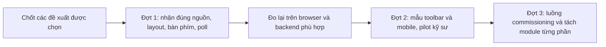

# DDC-24 — Bảng đề xuất cải thiện giao diện để review

**ID:** REC-DDC-UI-PROPOSAL-20260929
**Phiên bản:** 1.0
**Trạng thái:** In Review — mọi hàng là Đề xuất, chưa thành requirement
**Cập nhật:** 2026-09-29
**Chủ quản:** Product Owner
**Căn cứ:** [Báo cáo source và trình duyệt](DDC24_UI_SOURCE_REVIEW_2026-09-29.md), tại `main@265f1a8b`

## 1. Đề xuất chọn trước

**Nên chọn UI-P01, UI-P02 và UI-P03 trước:** giúp nhìn đúng thiết bị, tránh giao diện tràn khung và sử dụng đầy đủ bằng bàn phím. Sau đó chọn UI-P04 để việc theo dõi lệnh không chạy ngầm ngoài ý muốn. Nhóm còn lại cần thử mẫu giao diện với kỹ sư trước khi chốt bố cục.

Ước lượng là **ngày công của một kỹ sư**, gồm sửa và kiểm tập trung, không phải lịch cam kết. Chưa tính review độc lập, backend/target, HIL hay gate phát hành. Các hàng có đổi bố cục cần bổ sung thiết kế trực quan và quyết định Product trước.

| Mã | Nói dễ hiểu: làm cái gì | Lợi ích | Ưu tiên/căn cứ | Công dự kiến | Rủi ro và phụ thuộc | Nghiệm thu để biết đã làm đúng |
|---|---|---|---|---|---|---|
| **UI-P01** | Trên mọi khổ màn hình, hiện rõ điểm thuộc thiết bị nào; có tên, nguồn và thời điểm cập nhật | Không nhầm điểm của AHU A với AHU B | P1; UI-F01 đã tái hiện | 0,5–1,5 ngày | Chuỗi dài; cần formatter chung, không đổi binding contract | Hai thiết bị trùng `pointId` phân biệt ở 390/768/1280; STALE/UNKNOWN đọc được |
| **UI-P02** | Khi kéo cột hoặc đổi màn hình, tự giữ editor trong khung; có nút khôi phục bố cục | Không phải mò thuộc tính ở ngoài màn hình | P1; UI-F02 đã tái hiện | 2–3 ngày | Cần giữ thứ tự cột và luật dock của authority; thống nhất với UI-P03 | Mọi min/max lưu sẵn và resize 1680→1440→1280 không tràn ngang trang; editor giữ sàn 320 px |
| **UI-P03** | Sửa bảng lệnh nhanh để Tab ở trong hộp; Esc đóng; thêm phím đổi kích thước cột | Kỹ sư dùng được bằng bàn phím, không bấm nhầm trang phía sau | P1 cho modal; P2 cho splitter; UI-F03/F05 | 1–2 ngày | Dùng lại modal/focus chung; kiểm riêng Ctrl+K và Ctrl+P | Tab hai chiều không thoát; Esc/return focus đúng; thanh kéo có phím và giá trị truy cập |
| **UI-P04** | Rời trang thì dừng vòng đọc của trang đó; mở lại chỉ đọc lại trạng thái lệnh cũ | Không có nhiều vòng theo dõi ngầm; kết quả lệnh rõ hơn | P2; UI-F04 tái hiện trên host | 1–2 ngày | Đối chiếu `useOperationPolling`; giữ re-auth/idempotency và operation backend | Không GET mới sau unmount/reset; một vòng khi bấm đọc lại nhiều lần; recovery không POST |
| **UI-P05** | Thu gọn toolbar FBD; đặt tên rõ “Kiểm tra POU”/“Biên dịch & kiểm tra gói”; viết hướng dẫn bằng câu dễ hiểu | Người mới biết lệnh nào dùng lúc nào; canvas có thêm chỗ | P2; giả thuyết UX cần thử | 2–4 ngày | Phải phân biệt kiểm cục bộ với seal/check; cần duyệt visual và thuật ngữ VI/EN | Người thử giải thích đúng Save/Check/Commission; mọi lệnh vẫn tới được bằng phím; không đổi side effect |
| **UI-P06** | Điện thoại ưu tiên “Xem sơ đồ”, “Tín hiệu”, “Sự cố”; cây POU gọn, nút sửa khóa đưa vào phần giải thích | Người bảo trì xem nhanh, ít cuộn qua phần không dùng được | P2; khảo sát mobile | 3–5 ngày | Giữ chỉ đọc dưới 768 px; không bật chỉnh sửa qua shortcut hay context menu | 390/768 không tràn; 0 mutation dưới 768; mở đúng lỗi và tín hiệu bằng luồng chỉ đọc |
| **UI-P07** | Nối các bước bằng hướng dẫn “đang thiếu gì → mở đúng chỗ sửa → kiểm lại → đọc kết quả”; tận dụng bước tiếp theo đã có | Đi hết commissioning ít phải nhớ tên trang | P2; cần pilot người dùng | 3–5 ngày | Cần lý do chặn lấy từ contract; dữ liệu thiếu phải nói chưa rõ; không tự bỏ xác nhận an toàn | Hoàn thành 5 task pilot, ghi thời gian/lần hỏi; lỗi dẫn đúng POU/điểm; timeout không thành success |
| **UI-P08** | Khi sửa editor, tách phần layout, thao tác lệnh và dữ liệu; dùng chung modal/poll/định danh; thêm test cho 5 lỗi | Những lần sửa sau ít làm hỏng màn hình khác | P2; rủi ro bảo trì | 3–6 ngày, chia lát nhỏ | `EditorPane` hiện 3.644 dòng, FBD 1.334, WeeklyTab 1.326; số dòng tự nó không phải lỗi. Không viết lại cả editor | Mỗi lát giữ behavior, schema và phím; test hành vi và browser compare đạt; bundle vẫn dưới budget hiện hành |

UI-P08 có phần bổ sung test đi cùng từng bản sửa UI-P01..04; không cộng công test hai lần khi lập kế hoạch chính thức. Phần tách module chỉ làm khi có boundary rõ và giải quyết khó khăn thực tế.

## 2. Những nơi dev cần xem

Tất cả path thuộc source tại commit đã ghim trong báo cáo, không mặc định là bản checkout local:

| Đề xuất | File/module chủ quản | Phép kiểm bổ sung |
|---|---|---|
| UI-P01 | `design/mapping/AssignedMappingsTable.tsx`, `mappingViewModel.ts`, formatter định danh dùng chung | Hai thiết bị cùng mã điểm; chuỗi dài; null; chất lượng và timestamp trên mobile |
| UI-P02 | `design/editor/ProgramsWorkspace.tsx`, `EditorPane.tsx`, `layout/useProgrammingViewport.ts` | Kích thước lưu sẵn/max, container đổi chiều rộng, mọi trạng thái panel |
| UI-P03 | `shared/components/pa3/CommandPalette.tsx`, `Modal.tsx`, `focusTrap.ts`, `WorkspaceResizeHandle` | Modal đầu/cuối focus, Escape, focus trở về, splitter bằng phím |
| UI-P04 | `commission/useCommissionWorkflow.ts`, `shared/useOperationPolling.ts`, `CheckCommissionPage.tsx` | Unmount/reset/in-flight/recheck/unknown/reload; không gửi lại lệnh |
| UI-P05..06 | `fbd/StructuredFbdEditor.tsx`, `design/editor/EditorToolbar.tsx`, `EditorPane.tsx`, `design/DesignWorkspacePage.tsx` | Desktop/mobile, dirty Draft, LIVE/SIMULATE/chỉ đọc, tên lệnh và shortcut |
| UI-P07 | Overview, `design/workbench`, Mapping, Commission và Watch | Deep link đúng đối tượng; hành trình cùng fixture và backend thật |
| UI-P08 | Các owner trên và `e2e/programming.spec.ts`; Scheduler có owner riêng | Không nhân bản state/contract; mở các portal/modal khi thử bàn phím và axe |

Các path tương đối ở trên nằm dưới `apps/web-ui/src/features/programming`; nhóm `shared/components` nằm dưới `apps/web-ui/src`. Không sửa tất cả các file chỉ vì được liệt kê: DDD và Issue chính thức phải giới hạn owner từng lát.

## 3. Thứ tự triển khai dự kiến sau review

Mỗi đợt: cập nhật DDD đang chủ quản và ảnh trực quan khi đổi UI → manager tạo Issue có tiêu chí → implementer sửa đúng phạm vi → reviewer độc lập đối chiếu test/browser/contract. Bảng này không thay quy trình [WF-CLEAN-001](../../00_governance/CLEAN_CODE_WORKFLOW.md).

## 4. Chuẩn và cách dùng

- Dùng [WCAG 2.2](https://www.w3.org/TR/WCAG22/) làm mục tiêu kiểm khả năng sử dụng bằng bàn phím, focus, nhãn và bố cục. Kiểm bằng máy chỉ phủ một phần; không ghi “đạt WCAG toàn sản phẩm” từ kết quả axe.
- Với nút nhỏ, [W3C Target Size Minimum](https://www.w3.org/WAI/WCAG22/Understanding/target-size-minimum) yêu cầu xét kích thước 24 CSS px hoặc điều kiện/ngoại lệ phù hợp. Có thể chọn 44 px cho thao tác chạm quan trọng như một mục tiêu UX của dự án; không gọi 44 px là mức tối thiểu bắt buộc của tiêu chí 2.5.8 AA.
- [W3C Focus Not Obscured](https://www.w3.org/WAI/WCAG22/Understanding/focus-not-obscured-minimum) là căn cứ thử focus dưới thanh sticky/drawer. Không chỉ chụp ảnh khi đang không có focus.
- [Nielsen Norman Group về giảm nội dung phụ](https://www.nngroup.com/articles/progressive-disclosure/) hỗ trợ cách đưa thao tác ít dùng vào vùng mở thêm. Hành động an toàn, nguồn dữ liệu và nguyên nhân chặn phải vẫn dễ thấy.
- IEC/ST/FBD và quy tắc runtime tiếp tục theo contract/DDD hiện hành; các đề xuất UI không chứng nhận tuân thủ IEC hay làm thay đổi giới hạn điều khiển.

## 5. Quyết định Product cần ghi

| Quyết định | Lựa chọn đề nghị | Trạng thái |
|---|---|---|
| D-UI01 — Phạm vi đợt đầu | UI-P01..04 và test tương ứng | Chưa phê duyệt |
| D-UI02 — Thay toolbar/mobile | Duyệt mẫu desktop/mobile và pilot trước UI-P05..06 | Chưa phê duyệt |
| D-UI03 — Hướng dẫn vận hành | Dùng dữ liệu có thật và reason code; pilot UI-P07 | Chưa phê duyệt |
| D-UI04 — Mức refactor | UI-P08 chia theo ownership; giữ contract và behavior | Chưa phê duyệt |

Đây là kết quả để review, **chưa là Detailed Design đủ để implement, chưa đổi spec sản phẩm và chưa mở release gate**. Không yêu cầu quyết định về target/HIL để đọc hay đánh giá bảng đề xuất này.

## Lịch sử sửa đổi

| Phiên bản | Ngày | Nội dung |
|---|---|---|
| 1.0 | 2026-09-29 | Tạo tám đề xuất gắn finding/lợi ích/công/rủi ro/nghiệm thu; quyết định Product còn mở |
