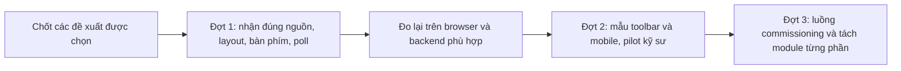
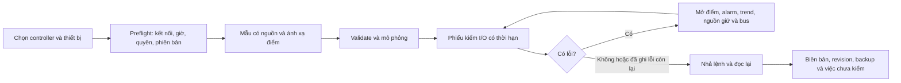
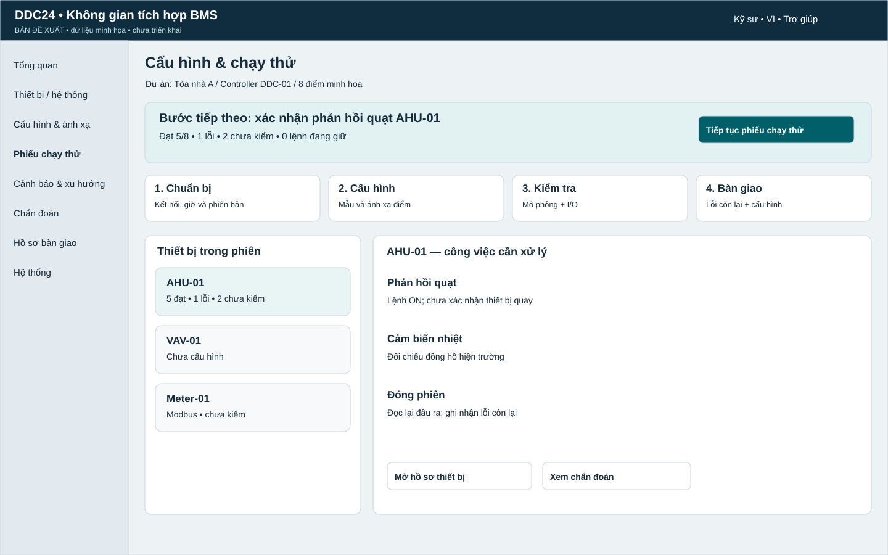
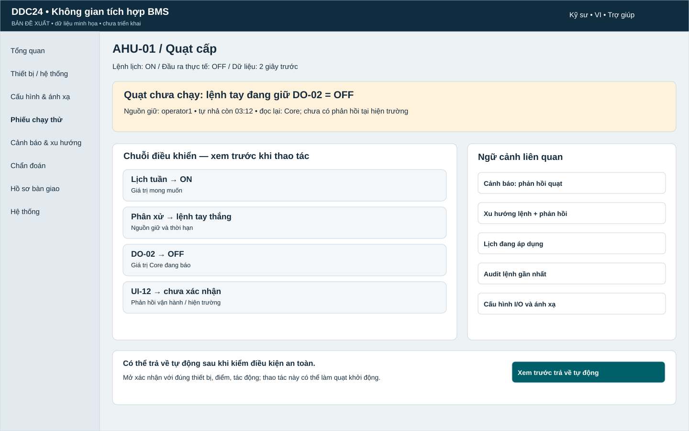
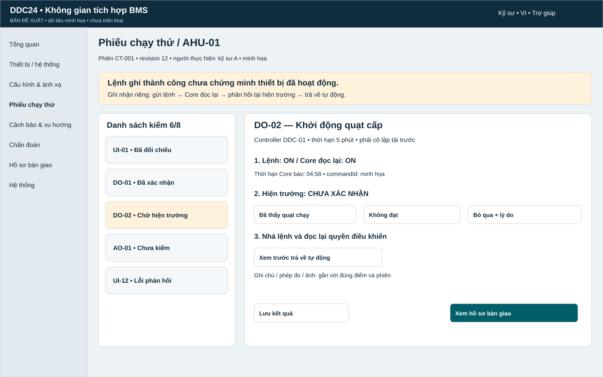
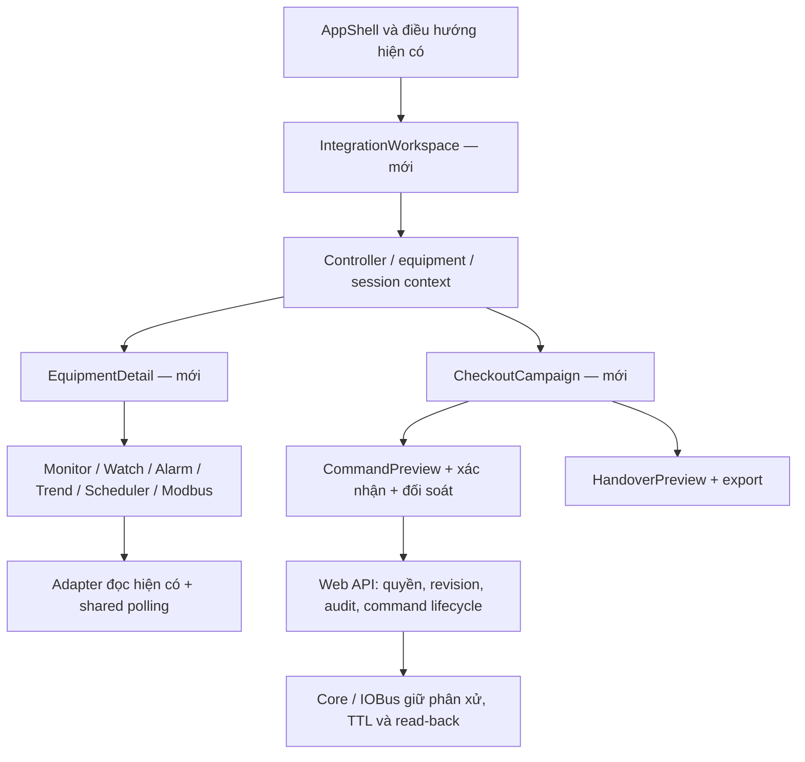
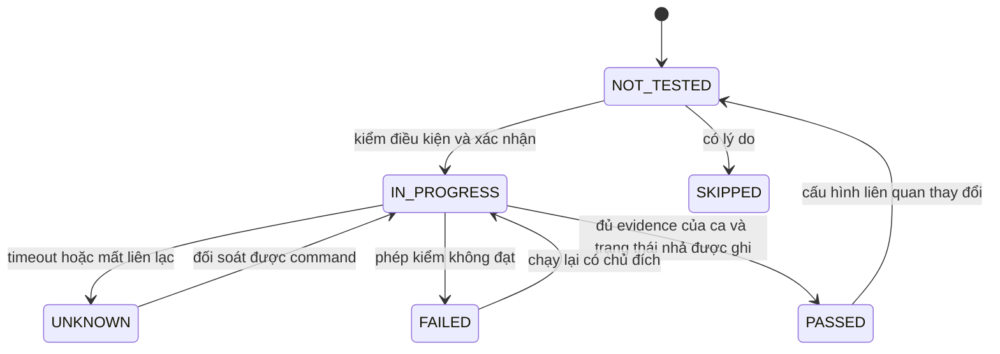

# DDC-24 — Bảng đề xuất cải thiện giao diện để review

**ID:** REC-DDC-UI-PROPOSAL-20260929
**Phiên bản:** 1.1
**Trạng thái:** In Review — mọi hàng là Đề xuất, chưa thành requirement
**Cập nhật:** 2026-09-29
**Chủ quản:** Product Owner
**Căn cứ:** [Báo cáo source và trình duyệt](DDC24_UI_SOURCE_REVIEW_2026-09-29.md), tại `main@265f1a8b`

## 1. Đề xuất chọn trước

**Nên chọn UI-P01, UI-P02 và UI-P03 trước:** giúp nhìn đúng thiết bị, tránh giao diện tràn khung và sử dụng đầy đủ bằng bàn phím. Sau đó chọn UI-P04 để việc theo dõi lệnh không chạy ngầm ngoài ý muốn. Nhóm còn lại cần thử mẫu giao diện với kỹ sư trước khi chốt bố cục.

Ước lượng là **ngày công của một kỹ sư**, gồm sửa và kiểm tập trung, không phải lịch cam kết. Chưa tính review độc lập, backend/target, HIL hay gate phát hành. Các hàng có đổi bố cục cần bổ sung thiết kế trực quan và quyết định Product trước.

| Mã | Nói dễ hiểu: làm cái gì | Lợi ích | Ưu tiên/căn cứ | Công dự kiến | Rủi ro và phụ thuộc | Nghiệm thu để biết đã làm đúng |
|---|---|---|---|---|---|---|
| **UI-P01** | Trên mọi khổ màn hình, hiện rõ điểm thuộc thiết bị nào; có tên, nguồn và thời điểm cập nhật | Không nhầm điểm của AHU A với AHU B | P1; UI-F01 đã tái hiện | 0,5–1,5 ngày | Chuỗi dài; cần formatter chung, không đổi binding contract | Hai thiết bị trùng `pointId` phân biệt ở 390/768/1280; STALE/UNKNOWN đọc được |
| **UI-P02** | Khi kéo cột hoặc đổi màn hình, tự giữ editor trong khung; có nút khôi phục bố cục | Không phải mò thuộc tính ở ngoài màn hình | P1; UI-F02 đã tái hiện | 2–3 ngày | Cần giữ thứ tự cột và luật dock của authority; thống nhất với UI-P03 | Mọi min/max lưu sẵn và resize 1680→1440→1280 không tràn ngang trang; editor giữ sàn 320 px |
| **UI-P03** | Sửa bảng lệnh nhanh để Tab ở trong hộp; Esc đóng; thêm phím đổi kích thước cột | Kỹ sư dùng được bằng bàn phím, không bấm nhầm trang phía sau | P1 cho modal; P2 cho splitter; UI-F03/F05 | 1–2 ngày | Dùng lại modal/focus chung; kiểm riêng Ctrl+K và Ctrl+P | Tab hai chiều không thoát; Esc/return focus đúng; thanh kéo có phím và giá trị truy cập |
| **UI-P04** | Rời trang thì dừng vòng đọc của trang đó; mở lại chỉ đọc lại trạng thái lệnh cũ | Không có nhiều vòng theo dõi ngầm; kết quả lệnh rõ hơn | P2; UI-F04 tái hiện trên host | 1–2 ngày | Đối chiếu `useOperationPolling`; giữ re-auth/idempotency và operation backend | Không GET mới sau unmount/reset; một vòng khi bấm đọc lại nhiều lần; recovery không POST |
| **UI-P05** | Thu gọn toolbar FBD; đặt tên rõ “Kiểm tra POU”/“Biên dịch & kiểm tra gói”; viết hướng dẫn bằng câu dễ hiểu | Người mới biết lệnh nào dùng lúc nào; canvas có thêm chỗ | P2; giả thuyết UX cần thử | 2–4 ngày | Phải phân biệt kiểm cục bộ với seal/check; cần duyệt visual và thuật ngữ VI/EN | Người thử giải thích đúng Save/Check/Commission; mọi lệnh vẫn tới được bằng phím; không đổi side effect |
| **UI-P06** | Điện thoại ưu tiên “Xem sơ đồ”, “Tín hiệu”, “Sự cố”; cây POU gọn, nút sửa khóa đưa vào phần giải thích | Người bảo trì xem nhanh, ít cuộn qua phần không dùng được | P2; khảo sát mobile | 3–5 ngày | Giữ chỉ đọc dưới 768 px; không bật chỉnh sửa qua shortcut hay context menu | 390/768 không tràn; 0 mutation dưới 768; mở đúng lỗi và tín hiệu bằng luồng chỉ đọc |
| **UI-P07** | Nối các bước bằng hướng dẫn “đang thiếu gì → mở đúng chỗ sửa → kiểm lại → đọc kết quả”; tận dụng bước tiếp theo đã có | Đi hết commissioning ít phải nhớ tên trang | P2; cần pilot người dùng | 3–5 ngày | Cần lý do chặn lấy từ contract; dữ liệu thiếu phải nói chưa rõ; không tự bỏ xác nhận an toàn | Hoàn thành 5 task pilot, ghi thời gian/lần hỏi; lỗi dẫn đúng POU/điểm; timeout không thành success |
| **UI-P08** | Khi sửa editor, tách phần layout, thao tác lệnh và dữ liệu; dùng chung modal/poll/định danh; thêm test cho 5 lỗi | Những lần sửa sau ít làm hỏng màn hình khác | P2; rủi ro bảo trì | 3–6 ngày, chia lát nhỏ | `EditorPane` hiện 3.644 dòng, FBD 1.334, WeeklyTab 1.326; số dòng tự nó không phải lỗi. Không viết lại cả editor | Mỗi lát giữ behavior, schema và phím; test hành vi và browser compare đạt; bundle vẫn dưới budget hiện hành |

UI-P08 có phần bổ sung test đi cùng từng bản sửa UI-P01..04; không cộng công test hai lần khi lập kế hoạch chính thức. Phần tách module chỉ làm khi có boundary rõ và giải quyết khó khăn thực tế.

## 2. Những nơi dev cần xem

Tất cả path thuộc source tại commit đã ghim trong báo cáo, không mặc định là bản checkout local:

| Đề xuất | File/module chủ quản | Phép kiểm bổ sung |
|---|---|---|
| UI-P01 | `design/mapping/AssignedMappingsTable.tsx`, `mappingViewModel.ts`, formatter định danh dùng chung | Hai thiết bị cùng mã điểm; chuỗi dài; null; chất lượng và timestamp trên mobile |
| UI-P02 | `design/editor/ProgramsWorkspace.tsx`, `EditorPane.tsx`, `layout/useProgrammingViewport.ts` | Kích thước lưu sẵn/max, container đổi chiều rộng, mọi trạng thái panel |
| UI-P03 | `shared/components/pa3/CommandPalette.tsx`, `Modal.tsx`, `focusTrap.ts`, `WorkspaceResizeHandle` | Modal đầu/cuối focus, Escape, focus trở về, splitter bằng phím |
| UI-P04 | `commission/useCommissionWorkflow.ts`, `shared/useOperationPolling.ts`, `CheckCommissionPage.tsx` | Unmount/reset/in-flight/recheck/unknown/reload; không gửi lại lệnh |
| UI-P05..06 | `fbd/StructuredFbdEditor.tsx`, `design/editor/EditorToolbar.tsx`, `EditorPane.tsx`, `design/DesignWorkspacePage.tsx` | Desktop/mobile, dirty Draft, LIVE/SIMULATE/chỉ đọc, tên lệnh và shortcut |
| UI-P07 | Overview, `design/workbench`, Mapping, Commission và Watch | Deep link đúng đối tượng; hành trình cùng fixture và backend thật |
| UI-P08 | Các owner trên và `e2e/programming.spec.ts`; Scheduler có owner riêng | Không nhân bản state/contract; mở các portal/modal khi thử bàn phím và axe |

Các path tương đối ở trên nằm dưới `apps/web-ui/src/features/programming`; nhóm `shared/components` nằm dưới `apps/web-ui/src`. Không sửa tất cả các file chỉ vì được liệt kê: DDD và Issue chính thức phải giới hạn owner từng lát.

## 3. Thứ tự triển khai dự kiến sau review

Mỗi đợt: cập nhật DDD đang chủ quản và ảnh trực quan khi đổi UI → manager tạo Issue có tiêu chí → implementer sửa đúng phạm vi → reviewer độc lập đối chiếu test/browser/contract. Bảng này không thay quy trình [WF-CLEAN-001](../../00_governance/CLEAN_CODE_WORKFLOW.md).

## 4. Chuẩn và cách dùng

- Dùng [WCAG 2.2](https://www.w3.org/TR/WCAG22/) làm mục tiêu kiểm khả năng sử dụng bằng bàn phím, focus, nhãn và bố cục. Kiểm bằng máy chỉ phủ một phần; không ghi “đạt WCAG toàn sản phẩm” từ kết quả axe.
- Với nút nhỏ, [W3C Target Size Minimum](https://www.w3.org/WAI/WCAG22/Understanding/target-size-minimum) yêu cầu xét kích thước 24 CSS px hoặc điều kiện/ngoại lệ phù hợp. Có thể chọn 44 px cho thao tác chạm quan trọng như một mục tiêu UX của dự án; không gọi 44 px là mức tối thiểu bắt buộc của tiêu chí 2.5.8 AA.
- [W3C Focus Not Obscured](https://www.w3.org/WAI/WCAG22/Understanding/focus-not-obscured-minimum) là căn cứ thử focus dưới thanh sticky/drawer. Không chỉ chụp ảnh khi đang không có focus.
- [Nielsen Norman Group về giảm nội dung phụ](https://www.nngroup.com/articles/progressive-disclosure/) hỗ trợ cách đưa thao tác ít dùng vào vùng mở thêm. Hành động an toàn, nguồn dữ liệu và nguyên nhân chặn phải vẫn dễ thấy.
- IEC/ST/FBD và quy tắc runtime tiếp tục theo contract/DDD hiện hành; các đề xuất UI không chứng nhận tuân thủ IEC hay làm thay đổi giới hạn điều khiển.

## 5. Quyết định Product cần ghi

| Quyết định | Lựa chọn đề nghị | Trạng thái |
|---|---|---|
| D-UI01 — Phạm vi đợt đầu | UI-P01..04 và test tương ứng | Chưa phê duyệt |
| D-UI02 — Thay toolbar/mobile | Duyệt mẫu desktop/mobile và pilot trước UI-P05..06 | Chưa phê duyệt |
| D-UI03 — Hướng dẫn vận hành | Dùng dữ liệu có thật và reason code; pilot UI-P07 | Chưa phê duyệt |
| D-UI04 — Mức refactor | UI-P08 chia theo ownership; giữ contract và behavior | Chưa phê duyệt |

Đây là kết quả để review, **chưa là Detailed Design đủ để implement, chưa đổi spec sản phẩm và chưa mở release gate**. Không yêu cầu quyết định về target/HIL để đọc hay đánh giá bảng đề xuất này.

## 6. Mục tiêu cạnh tranh đã chốt

**Khách hàng chính: đơn vị tích hợp BMS, cần cấu hình và chạy thử nhanh.** Mục tiêu sản phẩm đề nghị: kỹ sư chọn đúng thiết bị, dùng lại cấu hình đã kiểm, kiểm I/O có hướng dẫn, tìm nguyên nhân tại một chỗ và xuất được hồ sơ bàn giao. Tất cả vẫn dùng qua mạng LAN của controller; khả năng chuẩn bị offline, cache hay đồng bộ đa bo là phạm vi bổ sung phải thiết kế riêng.

Đây là phần mở rộng **để Product review**, không tự đổi [Product Spec](../../01_product/DDC24_PROGRAMMING_PRODUCT_SPEC.md), [requirements](../../02_requirements/PROGRAMMING_REQUIREMENTS_SPEC.md), visual authority hay release. Kế thừa [CP-01..09 của review kiến trúc](DDC24_ARCHITECTURE_SOLUTION_COMPARATIVE_REVIEW_2026-09-26.md), tránh tạo một backlog cạnh tranh độc lập khác. Nội dung source mới ghim `main@101d1fdf`; chi tiết tại [review §9–11](DDC24_UI_SOURCE_REVIEW_2026-09-29.md#9-mở-rộng-rà-soát-nhiều-trang-và-tính-năng).

### Hành trình đề nghị

## 7. Điều tra đối thủ và bài học áp dụng

Ngày tra cứu **2026-09-29**; nguồn chính thức của hãng. Đây là so sánh chức năng theo tài liệu, **chưa sử dụng trực tiếp sản phẩm đối thủ**, chưa đo thời gian thao tác, giá, license, hiệu năng hay giới hạn SKU. Không có điểm số tổng hợp giả. Thiếu bằng chứng nghĩa là “chưa xác minh”, không nghĩa đối thủ không có tính năng.

| Hãng / giải pháp | Cấp so sánh | Điều được tài liệu chứng minh | DDC24 hiện có | Bài học / đề xuất | Nguồn và phiên bản |
|---|---|---|---|---|---|
| Siemens Desigo PXC4/5/7, DXR2 + Web interface/ABT | Controller + công cụ kỹ thuật | Cấu hình, kiểm điểm field bus, trạng thái commissioning, lịch sử và báo cáo; phải đưa thay đổi tham số về ABT để tránh bị bản engineering cũ ghi đè | Nhiều trang tương ứng, draft/read-back, audit | Hồ sơ phiên và revision phải nối với cấu hình; tránh bàn giao nhầm bản | [Hướng dẫn chính thức V6.1 A6V13151547](https://sid.siemens.com/r/A6V13151547/31262763019__V6.1_en-US_30979792651?contentId=zcLNgxadpRZdlvn5BNkQRg) |
| Johnson Controls Metasys CCT/SCT | Công cụ engineering controller + hệ thống | Wizard tạo logic, UI dùng qua Configuration/Simulation/Commissioning, nạp nhiều controller; SCT tạo cấu hình offline, thiết bị/không gian và archive | Programming chia Design/Simulate/Check, library; chưa có campaign liên trang | Một cấu hình đi trọn vòng, mẫu ứng dụng và kiểm trước nạp | [Metasys Tools](https://www.johnsoncontrols.com/Building-Automation-and-Controls/Building-Automation-Systems-BAS/Metasys-Tools); trang không ghim release CCT |
| Schneider EcoStruxure Building Commission / SmartX | Ứng dụng chạy thử controller | Discover/connect, chọn I/O, force và kiểm thay đổi, sinh báo cáo gồm lỗi | Chạy thử AO/DO có TTL/xác nhận/audit; kết quả React tạm | Phiếu kiểm đầu vào/đầu ra, tiếp tục phiên và biên bản thiếu/đạt/lỗi | [I/O Checkout Workflow](https://ecostruxure-building-help.se.com/bms/Topics/show.castle?id=12028&locale=en-US&productversion=2022); bài 2021, liệt kê áp dụng 2022–2024/7.0/7.1, không suy mọi SKU |
| Honeywell Optimizer Unitary + Wire & Check | Controller + app pre-commissioning | Kiểm dây, tạo báo cáo và theo dõi tiến độ dự án | Có trang Commissioning; chưa có phiếu tiến độ bền vững | Điện thoại cần hoàn tất được một phép kiểm và lưu dấu vết | [Optimizer Unitary chính thức](https://buildings.honeywell.com/gb/en/brands/our-brands/bms/what-we-do/controllers/optimizer-suite/unitary-controller); chưa xác minh scope license/SKU |
| Distech Controls EC-gfxProgram | Công cụ programming controller | Thư viện mã tái dùng, Configuration Assistant, nạp nhiều thiết bị, live debugging và Watch List | FBD/ST library, Watch, check workflow | Mẫu kèm ca kiểm, giải thích lỗi và mở đúng biến | [EC-gfxProgram](https://www.distech-controls.com/products/detail/947822/distech-controls/ec-gfxprogram-graphical-programming-interface); capability theo trang, không benchmark |
| Tridium Niagara | Nền tảng tích hợp + Workbench + controller ecosystem | Timeline có HTML5 Point Manager/WebWiresheet, template/Haystack/Brick, security dashboard, quản lý phần mềm từ xa; trang hiện có Niagara 5 | Web cục bộ, point metadata equipment dạng nhẹ, FBD/ST | Học cách giữ ngữ cảnh và reuse; fleet/semantic nâng cao để sau pilot | [Timeline chính thức](https://www.tridium.com/us/en/Learn/about-us/niagara-timeline); tính năng phân bố theo các phiên bản, không gán hết cho một controller |
| Delta Controls enteliWEB | Nền tảng giám sát cấp công trình | Alarm assignment/comments/filter, widget theo thiết bị, audit timeline và quyền | Alarm/history/audit/saved view, nhưng ngữ cảnh còn trải trên nhiều trang | Khi tìm lỗi một AHU, mở được alarm–trend–lệnh–lịch cùng ngữ cảnh | [Catalog enteliWEB 4.23](https://deltacontrols.com/wp-content/uploads/enteliWEB-Catalog-Sheet.pdf), cập nhật 11/2022; tham khảo mẫu trải nghiệm, chưa xác nhận bản mới nhất |

**Nhận định của review:** lợi thế nên thử là **giảm công việc tại công trường, dùng trên web tại thiết bị và có hồ sơ minh bạch bằng tiếng Việt**. Màu sắc mới hoặc thêm một dashboard không tự tạo lợi thế. Các hãng lớn đã có nhiều công cụ chạy thử; chưa có bằng chứng DDC24 nhanh hơn. Kết luận cạnh tranh cần pilot và bằng chứng độ ổn định/khả năng tích hợp, không chỉ ảnh UI.

### Ma trận công việc người tích hợp

| Công việc | Chuẩn tham chiếu từ hãng | DDC24 ở baseline đã rà | Khoảng cần đầu tư |
|---|---|---|---|
| Làm dự án tương tự nhanh | CCT, EC-gfx reuse; Niagara template | Library, sao chép UI, Modbus template/import có source | Mẫu thiết bị gộp I/O–logic–alarm–lịch + ca kiểm, có revision |
| Kiểm dây và I/O | Schneider checkout; Honeywell Wire & Check | AO/DO commissioning, Modbus probe/test write | Input đối chiếu, phiếu qua nhiều trang, xác nhận hiện trường |
| Tìm vì sao đầu ra không chạy | Siemens object/override; Distech live Watch | Watch phân nguồn và Scheduler logic card, CRC/frame monitor | Mở một màn thiết bị, dẫn reason có nguồn; không chẩn đoán đoán |
| Bàn giao cho người khác | Siemens báo cáo/parameter handback; SCT archive | Snapshot, audit CSV, Modbus JSON/CSV | Hồ sơ cùng phiên/revision, lỗi còn lại, backup và kiểm restore |
| Đi công trường bằng điện thoại | App chạy thử của Siemens/Schneider/Honeywell | Commission page đọc được; nhiều trang responsive | Sửa tràn ngang, một điểm/một bước; giữ identity/TTL/read-back |
| Bảo trì an toàn | Framework bảo mật hãng; Niagara security | RBAC, time/network transaction, audit | Chỉ rõ quyền/nguồn dữ liệu, preflight; nghiên cứu security/fleet theo CP-06/09 riêng |

## 8. Tám đề xuất mở rộng — làm gì bằng ngôn ngữ dễ hiểu

Ước lượng là **công kỹ thuật sơ bộ**, gồm FE/BE/QA theo scope pilot, chưa là lịch cam kết; không gồm mua thiết bị/đấu dây/chứng nhận hoặc mở rộng fleet. Ngày công có thể song song và không cộng thành ngày phát hành. Chi phí thiết kế chính thức phải cập nhật sau quyết định contract.

| Mã / ưu tiên | Làm gì và lợi ích | Tái dùng hiện có / CP | Công & rủi ro | Pilot / điều kiện đạt | Quyết định Product / owner đề nghị |
|---|---|---|---|---|---|
| **UI-P09 / P1** Phiếu chạy thử | Danh sách điểm cần kiểm, trạng thái và ghi chú; đóng tab vẫn tiếp tục được; phân biệt lệnh/đọc lại/hiện trường | Commissioning TTL/modal/audit + CP-01 | 12–20 ngày công; BE lưu phiên, concurrent, retention; không tự kích tải khi tiếp tục phiên | 1 AHU + 1 slave: mất mạng/reload giữ kết quả; API ACK không tự PASS hiện trường; mọi điểm thiếu hiện trong biên bản | D-UI05: scope local + 1 mẫu Modbus; BE/FE/QA |
| **UI-P10 / P1** Một màn cho một thiết bị | Chọn AHU thấy điểm, lệnh mong muốn, nguồn giữ, alarm, trend và lịch; bấm lỗi mở đúng nơi | ADR-042 equipment filter, Watch, Scheduler logic card + CP-04/07 | 8–14 ngày; metadata chưa đủ/identity sai; không tạo engine phân xử ở FE | 3 lỗi có nguyên nhân biết trước: override, mất phản hồi, Modbus chưa poll; người dùng tìm đúng dữ liệu chứng minh | D-UI06: equipment tag hiện có trước entity tree; FE/BE |
| **UI-P11 / P1** Mẫu thiết bị đã kiểm | Chọn AHU/VAV mẫu, khai điểm còn thiếu, xem preview rồi tạo draft; mẫu kèm ca kiểm và nguồn | Library, simulation, copy UI, Modbus template + CP-02 | 12–20 ngày; đa revision, collision, cảm biến khác; không gọi mẫu “chuẩn G36” khi chưa xác minh sequence | 1 mẫu AHU nhỏ trước; nhập 2 controller khác ID không trộn point; lỗi thiếu điểm chặn apply | D-UI07: chọn ứng dụng/mẫu và người kiểm nội dung HVAC; HVAC/Core/BE/FE |
| **UI-P12 / P1** Hướng dẫn Modbus theo việc | Cổng→slave→mẫu register→đọc thử→preview→apply; chỉ rõ sai địa chỉ/endian/timeout dựa trên evidence | Toàn bộ 6 tab hiện có; CP-01/02 | 6–10 ngày; giả kết luận từ timeout; validate/rollback phải ở BE/IOBus | 1 meter + 1 module I/O; ca sai baud/address/word-order; luôn phân “chưa rõ” với “đã xác nhận” | D-UI08: 2 datasheet thật và thiết bị pilot; FE/BE/IOBus/QA |
| **UI-P13 / P1** Đóng phiên và bàn giao | Gom revision, kết quả kiểm, thiếu/lỗi, lệnh còn giữ, nguồn export; backup/restore có preflight | Snapshot/audit/export Modbus + CP-05 | 10–18 ngày cho hồ sơ + khảo sát backup; restore đa subsystem cần plan riêng, không giả atomic | Restore trên bo lab thay thế phải đối chiếu cấu hình và read-back; file không chứa mật khẩu/token | D-UI09: scope hồ sơ đầu tiên; Tech Lead/Ops/BE/QA |
| **UI-P14 / P2** Đường đi cho kỹ sư mới | Bước tiếp theo rõ; “Chạy thử” dễ tìm; lỗi có câu “kiểm gì, mở đâu”; nhãn Việt nhất quán | CommandPalette, Help topics, ADR-032 | 4–7 ngày; đổi navigation authority/permissions | Kỹ sư chưa dùng sản phẩm làm 5 việc, ít trợ giúp hơn baseline; route kế thừa còn chạy | D-UI10: entry-point tác vụ trước đổi toàn menu; Product/UX/FE |
| **UI-P15 / P2** Gói tìm lỗi theo thiết bị | Xuất đúng point/device/bus/command, thời gian và nguồn, giúp hỗ trợ tái hiện | Diagnostics export, FrameMonitor, audit, history + CP-04 | 5–9 ngày; retention/size/ẩn dữ liệu nhạy cảm; ảnh snapshot không thay phép đo HIL | 3 incident tạo gói đủ dữ liệu; thiếu endpoint ghi NOT AVAILABLE; support mở được lỗi đúng ngữ cảnh | D-UI11: nội dung và retention gói; Ops/BE/FE |
| **UI-P16 / P2** Demo đáng tin và capability rõ | Mẫu demo nhất quán số đo/đơn vị/cổng; tính năng chưa có ghi rõ; map từng chức năng tới proof | Product flags, route contract, mock client + CP-01..05 hỗ trợ bán hàng | 3–6 ngày; fixture khác live, scope chưa chốt | Demo AHU có fault scenario; unsupported không hiện nút “lưu thành công”; test same fixture khớp Overview/Modbus/Diagram | D-UI12: scenario demo và scope SKU; Product/QA/FE |

**Việc nền không được bỏ:** UI-P01..04 của phần đầu; mở rộng UI-P02/UI-P06 để xử lý UI-F06 toàn ứng dụng; bổ sung sửa UI-F07 vào UI-P06 (thống kê không bịa số). Chốt estimate sửa hai lỗi mới sau khi xác định consumer; sơ bộ UI-F06 2–4 ngày FE/QA, UI-F07 1–2 ngày FE/QA. Không tự chuyển ưu tiên review thành mức severity release đã phê duyệt.

## 9. Phương án thiết kế mới để review

[**Xem bộ mẫu render được**](assets/ui-review-2026-09-29/expanded/concept-gallery.html). Có **9 SVG**: ba màn chính ở desktop/mobile, xác nhận lệnh ở hai kích thước và bảng trạng thái. Tất cả dùng **dữ liệu minh họa**, chưa là visual authority, chưa gắn implementation. Đây là concept cụ thể để chọn luồng; các drawer/modal phụ và responsive đầy đủ cần hoàn tất trong DDD sau scope được duyệt.

### 9.1 Bàn cấu hình và chạy thử

[Mobile](assets/ui-review-2026-09-29/expanded/concept-workspace-mobile.svg). Thêm lối vào cho người tích hợp; giữ Dashboard vận hành với ưu tiên alarm/health. Không đưa CPU/RAM lên làm thông tin chính của phiên chạy thử. Hiển thị thiết bị/phiên, tiến độ và việc kế tiếp dựa trên trạng thái thật, không phần trăm tính tùy ý.

### 9.2 Hồ sơ một thiết bị

[Mobile](assets/ui-review-2026-09-29/expanded/concept-equipment-mobile.svg). Đặt “Vì sao chưa chạy?” trước biểu đồ. Câu trả lời phải có nguồn: lệnh, owner, thời hạn, write-result, read-back và phản hồi. Không có field thì hiện “Chưa có dữ liệu”, không suy owner từ giá trị ON/OFF. Dẫn tới trang có sẵn bằng stable point ID và controller context.

### 9.3 Phiếu kiểm và đóng phiên

[Mobile](assets/ui-review-2026-09-29/expanded/concept-checkout-mobile.svg). Desktop có danh sách và chi tiết; mobile một điểm/một bước. Không tự chạy hàng loạt output. Người vận hành ghi riêng phản hồi hiện trường và phép đo; nếu chưa kiểm vẫn xuất biên bản với danh sách thiếu. Chỉ kết luận đạt phép kiểm khi loại evidence yêu cầu đã đủ.

### 9.4 Xác nhận lệnh và trạng thái thiếu dữ liệu

[Modal desktop](assets/ui-review-2026-09-29/expanded/concept-confirm-desktop.svg) · [modal mobile](assets/ui-review-2026-09-29/expanded/concept-confirm-mobile.svg) · [bảng trạng thái](assets/ui-review-2026-09-29/expanded/concept-states.svg).

Xác nhận luôn nêu controller, thiết bị, point, giá trị, TTL, tác động và quyền; dữ liệu cũ/mất mạng khóa gửi. Timeout hiện “Kết quả chưa rõ”, đối soát trước retry. Focus vào tiêu đề, Tab/Shift+Tab nằm trong modal, Esc/hủy trả focus về nút mở; không cho đóng modal đang gửi rồi tự hiểu là lệnh đã hủy. Đây là yêu cầu target, chưa là kết quả đã test.

### 9.5 Component và dữ liệu cần nối

| Vùng concept | Field / contract cần có | Consumer/state/action | RBAC và copy |
|---|---|---|---|
| Context đầu trang | controller identity, equipment tag ADR-042, sessionId, config revision | URL context, không reset khi đổi tab; identity thiếu chặn lệnh | Viewer xem; người có quyền tạo/chạy phiên theo contract sẽ duyệt |
| Bước kế tiếp / tiến độ | checklist item + trạng thái lưu server | Loading/empty/error; chỉ đếm từ item thật | “5/8 đã kiểm, 2 chưa kiểm”; lỗi không làm mẫu số giảm |
| Nguyên nhân đầu ra | desired value, authority owner/priority/reason, write-result/read-back, freshness | Adapter hợp nhất, thiếu field hiện unknown; drilldown giữ point | Chỉ quan sát; không tự đặt ưu tiên hay safe-state ở FE |
| Phiếu một điểm | commandId, TTL Core báo, outcome từng cấp, observer/measurement | Soạn→xác nhận→gửi→đối soát→ghi nhận hiện trường→nhả | Lệnh theo RBAC hiện có; điểm có interlock không được FE bỏ qua |
| Đóng phiên | remaining overrides, revision, unresolved/untested, export manifest | Preview hồ sơ; số thiếu/lỗi luôn có trong file | Quyền export/đóng/restore phải chốt ở BE; không gộp engineer/admin vào một quyền |
| Sự cố / trợ giúp | reason code + nguồn + action link | Hướng dẫn kiểm, không chẩn đoán đoán | Mã kỹ thuật trong mở rộng; câu chính dùng tiếng Việt |

Token concept: nền `#edf2f5`, chữ `#162c3d`, accent `#005f68`, cảnh báo `#fff2dd`, lỗi `#ffe7e2`; không chỉ dùng màu để chỉ trạng thái. Sidebar desktop 208 px, gap 16–24 px, card radius 10 px; hành động chạm concept 44 px. Target breakpoint đề nghị: dưới 768 px một cột, 768–1199 px danh sách/drawer, từ 1200 px master/detail. **Chưa thay token authority**; DDD phải đo tương phản, focus và state từng component sau khi chọn phương án.

## 10. Refactor theo phần sở hữu và hợp đồng

**Mục đích:** giảm mã trùng và giữ cùng nghĩa của point/state qua nhiều trang. Triển khai từng bước có đối soát, giữ các route/contract đang dùng; không viết lại cả frontend.

| Phần | Tạo/sửa dự kiến | Ownership | Phải giữ / rủi ro | Cách kiểm |
|---|---|---|---|---|
| Dữ liệu quan sát | `shared/hooks/useLivePoints.ts`, `useSharedPoll.ts`, consumer Monitor/Trend/Commissioning; adapter theo point | FE shared data | Tái dùng main mới; key gồm controller + params + auth scope; không cache chéo người dùng/bo; fresh snapshot khác response nhận được | Đo request foreground/background và reconnect; cleanup/no-overlap; logout/controller switch xóa dữ liệu |
| Point presentation | Selector format unit/quality/freshness dùng chung; sửa `buildTrendRows` | FE points/operations | Phân biệt raw, engineering, percent; null không là 0; history generation không trộn | 0/null/missing/out-of-range/quality; mapping hai thiết bị trùng tên điểm |
| Context thiết bị | `features/equipment/` mới, adapter từ `Point.equipment`; mở sâu từ Monitor/Alarm/Trend/Scheduler | FE feature, BE metadata | ADR-042 string còn authoritative; không đổi thành UUID entity ngầm; thay controller không giữ nhầm phiên | URL encoding, tag trống, rename/revision, controller switch, quyền đọc |
| Phiếu chạy thử | `features/commissioning/` mới hoặc tách `CommissioningPage` theo scope; `application/transport` BE theo package authority hiện có | FE UI / Web API lưu phiên / Core command | UI quản lý workflow, BE auth+audit+revision; Core giữ TTL/phân xử; IOBus giữ thực thi bus | reload/reconnect/multi-tab/timeout/restart; physical/HIL lane riêng |
| Hướng dẫn Modbus | Orchestrator quanh `ModbusConfigProvider`, các page và preview; không sao chép validation | FE Modbus, BE/IOBus | Draft→save→apply→read-back hiện có, rollback và base revision; passive FrameMonitor vẫn passive | Import conflict, byte/word/address, stale telemetry, fail apply, không tự probe/write |
| Bàn giao | `features/handover/` mới; adapter các export hiện có; API lưu/xuất nếu được duyệt | BE artifact integrity, FE preview, Ops restore | Manifest có nguồn/revision/thiếu; export config khác report; restore nhiều subsystem chưa atomic | Checksum, compatibility, selective secrets removal, restore+read-back trên lab |
| Khung/điều hướng | `NavRail`, `CommandPalette`, `HelpPage`, route/menu contract | FE shell + Product authority | Entry-point dễ thấy; không đổi route hoặc roles tùy tiện; modal dùng primitive có focus trap | Keyboard đầy đủ, mobile tab reachability, deep-link giữ filter, viewer không gửi được lệnh |

### Dữ liệu mới cần thiết kế chính thức trước implement

Field dưới đây là **target đề nghị**, không phải schema đã có. Cần ADR/API review, migration và storage budget trước `IMPLEMENT_READY`.

| Model/field | Kiểu / nghĩa đề nghị | Quy tắc / quyết định còn mở |
|---|---|---|
| `CheckoutSession.id` | UUID, required, server tạo | Unique; không lấy tên AHU làm khóa |
| `controllerIdentity` | Định danh controller ổn định, required | Tech Lead xác minh serial/ID hiện có hoặc provisioning; thiếu identity cấm restore/gửi lệnh |
| `equipmentTag` | string hoặc null, từ ADR-042 | null là chưa gán; tên hiển thị không thay pointId |
| `configRevision` | revision hoặc manifest hash có nguồn | Không tự bịa một revision chung cho mọi subsystem; field phải chỉ rõ namespace |
| `createdAt/updatedAt` | UTC RFC3339 + clock source/status | Controller chưa đồng bộ phải ghi cảnh báo; không lấy giờ browser thay nguồn |
| `actor/observer` | user identity server xác nhận | actor từ session auth; observer cho phép khác người gửi theo policy |
| `item.pointId/source` | point ID hiện có + source local/virtual/modbus | Không ghép label thành identity; history có generation riêng nếu liên quan |
| `item.state` | NOT_TESTED, IN_PROGRESS, PASSED, FAILED, SKIPPED, UNKNOWN | PASSED theo evidence policy từng ca; SKIPPED required reason; UNKNOWN cho timeout |
| `commandId/commandResult` | ID nullable + kết quả lệnh có nguồn | null là chưa gửi/không có dữ liệu; response ACK không gán PASSED hiện trường |
| `readback/fieldObservation` | value+unit+quality+timestamp / phép đo+ghi chú | Tách hai trường; có thể chưa biết; không thay phép đo thực bằng ảnh UI |
| `releaseResult` | trạng thái nhả + read-back có nguồn | Browser đếm TTL không chứng minh nhả; server/Core đối soát |
| `version` | số tăng cho session/item | Optimistic concurrency; xung đột trả lỗi ổn định, không last-write-wins ngầm |
| `retention/exportManifest` | chính sách + version/checksum/source | Ops/BE chốt dung lượng, thời gian, attachment limit; chưa có số mặc định được duyệt |

Interface mới cần mô tả tạo/đọc/cập nhật/xuất session và liên kết command, quyền từng operation, lỗi revision/conflict/offline, timeout/retry/idempotency, pagination và compatibility. **Chưa đăng ký endpoint mới trong OpenAPI của report này.** Lệnh mutation không tự retry khi kết quả chưa rõ. Một session phục hồi sau reload chỉ đọc đối soát, không tự phát lại output. Report có thể ghi “còn lệnh giữ/chưa rõ” thay vì ép thao tác nhả không an toàn.

## 11. Pilot, tiêu chuẩn và kế hoạch đi đến quyết định

### 11.1 Pilot đo giá trị thật

Đề nghị **5 kỹ sư tích hợp** (ít nhất hai người chưa dùng DDC24), một AHU và hai thiết bị Modbus có datasheet. Cho thực hiện cùng bộ việc trên UI hiện tại và concept/prototype: chuẩn bị controller, map điểm, xử lý một lỗi, kiểm I/O, xuất biên bản. Đảo thứ tự thử để giảm lợi thế do đã học bài; không dùng số đo target giả cho các lỗi thực địa.

| Chỉ số | Cách đo | Mục tiêu pilot đề nghị, chưa là kết quả |
|---|---|---|
| Thời gian hoàn thành | Median từng việc; tách thời gian thao tác UI khỏi thời gian thiết bị đáp ứng | Giảm ≥30% so với baseline DDC24 cùng bài, ghi cả số tuyệt đối |
| Cần trợ giúp | Số câu hỏi/lần đi sai trang; observer ghi lý do | ≥4/5 người làm xong luồng không cần hướng dẫn miệng |
| Đúng nguyên nhân | So kết luận kỹ sư với fault được cài và evidence | Cả ba tình huống phải dẫn được nguồn; không tự nhận đúng bằng giao diện xanh |
| Hồ sơ trung thực | Kiểm controller/point/revision/actor/UTC/outcome/thiếu | 100% item có trạng thái; 0 false PASS hiện trường từ API ACK |
| An toàn thao tác | Wrong device, stale/unknown, TTL, nhả/read-back, duplicate command | 0 gửi nhầm point/controller và 0 tự retry write khi chưa rõ; xác minh lab/HIL riêng |
| Mobile | 390 px, tên dài, ngôn ngữ Việt, bàn phím/chạm | Document không tràn; identity/TTL/action luôn tới được |

Đây là mục tiêu do review đề nghị, không là cam kết tiết kiệm 30% hoặc benchmark nhanh hơn hãng khác. Pilot UI/prototype không mở release. Luồng có tác động I/O cần target + HIL; backup cần thử restore; process/power restart cần evidence đúng lane.

### 11.2 Quy tắc và tiêu chuẩn áp dụng đúng phạm vi

- **Nội bộ bắt buộc:** DOC-GOV-001 / WF-CLEAN-001, authority Product/requirements/ADR-032/ADR-042 và Programming manifest hiện có. Chọn concept không tự duyệt spec; phải hoàn tất DD-01..13, yêu cầu→test và sign-off trước implement.
- **Web accessibility đề nghị làm tiêu chí nghiệm thu:** [WCAG 2.2](https://www.w3.org/TR/WCAG22/) cho keyboard/focus/reflow/contrast/target; [W3C APG modal](https://www.w3.org/WAI/ARIA/apg/patterns/dialog-modal/) cho quản lý focus. AA 2.5.8 dùng 24 CSS px hoặc ngoại lệ; concept chọn 44 px cho thao tác chạm. Không gọi chọn token hoặc chạy axe là chứng nhận WCAG.
- **Semantics:** [Project Haystack Defs](https://project-haystack.org/doc/docHaystack/Defs) là tham chiếu cho site/equip/point và quan hệ. Không tuyên bố tương thích Haystack từ một field equipment; CP-07 cần mapping/export contract và interoperability test.
- **BMS/control:** IEC 61131-3, BACnet và các policy safe-state/TTL của dự án vẫn giữ authority riêng. UI wizard không chứng nhận IEC/BACnet/BTL hay ASHRAE Guideline 36. Template HVAC phải có kỹ sư chuyên môn kiểm sequence; bảo mật/IEC 62443/BACnet/SC thuộc plan kỹ thuật riêng khi chọn scope.
- **Phương pháp nghiên cứu:** quan sát tác vụ có cùng fixture, counterbalance, đo lỗi/thời gian và phỏng vấn ngắn. Source review chỉ chứng minh đường mã; demo chỉ chứng minh hiển thị. Báo cáo này chưa có thí nghiệm usability hoàn thành hoặc nghiên cứu độc lập chứng minh tăng năng suất.

### 11.3 Thứ tự làm và cổng

| Đợt | Kết quả cụ thể | Điều kiện trước bước sau |
|---|---|---|
| A — Chốt nền | UI-F01..07 có owner/bản sửa/test; ưu tiên null, identity, mobile và workflow cleanup | Tái hiện đỏ→xanh, Chrome/layout/focus/network, gates source phù hợp; không đóng từ docs |
| B — Pilot tích hợp | UI-P09 + UI-P10 + UI-P14 cho một AHU; template giới hạn UI-P11/P12 | Scope + API/data/error/state + visual đủ DD; prototype pilot đạt mục tiêu được chốt |
| C — Bàn giao có hồ sơ | UI-P13 + UI-P15; fixture UI-P16 nhất quán và nhãn capability rõ | Export đủ thiếu/lỗi; restore và restart/TTL trên target/HIL nếu claim tính năng này |
| D — Mở rộng theo nhu cầu | Thêm mẫu, semantic tree, BACnet/SC, energy/FDD/fleet theo CP-06..09 | Có demand/pilot và thiết kế riêng; không làm điều kiện vòng đầu nếu Product không chọn |

**Khuyến nghị một ưu tiên Product:** duyệt pilot **phiếu chạy thử + một màn theo thiết bị** (UI-P09/10), làm cùng các lỗi nền. Đây là giá trị trực tiếp nhất cho phân khúc người dùng đã chọn. Các D-UI05..12 là đề nghị chưa phê duyệt; owner Product ghi scope/budget, Tech Lead hoàn tất DDD và traceability trước implement. Báo cáo hoàn thành review và concept, **không kết luận `PLAN_READY`/`IMPLEMENT_READY`/`RELEASE_READY` cho tính năng mới**.

## Lịch sử sửa đổi

| Phiên bản | Ngày | Nội dung |
|---|---|---|
| 1.0 | 2026-09-29 | Tạo tám đề xuất gắn finding/lợi ích/công/rủi ro/nghiệm thu; quyết định Product còn mở |
| 1.1 | 2026-09-29 | Chốt phân khúc tích hợp BMS; đối chiếu 7 hãng/hệ sinh thái; bổ sung UI-P09..16, mapping CP, 9 concept SVG, refactor và pilot; chưa duyệt spec/DDD/release |
