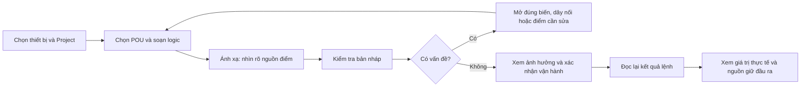
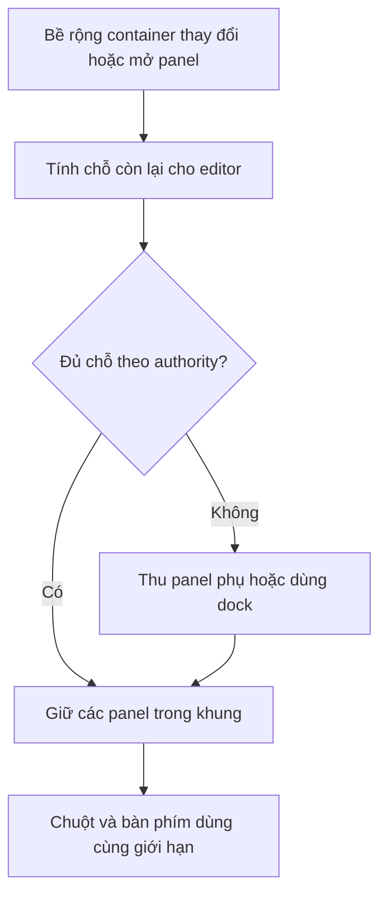

# DDC-24 — Review giao diện và mã nguồn frontend

**ID:** REC-DDC-UI-REVIEW-20260929
**Phiên bản:** 1.0
**Trạng thái:** In Review — hồ sơ quan sát, chưa phê duyệt thay đổi sản phẩm
**Cập nhật:** 2026-09-29
**Chủ quản:** Product Owner và nhóm frontend
**Nguồn đã rà:** `origin/main@265f1a8bfe2bcf1bc9548f0979e4334f3d6437b3`

## 1. Kết luận dễ hiểu

**Nên cải thiện theo thứ tự: nhận đúng thiết bị → giữ vùng làm việc dùng được → thao tác bàn phím đầy đủ → theo dõi lệnh ổn định → giảm số việc người dùng phải tự nhớ.**

Giao diện đã có nền để phát triển: chia các bước lập trình, ánh xạ, kiểm tra và vận hành; tách bản nháp khỏi bản đang chạy; có trạng thái chỉ đọc trên điện thoại; có thư viện, bàn làm việc và chẩn đoán theo ngữ cảnh. Nên phát triển tiếp các thành phần này.

Review tìm được **5 finding: 3 mục P1 và 2 mục P2**. Ba mục đã tái hiện trên Chrome, một mục tái hiện bằng test hook trên host, một mục xác nhận qua source. Chúng chưa được sửa trong phiên review này. [Bảng đề xuất riêng](DDC24_UI_IMPROVEMENT_PROPOSALS_2026-09-29.md) chuyển các finding thành việc cụ thể, có chi phí dự kiến và tiêu chí nghiệm thu.

P1 ở đây nghĩa là cần ưu tiên xử lý trước khi nghiệm thu phần giao diện liên quan; P2 là lỗi thao tác hoặc vòng đời cần xử lý trong đợt cải thiện tiếp theo. Đây là phân loại review, không tự sửa ma trận release của dự án.

## 2. Phạm vi và độ tin cậy

Checkout ban đầu là `main@cb690dfb`, chậm hơn main đã fetch 81 commit và có CHANGELOG đang sửa. Review dùng worktree riêng `/tmp/ddc-ui-review-20260929` tại commit nêu trên; không thay đổi source frontend của checkout người dùng. Các liên kết source trong finding ghim commit để không dẫn nhầm bản local cũ.

| Vùng | Đã làm | Giới hạn |
|---|---|---|
| Khung ứng dụng | Rà `App`, `AppShell`, `TopBar`, `CommandPalette`, `Modal`, ranh giới lỗi | Không kiểm hết các trang quản trị |
| Lập trình | Rà layout, panel, `EditorPane`, toolbar và các phần xử lý ST/FBD liên quan | Không kiểm toàn bộ ngữ nghĩa compiler |
| Ánh xạ | Rà `MappingTab`, view model, bảng đã gán; so desktop/mobile cùng dữ liệu | Không gửi lệnh gán hay ghi I/O |
| Kiểm tra và vận hành | Rà workflow, kiểm trạng thái READY bằng fixture, tái hiện vòng poll | Không thực hiện Commission lên thiết bị |
| Runtime/thư viện/tổng quan | Mở trang bằng fixture, kiểm trạng thái hiển thị và lỗi dữ liệu thiếu | Không xác nhận giá trị hay khả năng thực tế của bo |
| Scheduler | Rà điểm xử lý bàn phím/pointer và chạy test hiện có | Chưa audit trình duyệt toàn luồng lịch |
| Alarm, Trend, Network, quyền toàn hệ thống | Có rà khung chung; chưa kiểm từng luồng | Không có kết luận bao phủ toàn sản phẩm |

### Bản thiết kế dùng để đối chiếu

- [Manifest authority trực quan](../../04_uiux/KX_DDC24_Programming_FE_Handoff_v2_1/handoff_manifest.json): PNG/HTML được đăng ký là chuẩn về bố cục và thứ bậc, không phải bằng chứng runtime.
- Đã xem trực tiếp [ảnh FBD](../../04_uiux/KX_DDC24_Programming_FE_Handoff_v2_1/assets/PGM-02B_FBD_editor_reference.png) và [ảnh Mapping](../../04_uiux/KX_DDC24_Programming_FE_Handoff_v2_1/assets/PGM-03_mapping.png). Mapping giữ bố cục hai vùng trên và bảng đã gán bên dưới; Inspector theo ngữ cảnh.
- [Handoff Programs](../../04_uiux/KX_DDC24_Programming_FE_Handoff_v2_1/PGM-02_PROGRAMS_FE_HANDOFF_v2_2.md), [thiết kế workspace](../../02_design/software/PROGRAMMING_PGM02_WORKSPACE_DETAILED_DESIGN.md) và [thiết kế UX](../../04_uiux/PROGRAMMING_UI_UX_DESIGN.md) bổ sung luật thao tác, trạng thái và an toàn.
- [Review UX ngày 18/08](FE_UIUX_UC_REVIEW_2026-08-18.md) là hồ sơ lịch sử. Finding mới dưới đây được đối chiếu lại trên commit 29/09, không suy từ trạng thái cũ.

### Môi trường trình duyệt

Chrome DevTools MCP chạy được. Bản Vite dev dùng `VITE_DDC_MODE=live`, auth mock và hai cờ Programming bật. API Programming lấy handler từ `e2e/programming.spec.ts`, bọc thành máy chủ HTTP trên loopback. Các screenshot cuối của ứng dụng dùng cấu hình này; lượt khảo sát demo ban đầu không dùng làm bằng chứng trạng thái thiết bị.

**Dữ liệu là fixture.** “Core đang chạy”, PID chờ review, metadata chưa rõ và timestamp trong ảnh không nói lên trạng thái hiện tại của sản phẩm/bo. WebSocket và nhiều API hệ thống không được fixture phục vụ; lỗi 503 và banner mất kết nối được ghi lại, không tính thành lỗi frontend. Endpoint `runtime/signals` cũng chưa có trong handler này. Chi tiết và ảnh tại [hồ sơ bằng chứng](assets/ui-review-2026-09-29/EVIDENCE.md).

## 3. Những điểm nên giữ

| Điểm hiện có | Vì sao có ích | Source tại baseline |
|---|---|---|
| Draft, Active và chế độ EDIT/LIVE tách biệt | Tránh nhầm lưu mã với đưa mã vào vận hành | `layout/ProgrammingContextStrip.tsx`, `design/editor/EditorPane.tsx` |
| Mobile dưới 768 px truyền quyền chỉ đọc tới editor | Hạn chế thao tác sửa trên màn hình quá hẹp | `layout/useProgrammingViewport.ts` |
| Tương thích FE–thiết bị được kiểm trước khi sửa | Không cho soạn theo phiên bản thư viện khác thiết bị | `shared/programmingCompatibility.ts` |
| Ánh xạ có preview và đọc lại Draft | Người dùng được xem quyết định trước khi ghi | `design/mapping/MappingTab.tsx` |
| Watch tách giá trị Program đề xuất, giá trị thực tế và nguồn đang giữ | Giải thích vì sao đầu ra không giống lệnh Program | `runtime/WatchTab.tsx` |
| Modal chung và bộ poll chung đã có cơ chế cần dùng lại | Giảm việc mỗi màn hình tự dựng một cách xử lý | `shared/components/Modal.tsx`, `programming/shared/useOperationPolling.ts` |

Path trong cột source nằm dưới `apps/web-ui/src/features/programming`, trừ `shared/components/Modal.tsx` nằm dưới `apps/web-ui/src`.

## 4. Finding đã xác nhận

### UI-F01 — Điện thoại không cho biết điểm Modbus thuộc thiết bị nào — P1

**Người dùng gặp gì:** hai điểm có cùng tên/mã trên hai thiết bị khác nhau đều hiện `MB_RTU:TEMP`. Kỹ sư không phân biệt được nguồn của ánh xạ ngay trên thẻ đã gán.

**Nguyên nhân:** nhánh mobile chỉ ghép `category:pointId`; nhánh desktop có thêm `deviceId`. View model đã giữ định danh đầy đủ, nên thông tin mất ở lớp hiển thị.

**Bằng chứng:** cùng hai hàng có `deviceId=ahu-a/ahu-b`, desktop hiện `MB_RTU:ahu-a:TEMP` và `MB_RTU:ahu-b:TEMP`; viewport 390 px hiện hai chuỗi giống nhau. Đây là Chrome render component thật với dữ liệu minh họa, không phải lỗi phân giải backend. [Source dòng 31 và 45](https://github.com/Mekong-HCM/MK-DDC-24/blob/265f1a8bfe2bcf1bc9548f0979e4334f3d6437b3/apps/web-ui/src/features/programming/design/mapping/AssignedMappingsTable.tsx#L31).

**Đề xuất sửa:** một formatter định danh dùng chung desktop/mobile; tên dễ đọc đi cùng thiết bị/nguồn. Khi chuỗi dài, cho mở đầy đủ và sao chép. Thẻ mobile thêm thời điểm quan sát, vì hiện có quality nhưng thiếu mốc thời gian mà desktop có.

**Nghiệm thu:** hai thiết bị cùng `pointId` luôn phân biệt được ở 390 và 768 px; null không biến thành 0; STALE/UNKNOWN vẫn hiện. Không đổi identity hay binding payload.

### UI-F02 — Panel rộng đã lưu làm Inspector chạy ra ngoài màn hình — P1

**Người dùng gặp gì:** sau khi kéo các cột rộng hoặc chuyển từ màn hình lớn sang laptop, phải cuộn ngang cả trang mới thấy thuộc tính.

**Nguyên nhân:** giới hạn riêng từng panel chưa giới hạn tổng chiều rộng. Ba giá trị hợp lệ `480/320/480` cộng editor tối thiểu 320 và ba thanh kéo 6 px cần 1.618 px; workspace ở màn 1440 chỉ có 1.168 px. Lựa chọn này được lưu và dùng lại.

**Bằng chứng Chrome:** thiết lập các giá trị hợp lệ vào khóa `mkddc-pgm02-panel-widths-v1`, reload và mở lại FBD. `scrollWidth=1828`, `clientWidth=1430`; mép phải Inspector ở `x=1867`. Bộ gọn `192/180/256` không tràn tại 1440 px. [Source giới hạn](https://github.com/Mekong-HCM/MK-DDC-24/blob/265f1a8bfe2bcf1bc9548f0979e4334f3d6437b3/apps/web-ui/src/features/programming/design/editor/ProgramsWorkspace.tsx#L47), [đọc và dùng kích thước](https://github.com/Mekong-HCM/MK-DDC-24/blob/265f1a8bfe2bcf1bc9548f0979e4334f3d6437b3/apps/web-ui/src/features/programming/design/editor/ProgramsWorkspace.tsx#L55).

**Đề xuất sửa:** tính ngân sách theo bề rộng container thực; giữ editor tối thiểu, thu các panel phụ hoặc chuyển sang dock theo authority. Tách kích thước người dùng mong muốn khỏi kích thước đang áp dụng; thêm “Khôi phục bố cục”. Không giải quyết bằng cách đổi thứ tự các cột đã duyệt.

**Nghiệm thu:** dữ liệu panel ở min/max, dữ liệu lỗi, chuyển 1680→1440→1280 và mở/thu từng panel không làm trang tràn ngang. Canvas vẫn được cuộn nội bộ khi sơ đồ rộng.

### UI-F03 — Bảng lệnh nhanh để bàn phím đi xuống trang phía sau — P1

**Người dùng gặp gì:** hộp tìm trang còn mở nhưng tiêu điểm đã ở phía sau. Sau đó Esc không đóng hộp.

**Tái hiện:** mở `Ctrl+K`, từ ô “Tìm trang” nhấn `Shift+Tab`. Chrome xác nhận phần tử có focus là tab “Tham chiếu (0)”, `insideDialog=false`; nhấn Esc thì `dialogOpenAfterEscape=true`.

**Nguyên nhân:** `aria-modal=true` nhưng không có bẫy Tab và không vô hiệu hóa vùng nền. Escape chỉ được xử lý trong cây dialog. [Source](https://github.com/Mekong-HCM/MK-DDC-24/blob/265f1a8bfe2bcf1bc9548f0979e4334f3d6437b3/apps/web-ui/src/shared/components/pa3/CommandPalette.tsx#L125).

**Đề xuất sửa:** dùng cơ chế modal/focus đã có; đóng bằng Esc, giữ Tab/Shift+Tab trong hộp, trả focus về nút mở, có nút đóng nhìn thấy được. Quy tắc này phù hợp [hướng dẫn Modal của W3C](https://www.w3.org/WAI/ARIA/apg/patterns/dialog-modal/).

**Nghiệm thu:** từ ô đầu và lựa chọn cuối, Tab hai chiều không thoát; Esc luôn đóng; Enter chỉ chọn kết quả trong hộp; đóng không kích hoạt lệnh ở nền. Kiểm riêng cả `Ctrl+K` của shell và `Ctrl+P` của editor, vì đây là hai bề mặt khác nhau.

### UI-F04 — Rời trang vẫn tiếp tục đọc trạng thái Commission — P2

**Người dùng gặp gì:** không còn xem trang nhưng vòng GET vẫn chạy tới khi lệnh kết thúc hoặc gặp lỗi. Mở lại hoặc đọc lại nhiều lần có nguy cơ tạo các vòng theo dõi chồng nhau.

**Nguyên nhân xác nhận:** `useCommissionWorkflow` lên lịch bằng timeout nhưng không có cleanup khi unmount. `reset` chỉ đổi state. `recheckStatus` khởi động poll mà không vô hiệu hóa thế hệ trước. [Source poll](https://github.com/Mekong-HCM/MK-DDC-24/blob/265f1a8bfe2bcf1bc9548f0979e4334f3d6437b3/apps/web-ui/src/features/programming/commission/useCommissionWorkflow.ts#L51), [reset/recheck](https://github.com/Mekong-HCM/MK-DDC-24/blob/265f1a8bfe2bcf1bc9548f0979e4334f3d6437b3/apps/web-ui/src/features/programming/commission/useCommissionWorkflow.ts#L142).

**Bằng chứng host:** mock trả `VERIFYING`; gọi đọc lại → 1 GET; unmount → tiến đồng hồ giả 1.600 ms → 2 GET. Assertion mong không có GET mới thất bại. [Log tái hiện](assets/ui-review-2026-09-29/polling-reproducer.log), [mã tái hiện](assets/ui-review-2026-09-29/polling-reproducer.txt). Chưa đo tải bo; không kết luận có gửi Commission hai lần.

**Đề xuất sửa:** đối chiếu và dùng lại `shared/useOperationPolling` có generation, in-flight guard, deadline, recovery và cleanup. Hủy theo dõi ở FE không có nghĩa hủy operation trên thiết bị. Re-auth, impact và idempotency của lệnh ghi vẫn phải giữ đúng hợp đồng.

**Nghiệm thu:** không tạo GET mới sau unmount/reset; không cập nhật state từ response của thế hệ cũ; đọc lại liên tiếp chỉ có một vòng; hết thời gian hiện “chưa xác định” và recovery chỉ GET; không tự gửi lại POST.

### UI-F05 — Thanh kéo panel có focus nhưng không đổi được bằng bàn phím — P2

**Người dùng gặp gì:** dùng Tab tới “Đổi kích thước cây POU” nhưng không có thao tác bàn phím để điều chỉnh chiều rộng như khi kéo chuột.

**Bằng chứng source:** `WorkspaceResizeHandle` là button chỉ có `onPointerDown`; không có xử lý phím, giá trị hiện tại hay quan hệ tới panel. [Source](https://github.com/Mekong-HCM/MK-DDC-24/blob/265f1a8bfe2bcf1bc9548f0979e4334f3d6437b3/apps/web-ui/src/features/programming/design/editor/ProgramsWorkspace.tsx#L176). Chưa chạy phép đo phím riêng cho control này; không ghi thành browser PASS/FAIL.

**Đề xuất sửa:** phím trái/phải điều chỉnh trong ngân sách của UI-F02, giá trị truy cập đọc được và focus rõ. Bộ kéo khay đáy đã có xử lý phím, nên nên thống nhất cơ chế. [Window Splitter của W3C](https://www.w3.org/WAI/ARIA/apg/patterns/windowsplitter/) là tài liệu tham khảo triển khai; bản hướng dẫn này có ghi tình trạng ví dụ/review chưa hoàn tất, không phải chứng nhận riêng.

**Nghiệm thu:** chuột và bàn phím dùng cùng giới hạn; bộ đọc màn hình biết panel và giá trị; mở/thu không mất đường tới editor.

## 5. Khoảng cách về trải nghiệm cần Product review

Đây là đề xuất, không tính vào 5 lỗi đã xác nhận:

1. **Toolbar FBD:** ở 1440 px đã có ba hàng công cụ; bộ chọn khối và Thư viện nhanh cùng xuất hiện. Nên ưu tiên lệnh thường dùng, đưa lệnh bố trí/hiển thị ít dùng vào menu. Nút “Kiểm tra POU” và “Build gói” cần nói rõ kiểm cái gì, có tạo Revision hay không.
2. **Điện thoại:** quyền sửa đã bị khóa đúng, nhưng cây POU, các nút sửa bị khóa và canvas cao vẫn lấy nhiều chỗ. Nên có luồng xem sơ đồ/tín hiệu/sự cố gọn; dưới 768 px vẫn chỉ đọc.
3. **Ngôn ngữ:** Mapping hiện nhiều câu như “authority view”, “read-back”, “Backend/Core là authority”. Nên dùng câu nói việc cần làm, ví dụ “Xem trước ánh xạ trước khi lưu”; chi tiết kỹ thuật nằm trong vùng mở theo yêu cầu. Không đổi các thuật ngữ IEC có ý nghĩa chính xác.
4. **Hướng dẫn đi hết công việc:** nền đã có bước tiếp theo và liên kết tới các trang. Nên thử với kỹ sư mới để biết họ có tự đi được từ tạo POU tới xem nguyên nhân đầu ra bị override hay không; chưa có số đo usability trong phiên này.

Cách giảm nội dung phụ phù hợp nghiên cứu thiết kế ứng dụng phức tạp của [Nielsen Norman Group](https://www.nngroup.com/articles/complex-application-design/). Đây là cơ sở chọn giả thuyết để thử với người dùng, chưa chứng minh phương án mới nhanh hơn trên DDC-24.

## 6. Sơ đồ hướng cải thiện

Sơ đồ dưới đây mô tả ý tưởng luồng, không phải bản thiết kế màn hình đã duyệt.

## 7. Kiểm chứng đã chạy

| Phép kiểm | Kết quả thật | Phạm vi |
|---|---|---|
| `npm ci --no-audit --no-fund` tại worktree riêng | PASS; cài 267 package theo lockfile | Không cập nhật dependency/lockfile |
| 5 file Vitest chọn lọc | PASS **44/44**, 5/5 file; 4,52 s | Layout panel, dữ liệu Mapping, Commission page, điều hướng shell, WeeklyTab |
| `npm run lint` | PASS | ESLint src và chuỗi UI |
| `npm run build` sau npm ci | PASS; Programming chunk **76,83 KiB gzip**, dưới 165 KiB | Typecheck, contract, build, login chunk, nén sẵn, budget |
| Test mới để tái hiện UI-F04 | **FAIL: 2 GET, mong 1** | Host/hook, bằng chứng lỗi đang tồn tại; không nằm trong 44 test hiện có |
| Chrome DevTools MCP | Đã chạy desktop 1440/1280 và mobile thật qua emulation 390 | Snapshot, screenshot, focus, kích thước, Console/Network |
| Bộ E2E đầy đủ, backend thật, target, HIL vật lý | **NOT RUN** | Không suy readiness từ review này |

Lượt build đầu dùng node_modules của checkout cũ thất bại vì thiếu `@types/node`. Đã bỏ liên kết dependency tạm, cài đúng lockfile và chạy lại build/lint/test; kết quả trong bảng là lượt sau đó. Không đưa lỗi môi trường đã giải quyết này thành finding sản phẩm.

Test hiện có không bao phủ trường hợp panel đã lưu ở tổng chiều rộng tối đa, focus thoát modal và unmount workflow vừa tái hiện. Axe tự động cũng không thay được thử Tab/Shift+Tab/Esc. Bổ sung phép thử theo hành vi người dùng, không chỉ kiểm tên class.

Log và ảnh được lưu tại [bằng chứng audit](assets/ui-review-2026-09-29/EVIDENCE.md). Phép kiểm tài liệu được ghi ở đó sau khi chạy. Giao diện/mock đạt một số phép kiểm không đồng nghĩa thiết bị đã nghiệm thu hoặc `RELEASE_READY` được mở.

## 8. Quyết định cần chốt và cách thử phương án

- Product chọn các hàng trong [bảng đề xuất](DDC24_UI_IMPROVEMENT_PROPOSALS_2026-09-29.md); mặc định mọi hàng vẫn **Đề xuất**.
- Trước implement, cập nhật DDD chủ quản; thay bố cục phải có ảnh/SVG render được cho desktop/mobile và trạng thái liên quan, theo [quy tắc tài liệu](../../00_governance/DOC_GOVERNANCE.md).
- Thử với 5 kỹ sư, gồm người mới và người đang dùng sản phẩm: tìm đúng điểm từ hai thiết bị, sửa một dây sai, xác định nguyên nhân đầu ra bị giữ, đọc lại lệnh đang xử lý, mở modal bằng bàn phím. Dùng fixture an toàn trước, rồi lane backend thật cho các hợp đồng cần xác nhận.
- Đo thời gian, số lần chuyển trang, số lần hỏi trợ giúp và chọn nhầm nguồn; ghi median và từng lượt. Mục tiêu đề xuất: 5/5 phân biệt đúng thiết bị, không có mutation ngoài ý định, không thoát focus modal, không tràn ngang trang. So cùng người/cùng task trước–sau, đổi thứ tự phiên để giảm tác động học lại. Mẫu 5 người giúp tìm vấn đề, không đủ để tuyên bố hiệu quả thống kê toàn thị trường.

## Lịch sử sửa đổi

| Phiên bản | Ngày | Nội dung |
|---|---|---|
| 1.0 | 2026-09-29 | Review source ghim commit, tái hiện 5 finding theo lớp bằng chứng, đối chiếu authority và bàn giao đề xuất riêng; chưa sửa FE hay đánh giá release |
