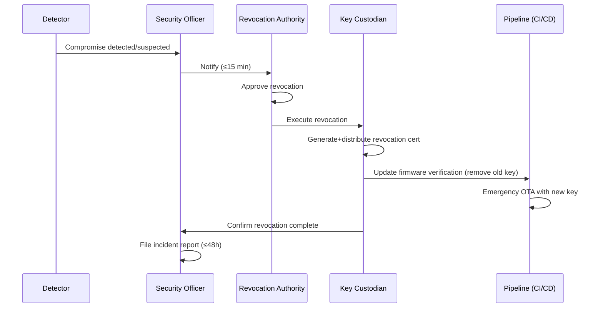

# GPG Signing-Key Rotation & Revocation Policy — MK-DDC-24

| Metadata | Value |
|----------|-------|
| **Document ID** | KX-DDC24-SEC-KEY-ROTATION-POLICY-001 |
| **Phiên bản** | 1.0 |
| **Trạng thái** | Draft — Chờ TechLead review |
| **Issue** | [IOT-5581](../../../../../../IOT/issues/IOT-5581) |
| **Parent** | [IOT-5576](../../../../../../IOT/issues/IOT-5576) |
| **Requirement trace** | SEC-010 (U-Boot GPG verify), SEC-011 (Signed `.kxpkg`), SEC-013 (HSM-protected key) |
| **Tham chiếu** | [SEC-REQ-001 §3.3](../00_management/KX-DDC24-SEC-REQ-001_VI.md) | [SEC-SUP-001 §9.4 R7](../00_management/KX-DDC24-SEC-SUP-001_VI.md) | [GPG Key Ceremony Procedure](gpg-key-ceremony.md) | [HSM Evaluation](hsm-evaluation.md) |

---

## 1. Policy Overview

### 1.1 Purpose

Chính sách này định nghĩa yêu cầu rotation và revocation cho GPG signing key dùng để ký
firmware package (`.kxpkg`) và kernel image của MK-DDC-24. Mục tiêu:

- **Giới hạn tác động của key compromise** — key bị lộ chỉ ảnh hưởng đến firmware signed
  trong một khoảng thời gian xác định
- **Đảm bảo tính liên tục** — rotation có transition period để không gián đoạn OTA updates
- **Duy trì trust chain** — public key luôn available và trusted bởi firmware verification
  pipeline
- **Tuân thủ regulatory requirements** — IEC 62443-4-1, NIST SP 800-57 Part 1 §8

### 1.2 Scope

Chính sách này áp dụng cho GPG signing key của MK-DDC-24. Các ECDSA signing key cho MCU
firmware (STM32G0B1) được quản lý riêng theo [MCU Secure Boot Design](../02_design/firmware/FW_MCU_SECURE_BOOT_MK-DDC-24_VI.md).
Các key internal (SSH, code signing certificates) nằm ngoài scope.

### 1.3 Key Personnel

| Role | Responsibility | Contact |
|------|---------------|---------|
| **Key Custodian** | Maintain custody log; track key lifecycle | QE Lead |
| **Primary Keyholder** | Sign firmware releases; execute rotation | Tech Lead |
| **Revocation Authority** | Authorize emergency revocation | CTO / CEO |
| **Security Officer** | Investigate compromise; file incident report | CTO |

---

## 2. Rotation Cadence Analysis

### 2.1 Options Considered

| Cadence | Risk Window (post-compromise) | Operational Overhead | Key Ceremony Cost (per event) | Recommendation |
|---------|:----------------------------:|:--------------------:|:-----------------------------:|:--------------:|
| **Annual** | ≤1 year signed firmware | Cao (mỗi năm) | ~$1,200 labor + 2 witness-hours | ⚠️ Fallback |
| **Bi-annual (2 years)** | ≤2 years signed firmware | Trung bình (2 năm) | ~$600 labor + 2 witness-hours | ✅ **Recommended** |
| **Event-driven only** | Unlimited (until compromise detected) | Thấp nhất | $0 (unless event) | ❌ Not recommended |

### 2.2 Rationale for Bi-Annual (2-Year) Cadence

**Risk assessment:**
- MK-DDC-24 firmware signing key là offline HSM-protected (YubiHSM 2, FIPS 140-2 Level 3)
- Key chỉ được dùng trong CI/CD release pipeline — không dùng cho interactive authentication
- Attack surface: physical access đến HSM, supply chain attack trên build server, hoặc
  cryptographic weakening của Ed25519
- Ed25519 được NIST SP 800-186 đánh giá an toàn đến 2030+ (≈128-bit security)

**Cost-benefit:**
- Mỗi lần rotation: air-gapped ceremony (2-3 giờ), 2 witnesses, ceremony log, backup cập nhật,
  CI/CD pipeline cập nhật public key
- Annual rotation tăng gấp đôi ceremony overhead mà không giảm đáng kể risk (vì key đã
  HSM-protected và offline)
- Event-driven (không định kỳ) tạo risk window vô hạn nếu compromise không bị phát hiện

**Decision:** Bi-annual (2 years) rotation định kỳ, kết hợp với event-driven rotation khi có
compromise hoặc algorithm deprecation.

**Exception:** Nếu Ed25519 bị deprecate trước 2028, lịch rotation được rút ngắn theo
deprecation schedule (xem §3.3).

### 2.3 Rotation Schedule

| Event | Baseline | Next Rotation |
|-------|----------|---------------|
| Key generation (baseline) | Q2 2026 | Q2 2028 |
| First rotation | Q2 2028 | Q2 2030 |
| Second rotation | Q2 2030 | Q2 2032 |

> **Note:** Rotation window mở trong 90 ngày trước expiration date. Nếu không rotation
> kịp, key vẫn hoạt động đến expiration nhưng firmware release phải dùng key mới.

---

## 3. Revocation Triggers

### 3.1 Trigger Classification

| ID | Trigger | Severity | Response Time | Approval |
|----|---------|:--------:|:-------------:|:--------:|
| RVK-01 | **Confirmed key compromise** (private key extracted) | CRITICAL | **≤4 hours** | CTO/CEO |
| RVK-02 | **Suspected key compromise** (unusual signing patterns, unauthorized access) | HIGH | **≤24 hours** | CTO/CEO |
| RVK-03 | **HSM physical loss/theft** | HIGH | **≤24 hours** | CTO/CEO |
| RVK-04 | **Keyholder termination** (with key access) | MEDIUM | **≤7 days** | CTO |
| RVK-05 | **Algorithm deprecation** (Ed25519 weakened or broken) | MEDIUM | Per deprecation schedule | Tech Lead + CTO |
| RVK-06 | **Key rotation (planned)** | LOW | Before new key activation | Tech Lead |
| RVK-07 | **Device EOL** (end-of-life) | LOW | At EOL announcement | Tech Lead |

### 3.2 Risk Escalation Path

```
Trigger detected
  → Security Officer notified
    → Severity assessment (CRITICAL / HIGH / MEDIUM / LOW)
      → CRITICAL/HIGH: Revocation Authority notified immediately
        → Emergency revocation per §5.2
      → MEDIUM: Planned revocation within 7 days
      → LOW: Revocation tại rotation event per §4
```

### 3.3 Algorithm Deprecation Handling

| Trigger | Action | Timeline |
|---------|--------|----------|
| NIST deprecation notice for Ed25519 | Schedule emergency rotation | Within 90 days of notice |
| Practical break of Ed25519 (e.g., quantum) | Immediate revocation + migrate to PQC | Within 24 hours |
| GPG deprecation of Ed25519 | Switch to RSA-4096 for remaining lifecycle | Per GPG EOL schedule |

Hiện tại không có dấu hiệu Ed25519 bị deprecate trong 5 năm tới. Policy này sẽ được review
nếu có thay đổi từ NIST SP 800-186 hoặc OpenPGP standard.

---

## 4. Rotation Procedure

### 4.1 Pre-Rotation (T-90 days)

1. **Notification:** Key Custodian notifies Tech Lead + CTO 90 days before expiration
2. **Schedule ceremony:** Book room, witnesses (minimum 2), air-gapped laptop
3. **Hardware check:** Verify YubiHSM 2 firmware up-to-date; order replacement if needed
4. **Pipeline review:** Confirm CI/CD pipeline supports multiple concurrent public keys
5. **Draft incident communication:** Prepare template in case of ceremony failure

### 4.2 Rotation Ceremony

Rotation ceremony follows [GPG Key Ceremony Procedure §3](gpg-key-ceremony.md#3-air-gapped-key-generation-procedure)
("Air-Gapped Key Generation Procedure") with these additions:

```bash
# Step 1: Generate new key pair (same algorithm — Ed25519)
gpg --batch --gen-key /tmp/gpg-batch-rotation.conf

# Step 2: Sign new public key with OLD key (cross-signing)
gpg --default-key <OLD-KEY-FP> \
  --armor --sign \
  --output ddc24-firmware-signing-pub-rotated.asc \
  ddc24-firmware-signing-pub-new.asc

# Step 3: Sign new public key with NEW key (self-sign)
gpg --default-key <NEW-KEY-FP> \
  --armor --sign \
  --output ddc24-firmware-signing-pub-self.asc \
  ddc24-firmware-signing-pub-new.asc

# Step 4: Verify cross-signature chain
gpg --verify ddc24-firmware-signing-pub-rotated.asc
# Must show: "Good signature from <OLD-KEY-UID>"
```

**Ceremony outputs:**
| Artifact | Description | Distribution |
|----------|-------------|--------------|
| New public key (self-signed) | `ddc24-firmware-signing-pub-self.asc` | Git repo, key server, firmware pipeline |
| Cross-signed public key | `ddc24-firmware-signing-pub-rotated.asc` | Git repo (audit trail) |
| New private key backup | Encrypted USB + tamper-evident seal | Per storage policy (§6 of ceremony doc) |
| Old private key backup (archived) | Sealed, labeled "ARCHIVED <OLD-KEY-FP>" | Offline archive |

### 4.3 Cross-Signing & Transition Period

**Transition period: 30 days** (từ khi new key activated đến khi old key removed)

| Phase | Duration | Old Key | New Key | Firmware Signed With |
|-------|:--------:|:-------:|:-------:|:--------------------:|
| Pre-transition | — | ✅ Active | ❌ Not yet | Old key |
| Transition | 30 days | ✅ Active | ✅ Active | New key (preferred) |
| Post-transition | — | ❌ Archived | ✅ Active | New key |

**During transition:**
- CI/CD pipeline signs new firmware với **new key**
- U-Boot và OTA verification pipeline chấp nhận **cả hai public keys** (old + new)
- Devices nhận OTA update với new public key embedded trong firmware manifest
- Old key được giữ trong firmware verification list để verify old firmware (rollback safety)

**After transition:**
- Old public key removed khỏi CI/CD pipeline và firmware verification list
- Old private key backup sealed + archived (không destroy — cần cho forensic audit)
- All references (docs, CI configs, key servers) updated

### 4.4 Post-Rotation Checklist

- [ ] New public key committed to `docs/security/ddc24-firmware-signing-pub.asc`
- [ ] New public key uploaded to key server (`keyserver.ubuntu.com`)
- [ ] CI/CD pipeline updated with new key
- [ ] U-Boot source updated (if public key hard-coded)
- [ ] OTA verification pipeline updated
- [ ] Old public key added to `docs/security/archived-keys/` directory
- [ ] Ceremony log signed by witnesses + archived
- [ ] Backup media created + sealed + stored
- [ ] Custody log updated
- [ ] Stakeholders notified (Tech Lead, CTO, QA, DevOps)
- [ ] Old key flagged as "archived" in ceremony log

---

## 5. Revocation Procedure

### 5.1 Revocation Certificate

Revocation certificate MUST be generated at key creation time và stored với backup key:

```bash
# During initial key ceremony (required step)
gpg --output ddc24-revocation.asc \
  --gen-revoke <KEY-FP>
```

**Revocation certificate storage:**
| Copy | Location | Format |
|------|----------|--------|
| Primary | With backup key (encrypted USB) | `.asc` file |
| Secondary | Offsite (bank safe deposit) | `.asc` file in tamper-evident envelope |

### 5.2 Emergency Revocation (RVK-01, RVK-02, RVK-03)



**Step-by-step:**

1. **Detection & Notification (≤15 min)**
   - Security Officer notified via phone/Signal — not email (phishing risk)
   - Initial assessment: confirm vs. false positive
   - If CONFIRMED → proceed; if SUSPECTED → escalate to CTO for judgment

2. **Authorization (≤30 min)**
   - Revocation Authority (CTO/CEO) gives written approval (PGP-signed email or in-person)
   - At least 2 witnesses required if accessing backup media
   - Incident report opened (SEC-INCIDENT-{NNN})

3. **Execute Revocation (≤4 hours)**
   ```bash
   # Step 1: Retrieve revocation certificate from backup
   # If backup inaccessible, generate new revocation cert from key backup
   gpg --import ddc24-revocation.asc
   gpg --keyserver keyserver.ubuntu.com --send-keys <COMPROMISED-KEY-FP>
   
   # Step 2: Publish CRL entry (Git repository)
   #   Commit to: docs/security/crl/revoked-keys.asc
   echo "2026-06-02T10:00:00Z REVOKED <KEY-FP> <REASON> RVK-01" >> crl.asc
   
   # Step 3: Remove compromised public key from firmware verification pipeline
   #   - Remove from U-Boot source
   #   - Remove from OTA verification list
   #   - Remove from CI/CD trust store
   
   # Step 4: Sign revocation notification (non-repudiation)
   gpg --clearsign --default-key <ADMIN-KEY> \
     --output firmware-key-revocation-20260602.asc \
     <<< "REVOCATION NOTICE: Key <COMPROMISED-FP> revoked at <TIMESTAMP>. Reason: <REASON>"
   
   # Step 5: Deploy emergency firmware update (if needed)
   #   - New key must be distributed via already-signed OTA (possible if key not yet removed)
   #   - OR manual update via physical access for devices in field
   ```

4. **Post-Revocation (≤48 hours)**
   - File incident report with root cause analysis
   - Generate new key pair per key ceremony (§3 of ceremony doc)
   - Push emergency OTA with new public key (if not done in step 3)
   - Update all downstream consumers (QA, field support, customer documentation)
   - Conduct post-incident review within 5 business days

### 5.3 Planned Revocation (RVK-04, RVK-05, RVK-06, RVK-07)

**Steps:**

1. Notify all stakeholders at least 14 days before planned revocation
2. Generate new key pair per §4.2 (rotation ceremony)
3. Distribute revocation certificate (same procedure as §5.2 but non-emergency)
4. Archive old backup with label "REVOKED <KEY-FP> <DATE>"
5. Update ceremony log

---

## 6. Certificate Revocation List (CRL)

### 6.1 CRL Format

CRL được maintain trong Git repository tại `docs/security/crl/revoked-keys.asc`.

```asc
-----BEGIN PGP SIGNED MESSAGE-----
Hash: SHA256

MK-DDC-24 Firmware Signing Key — Revocation List
Maintained by: Key Custodian
Last updated: 2026-06-02T00:00:00Z

REVOCATION LIST:
2026-06-02T00:00:00Z KEY: <KEY-FP> REASON: Revoked-Algorithm-Deprecation

-----BEGIN PGP SIGNATURE-----
<admin-signature>
-----END PGP SIGNATURE-----
```

**CRL entry format:**
```
<TIMESTAMP> KEY: <FINGERPRINT> REASON: <REASON>
```

**Revocation reasons** (per RFC 4880):
| Code | Reason | Usage |
|:----:|--------|-------|
| 0 | No reason specified | Fallback |
| 1 | Key compromised | RVK-01, RVK-02, RVK-03 |
| 2 | Key superseded | RVK-06 (rotation) |
| 3 | Key retired | RVK-07 (EOL) |
| 32 | Algorithm deprecation | RVK-05 |

### 6.2 CRL Distribution

| Channel | Format | Update | Consumers |
|---------|--------|--------|-----------|
| Git repository (`docs/security/crl/`) | PGP-signed text | Real-time | Internal team, CI/CD |
| Keyserver (keyserver.ubuntu.com) | GPG revocation cert | At revocation event | External verifiers |
| OTA manifest (firmware update payload) | Embedded CRL hash | Per-release | Field devices |

### 6.3 CRL Verification

All signing operations in CI/CD pipeline SHALL check CRL before signing:
```bash
# CI/CD step: verify key not revoked
gpg --with-fingerprint --list-keys <SIGNING-KEY> | grep -q '<KEY-FP>' || exit 1
# Manual check: verify CRL signature
gpg --verify docs/security/crl/revoked-keys.asc
```

---

## 7. Audit Trail Requirements

### 7.1 Audit Events

| Event ID | Event | Trigger | Log Required? | Retention |
|----------|-------|---------|:-------------:|:---------:|
| AUD-01 | Key generation | Ceremony | ✅ Mandatory | Lifetime + 5 years |
| AUD-02 | Key rotation | Ceremony | ✅ Mandatory | Lifetime + 5 years |
| AUD-03 | Key revocation | Revocation | ✅ Mandatory | Lifetime + 5 years |
| AUD-04 | Key backup created | Backup ceremony | ✅ Mandatory | Lifetime + 5 years |
| AUD-05 | Key backup accessed | Recovery | ✅ Mandatory | Lifetime + 5 years |
| AUD-06 | Signing operation | CI/CD release | ✅ Mandatory | 3 years |
| AUD-07 | Custody transfer | Keyholder change | ✅ Mandatory | Lifetime + 5 years |
| AUD-08 | CRL update | Revocation/rotation | ✅ Mandatory | Lifetime + 5 years |
| AUD-09 | Key verification test | Periodic check | ✅ Recommended | 3 years |
| AUD-10 | Policy review | Annual review | ✅ Mandatory | 3 years |

### 7.2 Audit Log Format

**Ceremony events (AUD-01 through AUD-05):**
```
Event:          [Key Generation / Rotation / Revocation / Backup / Recovery]
Date:           YYYY-MM-DDTHH:MM:SSZ
Ceremony ID:    KX-CER-YYYY-NNN
Key Fingerprint: <40-char hex>
Participants:   <Name> (Lead), <Name> (Witness 1), <Name> (Witness 2)
Ceremony Log:   docs/security/ceremony-logs/KX-CER-YYYY-NNN.md
Status:         [Completed / Aborted / Failed]
```

**Signing events (AUD-06):**
```
Event:          Signing operation
Date:           YYYY-MM-DDTHH:MM:SSZ
Artifact:       <firmware-version>.kxpkg
Signing Key FP: <40-char hex>
CI Job ID:      <github-actions-run-id>
Verified By:    [CI/CD / Manual]
```

### 7.3 Log Storage

| Event Type | Storage Location | Format | Access Control |
|------------|-----------------|--------|----------------|
| Ceremony logs | `docs/security/ceremony-logs/` | Markdown + PGP-signed | Tech Lead + CTO |
| CRL | `docs/security/crl/` | PGP-signed text | Public (read) |
| CI/CD signing logs | GitHub Actions artifacts | JSON | Tech Lead + DevOps |
| Custody log | `docs/security/custody-log.csv` | CSV (PGP-signed) | Tech Lead + CTO |
| Incident reports | `docs/security/incidents/` | Markdown | CTO + Security Officer |

### 7.4 Audit Review

- **Quarterly:** Key Custodian reviews ceremony log completeness, CRL accuracy
- **Annual:** Security Officer reviews full audit trail, tests recovery procedure
- **Post-incident:** Full audit of all events related to incident timeline

---

## 8. Key Compromise Response Procedure

### 8.1 Compromise Detection

| Detection Method | Description | Response |
|-----------------|-------------|----------|
| Physical inspection | Tamper-evident seal broken on HSM or backup | Assume compromise → RVK-03 |
| CI/CD anomaly | Unsigned signing job, unknown CI runner | Assume compromise → RVK-02 |
| Key server monitoring | Unknown key upload, suspicious certify | Investigate → RVK-01/02 |
| Vendor advisory | Yubico HSM firmware CVE | Assess impact → RVK-01/05 |
| Employee report | Keyholder reports lost HSM or USB | Assume compromise → RVK-03 |

### 8.2 Compromise Response Playbook

| Phase | Action | Owner | Timeline |
|-------|--------|-------|:--------:|
| **Triage** | 1. Acknowledge incident | Security Officer | ≤15 min |
| | 2. Initial severity assessment | Security Officer | ≤30 min |
| | 3. Notify Revocation Authority | Security Officer | ≤15 min |
| **Containment** | 4. Revoke compromised key (§5.2) | Revocation Authority | ≤4 hours |
| | 5. Generate new key pair | Key Custodian + Tech Lead | ≤24 hours |
| | 6. Push emergency firmware OTA (new key) | Developer Team | ≤48 hours |
| | 7. Revoke all firmware signed with compromised key | Developer Team | ≤72 hours |
| **Investigation** | 8. Root cause analysis | Security Officer | ≤7 days |
| | 9. Scope assessment (which devices affected) | Security Officer | ≤7 days |
| | 10. Forensic analysis of compromised key usage | Security Officer | ≤14 days |
| **Recovery** | 11. Deploy new key to all devices | Developer Team | ≤14 days |
| | 12. Update CRL and notify stakeholders | Key Custodian | ≤48 hours |
| | 13. Conduct post-incident review | Security Officer | ≤5 business days |
| **Post-mortem** | 14. File incident report (SEC-INCIDENT-NNN) | Security Officer | ≤48 hours |
| | 15. Update policy/procedure based on lessons | Tech Lead | ≤30 days |
| | 16. Implement corrective actions | Developer Team | ≤30 days |

### 8.3 Communication Templates

**Internal notification (immediate):**
```
SECURITY INCIDENT: GPG Signing Key [COMPROMISED/SUSPECTED]
Incident ID: SEC-INCIDENT-{NNN}
Key Fingerprint: <40-char hex>
Detected at: YYYY-MM-DDTHH:MM:SSZ
Severity: CRITICAL
Action: Key revocation in progress. Do not sign firmware until further notice.
Contact: Security Officer (<name>, <phone>)
```

**Customer notification (after containment):**
```
SECURITY ADVISORY: MK-DDC-24 Firmware Signing Key Rotation
Advisory ID: SEC-ADV-{YYYY}-{NNN}
Date: YYYY-MM-DD
Impact: Firmware signing key rotated. All devices must receive OTA update
  with new public key by <deadline>.
Action required: Ensure device is connected to internet to receive OTA.
  No physical intervention required.
Contact: Support (<email>, <phone>)
```

**Post-incident summary (within 48 hours):**
```
INCIDENT SUMMARY: SEC-INCIDENT-{NNN}
Date: YYYY-MM-DD
Key: <40-char hex> (REVOKED)
Root cause: <summary>
Impact: <number of firmware versions signed with compromised key>
Containment: <timestamp> — key revoked
Recovery: <timestamp> — new key deployed
Corrective actions: <list>

Report filed at: docs/security/incidents/SEC-INCIDENT-{NNN}.md
```

---

## 9. Compliance Mapping

### 9.1 Requirement Traceability

| Requirement | This Policy | Key Ceremony Doc | HSM Eval Doc |
|------------|-------------|-----------------|--------------|
| SEC-010 (U-Boot GPG verify) | §4.3 Transition — both keys active | §10 Rotation | — |
| SEC-011 (Signed .kxpkg) | §2 Rotation cadence ensures continuity | §10 Rotation | §8.2 Rotation |
| SEC-013 (HSM-protected key) | §8.2 Containment — generate new key on HSM | §3.4 HSM integration | §4 Recommendation |
| SEC-SUP-001 R7 (Risk mitigation) | §3.1 Revocation triggers | §9 Revocation | §8.2 Rotation |
| IEC 62443-4-1 (Secure development) | §7 Audit trail, §8 Incident response | §4 Witness, §6 Custody | — |
| NIST SP 800-57 Part 1 §8 | §2 Rotation cadence rationale, §5.3 Key states | — | — |

### 9.2 Key Lifecycle States (per NIST SP 800-57)

```
Pre-activation → Active → Suspended/Compromised → Deactivated → Destroyed/Archived
                    ↓
              (rotation) → Active (new key) → ... → Deactivated
```

| State | Definition | Duration | Actions |
|-------|------------|:--------:|---------|
| **Pre-activation** | Key generated, not yet used | ≤30 days | Backup, cross-sign, test |
| **Active** | Key used for signing | 2 years (baseline) | Normal signing operations |
| **Suspended** | Temporary halt (suspected compromise) | ≤24 hours | Investigation, no signing |
| **Compromised** | Key known to be compromised | — | Revoke per §5.2 |
| **Deactivated** | Key no longer used for signing | After transition | Archived, removed from pipeline |
| **Destroyed** | Key material destroyed | After retention | Only after lifecycle complete |

---

## 10. Policy Review & Maintenance

- **Annual review:** Policy được review tối thiểu mỗi năm một lần bởi Tech Lead + CTO
- **Triggered review:** Khi có thay đổi về thuật toán, regulatory requirement, hoặc
  architecture change (ví dụ: chuyển sang post-quantum signing)
- **Version history:** Maintained trong revision history của document này
- **Deviation handling:** Bất kỳ deviation từ policy này phải được Tech Lead và CTO phê duyệt
  bằng văn bản và ghi nhận trong audit log

---

## 11. Revision History

| Version | Ngày | Người | Thay đổi |
|---------|------|-------|----------|
| 1.0 | 2026-06-02 | DeveloperTeam | Baseline — rotation & revocation policy cho IOT-5581. Chờ TechLead review. |

---

## References

| Document | Link |
|----------|------|
| GPG Key Ceremony Procedure | [gpg-key-ceremony.md](gpg-key-ceremony.md) |
| HSM Evaluation | [hsm-evaluation.md](hsm-evaluation.md) |
| SEC-REQ-001 | [KX-DDC24-SEC-REQ-001_VI.md](../00_management/KX-DDC24-SEC-REQ-001_VI.md) |
| SEC-SUP-001 | [KX-DDC24-SEC-SUP-001_VI.md](../00_management/KX-DDC24-SEC-SUP-001_VI.md) |
| NIST SP 800-57 Part 1 | Key Management Recommendation (Rev. 5) |
| NIST SP 800-186 | Recommendations for Discrete Logarithm-based Cryptography |
| RFC 4880 | OpenPGP Message Format |
| IEC 62443-4-1 | Secure Product Development Lifecycle |
| Parent Issue | [IOT-5576](../../../../../../IOT/issues/IOT-5576) |
